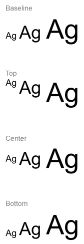
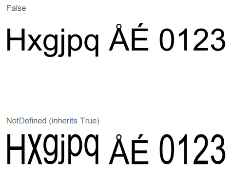

## **نظرة عامة**

هذه المقالة توضح كيفية تنسيق النص في عروض PowerPoint وOpenDocument باستخدام Aspose.Slides for Java. تغطي ألوان الخلفية، الشفافية، تباعد الأحرف، خصائص الخط، التدوير، تباعد الفقرات، سلوك الملاءمة التلقائية، تثبيت النص، نقاط التبويب، وإعدادات اللغة.

ما لم يُذكر خلاف ذلك، تستخدم الأمثلة الملف [sample.pptx](sample.pptx). الشكل الأول في الشريحة الأولى هو مربع نص، والفقرة الأولى تحتوي على النص المعروض أدناه. كلاً من فهارس الشرائح والأشكال تبدأ من الصفر. الأمثلة التي تحدد أجزاء غامقة تستخدم تنسيقًا فعالًا، بما في ذلك تنسيق الغامق الموروث:


للعثور على النص الحرفي أو مطابقة التعبيرات النمطية وتظليلها، راجع [بحث واستبدال النص](/slides/ar/java/search-and-replace-text/).

## **تعيين لون خلفية النص**

استخدم [IParagraphFormat.getDefaultPortionFormat](https://reference.aspose.com/slides/java/com.aspose.slides/iparagraphformat/#getDefaultPortionFormat--) لتعيين لون التظليل الافتراضي للفقرة، أو استخدم [IBasePortionFormat.getHighlightColor](https://reference.aspose.com/slides/java/com.aspose.slides/ibaseportionformat/#getHighlightColor--) لأجزاء النص الفردية.

تُعيد المثال التالي تعيين تظليل رمادي فاتح كافتراضي للفقرة الأولى. ألوان التظليل الصريحة على الأجزاء الفردية لها أولوية على هذا الافتراضي:

```java
import com.aspose.slides.*;
import java.awt.Color;

Presentation presentation = new Presentation("sample.pptx");
try {
    ISlide slide = presentation.getSlides().get_Item(0);

    IAutoShape autoShape = (IAutoShape)slide.getShapes().get_Item(0);
    IParagraph paragraph = autoShape.getTextFrame().getParagraphs().get_Item(0);

    // تعيين لون التظليل للفقرة بأكملها.
    paragraph.getParagraphFormat().getDefaultPortionFormat().getHighlightColor().setColor(Color.LIGHT_GRAY);

    presentation.save("gray_paragraph.pptx", SaveFormat.Pptx);
} finally {
    presentation.dispose();
}
```

النتيجة:


يوضح مثال الشيفرة أدناه كيفية تعيين لون الخلفية **لأجزاء النص ذات الخط العريض**:

```java
import com.aspose.slides.*;
import java.awt.Color;

Presentation presentation = new Presentation("sample.pptx");
try {
    ISlide slide = presentation.getSlides().get_Item(0);

    IAutoShape autoShape = (IAutoShape)slide.getShapes().get_Item(0);
    IParagraph paragraph = autoShape.getTextFrame().getParagraphs().get_Item(0);

    for (IPortion portion : paragraph.getPortions()) {
        if (portion.getPortionFormat().getEffective().getFontBold()) {
            // تعيين لون التظليل لجزء النص.
            portion.getPortionFormat().getHighlightColor().setColor(Color.LIGHT_GRAY);
        }
    }

    presentation.save("gray_text_portions.pptx", SaveFormat.Pptx);
} finally {
    presentation.dispose();
}
```

النتيجة:


## **محاذاة فقرات النص**

استخدم [IParagraphFormat.setAlignment](https://reference.aspose.com/slides/java/com.aspose.slides/iparagraphformat/#setAlignment-int-) لتعيين محاذاة الفقرة داخل إطار النص. يمكن أن تكون القيمة مركزة، محاذاة إلى اليسار، محاذاة إلى اليمين، مبررة، وما إلى ذلك.

يظهر المثال التالي كيفية محاذاة الفقرة إلى **الوسط**:

```java
import com.aspose.slides.*;

Presentation presentation = new Presentation("sample.pptx");
try {
    ISlide slide = presentation.getSlides().get_Item(0);

    IAutoShape autoShape = (IAutoShape)slide.getShapes().get_Item(0);
    IParagraph paragraph = autoShape.getTextFrame().getParagraphs().get_Item(0);

    // تعيين محاذاة الفقرة إلى المركز.
    paragraph.getParagraphFormat().setAlignment(TextAlignment.Center);

    presentation.save("aligned_paragraph.pptx", SaveFormat.Pptx);
} finally {
    presentation.dispose();
}
```

النتيجة:


## **محاذاة الخطوط داخل السطر**

استخدم [IParagraphFormat.setFontAlignment](https://reference.aspose.com/slides/java/com.aspose.slides/iparagraphformat/#setFontAlignment-int-) لمحاذاة أفقية للنص داخل سطر. هذا الإعداد يطبق على الفقرة بأكملها ويتحكم في المحاذاة داخل كل سطر من سطراتها.

ينشئ المثال التالي أربعة مربعات نص معنونة في شريحة واحدة. كل فقرة تحتوي على نفس النص بحجم 18، 36، و54 نقطة، مع محاذاة خط مختلفة. يستخدم Arial، ويعطل الملاءمة التلقائية واللف، ويحافظ على إطارات النص كبيرة بما يكفي لسطر واحد.

```java
import com.aspose.slides.*;
import java.awt.Color;

Presentation presentation = new Presentation();
try {
    ISlide slide = presentation.getSlides().get_Item(0);

    int[] alignments = { FontAlignment.Baseline, FontAlignment.Top, FontAlignment.Center, FontAlignment.Bottom };
    String[] alignmentNames = { "Baseline", "Top", "Center", "Bottom" };
    float[] fontSizes = { 18f, 36f, 54f };

    for (int i = 0; i < alignments.length; i++) {
        IAutoShape shape = slide.getShapes().addAutoShape(ShapeType.Rectangle, 30, 20 + i * 130, 660, 120);
        shape.getFillFormat().setFillType(FillType.NoFill);
        shape.getLineFormat().getFillFormat().setFillType(FillType.NoFill);

        ITextFrame textFrame = shape.getTextFrame();
        textFrame.getTextFrameFormat().setAnchoringType(TextAnchorType.Top);
        textFrame.getTextFrameFormat().setAutofitType(TextAutofitType.None);
        textFrame.getTextFrameFormat().setWrapText(NullableBool.False);

        IParagraph label = textFrame.getParagraphs().get_Item(0);
        label.setText(alignmentNames[i]);
        label.getParagraphFormat().setAlignment(TextAlignment.Left);
        label.getParagraphFormat().getDefaultPortionFormat().setFontHeight(14);
        label.getParagraphFormat().getDefaultPortionFormat().setLatinFont(new FontData("Arial"));
        label.getParagraphFormat().getDefaultPortionFormat().getFillFormat().setFillType(FillType.Solid);
        label.getParagraphFormat().getDefaultPortionFormat().getFillFormat().getSolidFillColor().setColor(Color.GRAY);

        Paragraph paragraph = new Paragraph();
        paragraph.getParagraphFormat().setFontAlignment(alignments[i]);
        paragraph.getParagraphFormat().setAlignment(TextAlignment.Left);
        paragraph.getParagraphFormat().getDefaultPortionFormat().setLatinFont(new FontData("Arial"));
        paragraph.getParagraphFormat().getDefaultPortionFormat().getFillFormat().setFillType(FillType.Solid);
        paragraph.getParagraphFormat().getDefaultPortionFormat().getFillFormat().getSolidFillColor().setColor(Color.BLACK);

        for (float fontSize : fontSizes) {
            Portion portion = new Portion("Ag ");
            portion.getPortionFormat().setFontHeight(fontSize);
            paragraph.getPortions().add(portion);
        }

        textFrame.getParagraphs().add(paragraph);
    }

    presentation.save("font_alignment.pptx", SaveFormat.Pptx);
} finally {
    presentation.dispose();
}
```

النتيجة:



تستخدم محاذاة الخط مقاييس الخط، لذا قد لا تتطابق حواف الأحرف الفردية تمامًا. يتضمن المثال حرفًا كبيرًا ومقاطع منخفضة لتوضيح الفرق بين المحاذاة القاعدية والسفلى. تتأثر النتيجة بتوفر الخطوط والاستبدال، الأحرف المستخدمة، واختلاف أحجام الخطوط. كما تؤثر أبعاد الإطار والهامش وتباعد السطور واللف والملاءمة التلقائية على التخطيط؛ استخدم نفس الخطوط وإعدادات التخطيط عند مقارنة الأنماط.

يختلف هذا الإعداد عن [IParagraphFormat.setAlignment](https://reference.aspose.com/slides/java/com.aspose.slides/iparagraphformat/#setAlignment-int-)، الذي يتحكم في محاذاة الفقرة أفقياً، وعن [ITextFrameFormat.setAnchoringType](https://reference.aspose.com/slides/java/com.aspose.slides/itextframeformat/#setAnchoringType-byte-)، الذي يحدد موضع كتلة النص عمودياً داخل الشكل. تنسيق السوبسكريبت والسوبسسكريبت عبر [IBasePortionFormat.setEscapement](https://reference.aspose.com/slides/java/com.aspose.slides/ibaseportionformat/#setEscapement-float-) ينقل الأجزاء الفردية بالنسبة إلى القاعدة بدلاً من ضبط محاذاة الخط لسطر الفقرة.

## **تعيين الشفافية للنص**

تُتحكم شفافية النص من خلال مكون الألفا للون المعين إلى [IBasePortionFormat.getFillFormat](https://reference.aspose.com/slides/java/com.aspose.slides/ibaseportionformat/#getFillFormat--). في الأمثلة أدناه، `alpha = 50` هو قيمة قناة ألفا ARGB على مقياس 0–255، وليس نسبة شفافية.

يظهر مثال الشيفرة أدناه كيفية تطبيق الشفافية على **الفقرة بأكملها**:

```java
import com.aspose.slides.*;
import java.awt.Color;

int alpha = 50;

Presentation presentation = new Presentation("sample.pptx");
try {
    ISlide slide = presentation.getSlides().get_Item(0);

    IAutoShape autoShape = (IAutoShape)slide.getShapes().get_Item(0);
    IParagraph paragraph = autoShape.getTextFrame().getParagraphs().get_Item(0);

    // تعيين لون تعبئة النص إلى لون شفاف.
    paragraph.getParagraphFormat().getDefaultPortionFormat().getFillFormat().setFillType(FillType.Solid);
    paragraph.getParagraphFormat().getDefaultPortionFormat().getFillFormat().getSolidFillColor().setColor(new Color(0, 0, 0, alpha));

    presentation.save("transparent_paragraph.pptx", SaveFormat.Pptx);
} finally {
    presentation.dispose();
}
```

النتيجة:


يُظهر المثال التالي كيفية تطبيق الشفافية على **أجزاء النص ذات الخط العريض**:

```java
import com.aspose.slides.*;
import java.awt.Color;

int alpha = 50;

Presentation presentation = new Presentation("sample.pptx");
try {
    ISlide slide = presentation.getSlides().get_Item(0);

    IAutoShape autoShape = (IAutoShape)slide.getShapes().get_Item(0);
    IParagraph paragraph = autoShape.getTextFrame().getParagraphs().get_Item(0);

    for (IPortion portion : paragraph.getPortions()) {
        if (portion.getPortionFormat().getEffective().getFontBold()) {
            // تعيين شفافية جزء النص.
            portion.getPortionFormat().getFillFormat().setFillType(FillType.Solid);
            portion.getPortionFormat().getFillFormat().getSolidFillColor().setColor(new Color(0, 0, 0, alpha));
        }
    }

    presentation.save("transparent_text_portions.pptx", SaveFormat.Pptx);
} finally {
    presentation.dispose();
}
```

النتيجة:


## **تعيين تباعد الأحرف للنص**

استخدم [IBasePortionFormat.setSpacing](https://reference.aspose.com/slides/java/com.aspose.slides/ibaseportionformat/#setSpacing-float-) لتوسيع أو تقليص التباعد بين الأحرف في مربع نص. تضيف الأمثلة 3 نقاط من التباعد؛ القيم السالبة تقرب النص.

يعرض الشيفرة التالية كيفية توسيع تباعد الأحرف في **الفقرة بأكملها**:

```java
import com.aspose.slides.*;

Presentation presentation = new Presentation("sample.pptx");
try {
    ISlide slide = presentation.getSlides().get_Item(0);

    IAutoShape autoShape = (IAutoShape)slide.getShapes().get_Item(0);
    IParagraph paragraph = autoShape.getTextFrame().getParagraphs().get_Item(0);

    // ملاحظة: استخدم القيم السالبة لضغط تباعد الأحرف.
    paragraph.getParagraphFormat().getDefaultPortionFormat().setSpacing(3); // توسيع تباعد الأحرف.

    presentation.save("character_spacing_in_paragraph.pptx", SaveFormat.Pptx);
} finally {
    presentation.dispose();
}
```

النتيجة:


يُظهر مثال الشيفرة أدناه كيفية توسيع تباعد الأحرف في **أجزاء النص ذات الخط العريض**:

```java
import com.aspose.slides.*;

Presentation presentation = new Presentation("sample.pptx");
try {
    ISlide slide = presentation.getSlides().get_Item(0);

    IAutoShape autoShape = (IAutoShape)slide.getShapes().get_Item(0);
    IParagraph paragraph = autoShape.getTextFrame().getParagraphs().get_Item(0);

    for (IPortion portion : paragraph.getPortions()) {
        if (portion.getPortionFormat().getEffective().getFontBold()) {
            // ملاحظة: استخدم القيم السالبة لضغط تباعد الأحرف.
            portion.getPortionFormat().setSpacing(3); // توسيع تباعد الأحرف.
        }
    }

    presentation.save("character_spacing_in_text_portions.pptx", SaveFormat.Pptx);
} finally {
    presentation.dispose();
}
```

النتيجة:


### **تعطيل التباعد بين الحروف (Kerning) لخطوط محددة**

في بعض الحالات، قد يبدو النص المرسوم بواسطة Aspose.Slides أكثر إحكامًا قليلاً من النص نفسه المعروض في PowerPoint. يمكن أن يحدث ذلك لأن PowerPoint قد يتجاهل بيانات Kerning لبعض الخطوط، حتى عندما يحتوي الخط على معلومات Kerning صحيحة ويكون Kerning مفعلاً في إعدادات PowerPoint.

لجعل المخرجات المرسومة أقرب إلى PowerPoint في مثل هذه الحالات، يمكنك تعطيل Kerning لأجزاء النص التي تستخدم الخط المتأثر. عيّن [IBasePortionFormat.setKerningMinimalSize](https://reference.aspose.com/slides/java/com.aspose.slides/ibaseportionformat/#setKerningMinimalSize-float-) إلى قيمة أكبر من حجم الخط الفعلي. يتطلب هذا المثال ملف "presentation.pptx" يحتوي على مربع نص كأول شكل في الشريحة الأولى. يتحقق من أسماء الخطوط الفعالة، بما في ذلك الخطوط الموروثة، ويحدد عتبة 100 نقطة للأجزاء التي تستخدم Roboto. هذا يعطل Kerning للأجزاء المطابقة التي يكون حجم الخط أقل من 100 نقطة:

```java
import com.aspose.slides.*;

Presentation presentation = new Presentation("presentation.pptx");
try {
    ISlide slide = presentation.getSlides().get_Item(0);

    IAutoShape autoShape = (IAutoShape)slide.getShapes().get_Item(0);
    String targetFont = "Roboto";

    for (IParagraph paragraph : autoShape.getTextFrame().getParagraphs()) {
        for (IPortion portion : paragraph.getPortions()) {
            IPortionFormatEffectiveData portionFormat = portion.getPortionFormat().getEffective();

            if ((portionFormat.getLatinFont() != null &&
                 portionFormat.getLatinFont().getFontName().equals(targetFont)) ||
                (portionFormat.getEastAsianFont() != null &&
                 portionFormat.getEastAsianFont().getFontName().equals(targetFont)) ||
                (portionFormat.getComplexScriptFont() != null &&
                 portionFormat.getComplexScriptFont().getFontName().equals(targetFont))) {
                portion.getPortionFormat().setKerningMinimalSize(100);
            }
        }
    }

    presentation.save("output.pptx", SaveFormat.Pptx);
} finally {
    presentation.dispose();
}
```

بالنسبة للنص المتطابق تحت العتبة، يمنع هذا الإعداد Kerning ويمكن أن يساعد في محاكاة مخرجات Aspose.Slides لتكون أقرب إلى ما يعرضه PowerPoint للخطوط المتأثرة بهذا السلوك الخاص بـ PowerPoint.

## **إدارة خصائص خط النص**

يمكن ضبط خصائص الخط على مستوى الفقرة عبر [IParagraphFormat.getDefaultPortionFormat](https://reference.aspose.com/slides/java/com.aspose.slides/iparagraphformat/#getDefaultPortionFormat--) أو على الأجزاء الفردية عبر [IPortionFormat](https://reference.aspose.com/slides/java/com.aspose.slides/iportionformat/).

يُعين المثال التالي الخط الافتراضي للفقرة الأولى إلى Times New Roman بحجم 12 نقطة مع غامق، مائل، وتسطير منقط. يَأخذ التنسيق الصريح على الأجزاء الفردية أولوية على هذه القيم الافتراضية:

```java
import com.aspose.slides.*;

Presentation presentation = new Presentation("sample.pptx");
try {
    ISlide slide = presentation.getSlides().get_Item(0);

    IAutoShape autoShape = (IAutoShape)slide.getShapes().get_Item(0);
    IParagraph paragraph = autoShape.getTextFrame().getParagraphs().get_Item(0);

    // تعيين خصائص الخط للفقرة.
    paragraph.getParagraphFormat().getDefaultPortionFormat().setFontHeight(12);
    paragraph.getParagraphFormat().getDefaultPortionFormat().setFontBold(NullableBool.True);
    paragraph.getParagraphFormat().getDefaultPortionFormat().setFontItalic(NullableBool.True);
    paragraph.getParagraphFormat().getDefaultPortionFormat().setFontUnderline(TextUnderlineType.Dotted);
    paragraph.getParagraphFormat().getDefaultPortionFormat().setLatinFont(new FontData("Times New Roman"));

    presentation.save("font_properties_for_paragraph.pptx", SaveFormat.Pptx);
} finally {
    presentation.dispose();
}
```

النتيجة:


يطبّق المثال التالي حجم 13 نقطة من Times New Roman، وتنسيق مائل، وتسطير منقط على الأجزاء التي يكون تنسيقها الفعّال غامقًا:

```java
import com.aspose.slides.*;

Presentation presentation = new Presentation("sample.pptx");
try {
    ISlide slide = presentation.getSlides().get_Item(0);

    IAutoShape autoShape = (IAutoShape)slide.getShapes().get_Item(0);
    IParagraph paragraph = autoShape.getTextFrame().getParagraphs().get_Item(0);

    for (IPortion portion : paragraph.getPortions()) {
        if (portion.getPortionFormat().getEffective().getFontBold()) {
            // تعيين خصائص الخط لجزء النص.
            portion.getPortionFormat().setFontHeight(13);
            portion.getPortionFormat().setFontItalic(NullableBool.True);
            portion.getPortionFormat().setFontUnderline(TextUnderlineType.Dotted);
            portion.getPortionFormat().setLatinFont(new FontData("Times New Roman"));
        }
    }

    presentation.save("font_properties_for_text_portions.pptx", SaveFormat.Pptx);
} finally {
    presentation.dispose();
}
```

النتيجة:


## **التحكم في تطبيع ارتفاع النص**

استخدم [IBasePortionFormat.setNormaliseHeight](https://reference.aspose.com/slides/java/com.aspose.slides/ibaseportionformat/#setNormaliseHeight-byte-) عند إعادة إنتاج طباعة القالب أو دراسة الفروق في ارتفاع الأحرف. في PowerPoint، يمدّ تمكين التطبيع أو يضغط الأحرف الفردية عموديًا لجعلها ذات ارتفاع مرئي موحد داخل جزء النص. لا يضمن ذلك تساوي ارتفاع النص بين الخطوط المختلفة.

اضبط الخاصية إلى [NullableBool.True أو False](https://reference.aspose.com/slides/java/com.aspose.slides/nullablebool/) لتمكين أو تعطيل التطبيع صراحة. يترك `NullableBool.NotDefined` الإعداد المحلي غير مُحدد بحيث يرث الجزء قيمته، على سبيل المثال من [getDefaultPortionFormat](https://reference.aspose.com/slides/java/com.aspose.slides/iparagraphformat/#getDefaultPortionFormat--) الخاص بالفقرة. لا يعني ذلك `False`. استخدم [IPortionFormat.getEffective](https://reference.aspose.com/slides/java/com.aspose.slides/iportionformat/#getEffective--) وقراءة [IBasePortionFormatEffectiveData.getNormaliseHeight](https://reference.aspose.com/slides/java/com.aspose.slides/ibaseportionformateffectivedata/#getNormaliseHeight--) للحصول على القيمة المنطقية المحلولة.

يتطلب المثال التالي **Arial** مثبتًا. ينشئ كتلتين نصيتين تحتويان على نفس الحروف الكبيرة، الصغيرة، الأحرف السفلية، والحروف المُعَلمة بحجم 54 نقطة. تمكّن الفقرتان التطبيع افتراضيًا. الجزء العلوي يعطل التطبيع صراحةً؛ الجزء السفلي يرثه. أبعاد الإطارات، الهوامش، وتباعد الفقرات متطابقة، مع تعطيل اللف والملاءمة التلقائية للحفاظ على المقارنة ثابتة. يطبع المثال `False: false` و`NotDefined: true`، ثم يحفظ "text_height_normalization.pptx".

```java
import com.aspose.slides.*;
import java.awt.Color;

Presentation presentation = new Presentation();
try {
    ISlide slide = presentation.getSlides().get_Item(0);

    byte[] settings = { NullableBool.False, NullableBool.NotDefined };
    String[] settingNames = { "False", "NotDefined" };

    for (int i = 0; i < settings.length; i++) {
        IAutoShape shape = slide.getShapes().addAutoShape(ShapeType.Rectangle, 30, 60 + i * 200, 660, 150);
        shape.getFillFormat().setFillType(FillType.NoFill);
        shape.getLineFormat().getFillFormat().setFillType(FillType.NoFill);

        ITextFrame textFrame = shape.getTextFrame();
        textFrame.setText("Hxgjpq ÅÉ 0123");
        textFrame.getTextFrameFormat().setAutofitType(TextAutofitType.None);
        textFrame.getTextFrameFormat().setWrapText(NullableBool.False);
        textFrame.getTextFrameFormat().setAnchoringType(TextAnchorType.Top);
        textFrame.getTextFrameFormat().setMarginTop(0);
        textFrame.getTextFrameFormat().setMarginLeft(0);

        IParagraph paragraph = textFrame.getParagraphs().get_Item(0);
        paragraph.getParagraphFormat().setAlignment(TextAlignment.Left);
        paragraph.getParagraphFormat().setSpaceBefore(0);
        paragraph.getParagraphFormat().setSpaceAfter(0);
        paragraph.getParagraphFormat().setSpaceWithin(100);
        paragraph.getParagraphFormat().getDefaultPortionFormat().setNormaliseHeight(NullableBool.True);

        IPortion portion = paragraph.getPortions().get_Item(0);
        FontData font = new FontData("Arial");
        portion.getPortionFormat().setLatinFont(font);
        portion.getPortionFormat().setFontHeight(54);
        portion.getPortionFormat().getFillFormat().setFillType(FillType.Solid);
        portion.getPortionFormat().getFillFormat().getSolidFillColor().setColor(Color.BLACK);
        portion.getPortionFormat().setNormaliseHeight(settings[i]);

        System.out.println(settingNames[i] + ": " + portion.getPortionFormat().getEffective().getNormaliseHeight());
    }

    presentation.save("text_height_normalization.pptx", SaveFormat.Pptx);
} finally {
    presentation.dispose();
}
```

تم استخراج المقارنة أدناه من العرض المحفوظ. الصف الأعلى له تطبيع معطل (`False`)؛ الصف الأسفل يرث الإعداد الممكن (`NotDefined` → `True`). احرص على تثبيت Arial لإعادة إنتاج هذا المظهر.



يغير التطبيع ارتفاع الحرف دون تغيير القيمة المعينة لـ [getFontHeight](https://reference.aspose.com/slides/java/com.aspose.slides/ibaseportionformat/#getFontHeight--)، التي تحدد حجم الخط بالنقاط. تتحكم الفقرة [setSpaceWithin](https://reference.aspose.com/slides/java/com.aspose.slides/iparagraphformat/#setSpaceWithin-float-) في تباعد الأسطر، بينما يتحكم إطار النص [setAutofitType](https://reference.aspose.com/slides/java/com.aspose.slides/itextframeformat/#setAutofitType-byte-) في طريقة تعديل النص أو حاويته لتناسب. تخدم هذه الإعدادات أغراضًا مختلفة ويمكن أن تؤثر على التخطيط العام بشكل مستقل. لمزيد من المعلومات حول تنسيق الفقرات والوراثة، راجع [إدارة الفقرات](/slides/ar/java/manage-paragraph/).

## **تطبيق وإزالة الشطب**

استخدم [IBasePortionFormat.setStrikethroughType](https://reference.aspose.com/slides/java/com.aspose.slides/ibaseportionformat/#setStrikethroughType-byte-) على جزء نص لتظهر تصحيحات، مصطلحات ملغاة، أو أسعار سابقة دون حذف النص الأصلي. عيّنها إلى [TextStrikethroughType.Single أو Double](https://reference.aspose.com/slides/java/com.aspose.slides/textstrikethroughtype/) لسطر واحد أو سطرين عبر النص.

لإزالة الشطب، مرّر [TextStrikethroughType.None](https://reference.aspose.com/slides/java/com.aspose.slides/textstrikethroughtype/#None). هذا يعطل التأثير صراحةً، حتى وإن كان التنسيق المحيط يحدد شطبًا. بالمقابل، يترك [TextStrikethroughType.NotDefined](https://reference.aspose.com/slides/java/com.aspose.slides/textstrikethroughtype/#NotDefined) الإعداد المحلي غير معرف، مما يسمح للجزء بوراثة التنسيق، مثلاً من الفقرة. لا يضمن ذلك إزالة الشطب. استخدم [IPortionFormat.getEffective](https://reference.aspose.com/slides/java/com.aspose.slides/iportionformat/#getEffective--) لقراءة التنسيق الناتج، بما في ذلك القيم الموروثة.

ينشئ المثال التالي ثلاثة مقارنات أسعار. كل فقرة لديها أجزاء منفصلة للملصق، السعر السابق، والسعر الحالي، بحيث يتأثر السعر السابق فقط. الصف الأول يطبّق ثم يزيل الشطب؛ الصفوف الأخرى تحتفظ بشطب واحد ومزدوج. يضمن تغيير هذا الإعداد بقاء النص وتنسيقه الآخر، بما في ذلك السعر السابق الغامق.

```java
import com.aspose.slides.*;
import java.awt.Color;

Presentation presentation = new Presentation();
try {
    ISlide slide = presentation.getSlides().get_Item(0);

    IAutoShape shape = slide.getShapes().addAutoShape(ShapeType.Rectangle, 50, 50, 620, 220);
    shape.getFillFormat().setFillType(FillType.NoFill);
    shape.getLineFormat().getFillFormat().setFillType(FillType.NoFill);
    shape.getTextFrame().getParagraphs().clear();

    String[] labels = { "None: ", "Single: ", "Double: " };

    for (String label : labels) {
        Paragraph paragraph = new Paragraph();
        paragraph.getParagraphFormat().setAlignment(TextAlignment.Left);
        paragraph.getParagraphFormat().setSpaceAfter(20);

        IPortionFormat format = paragraph.getParagraphFormat().getDefaultPortionFormat();
        format.setFontHeight(28);
        FontData font = new FontData("Arial");
        format.setLatinFont(font);
        format.getFillFormat().setFillType(FillType.Solid);
        format.getFillFormat().getSolidFillColor().setColor(Color.BLACK);

        Portion labelPortion = new Portion(label);
        paragraph.getPortions().add(labelPortion);

        Portion previousPrice = new Portion("$100");
        previousPrice.getPortionFormat().setFontBold(NullableBool.True);
        paragraph.getPortions().add(previousPrice);
        Portion currentPrice = new Portion(" → $80");
        paragraph.getPortions().add(currentPrice);

        shape.getTextFrame().getParagraphs().add(paragraph);
    }

    IParagraphCollection paragraphs = shape.getTextFrame().getParagraphs();

    // تطبيق الشطب، ثم إزالته صراحةً من السعر السابق الأول.
    paragraphs.get_Item(0).getPortions().get_Item(1).getPortionFormat().setStrikethroughType(TextStrikethroughType.Single);
    paragraphs.get_Item(0).getPortions().get_Item(1).getPortionFormat().setStrikethroughType(TextStrikethroughType.None);

    paragraphs.get_Item(1).getPortions().get_Item(1).getPortionFormat().setStrikethroughType(TextStrikethroughType.Single);
    paragraphs.get_Item(2).getPortions().get_Item(1).getPortionFormat().setStrikethroughType(TextStrikethroughType.Double);

    presentation.save("strikethrough.pptx", SaveFormat.Pptx);
} finally {
    presentation.dispose();
}
```

النتيجة، من الأعلى إلى الأسفل: لا شطب، شطب واحد، وشطب مزدوج.


## **تعيين تدوير النص**

استخدم [ITextFrameFormat.setTextVerticalType](https://reference.aspose.com/slides/java/com.aspose.slides/itextframeformat/#setTextVerticalType-byte-) لتعيين اتجاه نص مسبق التعريف داخل الشكل.

يحدد المثال التالي اتجاه النص في الشكل إلى [TextVerticalType.Vertical270](https://reference.aspose.com/slides/java/com.aspose.slides/textverticaltype/)، والذي يدور النص **90 درجة عكس عقارب الساعة**:

```java
import com.aspose.slides.*;

Presentation presentation = new Presentation("sample.pptx");
try {
    ISlide slide = presentation.getSlides().get_Item(0);

    IAutoShape autoShape = (IAutoShape)slide.getShapes().get_Item(0);
    autoShape.getTextFrame().getTextFrameFormat().setTextVerticalType(TextVerticalType.Vertical270);

    presentation.save("text_rotation.pptx", SaveFormat.Pptx);
} finally {
    presentation.dispose();
}
```

النتيجة:


## **تعيين تدوير مخصص لإطارات النص**

استخدم [ITextFrameFormat.setRotationAngle](https://reference.aspose.com/slides/java/com.aspose.slides/itextframeformat/#setRotationAngle-float-) لتعيين زاوية تدوير مخصصة لإطار نص [ITextFrame](https://reference.aspose.com/slides/java/com.aspose.slides/itextframe/).

يدور المثال التالي إطار النص بمقدار **3 درجات مع عقارب الساعة** داخل الشكل:

```java
import com.aspose.slides.*;

Presentation presentation = new Presentation("sample.pptx");
try {
    ISlide slide = presentation.getSlides().get_Item(0);

    IAutoShape autoShape = (IAutoShape)slide.getShapes().get_Item(0);
    autoShape.getTextFrame().getTextFrameFormat().setRotationAngle(3);

    presentation.save("custom_text_rotation.pptx", SaveFormat.Pptx);
} finally {
    presentation.dispose();
}
```

النتيجة:


## **تعيين تباعد الأسطر للفقرات**

توفر Aspose.Slides [IParagraphFormat.setSpaceAfter](https://reference.aspose.com/slides/java/com.aspose.slides/iparagraphformat/#setSpaceAfter-float-)، [IParagraphFormat.setSpaceBefore](https://reference.aspose.com/slides/java/com.aspose.slides/iparagraphformat/#setSpaceBefore-float-)، و[IParagraphFormat.setSpaceWithin](https://reference.aspose.com/slides/java/com.aspose.slides/iparagraphformat/#setSpaceWithin-float-) للتحكم في تباعد الفقرات. تُستَخدم هذه الخصائص كما يلي:

* استخدم قيمة موجبة لتحديد تباعد الأسطر كنسبة مئوية من ارتفاع السطر.
* استخدم قيمة سالبة لتحديد تباعد الأسطر بالنقاط.

يُعيّن المثال التالي التباعد داخل الفقرة الأولى إلى 200 % من ارتفاع السطر (تباعد مزدوج):

```java
import com.aspose.slides.*;

Presentation presentation = new Presentation("sample.pptx");
try {
    ISlide slide = presentation.getSlides().get_Item(0);

    IAutoShape autoShape = (IAutoShape)slide.getShapes().get_Item(0);

    IParagraph paragraph = autoShape.getTextFrame().getParagraphs().get_Item(0);
    paragraph.getParagraphFormat().setSpaceWithin(200);

    presentation.save("line_spacing.pptx", SaveFormat.Pptx);
} finally {
    presentation.dispose();
}
```

النتيجة:


## **التحكم في تقسيم السطر**

قواعد تقسيم سطر الفقرة مفيدة في كتل نصية ضيقة وعروض تقدم تمزج بين النص اللاتيني والآسيوي الشرقي. تنتمي الطرق التالية إلى [IParagraphFormat](https://reference.aspose.com/slides/java/com.aspose.slides/iparagraphformat/)، لذا فهي تُطبّق على الفقرة بأكملها:

- [setLatinLineBreak](https://reference.aspose.com/slides/java/com.aspose.slides/iparagraphformat/#setLatinLineBreak-byte-) يتحكم في قواعد تقسيم السطر للخط اللاتيني. في النص المختلط، قد يغيّر هذا أيضًا موضع اللف للنص الآسيوي الشرقي وعلامات الترقيم المجاورة.
- [setEastAsianLineBreak](https://reference.aspose.com/slides/java/com.aspose.slides/iparagraphformat/#setEastAsianLineBreak-byte-) يتحكم في قواعد تقسيم السطر للآسيوي الشرقي، بما في ذلك القيود على الأحرف في بداية ونهاية السطر.

هذه القواعد لا تحل محل [ITextFrameFormat.setWrapText](https://reference.aspose.com/slides/java/com.aspose.slides/itextframeformat/#setWrapText-byte-)، الذي يتيح اللف التلقائي داخل إطار النص. إنها تؤثر على التخطيط عندما يحدث اللف؛ لا تُدرج أحرف فاصل سطر. فاصل السطر الصريح يُجبر سطرًا جديدًا داخل الفقرة بغض النظر عن العرض المتاح.

ينشئ المثال التالي كتلة نصية ضيقة تحتوي على نص صيني ولاتيني. يضبط كلا خيارَي تقسيم السطر صراحةً ويحفظ الملف "line_breaking.pptx". لتجربة أي قاعدة، غير القيمة المقابلة مع إبقاء الإعدادات الأخرى ثابتة. يستخدم المثال Arial بحجم 24 نقطة وSimSun مع عرض إطار 160 نقطة وهامش أفقي صفر. يُستدعى [ITextFrameFormat.setAutofitType](https://reference.aspose.com/slides/java/com.aspose.slides/itextframeformat/#setAutofitType-byte-) مع [TextAutofitType.None](https://reference.aspose.com/slides/java/com.aspose.slides/textautofittype/) لتثبيت حجم النص وأبعاد الإطار.

```java
import com.aspose.slides.*;
import java.awt.Color;

Presentation presentation = new Presentation();
try {
    ISlide slide = presentation.getSlides().get_Item(0);

    IAutoShape shape = slide.getShapes().addAutoShape(ShapeType.Rectangle, 50, 50, 160, 300);
    shape.getFillFormat().setFillType(FillType.NoFill);

    ITextFrame textFrame = shape.getTextFrame();
    textFrame.getTextFrameFormat().setWrapText(NullableBool.True);
    textFrame.getTextFrameFormat().setAutofitType(TextAutofitType.None);
    textFrame.getTextFrameFormat().setMarginLeft(0);
    textFrame.getTextFrameFormat().setMarginRight(0);

    IParagraph paragraph = textFrame.getParagraphs().get_Item(0);
    paragraph.setText("中文排版测试，PowerPoint 中文演示。");

    IParagraphFormat format = paragraph.getParagraphFormat();
    format.setAlignment(TextAlignment.Left);
    format.getDefaultPortionFormat().setFontHeight(24);
    FontData latinFont = new FontData("Arial");
    format.getDefaultPortionFormat().setLatinFont(latinFont);
    FontData eastAsianFont = new FontData("SimSun");
    format.getDefaultPortionFormat().setEastAsianFont(eastAsianFont);
    format.getDefaultPortionFormat().getFillFormat().setFillType(FillType.Solid);
    format.getDefaultPortionFormat().getFillFormat().getSolidFillColor().setColor(Color.BLACK);
    format.setLatinLineBreak(NullableBool.False);
    format.setEastAsianLineBreak(NullableBool.True);

    presentation.save("line_breaking.pptx", SaveFormat.Pptx);
} finally {
    presentation.dispose();
}
```

## **التحكم في علامات الترقيم المتدلية**

يُتيح [IParagraphFormat.setHangingPunctuation](https://reference.aspose.com/slides/java/com.aspose.slides/iparagraphformat/#setHangingPunctuation-byte-) للعلامات المسموح بها أن تمتد إلى ما وراء الحافة اليمنى لسطر النص بدلًا من احتلال السطر التالي. ينطبق ذلك على الفقرة بأكملها ويختلف عن المسافة المتدلية.

يمكن المثال التالي من تمكين علامات الترقيم المتدلية في إطار نص عرضه 100 نقطة ويحفظ الملف "hanging_punctuation.pptx". باستخدام Arial بحجم 24 نقطة وهامش أفقي صفر، يبقى النقطة النهائية بعد كلمة "sentence" وتمتد إلى ما وراء حافة النص اليمنى. اضبط الخاصية إلى [NullableBool.False](https://reference.aspose.com/slides/java/com.aspose.slides/nullablebool/) للمقارنة: مع هذه الإعدادات، تشغل النقطة سطرًا منفصلًا. يُفعَّل اللف ويُعطَّل الملاءمة التلقائية للحفاظ على عرض ثابت.

```java
import com.aspose.slides.*;
import java.awt.Color;

Presentation presentation = new Presentation();
try {
    ISlide slide = presentation.getSlides().get_Item(0);

    IAutoShape shape = slide.getShapes().addAutoShape(ShapeType.Rectangle, 50, 50, 100, 200);
    shape.getFillFormat().setFillType(FillType.NoFill);

    ITextFrame textFrame = shape.getTextFrame();
    textFrame.getTextFrameFormat().setWrapText(NullableBool.True);
    textFrame.getTextFrameFormat().setAutofitType(TextAutofitType.None);
    textFrame.getTextFrameFormat().setMarginLeft(0);
    textFrame.getTextFrameFormat().setMarginRight(0);

    IParagraph paragraph = textFrame.getParagraphs().get_Item(0);
    paragraph.setText("Simple text, next sentence.");

    IParagraphFormat format = paragraph.getParagraphFormat();
    format.setAlignment(TextAlignment.Left);
    format.getDefaultPortionFormat().setFontHeight(24);
    FontData latinFont = new FontData("Arial");
    format.getDefaultPortionFormat().setLatinFont(latinFont);
    format.getDefaultPortionFormat().getFillFormat().setFillType(FillType.Solid);
    format.getDefaultPortionFormat().getFillFormat().getSolidFillColor().setColor(Color.BLACK);
    format.setHangingPunctuation(NullableBool.True);

    presentation.save("hanging_punctuation.pptx", SaveFormat.Pptx);
} finally {
    presentation.dispose();
}
```

ليس كل علامة ترقيم يمكن أن تتدلى. تنطبق شروط الخط والتخطيط المذكورة أعلاه ([التحكم في تقسيم السطر](#control-line-breaking)) أيضًا على هذه المقارنة: تغيير الخط أو العرض المتاح أو الهوامش أو إعدادات الملاءمة التلقائية قد يزيل الفرق المرئي.

## **تعيين نوع الملاءمة التلقائية لإطارات النص**

يحدد [ITextFrameFormat.setAutofitType](https://reference.aspose.com/slides/java/com.aspose.slides/itextframeformat/#setAutofitType-byte-) كيفية تصرف النص عندما يتجاوز حدود حاويته. استخدمه للتحكم فيما إذا كان النص ينكمش، يتجاوز، أو يعيد تحجيم الشكل تلقائيًا. يُكوّن المثال التالي الشكل لإعادة التحجيم ليتناسب مع النص ويحفظ النتيجة إلى "autofit_type.pptx".

```java
import com.aspose.slides.*;

Presentation presentation = new Presentation("sample.pptx");
try {
    ISlide slide = presentation.getSlides().get_Item(0);

    IAutoShape autoShape = (IAutoShape)slide.getShapes().get_Item(0);
    autoShape.getTextFrame().getTextFrameFormat().setAutofitType(TextAutofitType.Shape);

    presentation.save("autofit_type.pptx", SaveFormat.Pptx);
} finally {
    presentation.dispose();
}
```

لحساب عدد الأسطر بعد اللف التلقائي ومعرفة كيف يغيّر عرض النص أو الشكل النتيجة، راجع [عدد الأسطر المرسومة](/slides/ar/java/manage-paragraph/). عدد الأسطر وحده لا يوضح ما إذا كان النص يتجاوز حاويته.

## **تعيين مرساة إطارات النص**

يحدد [ITextFrameFormat.setAnchoringType](https://reference.aspose.com/slides/java/com.aspose.slides/itextframeformat/#setAnchoringType-byte-) كيف يُوضَع النص عموديًا داخل الشكل، مثلًا في الأعلى أو الوسط أو الأسفل. يُثبت المثال التالي النص إلى أسفل الشكل الأول ويحفظ النتيجة إلى "text_anchor.pptx".

```java
import com.aspose.slides.*;

Presentation presentation = new Presentation("sample.pptx");
try {
    ISlide slide = presentation.getSlides().get_Item(0);

    IAutoShape autoShape = (IAutoShape)slide.getShapes().get_Item(0);
    autoShape.getTextFrame().getTextFrameFormat().setAnchoringType(TextAnchorType.Bottom);

    presentation.save("text_anchor.pptx", SaveFormat.Pptx);
} finally {
    presentation.dispose();
}
```

## **تعيين تبويب النص**

استخدم [IParagraphFormat.setDefaultTabSize](https://reference.aspose.com/slides/java/com.aspose.slides/iparagraphformat/#setDefaultTabSize-float-) و[IParagraphFormat.getTabs](https://reference.aspose.com/slides/java/com.aspose.slides/iparagraphformat/#getTabs--) لتكوين نقاط التبويب في فقرة. يحدد المثال التالي الفاصل الافتراضي إلى 100 نقطة ويضيف نقطة تبويب محاذاة لليسار عند 30 نقطة. تؤثر هذه الإعدادات على النص الذي يحتوي على أحرف تبويب.

```java
import com.aspose.slides.*;

Presentation presentation = new Presentation("sample.pptx");
try {
    ISlide slide = presentation.getSlides().get_Item(0);

    IAutoShape autoShape = (IAutoShape)slide.getShapes().get_Item(0);
    
    IParagraph paragraph = autoShape.getTextFrame().getParagraphs().get_Item(0);
    paragraph.getParagraphFormat().setDefaultTabSize(100);
    paragraph.getParagraphFormat().getTabs().add(30, TabAlignment.Left);

    presentation.save("paragraph_tabs.pptx", SaveFormat.Pptx);
} finally {
    presentation.dispose();
}
```

النتيجة:


## **تعيين لغة التدقيق**

توفر Aspose.Slides [IBasePortionFormat.setLanguageId](https://reference.aspose.com/slides/java/com.aspose.slides/ibaseportionformat/#setLanguageId-java.lang.String-)، التي تسمح لك بتعيين لغة التدقيق لجزء النص. تحدد لغة التدقيق اللغة المستخدمة لتدقيق الإملاء والقواعد في PowerPoint.

يتطلب المثال التالي ملف "presentation.pptx" يحتوي على مربع نص كأول شكل في الشريحة الأولى وعلى الأقل فقرة واحدة. يستبدل محتوى الفقرة الأولى بـ "1。"، يعين SimSun كخط لها، ويُعيّن لغة التدقيق الصينية المبسطة (`zh-CN`). يحفظ النتيجة إلى "proofing_language.pptx":

```java
import com.aspose.slides.*;

Presentation presentation = new Presentation("presentation.pptx");
try {
    ISlide slide = presentation.getSlides().get_Item(0);
    IAutoShape autoShape = (IAutoShape)slide.getShapes().get_Item(0);

    IParagraph paragraph = autoShape.getTextFrame().getParagraphs().get_Item(0);
    paragraph.getPortions().clear();

    FontData font = new FontData("SimSun");

    Portion textPortion = new Portion();
    textPortion.getPortionFormat().setComplexScriptFont(font);
    textPortion.getPortionFormat().setEastAsianFont(font);
    textPortion.getPortionFormat().setLatinFont(font);

    // تعيين معرّف لغة التدقيق.
    textPortion.getPortionFormat().setLanguageId("zh-CN");

    textPortion.setText("1。");
    paragraph.getPortions().add(textPortion);

    presentation.save("proofing_language.pptx", SaveFormat.Pptx);
} finally {
    presentation.dispose();
}
```

## **تعيين اللغة الافتراضية**

استخدم [LoadOptions.setDefaultTextLanguage](https://reference.aspose.com/slides/java/com.aspose.slides/loadoptions/#setDefaultTextLanguage-java.lang.String-) لتحديد اللغة الافتراضية للنص المُنشأ أثناء تحميل أو إنشاء عرض تقديمي. يُنشئ المثال التالي عرضًا تقديميًا مع اللغة الإنجليزية الأمريكية كلغة نص افتراضية، يضيف مربع نص، ويطبع `en-US` لجزء النص الأول.

```java
import com.aspose.slides.*;

LoadOptions loadOptions = new LoadOptions();
loadOptions.setDefaultTextLanguage("en-US");

Presentation presentation = new Presentation(loadOptions);
try {
    ISlide slide = presentation.getSlides().get_Item(0);

    // إضافة شكل مستطيل جديد مع نص.
    IAutoShape shape = slide.getShapes().addAutoShape(ShapeType.Rectangle, 20, 20, 150, 50);
    shape.getTextFrame().setText("Sample text");

    // تحقق من لغة الجزء الأول.
    IPortion portion = shape.getTextFrame().getParagraphs().get_Item(0).getPortions().get_Item(0);
    System.out.println(portion.getPortionFormat().getLanguageId());
} finally {
    presentation.dispose();
}
```

## **تعيين نمط النص الافتراضي**

لتطبيق تنسيق نص افتراضي على مستوى العرض، استخدم [IPresentation.getDefaultTextStyle](https://reference.aspose.com/slides/java/com.aspose.slides/ipresentation/#getDefaultTextStyle--).

يُعين المثال التالي خطًا عريضًا بحجم 14 نقطة كافتراضي للفقرات العليا في عرض تقديمي جديد ويحفظه إلى "default_text_style.pptx". يمكن للنص وراثة هذه القيم الافتراضية ما لم يتجاوزها تنسيق أكثر تحديدًا.

```java
import com.aspose.slides.*;

Presentation presentation = new Presentation();
try {
    // الحصول على تنسيق الفقرة المستوى الأعلى.
    IParagraphFormat paragraphFormat = presentation.getDefaultTextStyle().getLevel(0);

    if (paragraphFormat != null) {
        paragraphFormat.getDefaultPortionFormat().setFontHeight(14);
        paragraphFormat.getDefaultPortionFormat().setFontBold(NullableBool.True);
    }

    presentation.save("default_text_style.pptx", SaveFormat.Pptx);
} finally {
    presentation.dispose();
}
```

## **استخراج النص مع تأثير الحروف الكبيرة**

في PowerPoint، يجعل تطبيق تأثير **All Caps** للخط يظهر النص بالحروف الكبيرة على الشريحة حتى لو كُتب أصلاً بأحرف صغيرة. عند استرجاع مثل هذا الجزء النصي عبر Aspose.Slides، تُعيد المكتبة النص كما تم إدخاله بالضبط. لمطابقة النص المعروض، تحقق من [TextCapType](https://reference.aspose.com/slides/java/com.aspose.slides/textcaptype/) وحوّل السلسلة المرجعة إلى حروف كبيرة عندما تكون القيمة `All`.

يتطلب هذا المثال ملف "sample2.pptx" يحتوي على مربع نص كأول شكل في الشريحة الأولى. يحتوي الجزء الأول من الفقرة الأولى على "Hello, Aspose!" مع تطبيق تأثير **All Caps**، كما هو موضح أدناه.


```java
import com.aspose.slides.*;

Presentation presentation = new Presentation("sample2.pptx");
try {
    ISlide slide = presentation.getSlides().get_Item(0);
    
    IAutoShape autoShape = (IAutoShape)slide.getShapes().get_Item(0);
    IPortion textPortion = autoShape.getTextFrame().getParagraphs().get_Item(0).getPortions().get_Item(0);

    System.out.println("Original text: " + textPortion.getText());

    IPortionFormatEffectiveData textFormat = textPortion.getPortionFormat().getEffective();
    if (textFormat.getTextCapType() == TextCapType.All) {
        String text = textPortion.getText().toUpperCase();
        System.out.println("All-Caps effect: " + text);
    }
} finally {
    presentation.dispose();
}
```

المخرجات:

```text
Original text: Hello, Aspose!
All-Caps effect: HELLO, ASPOSE!
```

## **الأسئلة الشائعة**

**كيف يمكنني تعديل النص في جدول على شريحة؟**

لتعديل النص في جدول على شريحة، استخدم [ITable](https://reference.aspose.com/slides/java/com.aspose.slides/itable/). استعرض الخلايا وحدث كل خلية عبر [ICell.getTextFrame](https://reference.aspose.com/slides/java/com.aspose.slides/icell/#getTextFrame--) وتنسيق الفقرة عبر [IParagraph.getParagraphFormat](https://reference.aspose.com/slides/java/com.aspose.slides/iparagraph/#getParagraphFormat--).

**كيف يمكنني تطبيق لون متدرج على النص في شريحة PowerPoint؟**

لتطبيق لون متدرج على النص، استخدم [IBasePortionFormat.getFillFormat](https://reference.aspose.com/slides/java/com.aspose.slides/ibaseportionformat/#getFillFormat--). عيّن [IFillFormat.setFillType](https://reference.aspose.com/slides/java/com.aspose.slides/ifillformat/#setFillType-byte-) إلى [FillType.Gradient](https://reference.aspose.com/slides/java/com.aspose.slides/filltype/) وConfigure تدرج الألوان، الاتجاه، والشفافية.

الموضوع ذات صلة: [تنسيق النص داخل الشرائح](/slides/ar/features/text-formatting/)