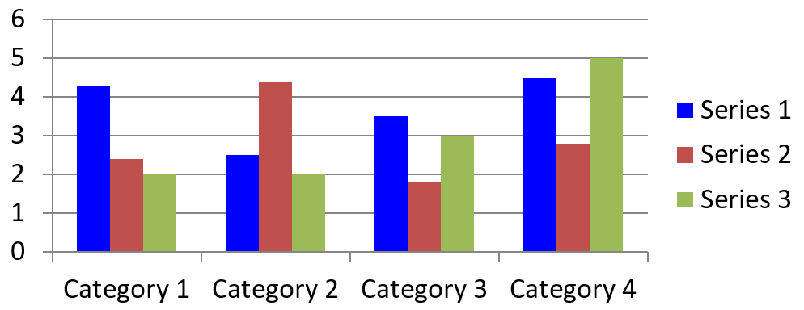

## **نظرة عامة**

يمكن للمخطط تخزين القيم التي يتم رسمها إما في خلايا المصنف أو مباشرةً كقيم عددية ثابتة. يمثل [IChartSeries](https://reference.aspose.com/slides/java/com.aspose.slides/ichartseries/) مجموعة واحدة من القيم المرتبطة، وكل [IChartDataPoint](https://reference.aspose.com/slides/java/com.aspose.slides/ichartdatapoint/) يمثل نقطة في تلك المجموعة. توفر كائنات [IChartCategory](https://reference.aspose.com/slides/java/com.aspose.slides/ichartcategory/) التسميات أو قيم التجميع المشتركة بين المجموعات. في المخططات التي تم إنشاؤها ببيانات افتراضية، تستخدم أسماء المجموعات والفئات وقيم النقاط كائنات [IChartDataCell](https://reference.aspose.com/slides/java/com.aspose.slides/ichartdatacell/) من مصنف المخطط.

في مخطط الفئة النموذجي، يستخدم المصنف الافتراضي الصف 0 لأسماء السلاسل، والعمود 0 لأسماء الفئات، وبقية الخلايا لقيم السلاسل. مؤشرات ورقة العمل والصف والعمود التي تُمرّر إلى [IChartDataWorkbook.getCell](https://reference.aspose.com/slides/java/com.aspose.slides/ichartdataworkbook/#getCell-int-int-int-) تبدأ من الصفر. هذا التخطيط مفيد عندما تنشئ مخططًا ببيانات افتراضية، لكن لا تفترض أن كل مخطط موجود يستخدمه. بالنسبة لعروض تقديمية محمّلة، تحقق من الخلايا التي تشير إليها السلاسل والفئات والنقاط قبل تعديل قيم المصنف.

- إعدادات مستوى السلسلة، مثل [IChartSeries.getFormat](https://reference.aspose.com/slides/java/com.aspose.slides/ichartseries/#getFormat--)، توفر المظهر الافتراضي لجميع النقاط في سلسلة واحدة.
- إعدادات نقطة البيانات، مثل [IChartDataPoint.getFormat](https://reference.aspose.com/slides/java/com.aspose.slides/ichartdatapoint/#getFormat--)، تتجاوز مظهر السلسلة لنقطة واحدة.
- إعدادات المجموعة تنطبق على السلاسل المتوافقة التي تنتمي إلى نفس [IChartSeriesGroup](https://reference.aspose.com/slides/java/com.aspose.slides/ichartseriesgroup/). يمكنك الوصول إلى المجموعة عبر [IChartSeries.getParentSeriesGroup](https://reference.aspose.com/slides/java/com.aspose.slides/ichartseries/#getParentSeriesGroup--) عندما تحتاج إلى تعيين خيارات مثل التداخل أو عرض الفجوة.

عند عدم تعيين تعبئة صريحة للنقطة أو السلسلة، يحدد نمط المخطط والسمة المظهر التلقائي. عندما تكون كل من تنسيقات السلسلة والنقطة موجودة، تتفوق تنسيق النقطة لتلك النقطة.


## **تعيين قيم السلسلة باستخدام القيم العددية الثابتة**

استخدم القيم العددية الثابتة عندما تأتي قيم السلسلة من بيانات التطبيق أو الحسابات ولا تحتاج إلى مراجع خلايا ورقة العمل. استدعِ [setDataSourceTypeForValues](https://reference.aspose.com/slides/java/com.aspose.slides/ichartdatapointcollection/#setDataSourceTypeForValues-int-) مع [DataSourceType.DoubleLiterals](https://reference.aspose.com/slides/java/com.aspose.slides/datasourcetype/#DoubleLiterals) قبل تعيين نتيجة كل نقطة عبر [getValue](https://reference.aspose.com/slides/java/com.aspose.slides/ichartdatapoint/#getValue--) باستخدام [setAsLiteralDouble](https://reference.aspose.com/slides/java/com.aspose.slides/idoublechartvalue/#setAsLiteralDouble-double-).

تتحكم إعدادات المجموعة في نوع مصدر جميع قيم النقاط في تلك السلسلة. طريقة [getDataSourceType](https://reference.aspose.com/slides/java/com.aspose.slides/ibasechartvalue/#getDataSourceType--) لكل قيمة نقطة تُظهر النوع المحدد؛ غيّره عبر إعداد المجموعة. مع `Worksheet`، استخدم [getAsCell](https://reference.aspose.com/slides/java/com.aspose.slides/isinglecellchartvalue/#getAsCell--) للوصول إلى الخلية المرجعية. مع `DoubleLiterals`، استخدم [getAsLiteralDouble](https://reference.aspose.com/slides/java/com.aspose.slides/idoublechartvalue/#getAsLiteralDouble--) أو `setAsLiteralDouble` لقراءة أو كتابة الرقم مباشرة.

المثال التالي ينشئ مخطط عمود بأسماء وفئات افتراضية، ثم يعيّن قيمًا محسوبة 10، 20، وما إلى ذلك للنقاط الموجودة في السلسلة الأولى. يحفظ العرض، يعيد فتحه، ويطبع القيم المخزنة.

```java
import com.aspose.slides.*;

Presentation presentation = new Presentation();
try {
    ISlide slide = presentation.getSlides().get_Item(0);

    IChart chart = slide.getShapes().addChart(ChartType.ClusteredColumn, 20, 20, 500, 300);
    IChartSeries series = chart.getChartData().getSeries().get_Item(0);

    series.getDataPoints().setDataSourceTypeForValues(DataSourceType.DoubleLiterals);
    for (int i = 0; i < series.getDataPoints().size(); i++) {
        series.getDataPoints().get_Item(i).getValue().setAsLiteralDouble((i + 1) * 10);
    }

    presentation.save("numeric_literals.pptx", SaveFormat.Pptx);
} finally {
    presentation.dispose();
}

Presentation reopenedPresentation = new Presentation("numeric_literals.pptx");
try {
    ISlide reopenedSlide = reopenedPresentation.getSlides().get_Item(0);
    IChart reopenedChart = (IChart) reopenedSlide.getShapes().get_Item(0);
    IChartSeries reopenedSeries = reopenedChart.getChartData().getSeries().get_Item(0);
    for (IChartDataPoint point : reopenedSeries.getDataPoints()) {
        System.out.println(point.getValue().getAsLiteralDouble());
    }
} finally {
    reopenedPresentation.dispose();
}
```

نوع مصدر قيمة النقطة منفصل عن [IChartData.getDataSourceType](https://reference.aspose.com/slides/java/com.aspose.slides/ichartdata/#getDataSourceType--) الذي يحدّد تكوين المصنف الداخلي أو الخارجي للمخطط. استخدام القيم العددية الثابتة لا يزيل المصنف المضمّن بحد ذاته. في هذا المثال يظل المصنف متاحًا لتسميات الفئات، أسماء السلاسل، والسلاسل الأخرى. راجع [مصنف المخطط](/slides/ar/java/chart-workbook/) لإدارة المصنف.

للمخططات المبعثرة ومخططات الفقاعات، استخدم [setDataSourceTypeForXValues](https://reference.aspose.com/slides/java/com.aspose.slides/ichartdatapointcollection/#setDataSourceTypeForXValues-int-) و[setDataSourceTypeForYValues](https://reference.aspose.com/slides/java/com.aspose.slides/ichartdatapointcollection/#setDataSourceTypeForYValues-int-) لاختيار المصادر لـ[getXValue](https://reference.aspose.com/slides/java/com.aspose.slides/ichartdatapoint/#getXValue--) و[getYValue](https://reference.aspose.com/slides/java/com.aspose.slides/ichartdatapoint/#getYValue--). تستخدم مخططات الفقاعات أيضًا [setDataSourceTypeForBubbleSizes](https://reference.aspose.com/slides/java/com.aspose.slides/ichartdatapointcollection/#setDataSourceTypeForBubbleSizes-int-) لـ[getBubbleSize](https://reference.aspose.com/slides/java/com.aspose.slides/ichartdatapoint/#getBubbleSize--). عيّن كل مصدر مناسب إلى `DoubleLiterals` قبل تعيين الأرقام عبر طريقة `setAsLiteralDouble` لتلك القيمة.

## **تعيين تداخل سلسلة المخطط**

[IChartSeries.getOverlap](https://reference.aspose.com/slides/java/com.aspose.slides/ichartseries/#getOverlap--) يُظهر مقدار تداخل الأشرطة أو الأعمدة في مخطط ثنائي الأبعاد، من -100 إلى 100 بالمئة. هو إسقاط للقراءة فقط لإعداد المجموعة الأم. استخدم [IChartSeriesGroup.setOverlap](https://reference.aspose.com/slides/java/com.aspose.slides/ichartseriesgroup/#setOverlap-byte-) لتحديث كل سلسلة متوافقة في تلك المجموعة. هذا الخيار يُطبق على أنواع المخططات التي تُظهر أشرطة أو أعمدة مجمعة؛ ولا يؤثّر على مجموعات السلاسل غير المرتبطة في مخطط مركّب.

المثال التالي يعيّن التداخل للمجموعة التي تحتوي على السلسلة الأولى:

```java
import com.aspose.slides.*;

final int firstSlideIndex = 0;
final int firstSeriesIndex = 0;
final byte overlapPercent = 30;

Presentation presentation = new Presentation();
try {
    ISlide slide = presentation.getSlides().get_Item(firstSlideIndex);

    // المخطط الجديد يحتوي على سلاسل وعينات وفئات وقيم.
    IChart chart = slide.getShapes().addChart(ChartType.ClusteredColumn, 20, 20, 500, 200);

    IChartSeries series = chart.getChartData().getSeries().get_Item(firstSeriesIndex);
    series.getParentSeriesGroup().setOverlap(overlapPercent);

    presentation.save("series_overlap.pptx", SaveFormat.Pptx);
} finally {
    presentation.dispose();
}
```

النتيجة:


## **تغيير لون تعبئة السلسلة**

استخدم [IChartSeries.getFormat](https://reference.aspose.com/slides/java/com.aspose.slides/ichartseries/#getFormat--) لتعيين التعبئة الافتراضية لسلسلة كاملة. إذا كانت النقطة لديها تعبئة صريحة بالفعل، فإن إعداد [IChartDataPoint.getFormat](https://reference.aspose.com/slides/java/com.aspose.slides/ichartdatapoint/#getFormat--) يتجاوز تعبئة السلسلة لتلك النقطة.

المثال التالي يطبق تعبئة صلبة زرقاء على السلسلة الأولى:

```java
import com.aspose.slides.*;
import java.awt.Color;

final int firstSlideIndex = 0;
final int firstSeriesIndex = 0;

Presentation presentation = new Presentation();
try {
    ISlide slide = presentation.getSlides().get_Item(firstSlideIndex);

    IChart chart = slide.getShapes().addChart(ChartType.ClusteredColumn, 20, 20, 500, 200);

    IChartSeries series = chart.getChartData().getSeries().get_Item(firstSeriesIndex);
    series.getFormat().getFill().setFillType(FillType.Solid);
    series.getFormat().getFill().getSolidFillColor().setColor(Color.BLUE);

    presentation.save("series_color.pptx", SaveFormat.Pptx);
} finally {
    presentation.dispose();
}
```

النتيجة:



## **تغيير اسم السلسلة**

يُخزن اسم السلسلة في مصنف بيانات المخطط وعادةً يُعرض في الأسطورة. في المصنف الافتراضي المُنشئ لمخطط عمود متكتل، الخلية B1 تقع في الصف 0، العمود 1 وتحتوي على اسم السلسلة الأولى. الثوابت المعرفة في المثال التالي تجعل هذا الهيكل واضحًا:

```java
import com.aspose.slides.*;

final int firstSlideIndex = 0;
final int worksheetIndex = 0;
final int seriesNameRowIndex = 0;
final int firstSeriesColumnIndex = 1;

Presentation presentation = new Presentation();
try {
    ISlide slide = presentation.getSlides().get_Item(firstSlideIndex);

    IChart chart = slide.getShapes().addChart(ChartType.ClusteredColumn, 20, 20, 500, 200);

    IChartDataWorkbook workbook = chart.getChartData().getChartDataWorkbook();
    IChartDataCell seriesNameCell = workbook.getCell(worksheetIndex, seriesNameRowIndex, firstSeriesColumnIndex);
    seriesNameCell.setValue("Revenue");

    presentation.save("series_name.pptx", SaveFormat.Pptx);
} finally {
    presentation.dispose();
}
```

يمكنك أيضًا تحديث الخلية التي يُشير إليها بالفعل [IChartSeries.getName](https://reference.aspose.com/slides/java/com.aspose.slides/ichartseries/#getName--). هذه الطريقة تتجنب الافتراض بوجود صف وعمود محددين في مخطط موجود:

```java
import com.aspose.slides.*;

final int firstSlideIndex = 0;
final int firstSeriesIndex = 0;
final int firstNameCellIndex = 0;

Presentation presentation = new Presentation();
try {
    ISlide slide = presentation.getSlides().get_Item(firstSlideIndex);

    IChart chart = slide.getShapes().addChart(ChartType.ClusteredColumn, 20, 20, 500, 200);

    IChartSeries series = chart.getChartData().getSeries().get_Item(firstSeriesIndex);
    IChartDataCell seriesNameCell = series.getName().getAsCells().get_Item(firstNameCellIndex);
    seriesNameCell.setValue("Revenue");

    presentation.save("series_name.pptx", SaveFormat.Pptx);
} finally {
    presentation.dispose();
}
```

النتيجة:


### **إنشاء سلسلة باسم من عدة خلايا**

اسم سلسلة مركب مفيد عندما يُخزن اسم المنتج وفترة التقرير في خلايا مصنف منفصلة. على سبيل المثال، يمكنك دمج `Product A` في B1 و`2026` في C1 في اسم سلسلة واحد مع الحفاظ على ارتباط كل جزء بخليته المصدرية.

استخدم [IChartDataWorkbook.getCellCollection](https://reference.aspose.com/slides/java/com.aspose.slides/ichartdataworkbook/#getCellCollection-java.lang.String-boolean-) لاسترجاع نطاق الاسم، ثم مرّر ذلك التجميع إلى [IChartSeriesCollection.add](https://reference.aspose.com/slides/java/com.aspose.slides/ichartseriescollection/#add-com.aspose.slides.IChartCellCollection-int-). معامل `skipHiddenCells` يتحكم فيما إذا كانت الخلايا المخفية تُضمّن: `true` يستثنيها، و`false` يضمّنها. يستخدم هذا المثال `false` لضمّن كل خلية في نطاق الاسم.

المثال التالي ينشئ عرضًا تقديميًا بسلسلة واحدة ونقطتي بيانات. الخلايا B1:C1 تُزوّد فقط باسم السلسلة؛ A2:A3 تُزوّد تسميات الفئات، وB2:B3 تُزوّد القيم العددية.

```java
import com.aspose.slides.*;

Presentation presentation = new Presentation();
try {
    ISlide slide = presentation.getSlides().get_Item(0);

    IChart chart = slide.getShapes().addChart(ChartType.ClusteredColumn, 50, 50, 620, 180);

    chart.getChartData().getSeries().clear();
    chart.getChartData().getCategories().clear();
    chart.setLegend(true);

    IChartDataWorkbook workbook = chart.getChartData().getChartDataWorkbook();
    workbook.clear(0);

    // هاتان الخليتان توفران اسم السلسلة.
    workbook.getCell(0, 0, 1, "Product A");
    workbook.getCell(0, 0, 2, "2026");
    IChartCellCollection nameCells = workbook.getCellCollection("Sheet1!$B$1:$C$1", false);
    IChartSeries series = chart.getChartData().getSeries().add(nameCells, ChartType.ClusteredColumn);

    // خلايا منفصلة توفر الفئات ونقاط البيانات الرقمية.
    IChartDataCell northCategory = workbook.getCell(0, 1, 0, "North");
    IChartDataCell southCategory = workbook.getCell(0, 2, 0, "South");
    chart.getChartData().getCategories().add(northCategory);
    chart.getChartData().getCategories().add(southCategory);
    IChartDataCell northValue = workbook.getCell(0, 1, 1, 120);
    IChartDataCell southValue = workbook.getCell(0, 2, 1, 150);
    series.getDataPoints().addDataPointForBarSeries(northValue);
    series.getDataPoints().addDataPointForBarSeries(southValue);

    presentation.save("composite_series_name.pptx", SaveFormat.Pptx);
} finally {
    presentation.dispose();
}
```

اسم السلسلة الناتج هو `Product A 2026` مع مسافة بين القيمتين. تُظهر الأسطورة هذا كإدخال واحد للعمودين. الصورة أدناه توضح النتيجة:


## **الحصول على لون تعبئة السلسلة التلقائي**

[IChartSeries.getAutomaticSeriesColor](https://reference.aspose.com/slides/java/com.aspose.slides/ichartseries/#getAutomaticSeriesColor--) يُعيد اللون المحسوب من فهرس السلسلة ونمط المخطط. هذا هو اللون المستخدم عندما لا تُحدَّد تعبئة السلسلة صراحة. استدعاء الطريقة يقرؤ اللون المحسوب؛ ولا يُعيّن تعبئة جديدة.

المثال التالي يطبع اللون التلقائي لكل سلسلة افتراضية:

```java
import com.aspose.slides.*;
import java.awt.Color;

final int firstSlideIndex = 0;

Presentation presentation = new Presentation();
try {
    ISlide slide = presentation.getSlides().get_Item(firstSlideIndex);

    IChart chart = slide.getShapes().addChart(ChartType.ClusteredColumn, 20, 20, 500, 200);

    int seriesCount = chart.getChartData().getSeries().size();
    for (int seriesIndex = 0; seriesIndex < seriesCount; seriesIndex++) {
        IChartSeries series = chart.getChartData().getSeries().get_Item(seriesIndex);
        Color automaticColor = series.getAutomaticSeriesColor();
        System.out.println("Series " + seriesIndex + ": " + automaticColor);
    }
} finally {
    presentation.dispose();
}
```

مخرجات المثال للنمط الافتراضي للمخطط:

```text
Series 0: java.awt.Color[r=79,g=129,b=189]
Series 1: java.awt.Color[r=192,g=80,b=77]
Series 2: java.awt.Color[r=155,g=187,b=89]
```

الألوان الدقيقة تعتمد على نمط المخطط والسمة.

## **تعيين لون التعبئة المعكوسة لسلسلة المخطط**

بالنسبة للسلاسل الشريطية والعمودية والفقاعية، يمكن لـ[IChartSeries.setInvertIfNegative](https://reference.aspose.com/slides/java/com.aspose.slides/ichartseries/#setInvertIfNegative-boolean-) عرض القيم السلبية بتعبئة مختلفة. عيّن تعبئة السلسلة العادية إلى صلبة، فعل الانعكاس، وعين لون القيمة السلبية عبر [IChartSeries.getInvertedSolidFillColor](https://reference.aspose.com/slides/java/com.aspose.slides/ichartseries/#getInvertedSolidFillColor--). تظل الأعداد السلبية دون تغيير في المصنف؛ فقط يتغيّر لون العرض.

المثال التالي يستبدل بيانات المخطط الافتراضية بسلسلة واحدة. الصف 0 في ورقة العمل يحتوي على اسم السلسلة، العمود 0 يحتوي على تسميات الفئات، والعمود 1 يحتوي على القيم:

```java
import com.aspose.slides.*;
import java.awt.Color;

final int firstSlideIndex = 0;
final int worksheetIndex = 0;
final int headerRowIndex = 0;
final int categoryColumnIndex = 0;
final int firstSeriesColumnIndex = 1;
final int firstDataRowIndex = 1;

String[] categoryNames = { "Category 1", "Category 2", "Category 3" };
int[] seriesValues = { -20, 50, -30 };

Presentation presentation = new Presentation();
try {
    ISlide slide = presentation.getSlides().get_Item(firstSlideIndex);

    IChart chart = slide.getShapes().addChart(ChartType.ClusteredColumn, 20, 20, 500, 200);
    IChartData chartData = chart.getChartData();
    IChartDataWorkbook workbook = chartData.getChartDataWorkbook();

    chartData.getSeries().clear();
    chartData.getCategories().clear();

    IChartDataCell seriesNameCell = workbook.getCell(worksheetIndex, headerRowIndex, firstSeriesColumnIndex, "Series 1");
    int chartType = chart.getType();
    IChartSeries series = chartData.getSeries().add(seriesNameCell, chartType);

    for (int categoryIndex = 0; categoryIndex < categoryNames.length; categoryIndex++) {
        int dataRowIndex = firstDataRowIndex + categoryIndex;
        String categoryName = categoryNames[categoryIndex];
        int seriesValue = seriesValues[categoryIndex];

        IChartDataCell categoryCell = workbook.getCell(worksheetIndex, dataRowIndex, categoryColumnIndex, categoryName);
        chartData.getCategories().add(categoryCell);

        IChartDataCell valueCell = workbook.getCell(worksheetIndex, dataRowIndex, firstSeriesColumnIndex, seriesValue);
        series.getDataPoints().addDataPointForBarSeries(valueCell);
    }

    Color automaticSeriesColor = series.getAutomaticSeriesColor();
    series.getFormat().getFill().setFillType(FillType.Solid);
    series.getFormat().getFill().getSolidFillColor().setColor(automaticSeriesColor);
    series.setInvertIfNegative(true);
    series.getInvertedSolidFillColor().setColor(Color.RED);

    presentation.save("inverted_solid_fill_color.pptx", SaveFormat.Pptx);
} finally {
    presentation.dispose();
}
```

النتيجة:


يمكنك تفعيل الانعكاس لنقطة واحدة عبر [IChartDataPoint.setInvertIfNegative](https://reference.aspose.com/slides/java/com.aspose.slides/ichartdatapoint/#setInvertIfNegative-boolean-). في المثال التالي يُعطل الانعكاس للسلسلة ويُفعَّل فقط للنقطة المختارة. تُعيّن النقطة أيضًا قيمة سلبية بحيث يكون التأثير مرئيًا:

```java
import com.aspose.slides.*;
import java.awt.Color;

final int firstSlideIndex = 0;
final int firstSeriesIndex = 0;
final int targetDataPointIndex = 2;
final int negativeValue = -30;

Presentation presentation = new Presentation();
try {
    ISlide slide = presentation.getSlides().get_Item(firstSlideIndex);

    IChart chart = slide.getShapes().addChart(ChartType.ClusteredColumn, 20, 20, 500, 200);

    IChartSeries series = chart.getChartData().getSeries().get_Item(firstSeriesIndex);
    Color automaticSeriesColor = series.getAutomaticSeriesColor();
    series.getFormat().getFill().setFillType(FillType.Solid);
    series.getFormat().getFill().getSolidFillColor().setColor(automaticSeriesColor);
    series.getInvertedSolidFillColor().setColor(Color.RED);
    series.setInvertIfNegative(false);

    IChartDataPoint dataPoint = series.getDataPoints().get_Item(targetDataPointIndex);
    dataPoint.getValue().getAsCell().setValue(negativeValue);
    dataPoint.setInvertIfNegative(true);

    presentation.save("data_point_invert_color_if_negative.pptx", SaveFormat.Pptx);
} finally {
    presentation.dispose();
}
```

## **مسح قيمة نقطة بيانات محددة**

لجعل نقطة واحدة فارغة دون إزالة باقي النقاط، عيّن خلية المصنف الداعمة لها إلى `null`. بالنسبة لمخطط عمودي، تكون القيمة المرسومة متوفرة عبر [IChartDataPoint.getValue](https://reference.aspose.com/slides/java/com.aspose.slides/ichartdatapoint/#getValue--). تبقى نقطة البيانات في نفس موقع الفئة، لكن المخطط يتعامل مع قيمتها كفراغ حسب إعدادات القيم الفارغة للمخطط.

المثال التالي يمسح فقط النقطة الثانية في السلسلة الأولى:

```java
import com.aspose.slides.*;

final int firstSlideIndex = 0;
final int firstSeriesIndex = 0;
final int targetDataPointIndex = 1;

Presentation presentation = new Presentation();
try {
    ISlide slide = presentation.getSlides().get_Item(firstSlideIndex);

    IChart chart = slide.getShapes().addChart(ChartType.ClusteredColumn, 20, 20, 500, 200);

    IChartSeries series = chart.getChartData().getSeries().get_Item(firstSeriesIndex);
    IChartDataPoint dataPoint = series.getDataPoints().get_Item(targetDataPointIndex);
    dataPoint.getValue().getAsCell().setValue(null);

    presentation.save("clear_data_point_value.pptx", SaveFormat.Pptx);
} finally {
    presentation.dispose();
}
```

تستخدم مخططات المبعثر خلايا X وY منفصلة، وتستخدم مخططات الفقاعات أيضًا خلية الحجم. امسح فقط الخلية التي تمثل القيمة التي تريد إزالتها. لا تستدعِ [IChartDataPointCollection.clear](https://reference.aspose.com/slides/java/com.aspose.slides/ichartdatapointcollection/#clear--) عندما ترغب في الاحتفاظ بالنقاط الأخرى، لأن هذه الطريقة تُزيل كل نقطة بيانات من التجميع.

## **التحكم في عرض الخلايا الفارغة**

الخلايا المخفية التي تحتوي على قيم هي حالة منفصلة عن الخلايا الفارغة. لتضمين أو استبعاد البيانات من الصفوف والأعمدة المخفية في ورقة العمل، راجع [تضمين البيانات من الصفوف والأعمدة المخفية](/slides/ar/java/chart-workbook/#include-data-from-hidden-rows-and-columns).

الخلية الفارغة في المصنف تمثّل بيانات مفقودة؛ الخلية التي تحتوي على `0` تمثّل قيمة عددية معروفة. استدعِ [IChartDataCell.setValue](https://reference.aspose.com/slides/java/com.aspose.slides/ichartdatacell/#setValue-java.lang.Object-) مع `null` لجعل الخلية فارغة. الصفر العددي يبقى صفرًا بغض النظر عن إعداد الخلية الفارغة.

استخدم [IChart.setDisplayBlanksAs](https://reference.aspose.com/slides/java/com.aspose.slides/ichart/#setDisplayBlanksAs-int-) لاختيار طريقة عرض المخطط للخلايا الفارغة. يُطبق هذا الإعداد على المخطط بالكامل. يغيّر طريقة رسم الفراغات دون ملء الخلية الفارغة في المصنف بالصفر أو قيمة مُستنتَجة.

المثال التالي المستقل ينشئ مخطط خط مع سلسلة واحدة، يمسح القيمة لليوم 3، ويحفظ المخطط نفسه بكل وضع. لا يلزم ملف إدخال. يستخدم [IChartDataWorkbook](https://reference.aspose.com/slides/java/com.aspose.slides/ichartdataworkbook/) ورقة عمل 0، العمود 0 لتسميات الفئات، والعمود 1 للقيم؛ الصف 0 يحتوي على اسم السلسلة. البيانات النهائية هي `10, 20, empty, 30, 40`.

```java
import com.aspose.slides.*;

Presentation presentation = new Presentation();
try {
    ISlide slide = presentation.getSlides().get_Item(0);

    IChart chart = slide.getShapes().addChart(ChartType.LineWithMarkers, 40, 40, 640, 400);
    IChartData chartData = chart.getChartData();
    IChartDataWorkbook workbook = chartData.getChartDataWorkbook();

    chartData.getSeries().clear();
    chartData.getCategories().clear();

    IChartDataCell seriesNameCell = workbook.getCell(0, 0, 1, "Measurements");
    IChartSeries series = chartData.getSeries().add(seriesNameCell, chart.getType());
    int[] values = { 10, 20, 25, 30, 40 };

    for (int i = 0; i < values.length; i++) {
        IChartDataCell categoryCell = workbook.getCell(0, i + 1, 0, "Day " + (i + 1));
        chartData.getCategories().add(categoryCell);
        IChartDataCell valueCell = workbook.getCell(0, i + 1, 1, values[i]);
        series.getDataPoints().addDataPointForLineSeries(valueCell);
    }

    // اترك اليوم الثالث فارغًا فعليًا، مع الاحتفاظ بالفئة ونقطة البيانات الخاصة به.
    workbook.getCell(0, 3, 1).setValue(null);

    int[] modes = { DisplayBlanksAsType.Gap, DisplayBlanksAsType.Zero, DisplayBlanksAsType.Span };
    String[] modeNames = { "Gap", "Zero", "Span" };
    for (int i = 0; i < modes.length; i++) {
        chart.setDisplayBlanksAs(modes[i]);
        presentation.save("empty_cells_" + modeNames[i] + ".pptx", SaveFormat.Pptx);
    }
} finally {
    presentation.dispose();
}
```

كل ملف إخراج يخزن الوضع المحدد قبل الحفظ: `empty_cells_Gap.pptx`، `empty_cells_Zero.pptx`، و`empty_cells_Span.pptx`. لحفظ نسخة واحدة فقط، عيّن الوضع المطلوب واحفظ العرض مرة واحدة بدلاً من التكرار على الأوضاع.

المقارنة أدناه تُظهر البيانات نفسها في الثلاث ملفات. اليوم 3 فارغ في المصنف في كل حالة:


التأثير الظاهر يعتمد على نوع المخطط. يجعل مخطط الخط الثلاثة أوضاع سهلة المقارنة. لا تملك مخططات الشريط والعمود خطًا لربط الفئات المفقودة، لذا لا يستطيع وضع `Span` إنشاء الجزء المتصل الموضح أعلاه؛ قد يبدو العمود المفقود والعمود صفر الارتفاع متشابهين. بالمثل، مخطط المبعثر مع علامات فقط لا يحتوي على خط متصل. لا تتوقع ثلاث نتائج متميزة لكل نوع مخطط؛ تحقق من النتيجة للنوع الذي تستخدمه.

## **تعيين عرض الفجوة بين السلاسل**

عرض الفجوة هو المسافة بين مجموعات الأشرطة أو الأعمدة المتجاورة، تُعبّر كنسبة مئوية من عرض العمود أو الشريط. مثل التداخل، ينتمي إلى مجموعة السلاسل الأم وليس إلى سلسلة واحدة. استدعِ [IChartSeriesGroup.setGapWidth](https://reference.aspose.com/slides/java/com.aspose.slides/ichartseriesgroup/#setGapWidth-int-) مرة واحدة للمجموعة. القيمة الأكبر تُنشئ مساحة أوسع بين المجموعات؛ القيمة الأصغر تجعلها أكثر كثافة.

المثال التالي يغيّر عرض الفجوة ويحفظ العرض النهائي فقط:

```java
import com.aspose.slides.*;

final int firstSlideIndex = 0;
final int firstSeriesIndex = 0;
final int gapWidthPercent = 30;

Presentation presentation = new Presentation();
try {
    ISlide slide = presentation.getSlides().get_Item(firstSlideIndex);

    IChart chart = slide.getShapes().addChart(ChartType.StackedColumn, 20, 20, 500, 200);

    IChartSeries series = chart.getChartData().getSeries().get_Item(firstSeriesIndex);
    series.getParentSeriesGroup().setGapWidth(gapWidthPercent);

    presentation.save("gap_width_30.pptx", SaveFormat.Pptx);
} finally {
    presentation.dispose();
}
```

النتيجة:


## **الأسئلة الشائعة**

**ما هي أنواع المخططات التي تدعم السلاسل البيانية؟**

جميع أنواع المخططات الممثلة في تعداد [ChartType](https://reference.aspose.com/slides/java/com.aspose.slides/charttype/) تستخدم بيانات المخطط، لكن سلاسلها لا تشترك جميعها في نفس بنية القيم أو الإعدادات. على سبيل المثال، تستخدم المخططات الفئوية الفئات والقيم، وتستخدم مخططات المبعثر قيم X وY، وتضيف مخططات الفقاعات أحجام الفقاعات. استخدم طريقة إنشاء نقطة البيانات التي تتطابق مع نوع السلسلة. تُطبق خيارات مثل التداخل وعرض الفجوة فقط على مجموعات الشريط أو العمود المتوافقة.

**ما هي مجموعة سلاسل المخطط؟**

[إ[IChartSeriesGroup](https://reference.aspose.com/slides/java/com.aspose.slides/ichartseriesgroup/)] تحتوي على سلاسل متوافقة تتشارك إعدادات الرسم على مستوى المجموعة. يمكن لمخطط مركب أن يحتوي على أكثر من مجموعة، لذا فإن تغيير المجموعة عبر سلسلة واحدة لا يغيّر بالضرورة كل السلاسل في المخطط.

**هل يحتوي المخطط الذي تم إنشاؤه حديثًا على بيانات افتراضية؟**

نعم. بشكل افتراضي، تُنشئ [IShapeCollection.addChart](https://reference.aspose.com/slides/java/com.aspose.slides/ishapecollection/#addChart-int-float-float-float-float-) سلاسل، فئات، وقيم عينة. يمكنك تعديل تلك الخلايا أو مسح كل من تجميعات السلاسل والفئات قبل إضافة مجموعة بيانات مخصصة بالكامل. يمكن أيضًا استدعاء نسخة overload لإنشاء مخطط بدون بيانات افتراضية.

**كيف ترتبط كائنات المخطط بخلايا المصنف؟**

تشير أسماء السلاسل، تسميات الفئات، وقيم نقاط البيانات إلى خلايا في [IChartDataWorkbook](https://reference.aspose.com/slides/java/com.aspose.slides/ichartdataworkbook/). يؤدي تعديل خلية مرجعية إلى تحديث العنصر المقابل في المخطط. عند بناء بيانات مخصصة، حافظ على توافق صفوف الفئات وصفوف قيم السلاسل بحيث تُرسم كل نقطة تحت الفئة المقصودة.

**كيف يمكنني مسح نقطة واحدة بدلاً من السلسلة بالكامل؟**

عيّن خلية القيمة المعنية إلى `null` للحفاظ على موضع الفئة كنقطة فارغة. استخدم [IChartDataPointCollection.clear](https://reference.aspose.com/slides/java/com.aspose.slides/ichartdatapointcollection/#clear--) فقط عندما تنوي إزالة جميع النقاط من تلك السلسلة. إذا أزلت الفئات أيضًا، حدّث كل سلسلة بحيث تبقى قيمها مُحاذاة مع مجموعة الفئات.

**كيف يتم عرض النقاط الفارغة؟**

النتيجة تعتمد على نوع المخطط والقيمة التي تم تكوينها عبر [IChart.setDisplayBlanksAs](https://reference.aspose.com/slides/java/com.aspose.slides/ichart/#setDisplayBlanksAs-int-). يمكن للمخططات المدعومة عرض الفراغات كفجوات، كقيمة صفرية، أو بربط النقاط المتجاورة. اختر الإعداد الذي يتماشى مع معنى البيانات المفقودة في عرضك. راجع [التحكم في عرض الخلايا الفارغة](#control-the-display-of-empty-cells) للحصول على مثال كامل ومقارنة مرئية.

**كيف يتم تنسيق القيم السلبية؟**

بالنسبة للسلاسل الشريطية والعمودية والفقاعية المدعومة، استدعِ [IChartSeries.setInvertIfNegative](https://reference.aspose.com/slides/java/com.aspose.slides/ichartseries/#setInvertIfNegative-boolean-) وعين اللون المسترجع عبر [IChartSeries.getInvertedSolidFillColor](https://reference.aspose.com/slides/java/com.aspose.slides/ichartseries/#getInvertedSolidFillColor--). يمكنك تجاوز السلوك لنقطة فردية باستخدام [IChartDataPoint.setInvertIfNegative](https://reference.aspose.com/slides/java/com.aspose.slides/ichartdatapoint/#setInvertIfNegative-boolean-). هذه الطرق تؤثر على التنسيق فقط، لا على القيم العددية المخزنة.

**أي تنسيق ينتصر عندما يتم تنسيق كل من السلسلة والنقطة؟**

تنسيق نقطة البيانات الصريح يتفوق لتلك النقطة. تستمر النقاط الأخرى في استخدام تنسيق السلسلة الصريح أو، إذا لم يُحدَّد تنسيق السلسلة، النمط والموضوع التلقائي للمخطط. إعدادات المجموعة مثل التداخل وعرض الفجوة تتحكم في التخطيط ولا تُعتبر تجاوزًا لتنسيق نقطة بمستوى النقطة.

**هل هناك حد لعدد السلاسل التي يمكن أن يحتويها المخطط؟**

لا يفرض Aspose.Slides حدًا ثابتًا منفصلًا لعدد السلاسل. في الواقع، تحدد قيود ملف العرض، الذاكرة المتاحة، زمن معالجة الرسم، وقابلية قراءة المخطط حدًا عمليًا.

**ماذا يجب أن أغير عندما تكون الأعمدة متقاربة جدًا أو متباعدة جدًا؟**

استدعِ [IChartSeriesGroup.setGapWidth](https://reference.aspose.com/slides/java/com.aspose.slides/ichartseriesgroup/#setGapWidth-int-) على مجموعة السلاسل الأم المناسبة. زد القيمة لتوسيع المسافة بين المجموعات، أو قلّها لتقريب المجموعات من بعضها.