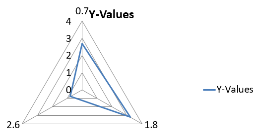

## **نظرة عامة**

هذه المقالة تقدم دليلًا شاملًا حول كيفية إنشاء المخططات وتخصيصها باستخدام Aspose.Slides for Java. ستتعلم كيفية إضافة مخطط برمجيًا إلى شريحة، ملئه بالبيانات، وتطبيق خيارات تنسيق مختلفة لتتناسب مع متطلبات التصميم الخاصة بك. على مدار المقالة، توضح أمثلة شفرة مفصلة كل خطوة، بدءًا من تهيئة العرض وكائن المخطط إلى تكوين السلاسل والمحاور والوسوم. باتباع هذا الدليل، ستحصل على فهم قوي لكيفية دمج توليد المخططات الديناميكي في تطبيقات Java الخاصة بك، مما يسهل إنشاء عروض تقديمية مدفوعة بالبيانات.

## **إنشاء مخطط**

تساعد المخططات الأشخاص على تصور البيانات بسرعة واستخلاص رؤى قد لا تكون واضحة فورًا من جدول أو جدول بيانات.

**لماذا نخلق مخططات؟**

باستخدام المخططات، يمكنك:

* تجميع أو تكثيف أو تلخيص كميات كبيرة من البيانات على شريحة واحدة في عرض تقديمي؛
* كشف الأنماط والاتجاهات في البيانات؛
* استنتاج اتجاه وزخم البيانات عبر الزمن أو بالنسبة لوحدة قياس معينة؛
* رصد القيم المتطرفة، الشذوذ، الانحرافات، الأخطاء، والبيانات غير المنطقية؛
* نقل أو عرض بيانات معقدة.

في PowerPoint، يمكنك إنشاء مخططات عبر وظيفة *إدراج* التي توفر قوالب لتصميم أنواع متعددة من المخططات. باستخدام Aspose.Slides، يمكنك إنشاء كلٍ من المخططات العادية (المستندة إلى الأنواع الشائعة) والمخططات المخصصة.

{}

استخدم تعداد [ChartType](https://reference.aspose.com/slides/java/com.aspose.slides/charttype/) في حزمة [com.aspose.slides](https://reference.aspose.com/slides/java/com.aspose.slides/). القيم في هذا التعداد تتطابق مع أنواع مخططات مختلفة.

{}

### **إنشاء مخططات أعمدة متكتلة**

هذا المثال يستخدم الدالة [addChart](https://reference.aspose.com/slides/java/com.aspose.slides/ishapecollection/#addChart-int-float-float-float-float-) لإنشاء مخطط أعمدة متكتل يقارن سلسلتين عبر ثلاث فئات. السلسلة تستخدم تعبئة حمراء وخضراء، وتظهر التسميات الفردية أسماء الفئات، أسماء السلاسل، والقيم. يشير فهرس ورقة العمل 0 إلى أول ورقة في دفتر العمل المضمن للمخطط.

```java
import com.aspose.slides.*;
import java.awt.Color;

Presentation presentation = new Presentation();
try
{
    ISlide slide = presentation.getSlides().get_Item(0);

    IChart chart = slide.getShapes().addChart(ChartType.ClusteredColumn, 20, 20, 500, 300);

    chart.getChartTitle().addTextFrameForOverriding("Sample Title");
    chart.getChartTitle().getTextFrameForOverriding().getTextFrameFormat().setCenterText(NullableBool.True);
    chart.getChartTitle().setHeight(20);
    chart.setTitle(true);

    IChartDataWorkbook workbook = chart.getChartData().getChartDataWorkbook();
    int worksheetIndex = 0;

    chart.getChartData().getSeries().clear();
    chart.getChartData().getCategories().clear();

    IChartDataCell seriesNameCell = workbook.getCell(worksheetIndex, 0, 1, "Series 1");
    chart.getChartData().getSeries().add(seriesNameCell, chart.getType());
    seriesNameCell = workbook.getCell(worksheetIndex, 0, 2, "Series 2");
    chart.getChartData().getSeries().add(seriesNameCell, chart.getType());

    IChartDataCell categoryCell = workbook.getCell(worksheetIndex, 1, 0, "Category 1");
    chart.getChartData().getCategories().add(categoryCell);
    categoryCell = workbook.getCell(worksheetIndex, 2, 0, "Category 2");
    chart.getChartData().getCategories().add(categoryCell);
    categoryCell = workbook.getCell(worksheetIndex, 3, 0, "Category 3");
    chart.getChartData().getCategories().add(categoryCell);

    IChartSeries series = chart.getChartData().getSeries().get_Item(0);

    IChartDataCell valueCell = workbook.getCell(worksheetIndex, 1, 1, 20);
    series.getDataPoints().addDataPointForBarSeries(valueCell);
    valueCell = workbook.getCell(worksheetIndex, 2, 1, 50);
    series.getDataPoints().addDataPointForBarSeries(valueCell);
    valueCell = workbook.getCell(worksheetIndex, 3, 1, 30);
    series.getDataPoints().addDataPointForBarSeries(valueCell);

    series.getFormat().getFill().setFillType(FillType.Solid);
    series.getFormat().getFill().getSolidFillColor().setColor(Color.RED);

    series = chart.getChartData().getSeries().get_Item(1);

    valueCell = workbook.getCell(worksheetIndex, 1, 2, 30);
    series.getDataPoints().addDataPointForBarSeries(valueCell);
    valueCell = workbook.getCell(worksheetIndex, 2, 2, 10);
    series.getDataPoints().addDataPointForBarSeries(valueCell);
    valueCell = workbook.getCell(worksheetIndex, 3, 2, 60);
    series.getDataPoints().addDataPointForBarSeries(valueCell);

    series.getFormat().getFill().setFillType(FillType.Solid);
    series.getFormat().getFill().getSolidFillColor().setColor(new Color(0, 128, 0));

    IDataLabel label = series.getDataPoints().get_Item(0).getLabel();
    label.getDataLabelFormat().setShowCategoryName(true);

    label = series.getDataPoints().get_Item(1).getLabel();
    label.getDataLabelFormat().setShowSeriesName(true);

    label = series.getDataPoints().get_Item(2).getLabel();
    label.getDataLabelFormat().setShowValue(true);
    label.getDataLabelFormat().setShowSeriesName(true);
    label.getDataLabelFormat().setSeparator("/");

    presentation.save("AsposeChart.pptx", SaveFormat.Pptx);
}
finally
{
    presentation.dispose();
}
```

الناتج:


### **إنشاء مخططات مبعثرة**

المخططات المبثورة (المعروفة أيضًا بمخططات التشتت أو الرسومات x‑y) تُستخدم غالبًا للتحقق من وجود أنماط أو إظهار الارتباطات بين متغيرين.

استخدم مخطط مبثر عندما:

* لديك بيانات رقمية مزدوجة.
* لديك متغيران يرتبطان جيدًا معًا.
* تريد تحديد ما إذا كان المتغيران مرتبطين.
* لديك متغير مستقل له قيم متعددة للمتغير التابع.

هذا المثال يرسم مجموعتين من قيم x‑y. السلسلة الأولى تستخدم خطوطًا مستقيمة مع علامات نجمة، بينما السلسلة الثانية تستخدم خطوطًا ناعمة مع علامات دائرة؛ كلاهما يستخدم حجم علامة 10، يتم تكوينه باستخدام الدالة [setSize](https://reference.aspose.com/slides/java/com.aspose.slides/imarker/#setSize-int-). تتحكم الدالة [setSymbol](https://reference.aspose.com/slides/java/com.aspose.slides/imarker/#setSymbol-int-) في شكل العلامة.

```java
import com.aspose.slides.*;

Presentation presentation = new Presentation();
try
{
    ISlide slide = presentation.getSlides().get_Item(0);

    IChart chart = slide.getShapes().addChart(ChartType.ScatterWithSmoothLines, 20, 20, 500, 300);

    IChartDataWorkbook workbook = chart.getChartData().getChartDataWorkbook();
    int worksheetIndex = 0;

    chart.getChartData().getSeries().clear();

    IChartDataCell seriesNameCell = workbook.getCell(worksheetIndex, 1, 1, "Series 1");
    chart.getChartData().getSeries().add(seriesNameCell, chart.getType());
    seriesNameCell = workbook.getCell(worksheetIndex, 1, 3, "Series 2");
    chart.getChartData().getSeries().add(seriesNameCell, chart.getType());

    IChartSeries series = chart.getChartData().getSeries().get_Item(0);

    IChartDataCell xValueCell = workbook.getCell(worksheetIndex, 2, 1, 1);
    IChartDataCell yValueCell = workbook.getCell(worksheetIndex, 2, 2, 3);
    series.getDataPoints().addDataPointForScatterSeries(xValueCell, yValueCell);

    xValueCell = workbook.getCell(worksheetIndex, 3, 1, 2);
    yValueCell = workbook.getCell(worksheetIndex, 3, 2, 10);
    series.getDataPoints().addDataPointForScatterSeries(xValueCell, yValueCell);

    series.setType(ChartType.ScatterWithStraightLinesAndMarkers);

    series.getMarker().setSize(10);
    series.getMarker().setSymbol(MarkerStyleType.Star);

    series = chart.getChartData().getSeries().get_Item(1);

    xValueCell = workbook.getCell(worksheetIndex, 2, 3, 5);
    yValueCell = workbook.getCell(worksheetIndex, 2, 4, 2);
    series.getDataPoints().addDataPointForScatterSeries(xValueCell, yValueCell);

    xValueCell = workbook.getCell(worksheetIndex, 3, 3, 3);
    yValueCell = workbook.getCell(worksheetIndex, 3, 4, 1);
    series.getDataPoints().addDataPointForScatterSeries(xValueCell, yValueCell);

    xValueCell = workbook.getCell(worksheetIndex, 4, 3, 2);
    yValueCell = workbook.getCell(worksheetIndex, 4, 4, 2);
    series.getDataPoints().addDataPointForScatterSeries(xValueCell, yValueCell);

    xValueCell = workbook.getCell(worksheetIndex, 5, 3, 5);
    yValueCell = workbook.getCell(worksheetIndex, 5, 4, 1);
    series.getDataPoints().addDataPointForScatterSeries(xValueCell, yValueCell);

    series.getMarker().setSize(10);
    series.getMarker().setSymbol(MarkerStyleType.Circle);

    presentation.save("AsposeChart.pptx", SaveFormat.Pptx);
}
finally
{
    presentation.dispose();
}
```

الناتج:


### **إنشاء مخططات دائرية**

المخططات الدائرية تُستخدم لعرض العلاقة جزء إلى كل في البيانات، خاصةً عندما تحتوي البيانات على تسميات فئوية مع قيم رقمية. ومع ذلك، إذا احتوت بياناتك على العديد من الأجزاء أو التسميات، قد تفضل استخدام مخطط شريطي بدلاً من ذلك.

هذا المثال ينشئ مخططًا دائريًا بثلاث قيم ربع سنوية. كل شريحة لها تعبئة وإطار مخصص، وتظهر التسميات مجموعات مختلفة من القيم والنسب ومعلومات السلسلة. تُحدد الدالة [setFirstSliceAngle](https://reference.aspose.com/slides/java/com.aspose.slides/ichartseriesgroup/#setFirstSliceAngle-int-) الزاوية الأولى لتبدأ عند 180 درجة.

```java
import com.aspose.slides.*;
import java.awt.Color;

Presentation presentation = new Presentation();
try
{
    ISlide slide = presentation.getSlides().get_Item(0);

    IChart chart = slide.getShapes().addChart(ChartType.Pie, 20, 20, 500, 300);

    chart.getChartTitle().addTextFrameForOverriding("Sample Title");
    chart.getChartTitle().getTextFrameForOverriding().getTextFrameFormat().setCenterText(NullableBool.True);
    chart.getChartTitle().setHeight(20);
    chart.setTitle(true);

    chart.getChartData().getSeries().get_Item(0).getLabels().getDefaultDataLabelFormat().setShowValue(true);

    IChartDataWorkbook workbook = chart.getChartData().getChartDataWorkbook();
    int worksheetIndex = 0;

    chart.getChartData().getSeries().clear();
    chart.getChartData().getCategories().clear();

    IChartDataCell categoryCell = workbook.getCell(0, 1, 0, "1st Qtr");
    chart.getChartData().getCategories().add(categoryCell);
    categoryCell = workbook.getCell(0, 2, 0, "2nd Qtr");
    chart.getChartData().getCategories().add(categoryCell);
    categoryCell = workbook.getCell(0, 3, 0, "3rd Qtr");
    chart.getChartData().getCategories().add(categoryCell);

    IChartDataCell seriesNameCell = workbook.getCell(0, 0, 1, "Series 1");
    IChartSeries series = chart.getChartData().getSeries().add(seriesNameCell, chart.getType());

    IChartDataCell valueCell = workbook.getCell(worksheetIndex, 1, 1, 20);
    series.getDataPoints().addDataPointForPieSeries(valueCell);
    valueCell = workbook.getCell(worksheetIndex, 2, 1, 50);
    series.getDataPoints().addDataPointForPieSeries(valueCell);
    valueCell = workbook.getCell(worksheetIndex, 3, 1, 30);
    series.getDataPoints().addDataPointForPieSeries(valueCell);

    chart.getChartData().getSeriesGroups().get_Item(0).setColorVaried(true);

    IChartDataPoint firstSlice = series.getDataPoints().get_Item(0);
    firstSlice.getFormat().getFill().setFillType(FillType.Solid);
    firstSlice.getFormat().getFill().getSolidFillColor().setColor(Color.CYAN);

    firstSlice.getFormat().getLine().getFillFormat().setFillType(FillType.Solid);
    firstSlice.getFormat().getLine().getFillFormat().getSolidFillColor().setColor(Color.GRAY);
    firstSlice.getFormat().getLine().setWidth(3.0);
    firstSlice.getFormat().getLine().setStyle(LineStyle.ThinThick);
    firstSlice.getFormat().getLine().setDashStyle(LineDashStyle.LargeDash);

    IChartDataPoint secondSlice = series.getDataPoints().get_Item(1);
    secondSlice.getFormat().getFill().setFillType(FillType.Solid);
    secondSlice.getFormat().getFill().getSolidFillColor().setColor(new Color(165, 42, 42));

    secondSlice.getFormat().getLine().getFillFormat().setFillType(FillType.Solid);
    secondSlice.getFormat().getLine().getFillFormat().getSolidFillColor().setColor(Color.BLUE);
    secondSlice.getFormat().getLine().setWidth(3.0);
    secondSlice.getFormat().getLine().setStyle(LineStyle.Single);
    secondSlice.getFormat().getLine().setDashStyle(LineDashStyle.LargeDashDot);

    IChartDataPoint thirdSlice = series.getDataPoints().get_Item(2);
    thirdSlice.getFormat().setFill().setFillType(FillType.Solid);
    thirdSlice.getFormat().getFill().getSolidFillColor().setColor(new Color(255, 127, 80));

    thirdSlice.getFormat().getLine().getFillFormat().setFillType(FillType.Solid);
    thirdSlice.getFormat().getLine().getFillFormat().getSolidFillColor().setColor(Color.RED);
    thirdSlice.getFormat().getLine().setWidth(2.0);
    thirdSlice.getFormat().getLine().setStyle(LineStyle.ThinThin);
    thirdSlice.getFormat().getLine().setDashStyle(LineDashStyle.LargeDashDotDot);

    IDataLabel firstLabel = series.getDataPoints().get_Item(0).getLabel();
    firstLabel.getDataLabelFormat().setShowValue(true);

    IDataLabel secondLabel = series.getDataPoints().get_Item(1).getLabel();
    secondLabel.getDataLabelFormat().setShowValue(true);
    secondLabel.getDataLabelFormat().setShowLegendKey(true);
    secondLabel.getDataLabelFormat().setShowPercentage(true);

    IDataLabel thirdLabel = series.getDataPoints().get_Item(2).getLabel();
    thirdLabel.getDataLabelFormat().setShowSeriesName(true);
    thirdLabel.getDataLabelFormat().setShowPercentage(true);

    series.getLabels().getDefaultDataLabelFormat().setShowLeaderLines(true);

    chart.getChartData().getSeriesGroups().get_Item(0).setFirstSliceAngle(180);

    presentation.save("PieChart.pptx", SaveFormat.Pptx);
}
finally
{
    presentation.dispose();
}
```

الناتج:


### **إنشاء مخططات خطية**

المخططات الخطية (المعروفة أيضًا بالرسومات الخطية) تُستخدم لعرض تغير القيم عبر الزمن. باستخدام مخطط خطي، يمكنك مقارنة كمية كبيرة من البيانات دفعة واحدة، تتبع التغييرات والاتجاهات عبر الزمن، تسليط الضوء على الشذوذ في سلاسل البيانات، وأكثر.

هذا المثال يستخدم الدالة [addChart](https://reference.aspose.com/slides/java/com.aspose.slides/ishapecollection/#addChart-int-float-float-float-float-) لإنشاء مخطط خطي بالسلاسل والفئات الافتراضية، ثم يحفظ العرض كملف PPTX.

```java
import com.aspose.slides.*;

Presentation presentation = new Presentation();
try
{
    ISlide slide = presentation.getSlides().get_Item(0);

    IChart lineChart = slide.getShapes().addChart(ChartType.Line, 20, 20, 500, 300);

    presentation.save("lineChart.pptx", SaveFormat.Pptx);
}
finally
{
    presentation.dispose();
}
```

افتراضيًا، يتم ربط نقاط المخطط الخطي بخطوط مستقيمة متصلة. إذا رغبت في ربط النقاط بخطوط متقطعة، استدعِ الدالة [setDashStyle](https://reference.aspose.com/slides/java/com.aspose.slides/ilineformat/#setDashStyle-byte-) باستخدام قيمة من تعداد [LineDashStyle](https://reference.aspose.com/slides/java/com.aspose.slides/linedashstyle/):

```java
import com.aspose.slides.*;

Presentation presentation = new Presentation();
try
{
    ISlide slide = presentation.getSlides().get_Item(0);

    IChart lineChart = slide.getShapes().addChart(ChartType.Line, 20, 20, 500, 300);

    for (IChartSeries series : lineChart.getChartData().getSeries())
    {
        series.getFormat().getLine().setDashStyle(LineDashStyle.Dash);
    }
}
finally
{
    presentation.dispose();
}
```

الناتج:


### **إنشاء مخططات شجرة**

مخططات الشجرة تُظهر بيانات المبيعات عندما تريد إظهار الحجم النسبي لفئات البيانات وجذب الانتباه سريعًا إلى العناصر التي تُشكل مساهمات كبيرة داخل كل فئة.

هذا المثال ينشئ شجرة بها ثمانية أوراق مُجمعة في أربعة جذوع وفرعين. تُعيّن الدالة [setGroupingItem](https://reference.aspose.com/slides/java/com.aspose.slides/ichartcategorylevelsmanager/#setGroupingItem-int-java.lang.Object-) الجذوع عند مستوى التجميع 1 والفروع عند المستوى 2. تحدد القيم أحجام المستطيلات النسبية، بينما تُعرّف تسميات الفئات والتسميات المتداخلة للأصلية الهرمية.

```java
import com.aspose.slides.*;

Presentation presentation = new Presentation();
try
{
    ISlide slide = presentation.getSlides().get_Item(0);

    IChart chart = slide.getShapes().addChart(ChartType.Treemap, 20, 20, 500, 300);

    chart.getChartData().getCategories().clear();
    chart.getChartData().getSeries().clear();

    IChartDataWorkbook workbook = chart.getChartData().getChartDataWorkbook();
    workbook.clear(0);

    // فرع 1
    IChartDataCell categoryCell = workbook.getCell(0, "C1", "Leaf1");
    IChartCategory leaf = chart.getChartData().getCategories().add(categoryCell);
    leaf.getGroupingLevels().setGroupingItem(1, "Stem1");
    leaf.getGroupingLevels().setGroupingItem(2, "Branch1");

    categoryCell = workbook.getCell(0, "C2", "Leaf2");
    chart.getChartData().getCategories().add(categoryCell);

    categoryCell = workbook.getCell(0, "C3", "Leaf3");
    leaf = chart.getChartData().getCategories().add(categoryCell);
    leaf.getGroupingLevels().setGroupingItem(1, "Stem2");

    categoryCell = workbook.getCell(0, "C4", "Leaf4");
    chart.getChartData().getCategories().add(categoryCell);

    // فرع 2
    categoryCell = workbook.getCell(0, "C5", "Leaf5");
    leaf = chart.getChartData().getCategories().add(categoryCell);
    leaf.getGroupingLevels().setGroupingItem(1, "Stem3");
    leaf.getGroupingLevels().setGroupingItem(2, "Branch2");

    categoryCell = workbook.getCell(0, "C6", "Leaf6");
    chart.getChartData().getCategories().add(categoryCell);

    categoryCell = workbook.getCell(0, "C7", "Leaf7");
    leaf = chart.getChartData().getCategories().add(categoryCell);
    leaf.getGroupingLevels().setGroupingItem(1, "Stem4");

    categoryCell = workbook.getCell(0, "C8", "Leaf8");
    chart.getChartData().getCategories().add(categoryCell);

    IChartSeries series = chart.getChartData().getSeries().add(ChartType.Treemap);
    series.getLabels().getDefaultDataLabelFormat().setShowCategoryName(true);
    IChartDataCell valueCell = workbook.getCell(0, "D1", 4);
    series.getDataPoints().addDataPointForTreemapSeries(valueCell);
    valueCell = workbook.getCell(0, "D2", 5);
    series.getDataPoints().addDataPointForTreemapSeries(valueCell);
    valueCell = workbook.getCell(0, "D3", 3);
    series.getDataPoints().addDataPointForTreemapSeries(valueCell);
    valueCell = workbook.getCell(0, "D4", 6);
    series.getDataPoints().addDataPointForTreemapSeries(valueCell);
    valueCell = workbook.getCell(0, "D5", 9);
    series.getDataPoints().addDataPointForTreemapSeries(valueCell);
    valueCell = workbook.getCell(0, "D6", 9);
    series.getDataPoints().addDataPointForTreemapSeries(valueCell);
    valueCell = workbook.getCell(0, "D7", 4);
    series.getDataPoints().addDataPointForTreemapSeries(valueCell);
    valueCell = workbook.getCell(0, "D8", 3);
    series.getDataPoints().addDataPointForTreemapSeries(valueCell);

    series.setParentLabelLayout(ParentLabelLayoutType.Overlapping);

    presentation.save("Treemap.pptx", SaveFormat.Pptx);
}
finally
{
    presentation.dispose();
}
```

الناتج:


### **إنشاء مخططات شلائل**

مخطط الشلائل يُظهر كيف تُساهم التغييرات الإيجابية والسلبية في القيمة النهائية. على سبيل المثال، يمكن أن يبدأ تحليل الربح بالإيرادات، يُخصم التكاليف، ثم يُضاف دخل آخر. الأعمدة المتغيرة تطفو بين القيم الجارية السابقة والجديدة، بينما تمتد الأعمدة الكلية من الصفر إلى القيمة المتراكمة.

المثال التالي يستخدم مبالغ بالآلاف من الدولارات الأمريكية:

| الفئة | قيمة المصنف | نوع العمود |
| --- | ---: | --- |
| الإيرادات | 1000 | زيادة |
| تكلفة المبيعات | -400 | نقصان |
| الربح الإجمالي | 600 | إجمالي متوسط |
| المصاريف التشغيلية | -200 | نقصان |
| دخل آخر | 50 | زيادة |
| صافي الربح | 450 | إجمالي نهائي |

لتمييز نقطة كإجمالي متوسط أو نهائي، استدعِ دالة [setSetAsTotal](https://reference.aspose.com/slides/java/com.aspose.slides/chartdatapoint/#setSetAsTotal-boolean-) مع القيمة `true`. قدّم المبلغ المتراكم الفعلي في خلية دفتر العمل لتلك النقطة: `600` للربح الإجمالي (`1000 - 400`) و`450` لصافي الربح (`600 - 200 + 50`). تُعلِّم هذه الدالة العمود بأنه إجمالي؛ لا تقوم بحساب أو تعبئة قيمة الخلية. لا تستخدم الصفر كقيمة نائبة ولا تُدخل تعديلًا آخرًا لنقطة إجمالية. يُظهر العمود الكلي القيمة المتراكمة دون إضافتها مرة أخرى إلى القيمة الجارية.

هذا المثال الكامل بلغة Java ينشئ مخططًا باستخدام العنصر `Waterfall` من تعداد [ChartType](https://reference.aspose.com/slides/java/com.aspose.slides/charttype/)، يمسح البيانات الافتراضية، ويملأ دفتر العمل المضمن. يختار فهرس ورقة العمل `0` أول ورقة؛ العمود A يحتوي أسماء الفئات والعمود B القيم. يُضاف كل خلية قيمة باستخدام الدالة [addDataPointForWaterfallSeries](https://reference.aspose.com/slides/java/com.aspose.slides/ichartdatapointcollection/#addDataPointForWaterfallSeries-com.aspose.slides.IChartDataCell-). تُحدِّد الفهارس الصفرية للنقاط `2` و`5` الإجماليات المتوسطة والنهائية. استدعاء الدالة [setShowValue](https://reference.aspose.com/slides/java/com.aspose.slides/idatalabelformat/#setShowValue-boolean-) مع `true` يُظهر القيم على الأعمدة. لا يلزم وجود عرض تقديمي أو دفتر عمل إدخالي.

```java
import com.aspose.slides.*;

Presentation presentation = new Presentation();
try
{
    ISlide slide = presentation.getSlides().get_Item(0);

    IChart chart = slide.getShapes().addChart(ChartType.Waterfall, 20, 20, 680, 200);

    chart.setTitle(true);
    chart.getChartTitle().addTextFrameForOverriding("Profit breakdown (USD thousands)");
    chart.getChartTitle().setOverlay(false);
    chart.setLegend(false);

    chart.getChartData().getSeries().clear();
    chart.getChartData().getCategories().clear();

    IChartDataWorkbook workbook = chart.getChartData().getChartDataWorkbook();
    int worksheetIndex = 0;

    workbook.clear(worksheetIndex);

    IChartDataCell seriesNameCell = workbook.getCell(worksheetIndex, 0, 1, "Profit");
    IChartSeries series = chart.getChartData().getSeries().add(seriesNameCell, ChartType.Waterfall);
    String[] categories = new String[] { "Revenue", "Cost of sales", "Gross profit", "Operating expenses", "Other income", "Net profit" };
    double[] values = new double[] { 1000, -400, 600, -200, 50, 450 };

    for (int i = 0; i < categories.length; i++)
    {
        IChartDataCell categoryCell = workbook.getCell(worksheetIndex, i + 1, 0, categories[i]);
        chart.getChartData().getCategories().add(categoryCell);
        IChartDataCell valueCell = workbook.getCell(worksheetIndex, i + 1, 1, values[i]);
        series.getDataPoints().addDataPointForWaterfallSeries(valueCell);
    }

    // النقطة الثالثة والسادسة تمثل إجماليات، ليست تغييرات إضافية.
    series.getDataPoints().get_Item(2).setSetAsTotal(true);
    series.getDataPoints().get_Item(5).setSetAsTotal(true);
    series.setShowConnectorLines(true);
    series.getLabels().getDefaultDataLabelFormat().setShowValue(true);

    presentation.save("WaterfallChart.pptx", SaveFormat.Pptx);
}
finally
{
    presentation.dispose();
}
```

استدعِ الدالة [setShowConnectorLines](https://reference.aspose.com/slides/java/com.aspose.slides/chartseries/#setShowConnectorLines-boolean-) على مستوى السلسلة مع `true` لإظهار الخطوط التي تربط الأعمدة المتتابعة وتسهيل متابعة القيمة الجارية. لإخفاء هذه الخطوط، استبدل الاستدعاء في المثال بـ `series.setShowConnectorLines(false);` قبل الحفظ. هذا يغيّر فقط رؤية الخطوط، لا البيانات أو الإجماليات.

العرض المحفوظ يُظهر الربح الإجمالي 600 وصافي الربح 450، مع رسم كلا الإجماليين من الصفر:


### **إنشاء مخططات الأسهم**

مخططات الأسهم تُستخدم لعرض بيانات مالية مثل أسعار الفتح، الأعلى، الأدنى، والإغلاق، مما يساعد على تحليل اتجاهات السوق وتقلباته. تُقدِّم هذه المخططات رؤى أساسية حول أداء الأسهم، وتساعد المستثمرين والمحللين على اتخاذ قرارات مستنيرة.

هذا المثال ينشئ مخططًا من نوع فتح‑أعلى‑أدنى‑إغلاق بأربع سلاسل بالترتيب المذكور وثلاث فئات. تُفعِّل الدالة [setUpDownBars](https://reference.aspose.com/slides/java/com.aspose.slides/iupdownbarsmanager/#setUpDownBars-boolean-) أشرطة الصعود/الهبط، وتتحكم الدالة [getHiLowLinesFormat](https://reference.aspose.com/slides/java/com.aspose.slides/ichartseriesgroup/#getHiLowLinesFormat--) في خطوط القمة‑القاع التي تُظهر نطاق الأسعار، بينما تُخفى خطوط السلاسل الفردية وخطوط الشبكة الأفقية الصغرى.

```java
import com.aspose.slides.*;

Presentation presentation = new Presentation();
try
{
    ISlide slide = presentation.getSlides().get_Item(0);

    IChart chart = slide.getShapes().addChart(ChartType.OpenHighLowClose, 20, 20, 500, 300, false);

    IChartDataWorkbook workbook = chart.getChartData().getChartDataWorkbook();

    IChartDataCell categoryCell = workbook.getCell(0, 1, 0, "A");
    chart.getChartData().getCategories().add(categoryCell);
    categoryCell = workbook.getCell(0, 2, 0, "B");
    chart.getChartData().getCategories().add(categoryCell);
    categoryCell = workbook.getCell(0, 3, 0, "C");
    chart.getChartData().getCategories().add(categoryCell);

    IChartDataCell seriesNameCell = workbook.getCell(0, 0, 1, "Open");
    chart.getChartData().getSeries().add(seriesNameCell, ChartType.OpenHighLowClose);
    seriesNameCell = workbook.getCell(0, 0, 2, "High");
    chart.getChartData().getSeries().add(seriesNameCell, ChartType.OpenHighLowClose);
    seriesNameCell = workbook.getCell(0, 0, 3, "Low");
    chart.getChartData().getSeries().add(seriesNameCell, ChartType.OpenHighLowClose);
    seriesNameCell = workbook.getCell(0, 0, 4, "Close");
    chart.getChartData().getSeries().add(seriesNameCell, ChartType.OpenHighLowClose);

    IChartSeries series = chart.getChartData().getSeries().get_Item(0);
    IChartDataCell valueCell = workbook.getCell(0, 1, 1, 72);
    series.getDataPoints().addDataPointForStockSeries(valueCell);
    valueCell = workbook.getCell(0, 2, 1, 25);
    series.getDataPoints().addDataPointForStockSeries(valueCell);
    valueCell = workbook.getCell(0, 3, 1, 38);
    series.getDataPoints().addDataPointForStockSeries(valueCell);

    series = chart.getChartData().getSeries().get_Item(1);
    valueCell = workbook.getCell(0, 1, 2, 172);
    series.getDataPoints().addDataPointForStockSeries(valueCell);
    valueCell = workbook.getCell(0, 2, 2, 57);
    series.getDataPoints().addDataPointForStockSeries(valueCell);
    valueCell = workbook.getCell(0, 3, 2, 57);
    series.getDataPoints().addDataPointForStockSeries(valueCell);

    series = chart.getChartData().getSeries().get_Item(2);
    valueCell = workbook.getCell(0, 1, 3, 12);
    series.getDataPoints().addDataPointForStockSeries(valueCell);
    valueCell = workbook.getCell(0, 2, 3, 12);
    series.getDataPoints().addDataPointForStockSeries(valueCell);
    valueCell = workbook.getCell(0, 3, 3, 13);
    series.getDataPoints().addDataPointForStockSeries(valueCell);

    series = chart.getChartData().getSeries().get_Item(3);
    valueCell = workbook.getCell(0, 1, 4, 25);
    series.getDataPoints().addDataPointForStockSeries(valueCell);
    valueCell = workbook.getCell(0, 2, 4, 38);
    series.getDataPoints().addDataPointForStockSeries(valueCell);
    valueCell = workbook.getCell(0, 3, 4, 50);
    series.getDataPoints().addDataPointForStockSeries(valueCell);

    chart.getChartData().getSeriesGroups().get_Item(0).getUpDownBars().setUpDownBars(true);
    chart.getChartData().getSeriesGroups().get_Item(0).getHiLowLinesFormat().getLine().getFillFormat().setFillType(FillType.Solid);

    for (IChartSeries stockSeries : chart.getChartData().getSeries())
    {
        stockSeries.getFormat().getLine().getFillFormat().setFillType(FillType.NoFill);
    }

    chart.getAxes().getVerticalAxis().getMinorGridLinesFormat().getLine().getFillFormat().setFillType(FillType.NoFill);

    presentation.save("Stock-chart.pptx", SaveFormat.Pptx);
}
finally
{
    presentation.dispose();
}
```

الناتج:


### **إنشاء مخططات الصندوق والشارب**

مخططات الصندوق والشارب تُظهر توزيع البيانات عن طريق تلخيص المقاييس الإحصائية الرئيسية مثل الوسيط، الأرباع، والقيم المتطرفة. تُعد مفيدة في التحليل الاستكشافي للبيانات والدراسات الإحصائية لفهم تباين البيانات بسرعة وتحديد أي شذوذ.

هذا المثال ينشئ مخطط صندوق وشارب من ست قيم. تُحدِّد الدالة [setQuartileMethod](https://reference.aspose.com/slides/java/com.aspose.slides/ichartseries/#setQuartileMethod-int-) طريقة حساب الأرباع الحصرية. يُفعِّل المثال أيضًا خطوط المتوسط، علامات المتوسط، النقاط الداخلية، ونقاط القيم المتطرفة.

```java
import com.aspose.slides.*;

Presentation presentation = new Presentation();
try
{
    ISlide slide = presentation.getSlides().get_Item(0);

    IChart chart = slide.getShapes().addChart(ChartType.BoxAndWhisker, 20, 20, 500, 300);

    chart.getChartData().getCategories().clear();
    chart.getChartData().getSeries().clear();

    IChartDataWorkbook workbook = chart.getChartData().getChartDataWorkbook();
    workbook.clear(0);

    IChartDataCell categoryCell = workbook.getCell(0, "A1", "Category 1");
    chart.getChartData().getCategories().add(categoryCell);
    categoryCell = workbook.getCell(0, "A2", "Category 2");
    chart.getChartData().getCategories().add(categoryCell);
    categoryCell = workbook.getCell(0, "A3", "Category 3");
    chart.getChartData().getCategories().add(categoryCell);
    categoryCell = workbook.getCell(0, "A4", "Category 4");
    chart.getChartData().getCategories().add(categoryCell);
    categoryCell = workbook.getCell(0, "A5", "Category 5");
    chart.getChartData().getCategories().add(categoryCell);
    categoryCell = workbook.getCell(0, "A6", "Category 6");
    chart.getChartData().getCategories().add(categoryCell);

    IChartSeries series = chart.getChartData().getSeries().add(ChartType.BoxAndWhisker);

    series.setQuartileMethod(QuartileMethodType.Exclusive);
    series.setShowMeanLine(true);
    series.setShowMeanMarkers(true);
    series.setShowInnerPoints(true);
    series.setShowOutlierPoints(true);

    IChartDataCell valueCell = workbook.getCell(0, "B1", 15);
    series.getDataPoints().addDataPointForBoxAndWhiskerSeries(valueCell);
    valueCell = workbook.getCell(0, "B2", 41);
    series.getDataPoints().addDataPointForBoxAndWhiskerSeries(valueCell);
    valueCell = workbook.getCell(0, "B3", 16);
    series.getDataPoints().addDataPointForBoxAndWhiskerSeries(valueCell);
    valueCell = workbook.getCell(0, "B4", 10);
    series.getDataPoints().addDataPointForBoxAndWhiskerSeries(valueCell);
    valueCell = workbook.getCell(0, "B5", 23);
    series.getDataPoints().addDataPointForBoxAndWhiskerSeries(valueCell);
    valueCell = workbook.getCell(0, "B6", 16);
    series.getDataPoints().addDataPointForBoxAndWhiskerSeries(valueCell);

    presentation.save("BoxAndWhisker.pptx", SaveFormat.Pptx);
}
finally
{
    presentation.dispose();
}
```

### **إنشاء مخططات القمع**

مخططات القمع تُستخدم لتصوير عمليات تتضمن مراحل متتابعة، حيث يقل حجم البيانات كلما تقدم إلى الخطوة التالية. تُعد مفيدة لتحليل معدلات التحويل، تحديد الاختناقات، وتتبع كفاءة عمليات المبيعات أو التسويق.

هذا المثال يستخدم الدالة [addChart](https://reference.aspose.com/slides/java/com.aspose.slides/ishapecollection/#addChart-int-float-float-float-float-) لإضافة مخطط قمع إلى الشريحة الأولى من عرض تقديمي موجود. يستبدل البيانات الافتراضية بست فئات وقيم تتراوح من 50 إلى 500، ثم يحفظ العرض المُحدَّث. يجب أن يحتوي العرض الإدخالي على شريحة واحدة على الأقل.

```java
import com.aspose.slides.*;

Presentation presentation = new Presentation("test.pptx");
try
{
    ISlide slide = presentation.getSlides().get_Item(0);

    IChart chart = slide.getShapes().addChart(ChartType.Funnel, 50, 50, 500, 400);

    chart.getChartData().getCategories().clear();
    chart.getChartData().getSeries().clear();

    IChartDataWorkbook workbook = chart.getChartData().getChartDataWorkbook();
    workbook.clear(0);

    IChartDataCell categoryCell = workbook.getCell(0, "A1", "Category 1");
    chart.getChartData().getCategories().add(categoryCell);
    categoryCell = workbook.getCell(0, "A2", "Category 2");
    chart.getChartData().getCategories().add(categoryCell);
    categoryCell = workbook.getCell(0, "A3", "Category 3");
    chart.getChartData().getCategories().add(categoryCell);
    categoryCell = workbook.getCell(0, "A4", "Category 4");
    chart.getChartData().getCategories().add(categoryCell);
    categoryCell = workbook.getCell(0, "A5", "Category 5");
    chart.getChartData().getCategories().add(categoryCell);
    categoryCell = workbook.getCell(0, "A6", "Category 6");
    chart.getChartData().getCategories().add(categoryCell);

    IChartSeries series = chart.getChartData().getSeries().add(ChartType.Funnel);

    IChartDataCell valueCell = workbook.getCell(0, "B1", 50);
    series.getDataPoints().addDataPointForFunnelSeries(valueCell);
    valueCell = workbook.getCell(0, "B2", 100);
    series.getDataPoints().addDataPointForFunnelSeries(valueCell);
    valueCell = workbook.getCell(0, "B3", 200);
    series.getDataPoints().addDataPointForFunnelSeries(valueCell);
    valueCell = workbook.getCell(0, "B4", 300);
    series.getDataPoints().addDataPointForFunnelSeries(valueCell);
    valueCell = workbook.getCell(0, "B5", 400);
    series.getDataPoints().addDataPointForFunnelSeries(valueCell);
    valueCell = workbook.getCell(0, "B6", 500);
    series.getDataPoints().addDataPointForFunnelSeries(valueCell);

    presentation.save("Funnel.pptx", SaveFormat.Pptx);
}
finally
{
    presentation.dispose();
}
```

الناتج:


### **إنشاء مخططات الشعاعية**

مخططات الشعاعية تُستخدم لتصوير البيانات الهرمية، حيث تُعرض المستويات كدوائر متحدة المركز. تُساعد في توضيح علاقات جزء‑إلى‑كل وتُعد مثالية لتمثيل الفئات المتداخلة والفرعية بصورة واضحة ومُدمجة.

هذا المثال ينشئ مخططًا شعاعيًا بثمانية أوراق مُجمعة في أربعة جذوع وفرعين. تُعيّن الدالة [setGroupingItem](https://reference.aspose.com/slides/java/com.aspose.slides/ichartcategorylevelsmanager/#setGroupingItem-int-java.lang.Object-) الجذوع عند مستوى التجميع 1 والفروع عند المستوى 2. تُعرّف تسميات الفئات القطاعات، وتُحدِّد القيم أحجامها النسبية.

```java
import com.aspose.slides.*;

Presentation presentation = new Presentation();
try
{
    ISlide slide = presentation.getSlides().get_Item(0);

    IChart chart = slide.getShapes().addChart(ChartType.Sunburst, 20, 20, 500, 300);

    chart.getChartData().getCategories().clear();
    chart.getChartData().getSeries().clear();

    IChartDataWorkbook workbook = chart.getChartData().getChartDataWorkbook();
    workbook.clear(0);

    // الفرع 1
    IChartDataCell categoryCell = workbook.getCell(0, "C1", "Leaf1");
    IChartCategory leaf = chart.getChartData().getCategories().add(categoryCell);
    leaf.getGroupingLevels().setGroupingItem(1, "Stem1");
    leaf.getGroupingLevels().setGroupingItem(2, "Branch1");

    categoryCell = workbook.getCell(0, "C2", "Leaf2");
    chart.getChartData().getCategories().add(categoryCell);

    categoryCell = workbook.getCell(0, "C3", "Leaf3");
    leaf = chart.getChartData().getCategories().add(categoryCell);
    leaf.getGroupingLevels().setGroupingItem(1, "Stem2");

    categoryCell = workbook.getCell(0, "C4", "Leaf4");
    chart.getChartData().getCategories().add(categoryCell);

    // الفرع 2
    categoryCell = workbook.getCell(0, "C5", "Leaf5");
    leaf = chart.getChartData().getCategories().add(categoryCell);
    leaf.getGroupingLevels().setGroupingItem(1, "Stem3");
    leaf.getGroupingLevels().setGroupingItem(2, "Branch2");

    categoryCell = workbook.getCell(0, "C6", "Leaf6");
    chart.getChartData().getCategories().add(categoryCell);

    categoryCell = workbook.getCell(0, "C7", "Leaf7");
    leaf = chart.getChartData().getCategories().add(categoryCell);
    leaf.getGroupingLevels().setGroupingItem(1, "Stem4");

    categoryCell = workbook.getCell(0, "C8", "Leaf8");
    chart.getChartData().getCategories().add(categoryCell);

    IChartSeries series = chart.getChartData().getSeries().add(ChartType.Sunburst);
    series.getLabels().getDefaultDataLabelFormat().setShowCategoryName(true);
    IChartDataCell valueCell = workbook.getCell(0, "D1", 4);
    series.getDataPoints().addDataPointForSunburstSeries(valueCell);
    valueCell = workbook.getCell(0, "D2", 5);
    series.getDataPoints().addDataPointForSunburstSeries(valueCell);
    valueCell = workbook.getCell(0, "D3", 3);
    series.getDataPoints().addDataPointForSunburstSeries(valueCell);
    valueCell = workbook.getCell(0, "D4", 6);
    series.getDataPoints().addDataPointForSunburstSeries(valueCell);
    valueCell = workbook.getCell(0, "D5", 9);
    series.getDataPoints().addDataPointForSunburstSeries(valueCell);
    valueCell = workbook.getCell(0, "D6", 9);
    series.getDataPoints().addDataPointForSunburstSeries(valueCell);
    valueCell = workbook.getCell(0, "D7", 4);
    series.getDataPoints().addDataPointForSunburstSeries(valueCell);
    valueCell = workbook.getCell(0, "D8", 3);
    series.getDataPoints().addDataPointForSunburstSeries(valueCell);

    presentation.save("Sunburst.pptx", SaveFormat.Pptx);
}
finally
{
    presentation.dispose();
}
```

الناتج:


### **إنشاء مخططات هيستوجرام**

مخططات الهيستوجرام تُظهر توزيع القيم الرقمية عبر فواصل (صناديق). لتقارير شهرية عن أوقات معالجة الطلبات، استخدم نفس عرض الصناديق والع‍تبات للحفاظ على التناسق وتسهيل المقارنة بين التوزيعات.

استدعِ الدالة [setAggregationType](https://reference.aspose.com/slides/java/com.aspose.slides/iaxis/#setAggregationType-int-) على المحور الأفقي مع وضع من تعداد [AxisAggregationType](https://reference.aspose.com/slides/java/com.aspose.slides/axisaggregationtype/). تُطبَّق [setBinWidth](https://reference.aspose.com/slides/java/com.aspose.slides/iaxis/#setBinWidth-double-) فقط على الوضع `ByBinWidth`؛ بينما تُطبَّق [setNumberOfBins](https://reference.aspose.com/slides/java/com.aspose.slides/iaxis/#setNumberOfBins-long-) فقط على الوضع `ByNumberOfBins`. استخدم `Automatic` للسماح للمخطط باختيار الصناديق تلقائيًا.

#### **استخدام عرض صندوق ثابت**

هذا المثال يجمّع أوقات المعالجة في فواصل 10 دقائق، مع صناديق منفصلة للأوقات ≤ 10 دقائق وللوقت > 40 دقيقة. فعِّل هذه الصناديق باستخدام الدالتين [setUnderflowBin](https://reference.aspose.com/slides/java/com.aspose.slides/iaxis/#setUnderflowBin-boolean-) و[setOverflowBin](https://reference.aspose.com/slides/java/com.aspose.slides/iaxis/#setOverflowBin-boolean-). عند تحديد عتبات صريحة عبر [setUnderflowBin](https://reference.aspose.com/slides/java/com.aspose.slides/iaxis/#setUnderflowBin-double-) و[setOverflowBin](https://reference.aspose.com/slides/java/com.aspose.slides/iaxis/#setOverflowBin-double-)، استدعِ الدالتين [setAutomaticUnderflowBin](https://reference.aspose.com/slides/java/com.aspose.slides/iaxis/#setAutomaticUnderflowBin-boolean-) و[setAutomaticOverflowBin](https://reference.aspose.com/slides/java/com.aspose.slides/iaxis/#setAutomaticOverflowBin-boolean-) مع `false`.

```java
import com.aspose.slides.*;

Presentation presentation = new Presentation();
try
{
    ISlide slide = presentation.getSlides().get_Item(0);

    IChart chart = slide.getShapes().addChart(ChartType.Histogram, 20, 20, 680, 200);

    chart.setLegend(false);
    chart.setTitle(false);

    chart.getChartData().getCategories().clear();
    chart.getChartData().getSeries().clear();

    IChartDataWorkbook workbook = chart.getChartData().getChartDataWorkbook();
    workbook.clear(0);

    IChartSeries series = chart.getChartData().getSeries().add(ChartType.Histogram);
    double[] values = { 5, 10, 10, 11, 15, 20, 20, 21, 25, 30, 30, 31, 35, 40, 40, 41, 50 };
    for (int i = 0; i < values.length; i++)
    {
        IChartDataCell valueCell = workbook.getCell(0, i, 0, values[i]);
        series.getDataPoints().addDataPointForHistogramSeries(valueCell);
    }

    IAxis axis = chart.getAxes().getHorizontalAxis();
    axis.setAggregationType(AxisAggregationType.ByBinWidth);
    axis.setBinWidth(10);
    axis.setUnderflowBin(true);
    axis.setAutomaticUnderflowBin(false);
    axis.setUnderflowBin(10);
    axis.setOverflowBin(true);
    axis.setAutomaticOverflowBin(false);
    axis.setOverflowBin(40);

    presentation.save("Histogram-bin-width.pptx", SaveFormat.Pptx);
}
finally
{
    presentation.dispose();
}
```

العرض في PowerPoint يُظهر عدد الصناديق **3, 4, 4, 4, 2**. الصندوق تحت التدفق يضم `5, 10, 10`، لذا عتّابه شامل. الصندوق فوق التدفق يضم فقط `41, 50`، لذا عتّابه حصري؛ القيم المتساوية `40` تبقى في الفاصل السابق. الصناديق الداخلية تشمل القيم الأكبر من حدها الأدنى وأقل من أو يساوي حدها الأعلى.


#### **تحديد عدد الصناديق**

للحصول على مستوى ثابت من التفاصيل بدلًا من فواصل ثابتة، اطلب خمس صناديق لنفس البيانات. يترك هذا المثال صناديق التدفق وتجاوز التدفق معطلة. يحدد المخطط العرض من نطاق البيانات، لذا قد تتغير الحدود بين التقارير.

```java
import com.aspose.slides.*;

Presentation presentation = new Presentation();
try
{
    ISlide slide = presentation.getSlides().get_Item(0);

    IChart chart = slide.getShapes().addChart(ChartType.Histogram, 20, 20, 680, 200);

    chart.setLegend(false);
    chart.setTitle(false);

    chart.getChartData().getCategories().clear();
    chart.getChartData().getSeries().clear();

    IChartDataWorkbook workbook = chart.getChartData().getChartDataWorkbook();
    workbook.clear(0);

    IChartSeries series = chart.getChartData().getSeries().add(ChartType.Histogram);
    double[] values = { 5, 10, 10, 11, 15, 20, 20, 21, 25, 30, 30, 31, 35, 40, 40, 41, 50 };
    for (int i = 0; i < values.length; i++)
    {
        IChartDataCell valueCell = workbook.getCell(0, i, 0, values[i]);
        series.getDataPoints().addDataPointForHistogramSeries(valueCell);
    }

    IAxis axis = chart.getAxes().getHorizontalAxis();
    axis.setAggregationType(AxisAggregationType.ByNumberOfBins);
    axis.setNumberOfBins(5);

    presentation.save("Histogram-bin-count.pptx", SaveFormat.Pptx);
}
finally
{
    presentation.dispose();
}
```

الصناديق الخمس لها عدد **4, 4, 4, 4, 1**. قارن هذا التوزيع مع نتيجة العرض الثابت أعلاه: القيم المدخلة متطابقة، لكن الحدود تختلف.


### **إنشاء مخططات رادار**

مخططات الرادار تُستخدم لعرض بيانات متعددة المتغيّرات في صيغة ثنائية الأبعاد، مما يسهّل مقارنة عدة متغيّرات في آنٍ واحد. تُعد مفيدة لتحديد الأنماط، النقاط القوية، والضعيفة عبر مجموعة من مؤشرات الأداء أو السمات.

هذا المثال يستخدم الدالة [addChart](https://reference.aspose.com/slides/java/com.aspose.slides/ishapecollection/#addChart-int-float-float-float-float-) لإنشاء مخطط رادار بالسلاسل والفئات الافتراضية، ثم يحفظ العرض كملف PPTX.

```java
import com.aspose.slides.*;

Presentation presentation = new Presentation();
try
{
    ISlide slide = presentation.getSlides().get_Item(0);

    slide.getShapes().addChart(ChartType.Radar, 20, 20, 500, 300);

    presentation.save("Radar-chart.pptx", SaveFormat.Pptx);
}
finally
{
    presentation.dispose();
}
```

الناتج:



### **إنشاء مخططات متعددة الفئات**

مخططات متعددة الفئات تُستخدم لعرض بيانات تشمل أكثر من تجميع فئوي، مما يتيح مقارنة القيم عبر أبعاد متعددة في آنٍ واحد. تُفيد عند الحاجة إلى تحليل الاتجاهات والعلاقات داخل مجموعات بيانات معقدة ومتعددة الطبقات.

هذا المثال ينشئ مخطط أعمدة متكتل بثمانية فئات مرتبة في أربعة أزواج. تُعطى الدالة [setGroupingItem](https://reference.aspose.com/slides/java/com.aspose.slides/ichartcategorylevelsmanager/#setGroupingItem-int-java.lang.Object-) كل زوج تسمية مشتركة على مستوى التجميع 1، منتجًا محور فئات يحتوي على كلٍ من التسميات الفردية ومجموعات الفئات.

```java
import com.aspose.slides.*;

Presentation presentation = new Presentation();
try
{
    ISlide slide = presentation.getSlides().get_Item(0);

    IChart chart = slide.getShapes().addChart(ChartType.ClusteredColumn, 20, 20, 500, 300);

    chart.getChartData().getSeries().clear();
    chart.getChartData().getCategories().clear();

    IChartDataWorkbook workbook = chart.getChartData().getChartDataWorkbook();
    workbook.clear(0);

    int worksheetIndex = 0;

    IChartDataCell categoryCell = workbook.getCell(0, "c2", "A");
    IChartCategory category = chart.getChartData().getCategories().add(categoryCell);
    category.getGroupingLevels().setGroupingItem(1, "Group1");
    categoryCell = workbook.getCell(0, "c3", "B");
    category = chart.getChartData().getCategories().add(categoryCell);

    categoryCell = workbook.getCell(0, "c4", "C");
    category = chart.getChartData().getCategories().add(categoryCell);
    category.getGroupingLevels().setGroupingItem(1, "Group2");
    categoryCell = workbook.getCell(0, "c5", "D");
    category = chart.getChartData().getCategories().add(categoryCell);

    categoryCell = workbook.getCell(0, "c6", "E");
    category = chart.getChartData().getCategories().add(categoryCell);
    category.getGroupingLevels().setGroupingItem(1, "Group3");
    categoryCell = workbook.getCell(0, "c7", "F");
    category = chart.getChartData().getCategories().add(categoryCell);

    categoryCell = workbook.getCell(0, "c8", "G");
    category = chart.getChartData().getCategories().add(categoryCell);
    category.getGroupingLevels().setGroupingItem(1, "Group4");
    categoryCell = workbook.getCell(0, "c9", "H");
    category = chart.getChartData().getCategories().add(categoryCell);

    IChartDataCell seriesNameCell = workbook.getCell(0, "D1", "Series 1");
    IChartSeries series = chart.getChartData().getSeries().add(seriesNameCell, ChartType.ClusteredColumn);

    IChartDataCell valueCell = workbook.getCell(worksheetIndex, "D2", 10);
    series.getDataPoints().addDataPointForBarSeries(valueCell);
    valueCell = workbook.getCell(worksheetIndex, "D3", 20);
    series.getDataPoints().addDataPointForBarSeries(valueCell);
    valueCell = workbook.getCell(worksheetIndex, "D4", 30);
    series.getDataPoints().addDataPointForBarSeries(valueCell);
    valueCell = workbook.getCell(worksheetIndex, "D5", 40);
    series.getDataPoints().addDataPointForBarSeries(valueCell);
    valueCell = workbook.getCell(worksheetIndex, "D6", 50);
    series.getDataPoints().addDataPointForBarSeries(valueCell);
    valueCell = workbook.getCell(worksheetIndex, "D7", 60);
    series.getDataPoints().addDataPointForBarSeries(valueCell);
    valueCell = workbook.getCell(worksheetIndex, "D8", 70);
    series.getDataPoints().addDataPointForBarSeries(valueCell);
    valueCell = workbook.getCell(worksheetIndex, "D9", 80);
    series.getDataPoints().addDataPointForBarSeries(valueCell);

    presentation.save("AsposeChart.pptx", SaveFormat.Pptx);
}
finally
{
    presentation.dispose();
}
```

الناتج:


### **إنشاء مخططات خريطة**

مخططات الخريطة تُستخدم لتصوير البيانات الجغرافية بربط المعلومات بمواقع محددة مثل دول أو ولايات أو مدن. تُعد مفيدة لتحليل الاتجاهات الإقليمية، البيانات السكانية، والتوزيعات المكانية بطريقة واضحة وجذابة بصريًا.

هذا المثال يستخدم الدالة [addChart](https://reference.aspose.com/slides/java/com.aspose.slides/ishapecollection/#addChart-int-float-float-float-float-) لإنشاء مخطط خريطة بالبيانات الجغرافية الافتراضية ويحفظه للعرض في PowerPoint.

```java
import com.aspose.slides.*;

Presentation presentation = new Presentation();
try
{
    ISlide slide = presentation.getSlides().get_Item(0);

    IChart chart = slide.getShapes().addChart(ChartType.Map, 20, 20, 500, 300);

    presentation.save("mapChart.pptx", SaveFormat.Pptx);
}
finally
{
    presentation.dispose();
}
```

الناتج:


{}

الصورة أعلاه تُظهر العرض المحفوظ مفتوحًا في PowerPoint. Aspose.Slides يكتب مخطط الخريطة وبياناته بشكل صحيح، لكنه لا يرسم مخططات الخريطة ذاتها: عندما يتم تحويل شريحة تحتوي على مخطط خريطة إلى صورة أو إلى PDF أو SVG، يصبح مساحة المخطط فارغة. الأشكال الأخرى في نفس الشريحة لا تتأثر.

{}

### **إنشاء مخططات مركبة**

المخطط المركب (أو مخطط الجمع) يجمع نوعين أو أكثر من المخططات في رسم بياني واحد. يتيح لك هذا المخطط إبراز، مقارنة، أو فحص الفروق بين مجموعتين أو أكثر من البيانات، مما يساعد على تحديد العلاقات بينها.


هذا المثال يجمع سلسلتين من الأعمدة المتكتلة مع سلسلة خطية عبر أربع فئات. تستخدم الأعمدة المحور الرأسي الأساسي، بينما تُضع الدالة [setPlotOnSecondAxis](https://reference.aspose.com/slides/java/com.aspose.slides/ichartseries/#setPlotOnSecondAxis-boolean-) الخط على محور رأسي ثانوي على اليمين. تقوم الدوال المساعدة بتكوين العنوان، الوسم، تسميات المحاور، وخطوط الشبكة.

```java
import com.aspose.slides.*;
import java.awt.Color;

class ComboChartExample
{
    void createComboChart()
    {
        Presentation presentation = new Presentation();
        try
        {
            IChart chart = createChartWithFirstSeries(presentation.getSlides().get_Item(0));

            addSecondSeriesToChart(chart);
            addThirdSeriesToChart(chart);

            setPrimaryAxesFormat(chart);
            setSecondaryAxesFormat(chart);

            presentation.save("combo-chart.pptx", SaveFormat.Pptx);
        }
        finally
        {
            presentation.dispose();
        }
    }

    IChart createChartWithFirstSeries(ISlide slide)
    {
        IChart chart = slide.getShapes().addChart(ChartType.ClusteredColumn, 50, 50, 600, 400);

        chart.setTitle(true);
        chart.getChartTitle().addTextFrameForOverriding("Chart Title");
        chart.getChartTitle().setOverlay(false);
        IPortionFormat portionFormat = chart.getChartTitle().getTextFrameForOverriding().getParagraphs().get_Item(0).getParagraphFormat().getDefaultPortionFormat();
        portionFormat.setFontBold(NullableBool.False);
        portionFormat.setFontHeight(18f);

        chart.getLegend().setPosition(LegendPositionType.Bottom);
        chart.getLegend().getTextFormat().getPortionFormat().setFontHeight(12f);

        chart.getChartData().getSeries().clear();
        chart.getChartData().getCategories().clear();

        IChartDataWorkbook workbook = chart.getChartData().getChartDataWorkbook();
        int worksheetIndex = 0;

        IChartDataCell categoryCell = workbook.getCell(worksheetIndex, 1, 0, "Category 1");
        chart.getChartData().getCategories().add(categoryCell);
        categoryCell = workbook.getCell(worksheetIndex, 2, 0, "Category 2");
        chart.getChartData().getCategories().add(categoryCell);
        categoryCell = workbook.getCell(worksheetIndex, 3, 0, "Category 3");
        chart.getChartData().getCategories().add(categoryCell);
        categoryCell = workbook.getCell(worksheetIndex, 4, 0, "Category 4");
        chart.getChartData().getCategories().add(categoryCell);

        IChartDataCell seriesNameCell = workbook.getCell(worksheetIndex, 0, 1, "Series 1");
        IChartSeries series = chart.getChartData().getSeries().add(seriesNameCell, chart.getType());

        series.getParentSeriesGroup().setOverlap((byte) -25);
        series.getParentSeriesGroup().setGapWidth(220);

        IChartDataCell valueCell = workbook.getCell(worksheetIndex, 1, 1, 4.3);
        series.getDataPoints().addDataPointForBarSeries(valueCell);
        valueCell = workbook.getCell(worksheetIndex, 2, 1, 2.5);
        series.getDataPoints().addDataPointForBarSeries(valueCell);
        valueCell = workbook.getCell(worksheetIndex, 3, 1, 3.5);
        series.getDataPoints().addDataPointForBarSeries(valueCell);
        valueCell = workbook.getCell(worksheetIndex, 4, 1, 4.5);
        series.getDataPoints().addDataPointForBarSeries(valueCell);

        return chart;
    }

    void addSecondSeriesToChart(IChart chart)
    {
        IChartDataWorkbook workbook = chart.getChartData().getChartDataWorkbook();
        final int worksheetIndex = 0;

        IChartDataCell seriesNameCell = workbook.getCell(worksheetIndex, 0, 2, "Series 2");
        IChartSeries series = chart.getChartData().getSeries().add(seriesNameCell, ChartType.ClusteredColumn);

        series.getParentSeriesGroup().setOverlap((byte) -25);
        series.getParentSeriesGroup().setGapWidth(220);

        IChartDataCell valueCell = workbook.getCell(worksheetIndex, 1, 2, 2.4);
        series.getDataPoints().addDataPointForBarSeries(valueCell);
        valueCell = workbook.getCell(worksheetIndex, 2, 2, 4.4);
        series.getDataPoints().addDataPointForBarSeries(valueCell);
        valueCell = workbook.getCell(worksheetIndex, 3, 2, 1.8);
        series.getDataPoints().addDataPointForBarSeries(valueCell);
        valueCell = workbook.getCell(worksheetIndex, 4, 2, 2.8);
        series.getDataPoints().addDataPointForBarSeries(valueCell);
    }

    void addThirdSeriesToChart(IChart chart)
    {
        IChartDataWorkbook workbook = chart.getChartData().getChartDataWorkbook();
        final int worksheetIndex = 0;

        IChartDataCell seriesNameCell = workbook.getCell(worksheetIndex, 0, 3, "Series 3");
        IChartSeries series = chart.getChartData().getSeries().add(seriesNameCell, ChartType.Line);

        IChartDataCell valueCell = workbook.getCell(worksheetIndex, 1, 3, 2.0);
        series.getDataPoints().addDataPointForLineSeries(valueCell);
        valueCell = workbook.getCell(worksheetIndex, 2, 3, 2.0);
        series.getDataPoints().addDataPointForLineSeries(valueCell);
        valueCell = workbook.getCell(worksheetIndex, 3, 3, 3.0);
        series.getDataPoints().addDataPointForLineSeries(valueCell);
        valueCell = workbook.getCell(worksheetIndex, 4, 3, 5.0);
        series.getDataPoints().addDataPointForLineSeries(valueCell);

        series.setPlotOnSecondAxis(true);
    }

    void setPrimaryAxesFormat(IChart chart)
    {
        IAxis horizontalAxis = chart.getAxes().getHorizontalAxis();
        horizontalAxis.getTextFormat().getPortionFormat().setFontHeight(12f);
        horizontalAxis.getFormat().getLine().getFillFormat().setFillType(FillType.NoFill);

        setAxisTitle(horizontalAxis, "X Axis");

        IAxis verticalAxis = chart.getAxes().getVerticalAxis();
        verticalAxis.getTextFormat().getPortionFormat().setFontHeight(12f);
        verticalAxis.getFormat().getLine().getFillFormat().setFillType(FillType.NoFill);

        setAxisTitle(verticalAxis, "Y Axis 1");

        ILineFillFormat majorGridLinesFormat = verticalAxis.getMajorGridLinesFormat().getLine().getFillFormat();
        majorGridLinesFormat.setFillType(FillType.Solid);
        majorGridLinesFormat.getSolidFillColor().setColor(new Color(217, 217, 217));
    }

    void setSecondaryAxesFormat(IChart chart)
    {
        IAxis secondaryHorizontalAxis = chart.getAxes().getSecondaryHorizontalAxis();
        secondaryHorizontalAxis.setPosition(AxisPositionType.Bottom);
        secondaryHorizontalAxis.setCrossType(CrossesType.Maximum);
        secondaryHorizontalAxis.setVisible(false);
        secondaryHorizontalAxis.getMajorGridLinesFormat().getLine().getFillFormat().setFillType(FillType.NoFill);
        secondaryHorizontalAxis.getMinorGridLinesFormat().getLine().getFillFormat().setFillType(FillType.NoFill);

        IAxis secondaryVerticalAxis = chart.getAxes().getSecondaryVerticalAxis();
        secondaryVerticalAxis.setPosition(AxisPositionType.Right);
        secondaryVerticalAxis.getTextFormat().getPortionFormat().setFontHeight(12f);
        secondaryVerticalAxis.getFormat().getLine().getFillFormat().setFillType(FillType.NoFill);
        secondaryVerticalAxis.getMajorGridLinesFormat().getLine().getFillFormat().setFillType(FillType.NoFill);
        secondaryVerticalAxis.getMinorGridLinesFormat().getLine().getFillFormat().setFillType(FillType.NoFill);

        setAxisTitle(secondaryVerticalAxis, "Y Axis 2");
    }

    void setAxisTitle(IAxis axis, String axisTitle)
    {
        axis.setTitle(true);
        axis.getTitle().setOverlay(false);
        IPortionFormat titlePortionFormat = axis.getTitle().addTextFrameForOverriding(axisTitle).getParagraphs().get_Item(0).getParagraphFormat().getDefaultPortionFormat();
        titlePortionFormat.setFontBold(NullableBool.False);
        titlePortionFormat.setFontHeight(12f);
    }
}

ComboChartExample example = new ComboChartExample();
example.createComboChart();
```

## **تحديث المخططات**

Aspose.Slides for Java يتيح لك تحديث مخططات PowerPoint عن طريق تعديل بيانات المخطط، تنسيقه، وتصميمه. تُبسط هذه الميزة عملية إبقاء العروض محدثة بالمحتوى الديناميكي وتضمن أن المخططات تعكس البيانات الحالية والمعايير البصرية بدقة.

هذا المثال يُحدِّث المخطط المسمّى "My chart" في الشريحة الأولى من عرض تقديمي موجود. يتطلب وجود سلسلتين عموديتين كل منهما بثلاث نقاط بيانات، مع تسميات الفئات في العمود A وأسماء السلاسل في الصف الأول من أول ورقة عمل. يستخدم المثال الدالة [getCell](https://reference.aspose.com/slides/java/com.aspose.slides/ichartdataworkbook/#getCell-int-int-int-java.lang.Object-) لتغيير خلايا دفتر العمل، يُحدِّث قيم السلاسل، يضيف سلسلة ثالثة، ويغيّر نوع المخطط إلى أسطوانات متكتلة عبر الدالة [setType](https://reference.aspose.com/slides/java/com.aspose.slides/ichart/#setType-int-).

```java
import com.aspose.slides.*;

final String chartName = "My chart";

Presentation presentation = new Presentation("ExistingChart.pptx");
try
{
    ISlide slide = presentation.getSlides().get_Item(0);

    for (IShape shape : slide.getShapes())
    {
        if (shape instanceof IChart && chartName.equals(shape.getName()))
        {
            IChart chart = (IChart) shape;
            int worksheetIndex = 0;

            IChartDataWorkbook workbook = chart.getChartData().getChartDataWorkbook();

            workbook.getCell(worksheetIndex, 1, 0, "Modified Category 1");
            workbook.getCell(worksheetIndex, 2, 0, "Modified Category 2");

            IChartSeries series = chart.getChartData().getSeries().get_Item(0);

            workbook.getCell(worksheetIndex, 0, 1, "New_Series 1");
            series.getDataPoints().get_Item(0).getValue().setData(90);
            series.getDataPoints().get_Item(1).getValue().setData(123);
            series.getDataPoints().get_Item(2).getValue().setData(44);

            series = chart.getChartData().getSeries().get_Item(1);

            workbook.getCell(worksheetIndex, 0, 2, "New_Series 2");
            series.getDataPoints().get_Item(0).getValue().setData(23);
            series.getDataPoints().get_Item(1).getValue().setData(67);
            series.getDataPoints().get_Item(2).getValue().setData(99);

            IChartDataCell seriesNameCell = workbook.getCell(worksheetIndex, 0, 3, "Series 3");
            series = chart.getChartData().getSeries().add(seriesNameCell, chart.getType());

            IChartDataCell valueCell = workbook.getCell(worksheetIndex, 1, 3, 20);
            series.getDataPoints().addDataPointForBarSeries(valueCell);
            valueCell = workbook.getCell(worksheetIndex, 2, 3, 50);
            series.getDataPoints().addDataPointForBarSeries(valueCell);
            valueCell = workbook.getCell(worksheetIndex, 3, 3, 30);
            series.getDataPoints().addDataPointForBarSeries(valueCell);

            chart.setType(ChartType.ClusteredCylinder);
        }
    }

    presentation.save("AsposeChartModified.pptx", SaveFormat.Pptx);
}
finally
{
    presentation.dispose();
}
```

## **تحديد نطاق البيانات لمخطط**

للتفقد النطاق المُستخدم بالفعل من قبل مخطط موجود، راجع [Retrieve a Chart's Data Range](/slides/ar/java/chart-workbook/#retrieve-a-charts-data-range).

Aspose.Slides for Java يوفر المرونة لتحديد نطاق بيانات محدد من ورقة عمل كمصدر لبيانات المخطط. هذا يعني أنه يمكنك ربط جزء من ورقة العمل مباشرةً بالمخطط، مما يتيح لك التحكم في الخلايا التي تُساهم في سلاسل المخطط وفئاته. وبالتالي، يمكنك بسهولة تحديث ومزامنة مخططاتك مع أحدث تغييرات البيانات في ورقة العمل، ما يضمن أن عروض PowerPoint تعكس معلومات دقيقة ومحدثة.

هذا المثال يستخدم الدالة [setRange](https://reference.aspose.com/slides/java/com.aspose.slides/ichartdata/#setRange-java.lang.String-) لتعيين مصدر بيانات المخطط المسمّى "My chart" في الشريحة الأولى من عرض تقديمي موجود إلى `Sheet1!A1:B4`. يجب أن يحتوي دفتر عمل المخطط على تلك الورقة ونطاقًا مُملأً مع عنوان سلسلة في الصف الأول، وتسميات فئات في العمود A، وثلاث قيم في العمود B.

```java
import com.aspose.slides.*;

final String chartName = "My chart";

Presentation presentation = new Presentation("ExistingChart.pptx");
try
{
    ISlide slide = presentation.getSlides().get_Item(0);

    for (IShape shape : slide.getShapes())
    {
        if (shape instanceof IChart && chartName.equals(shape.getName()))
        {
            IChart chart = (IChart) shape;
            chart.getChartData().setRange("Sheet1!A1:B4");
        }
    }

    presentation.save("SetDataRange.pptx", SaveFormat.Pptx);
}
finally
{
    presentation.dispose();
}
```

## **استخدام العلامات الافتراضية في المخططات**

عند استخدام العلامات الافتراضية في المخططات، يحصل كلُّ سلسلة مخطط على رمز علامة افتراضي مختلف تلقائيًا.

هذا المثال يستخدم الدالة [addChart](https://reference.aspose.com/slides/java/com.aspose.slides/ishapecollection/#addChart-int-float-float-float-float-) لإنشاء مخطط بسلسلتين خطيتين ووسم. تُعيد إعدادات العلامة التي تُستخرج عبر الدالة [getMarker](https://reference.aspose.com/slides/java/com.aspose.slides/ichartseries/#getMarker--) الرموز المُعيَّنة تلقائيًا. السلسلة الأولى تتضمن قيمة سلبية وقيمة مفقودة ممثلة بـ `null`، بينما تحتوي السلسلة الثانية قيمة لكل فئة.

```java
import com.aspose.slides.*;

Presentation presentation = new Presentation();
try
{
    ISlide slide = presentation.getSlides().get_Item(0);

    IChart chart = slide.getShapes().addChart(ChartType.LineWithMarkers, 10, 10, 400, 400);

    chart.getChartData().getSeries().clear();
    chart.getChartData().getCategories().clear();

    IChartDataWorkbook workbook = chart.getChartData().getChartDataWorkbook();

    IChartDataCell seriesNameCell = workbook.getCell(0, 0, 1, "Series 1");
    IChartSeries series = chart.getChartData().getSeries().add(seriesNameCell, chart.getType());

    IChartDataCell categoryCell = workbook.getCell(0, 1, 0, "C1");
    chart.getChartData().getCategories().add(categoryCell);
    IChartDataCell valueCell = workbook.getCell(0, 1, 1, 24);
    series.getDataPoints().addDataPointForLineSeries(valueCell);

    categoryCell = workbook.getCell(0, 2, 0, "C2");
    chart.getChartData().getCategories().add(categoryCell);
    valueCell = workbook.getCell(0, 2, 1, 23);
    series.getDataPoints().addDataPointForLineSeries(valueCell);

    categoryCell = workbook.getCell(0, 3, 0, "C3");
    chart.getChartData().getCategories().add(categoryCell);
    valueCell = workbook.getCell(0, 3, 1, -10);
    series.getDataPoints().addDataPointForLineSeries(valueCell);

    categoryCell = workbook.getCell(0, 4, 0, "C4");
    chart.getChartData().getCategories().add(categoryCell);
    valueCell = workbook.getCell(0, 4, 1, null);
    series.getDataPoints().addDataPointForLineSeries(valueCell);

    seriesNameCell = workbook.getCell(0, 0, 2, "Series 2");
    IChartSeries secondSeries = chart.getChartData().getSeries().add(seriesNameCell, chart.getType());

    valueCell = workbook.getCell(0, 1, 2, 30);
    secondSeries.getDataPoints().addDataPointForLineSeries(valueCell);
    valueCell = workbook.getCell(0, 2, 2, 10);
    secondSeries.getDataPoints().addDataPointForLineSeries(valueCell);
    valueCell = workbook.getCell(0, 3, 2, 60);
    secondSeries.getDataPoints().addDataPointForLineSeries(valueCell);
    valueCell = workbook.getCell(0, 4, 2, 40);
    secondSeries.getDataPoints().addDataPointForLineSeries(valueCell);

    chart.setLegend(true);
    chart.getLegend().setOverlay(false);

    presentation.save("DefaultMarkersInChart.pptx", SaveFormat.Pptx);
}
finally
{
    presentation.dispose();
}
```

## **الأسئلة المتداولة**

**ما هي أنواع المخططات التي يدعمها Aspose.Slides for Java؟**

يدعم Aspose.Slides for Java مجموعة واسعة من أنواع المخططات، بما في ذلك المخططات الشريطية، الخطية، الدائرية، المساحية، المبعثرة، الهيستوجرام، الرادار، والعديد غيرها. تُتيح لك هذه المرونة اختيار النوع الأنسب لتصوير بياناتك.

**كيف يمكن إضافة مخطط جديد إلى شريحة؟**

لإضافة مخطط، أولاً أنشئ مثيلًا من فئة [Presentation](https://reference.aspose.com/slides/java/com.aspose.slides/presentation/)، احصل على الشريحة المطلوبة باستخدام فهرستها، ثم استدعِ الدالة لإضافة مخطط، محددًا نوع المخطط والبيانات الأولية. يدمج هذا العملية المخطط مباشرةً في العرض.

**كيف يمكن تحديث البيانات المعروضة في مخطط؟**

يمكنك تحديث بيانات المخطط عبر الوصول إلى دفتر بياناته ([IChartDataWorkbook](https://reference.aspose.com/slides/java/com.aspose.slides/ichartdataworkbook/))، مسح أي سلاسل وفئات افتراضية، ثم إضافة بياناتك المخصصة. يتيح لك ذلك تحديث المخطط برمجيًا لتظهر أحدث البيانات.

**هل يمكن تخصيص مظهر المخطط؟**

نعم، يوفر Aspose.Slides for Java خيارات تخصيص واسعة. يمكنك تعديل الألوان، الخطوط، التسميات، الأوسمة، وعناصر التنسيق الأخرى لتكييف مظهر المخطط مع متطلبات التصميم الخاصة بك.