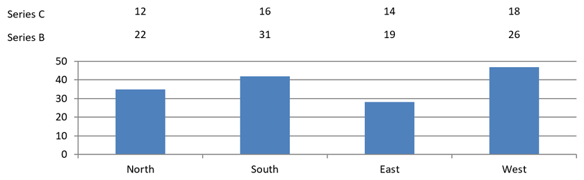

## **المقدمة**

تُظهر تسميات البيانات معلومات حول سلسلة المخطط والنقاط الفردية للبيانات، مما يساعد القارئ على تحديد القيم وفهم المخطط. يوضح هذا المقال كيفية تنسيق القيم، وعرض النسب المئوية، وقراءة نص التسمية، والتحكم في التسميات التي تتجاوز الحد الأقصى للمحور، وضبط تباعد تسميات محور الفئة، وتحديد موضع تسميات المخطط الدائري.

## **تحديد دقة البيانات في تسميات البيانات بالمخطط**

استخدم [NumberFormatOfValues](https://reference.aspose.com/slides/net/aspose.slides.charts/ichartseries/numberformatofvalues/) لتنسيق قيم السلسلة. يخلق هذا المثال مخططًا خطيًا ببيانات افتراضية، يعرض جدول البيانات الخاص به، ويفعل تسميات القيم للسلسلة الأولى. التنسيق `#,##0.00` يعرض فاصل الآلاف ومكانين عشريين دون تغيير القيم الأساسية.

```csharp
using Aspose.Slides;
using Aspose.Slides.Charts;
using Aspose.Slides.Export;

using var presentation = new Presentation();
var slide = presentation.Slides[0];

var chart = slide.Shapes.AddChart(ChartType.Line, 50, 50, 450, 300);
chart.HasDataTable = true;

var series = chart.ChartData.Series[0];
series.NumberFormatOfValues = "#,##0.00";
series.Labels.DefaultDataLabelFormat.ShowValue = true;

presentation.Save("PrecisionOfDatalabels_out.pptx", SaveFormat.Pptx);
```

## **عرض النسبة المئوية كوسوم**

في مخطط الأعمدة المتراكم، احسب كل قيمة كنسبة مئوية من مجموع الفئة الخاص بها وعيّن النص إلى [TextFrameForOverriding](https://reference.aspose.com/slides/net/aspose.slides.charts/ioverridabletext/textframeforoverriding/). يستخدم هذا المثال البيانات الافتراضية للمخطط ويعرض النسب المئوية بمكانين عشريين بخط بحجم 8 نقاط. يتم تخطي الفئات التي يكون مجموعها صفرًا لتجنب القسمة على الصفر. أعِد حساب نص التسمية المخصص إذا تغيرت بيانات المخطط.

```csharp
using System;
using Aspose.Slides;
using Aspose.Slides.Charts;
using Aspose.Slides.Export;

using var presentation = new Presentation();
var slide = presentation.Slides[0];

var chart = slide.Shapes.AddChart(ChartType.StackedColumn, 20, 20, 400, 400);

var categoryTotals = new double[chart.ChartData.Categories.Count];
for (int k = 0; k < chart.ChartData.Categories.Count; k++)
{
    for (int i = 0; i < chart.ChartData.Series.Count; i++)
    {
        var series = chart.ChartData.Series[i];
        var pointValue = Convert.ToDouble(series.DataPoints[k].Value.Data);
        categoryTotals[k] += pointValue;
    }
}

for (int x = 0; x < chart.ChartData.Series.Count; x++)
{
    var series = chart.ChartData.Series[x];
    series.Labels.DefaultDataLabelFormat.ShowLegendKey = false;

    for (int j = 0; j < series.DataPoints.Count; j++)
    {
        var label = series.DataPoints[j].Label;
        if (categoryTotals[j] == 0)
        {
            continue;
        }

        var pointValue = Convert.ToDouble(series.DataPoints[j].Value.Data);
        var dataPointPercent = (pointValue / categoryTotals[j]) * 100;

        var portion = new Portion();
        portion.Text = string.Format("{0:F2} %", dataPointPercent);
        portion.PortionFormat.FontHeight = 8f;

        label.TextFrameForOverriding.Text = "";

        var paragraph = label.TextFrameForOverriding.Paragraphs[0];
        paragraph.Portions.Add(portion);

        label.DataLabelFormat.ShowValue = true;
        label.DataLabelFormat.ShowSeriesName = false;
        label.DataLabelFormat.ShowPercentage = false;
        label.DataLabelFormat.ShowLegendKey = false;
        label.DataLabelFormat.ShowCategoryName = false;
        label.DataLabelFormat.ShowBubbleSize = false;
    }
}

presentation.Save("DisplayPercentageAsLabels_out.pptx", SaveFormat.Pptx);
```

## **تعيين علامة النسبة المئوية في تسميات البيانات بالمخطط**

عند تخزين القيم ككسور، استخدم [NumberFormat](https://reference.aspose.com/slides/net/aspose.slides.charts/idatalabelformat/numberformat/) لعرض النسب المئوية. عيّن [IsNumberFormatLinkedToSource](https://reference.aspose.com/slides/net/aspose.slides.charts/idatalabelformat/isnumberformatlinkedtosource/) إلى `false` لتطبيق تنسيق التسمية بشكل مستقل عن خلايا المصدر. هذا المثال يخلق مخطط أعمدة متراكم بنسبة 100٪ مع سلسلتين حمراء وزرقاء عبر أربعة فئات. كل زوج من القيم يساوي 1. تنسيق التسمية `0.0%` يعرض 0.30 كـ30.0٪، بينما يستخدم المحور العمودي مكانين عشريين. كلا السلسلتين تستخدم نص التسمية بلون أبيض وحجم 10 نقاط.

```csharp
using System.Drawing;
using Aspose.Slides;
using Aspose.Slides.Charts;
using Aspose.Slides.Export;

using var presentation = new Presentation();
var slide = presentation.Slides[0];

var chart = slide.Shapes.AddChart(ChartType.PercentsStackedColumn, 20, 20, 500, 400);

chart.Axes.VerticalAxis.IsNumberFormatLinkedToSource = false;
chart.Axes.VerticalAxis.NumberFormat = "0.00%";

chart.ChartData.Series.Clear();
chart.ChartData.Categories.Clear();

var workbook = chart.ChartData.ChartDataWorkbook;
int worksheetIndex = 0;
for (int i = 0; i < 4; i++)
{
    var categoryCell = workbook.GetCell(worksheetIndex, i + 1, 0, $"Category {i + 1}");
    chart.ChartData.Categories.Add(categoryCell);
}

string[] seriesNames = { "Reds", "Blues" };
Color[] seriesColors = { Color.Red, Color.Blue };
double[,] values = { { 0.30, 0.50, 0.80, 0.65 }, { 0.70, 0.50, 0.20, 0.35 } };

for (int i = 0; i < seriesNames.Length; i++)
{
    var seriesCell = workbook.GetCell(worksheetIndex, 0, i + 1, seriesNames[i]);
    var series = chart.ChartData.Series.Add(seriesCell, chart.Type);
    for (int j = 0; j < 4; j++)
    {
        var valueCell = workbook.GetCell(worksheetIndex, j + 1, i + 1, values[i, j]);
        series.DataPoints.AddDataPointForBarSeries(valueCell);
    }

    series.Format.Fill.FillType = FillType.Solid;
    series.Format.Fill.SolidFillColor.Color = seriesColors[i];

    var labelFormat = series.Labels.DefaultDataLabelFormat;
    labelFormat.ShowValue = true;
    labelFormat.IsNumberFormatLinkedToSource = false;
    labelFormat.NumberFormat = "0.0%";
    labelFormat.TextFormat.PortionFormat.FontHeight = 10;
    labelFormat.TextFormat.PortionFormat.FillFormat.FillType = FillType.Solid;
    labelFormat.TextFormat.PortionFormat.FillFormat.SolidFillColor.Color = Color.White;
}

presentation.Save("SetDataLabelsPercentageSign_out.pptx", SaveFormat.Pptx);
```

## **قراءة النص الفعلي لتسميات البيانات**

استخدم [GetActualLabelText](https://reference.aspose.com/slides/net/aspose.slides.charts/idatalabel/getactuallabeltext/) لاسترجاع النص الناتج عن إعدادات تسمية البيانات. هذا مفيد عند استخراج التسميات لتقارير، أو البحث في محتوى العرض التقديمي، أو التحقق من صحة المخططات المُنشأة. في المثال أدناه، يجمع تنسيق [تنسيق تسمية البيانات](https://reference.aspose.com/slides/net/aspose.slides.charts/idatalabelformat/) الافتراضي كلًا من اسم الفئة، اسم السلسلة، والقيمة. نقطة واحدة تنسق قيمتها كنسبة مئوية، وأخرى تستخدم نصًا مخصصًا من [TextFrameForOverriding](https://reference.aspose.com/slides/net/aspose.slides.charts/ioverridabletext/textframeforoverriding/). 

```csharp
using System;
using Aspose.Slides;
using Aspose.Slides.Charts;

using var presentation = new Presentation();
var slide = presentation.Slides[0];

var chart = slide.Shapes.AddChart(ChartType.ClusteredColumn, 20, 20, 500, 300);

chart.ChartData.Series.Clear();
chart.ChartData.Categories.Clear();

var workbook = chart.ChartData.ChartDataWorkbook;
chart.ChartData.Categories.Add(workbook.GetCell(0, 1, 0, "Q1"));
chart.ChartData.Categories.Add(workbook.GetCell(0, 2, 0, "Q2"));

var north = chart.ChartData.Series.Add(workbook.GetCell(0, 0, 1, "North"), chart.Type);
north.DataPoints.AddDataPointForBarSeries(workbook.GetCell(0, 1, 1, 0.25));
north.DataPoints.AddDataPointForBarSeries(workbook.GetCell(0, 2, 1, 0.75));

var south = chart.ChartData.Series.Add(workbook.GetCell(0, 0, 2, "South"), chart.Type);
south.DataPoints.AddDataPointForBarSeries(workbook.GetCell(0, 1, 2, 0.40));
south.DataPoints.AddDataPointForBarSeries(workbook.GetCell(0, 2, 2, 0.60));

foreach (var series in chart.ChartData.Series)
{
    var format = series.Labels.DefaultDataLabelFormat;
    format.ShowCategoryName = true;
    format.ShowSeriesName = true;
    format.ShowValue = true;
}

north.Labels[1].DataLabelFormat.IsNumberFormatLinkedToSource = false;
north.Labels[1].DataLabelFormat.NumberFormat = "0%";
south.Labels[0].TextFrameForOverriding.Text = "Reviewed";

foreach (var series in chart.ChartData.Series)
{
    foreach (var point in series.DataPoints)
    {
        var label = point.Label;
        if (!label.IsVisible)
        {
            continue;
        }

        Console.WriteLine($"Value: {point.Value.Data}; label: {label.GetActualLabelText()}");
    }
}
```

الرقم المخزن في نقطة البيانات يظل `0.75`، حتى عندما تُظهر تسميتها `75%` مع أسماء الفئة والسلسلة. يستبدل النص المخصص النص الذي تم إنشاؤه تلقائيًا. يُرجع [GetActualLabelText](https://reference.aspose.com/slides/net/aspose.slides.charts/idatalabel/getactuallabeltext/) سلسلة التسمية الناتجة في كلتا الحالتين. تحقق من [IsVisible](https://reference.aspose.com/slides/net/aspose.slides.charts/idatalabel/isvisible/) بشكل منفصل، كما هو موضح أعلاه، عندما تريد استخراج التسميات المرئية فقط.

## **التحكم في تسميات البيانات التي تتجاوز الحد الأقصى للمحور**

عند تحديد نطاق محور يدويًا، قد تتجاوز بعض نقاط البيانات الحد الأقصى له. استخدم [ShowDataLabelsOverMaximum](https://reference.aspose.com/slides/net/aspose.slides.charts/ichart/showdatalabelsovermaximum/) للتحكم فيما إذا كانت تسميات بياناتها تُعرض. هذا الإعداد يغيّر رؤية التسمية؛ لا يغيّر نطاق المحور ولا القيم الأساسية للبيانات. 

يخلق المثال أدناه مخطط أعمدة متجّمّع ثنائي الأبعاد بقيم 60 و120. يعيّن [IsAutomaticMaxValue](https://reference.aspose.com/slides/net/aspose.slides.charts/iaxis/isautomaticmaxvalue/) إلى `false` و[MaxValue](https://reference.aspose.com/slides/net/aspose.slides.charts/iaxis/maxvalue/) إلى 100 على المحور العمودي. تسمح الشريحة الأولى بعرض تسميات تتجاوز الحد الأقصى؛ نسخة من تلك الشريحة تعطلها. تُحفظ كلا الشريحتين في `DataLabelsOverMaximum.pptx`.

فعّل تسميات القيم باستخدام [ShowValue](https://reference.aspose.com/slides/net/aspose.slides.charts/idatalabelformat/showvalue/). إعداد مستوى المخطط لا يفعّل عرض القيم بحد ذاته ولا يتجاوز إعداد إظهار القيمة المعطل لتسمية فردية. يفعّل هذا المثال القيم لكامل السلسلة ويستخدم [Position](https://reference.aspose.com/slides/net/aspose.slides.charts/idatalabelformat/position/) لتحديد موقع التسميات عند الطرف الخارجي لكل عمود.

```csharp
using Aspose.Slides;
using Aspose.Slides.Charts;
using Aspose.Slides.Export;

using var presentation = new Presentation();
var slide = presentation.Slides[0];

var chart = slide.Shapes.AddChart(ChartType.ClusteredColumn, 50, 50, 600, 400);
chart.HasLegend = false;

chart.ChartData.Series.Clear();
chart.ChartData.Categories.Clear();

var workbook = chart.ChartData.ChartDataWorkbook;

var firstCategory = workbook.GetCell(0, 1, 0, "Within range");
var secondCategory = workbook.GetCell(0, 2, 0, "Above maximum");

chart.ChartData.Categories.Add(firstCategory);
chart.ChartData.Categories.Add(secondCategory);

var seriesName = workbook.GetCell(0, 0, 1, "Values");
var series = chart.ChartData.Series.Add(seriesName, chart.Type);

var firstValue = workbook.GetCell(0, 1, 1, 60);
var secondValue = workbook.GetCell(0, 2, 1, 120);

series.DataPoints.AddDataPointForBarSeries(firstValue);
series.DataPoints.AddDataPointForBarSeries(secondValue);

series.Labels.DefaultDataLabelFormat.ShowValue = true;
series.Labels.DefaultDataLabelFormat.Position = LegendDataLabelPosition.OutsideEnd;

chart.Axes.VerticalAxis.IsAutomaticMaxValue = false;
chart.Axes.VerticalAxis.MaxValue = 100;
chart.ShowDataLabelsOverMaximum = true;

var secondSlide = presentation.Slides.AddClone(slide);
var secondChart = (IChart)secondSlide.Shapes[0];
secondChart.ShowDataLabelsOverMaximum = false;

presentation.Save("DataLabelsOverMaximum.pptx", SaveFormat.Pptx);
```

تظهر الصور التالية الشرائح المحفوظة التي تم عرضها بواسطة Microsoft PowerPoint. عند `true`، تكون التسمية **120** مرئية عند الحد العلوي؛ عند `false`، تكون مخفية. تظل التسمية **60** مرئية، يظل الحد الأقصى للمحور **100**، وتظل نقطة البيانات الثانية **120** في الحالتين.

| ShowDataLabelsOverMaximum = true | ShowDataLabelsOverMaximum = false |
| --- | --- |
|  |  |

{}
يستخدم هذا المثال مخطط أعمدة ثنائي الأبعاد مع محور قيم. المخططات التي لا تملك محور قيم، مثل المخططات الدائرية ومخططات الحلقة، لا تمتلك حدًا أقصى للمح axis لتقيده بهذه الطريقة.
{}

## **تحديد مسافة التسمية من المحور**

استخدم [LabelOffset](https://reference.aspose.com/slides/net/aspose.slides.charts/iaxis/labeloffset/) للتحكم في المسافة بين تسميات محور الفئة والمحور. القيمة هي نسبة مئوية من الحد الأقصى لحجم الخط لتسميات المحور. هذا المثال يخلق مخطط أعمدة متجّمّع ويعيّن إزاحة تسميات المحور الأفقي إلى 500. يؤثر هذا الإعداد على تسميات محور الفئة وليس على التسميات المرفقة بنقاط البيانات الفردية.

```csharp
using Aspose.Slides;
using Aspose.Slides.Charts;
using Aspose.Slides.Export;

using var presentation = new Presentation();
var slide = presentation.Slides[0];

var chart = slide.Shapes.AddChart(ChartType.ClusteredColumn, 20, 20, 500, 300);
chart.Axes.HorizontalAxis.LabelOffset = 500;

presentation.Save("SetCategoryAxisLabelDistance_out.pptx", SaveFormat.Pptx);
```

## **ضبط موقع التسمية**

في مخطط دائري، اضبط مواضع تسميات البيانات لتحسين التباعد وإتاحة مساحة لخطوط الربط.

يعرض هذا المثال قيمة نقطة البيانات الأولى، يضع تسميتها خارج الشريحة، ويضبط إزاحتيها [X](https://reference.aspose.com/slides/net/aspose.slides.charts/ilayoutable/x/) و [Y](https://reference.aspose.com/slides/net/aspose.slides.charts/ilayoutable/y/). هذه الإزاحات نسبية إلى عرض وارتفاع المخطط على التوالي.

```csharp
using Aspose.Slides;
using Aspose.Slides.Charts;
using Aspose.Slides.Export;

using var presentation = new Presentation();
var slide = presentation.Slides[0];

var chart = slide.Shapes.AddChart(ChartType.Pie, 50, 50, 200, 200);
var series = chart.ChartData.Series;

var label = series[0].Labels[0];
label.DataLabelFormat.ShowValue = true;
label.DataLabelFormat.Position = LegendDataLabelPosition.OutsideEnd;
label.X = 0.71f;
label.Y = 0.04f;

presentation.Save("presentation.pptx", SaveFormat.Pptx);
```


## **إضافة عدة صفوف من تسميات البيانات فوق مخطط عمود**

يخلق هذا المثال مخطط أعمدة مع صفين من تسميات البيانات فوق مساحة الرسم. تعرض السلسلة A الأعمدة المرئية، بينما توفر السلسلة B والسلسلة C التسميات الإضافية. تُخفى أعمدتها بإزالة التعبئة والحد. يضمن خاصية [Overlap](https://reference.aspose.com/slides/net/aspose.slides.charts/ichartseriesgroup/overlap/) محاذاة الثلاث سلاسل إلى نفس مراكز الفئات.

تخصص إعدادات [PlotArea](https://reference.aspose.com/slides/net/aspose.slides.charts/ichart/plotarea/) مساحة لصفوف التسميات. بعد أن يحسب [ValidateChartLayout](https://reference.aspose.com/slides/net/aspose.slides.charts/ichart/validatechartlayout/) المواضع الافتراضية، تحافظ إزاحات [X](https://reference.aspose.com/slides/net/aspose.slides.charts/ilayoutable/x/) و [Y](https://reference.aspose.com/slides/net/aspose.slides.charts/ilayoutable/y/) على المحاذاة الأفقية وتطبق إزاحات عمودية لترتيب التسميات في صفين. الأرقام تظل تسميات بيانات مرتبطة بقيم السلسلة؛ فقط عناوين الصفوف هي أشكال نصية منفصلة.

```csharp
using System.Drawing;
using Aspose.Slides;
using Aspose.Slides.Charts;
using Aspose.Slides.Export;

using var presentation = new Presentation();
var slide = presentation.Slides[0];

var chart = slide.Shapes.AddChart(ChartType.ClusteredColumn, 40, 40, 640, 200);
chart.HasTitle = false;
chart.HasLegend = false;
chart.TextFormat.PortionFormat.FontHeight = 12;

chart.ChartData.Series.Clear();
chart.ChartData.Categories.Clear();

var workbook = chart.ChartData.ChartDataWorkbook;
workbook.Clear(0);

string[] categories = { "North", "South", "East", "West" };
string[] seriesNames = { "Series A", "Series B", "Series C" };
double[,] seriesValues = {
    { 35, 42, 28, 47 },
    { 22, 31, 19, 26 },
    { 12, 16, 14, 18 }
};

for (int categoryIndex = 0; categoryIndex < categories.Length; categoryIndex++)
{
    var categoryCell = workbook.GetCell(0, categoryIndex + 1, 0, categories[categoryIndex]);
    chart.ChartData.Categories.Add(categoryCell);
}

for (int seriesIndex = 0; seriesIndex < seriesNames.Length; seriesIndex++)
{
    var seriesCell = workbook.GetCell(0, 0, seriesIndex + 1, seriesNames[seriesIndex]);
    var series = chart.ChartData.Series.Add(seriesCell, ChartType.ClusteredColumn);

    for (int categoryIndex = 0; categoryIndex < categories.Length; categoryIndex++)
    {
        var valueCell = workbook.GetCell(0, categoryIndex + 1, seriesIndex + 1, seriesValues[seriesIndex, categoryIndex]);
        series.DataPoints.AddDataPointForBarSeries(valueCell);
    }

    if (seriesIndex > 0)
    {
        // إخفاء أعمدة B و C، ولكن الحفاظ على تسميات البيانات.
        series.Format.Fill.FillType = FillType.NoFill;
        series.Format.Line.FillFormat.FillType = FillType.NoFill;
        var labelFormat = series.Labels.DefaultDataLabelFormat;
        labelFormat.ShowValue = true;
        labelFormat.TextFormat.PortionFormat.FontHeight = 12;
        var labelFill = labelFormat.TextFormat.PortionFormat.FillFormat;
        labelFill.FillType = FillType.Solid;
        labelFill.SolidFillColor.Color = Color.Black;
        labelFormat.Position = LegendDataLabelPosition.InsideBase;
    }
}

// Align all three series with the same category centers.
chart.ChartData.Series[0].ParentSeriesGroup.Overlap = 100;

// Use fewer gridlines for this compact example.
chart.Axes.VerticalAxis.IsAutomaticMajorUnit = false;
chart.Axes.VerticalAxis.MajorUnit = 10;

// Reserve space above the plot for two rows of data labels.
chart.PlotArea.LayoutTargetType = LayoutTargetType.Inner;
chart.PlotArea.X = 0.15f;
chart.PlotArea.Y = 0.32f;
chart.PlotArea.Width = 0.80f;
chart.PlotArea.Height = 0.48f;
chart.ValidateChartLayout();

for (int seriesIndex = 1; seriesIndex < seriesNames.Length; seriesIndex++)
{
    var series = chart.ChartData.Series[seriesIndex];
    float rowTop = seriesIndex == 1 ? 0.15f : 0.03f;

    for (int categoryIndex = 0; categoryIndex < categories.Length; categoryIndex++)
    {
        var dataLabel = series.DataPoints[categoryIndex].Label;
        // الحفاظ على الموضع الأفقي الافتراضي. Y هو إزاحة من
        // موضع التسمية الافتراضي، معبرًا عنه ككسر من ارتفاع المخطط.
        dataLabel.X = 0;
        dataLabel.Y = rowTop - dataLabel.ActualY / chart.Height;
    }

    // عنوان الصف هو الشكل النصي المنفصل الوحيد.
    var rowHeading = slide.Shapes.AddAutoShape(ShapeType.Rectangle, chart.X, chart.Y + rowTop * chart.Height, 85, 18);
    rowHeading.FillFormat.FillType = FillType.NoFill;
    rowHeading.LineFormat.FillFormat.FillType = FillType.NoFill;
    rowHeading.AddTextFrame(seriesNames[seriesIndex]);
    rowHeading.TextFrame.TextFrameFormat.MarginTop = 0;
    rowHeading.TextFrame.TextFrameFormat.MarginBottom = 0;
    var headingFormat = rowHeading.TextFrame.Paragraphs[0].Portions[0].PortionFormat;
    headingFormat.FontHeight = 12;
    headingFormat.FillFormat.FillType = FillType.Solid;
    headingFormat.FillFormat.SolidFillColor.Color = Color.Black;
}

presentation.Save("multiple-rows-of-labels.pptx", SaveFormat.Pptx);
```



## **الأسئلة المتكررة**

**كيف يمكنني منع تداخل تسميات البيانات في المخططات المكتظة؟**  
اجمع بين وضع التسميات التلقائي، خطوط الربط، وتقليل حجم الخط؛ إذا لزم الأمر، أخفِ بعض الحقول (مثل الفئة) أو اعرض التسميات فقط للقيم المتطرفة أو النقاط الرئيسية.

**كيف يمكنني تعطيل التسميات للقيم صفر أو السالبة أو الفارغة فقط؟**  
قم بتصفية نقاط البيانات قبل تفعيل التسميات وأوقف العرض للقيم الصفرية، القيم السالبة، أو القيم الفارغة وفقًا لقاعدة محددة.

**كيف يمكنني ضمان أسلوب تسميات ثابت عند التصدير إلى PDF/صور؟**  
حدد عائلة الخط وحجمه صراحةً وتأكد من توفر الخط في بيئة العرض لتفادي الانتقال إلى خط بديل.