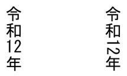

## **نظرة عامة**

توضح هذه المقالة كيفية تنسيق النص في عروض PowerPoint وOpenDocument باستخدام Aspose.Slides للـ Node.js عبر Java. تغطي ألوان الخلفية، الشفافية، تباعد الأحرف، خصائص الخط، الدوران، تباعد الفقرات، سلوك الضبط التلقائي، تثبيت النص، مواضع التبويب، وإعدادات اللغة.

ما لم يُذكر خلاف ذلك، تستخدم الأمثلة الملف [sample.pptx](sample.pptx). الشكل الأول في الشريحة الأولى هو صندوق نص، والفقرة الأولى تحتوي على النص المعروض أدناه. كل من مؤشرات الشرائح والأشكال تبدأ من الصفر. الأمثلة التي تختار أجزاءً بالخط العريض تستخدم التنسيق الفعّال، بما في ذلك تنسيق العريض الموروث:


للعثور على النص الحرفي أو مطابقة التعبيرات النمطية وتظليلها، راجع [البحث واستبدال النص](/slides/ar/nodejs-java/search-and-replace-text/).

## **ضبط لون خلفية النص**

استخدم [ParagraphFormat.getDefaultPortionFormat](https://reference.aspose.com/slides/nodejs-java/aspose.slides/paragraphformat/#getDefaultPortionFormat) لتعيين لون التظليل الافتراضي لفقرة، أو استخدم [BasePortionFormat.getHighlightColor](https://reference.aspose.com/slides/nodejs-java/aspose.slides/baseportionformat/#getHighlightColor) لأجزاء النص الفردية.

المثال التالي يضبط تظليلًا رماديًا فاتحًا كافتراضي للفقرة الأولى. الألوان المخصصة للتظليل على الأجزاء الفردية تتفوق على هذا الافتراضي:

```javascript
const aspose = { slides: require("aspose.slides.via.java") };
const java = require("java");

const presentation = new aspose.slides.Presentation("sample.pptx");
try {
    const slide = presentation.getSlides().get_Item(0);

    const autoShape = slide.getShapes().get_Item(0);
    const paragraph = autoShape.getTextFrame().getParagraphs().get_Item(0);

    // تعيين لون التظليل للفقرة بأكملها.
    paragraph.getParagraphFormat().getDefaultPortionFormat().getHighlightColor().setColor(java.getStaticFieldValue("java.awt.Color", "LIGHT_GRAY"));

    presentation.save("gray_paragraph.pptx", aspose.slides.SaveFormat.Pptx);
} finally {
    presentation.dispose();
}
```

النتيجة:


يوضح مثال الكود أدناه كيفية تعيين لون الخلفية لـ **أجزاء النص ذات الخط العريض**:

```javascript
const aspose = { slides: require("aspose.slides.via.java") };
const java = require("java");

const presentation = new aspose.slides.Presentation("sample.pptx");
try {
    const slide = presentation.getSlides().get_Item(0);

    const autoShape = slide.getShapes().get_Item(0);
    const paragraph = autoShape.getTextFrame().getParagraphs().get_Item(0);
    const portions = paragraph.getPortions();
    const portionCount = portions.getCount();

    for (let portionIndex = 0; portionIndex < portionCount; portionIndex++) {
        const portion = portions.get_Item(portionIndex);
        if (portion.getPortionFormat().getEffective().getFontBold()) {
            // تعيين لون التظليل للجزء النصي.
            portion.getPortionFormat().getHighlightColor().setColor(java.getStaticFieldValue("java.awt.Color", "LIGHT_GRAY"));
        }
    }

    presentation.save("gray_text_portions.pptx", aspose.slides.SaveFormat.Pptx);
} finally {
    presentation.dispose();
}
```

النتيجة:


## **محاذاة فقرات النص**

استخدم [ParagraphFormat.setAlignment](https://reference.aspose.com/slides/nodejs-java/aspose.slides/paragraphformat/#setAlignment) لتعيين محاذاة الفقرة داخل إطار النص. يمكن أن تكون القيمة مركزية، محاذاة إلى اليسار، إلى اليمين، مبررة، وما إلى ذلك.

يوضح مثال الكود التالي كيفية محاذاة الفقرة إلى **الوسط**:

```javascript
const aspose = { slides: require("aspose.slides.via.java") };

const presentation = new aspose.slides.Presentation("sample.pptx");
try {
    const slide = presentation.getSlides().get_Item(0);

    const autoShape = slide.getShapes().get_Item(0);
    const paragraph = autoShape.getTextFrame().getParagraphs().get_Item(0);

    // تعيين محاذاة الفقرة إلى الوسط.
    paragraph.getParagraphFormat().setAlignment(aspose.slides.TextAlignment.Center);

    presentation.save("aligned_paragraph.pptx", aspose.slides.SaveFormat.Pptx);
} finally {
    presentation.dispose();
}
```

النتيجة:


## **محاذاة الخطوط داخل السطر**

استخدم [ParagraphFormat.setFontAlignment](https://reference.aspose.com/slides/nodejs-java/aspose.slides/paragraphformat/#setFontAlignment) لمحاذاة أجزاء النص ذات أحجام الخط المختلفة عموديًا داخل السطر. يطبق هذا الإعداد على الفقرة بأكملها ويتحكم في المحاذاة داخل كل سطر منها.

المثال المستقل التالي ينشئ أربعة صناديق نصية معنونة على شريحة واحدة. كل فقرة تحتوي على نفس النص بحجم 18، 36، و54 نقطة، مع محاذاة خط مختلفة. يستخدم Arial، يعطل الضبط التلقائي والالتفاف، ويحافظ على أن إطارات النص كبيرة بما يكفي لسطر واحد.

```javascript
const aspose = { slides: require("aspose.slides.via.java") };
const java = require("java");

const presentation = new aspose.slides.Presentation();
try {
    const slide = presentation.getSlides().get_Item(0);

    const alignments = [aspose.slides.FontAlignment.Baseline, aspose.slides.FontAlignment.Top, aspose.slides.FontAlignment.Center, aspose.slides.FontAlignment.Bottom];
    const alignmentNames = ["Baseline", "Top", "Center", "Bottom"];
    const fontSizes = [18, 36, 54];

    for (let i = 0; i < alignments.length; i++) {
        const shape = slide.getShapes().addAutoShape(aspose.slides.ShapeType.Rectangle, 30, 20 + i * 130, 660, 120);
        shape.getFillFormat().setFillType(java.newByte(aspose.slides.FillType.NoFill));
        shape.getLineFormat().getFillFormat().setFillType(java.newByte(aspose.slides.FillType.NoFill));

        const textFrame = shape.getTextFrame();
        textFrame.getTextFrameFormat().setAnchoringType(java.newByte(aspose.slides.TextAnchorType.Top));
        textFrame.getTextFrameFormat().setAutofitType(java.newByte(aspose.slides.TextAutofitType.None));
        textFrame.getTextFrameFormat().setWrapText(java.newByte(aspose.slides.NullableBool.False));

        const label = textFrame.getParagraphs().get_Item(0);
        label.setText(alignmentNames[i]);
        label.getParagraphFormat().setAlignment(aspose.slides.TextAlignment.Left);
        label.getParagraphFormat().getDefaultPortionFormat().setFontHeight(14);
        label.getParagraphFormat().getDefaultPortionFormat().setLatinFont(new aspose.slides.FontData("Arial"));
        label.getParagraphFormat().getDefaultPortionFormat().getFillFormat().setFillType(java.newByte(aspose.slides.FillType.Solid));
        label.getParagraphFormat().getDefaultPortionFormat().getFillFormat().getSolidFillColor().setColor(java.getStaticFieldValue("java.awt.Color", "GRAY"));

        const paragraph = new aspose.slides.Paragraph();
        paragraph.getParagraphFormat().setFontAlignment(alignments[i]);
        paragraph.getParagraphFormat().setAlignment(aspose.slides.TextAlignment.Left);
        paragraph.getParagraphFormat().getDefaultPortionFormat().setLatinFont(new aspose.slides.FontData("Arial"));
        paragraph.getParagraphFormat().getDefaultPortionFormat().getFillFormat().setFillType(java.newByte(aspose.slides.FillType.Solid));
        paragraph.getParagraphFormat().getDefaultPortionFormat().getFillFormat().getSolidFillColor().setColor(java.getStaticFieldValue("java.awt.Color", "BLACK"));

        for (const fontSize of fontSizes) {
            const portion = new aspose.slides.Portion("Ag ");
            portion.getPortionFormat().setFontHeight(fontSize);
            paragraph.getPortions().add(portion);
        }

        textFrame.getParagraphs().add(paragraph);
    }

    presentation.save("font_alignment.pptx", aspose.slides.SaveFormat.Pptx);
} finally {
    presentation.dispose();
}
```

النتيجة:


تستخدم محاذاة الخط مقاييس الخط، لذا قد لا تتطابق حواف الأحرف الفردية تمامًا. يتضمن المثال حرفًا كبيرًا وحرفًا أسفليًا لتوضيح الفرق بين محاذاة الخط الأساسي والسفلية. توفر الخط واستبداله، الأحرف المستخدمة، والفرق في أحجام الخط تؤثر على النتيجة. أبعاد الإطار، الهوامش، تباعد السطر، الالتفاف، والضبط التلقائي تؤثر أيضًا على التخطيط؛ استخدم نفس الخطوط وإعدادات التخطيط عند مقارنة الأنماط.

يختلف هذا الإعداد عن [ParagraphFormat.setAlignment](https://reference.aspose.com/slides/nodejs-java/aspose.slides/paragraphformat/#setAlignment)، الذي يتحكم في محاذاة الفقرة أفقياً، وعن [TextFrameFormat.setAnchoringType](https://reference.aspose.com/slides/nodejs-java/aspose.slides/textframeformat/#setAnchoringType)، الذي يحدد موضع كتلة النص عموديًا داخل الشكل. تنسيق الحرف العلوي والسفلي عبر [BasePortionFormat.setEscapement](https://reference.aspose.com/slides/nodejs-java/aspose.slides/baseportionformat/#setEscapement) يغير موضع الأجزاء الفردية بالنسبة للخط الأساسي بدلاً من ضبط محاذاة الخط لسطور الفقرة.

## **ضبط الشفافية للنص**

تُتحكم شفافية النص عبر مكوّن ألفا للون المعيّن إلى [BasePortionFormat.getFillFormat](https://reference.aspose.com/slides/nodejs-java/aspose.slides/baseportionformat/#getFillFormat). في الأمثلة أدناه، `alpha = 50` هو قيمة قناة ألفا بنظام ARGB على مقياس 0–255، وليس نسبة شفافية.

يوضح مثال الكود أدناه كيفية تطبيق الشفافية على **الفقرة بأكملها**:

```javascript
const aspose = { slides: require("aspose.slides.via.java") };
const java = require("java");

const alpha = 50;
const transparentBlack = java.newInstanceSync("java.awt.Color", 0, 0, 0, alpha);
const presentation = new aspose.slides.Presentation("sample.pptx");
try {
    const slide = presentation.getSlides().get_Item(0);

    const autoShape = slide.getShapes().get_Item(0);
    const paragraph = autoShape.getTextFrame().getParagraphs().get_Item(0);
    const fillFormat = paragraph.getParagraphFormat().getDefaultPortionFormat().getFillFormat();

    // تعيين لون ملء النص إلى لون شفاف.
    fillFormat.setFillType(java.newByte(aspose.slides.FillType.Solid));
    fillFormat.getSolidFillColor().setColor(transparentBlack);

    presentation.save("transparent_paragraph.pptx", aspose.slides.SaveFormat.Pptx);
} finally {
    presentation.dispose();
}
```

النتيجة:


يوضح مثال الكود التالي كيفية تطبيق الشفافية على **أجزاء النص ذات الخط العريض**:

```javascript
const aspose = { slides: require("aspose.slides.via.java") };
const java = require("java");

const alpha = 50;
const transparentBlack = java.newInstanceSync("java.awt.Color", 0, 0, 0, alpha);
const presentation = new aspose.slides.Presentation("sample.pptx");
try {
    const slide = presentation.getSlides().get_Item(0);

    const autoShape = slide.getShapes().get_Item(0);
    const paragraph = autoShape.getTextFrame().getParagraphs().get_Item(0);
    const portions = paragraph.getPortions();
    const portionCount = portions.getCount();

    for (let portionIndex = 0; portionIndex < portionCount; portionIndex++) {
        const portion = portions.get_Item(portionIndex);
        if (portion.getPortionFormat().getEffective().getFontBold()) {
            const fillFormat = portion.getPortionFormat().getFillFormat();

            // تعيين شفافية الجزء النصي.
            fillFormat.setFillType(java.newByte(aspose.slides.FillType.Solid));
            fillFormat.getSolidFillColor().setColor(transparentBlack);
        }
    }

    presentation.save("transparent_text_portions.pptx", aspose.slides.SaveFormat.Pptx);
} finally {
    presentation.dispose();
}
```

النتيجة:


## **ضبط تباعد الأحرف للنص**

استخدم [BasePortionFormat.setSpacing](https://reference.aspose.com/slides/nodejs-java/aspose.slides/baseportionformat/#setSpacing) لتوسيع أو تضييق التباعد بين الأحرف في صندوق نص. تضيف الأمثلة 3 نقاط من التباعد؛ القيم السالبة تضيق النص.

يوضح كود JavaScript التالي كيفية توسيع تباعد الأحرف في **الفقرة بأكملها**:

```javascript
const aspose = { slides: require("aspose.slides.via.java") };

const presentation = new aspose.slides.Presentation("sample.pptx");
try {
    const slide = presentation.getSlides().get_Item(0);

    const autoShape = slide.getShapes().get_Item(0);
    const paragraph = autoShape.getTextFrame().getParagraphs().get_Item(0);

    // ملاحظة: استخدم القيم السالبة لضغط تباعد الأحرف.
    paragraph.getParagraphFormat().getDefaultPortionFormat().setSpacing(3); // توسيع تباعد الأحرف.

    presentation.save("character_spacing_in_paragraph.pptx", aspose.slides.SaveFormat.Pptx);
} finally {
    presentation.dispose();
}
```

النتيجة:


يوضح مثال الكود أدناه كيفية توسيع تباعد الأحرف في **أجزاء النص ذات الخط العريض**:

```javascript
const aspose = { slides: require("aspose.slides.via.java") };

const presentation = new aspose.slides.Presentation("sample.pptx");
try {
    const slide = presentation.getSlides().get_Item(0);

    const autoShape = slide.getShapes().get_Item(0);
    const paragraph = autoShape.getTextFrame().getParagraphs().get_Item(0);
    const portions = paragraph.getPortions();
    const portionCount = portions.getCount();

    for (let portionIndex = 0; portionIndex < portionCount; portionIndex++) {
        const portion = portions.get_Item(portionIndex);
        if (portion.getPortionFormat().getEffective().getFontBold()) {
            // ملاحظة: استخدم القيم السالبة لضغط تباعد الأحرف.
            portion.getPortionFormat().setSpacing(3); // توسيع تباعد الأحرف.
        }
    }

    presentation.save("character_spacing_in_text_portions.pptx", aspose.slides.SaveFormat.Pptx);
} finally {
    presentation.dispose();
}
```

النتيجة:


### **تعطيل التقسيم (Kerning) للخطوط المحددة**

في بعض الحالات، قد يبدو النص المُنتج بواسطة Aspose.Slides أكثر إحكامًا قليلاً من نفس النص المعروض في PowerPoint. يمكن أن يحدث ذلك لأن PowerPoint قد يتجاهل بيانات الـ kerning لبعض الخطوط، حتى عندما يحتوي الخط على معلومات kerning صالحة ويكون الـ kerning مفعلاً في إعدادات PowerPoint.

لجعل الإخراج المُنتج أقرب إلى PowerPoint في مثل هذه الحالات، يمكنك تعطيل الـ kerning لأجزاء النص التي تستخدم الخط المتأثر. اضبط [BasePortionFormat.setKerningMinimalSize](https://reference.aspose.com/slides/nodejs-java/aspose.slides/baseportionformat/#setKerningMinimalSize) على قيمة أكبر من حجم الخط الفعلي. يتطلب هذا المثال الملف "presentation.pptx" مع صندوق نص كأول شكل في الشريحة الأولى. يتحقق من أسماء الخطوط الفعّالة، بما في ذلك الخطوط الموروثة، ويضع عتبة 100 نقطة للأجزاء التي تستخدم Roboto. هذا يعطل الـ kerning للأجزاء المطابقة التي يكون حجم الخط فيها أقل من 100 نقطة:

```javascript
const aspose = { slides: require("aspose.slides.via.java") };

const presentation = new aspose.slides.Presentation("presentation.pptx");
try {
    const slide = presentation.getSlides().get_Item(0);

    const autoShape = slide.getShapes().get_Item(0);
    const paragraphs = autoShape.getTextFrame().getParagraphs();
    const paragraphCount = paragraphs.getCount();
    const targetFont = "Roboto";

    for (let paragraphIndex = 0; paragraphIndex < paragraphCount; paragraphIndex++) {
        const portions = paragraphs.get_Item(paragraphIndex).getPortions();
        const portionCount = portions.getCount();

        for (let portionIndex = 0; portionIndex < portionCount; portionIndex++) {
            const portion = portions.get_Item(portionIndex);
            const portionFormat = portion.getPortionFormat().getEffective();
            const latinFont = portionFormat.getLatinFont();
            const eastAsianFont = portionFormat.getEastAsianFont();
            const complexScriptFont = portionFormat.getComplexScriptFont();

            if ((latinFont !== null && latinFont.getFontName() === targetFont) ||
                (eastAsianFont !== null && eastAsianFont.getFontName() === targetFont) ||
                (complexScriptFont !== null && complexScriptFont.getFontName() === targetFont)) {
                portion.getPortionFormat().setKerningMinimalSize(100);
            }
        }
    }

    presentation.save("output.pptx", aspose.slides.SaveFormat.Pptx);
} finally {
    presentation.dispose();
}
```

بالنسبة للنص المطابق تحت العتبة، يمنع هذا الإعداد الـ kerning ويمكن أن يساعد في مطابقة عرض Aspose.Slides مع المخرجات المرئية في PowerPoint للخطوط المتأثرة بهذا السلوك الخاص بـ PowerPoint.

## **إدارة خصائص خط النص**

يمكن تعيين خصائص الخط على مستوى الفقرة عبر [ParagraphFormat.getDefaultPortionFormat](https://reference.aspose.com/slides/nodejs-java/aspose.slides/paragraphformat/#getDefaultPortionFormat) أو على الأجزاء الفردية عبر [PortionFormat](https://reference.aspose.com/slides/nodejs-java/aspose.slides/portionformat/).

المثال التالي يضبط الخط الافتراضي للفقرة الأولى إلى 12 نقطة Times New Roman مع تنسيق عريض ومائل وتسطير نقطي. التنسيق الصريح على الأجزاء الفردية يتفوق على هذه القيم الافتراضية.

```javascript
const aspose = { slides: require("aspose.slides.via.java") };
const java = require("java");

const presentation = new aspose.slides.Presentation("sample.pptx");
try {
    const slide = presentation.getSlides().get_Item(0);

    const autoShape = slide.getShapes().get_Item(0);
    const paragraph = autoShape.getTextFrame().getParagraphs().get_Item(0);
    const defaultPortionFormat = paragraph.getParagraphFormat().getDefaultPortionFormat();

    // تعيين خصائص الخط للفقرة.
    defaultPortionFormat.setFontHeight(12);
    defaultPortionFormat.setFontBold(java.newByte(aspose.slides.NullableBool.True));
    defaultPortionFormat.setFontItalic(java.newByte(aspose.slides.NullableBool.True));
    defaultPortionFormat.setFontUnderline(java.newByte(aspose.slides.TextUnderlineType.Dotted));
    defaultPortionFormat.setLatinFont(new aspose.slides.FontData("Times New Roman"));

    presentation.save("font_properties_for_paragraph.pptx", aspose.slides.SaveFormat.Pptx);
} finally {
    presentation.dispose();
}
```

النتيجة:


المثال التالي يطبق Times New Roman بحجم 13 نقطة، تنسيق مائل، وتسطير نقطي على الأجزاء التي يكون تنسيقها الفعّال عريضًا:

```javascript
const aspose = { slides: require("aspose.slides.via.java") };
const java = require("java");

const presentation = new aspose.slides.Presentation("sample.pptx");
try {
    const slide = presentation.getSlides().get_Item(0);

    const autoShape = slide.getShapes().get_Item(0);
    const paragraph = autoShape.getTextFrame().getParagraphs().get_Item(0);
    const portions = paragraph.getPortions();
    const portionCount = portions.getCount();

    for (let portionIndex = 0; portionIndex < portionCount; portionIndex++) {
        const portion = portions.get_Item(portionIndex);
        if (portion.getPortionFormat().getEffective().getFontBold()) {
            const portionFormat = portion.getPortionFormat();

            // تعيين خصائص الخط للجزء النصي.
            portionFormat.setFontHeight(13);
            portionFormat.setFontItalic(java.newByte(aspose.slides.NullableBool.True));
            portionFormat.setFontUnderline(java.newByte(aspose.slides.TextUnderlineType.Dotted));
            portionFormat.setLatinFont(new aspose.slides.FontData("Times New Roman"));
        }
    }

    presentation.save("font_properties_for_text_portions.pptx", aspose.slides.SaveFormat.Pptx);
} finally {
    presentation.dispose();
}
```

النتيجة:


## **التحكم في تطبيع ارتفاع النص**

استخدم [BasePortionFormat.setNormaliseHeight](https://reference.aspose.com/slides/nodejs-java/aspose.slides/baseportionformat/#setNormaliseHeight) عند إعادة إنتاج تنسيق القالب أو دراسة الفروق في ارتفاع الأحرف. في PowerPoint، يؤدي تمكين التطبيع إلى تمديد أو ضغط الأحرف الفردية رأسيًا لإعطائها ارتفاعًا مرئيًا موحدًا داخل جزء النص. لا يضمن ذلك توحيد ارتفاع النص عبر خطوط مختلفة.

اضبط الخاصية إلى [NullableBool.True or False](https://reference.aspose.com/slides/nodejs-java/aspose.slides/nullablebool/) لتمكين أو تعطيل التطبيع صراحةً. `NullableBool.NotDefined` يترك الإعداد المحلي غير محدد بحيث يرث الجزء قيمته، على سبيل المثال، من [getDefaultPortionFormat](https://reference.aspose.com/slides/nodejs-java/aspose.slides/paragraphformat/#getDefaultPortionFormat) الخاص بالفقرة. هذا لا يعني `False`. استخدم [PortionFormat.getEffective](https://reference.aspose.com/slides/nodejs-java/aspose.slides/portionformat/#getEffective) واقرأ [IBasePortionFormatEffectiveData.getNormaliseHeight](https://reference.aspose.com/slides/java/com.aspose.slides/ibaseportionformateffectivedata/#getNormaliseHeight--) للحصول على القيمة المنطقية المحسوبة.

المثال المستقل التالي يتطلب تثبيت **Arial**. ينشئ كتلتين نصيتين تحتويان على نفس الحروف الكبيرة، الصغيرة، الأحرف السفلية، والحروف المجهّرة بحجم 54 نقطة. كلتا الفقرتين تمكّن التطبيع افتراضيًا. الجزء العلوي يعطل ذلك صراحةً؛ الجزء السفلي يرثه. أحجام الإطارات والهوامش وتباعد الفقرات متطابقة، مع تعطيل الالتفاف والضبط التلقائي للحفاظ على مقارنة ثابتة. يطبع المثال `False: false` و`NotDefined: true`، ثم يحفظ "text_height_normalization.pptx".

```javascript
const aspose = { slides: require("aspose.slides.via.java") };
const java = require("java");

const presentation = new aspose.slides.Presentation();
try {
    const slide = presentation.getSlides().get_Item(0);

    const settings = [aspose.slides.NullableBool.False, aspose.slides.NullableBool.NotDefined];
    const settingNames = ["False", "NotDefined"];

    for (let i = 0; i < settings.length; i++) {
        const shape = slide.getShapes().addAutoShape(aspose.slides.ShapeType.Rectangle, 30, 60 + i * 200, 660, 150);
        shape.getFillFormat().setFillType(java.newByte(aspose.slides.FillType.NoFill));
        shape.getLineFormat().getFillFormat().setFillType(java.newByte(aspose.slides.FillType.NoFill));

        const textFrame = shape.getTextFrame();
        textFrame.setText("Hxgjpq ÅÉ 0123");
        textFrame.getTextFrameFormat().setAutofitType(java.newByte(aspose.slides.TextAutofitType.None));
        textFrame.getTextFrameFormat().setWrapText(java.newByte(aspose.slides.NullableBool.False));
        textFrame.getTextFrameFormat().setAnchoringType(java.newByte(aspose.slides.TextAnchorType.Top));
        textFrame.getTextFrameFormat().setMarginTop(0);
        textFrame.getTextFrameFormat().setMarginLeft(0);

        const paragraph = textFrame.getParagraphs().get_Item(0);
        paragraph.getParagraphFormat().setAlignment(aspose.slides.TextAlignment.Left);
        paragraph.getParagraphFormat().setSpaceBefore(0);
        paragraph.getParagraphFormat().setSpaceAfter(0);
        paragraph.getParagraphFormat().setSpaceWithin(100);
        paragraph.getParagraphFormat().getDefaultPortionFormat().setNormaliseHeight(java.newByte(aspose.slides.NullableBool.True));

        const portion = paragraph.getPortions().get_Item(0);
        const font = new aspose.slides.FontData("Arial");
        portion.getPortionFormat().setLatinFont(font);
        portion.getPortionFormat().setFontHeight(54);
        portion.getPortionFormat().getFillFormat().setFillType(java.newByte(aspose.slides.FillType.Solid));
        const textColor = java.getStaticFieldValue("java.awt.Color", "BLACK");
        portion.getPortionFormat().getFillFormat().getSolidFillColor().setColor(textColor);
        portion.getPortionFormat().setNormaliseHeight(java.newByte(settings[i]));

        console.log(settingNames[i] + ": " + portion.getPortionFormat().getEffective().getNormaliseHeight());
    }

    presentation.save("text_height_normalization.pptx", aspose.slides.SaveFormat.Pptx);
} finally {
    presentation.dispose();
}
```

المقارنة أدناه تم تصديرها من العرض التقديمي المحفوظ. الصف العلوي فيه التطبيع معطل (`False`); الصف السفلي يرث الإعداد الممكّن (`NotDefined` → `True`). ابقِ Arial مثبتًا لإعادة إنتاج هذا الشكل.


يُغيّر التطبيع ارتفاع الأحرف دون تغيير القيمة المعيّنة لـ [getFontHeight](https://reference.aspose.com/slides/nodejs-java/aspose.slides/baseportionformat/#getFontHeight)، التي تحدد حجم الخط بالنقاط. يتحكم [setSpaceWithin](https://reference.aspose.com/slides/nodejs-java/aspose.slides/paragraphformat/#setSpaceWithin) في الفقرة في تباعد السطر، بينما يتحكم إطار النص [setAutofitType](https://reference.aspose.com/slides/nodejs-java/aspose.slides/textframeformat/#setAutofitType) في كيفية تعديل النص أو الحاوية لتلائم. تخدم هذه الإعدادات أغراضًا مختلفة ويمكن أن تؤثر على التخطيط الكلي بشكل مستقل. للمزيد حول تنسيق الفقرة والورث، راجع [Manage Paragraph](/slides/ar/nodejs-java/manage-paragraph/).

## **إضافة وإزالة الخط عبر النص**

استخدم [BasePortionFormat.setStrikethroughType](https://reference.aspose.com/slides/nodejs-java/aspose.slides/baseportionformat/#setStrikethroughType) على جزء نص لإظهار التصحيحات أو المصطلحات الملغاة أو الأسعار السابقة دون حذف النص الأصلي. اضبطه إلى [TextStrikethroughType.Single or Double](https://reference.aspose.com/slides/nodejs-java/aspose.slides/textstrikethroughtype/) للحصول على خط واحد أو مزدوج عبر النص.

لإزالة الخط عبر النص، مرّر [TextStrikethroughType.None](https://reference.aspose.com/slides/nodejs-java/aspose.slides/textstrikethroughtype/#None). هذا يعطل التأثير صراحةً، حتى لو كان التنسيق المحيط يحدد وجود الخط عبر النص. بالمقابل، يترك [TextStrikethroughType.NotDefined](https://reference.aspose.com/slides/nodejs-java/aspose.slides/textstrikethroughtype/#NotDefined) الإعداد المحلي غير معرف، مما يسمح للجزء بوراثة التنسيق، على سبيل المثال، من الفقرة. لا يضمن ذلك إزالة الخط عبر النص. استخدم [PortionFormat.getEffective](https://reference.aspose.com/slides/nodejs-java/aspose.slides/portionformat/#getEffective) لقراءة التنسيق الناتج، بما في ذلك القيم الموروثة.

المثال المستقل التالي ينشئ ثلاث مقارنات للأسعار. كل فقرة لديها أجزاء منفصلة للعلامة والسعر السابق والسعر الحالي، بحيث يتأثر السعر السابق فقط. الصف الأول يضيف ثم يزيل الخط عبر النص؛ الصفوف الأخرى تحتفظ بخط عبر نص واحد أو مزدوج. تغيير هذا الإعداد يحافظ على النص وتنسيقه الآخر، بما في ذلك السعر السابق العريض.

```javascript
const aspose = { slides: require("aspose.slides.via.java") };
const java = require("java");

const presentation = new aspose.slides.Presentation();
try {
    const slide = presentation.getSlides().get_Item(0);

    const shape = slide.getShapes().addAutoShape(aspose.slides.ShapeType.Rectangle, 50, 50, 620, 220);
    shape.getFillFormat().setFillType(java.newByte(aspose.slides.FillType.NoFill));
    shape.getLineFormat().getFillFormat().setFillType(java.newByte(aspose.slides.FillType.NoFill));
    shape.getTextFrame().getParagraphs().clear();

    const labels = ["None: ", "Single: ", "Double: "];

    for (const label of labels) {
        const paragraph = new aspose.slides.Paragraph();
        paragraph.getParagraphFormat().setAlignment(aspose.slides.TextAlignment.Left);
        paragraph.getParagraphFormat().setSpaceAfter(20);

        const format = paragraph.getParagraphFormat().getDefaultPortionFormat();
        format.setFontHeight(28);
        const font = new aspose.slides.FontData("Arial");
        format.setLatinFont(font);
        format.getFillFormat().setFillType(java.newByte(aspose.slides.FillType.Solid));
        const textColor = java.getStaticFieldValue("java.awt.Color", "BLACK");
        format.getFillFormat().getSolidFillColor().setColor(textColor);

        const labelPortion = new aspose.slides.Portion(label);
        paragraph.getPortions().add(labelPortion);

        const previousPrice = new aspose.slides.Portion("$100");
        previousPrice.getPortionFormat().setFontBold(java.newByte(aspose.slides.NullableBool.True));
        paragraph.getPortions().add(previousPrice);
        const currentPrice = new aspose.slides.Portion(" → $80");
        paragraph.getPortions().add(currentPrice);

        shape.getTextFrame().getParagraphs().add(paragraph);
    }

    const paragraphs = shape.getTextFrame().getParagraphs();

    // تطبيق الخط عبر النص، ثم إزالته صراحةً من السعر السابق الأول.
    paragraphs.get_Item(0).getPortions().get_Item(1).getPortionFormat().setStrikethroughType(java.newByte(aspose.slides.TextStrikethroughType.Single));
    paragraphs.get_Item(0).getPortions().get_Item(1).getPortionFormat().setStrikethroughType(java.newByte(aspose.slides.TextStrikethroughType.None));

    paragraphs.get_Item(1).getPortions().get_Item(1).getPortionFormat().setStrikethroughType(java.newByte(aspose.slides.TextStrikethroughType.Single));
    paragraphs.get_Item(2).getPortions().get_Item(1).getPortionFormat().setStrikethroughType(java.newByte(aspose.slides.TextStrikethroughType.Double));

    presentation.save("strikethrough.pptx", aspose.slides.SaveFormat.Pptx);
} finally {
    presentation.dispose();
}
```

النتيجة، من الأعلى إلى الأسفل: بدون خط عبر النص، خط عبر نص واحد، وخط عبر نص مزدوج.


## **ضبط دوران النص**

استخدم [TextFrameFormat.setTextVerticalType](https://reference.aspose.com/slides/nodejs-java/aspose.slides/textframeformat/#setTextVerticalType) لتعيين اتجاه نص مسبق التعريف داخل الشكل.

يوضح مثال الكود التالي ضبط اتجاه النص داخل الشكل إلى [TextVerticalType.Vertical270](https://reference.aspose.com/slides/nodejs-java/aspose.slides/textverticaltype/)، الذي يدور النص **90 درجة عكس اتجاه عقارب الساعة**:

```javascript
const aspose = { slides: require("aspose.slides.via.java") };
const java = require("java");

const presentation = new aspose.slides.Presentation("sample.pptx");
try {
    const slide = presentation.getSlides().get_Item(0);

    const autoShape = slide.getShapes().get_Item(0);
    autoShape.getTextFrame().getTextFrameFormat().setTextVerticalType(java.newByte(aspose.slides.TextVerticalType.Vertical270));

    presentation.save("text_rotation.pptx", aspose.slides.SaveFormat.Pptx);
} finally {
    presentation.dispose();
}
```

النتيجة:


## **عرض الأرقام جنبًا إلى جنب في النص العمودي**

لحافظ على رقم مكوّن من رقمين معًا في تسمية يابانية عمودية، ضع كلا الرقمين في جزء نص واحد واستدعِ [BasePortionFormat.setKumimoji](https://reference.aspose.com/slides/nodejs-java/aspose.slides/baseportionformat/#setKumimoji) على تنسيق ذلك الجزء. يستخدم المثال [TextVerticalType.EastAsianVertical](https://reference.aspose.com/slides/nodejs-java/aspose.slides/textverticaltype/#EastAsianVertical) وخط MS Gothic بحجم 40 نقطة لكلا التسميتين. فقط قيمة [NullableBool](https://reference.aspose.com/slides/nodejs-java/aspose.slides/nullablebool/) الممررة إلى الجزء الرقمي تختلف.

```javascript
const aspose = { slides: require("aspose.slides.via.java") };
const java = require("java");

const presentation = new aspose.slides.Presentation();
try {
    const slide = presentation.getSlides().get_Item(0);

    const font = new aspose.slides.FontData("MS Gothic");
    const textColor = java.getStaticFieldValue("java.awt.Color", "BLACK");
    const settings = [aspose.slides.NullableBool.True, aspose.slides.NullableBool.False];
    let x = 120;

    for (const kumimoji of settings) {
        const label = slide.getShapes().addAutoShape(aspose.slides.ShapeType.Rectangle, x, 48, 120, 420);
        label.getFillFormat().setFillType(java.newByte(aspose.slides.FillType.NoFill));
        label.getLineFormat().getFillFormat().setFillType(java.newByte(aspose.slides.FillType.NoFill));

        const frame = label.addTextFrame("");
        frame.getTextFrameFormat().setTextVerticalType(java.newByte(aspose.slides.TextVerticalType.EastAsianVertical));

        const paragraph = frame.getParagraphs().get_Item(0);
        const format = paragraph.getParagraphFormat().getDefaultPortionFormat();
        format.setLatinFont(font);
        format.setEastAsianFont(font);
        format.setFontHeight(40);
        format.getFillFormat().setFillType(java.newByte(aspose.slides.FillType.Solid));
        format.getFillFormat().getSolidFillColor().setColor(textColor);

        const digits = new aspose.slides.Portion("12");
        digits.getPortionFormat().setKumimoji(java.newByte(kumimoji));

        const portions = paragraph.getPortions();
        portions.clear();
        portions.add(new aspose.slides.Portion("令和"));
        portions.add(digits);
        portions.add(new aspose.slides.Portion("年"));
        x += 240;
    }
    presentation.save("vertical_date.pptx", aspose.slides.SaveFormat.Pptx);
} finally {
    presentation.dispose();
}
```

في PowerPoint، تُظهر التسمية اليسرى (`True`) الأرقام عمودية وجانبًا إلى جانب بين 和 و 年. في التسمية اليمنى (`False`)، يتم تدوير الزوج 90 درجة مع اتجاه عقارب الساعة. الأحرف اليابانية المحيطة تبقى رأسية في كلتا التسميتين.



## **ضبط دوران مخصص لإطارات النص**

استخدم [TextFrameFormat.setRotationAngle](https://reference.aspose.com/slides/nodejs-java/aspose.slides/textframeformat/#setRotationAngle) لتعيين زاوية دوران مخصصة لـ [TextFrame](https://reference.aspose.com/slides/nodejs-java/aspose.slides/textframe/).

يمثل مثال الكود التالي تدوير إطار النص بزاوية 3 درجات مع اتجاه عقارب الساعة داخل الشكل:

```javascript
const aspose = { slides: require("aspose.slides.via.java") };

const presentation = new aspose.slides.Presentation("sample.pptx");
try {
    const slide = presentation.getSlides().get_Item(0);

    const autoShape = slide.getShapes().get_Item(0);
    autoShape.getTextFrame().getTextFrameFormat().setRotationAngle(3);

    presentation.save("custom_text_rotation.pptx", aspose.slides.SaveFormat.Pptx);
} finally {
    presentation.dispose();
}
```

النتيجة:


## **ضبط تباعد السطر للفقرات**

توفر Aspose.Slides الدوال [ParagraphFormat.setSpaceAfter](https://reference.aspose.com/slides/nodejs-java/aspose.slides/paragraphformat/#setSpaceAfter)، [ParagraphFormat.setSpaceBefore](https://reference.aspose.com/slides/nodejs-java/aspose.slides/paragraphformat/#setSpaceBefore)، و[ParagraphFormat.setSpaceWithin](https://reference.aspose.com/slides/nodejs-java/aspose.slides/paragraphformat/#setSpaceWithin) للتحكم في تباعد الفقرة. تُستخدم هذه الخصائص كالتالي:

* استخدم قيمة موجبة لتحديد تباعد السطر كنسبة مئوية من ارتفاع السطر.
* استخدم قيمة سالبة لتحديد تباعد السطر بالنقاط.

المثال التالي يضبط التباعد داخل الفقرة الأولى إلى 200٪ من ارتفاع السطر (تباعد مزدوج):

```javascript
const aspose = { slides: require("aspose.slides.via.java") };

const presentation = new aspose.slides.Presentation("sample.pptx");
try {
    const slide = presentation.getSlides().get_Item(0);

    const autoShape = slide.getShapes().get_Item(0);

    const paragraph = autoShape.getTextFrame().getParagraphs().get_Item(0);
    paragraph.getParagraphFormat().setSpaceWithin(200);

    presentation.save("line_spacing.pptx", aspose.slides.SaveFormat.Pptx);
} finally {
    presentation.dispose();
}
```

النتيجة:


## **التحكم في كسر السطر**

قواعد كسر سطر الفقرة مفيدة في كتل نصية ضيقة وعروض تقديمية تمزج بين النص اللاتيني والآسيوي الشرقي. تنتمي الطرق التالية إلى [ParagraphFormat](https://reference.aspose.com/slides/nodejs-java/aspose.slides/paragraphformat/)، لذا فإنها تنطبق على الفقرة بأكملها:

- [setLatinLineBreak](https://reference.aspose.com/slides/nodejs-java/aspose.slides/paragraphformat/#setLatinLineBreak) يتحكم في قواعد كسر سطر النص اللاتيني. في النص المختلط، قد يغيّر ذلك أيضًا موضع الالتفاف للنص والرموز الآسيوية الشرقية المجاورة.
- [setEastAsianLineBreak](https://reference.aspose.com/slides/nodejs-java/aspose.slides/paragraphformat/#setEastAsianLineBreak) يتحكم في قواعد كسر سطر النص الآسيوي الشرقي، بما في ذلك القيود على الأحرف في بداية ونهاية السطر.

هذه القواعد لا تحل محل [TextFrameFormat.setWrapText](https://reference.aspose.com/slides/nodejs-java/aspose.slides/textframeformat/#setWrapText)، الذي يفعّل الالتفاف التلقائي داخل إطار النص. تؤثر على التخطيط عند حدوث الالتفاف؛ لا تُدخل أحرف كسر السطر. كسر سطر صريح يُجبر على سطر جديد داخل الفقرة بغض النظر عن العرض المتاح.

المثال المستقل التالي ينشئ كتلة نصية ضيقة تحتوي على نص صيني ولاتيني. يضبط كلا خيارَي كسر السطر صراحةً ويحفظ "line_breaking.pptx". لتجربة أي قاعدة، غيّر القيمة المقابلة مع إبقاء الإعدادات الأخرى ثابتة. يستخدم المثال خط Arial وSimSun بحجم 24 نقطة وعرض إطار 160 نقطة وهامش أفقي صفر لإطار النص. يتم استدعاء [TextFrameFormat.setAutofitType](https://reference.aspose.com/slides/nodejs-java/aspose.slides/textframeformat/#setAutofitType) مع [TextAutofitType.None](https://reference.aspose.com/slides/nodejs-java/aspose.slides/textautofittype/) لضمان بقاء حجم النص وأبعاد الإطار ثابتة.

```javascript
const aspose = { slides: require("aspose.slides.via.java") };
const java = require("java");

const presentation = new aspose.slides.Presentation();
try {
    const slide = presentation.getSlides().get_Item(0);

    const shape = slide.getShapes().addAutoShape(aspose.slides.ShapeType.Rectangle, 50, 50, 160, 300);
    shape.getFillFormat().setFillType(java.newByte(aspose.slides.FillType.NoFill));

    const textFrame = shape.getTextFrame();
    textFrame.getTextFrameFormat().setWrapText(java.newByte(aspose.slides.NullableBool.True));
    textFrame.getTextFrameFormat().setAutofitType(java.newByte(aspose.slides.TextAutofitType.None));
    textFrame.getTextFrameFormat().setMarginLeft(0);
    textFrame.getTextFrameFormat().setMarginRight(0);

    const paragraph = textFrame.getParagraphs().get_Item(0);
    paragraph.setText("中文排版测试，PowerPoint 中文演示。");

    const format = paragraph.getParagraphFormat();
    format.setAlignment(aspose.slides.TextAlignment.Left);
    format.getDefaultPortionFormat().setFontHeight(24);
    const latinFont = new aspose.slides.FontData("Arial");
    format.getDefaultPortionFormat().setLatinFont(latinFont);
    const eastAsianFont = new aspose.slides.FontData("SimSun");
    format.getDefaultPortionFormat().setEastAsianFont(eastAsianFont);
    format.getDefaultPortionFormat().getFillFormat().setFillType(java.newByte(aspose.slides.FillType.Solid));
    const textColor = java.getStaticFieldValue("java.awt.Color", "BLACK");
    format.getDefaultPortionFormat().getFillFormat().getSolidFillColor().setColor(textColor);
    format.setLatinLineBreak(java.newByte(aspose.slides.NullableBool.False));
    format.setEastAsianLineBreak(java.newByte(aspose.slides.NullableBool.True));

    presentation.save("line_breaking.pptx", aspose.slides.SaveFormat.Pptx);
} finally {
    presentation.dispose();
}
```

## **التحكم في علامات الترقيم المتدلية**

[ParagraphFormat.setHangingPunctuation](https://reference.aspose.com/slides/nodejs-java/aspose.slides/paragraphformat/#setHangingPunctuation) يسمح لعلامات الترقيم المؤهلة بالامتداد خارج الحافة اليمنى لسطر النص بدلاً من شغل السطر التالي. ينطبق على الفقرة بأكملها ويختلف عن المسافة المتدلية.

المثال المستقل التالي يفعّل علامات الترقيم المتدلية في إطار نص بعرض 100 نقطة ويحفظ "hanging_punctuation.pptx". باستخدام Arial بحجم 24 نقطة وهامش أفقي صفر لإطار النص، يبقى النقطة الأخيرة بعد "sentence" وتمتد خارج الحافة اليمنى للنص. اضبط الخاصية إلى [NullableBool.False](https://reference.aspose.com/slides/nodejs-java/aspose.slides/nullablebool/) للمقارنة: مع هذه الإعدادات، تحتل النقطة سطرًا منفصلًا. تم تمكين الالتفاف وتعطيل الضبط التلقائي للحفاظ على عرض ثابت.

```javascript
const aspose = { slides: require("aspose.slides.via.java") };
const java = require("java");

const presentation = new aspose.slides.Presentation();
try {
    const slide = presentation.getSlides().get_Item(0);

    const shape = slide.getShapes().addAutoShape(aspose.slides.ShapeType.Rectangle, 50, 50, 100, 200);
    shape.getFillFormat().setFillType(java.newByte(aspose.slides.FillType.NoFill));

    const textFrame = shape.getTextFrame();
    textFrame.getTextFrameFormat().setWrapText(java.newByte(aspose.slides.NullableBool.True));
    textFrame.getTextFrameFormat().setAutofitType(java.newByte(aspose.slides.TextAutofitType.None));
    textFrame.getTextFrameFormat().setMarginLeft(0);
    textFrame.getTextFrameFormat().setMarginRight(0);

    const paragraph = textFrame.getParagraphs().get_Item(0);
    paragraph.setText("Simple text, next sentence.");

    const format = paragraph.getParagraphFormat();
    format.setAlignment(aspose.slides.TextAlignment.Left);
    format.getDefaultPortionFormat().setFontHeight(24);
    const latinFont = new aspose.slides.FontData("Arial");
    format.getDefaultPortionFormat().setLatinFont(latinFont);
    format.getDefaultPortionFormat().getFillFormat().setFillType(java.newByte(aspose.slides.FillType.Solid));
    const textColor = java.getStaticFieldValue("java.awt.Color", "BLACK");
    format.getDefaultPortionFormat().getFillFormat().getSolidFillColor().setColor(textColor);
    format.setHangingPunctuation(java.newByte(aspose.slides.NullableBool.True));

    presentation.save("hanging_punctuation.pptx", aspose.slides.SaveFormat.Pptx);
} finally {
    presentation.dispose();
}
```

ليس كل علامة ترقيم يمكنها التعليق. تنطبق [شروط الخط والتخطيط الموضحة أعلاه](#control-line-breaking) أيضًا على هذه المقارنة: تغيير الخط أو العرض المتاح أو الهوامش أو إعدادات الضبط التلقائي يمكن أن يزيل الفارق المرئي.

## **ضبط نوع الضبط التلقائي لإطارات النص**

[TextFrameFormat.setAutofitType](https://reference.aspose.com/slides/nodejs-java/aspose.slides/textframeformat/#setAutofitType) يحدد سلوك النص عندما يتجاوز حدود الحاوية. استخدمه للتحكم فيما إذا كان النص سيصغر، يفيض، أو يغيّر حجم الشكل تلقائيًا. المثال التالي يضبط الشكل ليتغير حجمه ليتناسب مع النص ويحفظ النتيجة إلى "autofit_type.pptx".

```javascript
const aspose = { slides: require("aspose.slides.via.java") };
const java = require("java");

const presentation = new aspose.slides.Presentation("sample.pptx");
try {
    const slide = presentation.getSlides().get_Item(0);

    const autoShape = slide.getShapes().get_Item(0);
    autoShape.getTextFrame().getTextFrameFormat().setAutofitType(java.newByte(aspose.slides.TextAutofitType.Shape));

    presentation.save("autofit_type.pptx", aspose.slides.SaveFormat.Pptx);
} finally {
    presentation.dispose();
}
```

لحساب عدد الأسطر بعد الالتفاف التلقائي ورؤية كيفية تغيير عرض النص أو الشكل للنتيجة، راجع [Count Rendered Lines](/slides/ar/nodejs-java/manage-paragraph/). عدد الأسطر وحده لا يشير إلى ما إذا كان النص يفيض عن حاويته.

## **ضبط موضع إرساء إطارات النص**

[TextFrameFormat.setAnchoringType](https://reference.aspose.com/slides/nodejs-java/aspose.slides/textframeformat/#setAnchoringType) يحدد كيفية تموضع النص عموديًا داخل الشكل، على سبيل المثال، في الأعلى أو الوسط أو الأسفل. المثال التالي يربط النص بأسفل الشكل الأول ويحفظ النتيجة إلى "text_anchor.pptx".

```javascript
const aspose = { slides: require("aspose.slides.via.java") };
const java = require("java");

const presentation = new aspose.slides.Presentation("sample.pptx");
try {
    const slide = presentation.getSlides().get_Item(0);

    const autoShape = slide.getShapes().get_Item(0);
    autoShape.getTextFrame().getTextFrameFormat().setAnchoringType(java.newByte(aspose.slides.TextAnchorType.Bottom));

    presentation.save("text_anchor.pptx", aspose.slides.SaveFormat.Pptx);
} finally {
    presentation.dispose();
}
```

## **ضبط الفواصل (التبويبات) للنص**

استخدم [ParagraphFormat.setDefaultTabSize](https://reference.aspose.com/slides/nodejs-java/aspose.slides/paragraphformat/#setDefaultTabSize) و[ParagraphFormat.getTabs](https://reference.aspose.com/slides/nodejs-java/aspose.slides/paragraphformat/#getTabs) لتكوين مواضع التبويب في الفقرة. يضبط المثال التالي الفاصل الافتراضي للتبويب إلى 100 نقطة ويضيف موضع تبويب محاذاة إلى اليسار عند 30 نقطة. تؤثر هذه الإعدادات على النص الذي يحتوي على أحرف تبويب.

```javascript
const aspose = { slides: require("aspose.slides.via.java") };
const java = require("java");

const presentation = new aspose.slides.Presentation("sample.pptx");
try {
    const slide = presentation.getSlides().get_Item(0);

    const autoShape = slide.getShapes().get_Item(0);

    const paragraph = autoShape.getTextFrame().getParagraphs().get_Item(0);
    paragraph.getParagraphFormat().setDefaultTabSize(100);
    paragraph.getParagraphFormat().getTabs().add(30, java.newByte(aspose.slides.TabAlignment.Left));

    presentation.save("paragraph_tabs.pptx", aspose.slides.SaveFormat.Pptx);
} finally {
    presentation.dispose();
}
```

النتيجة:


## **ضبط لغة التدقيق**

توفر Aspose.Slides الدالة [BasePortionFormat.setLanguageId](https://reference.aspose.com/slides/nodejs-java/aspose.slides/baseportionformat/#setLanguageId)، التي تسمح لك بتعيين لغة التدقيق لجزء نص. تحدد لغة التدقيق اللغة المستخدمة لتدقيق الإملاء والقواعد في PowerPoint.

المثال التالي يتطلب ملف "presentation.pptx" مع صندوق نص كأول شكل في الشريحة الأولى وعلى الأقل فقرة واحدة. يستبدل محتويات الفقرة الأولى بـ "1。"، يضبط SimSun كخط لها، ويعين لغة التدقيق الصينية المبسطة (`zh-CN`). يحفظ النتيجة إلى "proofing_language.pptx":

```javascript
const aspose = { slides: require("aspose.slides.via.java") };

const presentation = new aspose.slides.Presentation("presentation.pptx");
try {
    const slide = presentation.getSlides().get_Item(0);

    const autoShape = slide.getShapes().get_Item(0);

    const paragraph = autoShape.getTextFrame().getParagraphs().get_Item(0);
    paragraph.getPortions().clear();

    const font = new aspose.slides.FontData("SimSun");
    const textPortion = new aspose.slides.Portion();
    textPortion.getPortionFormat().setComplexScriptFont(font);
    textPortion.getPortionFormat().setEastAsianFont(font);
    textPortion.getPortionFormat().setLatinFont(font);

    // تعيين معرف لغة التدقيق.
    textPortion.getPortionFormat().setLanguageId("zh-CN");

    textPortion.setText("1。");
    paragraph.getPortions().add(textPortion);

    presentation.save("proofing_language.pptx", aspose.slides.SaveFormat.Pptx);
} finally {
    presentation.dispose();
}
```

### **نسخ بيانات اللغة الوصفية**

عند نسخ نص متعدد اللغات من قالب، احتفظ بكل من [BasePortionFormat.getLanguageId](https://reference.aspose.com/slides/nodejs-java/aspose.slides/baseportionformat/#getLanguageId) و[BasePortionFormat.getAlternativeLanguageId](https://reference.aspose.com/slides/nodejs-java/aspose.slides/baseportionformat/#getAlternativeLanguageId). المثال المستقل التالي ينشئ جزءًا مصدرًا باللغة الإنجليزية الأمريكية كلغته واللغة الفرنسية كلغة بديلة، ثم ينقل النص والمعرفات إلى جزء في عرض تقديمي جديد.

```javascript
const aspose = { slides: require("aspose.slides.via.java") };

const source = new aspose.slides.Portion("Hello! Bonjour!");
source.getPortionFormat().setLanguageId("en-US");
source.getPortionFormat().setAlternativeLanguageId("fr-FR");

const presentation = new aspose.slides.Presentation();
try {
    const slide = presentation.getSlides().get_Item(0);

    const shape = slide.getShapes().addAutoShape(aspose.slides.ShapeType.Rectangle, 20, 20, 400, 80);
    const paragraph = shape.getTextFrame().getParagraphs().get_Item(0);
    paragraph.getPortions().clear();

    const destination = new aspose.slides.Portion();
    destination.setText(source.getText());
    destination.getPortionFormat().setLanguageId(source.getPortionFormat().getLanguageId());
    // إذا لم يكن للمصدر لغة بديلة، فإن القيمة null تُزيل قيمة الوجهة.
    destination.getPortionFormat().setAlternativeLanguageId(source.getPortionFormat().getAlternativeLanguageId());
    paragraph.getPortions().add(destination);

    presentation.save("copied_language_metadata.pptx", aspose.slides.SaveFormat.Pptx);
} finally {
    presentation.dispose();
}
```

لتجربة مصدر دون لغة بديلة، احذف تعيين `"fr-FR"`. يصبح المعرف البديل `null`، ويحافظ بيان النسخ نفسه على غيابه دون إدخال قيمة افتراضية، حتى إذا كان الهدف قد تم تعيين لغة بديلة له مسبقًا.

هذه المعرفات تُخزن كبيانات وصفية للغة. الحفاظ عليها لا يحدد أي قاموس سيختاره PowerPoint لتدقيق الإملاء أو القواعد.

## **ضبط اللغة الافتراضية**

استخدم [LoadOptions.setDefaultTextLanguage](https://reference.aspose.com/slides/nodejs-java/aspose.slides/loadoptions/#setDefaultTextLanguage) لتحديد اللغة الافتراضية للنص المُنشأ أثناء تحميل أو إنشاء عرض تقديمي. المثال التالي ينشئ عرضًا تقديميًا باللغة الإنجليزية الأمريكية كلغة نصية افتراضية، يضيف صندوق نص، ويطبع `en-US` للجزء النصي الأول.

```javascript
const aspose = { slides: require("aspose.slides.via.java") };

const loadOptions = new aspose.slides.LoadOptions();
loadOptions.setDefaultTextLanguage("en-US");

const presentation = new aspose.slides.Presentation(loadOptions);
try {
    const slide = presentation.getSlides().get_Item(0);

    // إضافة شكل مستطيل جديد مع نص.
    const shape = slide.getShapes().addAutoShape(aspose.slides.ShapeType.Rectangle, 20, 20, 150, 50);
    shape.getTextFrame().setText("Sample text");

    // تحقق من لغة الجزء الأول.
    const portion = shape.getTextFrame().getParagraphs().get_Item(0).getPortions().get_Item(0);
    console.log(portion.getPortionFormat().getLanguageId());
} finally {
    presentation.dispose();
}
```

## **ضبط نمط النص الافتراضي**

لتطبيق تنسيق النص الافتراضي على مستوى العرض التقديمي، استخدم [Presentation.getDefaultTextStyle](https://reference.aspose.com/slides/nodejs-java/aspose.slides/presentation/#getDefaultTextStyle).

المثال التالي يضبط خطًا عريضًا بحجم 14 نقطة كافتراضي للفقرات ذات المستوى الأعلى في عرض تقديمي جديد ويحفظه إلى "default_text_style.pptx". يمكن للنص ورث هذه القيم الافتراضية ما لم يتجاوزها تنسيق أكثر تحديدًا.

```javascript
const aspose = { slides: require("aspose.slides.via.java") };
const java = require("java");

const presentation = new aspose.slides.Presentation();
try {
    // احصل على تنسيق الفقرة المستوى الأعلى.
    const paragraphFormat = presentation.getDefaultTextStyle().getLevel(0);

    if (paragraphFormat !== null) {
        paragraphFormat.getDefaultPortionFormat().setFontHeight(14);
        paragraphFormat.getDefaultPortionFormat().setFontBold(java.newByte(aspose.slides.NullableBool.True));
    }

    presentation.save("default_text_style.pptx", aspose.slides.SaveFormat.Pptx);
} finally {
    presentation.dispose();
}
```

## **استخراج النص مع تأثير الحروف الكبيرة**

في PowerPoint، يسبب تطبيق تأثير **All Caps** للخط ظهور النص بأحرف كبيرة على الشريحة حتى لو كُتب أصلاً بأحرف صغيرة. عند استرجاع مثل هذا الجزء النصي باستخدام Aspose.Slides، تُعيد المكتبة النص كما تم إدخاله. لمطابقة النص المعروض، افحص [TextCapType](https://reference.aspose.com/slides/nodejs-java/aspose.slides/textcaptype/) وحوّل السلسلة المسترجعة إلى أحرف كبيرة عندما تكون القيمة `All`.

يتطلب هذا المثال الملف "sample2.pptx" مع صندوق نص كأول شكل في الشريحة الأولى. يحتوي الجزء الأول من الفقرة الأولى على النص "Hello, Aspose!" مع تطبيق تأثير All Caps، كما هو موضح أدناه.


يوضح مثال الكود أدناه كيفية استخراج النص مع تطبيق تأثير **All Caps**:

```javascript
const aspose = { slides: require("aspose.slides.via.java") };

const presentation = new aspose.slides.Presentation("sample2.pptx");
try {
    const slide = presentation.getSlides().get_Item(0);
    
    const autoShape = slide.getShapes().get_Item(0);
    const textPortion = autoShape.getTextFrame().getParagraphs().get_Item(0).getPortions().get_Item(0);

    console.log("Original text: " + textPortion.getText());

    const textFormat = textPortion.getPortionFormat().getEffective();
    if (textFormat.getTextCapType() === aspose.slides.TextCapType.All) {
        const text = textPortion.getText().toUpperCase();
        console.log("All-Caps effect: " + text);
    }
} finally {
    presentation.dispose();
}
```

الناتج:

```text
Original text: Hello, Aspose!
All-Caps effect: HELLO, ASPOSE!
```

## **الأسئلة المتكررة**

**كيف يمكنني تعديل النص في جدول على شريحة؟**

لتعديل النص في جدول على شريحة، استخدم [Table](https://reference.aspose.com/slides/nodejs-java/aspose.slides/table/). قم بالتكرار عبر الخلايا وحدث كل خلية باستخدام [Cell.getTextFrame](https://reference.aspose.com/slides/nodejs-java/aspose.slides/cell/#getTextFrame) وتنسيق الفقرة عبر [Paragraph.getParagraphFormat](https://reference.aspose.com/slides/nodejs-java/aspose.slides/paragraph/#getParagraphFormat).

**كيف يمكنني تطبيق لون تدرج على النص في شريحة PowerPoint؟**

لتطبيق لون تدرج على النص، استخدم [BasePortionFormat.getFillFormat](https://reference.aspose.com/slides/nodejs-java/aspose.slides/baseportionformat/#getFillFormat). اضبط [FillFormat.setFillType](https://reference.aspose.com/slides/nodejs-java/aspose.slides/fillformat/#setFillType) إلى [FillType.Gradient](https://reference.aspose.com/slides/nodejs-java/aspose.slides/filltype/) وقم بتكوين نقاط التدرج، الاتجاه، والشفافية.