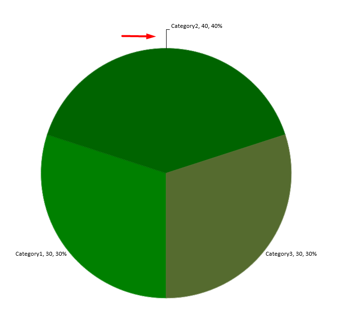

## **مقدمة**

تُظهر تسميات البيانات معلومات حول سلاسل المخططات ونقاط البيانات الفردية، مما يساعد القارئ على تحديد القيم وفهم المخطط. تُشرح هذه المقالة كيفية تنسيق القيم، وعرض النسب المئوية، وقراءة نص التسمية، والتحكم في التسميات التي تتجاوز الحد الأقصى للمحور، وتعديل تباعد تسميات محور الفئات، وتحديد موضع تسميات مخطط الدائرة.

## **عدد تسميات البيانات الظاهرة**

استخدم [getCountOfVisibleDataLabels](https://reference.aspose.com/slides/python-java/aspose.slides/datalabelcollection/#getCountOfVisibleDataLabels) للتحقق من عدد تسميات البيانات التي تم تمكين عرضها قبل نشر العرض التقديمي. على عكس [getCount](https://reference.aspose.com/slides/python-java/aspose.slides/datalabelcollection/#getCount)، الذي يُعيد العدد الإجمالي للتسميات في المجموعة، يأخذ في الاعتبار الإعدادات الافتراضية للسلسلة وإعدادات كل تسمية على حدة.

هذا المثال يُنشئ مخطط أعمدة يحتوي على سلسلة واحدة وثلاث نقاط بيانات. يصل إلى مجموعة تسميات السلسلة عبر [getLabels](https://reference.aspose.com/slides/python-java/aspose.slides/chartseries/#getLabels) ويطبع عدد التسميات الظاهرة مع تغيّر الإعدادات: **0, 3, 2, 3**. يبقى العدد الإجمالي **3**.

```python
import jpype
import asposeslides

if not jpype.isJVMStarted():
    jpype.startJVM()

from asposeslides.api import ChartType, Presentation

presentation = Presentation()
try:
    slide = presentation.getSlides().get_Item(0)

    chart = slide.getShapes().addChart(ChartType.ClusteredColumn, 50, 50, 500, 300)

    chart.getChartData().getSeries().clear()
    chart.getChartData().getCategories().clear()

    workbook = chart.getChartData().getChartDataWorkbook()
    series_cell = workbook.getCell(0, 0, 1, "Values")
    series = chart.getChartData().getSeries().add(series_cell, chart.getType())

    for i in range(3):
        category_cell = workbook.getCell(0, i + 1, 0, f"Category {i + 1}")
        chart.getChartData().getCategories().add(category_cell)
        value_cell = workbook.getCell(0, i + 1, 1, jpype.JDouble((i + 1) * 10))
        series.getDataPoints().addDataPointForBarSeries(value_cell)

    labels = series.getLabels()
    print(f"Total: {labels.getCount()}; visible: {labels.getCountOfVisibleDataLabels()}")  # الإجمالي: 3; الظاهرة: 0

    labels.getDefaultDataLabelFormat().setShowValue(True)
    print(f"Visible: {labels.getCountOfVisibleDataLabels()}")  # الظاهرة: 3

    labels.get_Item(1).getDataLabelFormat().setShowValue(False)
    print(f"Visible: {labels.getCountOfVisibleDataLabels()}")  # الظاهرة: 2

    labels.get_Item(1).getDataLabelFormat().setShowLegendKey(True)
    print(f"Visible: {labels.getCountOfVisibleDataLabels()}")  # الظاهرة: 3
finally:
    presentation.dispose()
```

توفر [getDefaultDataLabelFormat](https://reference.aspose.com/slides/python-java/aspose.slides/datalabelcollection/#getDefaultDataLabelFormat) إعدادات افتراضية للسلسلة. تمرير `True` إلى [setShowValue](https://reference.aspose.com/slides/python-java/aspose.slides/datalabelformat/#setShowValue) هناك يعرض القيم لجميع الثلاث تسميات. تمرير `False` عبر [getDataLabelFormat](https://reference.aspose.com/slides/python-java/aspose.slides/datalabel/#getDataLabelFormat) لإحدى التسميات يتجاوز هذا الإعداد للتسمية المختارة. تمرير `True` إلى [setShowLegendKey](https://reference.aspose.com/slides/python-java/aspose.slides/datalabelformat/#setShowLegendKey) يجعل تلك التسمية تُحسب كظاهرة مرة أخرى، حتى وإن ظلت قيمتها مخفية.

عدد التسميات الظاهرة يعكس إعدادات الرؤية. وهو لا يقيس ما إذا كانت التسميات تتقاطع أو تُقص أو تُقَرى في المخطط المرسوم.

## **ضبط دقة البيانات في تسميات المخطط**

استخدم [setNumberFormatOfValues](https://reference.aspose.com/slides/python-java/aspose.slides/chartseries/#setNumberFormatOfValues) لتنسيق قيم السلسلة. يُنشئ هذا المثال مخطط خط مع بيانات افتراضية، يعرض جدول البيانات الخاص به، ويفعل تسميات القيم للسلسلة الأولى. التنسيق `#,##0.00` يُظهر فاصل الآلاف واثنين من المنازل العشرية دون تغيير القيم الأساسية.

```python
import jpype
import asposeslides

if not jpype.isJVMStarted():
    jpype.startJVM()

from asposeslides.api import ChartType, Presentation, SaveFormat

presentation = Presentation()
try:
    slide = presentation.getSlides().get_Item(0)

    chart = slide.getShapes().addChart(ChartType.Line, 50, 50, 450, 300)
    chart.setDataTable(True)

    series = chart.getChartData().getSeries().get_Item(0)
    series.setNumberFormatOfValues("#,##0.00")
    series.getLabels().getDefaultDataLabelFormat().setShowValue(True)

    presentation.save("PrecisionOfDatalabels_out.pptx", SaveFormat.Pptx)
finally:
    presentation.dispose()
```

لتنسيق الخلايا الرقمية في دفتر عمل مدمج بالمخطط، راجع [تعيين تنسيقات الأرقام المخصصة لخلايا دفتر العمل](/slides/ar/python-java/chart-workbook/#set-custom-number-formats-for-workbook-cells). يُظهر ذلك المثال أيضًا تسميات القيم وفق تنسيقات الخلية المصدر مع الحفاظ على القيم الرقمية المخزنة.

## **عرض النسبة المئوية كعناوين**

للمخطط العمودي المكدس، احسب كل قيمة كنسبة مئوية من إجمالي الفئة الخاصة بها وعيّن النص إلى إطار النص الذي يُعيده [getTextFrameForOverriding](https://reference.aspose.com/slides/python-java/aspose.slides/datalabel/#getTextFrameForOverriding). يستخدم هذا المثال بيانات المخطط الافتراضية ويعرض النسب المئوية بدقتين عشريتين بخط 8 نقاط. تُستبعد الفئات التي مجموعها صفر لتفادي القسمة على الصفر. أعد حساب النص المخصص للتسمية إذا تغيرت بيانات المخطط.

```python
import jpype
import asposeslides

if not jpype.isJVMStarted():
    jpype.startJVM()

from asposeslides.api import ChartType, Portion, Presentation, SaveFormat

presentation = Presentation()
try:
    slide = presentation.getSlides().get_Item(0)

    chart = slide.getShapes().addChart(ChartType.StackedColumn, 20, 20, 400, 400)

    chart_series = chart.getChartData().getSeries()
    category_totals = [0.0] * chart.getChartData().getCategories().size()
    for category_index in range(len(category_totals)):
        for series_index in range(chart_series.size()):
            data_point = chart_series.get_Item(series_index).getDataPoints().get_Item(category_index)
            category_totals[category_index] += float(data_point.getValue().getData())

    for series_index in range(chart_series.size()):
        series = chart_series.get_Item(series_index)
        series.getLabels().getDefaultDataLabelFormat().setShowLegendKey(False)

        for point_index in range(series.getDataPoints().size()):
            data_point = series.getDataPoints().get_Item(point_index)
            label = data_point.getLabel()
            if category_totals[point_index] == 0:
                print(f"Cannot calculate a percentage for category {point_index}: the total is zero.")
                continue
            point_percentage = float(data_point.getValue().getData()) / category_totals[point_index] * 100

            portion = Portion()
            portion.setText(f"{point_percentage:.2f} %")
            portion.getPortionFormat().setFontHeight(8)
            label.getTextFrameForOverriding().setText("")
            paragraph = label.getTextFrameForOverriding().getParagraphs().get_Item(0)
            paragraph.getPortions().add(portion)

            label_format = label.getDataLabelFormat()
            label_format.setShowValue(True)
            label_format.setShowSeriesName(False)
            label_format.setShowPercentage(False)
            label_format.setShowLegendKey(False)
            label_format.setShowCategoryName(False)
            label_format.setShowBubbleSize(False)

    presentation.save("DisplayPercentageAsLabels_out.pptx", SaveFormat.Pptx)
finally:
    presentation.dispose()
```

## **إضافة علامة النسبة المئوية إلى تسميات بيانات المخطط**

عند تخزين القيم ككسرات، استخدم [setNumberFormat](https://reference.aspose.com/slides/python-java/aspose.slides/datalabelformat/#setNumberFormat) لعرض النسب المئوية. مرر `False` إلى [setNumberFormatLinkedToSource](https://reference.aspose.com/slides/python-java/aspose.slides/datalabelformat/#setNumberFormatLinkedToSource) لتطبيق تنسيق التسمية بشكل مستقل عن خلايا المصدر.

هذا المثال يُنشئ مخطط عمودي مكدس بنسبة 100% يحتوي على سلسلتين حمراء وزرقاء عبر أربع فئات. كل زوج من القيم يساوي 1. يُظهر تنسيق التسمية `0.0%` القيمة 0.30 كـ30.0%، بينما يستخدم المحور العمودي منزلتين عشريتين. كلا السلسلتين تستخدم نص تسمية أبيض بحجم 10 نقاط.

```python
import jpype
import asposeslides

if not jpype.isJVMStarted():
    jpype.startJVM()

from asposeslides.api import ChartType, FillType, Presentation, SaveFormat

Color = jpype.JClass("java.awt.Color")

presentation = Presentation()
try:
    slide = presentation.getSlides().get_Item(0)

    chart = slide.getShapes().addChart(ChartType.PercentsStackedColumn, 20, 20, 500, 400)

    chart.getAxes().getVerticalAxis().setNumberFormatLinkedToSource(False)
    chart.getAxes().getVerticalAxis().setNumberFormat("0.00%")

    chart.getChartData().getSeries().clear()
    chart.getChartData().getCategories().clear()

    workbook = chart.getChartData().getChartDataWorkbook()
    worksheet_index = 0
    for i in range(4):
        category_cell = workbook.getCell(worksheet_index, i + 1, 0, f"Category {i + 1}")
        chart.getChartData().getCategories().add(category_cell)

    series_names = ["Reds", "Blues"]
    series_colors = [Color.RED, Color.BLUE]
    values = [[0.30, 0.50, 0.80, 0.65], [0.70, 0.50, 0.20, 0.35]]

    for i, series_name in enumerate(series_names):
        series_cell = workbook.getCell(worksheet_index, 0, i + 1, series_name)
        series = chart.getChartData().getSeries().add(series_cell, chart.getType())
        for j, value in enumerate(values[i]):
            value_cell = workbook.getCell(worksheet_index, j + 1, i + 1, jpype.JDouble(value))
            series.getDataPoints().addDataPointForBarSeries(value_cell)

        series.getFormat().getFill().setFillType(FillType.Solid)
        series.getFormat().getFill().getSolidFillColor().setColor(series_colors[i])

        label_format = series.getLabels().getDefaultDataLabelFormat()
        label_format.setShowValue(True)
        label_format.setNumberFormatLinkedToSource(False)
        label_format.setNumberFormat("0.0%")
        portion_format = label_format.getTextFormat().getPortionFormat()
        portion_format.setFontHeight(10)
        portion_format.getFillFormat().setFillType(FillType.Solid)
        portion_format.getFillFormat().getSolidFillColor().setColor(Color.WHITE)

    presentation.save("SetDataLabelsPercentageSign_out.pptx", SaveFormat.Pptx)
finally:
    presentation.dispose()
```

## **قراءة النص الفعلي لتسميات البيانات**

استخدم [getActualLabelText](https://reference.aspose.com/slides/python-java/aspose.slides/datalabel/#getActualLabelText) لاسترداد النص الناتج عن إعدادات تسمية البيانات. هذا مفيد عند استخراج التسميات للتقارير، أو البحث في محتوى العرض التقديمي، أو التحقق من صحة المخططات المُنشأة. في المثال أدناه، يجمع [تنسيق تسمية البيانات](https://reference.aspose.com/slides/python-java/aspose.slides/datalabelformat/) الافتراضي كل من اسم الفئة، اسم السلسلة، والقيمة. تُنسق نقطة واحدة قيمتها كنسبة مئوية، وتستخدم أخرى نصًا مخصصًا من [getTextFrameForOverriding](https://reference.aspose.com/slides/python-java/aspose.slides/datalabel/#getTextFrameForOverriding).

```python
import jpype
import asposeslides

if not jpype.isJVMStarted():
    jpype.startJVM()

from asposeslides.api import ChartType, Presentation

presentation = Presentation()
try:
    slide = presentation.getSlides().get_Item(0)

    chart = slide.getShapes().addChart(ChartType.ClusteredColumn, 20, 20, 500, 300)

    chart.getChartData().getSeries().clear()
    chart.getChartData().getCategories().clear()

    workbook = chart.getChartData().getChartDataWorkbook()
    first_category_cell = workbook.getCell(0, 1, 0, "Q1")
    chart.getChartData().getCategories().add(first_category_cell)
    second_category_cell = workbook.getCell(0, 2, 0, "Q2")
    chart.getChartData().getCategories().add(second_category_cell)

    north_series_cell = workbook.getCell(0, 0, 1, "North")
    north = chart.getChartData().getSeries().add(north_series_cell, chart.getType())
    north_first_value_cell = workbook.getCell(0, 1, 1, jpype.JDouble(0.25))
    north.getDataPoints().addDataPointForBarSeries(north_first_value_cell)
    north_second_value_cell = workbook.getCell(0, 2, 1, jpype.JDouble(0.75))
    north.getDataPoints().addDataPointForBarSeries(north_second_value_cell)

    south_series_cell = workbook.getCell(0, 0, 2, "South")
    south = chart.getChartData().getSeries().add(south_series_cell, chart.getType())
    south_first_value_cell = workbook.getCell(0, 1, 2, jpype.JDouble(0.40))
    south.getDataPoints().addDataPointForBarSeries(south_first_value_cell)
    south_second_value_cell = workbook.getCell(0, 2, 2, jpype.JDouble(0.60))
    south.getDataPoints().addDataPointForBarSeries(south_second_value_cell)

    for series in chart.getChartData().getSeries():
        label_format = series.getLabels().getDefaultDataLabelFormat()
        label_format.setShowCategoryName(True)
        label_format.setShowSeriesName(True)
        label_format.setShowValue(True)

    north.getLabels().get_Item(1).getDataLabelFormat().setNumberFormatLinkedToSource(False)
    north.getLabels().get_Item(1).getDataLabelFormat().setNumberFormat("0%")
    south.getLabels().get_Item(0).getTextFrameForOverriding().setText("Reviewed")

    for series in chart.getChartData().getSeries():
        for point in series.getDataPoints():
            label = point.getLabel()
            if not label.isVisible():
                continue

            print(f"Value: {point.getValue().getData()}; label: {label.getActualLabelText()}")
finally:
    presentation.dispose()
```

العدد المخزن في نقطة البيانات يبقى `0.75`، حتى وإن كانت تسميتها تُظهر `75%` مع اسم الفئة والسلسلة. النص المخصص يحل محل النص المُولد للتسمية. تُعيد [getActualLabelText](https://reference.aspose.com/slides/python-java/aspose.slides/datalabel/#getActualLabelText) سلسلة التسمية الناتجة في الحالتين. تحقق من [isVisible](https://reference.aspose.com/slides/python-java/aspose.slides/datalabel/#isVisible) بشكل منفصل، كما هو موضح أعلاه، عندما تريد استخراج التسميات الظاهرة فقط.

## **التحكم في تسميات البيانات التي تتجاوز الحد الأقصى للمحور**

عند تحديد نطاق المحور يدويًا، قد تتجاوز بعض نقاط البيانات قيمته القصوى. استخدم [setShowDataLabelsOverMaximum](https://reference.aspose.com/slides/python-java/aspose.slides/chart/#setShowDataLabelsOverMaximum) للتحكم فيما إذا كانت تسميات تلك البيانات تُعرض. لا يغيّر هذا الإعداد نطاق المحور أو القيم الأساسية للبيانات؛ فهو يغيّر فقط رؤية التسميات.

يُنشئ المثال أدناه مخطط أعمدة متجمع ثنائي الأبعاد بقيم 60 و120. يمرر `False` إلى [setAutomaticMaxValue](https://reference.aspose.com/slides/python-java/aspose.slides/axis/#setAutomaticMaxValue) ويُحدد الحد الأقصى إلى 100 باستخدام [setMaxValue](https://reference.aspose.com/slides/python-java/aspose.slides/axis/#setMaxValue) على المحور العمودي. الشريحة الأولى تسمح بالتسميات التي تتجاوز الحد الأقصى؛ نسخة من تلك الشريحة تُعطِّلها. تُحفظ كلتا الشريحتين في `DataLabelsOverMaximum.pptx`.

فعِّل تسميات القيم باستخدام [setShowValue](https://reference.aspose.com/slides/python-java/aspose.slides/datalabelformat/#setShowValue). لا يفعِّل إعداد مستوى المخطط عرض القيم بحد ذاته ولا يتجاوز إعداد إيقاف عرض قيمة تسمية فردية. يُفعِّل هذا المثال القيم للسلسلة بأكملها ويستخدم [setPosition](https://reference.aspose.com/slides/python-java/aspose.slides/datalabelformat/#setPosition) لوضع التسميات عند الطرف الخارجي لكل عمود.

```python
import jpype
import asposeslides

if not jpype.isJVMStarted():
    jpype.startJVM()

from asposeslides.api import ChartType, LegendDataLabelPosition, Presentation, SaveFormat

presentation = Presentation()
try:
    slide = presentation.getSlides().get_Item(0)

    chart = slide.getShapes().addChart(ChartType.ClusteredColumn, 50, 50, 600, 400)
    chart.setLegend(False)

    chart.getChartData().getSeries().clear()
    chart.getChartData().getCategories().clear()

    workbook = chart.getChartData().getChartDataWorkbook()

    first_category = workbook.getCell(0, 1, 0, "Within range")
    second_category = workbook.getCell(0, 2, 0, "Above maximum")

    chart.getChartData().getCategories().add(first_category)
    chart.getChartData().getCategories().add(second_category)

    series_name = workbook.getCell(0, 0, 1, "Values")
    series = chart.getChartData().getSeries().add(series_name, chart.getType())

    first_value = workbook.getCell(0, 1, 1, jpype.JDouble(60))
    second_value = workbook.getCell(0, 2, 1, jpype.JDouble(120))

    series.getDataPoints().addDataPointForBarSeries(first_value)
    series.getDataPoints().addDataPointForBarSeries(second_value)

    series.getLabels().getDefaultDataLabelFormat().setShowValue(True)
    series.getLabels().getDefaultDataLabelFormat().setPosition(LegendDataLabelPosition.OutsideEnd)

    chart.getAxes().getVerticalAxis().setAutomaticMaxValue(False)
    chart.getAxes().getVerticalAxis().setMaxValue(100)
    chart.setShowDataLabelsOverMaximum(True)

    second_slide = presentation.getSlides().addClone(slide)
    second_chart = second_slide.getShapes().get_Item(0)
    second_chart.setShowDataLabelsOverMaximum(False)

    presentation.save("DataLabelsOverMaximum.pptx", SaveFormat.Pptx)
finally:
    presentation.dispose()
```

تُظهر الصور التالية الشرائح المحفوظة التي تم عرضها بواسطة Microsoft PowerPoint. مع `True` تكون التسمية **120** ظاهرة عند الحد العلوي؛ مع `False` تُخفى. تظل التسمية **60** ظاهرة، يبقى الحد الأقصى للمحور **100**، وتظل النقطة الثانية **120** في الحالتين.

| setShowDataLabelsOverMaximum(True) | setShowDataLabelsOverMaximum(False) |
| --- | --- |
|  |  |

{}
هذا المثال يستخدم مخطط أعمدة ثنائي الأبعاد مع محور قيم. المخططات التي لا تملك محور قيم، مثل مخططات الدائرة ومخططات الحلقة، لا تمتلك حدًا أقصى للمحور لتقيده بهذه الطريقة.
{}

## **تعيين مسافة التسمية من المحور**

استخدم [setLabelOffset](https://reference.aspose.com/slides/python-java/aspose.slides/axis/#setLabelOffset) للتحكم في المسافة بين تسميات محور الفئات والمحور. القيمة هي نسبة مئوية من الحد الأقصى لحجم خط تسميات المحور. يُنشئ هذا المثال مخطط أعمدة متجمع ويعيّن إزاحة تسمية محور الأفقي إلى 500. يؤثر هذا الإعداد على تسميات محور الفئات بدلًا من التسميات المرفقة بنقاط البيانات الفردية.

```python
import jpype
import asposeslides

if not jpype.isJVMStarted():
    jpype.startJVM()

from asposeslides.api import ChartType, Presentation, SaveFormat

presentation = Presentation()
try:
    slide = presentation.getSlides().get_Item(0)

    chart = slide.getShapes().addChart(ChartType.ClusteredColumn, 20, 20, 500, 300)
    chart.getAxes().getHorizontalAxis().setLabelOffset(500)

    presentation.save("SetCategoryAxisLabelDistance_out.pptx", SaveFormat.Pptx)
finally:
    presentation.dispose()
```

## **ضبط موقع التسمية**

في مخطط الدائرة، اضبط مواضع تسميات البيانات لتحسين التباعد وإتاحة مساحة لخطوط القائد.

يعرض هذا المثال قيمة نقطة البيانات الأولى، يضع تسميتها خارج القطاع، ويضبط الإزاحات الأفقية والعمودية باستخدام [setX](https://reference.aspose.com/slides/python-java/aspose.slides/datalabel/#setX) و[setY](https://reference.aspose.com/slides/python-java/aspose.slides/datalabel/#setY). تُحسب هذه الإزاحات نسبةً إلى عرض وارتفاع المخطط على التوالي.

```python
import jpype
import asposeslides

if not jpype.isJVMStarted():
    jpime.startJVM()

from asposeslides.api import ChartType, LegendDataLabelPosition, Presentation, SaveFormat

presentation = Presentation()
try:
    slide = presentation.getSlides().get_Item(0)

    chart = slide.getShapes().addChart(ChartType.Pie, 50, 50, 200, 200)
    series = chart.getChartData().getSeries()
    
    label = series.get_Item(0).getLabels().get_Item(0)
    label.getDataLabelFormat().setShowValue(True)
    label.getDataLabelFormat().setPosition(LegendDataLabelPosition.OutsideEnd)
    label.setX(0.71)
    label.setY(0.04)

    presentation.save("presentation.pptx", SaveFormat.Pptx)
finally:
    presentation.dispose()
```



## **تنسيق خطوط القائد**

عندما تكون تسميات مخطط الدائرة خارج القطاعات، تساعد خطوط القائد القارئ على مطابقة كل قيمة مع القطاع الصحيح. يمكن للون المتباين والخط السميك قليلًا أن يجعل هذه الوصلات أسهل في المتابعة، بينما تُبقي الشفافية والنمط المتقطع الخطوط غير بارزة بصريًا.

استخدم [getLeaderLinesFormat](https://reference.aspose.com/slides/python-java/aspose.slides/datalabelcollection/#getLeaderLinesFormat) لتنسيق خطوط القائد على مستوى مجموعة تسميات البيانات للسلسلة. تُطبق الإعدادات في `series.getLabels().getLeaderLinesFormat().getLine()` على المجموعة ككل، وليس على تسمية فردية.

يُنشئ هذا المثال مخطط دائرة ببيانات افتراضية، يُظهر القيم خارج القطاعات، ويفعل [setShowLeaderLines](https://reference.aspose.com/slides/python-java/aspose.slides/datalabelformat/#setShowLeaderLines). يُبعد ملصقين أكثر عن قطاعاتهما باستخدام إزاحات [setX](https://reference.aspose.com/slides/python-java/aspose.slides/datalabel/#setX) و[setY](https://reference.aspose.com/slides/python-java/aspose.slides/datalabel/#setY) معبرًا عنها كسُكّات من عرض وارتفاع المخطط. لا يُطلَب عرض تقديمي إدخالي.

يُعيّن [getFillFormat](https://reference.aspose.com/slides/python-java/aspose.slides/lineformat/#getFillFormat) للخط لونًا أزرق ثابتًا بقيمة ألفا 191 من 255، ما يُعطي شفافية تقريبية بنسبة 25 %. يُعيّن [setWidth](https://reference.aspose.com/slides/python-java/aspose.slides/lineformat/#setWidth) السماكة إلى نقطتين، ويجعل [setDashStyle](https://reference.aspose.com/slides/python-java/aspose.slides/lineformat/#setDashStyle) الخط متقطعًا.

```python
import jpype
import asposeslides

if not jpype.isJVMStarted():
    jpype.startJVM()

from asposeslides.api import ChartType, FillType, LegendDataLabelPosition, LineDashStyle, Presentation, SaveFormat

Color = jpype.JClass("java.awt.Color")

presentation = Presentation()
try:
    slide = presentation.getSlides().get_Item(0)

    chart = slide.getShapes().addChart(ChartType.Pie, 80, 50, 560, 400)
    chart.setLegend(False)

    series = chart.getChartData().getSeries().get_Item(0)

    label_format = series.getLabels().getDefaultDataLabelFormat()
    label_format.setShowValue(True)
    label_format.setPosition(LegendDataLabelPosition.OutsideEnd)
    label_format.setShowLeaderLines(True)

    # حرك تسميتين بعيدًا عن قطاعاتهما.
    series.getLabels().get_Item(0).setX(0.10)
    series.getLabels().get_Item(0).setY(-0.05)
    series.getLabels().get_Item(1).setX(-0.10)
    series.getLabels().get_Item(1).setY(0.05)

    line = series.getLabels().getLeaderLinesFormat().getLine()
    line.getFillFormat().setFillType(FillType.Solid)
    color = Color(30, 90, 160, 191)
    line.getFillFormat().getSolidFillColor().setColor(color)
    line.setWidth(2)
    line.setDashStyle(LineDashStyle.Dash)

    presentation.save("FormattedLeaderLines.pptx", SaveFormat.Pptx)
finally:
    presentation.dispose()
```

إضافة خطوط القائد لا يضمن ظهور خط لكل تسمية. تعتمد الرؤية على موضع التسمية وسلوك تخطيط المخطط. في هذا المثال، للملصقين المنقولين خطوط قائد مرئية؛ ولا تحتاج التسميات القريبة من قطاعاتها إلى خطوط.

الصورة التالية تُظهر ملف `FormattedLeaderLines.pptx` المحفوظ والمعروض باستخدام Aspose.Slides:


## **إضافة عدة صفوف من تسميات البيانات أعلى مخطط عمودي**

يُنشئ هذا المثال مخطط أعمدة مع صفين من تسميات البيانات فوق مساحة الرسم. تُظهر السلسلة A الأعمدة الظاهرة، بينما توفر السلسلة B والسلسلة C التسميات الإضافية. تُخفى أعمدتها بإزالة التعبئة والحد. تُحاذي طريقة [ChartSeriesGroup.setOverlap](https://reference.aspose.com/slides/python-java/aspose.slides/chartseriesgroup/#setOverlap) جميع السلاسل الثلاثة إلى مراكز الفئات نفسها.

تُخصص إعدادات [ChartPlotArea](https://reference.aspose.com/slides/python-java/aspose.slides/chartplotarea/) مساحة لصفوف التسميات. بعد أن تحسب [Chart.validateChartLayout](https://reference.aspose.com/slides/python-java/aspose.slides/chart/#validateChartLayout) المواقع الافتراضية، تُحافظ [DataLabel.setX](https://reference.aspose.com/slides/python-java/aspose.slides/datalabel/#setX) و[DataLabel.setY](https://reference.aspose.com/slides/python-java/aspose.slides/datalabel/#setY) على المحاذاة الأفقية وتطبيق إزاحات عمودية لترتيب التسميات في صفين. تبقى الأرقام تسميات بيانات مرتبطة بقيم السلسلة؛ فقط رؤوس الصفوف هي أشكال نصية منفصلة.

```python
import jpype
import asposeslides

if not jpype.isJVMStarted():
    jpype.startJVM()

from asposeslides.api import ChartType, FillType, LayoutTargetType, LegendDataLabelPosition, Presentation, SaveFormat, ShapeType

Color = jpype.JClass("java.awt.Color")

presentation = Presentation()
try:
    slide = presentation.getSlides().get_Item(0)

    chart = slide.getShapes().addChart(ChartType.ClusteredColumn, 40, 40, 640, 200)
    chart.setTitle(False)
    chart.setLegend(False)
    chart.getTextFormat().getPortionFormat().setFontHeight(12)

    chart.getChartData().getSeries().clear()
    chart.getChartData().getCategories().clear()

    workbook = chart.getChartData().getChartDataWorkbook()
    workbook.clear(0)

    categories = ["North", "South", "East", "West"]
    series_names = ["Series A", "Series B", "Series C"]
    series_values = [[35, 42, 28, 47], [22, 31, 19, 26], [12, 16, 14, 18]]

    for category_index, category in enumerate(categories):
        category_cell = workbook.getCell(0, category_index + 1, 0, category)
        chart.getChartData().getCategories().add(category_cell)

    for series_index, series_name in enumerate(series_names):
        series_cell = workbook.getCell(0, 0, series_index + 1, series_name)
        series = chart.getChartData().getSeries().add(series_cell, ChartType.ClusteredColumn)

        for category_index, value in enumerate(series_values[series_index]):
            value_cell = workbook.getCell(0, category_index + 1, series_index + 1, jpype.JDouble(value))
            series.getDataPoints().addDataPointForBarSeries(value_cell)

        if series_index > 0:
            # إخفاء أعمدة B و C، لكن الإبقاء على تسميات البيانات.
            series.getFormat().getFill().setFillType(FillType.NoFill)
            series.getFormat().getLine().getFillFormat().setFillType(FillType.NoFill)
            label_format = series.getLabels().getDefaultDataLabelFormat()
            label_format.setShowValue(True)
            label_format.getTextFormat().getPortionFormat().setFontHeight(12)
            label_fill = label_format.getTextFormat().getPortionFormat().getFillFormat()
            label_fill.setFillType(FillType.Solid)
            label_fill.getSolidFillColor().setColor(Color.BLACK)
            label_format.setPosition(LegendDataLabelPosition.InsideBase)

    # محاذاة جميع السلاسل الثلاث مع مراكز الفئات نفسها.
    chart.getChartData().getSeries().get_Item(0).getParentSeriesGroup().setOverlap(jpype.JByte(100))

    # استخدام خطوط شبكة أقل لهذا المثال المدمج.
    chart.getAxes().getVerticalAxis().setAutomaticMajorUnit(False)
    chart.getAxes().getVerticalAxis().setMajorUnit(10)

    # حجز مساحة فوق منطقة الرسم لصفين من تسميات البيانات.
    chart.getPlotArea().setLayoutTargetType(LayoutTargetType.Inner)
    chart.getPlotArea().setX(0.15)
    chart.getPlotArea().setY(0.32)
    chart.getPlotArea().setWidth(0.80)
    chart.getPlotArea().setHeight(0.48)
    chart.validateChartLayout()

    for series_index in range(1, len(series_names)):
        series = chart.getChartData().getSeries().get_Item(series_index)
        row_top = 0.15 if series_index == 1 else 0.03

        for category_index in range(len(categories)):
            data_label = series.getDataPoints().get_Item(category_index).getLabel()
            # الاحتفاظ بالموقع الأفقي الافتراضي. Y هو إزاحة من
            # موقع التسمية الافتراضي، معبرًا عنه كسنة من ارتفاع المخطط.
            data_label.setX(0)
            data_label.setY(row_top - data_label.getActualY() / chart.getHeight())

        # فقط عنوان الصف هو شكل نص منفصل.
        heading_y = chart.getY() + row_top * chart.getHeight()
        row_heading = slide.getShapes().addAutoShape(ShapeType.Rectangle, chart.getX(), heading_y, 85, 18)
        row_heading.getFillFormat().setFillType(FillType.NoFill)
        row_heading.getLineFormat().getFillFormat().setFillType(FillType.NoFill)
        row_heading.addTextFrame(series_names[series_index])
        row_heading.getTextFrame().getTextFrameFormat().setMarginTop(0)
        row_heading.getTextFrame().getTextFrameFormat().setMarginBottom(0)
        heading_format = row_heading.getTextFrame().getParagraphs().get_Item(0).getPortions().get_Item(0).getPortionFormat()
        heading_format.setFontHeight(12)
        heading_format.getFillFormat().setFillType(FillType.Solid)
        heading_format.getFillFormat().getSolidFillColor().setColor(Color.BLACK)

    presentation.save("multiple-rows-of-labels.pptx", SaveFormat.Pptx)
finally:
    presentation.dispose()
```


## **الأسئلة المتكررة**

**كيف يمكنني منع تداخل تسميات البيانات في المخططات المكتظة؟**

اجمع بين وضع التسميات التلقائي، خطوط القائد، وتقليل حجم الخط؛ وإذا لزم الأمر، أخفِ بعض الحقول (مثل الفئة) أو أظهر التسميات فقط للقيم المتطرفة أو النقاط الرئيسية.

**كيف يمكنني إلغاء تمكين التسميات للقيم الصفرية أو السالبة أو الفارغة فقط؟**

قُم بفلترة نقاط البيانات قبل تمكين التسميات وأوقف العرض للقيم 0 أو القيم السالبة أو القيم المفقودة وفق قاعدة معرفة.

**كيف أضمن نمط تسمية متسق عند التصدير إلى PDF أو صور؟**

حدِّد بوضوح عائلة الخط وحجمه وتحقق من توفر الخط في بيئة العرض لتجنب الاعتماد على الخط الاحتياطي.