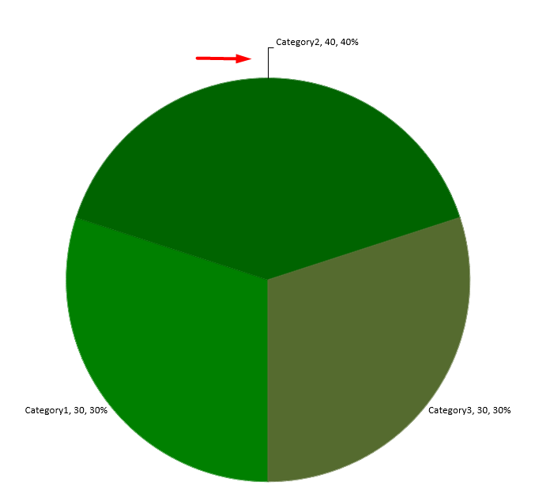

## **المقدمة**

تظهر تسميات البيانات معلومات حول سلاسل المخطط والنقاط البيانية الفردية، مما يساعد القراء على تحديد القيم وفهم المخطط. يشرح هذا المقال كيفية تنسيق القيم، وعرض النسب المئوية، وقراءة نص التسمية، والتحكم في التسميات التي تتجاوز الحد الأقصى للمحور، وضبط تباعد تسميات المحور الفئوي، وتحديد موقع تسميات مخطط الدائرة.

## **ضبط دقة البيانات في تسميات بيانات المخطط**

استخدم [setNumberFormatOfValues](https://reference.aspose.com/slides/python-java/aspose.slides/chartseries/#setNumberFormatOfValues) لتنسيق قيم السلسلة. يخلق هذا المثال مخطط خط مع بيانات افتراضية، يعرض جدول البيانات الخاص به، ويفعل تسميات القيم للسلسلة الأولى. التنسيق `#,##0.00` يعرض فاصل الآلاف ومكانين عشريين دون تغيير القيم الأساسية.

```python
import jpype
import asposeslides

if not jpype.isJVMStarted():
    jpype.startJVM()

from asposeslides.api import ChartType, Presentation, SaveFormat

presentation = Presentation()
try:
    slide = presentation.getSlides().get_Item(0)

    chart = slide.getShapes().addChart(ChartType.Line, 50, 50, 450, 300)
    chart.setDataTable(True)

    series = chart.getChartData().getSeries().get_Item(0)
    series.setNumberFormatOfValues("#,##0.00")
    series.getLabels().getDefaultDataLabelFormat().setShowValue(True)

    presentation.save("PrecisionOfDatalabels_out.pptx", SaveFormat.Pptx)
finally:
    presentation.dispose()
```

## **عرض النسبة المئوية كعناوين**

للتخطيط العمودي المتراكم، احسب كل قيمة كنسبة مئوية من إجمالي فئتها وعيّن النص إلى إطار النص الذي يُرجعه [getTextFrameForOverriding](https://reference.aspose.com/slides/python-java/aspose.slides/datalabel/#getTextFrameForOverriding). يستخدم هذا المثال بيانات المخطط الافتراضية ويعرض النسب المئوية بمكانين عشريين بخط حجم 8 نقاط. يتم تخطي الفئات التي مجموعها صفر لتجنب القسمة على الصفر. أعد حساب نص التسمية المخصص إذا تغيرت بيانات المخطط.

```python
import jpype
import asposeslides

if not jpype.isJVMStarted():
    jpype.startJVM()

from asposeslides.api import ChartType, Portion, Presentation, SaveFormat

presentation = Presentation()
try:
    slide = presentation.getSlides().get_Item(0)

    chart = slide.getShapes().addChart(ChartType.StackedColumn, 20, 20, 400, 400)

    chart_series = chart.getChartData().getSeries()
    category_totals = [0.0] * chart.getChartData().getCategories().size()
    for category_index in range(len(category_totals)):
        for series_index in range(chart_series.size()):
            data_point = chart_series.get_Item(series_index).getDataPoints().get_Item(category_index)
            category_totals[category_index] += float(data_point.getValue().getData())

    for series_index in range(chart_series.size()):
        series = chart_series.get_Item(series_index)
        series.getLabels().getDefaultDataLabelFormat().setShowLegendKey(False)

        for point_index in range(series.getDataPoints().size()):
            data_point = series.getDataPoints().get_Item(point_index)
            label = data_point.getLabel()
            if category_totals[point_index] == 0:
                print(f"Cannot calculate a percentage for category {point_index}: the total is zero.")
                continue
            point_percentage = float(data_point.getValue().getData()) / category_totals[point_index] * 100

            portion = Portion()
            portion.setText(f"{point_percentage:.2f} %")
            portion.getPortionFormat().setFontHeight(8)
            label.getTextFrameForOverriding().setText("")
            paragraph = label.getTextFrameForOverriding().getParagraphs().get_Item(0)
            paragraph.getPortions().add(portion)

            label_format = label.getDataLabelFormat()
            label_format.setShowValue(True)
            label_format.setShowSeriesName(False)
            label_format.setShowPercentage(False)
            label_format.setShowLegendKey(False)
            label_format.setShowCategoryName(False)
            label_format.setShowBubbleSize(False)

    presentation.save("DisplayPercentageAsLabels_out.pptx", SaveFormat.Pptx)
finally:
    presentation.dispose()
```

## **تعيين علامة النسبة المئوية مع تسميات بيانات المخطط**

عند تخزين القيم ككسر، استخدم [setNumberFormat](https://reference.aspose.com/slides/python-java/aspose.slides/datalabelformat/#setNumberFormat) لعرض النسب المئوية. مرّر `False` إلى [setNumberFormatLinkedToSource](https://reference.aspose.com/slides/python-java/aspose.slides/datalabelformat/#setNumberFormatLinkedToSource) لتطبيق تنسيق التسمية بشكل مستقل عن خلايا المصدر.

ينشئ هذا المثال مخطط عمودي متراكم بنسبة 100% مع سلاسل حمراء وزرقاء عبر أربع فئات. كل زوج من القيم يساوي 1. تنسيق التسمية `0.0%` يعرض 0.30 كـ 30.0%، بينما يستخدم المحور العمودي مكانين عشريين. كلا السلسلتين تستخدم نص تسمية أبيض بحجم 10 نقاط.

```python
import jpype
import asposeslides

if not jpype.isJVMStarted():
    jpype.startJVM()

from asposeslides.api import ChartType, FillType, Presentation, SaveFormat

Color = jpype.JClass("java.awt.Color")

presentation = Presentation()
try:
    slide = presentation.getSlides().get_Item(0)

    chart = slide.getShapes().addChart(ChartType.PercentsStackedColumn, 20, 20, 500, 400)

    chart.getAxes().getVerticalAxis().setNumberFormatLinkedToSource(False)
    chart.getAxes().getVerticalAxis().setNumberFormat("0.00%")

    chart.getChartData().getSeries().clear()
    chart.getChartData().getCategories().clear()

    workbook = chart.getChartData().getChartDataWorkbook()
    worksheet_index = 0
    for i in range(4):
        category_cell = workbook.getCell(worksheet_index, i + 1, 0, f"Category {i + 1}")
        chart.getChartData().getCategories().add(category_cell)

    series_names = ["Reds", "Blues"]
    series_colors = [Color.RED, Color.BLUE]
    values = [[0.30, 0.50, 0.80, 0.65], [0.70, 0.50, 0.20, 0.35]]

    for i, series_name in enumerate(series_names):
        series_cell = workbook.getCell(worksheet_index, 0, i + 1, series_name)
        series = chart.getChartData().getSeries().add(series_cell, chart.getType())
        for j, value in enumerate(values[i]):
            value_cell = workbook.getCell(worksheet_index, j + 1, i + 1, jpype.JDouble(value))
            series.getDataPoints().addDataPointForBarSeries(value_cell)

        series.getFormat().getFill().setFillType(FillType.Solid)
        series.getFormat().getFill().getSolidFillColor().setColor(series_colors[i])

        label_format = series.getLabels().getDefaultDataLabelFormat()
        label_format.setShowValue(True)
        label_format.setNumberFormatLinkedToSource(False)
        label_format.setNumberFormat("0.0%")
        portion_format = label_format.getTextFormat().getPortionFormat()
        portion_format.setFontHeight(10)
        portion_format.getFillFormat().setFillType(FillType.Solid)
        portion_format.getFillFormat().getSolidFillColor().setColor(Color.WHITE)

    presentation.save("SetDataLabelsPercentageSign_out.pptx", SaveFormat.Pptx)
finally:
    presentation.dispose()
```

## **قراءة النص الفعلي لتسميات البيانات**

استخدم [getActualLabelText](https://reference.aspose.com/slides/python-java/aspose.slides/datalabel/#getActualLabelText) لاسترداد النص الناتج عن إعدادات تسمية البيانات. هذا مفيد عند استخراج التسميات للتقارير، أو البحث في محتوى العرض التقديمي، أو التحقق من صحة المخططات المولدة. في المثال أدناه، يجمع تنسيق [data label format](https://reference.aspose.com/slides/python-java/aspose.slides/datalabelformat/) الافتراضي كل اسم فئة، واسم السلسلة، والقيمة. تنسق إحدى النقاط قيمتها كنسبة مئوية، وتستخدم أخرى نصًا مخصصًا من [getTextFrameForOverriding](https://reference.aspose.com/slides/python-java/aspose.slides/datalabel/#getTextFrameForOverriding).

```python
import jpype
import asposeslides

if not jpype.isJVMStarted():
    jpype.startJVM()

from asposeslides.api import ChartType, Presentation

presentation = Presentation()
try:
    slide = presentation.getSlides().get_Item(0)

    chart = slide.getShapes().addChart(ChartType.ClusteredColumn, 20, 20, 500, 300)

    chart.getChartData().getSeries().clear()
    chart.getChartData().getCategories().clear()

    workbook = chart.getChartData().getChartDataWorkbook()
    first_category_cell = workbook.getCell(0, 1, 0, "Q1")
    chart.getChartData().getCategories().add(first_category_cell)
    second_category_cell = workbook.getCell(0, 2, 0, "Q2")
    chart.getChartData().getCategories().add(second_category_cell)

    north_series_cell = workbook.getCell(0, 0, 1, "North")
    north = chart.getChartData().getSeries().add(north_series_cell, chart.getType())
    north_first_value_cell = workbook.getCell(0, 1, 1, jpype.JDouble(0.25))
    north.getDataPoints().addDataPointForBarSeries(north_first_value_cell)
    north_second_value_cell = workbook.getCell(0, 2, 1, jpype.JDouble(0.75))
    north.getDataPoints().addDataPointForBarSeries(north_second_value_cell)

    south_series_cell = workbook.getCell(0, 0, 2, "South")
    south = chart.getChartData().getSeries().add(south_series_cell, chart.getType())
    south_first_value_cell = workbook.getCell(0, 1, 2, jpype.JDouble(0.40))
    south.getDataPoints().addDataPointForBarSeries(south_first_value_cell)
    south_second_value_cell = workbook.getCell(0, 2, 2, jpype.JDouble(0.60))
    south.getDataPoints().addDataPointForBarSeries(south_second_value_cell)

    for series in chart.getChartData().getSeries():
        label_format = series.getLabels().getDefaultDataLabelFormat()
        label_format.setShowCategoryName(True)
        label_format.setShowSeriesName(True)
        label_format.setShowValue(True)

    north.getLabels().get_Item(1).getDataLabelFormat().setNumberFormatLinkedToSource(False)
    north.getLabels().get_Item(1).getDataLabelFormat().setNumberFormat("0%")
    south.getLabels().get_Item(0).getTextFrameForOverriding().setText("Reviewed")

    for series in chart.getChartData().getSeries():
        for point in series.getDataPoints():
            label = point.getLabel()
            if not label.isVisible():
                continue

            print(f"Value: {point.getValue().getData()}; label: {label.getActualLabelText()}")
finally:
    presentation.dispose()
```

يظل الرقم المخزن في نقطة البيانات `0.75`، حتى عندما تظهر تسميتها `75%` مع أسماء الفئة والسلسلة. النص المخصص يستبدل نص التسمية المُنتَج. تُعيد [getActualLabelText](https://reference.aspose.com/slides/python-java/aspose.slides/datalabel/#getActualLabelText) سلسلة التسمية الناتجة في كلتا الحالتين. تحقق من [isVisible](https://reference.aspose.com/slides/python-java/aspose.slides/datalabel/#isVisible) بشكل منفصل، كما هو موضح أعلاه، عندما تريد استخراج التسميات الظاهرة فقط.

## **التحكم في تسميات البيانات التي تتجاوز الحد الأقصى للمحور**

عند تحديد نطاق المحور يدويًا، قد تتجاوز بعض نقاط البيانات الحد الأقصى له. استخدم [setShowDataLabelsOverMaximum](https://reference.aspose.com/slides/python-java/aspose.slides/chart/#setShowDataLabelsOverMaximum) للتحكم فيما إذا كانت تسميات البيانات الخاصة بها مظهرة. هذا الإعداد يغيّر رؤية التسمية؛ ولا يغيّر نطاق المحور أو قيم البيانات الأساسية.

ينشئ المثال أدناه مخطط عمودي متجمع ثنائي الأبعاد بقيم 60 و120. يمرّر `False` إلى [setAutomaticMaxValue](https://reference.aspose.com/slides/python-java/aspose.slides/axis/#setAutomaticMaxValue) ويضبط الحد الأقصى على 100 باستخدام [setMaxValue](https://reference.aspose.com/slides/python-java/aspose.slides/axis/#setMaxValue) على المحور العمودي. الشريحة الأولى تسمح بالتسميات التي تتجاوز الحد الأقصى؛ نسخة تلك الشريحة تعطلها. تُحفظ كلتا الشريحتين في `DataLabelsOverMaximum.pptx`.

قم بتمكين تسميات القيم باستخدام [setShowValue](https://reference.aspose.com/slides/python-java/aspose.slides/datalabelformat/#setShowValue). لا يقوم إعداد مستوى المخطط بتمكين عرض القيم بمفرده ولا يتجاوز إعداد إخفاء عرض القيمة لتسمية فردية. يتيح هذا المثال القيم لكامل السلسلة ويستخدم [setPosition](https://reference.aspose.com/slides/python-java/aspose.slides/datalabelformat/#setPosition) لوضع التسميات عند الطرف الخارجي لكل عمود.

```python
import jpype
import asposeslides

if not jpype.isJVMStarted():
    jpype.startJVM()

from asposeslides.api import ChartType, LegendDataLabelPosition, Presentation, SaveFormat

presentation = Presentation()
try:
    slide = presentation.getSlides().get_Item(0)

    chart = slide.getShapes().addChart(ChartType.ClusteredColumn, 50, 50, 600, 400)
    chart.setLegend(False)

    chart.getChartData().getSeries().clear()
    chart.getChartData().getCategories().clear()

    workbook = chart.getChartData().getChartDataWorkbook()

    first_category = workbook.getCell(0, 1, 0, "Within range")
    second_category = workbook.getCell(0, 2, 0, "Above maximum")

    chart.getChartData().getCategories().add(first_category)
    chart.getChartData().getCategories().add(second_category)

    series_name = workbook.getCell(0, 0, 1, "Values")
    series = chart.getChartData().getSeries().add(series_name, chart.getType())

    first_value = workbook.getCell(0, 1, 1, jpype.JDouble(60))
    second_value = workbook.getCell(0, 2, 1, jpype.JDouble(120))

    series.getDataPoints().addDataPointForBarSeries(first_value)
    series.getDataPoints().addDataPointForBarSeries(second_value)

    series.getLabels().getDefaultDataLabelFormat().setShowValue(True)
    series.getLabels().getDefaultDataLabelFormat().setPosition(LegendDataLabelPosition.OutsideEnd)

    chart.getAxes().getVerticalAxis().setAutomaticMaxValue(False)
    chart.getAxes().getVerticalAxis().setMaxValue(100)
    chart.setShowDataLabelsOverMaximum(True)

    second_slide = presentation.getSlides().addClone(slide)
    second_chart = second_slide.getShapes().get_Item(0)
    second_chart.setShowDataLabelsOverMaximum(False)

    presentation.save("DataLabelsOverMaximum.pptx", SaveFormat.Pptx)
finally:
    presentation.dispose()
```

تظهر الصور التالية الشرائح المحفوظة التي تم عرضها بواسطة Microsoft PowerPoint. مع `True` تكون التسمية **120** مرئية عند الحد العلوي؛ مع `False` تكون مخفية. تظل التسمية **60** مرئية، ويبقى الحد الأقصى للمحور **100**، وتظل نقطة البيانات الثانية **120** في الحالتين.

| setShowDataLabelsOverMaximum(True) | setShowDataLabelsOverMaximum(False) |
| --- | --- |
|  |  |

{}
يستخدم هذا المثال مخطط عمودي ثنائي الأبعاد مع محور قيم. المخططات التي لا تحتوي على محور قيم، مثل مخططات الدائرة والدوامة، لا تملك حدًا أقصى للمحور لتقييده بهذه الطريقة.
{}

## **ضبط مسافة التسمية من المحور**

استخدام [setLabelOffset](https://reference.aspose.com/slides/python-java/aspose.slides/axis/#setLabelOffset) للتحكم في المسافة بين تسميات المحور الفئوي والمحور. القيمة هي نسبة مئوية من الحد الأقصى لحجم الخط لتسميات المحور. يخلق هذا المثال مخطط عمودي متجمع ويضبط إزاحة تسمية المحور الأفقي إلى 500. يؤثر هذا الإعداد على تسميات المحور الفئوي بدلاً من التسميات المرتبطة بنقاط البيانات الفردية.

```python
import jpype
import asposeslides

if not jpype.isJVMStarted():
    jpype.startJVM()

from asposeslides.api import ChartType, Presentation, SaveFormat

presentation = Presentation()
try:
    slide = presentation.getSlides().get_Item(0)

    chart = slide.getShapes().addChart(ChartType.ClusteredColumn, 20, 20, 500, 300)
    chart.getAxes().getHorizontalAxis().setLabelOffset(500)

    presentation.save("SetCategoryAxisLabelDistance_out.pptx", SaveFormat.Pptx)
finally:
    presentation.dispose()
```

## **ضبط موقع التسمية**

في مخطط الدائرة، اضبط مواضع تسميات البيانات لتحسين التباعد وإتاحة مساحة لخطوط التوجيه.

يعرض هذا المثال قيمة نقطة البيانات الأولى، يضع تسميتها خارج الشريحة، ويضبط إزاحتها الأفقية والرأسية باستخدام [setX](https://reference.aspose.com/slides/python-java/aspose.slides/datalabel/#setX) و[setY](https://reference.aspose.com/slides/python-java/aspose.slides/datalabel/#setY). هذه الإزاحات نسبية إلى عرض وارتفاع المخطط على التوالي.

```python
import jpype
import asposeslides

if not jpype.isJVMStarted():
    jpype.startJVM()

from asposeslides.api import ChartType, LegendDataLabelPosition, Presentation, SaveFormat

presentation = Presentation()
try:
    slide = presentation.getSlides().get_Item(0)

    chart = slide.getShapes().addChart(ChartType.Pie, 50, 50, 200, 200)
    series = chart.getChartData().getSeries()
    
    label = series.get_Item(0).getLabels().get_Item(0)
    label.getDataLabelFormat().setShowValue(True)
    label.getDataLabelFormat().setPosition(LegendDataLabelPosition.OutsideEnd)
    label.setX(0.71)
    label.setY(0.04)

    presentation.save("presentation.pptx", SaveFormat.Pptx)
finally:
    presentation.dispose()
```



## **تنسيق خطوط التوجيه**

عند وضع تسميات مخطط الدائرة خارج شرائحها، تساعد خطوط التوجيه القراء على مطابقة كل قيمة مع الشريحة الصحيحة. يمكن للون متباين وخط أكثر سمكًا قليلاً أن يجعل هذه الوصلات أسهل في المتابعة، بينما الشفافية والنمط المتقطع يحافظان على عدم إزعاج الخطوط بصريًا.

استخدم [getLeaderLinesFormat](https://reference.aspose.com/slides/python-java/aspose.slides/datalabelcollection/#getLeaderLinesFormat) لتنسيق خطوط التوجيه على مستوى مجموعة تسميات البيانات للسلسلة. يتم تطبيق الإعدادات في `series.getLabels().getLeaderLinesFormat().getLine()` على المجموعة، وليس على تسمية فردية.

ينشئ هذا المثال مخطط دائرة ببيانات افتراضية، يعرض القيم خارج الشرائح، ويفعل [setShowLeaderLines](https://reference.aspose.com/slides/python-java/aspose.slides/datalabelformat/#setShowLeaderLines). ينقل تسميتين بعيدًا عن شرائحهما باستخدام إزاحات [setX](https://reference.aspose.com/slides/python-java/aspose.slides/datalabel/#setX) و[setY](https://reference.aspose.com/slides/python-java/aspose.slides/datalabel/#setY)، معبرًا عنها ككسور من عرض وارتفاع المخطط. لا يلزم عرض تقديمي إدخال.

تحدد [getFillFormat](https://reference.aspose.com/slides/python-java/aspose.slides/lineformat/#getFillFormat) للخط لونًا أزرق صلبًا بقيمة ألفا 191 من 255، مما يمنح شفافية تقريبًا 25٪. يحدد [setWidth](https://reference.aspose.com/slides/python-java/aspose.slides/lineformat/#setWidth) السمك إلى نقطتين، وتجعل [setDashStyle](https://reference.aspose.com/slides/python-java/aspose.slides/lineformat/#setDashStyle) الخط متقطّعًا.

```python
import jpype
import asposeslides

if not jpype.isJVMStarted():
    jpype.startJVM()

from asposeslides.api import ChartType, FillType, LegendDataLabelPosition, LineDashStyle, Presentation, SaveFormat

Color = jpype.JClass("java.awt.Color")

presentation = Presentation()
try:
    slide = presentation.getSlides().get_Item(0)

    chart = slide.getShapes().addChart(ChartType.Pie, 80, 50, 560, 400)
    chart.setLegend(False)

    series = chart.getChartData().getSeries().get_Item(0)

    label_format = series.getLabels().getDefaultDataLabelFormat()
    label_format.setShowValue(True)
    label_format.setPosition(LegendDataLabelPosition.OutsideEnd)
    label_format.setShowLeaderLines(True)

    # نقل تسميتين بعيدًا عن شرائحهما.
    series.getLabels().get_Item(0).setX(0.10)
    series.getLabels().get_Item(0).setY(-0.05)
    series.getLabels().get_Item(1).setX(-0.10)
    series.getLabels().get_Item(1).setY(0.05)

    line = series.getLabels().getLeaderLinesFormat().getLine()
    line.getFillFormat().setFillType(FillType.Solid)
    color = Color(30, 90, 160, 191)
    line.getFillFormat().getSolidFillColor().setColor(color)
    line.setWidth(2)
    line.setDashStyle(LineDashStyle.Dash)

    presentation.save("FormattedLeaderLines.pptx", SaveFormat.Pptx)
finally:
    presentation.dispose()
```

تفعيل خطوط التوجيه لا يضمن ظهور خط لكل تسمية. تعتمد الرؤية على موضع التسمية وسلوك تخطيط المخطط. في هذا المثال، تتوفر خطوط توجيه مرئية لتسميتين مُبعدتين؛ والتسميات التي تظل قريبة من شرائحها لا تحتاج إليها.

الصورة التالية تُظهر ملف `FormattedLeaderLines.pptx` المحفوظ معروضا بواسطة Aspose.Slides:


## **إضافة عدة صفوف من تسميات البيانات فوق مخطط عمودي**

ينشئ هذا المثال مخطط عمودي مع صفين من تسميات البيانات فوق منطقة الرسم. تعرض السلسلة A الأعمدة المرئية، بينما توفر السلسلة B والسلسلة C التسميات الإضافية. تُخفي أعمدتها بإزالة التعبئة والحد. طريقة [ChartSeriesGroup.setOverlap](https://reference.aspose.com/slides/python-java/aspose.slides/chartseriesgroup/#setOverlap) تُحاذِئ جميع السلاسل الثلاثة مع مراكز الفئات نفسها.

تُخصص إعدادات [ChartPlotArea](https://reference.aspose.com/slides/python-java/aspose.slides/chartplotarea/) مساحة لصفوف التسميات. بعد أن تحسب [Chart.validateChartLayout](https://reference.aspose.com/slides/python-java/aspose.slides/chart/#validateChartLayout) المواضع الافتراضية، تحتفظ [DataLabel.setX](https://reference.aspose.com/slides/python-java/aspose.slides/datalabel/#setX) و[DataLabel.setY](https://reference.aspose.com/slides/python-java/aspose.slides/datalabel/#setY) بالمواءمة الأفقية وتطبق إزاحات رأسية لترتيب التسميات في صفين. تظل الأرقام تسميات بيانات مرتبطة بقيم السلسلة؛ فقط عناوين الصفوف هي أشكال نصية منفصلة.

```python
import jpype
import asposeslides

if not jpype.isJVMStarted():
    jpype.startJVM()

from asposeslides.api import ChartType, FillType, LayoutTargetType, LegendDataLabelPosition, Presentation, SaveFormat, ShapeType

Color = jpype.JClass("java.awt.Color")

presentation = Presentation()
try:
    slide = presentation.getSlides().get_Item(0)

    chart = slide.getShapes().addChart(ChartType.ClusteredColumn, 40, 40, 640, 200)
    chart.setTitle(False)
    chart.setLegend(False)
    chart.getTextFormat().getPortionFormat().setFontHeight(12)

    chart.getChartData().getSeries().clear()
    chart.getChartData().getCategories().clear()

    workbook = chart.getChartData().getChartDataWorkbook()
    workbook.clear(0)

    categories = ["North", "South", "East", "West"]
    series_names = ["Series A", "Series B", "Series C"]
    series_values = [[35, 42, 28, 47], [22, 31, 19, 26], [12, 16, 14, 18]]

    for category_index, category in enumerate(categories):
        category_cell = workbook.getCell(0, category_index + 1, 0, category)
        chart.getChartData().getCategories().add(category_cell)

    for series_index, series_name in enumerate(series_names):
        series_cell = workbook.getCell(0, 0, series_index + 1, series_name)
        series = chart.getChartData().getSeries().add(series_cell, ChartType.ClusteredColumn)

        for category_index, value in enumerate(series_values[series_index]):
            value_cell = workbook.getCell(0, category_index + 1, series_index + 1, jpype.JDouble(value))
            series.getDataPoints().addDataPointForBarSeries(value_cell)

        if series_index > 0:
            # إخفاء أعمدة B و C، مع الحفاظ على تسميات البيانات الخاصة بهما.
            series.getFormat().getFill().setFillType(FillType.NoFill)
            series.getFormat().getLine().getFillFormat().setFillType(FillType.NoFill)
            label_format = series.getLabels().getDefaultDataLabelFormat()
            label_format.setShowValue(True)
            label_format.getTextFormat().getPortionFormat().setFontHeight(12)
            label_fill = label_format.getTextFormat().getPortionFormat().getFillFormat()
            label_fill.setFillType(FillType.Solid)
            label_fill.getSolidFillColor().setColor(Color.BLACK)
            label_format.setPosition(LegendDataLabelPosition.InsideBase)

    # محاذاة جميع السلاسل الثلاثة مع نفس مراكز الفئات.
    chart.getChartData().getSeries().get_Item(0).getParentSeriesGroup().setOverlap(jpype.JByte(100))

    # استخدام خطوط شبكة أقل لهذا المثال المدمج.
    chart.getAxes().getVerticalAxis().setAutomaticMajorUnit(False)
    chart.getAxes().getVerticalAxis().setMajorUnit(10)

    # حجز مساحة أعلى الرسم البياني لسطرين من تسميات البيانات.
    chart.getPlotArea().setLayoutTargetType(LayoutTargetType.Inner)
    chart.getPlotArea().setX(0.15)
    chart.getPlotArea().setY(0.32)
    chart.getPlotArea().setWidth(0.80)
    chart.getPlotArea().setHeight(0.48)
    chart.validateChartLayout()

    for series_index in range(1, len(series_names)):
        series = chart.getChartData().getSeries().get_Item(series_index)
        row_top = 0.15 if series_index == 1 else 0.03

        for category_index in range(len(categories)):
            data_label = series.getDataPoints().get_Item(category_index).getLabel()
            # الاحتفاظ بالموضع الأفقي الافتراضي. Y هو إزاحة من
            # موضع التسمية الافتراضي، معبرًا عنه كجزء من ارتفاع المخطط.
            data_label.setX(0)
            data_label.setY(row_top - data_label.getActualY() / chart.getHeight())

        # فقط عنوان الصف هو شكل نصي منفصل.
        heading_y = chart.getY() + row_top * chart.getHeight()
        row_heading = slide.getShapes().addAutoShape(ShapeType.Rectangle, chart.getX(), heading_y, 85, 18)
        row_heading.getFillFormat().setFillType(FillType.NoFill)
        row_heading.getLineFormat().getFillFormat().setFillType(FillType.NoFill)
        row_heading.addTextFrame(series_names[series_index])
        row_heading.getTextFrame().getTextFrameFormat().setMarginTop(0)
        row_heading.getTextFrame().getTextFrameFormat().setMarginBottom(0)
        heading_format = row_heading.getTextFrame().getParagraphs().get_Item(0).getPortions().get_Item(0).getPortionFormat()
        heading_format.setFontHeight(12)
        heading_format.getFillFormat().setFillType(FillType.Solid)
        heading_format.getFillFormat().getSolidFillColor().setColor(Color.BLACK)

    presentation.save("multiple-rows-of-labels.pptx", SaveFormat.Pptx)
finally:
    presentation.dispose()
```


## **الأسئلة المتكررة**

**كيف يمكنني منع تداخل تسميات البيانات في المخططات المكتظة؟**  
استخدم دمج وضع التسمية التلقائي، وخطوط التوجيه، وتقليل حجم الخط؛ إذا لزم الأمر، أخفِ بعض الحقول (مثل الفئة) أو أظهر التسميات فقط للقيم المتطرفة أو النقاط الرئيسية.

**كيف يمكنني تعطيل التسميات للقيم الصفرية أو السلبية أو الفارغة فقط؟**  
قُم بتصفية نقاط البيانات قبل تمكين التسميات وأطفئ العرض للقيم الصفرية أو السلبية أو القيم المفقودة وفقًا لقاعدة محددة.

**كيف يمكنني ضمان نمط تسمية متسق عند التصدير إلى PDF/صور؟**  
حدِّد صراحةً عائلة الخط وحجمه وتأكد من توفر الخط في بيئة العرض لتجنب الاستخدام الاحتياطي.