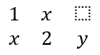

## **نظرة عامة**

PowerPoint يخزن المعادلات بصيغة Office Math Markup Language (OMML). مع Aspose.Slides for Python عبر Java، يمكنك إنشاء نفس نوع محتوى الرياضيات برمجيًا: الكسور، الجذور، الدوال، الحدود، العوامل N-ary، المصفوفات، المصفوفات المتعددة، وكتل الرياضيات المنسقة.

في PowerPoint، يضيف المستخدمون عادةً المعادلات من **Insert > Equation**:


النتيجة هي نص رياضي قابل للتحرير على الشريحة:


Aspose.Slides يبني ذلك النص الرياضي من خلال ثلاث كائنات رئيسية:

- شكل رياضي، يُنشأ باستخدام [addMathShape](https://reference.aspose.com/slides/python-java/aspose.slides/shapecollection/#addMathShape)، وهو الشكل الذي يحتوي على المعادلة.
- [MathPortion](https://reference.aspose.com/slides/python-java/aspose.slides/mathportion/) يخزن محتوى الرياضيات داخل إطار نص الشكل.
- [MathParagraph](https://reference.aspose.com/slides/python-java/aspose.slides/mathparagraph/) يحتوي على كائن أو أكثر من [MathBlock](https://reference.aspose.com/slides/python-java/aspose.slides/mathblock/) .

تستخدم معظم الأمثلة أدناه [MathematicalText](https://reference.aspose.com/slides/python-java/aspose.slides/mathematicaltext/) وطرق السلسلة من [MathElementBase](https://reference.aspose.com/slides/python-java/aspose.slides/mathelementbase/) للحفاظ على اختصار وقابلية قراءة الكود.

للحالات التي تتطلب تصدير MathML، راجع [تصدير المعادلات الرياضية من العروض التقديمية في Python](/slides/ar/python-java/exporting-math-equations/).

## **إنشاء معادلة**

هذا المثال يستخدم [addMathShape](https://reference.aspose.com/slides/python-java/aspose.slides/shapecollection/#addMathShape) لإنشاء شكل رياضي ويضيف مبرهنة فيثاغورس:


```python
import jpype
import asposeslides

if not jpype.isJVMStarted():
    jpype.startJVM()

from asposeslides.api import MathematicalText, Presentation, SaveFormat

presentation = Presentation()
try:
    slide = presentation.getSlides().get_Item(0)

    math_shape = slide.getShapes().addMathShape(20, 20, 700, 120)
    math_paragraph = math_shape.getTextFrame().getParagraphs().get_Item(0).getPortions().get_Item(0).getMathParagraph()

    a_squared = MathematicalText("a").setSuperscript("2")
    b_squared = MathematicalText("b").setSuperscript("2")
    equation = MathematicalText("c").setSuperscript("2").join("=").join(a_squared).join("+").join(b_squared)

    math_paragraph.add(equation)

    presentation.save("pythagorean-theorem.pptx", SaveFormat.Pptx)
finally:
    presentation.dispose()
```

{}
[addMathShape](https://reference.aspose.com/slides/python-java/aspose.slides/shapecollection/#addMathShape) ينشئ شكلًا يحتوي بالفعل على فقرة رياضية. احصل على أول [MathPortion](https://reference.aspose.com/slides/python-java/aspose.slides/mathportion/)، استدعِ [getMathParagraph](https://reference.aspose.com/slides/python-java/aspose.slides/mathportion/#getMathParagraph)، ثم أضف كتلًا رياضية أو عناصر رياضية إليها.
{}

## **إضافة كسور**

استخدم [divide](https://reference.aspose.com/slides/python-java/aspose.slides/mathelementbase/#divide) لإنشاء كسر. يمكنك اختيار نمط الكسر باستخدام [MathFractionTypes](https://reference.aspose.com/slides/python-java/aspose.slides/mathfractiontypes/).


```python
import jpype
import asposeslides

if not jpype.isJVMStarted():
    jpype.startJVM()

from asposeslides.api import MathBlock, MathFractionTypes, MathematicalText, Presentation, SaveFormat

presentation = Presentation()
try:
    slide = presentation.getSlides().get_Item(0)

    math_shape = slide.getShapes().addMathShape(20, 20, 700, 100)
    math_paragraph = math_shape.getTextFrame().getParagraphs().get_Item(0).getPortions().get_Item(0).getMathParagraph()

    fraction = MathematicalText("1").divide("x", MathFractionTypes.Skewed)

    math_block = MathBlock(fraction)
    math_paragraph.add(math_block)

    presentation.save("fraction.pptx", SaveFormat.Pptx)
finally:
    presentation.dispose()
```

لإنشاء كسر مكدس، استخدم [MathFractionTypes.Bar](https://reference.aspose.com/slides/python-java/aspose.slides/mathfractiontypes/#Bar):

```python
import jpype
import asposeslides

if not jpype.isJVMStarted():
    jpype.startJVM()

from asposeslides.api import MathFractionTypes, MathematicalText

stacked_fraction = MathematicalText("x + 1").divide("y - 1", MathFractionTypes.Bar)
```

## **إضافة جذورات**

استخدم [radical](https://reference.aspose.com/slides/python-java/aspose.slides/mathelementbase/#radical) لإنشاء جذر تربيعي، جذر مكعب، أو أي جذر آخر. العنصر الحالي يصبح القاعدة، والوسيط يصبح الدرجة.


```python
import jpype
import asposeslides

if not jpype.isJVMStarted():
    jpype.startJVM()

from asposeslides.api import MathBlock, MathematicalText, Presentation, SaveFormat

presentation = Presentation()
try:
    slide = presentation.getSlides().get_Item(0)

    math_shape = slide.getShapes().addMathShape(20, 20, 700, 100)
    math_paragraph = math_shape.getTextFrame().getParagraphs().get_Item(0).getPortions().get_Item(0).getMathParagraph()

    radical = MathematicalText("x").radical("n")

    math_block = MathBlock(radical)
    math_paragraph.add(math_block)

    presentation.save("radical.pptx", SaveFormat.Pptx)
finally:
    presentation.dispose()
```

## **إضافة دوال وحدود**

استخدم [asArgumentOfFunction](https://reference.aspose.com/slides/python-java/aspose.slides/mathelementbase/#asArgumentOfFunction) أو [function](https://reference.aspose.com/slides/python-java/aspose.slides/mathelementbase/#function) للدوال مثل `sin(x)`، `log(x)`، أو أسماء دوال مخصصة. للحدود، ضع `lim` داخل [MathLimit](https://reference.aspose.com/slides/python-java/aspose.slides/mathlimit/) أو استخدم [setLowerLimit](https://reference.aspose.com/slides/python-java/aspose.slides/mathelementbase/#setLowerLimit).


```python
import jpype
import asposeslides

if not jpype.isJVMStarted():
    jpype.startJVM()

from asposeslides.api import MathBlock, MathematicalText, Presentation, SaveFormat

presentation = Presentation()
try:
    slide = presentation.getSlides().get_Item(0)

    math_shape = slide.getShapes().addMathShape(20, 20, 700, 100)
    math_paragraph = math_shape.getTextFrame().getParagraphs().get_Item(0).getPortions().get_Item(0).getMathParagraph()

    limit = MathematicalText("lim").setLowerLimit("x\u2192\u221E").function("x")

    math_block = MathBlock(limit)
    math_paragraph.add(math_block)

    presentation.save("functions-and-limits.pptx", SaveFormat.Pptx)
finally:
    presentation.dispose()
```

لإنشاء اسم دالة مخصص، اجعل اسم الدالة هو العنصر الحالي واستدعِ [function](https://reference.aspose.com/slides/python-java/aspose.slides/mathelementbase/#function) مع وسيطه:

```python
import jpype
import asposeslides

if not jpype.isJVMStarted():
    jpype.startJVM()

from asposeslides.api import MathematicalText

custom_function = MathematicalText("f").function("x + 1")
```

## **إضافة عوامل N-ary وتكاملات**

استخدم [nary](https://reference.aspose.com/slides/python-java/aspose.slides/mathelementbase/#nary) للتجميعات، الاتحادات، التقاطعات، وغيرها من العوامل الكبيرة. استخدم [integral](https://reference.aspose.com/slides/python-java/aspose.slides/mathelementbase/#integral) للتكاملات. كلا الطريقتين تسمح لك بتعيين حدود سفلية وعليا.


```python
import jpype
import asposeslides

if not jpype.isJVMStarted():
    jpype.startJVM()

from asposeslides.api import MathBlock, MathNaryOperatorTypes, MathematicalText, Presentation, SaveFormat

presentation = Presentation()
try:
    slide = presentation.getSlides().get_Item(0)

    math_shape = slide.getShapes().addMathShape(20, 20, 700, 120)
    math_paragraph = math_shape.getTextFrame().getParagraphs().get_Item(0).getPortions().get_Item(0).getMathParagraph()

    a_power = MathematicalText("a").setSuperscript("n-k")
    summation_base = MathematicalText("x").setSuperscript("k").join(a_power)

    summation = summation_base.nary(MathNaryOperatorTypes.Summation, "k=0", "n")

    math_block = MathBlock(summation)
    math_paragraph.add(math_block)

    presentation.save("nary-operators.pptx", SaveFormat.Pptx)
finally:
    presentation.dispose()
```

العوامل N-ary مخصصة للعوامل الكبيرة التي قد تحتوي على حدود اختيارية. العوامل البسيطة مثل `+`، `-`، و `=` تُضاف عادةً كـ [MathematicalText](https://reference.aspose.com/slides/python-java/aspose.slides/mathematicaltext/) وتُدمج في التعبير.

لإنشاء تكامل، استخدم [integral](https://reference.aspose.com/slides/python-java/aspose.slides/mathelementbase/#integral):

```python
import jpype
import asposeslides

if not jpype.isJVMStarted():
    jpype.startJVM()

from asposeslides.api import MathIntegralTypes, MathematicalText

differential = MathematicalText("dx").toBox()
integral_base = MathematicalText("x").join(differential)
integral = integral_base.integral(MathIntegralTypes.Simple, "0", "1")
```

## **إضافة مصفوفات**

استخدم [MathMatrix](https://reference.aspose.com/slides/python-java/aspose.slides/mathmatrix/) للصفوف والأعمدة. المصفوفات لا تتضمن أقواسًا بشكل افتراضي، لذا احط المصفوفة بأقواس أو أقواس مربعة أو أقواس معقوفة عندما تحتاج ذلك.



```python
import jpype
import asposeslides

if not jpype.isJVMStarted():
    jpype.startJVM()

from asposeslides.api import MathBlock, MathMatrix, MathematicalText, Presentation, SaveFormat

presentation = Presentation()
try:
    slide = presentation.getSlides().get_Item(0)

    math_shape = slide.getShapes().addMathShape(20, 20, 700, 120)
    math_paragraph = math_shape.getTextFrame().getParagraphs().get_Item(0).getPortions().get_Item(0).getMathParagraph()

    matrix = MathMatrix(2, 3)
    cell_0_0 = MathematicalText("1")
    matrix.set_Item(0, 0, cell_0_0)
    cell_0_1 = MathematicalText("x")
    matrix.set_Item(0, 1, cell_0_1)
    cell_1_0 = MathematicalText("x")
    matrix.set_Item(1, 0, cell_1_0)
    cell_1_1 = MathematicalText("2")
    matrix.set_Item(1, 1, cell_1_1)
    cell_1_2 = MathematicalText("y")
    matrix.set_Item(1, 2, cell_1_2)

    math_block = MathBlock(matrix)
    math_paragraph.add(math_block)

    presentation.save("matrix.pptx", SaveFormat.Pptx)
finally:
    presentation.dispose()
```

## **إضافة مصفوفات معادلات**

استخدم [toMathArray](https://reference.aspose.com/slides/python-java/aspose.slides/mathelementbase/#toMathArray) عندما تحتاج إلى معادلات محاذاة أو مجموعة عمودية من التعبيرات.


```python
import jpype
import asposeslides

if not jpype.isJVMStarted():
    jpype.startJVM()

from asposeslides.api import MathBlock, MathematicalText, Presentation, SaveFormat

presentation = Presentation()
try:
    slide = presentation.getSlides().get_Item(0)

    math_shape = slide.getShapes().addMathShape(20, 20, 700, 140)
    math_paragraph = math_shape.getTextFrame().getParagraphs().get_Item(0).getPortions().get_Item(0).getMathParagraph()

    equation_array = MathematicalText("x").join("y").toMathArray()

    math_block = MathBlock(equation_array)
    math_paragraph.add(math_block)

    presentation.save("equation-array.pptx", SaveFormat.Pptx)
finally:
    presentation.dispose()
```

## **إضافة دوال مثلثية**

استخدم [asArgumentOfFunction](https://reference.aspose.com/slides/python-java/aspose.slides/mathelementbase/#asArgumentOfFunction) عندما يكون الوسيط هو العنصر الحالي ويكون اسم الدالة معروفًا.


```python
import jpype
import asposeslides

if not jpype.isJVMStarted():
    jpype.startJVM()

from asposeslides.api import MathBlock, MathFunctionsOfOneArgument, MathematicalText, Presentation, SaveFormat

presentation = Presentation()
try:
    slide = presentation.getSlides().get_Item(0)

    math_shape = slide.getShapes().addMathShape(20, 20, 700, 100)
    math_paragraph = math_shape.getTextFrame().getParagraphs().get_Item(0).getPortions().get_Item(0).getMathParagraph()

    cosine = MathematicalText("2x").asArgumentOfFunction(MathFunctionsOfOneArgument.Cos)

    math_block = MathBlock(cosine)
    math_paragraph.add(math_block)

    presentation.save("trigonometric-function.pptx", SaveFormat.Pptx)
finally:
    presentation.dispose()
```

## **إضافة مواضع سفلية وعليا**

استخدم مساعدات الموضع السفلي والعلي لتحديد الفهارس والاسات. عندما يكون من الضروري ظهور الفهارس على الجانب الأيسر من القاعدة، استخدم [setSubSuperscriptOnTheLeft](https://reference.aspose.com/slides/python-java/aspose.slides/mathelementbase/#setSubSuperscriptOnTheLeft).


```python
import jpype
import asposeslides

if not jpype.isJVMStarted():
    jpype.startJVM()

from asposeslides.api import MathBlock, MathematicalText, Presentation, SaveFormat

presentation = Presentation()
try:
    slide = presentation.getSlides().get_Item(0)

    math_shape = slide.getShapes().addMathShape(20, 20, 700, 100)
    math_paragraph = math_shape.getTextFrame().getParagraphs().get_Item(0).getPortions().get_Item(0).getMathParagraph()

    scripts = MathematicalText("Y").setSubSuperscriptOnTheLeft("1", "n")

    math_block = MathBlock(scripts)
    math_paragraph.add(math_block)

    presentation.save("subscript-superscript.pptx", SaveFormat.Pptx)
finally:
    presentation.dispose()
```

## **إضافة محددات**

استخدم [enclose](https://reference.aspose.com/slides/python-java/aspose.slides/mathelementbase/#enclose) لوضع تعبير داخل محددات. يمكنك أيضًا تعيين حرف فاصل لتعبيرات محددات تحتوي على عدة عناصر.


```python
import jpype
import asposeslides

if not jpype.isJVMStarted():
    jpype.startJVM()

from asposeslides.api import MathBlock, MathematicalText, Presentation, SaveFormat

presentation = Presentation()
try:
    slide = presentation.getSlides().get_Item(0)

    math_shape = slide.getShapes().addMathShape(20, 20, 700, 100)
    math_paragraph = math_shape.getTextFrame().getParagraphs().get_Item(0).getPortions().get_Item(0).getMathParagraph()

    delimiter = MathematicalText("x").join("y").join("z").enclose('<', '>')
    delimiter.setSeparatorCharacter('|')

    math_block = MathBlock(delimiter)
    math_paragraph.add(math_block)

    presentation.save("delimiters.pptx", SaveFormat.Pptx)
finally:
    presentation.dispose()
```

### **حجم ومحاذاة المحددات**

مرّر `True` إلى [setGrowToMatchOperandHeight](https://reference.aspose.com/slides/python-java/aspose.slides/mathdelimiter/#setGrowToMatchOperandHeight) لتجعل الأقواس تتوسع حول معامل مرتفع، أو مرّر `False` للحفاظ على حجمها الطبيعي. استخدم [setDelimiterShape](https://reference.aspose.com/slides/python-java/aspose.slides/mathdelimiter/#setDelimiterShape) مع أحد قيمتي [MathDelimiterShape](https://reference.aspose.com/slides/python-java/aspose.slides/mathdelimitershape/) . `Centered` يوسّط الأقواس على محور الرياضيات، الذي يمر عبر منتصف علامة المساواة. `Match` يطابقها مع المحتوى المحاط. كلا الإعدادين يؤثران فقط على المحددات. يبقى التعبير داخلها كما هو.

المثال يضع كسرًا في أس `x` بحيث يمتد التعبير أعلى الخط الأساسي أكثر من تحته. جميع المعادلات الأربعة تستخدم نفس الأقواس وإعدادات الخط.

```python
import jpype
import asposeslides

if not jpype.isJVMStarted():
    jpype.startJVM()

from asposeslides.api import MathDelimiterShape, MathematicalText, Presentation, SaveFormat

presentation = Presentation()
try:
    slide = presentation.getSlides().get_Item(0)
    for row, grow in enumerate((True, False)):
        for column, shape in enumerate((MathDelimiterShape.Centered, MathDelimiterShape.Match)):
            fraction = MathematicalText("a + b").divide("c + d")
            power = MathematicalText("x").setSuperscript(fraction)
            delimiter = power.enclose("(", ")")
            delimiter.setGrowToMatchOperandHeight(grow)
            delimiter.setDelimiterShape(shape)

            math_shape = slide.getShapes().addMathShape(20 + 330 * column, 20 + 120 * row, 300, 100)
            portion = math_shape.getTextFrame().getParagraphs().get_Item(0).getPortions().get_Item(0)
            portion.getPortionFormat().setFontHeight(32)
            equation = MathematicalText("y = ").join(delimiter)
            portion.getMathParagraph().add(equation)

    presentation.save("delimiter-sizing.pptx", SaveFormat.Pptx)
finally:
    presentation.dispose()
```

في PowerPoint، قارن الصفوف لترى تأثير التوسع. في الصف العلوي، تتوسّع الأقواس لتحتوي الأس وتتشابه لكلا الشكلين. في الصف السفلي، يكون التوسع معطلاً. الأقواس الأصغر على اليسار (`Centered`) تتماشى مع علامة المساواة، بينما الأقواس على اليمين (`Match`) ترتفع أعلى حول التعبير.


## **إضافة صندوق حدود**

استدعِ [toBorderBox](https://reference.aspose.com/slides/python-java/aspose.slides/mathelementbase/#toBorderBox) على كسر لتأطير التعبير بالكامل. تُظهر [MathBorderBox](https://reference.aspose.com/slides/python-java/aspose.slides/mathborderbox/) المُرجعة جميع الجوانب الأربعة افتراضيًا. استخدم [setHideTop](https://reference.aspose.com/slides/python-java/aspose.slides/mathborderbox/#setHideTop)، [setHideBottom](https://reference.aspose.com/slides/python-java/aspose.slides/mathborderbox/#setHideBottom)، [setHideLeft](https://reference.aspose.com/slides/python-java/aspose.slides/mathborderbox/#setHideLeft)، و [setHideRight](https://reference.aspose.com/slides/python-java/aspose.slides/mathborderbox/#setHideRight) لإزالة جوانب معينة.

المثال يضع ست نسخ من نفس الكسر على شريحة واحدة. لإظهار الإلغاء، اخفِ جميع الجوانب الأربعة ومرّر `True` إلى [setStrikethroughBottomLeftToTopRight](https://reference.aspose.com/slides/python-java/aspose.slides/mathborderbox/#setStrikethroughBottomLeftToTopRight) للحصول على قطر صاعد (↗) أو إلى [setStrikethroughTopLeftToBottomRight](https://reference.aspose.com/slides/python-java/aspose.slides/mathborderbox/#setStrikethroughTopLeftToBottomRight) للحصول على قطر هابط (↘). يمكنك أيضًا استخدام [setStrikethroughHorizontal](https://reference.aspose.com/slides/python-java/aspose.slides/mathborderbox/#setStrikethroughHorizontal) أو [setStrikethroughVertical](https://reference.aspose.com/slides/python-java/aspose.slides/mathborderbox/#setStrikethroughVertical) مع أي تركيبة من الجوانب المرئية.

```python
import jpype
import asposeslides

if not jpype.isJVMStarted():
    jpype.startJVM()

from asposeslides.api import MathBlock, MathematicalText, Presentation, SaveFormat, SlideSizeScaleType

presentation = Presentation()
try:
    presentation.getSlideSize().setSize(540, 220, SlideSizeScaleType.DoNotScale)
    slide = presentation.getSlides().get_Item(0)

    def add_fraction(x, y, hide_border):
        fraction = MathematicalText("x+1").divide("y+2")
        box = fraction.toBorderBox()
        box.setHideTop(hide_border)
        box.setHideBottom(hide_border)
        box.setHideLeft(hide_border)
        box.setHideRight(hide_border)

        shape = slide.getShapes().addMathShape(x, y, 160, 90)
        portion = shape.getTextFrame().getParagraphs().get_Item(0).getPortions().get_Item(0)
        portion.getPortionFormat().setFontHeight(28)
        math_block = MathBlock(box)
        portion.getMathParagraph().add(math_block)
        return box

    add_fraction(10, 10, False)

    partial = add_fraction(190, 10, False)
    partial.setHideTop(True)
    partial.setHideRight(True)

    add_fraction(370, 10, True).setStrikethroughBottomLeftToTopRight(True)
    add_fraction(10, 120, True).setStrikethroughTopLeftToBottomRight(True)
    add_fraction(190, 120, True).setStrikethroughHorizontal(True)
    add_fraction(370, 120, False).setStrikethroughVertical(True)

    presentation.save("border-box.pptx", SaveFormat.Pptx)
finally:
    presentation.dispose()
```


على هذا الكسر، يتقاطع الخط الأفقي مع شريط الكسر. الخط العمودي يقطع البسط والمقام بينما يبقى الحد المحيط مرئيًا. هذه الخطوط تزيّن التعبير كاملًا. الضربة عبر النص العادي تطبق على الأحرف داخل مقطع النص. بعد إعادة فتح العرض التقديمي في PowerPoint، لا يزال بإمكانك تعديل البسط والمقام بشكل مستقل.

## **تجميع المصطلحات**

استخدم [group](https://reference.aspose.com/slides/python-java/aspose.slides/mathelementbase/#group) لوضع حرف تجميع فوق أو تحت تعبير. أضف حدًا لتسمية المصطلحات المجمعة.


```python
import jpype
import asposeslides

if not jpype.isJVMStarted():
    jpype.startJVM()

from asposeslides.api import MathBlock, MathTopBotPositions, MathematicalText, Presentation, SaveFormat

presentation = Presentation()
try:
    slide = presentation.getSlides().get_Item(0)

    math_shape = slide.getShapes().addMathShape(20, 20, 700, 120)
    math_paragraph = math_shape.getTextFrame().getParagraphs().get_Item(0).getPortions().get_Item(0).getMathParagraph()

    grouped = MathematicalText("x + y").group('\u23DF', MathTopBotPositions.Bottom, MathTopBotPositions.Top).setLowerLimit("any text")

    math_block = MathBlock(grouped)
    math_paragraph.add(math_block)

    presentation.save("grouped-terms.pptx", SaveFormat.Pptx)
finally:
    presentation.dispose()
```

## **تنسيق عناصر الرياضيات**

استخدم مساعدات التنسيق فقط حيث توضح الصيغة. على سبيل المثال، [overbar](https://reference.aspose.com/slides/python-java/aspose.slides/mathelementbase/#overbar) يضع شريطًا فوق عنصر رياضي.


```python
import jpype
import asposeslides

if not jpype.isJVMStarted():
    jpype.startJVM()

from asposeslides.api import MathBlock, MathematicalText, Presentation, SaveFormat

presentation = Presentation()
try:
    slide = presentation.getSlides().get_Item(0)

    math_shape = slide.getShapes().addMathShape(20, 20, 700, 100)
    math_paragraph = math_shape.getTextFrame().getParagraphs().get_Item(0).getPortions().get_Item(0).getMathParagraph()

    overbar = MathematicalText("ABC").overbar()

    math_block = MathBlock(overbar)
    math_paragraph.add(math_block)

    presentation.save("overbar.pptx", SaveFormat.Pptx)
finally:
    presentation.dispose()
```

### **تنسيق النص في معادلة موجودة**

لتنسيق النص في جميع أنحاء معادلة موجودة، استعرض شجرة عناصر كل كتلة رياضية. [MathElementBase.getChildren](https://reference.aspose.com/slides/python-java/aspose.slides/mathelementbase/#getChildren) يُعيد الأطفال المباشرين فقط، لذا استدعِه بصورة متكررة للوصول إلى النص داخل الكسور، والمواضع، والجذور، والهياكل المتداخلة الأخرى. تحقق من العنصر الحالي وكذلك من أطفاله لتضمين العنصر الأول عندما يكون [MathematicalText](https://reference.aspose.com/slides/python-java/aspose.slides/mathematicaltext/).

هذا المثال يفترض أن `input.pptx` يحتوي على معادلة مثل `z = xᵢ / ∛y`، مع كسر يحتوي على موضع سفلي في البسط وجذر في المقام. معالجة العناصر المستوى الأعلى فقط سيتسبب في فقدان النص داخل الكسر. المثال يجد أجزاء رياضية في إطارات نص الشرائح، يدخل إلى كتلها عبر [MathPortion.getMathParagraph](https://reference.aspose.com/slides/python-java/aspose.slides/mathportion/#getMathParagraph)، ويستخدم [setFontHeight](https://reference.aspose.com/slides/python-java/aspose.slides/baseportionformat/#setFontHeight) لتعيين حجم الخط إلى 28 نقطة عبر طريقة [getFormat](https://reference.aspose.com/slides/python-java/aspose.slides/mathematicaltext/#getFormat) لكل عنصر نصي.

```python
import jpype
import asposeslides

if not jpype.isJVMStarted():
    jpype.startJVM()

from asposeslides.api import AutoShape, MathematicalText, MathPortion, Presentation, SaveFormat


def format_math_text(element):
    if isinstance(element, MathematicalText):
        element.getFormat().setFontHeight(28)

    for child in element.getChildren():
        format_math_text(child)


presentation = Presentation("input.pptx")
try:
    for slide in presentation.getSlides():
        for shape in slide.getShapes():
            if not isinstance(shape, AutoShape):
                continue

            if shape.getTextFrame() is None:
                continue

            for paragraph in shape.getTextFrame().getParagraphs():
                for portion in paragraph.getPortions():
                    if isinstance(portion, MathPortion):
                        for block in portion.getMathParagraph():
                            format_math_text(block)

    presentation.save("formatted-equations.pptx", SaveFormat.Pptx)
finally:
    presentation.dispose()
```

العرض المحفوظ يحتوي على تنسيق نص محدث في كل مستوى من كل معادلة معالجة، مع الحفاظ على محتوى النص والبنية الرياضية.

## **مرجع سريع**

| المهمة | API الرئيسي |
| --- | --- |
| إنشاء نص رياضي | [MathematicalText](https://reference.aspose.com/slides/python-java/aspose.slides/mathematicaltext/) |
| دمج العناصر | [MathElementBase.join](https://reference.aspose.com/slides/python-java/aspose.slides/mathelementbase/#join) |
| إنشاء كسور | [MathElementBase.divide](https://reference.aspose.com/slides/python-java/aspose.slides/mathelementbase/#divide) |
| إضافة أس فوق أو أس تحت | [setSuperscript](https://reference.aspose.com/slides/python-java/aspose.slides/mathelementbase/#setSuperscript), [setSubscript](https://reference.aspose.com/slides/python-java/aspose.slides/mathelementbase/#setSubscript) |
| إضافة دوال | [function](https://reference.aspose.com/slides/python-java/aspose.slides/mathelementbase/#function), [asArgumentOfFunction](https://reference.aspose.com/slides/python-java/aspose.slides/mathelementbase/#asArgumentOfFunction) |
| إضافة جذور | [MathElementBase.radical](https://reference.aspose.com/slides/python-java/aspose.slides/mathelementbase/#radical) |
| إضافة حدود | [setLowerLimit](https://reference.aspose.com/slides/python-java/aspose.slides/mathelementbase/#setLowerLimit), [setUpperLimit](https://reference.aspose.com/slides/python-java/aspose.slides/mathelementbase/#setUpperLimit) |
| إضافة مواضع على الجانب الأيسر | [setSubSuperscriptOnTheLeft](https://reference.aspose.com/slides/python-java/aspose.slides/mathelementbase/#setSubSuperscriptOnTheLeft) |
| إضافة عمليات جمع وتكامل | [nary](https://reference.aspose.com/slides/python-java/aspose.slides/mathelementbase/#nary), [integral](https://reference.aspose.com/slides/python-java/aspose.slides/mathelementbase/#integral) |
| إضافة مصفوفات | [MathMatrix](https://reference.aspose.com/slides/python-java/aspose.slides/mathmatrix/) |
| إضافة مصفوفات معادلات | [toMathArray](https://reference.aspose.com/slides/python-java/aspose.slides/mathelementbase/#toMathArray) |
| إضافة محددات | [enclose](https://reference.aspose.com/slides/python-java/aspose.slides/mathelementbase/#enclose) |
| إضافة أشرطة وإطارات | [overbar](https://reference.aspose.com/slides/python-java/aspose.slides/mathelementbase/#overbar), [toBorderBox](https://reference.aspose.com/slides/python-java/aspose.slides/mathelementbase/#toBorderBox) |
| تجميع المصطلحات | [group](https://reference.aspose.com/slides/python-java/aspose.slides/mathelementbase/#group) |

## **الأسئلة المتكررة**

**هل يمكنني تعديل معادلة PowerPoint موجودة؟**

نعم. افتح العرض التقديمي، ابحث عن الشكل الذي يحتوي على [MathPortion](https://reference.aspose.com/slides/python-java/aspose.slides/mathportion/)، استدعِ [getMathParagraph](https://reference.aspose.com/slides/python-java/aspose.slides/mathportion/#getMathParagraph)، وقم بتحديث كتل الرياضيات داخل تلك الفقرة.

**هل تُحفظ المعادلات كرياضيات PowerPoint قابلة للتحرير؟**

نعم. عند الحفظ إلى PPTX، تقوم Aspose.Slides بكتابة المعادلة كمحتوى Office Math قابل للتحرير.

**هل يمكنني تصدير المعادلات إلى LaTeX؟**

نعم. احصل على [MathParagraph](https://reference.aspose.com/slides/python-java/aspose.slides/mathparagraph/) للمعادلة من [MathPortion](https://reference.aspose.com/slides/python-java/aspose.slides/mathportion/)، ثم استدعِ [MathParagraph.toLatex](https://reference.aspose.com/slides/python-java/aspose.slides/mathparagraph/#toLatex) لتصديره مباشرة. للحصول على مثال كامل، راجع [تصدير المعادلات الرياضية من العروض التقديمية في Python](/slides/ar/python-java/exporting-math-equations/#export-math-equations-to-latex).