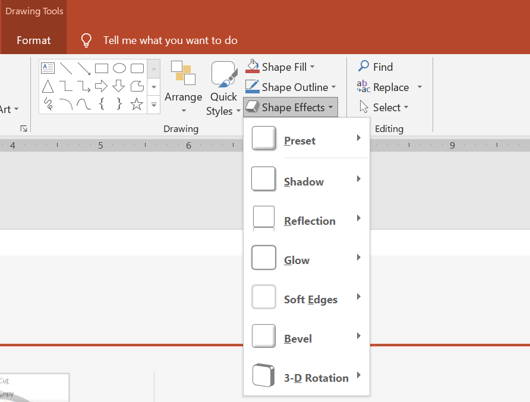

## **مقدمة**

في حين يمكن استخدام التأثيرات في PowerPoint لجعل الشكل بارزًا، فإنها تختلف عن [الملء](/slides/ar/python-java/shape-formatting/#gradient-fill) أو الحدود. باستخدام تأثيرات PowerPoint، يمكنك إنشاء انعكاسات مقنعة على الشكل، وتوزيع توهج الشكل، وما إلى ذلك.



يوفر PowerPoint ستة تأثيرات يمكن تطبيقها على الأشكال. يمكنك تطبيق تأثير واحد أو أكثر على الشكل.

بعض تركيبات التأثيرات تبدو أفضل من غيرها. لهذا السبب، يوفر PowerPoint خيارات تحت **Preset**. خيارات Preset هي تركيبات من تأثيرين أو أكثر معروفة بأنها تبدو جيدة. بهذه الطريقة، عند اختيار إعداد مسبق، لن تحتاج إلى إضاعة الوقت في اختبار أو دمج تأثيرات مختلفة للعثور على تركيبة مناسبة.

توفر Aspose.Slides الخصائص والطرق ضمن الفئة [EffectFormat](https://reference.aspose.com/slides/python-java/aspose.slides/effectformat/) التي تتيح لك تطبيق نفس التأثيرات على الأشكال في عروض PowerPoint.

## **تطبيق تأثير الظل**

تدعم Aspose.Slides للـ Python عبر Java الظلال الخارجية والداخلية للأشكال. يمكنك تخصيص لونها، اتجاهها، مسافتها، ونصف قطر التشويش لتتناسب مع تصميم عرضك.

### **تطبيق ظل خارجي**

استخدم ظلًا خارجيًا لجعل بطاقة أو لوحة بارزة مقابل خلفية الشريحة. يمتد الظل خارج حواف الشكل، مما يخلق انطباعًا بأن الشكل مرتفع فوق الشريحة. قم بضبط لونه، اتجاهه، مسافته، ونصف قطر التشويش ليتناسب مع إضاءة ونمط القالب الخاص بك.

يعرض هذا الشيفرة بلغة Python كيفية تطبيق [تأثير الظل الخارجي](https://reference.aspose.com/slides/python-java/aspose.slides/effectformat/#getOuterShadowEffect) على مستطيل:

```python
import jpype
import asposeslides

if not jpype.isJVMStarted():
    jpype.startJVM()

from asposeslides.api import Presentation, SaveFormat, ShapeType
from java.awt import Color

presentation = Presentation()
try:
    slide = presentation.getSlides().get_Item(0)

    shape = slide.getShapes().addAutoShape(ShapeType.RoundCornerRectangle, 20, 20, 200, 100)
    shape.getEffectFormat().enableOuterShadowEffect()
    shape.getEffectFormat().getOuterShadowEffect().getShadowColor().setColor(Color(169, 169, 169))
    shape.getEffectFormat().getOuterShadowEffect().setDistance(10)
    shape.getEffectFormat().getOuterShadowEffect().setDirection(45)

    presentation.save("shadow_effect.pptx", SaveFormat.Pptx)
finally:
    presentation.dispose()
```


### **تطبيق ظل داخلي**

عند إعادة إنتاج نمط القالب البصري، استخدم ظلًا داخليًا لإعطاء بطاقة أو لوحة مظهرًا متراجعًا. يمتد الظل الخارجي خارج الشكل ويجعله يبدو مرتفعًا، بينما يظلل الظل الداخلي داخل حواف الشكل.

استدعِ [enableInnerShadowEffect](https://reference.aspose.com/slides/python-java/aspose.slides/effectformat/#enableInnerShadowEffect)، ثم قم بتكوين الظل الذي تُعيده الدالة [getInnerShadowEffect](https://reference.aspose.com/slides/python-java/aspose.slides/effectformat/#getInnerShadowEffect). القيم الأكبر لنصف قطر التشويش تُنتج حوافًا أنعم.

هذا المثال بلغة Python ينشئ بطاقة زرقاء فاتحة مع ظل داخلي رمادي داكن ويحفظها كملف PPTX. اتجاه الظل هو 225 درجة، مسافته 7 نقاط، ونصف قطر التشويش 6 نقاط:

```python
import jpype
import asposeslides

if not jpype.isJVMStarted():
    jpype.startJVM()

from asposeslides.api import FillType, Presentation, SaveFormat, ShapeType
from java.awt import Color

presentation = Presentation()
try:
    slide = presentation.getSlides().get_Item(0)

    shape = slide.getShapes().addAutoShape(ShapeType.Rectangle, 20, 20, 200, 100)
    shape.getFillFormat().setFillType(FillType.Solid)
    shape.getFillFormat().getSolidFillColor().setColor(Color(173, 216, 230))
    shape.getLineFormat().getFillFormat().setFillType(FillType.NoFill)

    shape.getEffectFormat().enableInnerShadowEffect()
    shadow = shape.getEffectFormat().getInnerShadowEffect()
    shadow.getShadowColor().setColor(Color(105, 105, 105))
    shadow.setDirection(225)
    shadow.setDistance(7)
    shadow.setBlurRadius(6)

    presentation.save("inner_shadow_effect.pptx", SaveFormat.Pptx)
finally:
    presentation.dispose()
```


لإزالة الظل الداخلي، استدعِ [disableInnerShadowEffect](https://reference.aspose.com/slides/python-java/aspose.slides/effectformat/#disableInnerShadowEffect) على تنسيق تأثير الشكل.

## **تطبيق تأثير الانعكاس**

لتطبيق تأثير الانعكاس في Aspose.Slides للـ Python عبر Java، يمكنك إضافة انعكاس شبيه بالمرآة إلى الأشكال، مع ضبط المعلمات مثل المسافة، الشفافية، والحجم. يعزز هذا التأثير جمالية عروضك من خلال إعطاء الأشكال مظهرًا أكثر صقلاً وتطورًا. من السهل تنفيذ ذلك باستخدام شفرة بسيطة، مما يتيح تطبيقًا سريعًا عبر عناصر متعددة لتصميم متسق.

يعرض هذا الشيفرة بلغة Python كيفية تطبيق [تأثير الانعكاس](https://reference.aspose.com/slides/python-java/aspose.slides/effectformat/#getReflectionEffect) على شكل:

```python
import jpype
import asposeslides

if not jpype.isJVMStarted():
    jpype.startJVM()

from asposeslides.api import Presentation, RectangleAlignment, SaveFormat, ShapeType

presentation = Presentation()
try:
    slide = presentation.getSlides().get_Item(0)

    shape = slide.getShapes().addAutoShape(ShapeType.RoundCornerRectangle, 20, 20, 200, 100)
    shape.getEffectFormat().enableReflectionEffect()
    shape.getEffectFormat().getReflectionEffect().setRectangleAlign(RectangleAlignment.Bottom)
    shape.getEffectFormat().getReflectionEffect().setDirection(90)
    shape.getEffectFormat().getReflectionEffect().setDistance(40)
    shape.getEffectFormat().getReflectionEffect().setBlurRadius(2)

    presentation.save("reflection_effect.pptx", SaveFormat.Pptx)
finally:
    presentation.dispose()
```


## **تطبيق تأثير التوهج**

لتطبيق تأثير التوهج على شكل في Aspose.Slides للـ Python عبر Java، يمكنك إضافة هالة ناعمة ومضيئة حول الأشكال، مع ضبط خصائص مثل اللون والحجم. يساعد هذا التأثير على إبراز الأشكال ويضيف عنصرًا بصريًا جذابًا ولافتًا للانتباه إلى عرضك. من السهل تنفيذه بكمية قليلة من الشفرة، مما يحسن المظهر العام لشريحاتك.

يعرض هذا الشيفرة بلغة Python كيفية تطبيق [تأثير التوهج](https://reference.aspose.com/slides/python-java/aspose.slides/effectformat/#getGlowEffect) على شكل:

```python
import jpype
import asposeslides

if not jpype.isJVMStarted():
    jpype.startJVM()

from asposeslides.api import Presentation, SaveFormat, ShapeType
from java.awt import Color

presentation = Presentation()
try:
    slide = presentation.getSlides().get_Item(0)

    shape = slide.getShapes().addAutoShape(ShapeType.RoundCornerRectangle, 20, 20, 200, 100)
    shape.getEffectFormat().enableGlowEffect()
    shape.getEffectFormat().getGlowEffect().getColor().setColor(Color.MAGENTA)
    shape.getEffectFormat().getGlowEffect().setRadius(15)

    presentation.save("glow_effect.pptx", SaveFormat.Pptx)
finally:
    presentation.dispose()
```


## **تطبيق تأثير الحواف الناعمة**

لتطبيق تأثير الحواف الناعمة في Aspose.Slides للـ Python عبر Java، يمكنك إنشاء انتقال سلس ومتشوش حول حواف الشكل. يضيف هذا التأثير مظهرًا أكثر رقة وتفصيلًا، وهو مثالي للتصاميم التي تحتاج إلى مظهر ناعم وأقل حدة. يمكنك بسهولة ضبط معلمات مثل نصف القطر لتحقيق التأثير المطلوب عبر أشكال مختلفة في عرضك.

يعرض هذا الشيفرة بلغة Python كيفية تطبيق [تأثير الحواف الناعمة](https://reference.aspose.com/slides/python-java/aspose.slides/effectformat/#getSoftEdgeEffect) على شكل:

```python
import jpype
import asposeslides

if not jpype.isJVMStarted():
    jpype.startJVM()

from asposeslides.api import Presentation, SaveFormat, ShapeType

presentation = Presentation()
try:
    slide = presentation.getSlides().get_Item(0)

    shape = slide.getShapes().addAutoShape(ShapeType.RoundCornerRectangle, 20, 20, 200, 150)
    shape.getEffectFormat().enableSoftEdgeEffect()
    shape.getEffectFormat().getSoftEdgeEffect().setRadius(8)

    presentation.save("soft_edges_effect.pptx", SaveFormat.Pptx)
finally:
    presentation.dispose()
```


## **تطبيق تأثير الضبابية**

استخدم ضبابية الشكل لتنعيم ملء الشكل وحدوده مع الحفاظ على قابلية التحرير. استدعِ [setBlurEffect](https://reference.aspose.com/slides/python-java/aspose.slides/effectformat/#setBlurEffect) على تنسيق تأثير الشكل. يُقاس نصف القطر بالنقاط (1/72 بوصة): استخدم قيمة غير سالبة، حيث أن القيم الأكبر تنتج ضبابية أقوى. نصف القطر الصفري يترك المظهر دون تغيير.

تتحكم إعدادات [getGrow](https://reference.aspose.com/slides/python-java/aspose.slides/blur/#getGrow) في الحدود المرئية للتأثير. عند `False`، تُقَصّ الضبابية إلى الحدود المرسومة الأصلية، بما في ذلك الحد. عند `True`، يمكن للضبابية أن تمتد خارج تلك الحدود. لا يغيّر أي من الإعدادين موضع الشكل أو أبعاده.

المقارنة أدناه تستخدم نفس الملء والحد وأبعاد الشكل طوال الوقت. الصف العلوي يستخدم `grow = False`؛ الصف السفلي يستخدم `grow = True`.


هذا المثال بلغة Python ينشئ مستطيلًا برتقاليًا بحد أزرق داكن، يطبق ضبابية بسمك 5 نقاط، ثم يحدّثها إلى ضبابية بسمك 15 نقطة باستدعاء [setBlurEffect](https://reference.aspose.com/slides/python-java/aspose.slides/effectformat/#setBlurEffect) مرة أخرى. يحفظ كلا الحالتين الضبابيتين، ثم يستدعي [disableBlurEffect](https://reference.aspose.com/slides/python-java/aspose.slides/effectformat/#disableBlurEffect) ويحفظ الشكل بدون ضبابية.

```python
import jpype
import asposeslides

if not jpype.isJVMStarted():
    jpype.startJVM()

from asposeslides.api import FillType, Presentation, SaveFormat, ShapeType
from java.awt import Color

presentation = Presentation()
try:
    slide = presentation.getSlides().get_Item(0)

    shape = slide.getShapes().addAutoShape(ShapeType.Rectangle, 100, 80, 160, 100)
    shape.getFillFormat().setFillType(FillType.Solid)
    shape.getFillFormat().getSolidFillColor().setColor(Color(255, 165, 0))
    shape.getLineFormat().getFillFormat().setFillType(FillType.Solid)
    shape.getLineFormat().getFillFormat().getSolidFillColor().setColor(Color(0, 0, 139))
    shape.getLineFormat().setWidth(8)

    shape.getEffectFormat().setBlurEffect(5, False)
    presentation.save("shape_blur_5.pptx", SaveFormat.Pptx)

    shape.getEffectFormat().setBlurEffect(15, True)
    presentation.save("shape_blur_15.pptx", SaveFormat.Pptx)

    shape.getEffectFormat().disableBlurEffect()
    presentation.save("shape_blur_removed.pptx", SaveFormat.Pptx)
finally:
    presentation.dispose()
```

تؤثر ضبابية الشكل على الملء والحد معًا. يخفف تأثير الحواف الناعمة حواف الشكل، بينما تُنعم ضبابية الظل الظل فقط. تعمل تأثيرات تحويل الصورة على محتوى الصورة؛ هذا المثال يطبق الضبابية مباشرةً على تنسيق تأثير الشكل دون تحويل الشكل إلى صورة.

## **الأسئلة الشائعة**

**هل يمكنني تطبيق تأثيرات متعددة على الشكل نفسه؟**

نعم، يمكنك دمج تأثيرات مختلفة، مثل الظل، والانعكاس، والتوهج، على شكل واحد لإنشاء مظهر أكثر ديناميكية.

**ما الأشكال التي يمكنني تطبيق التأثيرات عليها؟**

يمكنك تطبيق التأثيرات على أشكال متعددة، بما في ذلك الأشكال التلقائية، المخططات، الجداول، الصور، كائنات SmartArt، كائنات OLE، وغيرها.

**هل يمكنني تطبيق التأثيرات على الأشكال المجمعة؟**

نعم، يمكنك تطبيق التأثيرات على الأشكال المجمعة. سيُطبَق التأثير على المجموعة بأكملها.