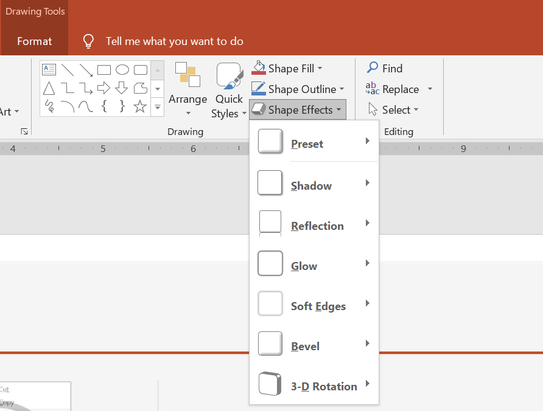

## **المقدمة**

في حين يمكن استخدام التأثيرات في PowerPoint لجعل الشكل يبرز، إلا أنها تختلف عن [التعبئات](/slides/ar/python-java/shape-formatting/#gradient-fill) أو الخطوط الخارجية. باستخدام تأثيرات PowerPoint، يمكنك إنشاء انعكاسات مقنعة على الشكل، ونشر توهج الشكل، وما إلى ذلك.



يقدم PowerPoint ستة تأثيرات يمكن تطبيقها على الأشكال. يمكنك تطبيق تأثير واحد أو أكثر على الشكل.

بعض تركيبات التأثيرات تبدو أفضل من غيرها. لهذا السبب، يوفر PowerPoint خيارات تحت **Preset**. خيارات Preset هي تركيبات من اثنين أو أكثر من التأثيرات المعروفة بأنها تبدو جيدة. بهذه الطريقة، عند اختيار إعداد مسبق، لن تحتاج إلى إضاعة الوقت في اختبار أو دمج تأثيرات مختلفة للعثور على تركيبة جميلة.

توفر Aspose.Slides خصائص وأساليب تحت فئة [EffectFormat](https://reference.aspose.com/slides/python-java/aspose.slides/effectformat/) التي تتيح لك تطبيق نفس التأثيرات على الأشكال في عروض PowerPoint.

## **تطبيق تأثير ظل**

يدعم Aspose.Slides للـ Python عبر Java الظلال الخارجية والداخلية للأشكال. يمكنك تخصيص اللون والاتجاه والمسافة ونصف قطر الضبابية لتتناسب مع تصميم العرض التقديمي الخاص بك.

### **تطبيق ظل خارجي**

استخدم الظل الخارجي لجعل البطاقة أو اللوحة تبرز مقابل خلفية الشريحة. يمتد الظل خارج حواف الشكل، مما يخلق انطباعًا بأن الشكل مرتفع فوق الشريحة. اضبط لونه واتجاهه ومسافته ونصف قطر الضبابية لتتناسب مع الإضاءة وتنسيق القالب الخاص بك.

يعرض هذا الكود Python كيفية تطبيق [تأثير الظل الخارجي](https://reference.aspose.com/slides/python-java/aspose.slides/effectformat/#getOuterShadowEffect) على مستطيل:

```python
import jpype
import asposeslides

if not jpype.isJVMStarted():
    jpype.startJVM()

from asposeslides.api import Presentation, SaveFormat, ShapeType
from java.awt import Color

presentation = Presentation()
try:
    slide = presentation.getSlides().get_Item(0)

    shape = slide.getShapes().addAutoShape(ShapeType.RoundCornerRectangle, 20, 20, 200, 100)
    shape.getEffectFormat().enableOuterShadowEffect()
    shape.getEffectFormat().getOuterShadowEffect().getShadowColor().setColor(Color(169, 169, 169))
    shape.getEffectFormat().getOuterShadowEffect().setDistance(10)
    shape.getEffectFormat().getOuterShadowEffect().setDirection(45)

    presentation.save("shadow_effect.pptx", SaveFormat.Pptx)
finally:
    presentation.dispose()
```


#### **التحكم في اتجاه الظل عندما يدور الشكل**

بشكل افتراضي، يدور الظل الخارجي مع الشكل. لجعل الأشكال ذات الدورانات المختلفة تبدو مضاءة من نفس الاتجاه، استدعِ [setRotateShadowWithShape](https://reference.aspose.com/slides/python-java/aspose.slides/outershadow/#setRotateShadowWithShape) مع `False` واستخدم [setDirection](https://reference.aspose.com/slides/python-java/aspose.slides/outershadow/#setDirection) لتعيين نفس الاتجاه لظلالها.

ينشئ المثال سهمين أزرقين بظلال رمادية إزاحة 42 نقطة إلى اليمين (0°). ثم يكرر الشريحة ويدور السهمين 90° باتجاه عقارب الساعة.

```python
import jpype
import asposeslides

if not jpype.isJVMStarted():
    jpype.startJVM()

from asposeslides.api import FillType, Presentation, SaveFormat, ShapeType
from java.awt import Color

presentation = Presentation()
try:
    before = presentation.getSlides().get_Item(0)
    
    left = before.getShapes().addAutoShape(ShapeType.RightArrow, 55, 130, 110, 60)
    left.getFillFormat().setFillType(FillType.Solid)
    left.getFillFormat().getSolidFillColor().setColor(Color(70, 130, 180))
    left.getLineFormat().getFillFormat().setFillType(FillType.NoFill)

    left.getEffectFormat().enableOuterShadowEffect()
    shadow = left.getEffectFormat().getOuterShadowEffect()
    shadow.getShadowColor().setColor(Color.GRAY)
    shadow.setDirection(0)
    shadow.setDistance(42)
    shadow.setBlurRadius(0)
    shadow.setRotateShadowWithShape(True)

    right = before.getShapes().addClone(left)
    right.setX(395)
    right.getEffectFormat().getOuterShadowEffect().setRotateShadowWithShape(False)

    after = presentation.getSlides().addClone(before)
    for arrow in after.getShapes():
        arrow.setRotation(90)

    presentation.save("arrow_shadows.pptx", SaveFormat.Pptx)
finally:
    presentation.dispose()
```

في الشريحة الثانية، يلقي السهم الأيسر ظله إلى الأسفل، بينما لا يزال السهم الأيمن يلقي ظله إلى اليمين. يبقى الاتجاه المُعدّ 0° لكل الظلين.


### **تطبيق ظل داخلي**

عند إعادة إنتاج نمط القالب البصري، استخدم الظل الداخلي لإعطاء البطاقة أو اللوحة مظهرًا محفرًا. الظل الخارجي يمتد خارج الشكل ويجعله يبدو مرتفعًا، بينما يظلل الظل الداخلي داخل حوافه.

استدعِ [enableInnerShadowEffect](https://reference.aspose.com/slides/python-java/aspose.slides/effectformat/#enableInnerShadowEffect)، ثم قم بإعداد الظل المُعاد من [getInnerShadowEffect](https://reference.aspose.com/slides/python-java/aspose.slides/effectformat/#getInnerShadowEffect). القيم الأكبر لنصف قطر الضبابية تنتج حوافًا أنعم.

هذا المثال Python ينشئ بطاقة زرقاء فاتحة بظل داخلي رمادي داكن ويحفظها كملف PPTX. اتجاه الظل هو 225 درجة، مسافته 7 نقاط، ونصف قطر الضبابية 6 نقاط:

```python
import jpype
import asposeslides

if not jpype.isJVMStarted():
    jpype.startJVM()

from asposeslides.api import FillType, Presentation, SaveFormat, ShapeType
from java.awt import Color

presentation = Presentation()
try:
    slide = presentation.getSlides().get_Item(0)

    shape = slide.getShapes().addAutoShape(ShapeType.Rectangle, 20, 20, 200, 100)
    shape.getFillFormat().setFillType(FillType.Solid)
    shape.getFillFormat().getSolidFillColor().setColor(Color(173, 216, 230))
    shape.getLineFormat().getFillFormat().setFillType(FillType.NoFill)

    shape.getEffectFormat().enableInnerShadowEffect()
    shadow = shape.getEffectFormat().getInnerShadowEffect()
    shadow.getShadowColor().setColor(Color(105, 105, 105))
    shadow.setDirection(225)
    shadow.setDistance(7)
    shadow.setBlurRadius(6)

    presentation.save("inner_shadow_effect.pptx", SaveFormat.Pptx)
finally:
    presentation.dispose()
```


لإزالة الظل الداخلي، استدعِ [disableInnerShadowEffect](https://reference.aspose.com/slides/python-java/aspose.slides/effectformat/#disableInnerShadowEffect) على تنسيق تأثير الشكل.

### **تطبيق، تعديل وإزالة ظل مسبق**

استدعِ [enablePresetShadowEffect](https://reference.aspose.com/slides/python-java/aspose.slides/effectformat/#enablePresetShadowEffect)، ثم استخدم [setPreset](https://reference.aspose.com/slides/python-java/aspose.slides/presetshadow/#setPreset) لاختيار [PresetShadowType](https://reference.aspose.com/slides/python-java/aspose.slides/presetshadowtype/). لتبديل الأنماط، غيّر الإعداد المسبق على نفس الشكل. استدعِ [disablePresetShadowEffect](https://reference.aspose.com/slides/python-java/aspose.slides/effectformat/#disablePresetShadowEffect) لإزالة الظل مع الحفاظ على التعبئة والحد.

يستنسخ المثال المستطيل في كل مرحلة حتى تتمكن من مقارنة الحالة الأربعة جنبًا إلى جنب في شريحة واحدة. كلا الظلين إزاحتهما 10 نقاط. اتجاه 225° يضع الظل الأول فوق ويسار المستطيل. اتجاه 45° يضع الظل الثاني أسفل ويمين المستطيل.

```python
import jpype
import asposeslides

if not jpype.isJVMStarted():
    jpype.startJVM()

from asposeslides.api import FillType, Presentation, PresetShadowType, SaveFormat, ShapeType, SlideSizeScaleType
from java.awt import Color

presentation = Presentation()
try:
    presentation.getSlideSize().setSize(800, 120, SlideSizeScaleType.DoNotScale)
    shapes = presentation.getSlides().get_Item(0).getShapes()

    shape = shapes.addAutoShape(ShapeType.Rectangle, 15, 30, 170, 60)
    shape.getFillFormat().setFillType(FillType.Solid)
    shape.getFillFormat().getSolidFillColor().setColor(Color(70, 130, 180))
    shape.getLineFormat().getFillFormat().setFillType(FillType.Solid)
    shape.getLineFormat().getFillFormat().getSolidFillColor().setColor(Color(0, 0, 139))
    text_frame = shape.getTextFrame()
    text_frame.setText("No shadow")
    paragraph_format = text_frame.getParagraphs().get_Item(0).getParagraphFormat()
    paragraph_format.getDefaultPortionFormat().setFontHeight(14)
    shapes.addClone(shape)

    shape.setX(shape.getX() + 200)
    shape.getEffectFormat().enablePresetShadowEffect()
    shadow = shape.getEffectFormat().getPresetShadowEffect()
    shadow.setPreset(PresetShadowType.TopLeftDropShadow)
    shadow.setDistance(10)
    shadow.setDirection(225)
    text_frame.setText("TopLeftDropShadow")
    shapes.addClone(shape)

    shape.setX(shape.getX() + 200)
    shadow.setPreset(PresetShadowType.BottomRightDropShadow)
    shadow.setDirection(45)
    text_frame.setText("BottomRightDropShadow")
    shapes.addClone(shape)

    shape.setX(shape.getX() + 200)
    shape.getEffectFormat().disablePresetShadowEffect()
    text_frame.setText("No shadow")

    presentation.save("preset_shadows.pptx", SaveFormat.Pptx)
finally:
    presentation.dispose()
```

| الأصلي | الإعداد المسبق الأول | الإعداد المسبق الثاني | بعد الإزالة |
| :---: | :---: | :---: | :---: |
|  |  |  |  |

## **تطبيق تأثير الانعكاس**

لتطبيق تأثير الانعكاس في Aspose.Slides للـ Python عبر Java، يمكنك إضافة انعكاس مشابه للمرآة إلى الأشكال، مع ضبط معلمات مثل المسافة والشفافية والحجم. يعزز هذا التأثير جمالية العروض التقديمية بإضفاء مظهر أكثر صقلًا وتفردًا على الأشكال. من السهل تنفيذه باستخدام كود بسيط، مما يتيح تطبيقًا سريعًا عبر عناصر متعددة لتصميم متسق.

يعرض هذا الكود Python كيفية تطبيق [تأثير الانعكاس](https://reference.aspose.com/slides/python-java/aspose.slides/effectformat/#getReflectionEffect) على شكل:

```python
import jpype
import asposeslides

if not jpype.isJVMStarted():
    jpype.startJVM()

from asposeslides.api import Presentation, RectangleAlignment, SaveFormat, ShapeType

presentation = Presentation()
try:
    slide = presentation.getSlides().get_Item(0)

    shape = slide.getShapes().addAutoShape(ShapeType.RoundCornerRectangle, 20, 20, 200, 100)
    shape.getEffectFormat().enableReflectionEffect()
    shape.getEffectFormat().getReflectionEffect().setRectangleAlign(RectangleAlignment.Bottom)
    shape.getEffectFormat().getReflectionEffect().setDirection(90)
    shape.getEffectFormat().getReflectionEffect().setDistance(40)
    shape.getEffectFormat().getReflectionEffect().setBlurRadius(2)

    presentation.save("reflection_effect.pptx", SaveFormat.Pptx)
finally:
    presentation.dispose()
```


## **تطبيق تأثير التوهج**

لتطبيق تأثير التوهج على شكل في Aspose.Slides للـ Python عبر Java، يمكنك إضافة هالة ناعمة ومضيئة حول الأشكال، مع ضبط خصائص مثل اللون والحجم. يساعد هذا التأثير على إبراز الأشكال ويضيف عنصرًا بصريًا جذابًا ولافتًا للانتباه إلى العرض التقديمي. من السهل تنفيذه بكود بسيط، مما يعزز المظهر العام للشرائح.

يعرض هذا الكود Python كيفية تطبيق [تأثير التوهج](https://reference.aspose.com/slides/python-java/aspose.slides/effectformat/#getGlowEffect) على شكل:

```python
import jpype
import asposeslides

if not jpype.isJVMStarted():
    jpype.startJVM()

from asposeslides.api import Presentation, SaveFormat, ShapeType
from java.awt import Color

presentation = Presentation()
try:
    slide = presentation.getSlides().get_Item(0)

    shape = slide.getShapes().addAutoShape(ShapeType.RoundCornerRectangle, 20, 20, 200, 100)
    shape.getEffectFormat().enableGlowEffect()
    shape.getEffectFormat().getGlowEffect().getColor().setColor(Color.MAGENTA)
    shape.getEffectFormat().getGlowEffect().setRadius(15)

    presentation.save("glow_effect.pptx", SaveFormat.Pptx)
finally:
    presentation.dispose()
```


## **تطبيق تأثير الحواف الناعمة**

لتطبيق تأثير الحواف الناعمة في Aspose.Slides للـ Python عبر Java، يمكنك إنشاء انتقال ناعم ومموه حول حواف الشكل. يضيف هذا التأثير مظهرًا أكثر رقة وتفصيلًا، وهو مثالي للتصاميم التي تحتاج إلى مظهر لطيف وأقل حدة. يمكنك بسهولة ضبط معلمات مثل نصف القطر لتحقيق التأثير المطلوب عبر أشكال مختلفة في العرض التقديمي.

يعرض هذا الكود Python كيفية تطبيق [تأثير الحواف الناعمة](https://reference.aspose.com/slides/python-java/aspose.slides/effectformat/#getSoftEdgeEffect) على شكل:

```python
import jpype
import asposeslides

if not jpype.isJVMStarted():
    jpype.startJVM()

from asposeslides.api import Presentation, SaveFormat, ShapeType

presentation = Presentation()
try:
    slide = presentation.getSlides().get_Item(0)

    shape = slide.getShapes().addAutoShape(ShapeType.RoundCornerRectangle, 20, 20, 200, 150)
    shape.getEffectFormat().enableSoftEdgeEffect()
    shape.getEffectFormat().getSoftEdgeEffect().setRadius(8)

    presentation.save("soft_edges_effect.pptx", SaveFormat.Pptx)
finally:
    presentation.dispose()
```


## **تطبيق تأثير الضبابية**

استخدم ضبابية الشكل لتنعيم تعبئة الشكل وخطّه الخارجي مع الحفاظ على قابلية تحرير الشكل. استدعِ [setBlurEffect](https://reference.aspose.com/slides/python-java/aspose.slides/effectformat/#setBlurEffect) على تنسيق تأثير الشكل. يُقاس نصف القطر بالنقاط (1/72 بوصة): استخدم قيمة غير سالبة، حيث القيم الأكبر تنتج ضبابية أقوى. نصف القطر صفر يترك المظهر دون تغيير.

تتحكم إعدادات [getGrow](https://reference.aspose.com/slides/python-java/aspose.slides/blur/#getGrow) في حدود التأثير الظاهرة. مع `False`، تُقَص الضبابية إلى الحدود المرسومة الأصلية، بما في ذلك الخط الخارجي. مع `True`، يمكن للضبابية أن تمتد خارج تلك الحدود. لا يغيّر أي من الإعدادين موضع الشكل أو أبعاده.

المقارنة أدناه تستخدم نفس التعبئة والخط الخارجي وأبعاد الشكل طوال الوقت. الصف العلوي يستخدم `grow = False`؛ الصف السفلي يستخدم `grow = True`.


هذا المثال Python ينشئ مستطيلًا برتقاليًا بخط خارجي أزرق داكن، يطبق ضبابية 5 نقاط، ثم يحدّثه إلى ضبابية 15 نقطة باستدعاء [setBlurEffect](https://reference.aspose.com/slides/python-java/aspose.slides/effectformat/#setBlurEffect) مرة أخرى. يحفظ كلا الحالتين الضبابيتين، ثم يستدعي [disableBlurEffect](https://reference.aspose.com/slides/python-java/aspose.slides/effectformat/#disableBlurEffect) ويحفظ الشكل دون ضبابية.

```python
import jpype
import asposeslides

if not jpype.isJVMStarted():
    jpype.startJVM()

from asposeslides.api import FillType, Presentation, SaveFormat, ShapeType
from java.awt import Color

presentation = Presentation()
try:
    slide = presentation.getSlides().get_Item(0)

    shape = slide.getShapes().addAutoShape(ShapeType.Rectangle, 100, 80, 160, 100)
    shape.getFillFormat().setFillType(FillType.Solid)
    shape.getFillFormat().getSolidFillColor().setColor(Color(255, 165, 0))
    shape.getLineFormat().getFillFormat().setFillType(FillType.Solid)
    shape.getLineFormat().getFillFormat().getSolidFillColor().setColor(Color(0, 0, 139))
    shape.getLineFormat().setWidth(8)

    shape.getEffectFormat().setBlurEffect(5, False)
    presentation.save("shape_blur_5.pptx", SaveFormat.Pptx)

    shape.getEffectFormat().setBlurEffect(15, True)
    presentation.save("shape_blur_15.pptx", SaveFormat.Pptx)

    shape.getEffectFormat().disableBlurEffect()
    presentation.save("shape_blur_removed.pptx", SaveFormat.Pptx)
finally:
    presentation.dispose()
```

تؤثر ضبابية الشكل على التعبئة والخط الخارجي معًا. يخفف تأثير الحواف الناعمة حواف الشكل، بينما ينعّم ضباب الظل الظل فقط. تعمل تأثيرات تحويل الصورة على محتوى الصورة؛ هذا المثال يطبق الضبابية مباشرة على تنسيق تأثير الشكل دون تحويل الشكل إلى صورة.

## **الأسئلة المتكررة**

**هل يمكنني تطبيق تأثيرات متعددة على نفس الشكل؟**

نعم، يمكنك دمج تأثيرات مختلفة، مثل الظل والانعكاس والتوهج، على شكل واحد لإنشاء مظهر أكثر ديناميكية.

**ما هي الأشكال التي يمكنني تطبيق التأثيرات عليها؟**

يمكنك تطبيق التأثيرات على أشكال مختلفة، بما في ذلك الأشكال التلقائية، المخططات، الجداول، الصور، كائنات SmartArt، كائنات OLE، وغير ذلك.

**هل يمكنني تطبيق التأثيرات على الأشكال المجمعة؟**

نعم، يمكنك تطبيق التأثيرات على الأشكال المجمعة. سيُطبق التأثير على المجموعة بأكملها.