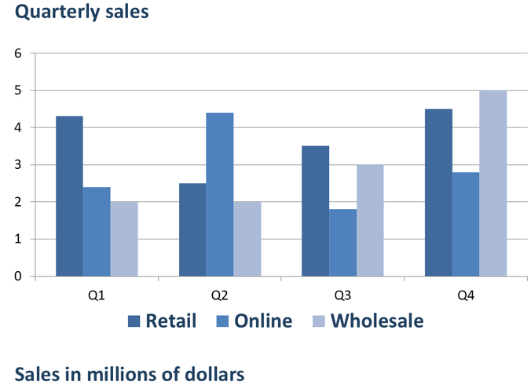

## **Přehled**

Tento článek vysvětluje, jak formátovat grafy v prezentacích PowerPoint pomocí Aspose.Slides. Ukazuje, jak přizpůsobit klíčové prvky grafu, jako jsou osy, mřížkové čáry, názvy, legendy, oblast vykreslování a výplně stěn, aby se zlepšil vzhled a čitelnost dat v grafu.

Také ukazuje, jak nastavit vlastnosti písma pro text v grafu, použít předdefinované číselné formáty na data grafu a povolit zaoblené rohy oblasti grafu. Tyto příklady společně ukazují, jak řídit jak vizuální styl, tak i prezentaci dat v grafu v prezentaci.

Pro samostatné výplně a obrysy během rostoucích a klesajících intervalů viz [příklad akciového grafu](/slides/cs/androidjava/create-chart/#create-stock-charts).

## **Formátování entit grafu**

Použijte [IChart](https://reference.aspose.com/slides/androidjava/com.aspose.slides/ichart/) k formátování názvů grafu, os, mřížkových čar, legend a oblasti vykreslování. Tento příklad vytvoří spojnicový graf s značkami a výchozími daty, poté aplikuje samostatné styly textu a čáry na jeho hodnotové a kategoriové osy. Velikosti písma a šířky čar jsou zadány v bodech; popisky kategorií jsou otočeny o 45 stupňů.

Hodnotová osa používá [setNumberFormat](https://reference.aspose.com/slides/androidjava/com.aspose.slides/iaxis/#setNumberFormat-java.lang.String-) nezávisle na zdrojových buňkách. Její měřítko běží od -2 do 15, s hlavními intervaly 2 a vedlejšími intervaly 0,5. Příklad také kombinuje formátování procent s [setDisplayUnit](https://reference.aspose.com/slides/androidjava/com.aspose.slides/iaxis/#setDisplayUnit-int-) nastaveným na tisíce, proto přizpůsobte tato nastavení významu a velikosti vašich dat. Legenda zůstává mimo oblast vykreslování, protože [setOverlay](https://reference.aspose.com/slides/androidjava/com.aspose.slides/ilegend/#setOverlay-boolean-) je voláno s hodnotou `false`. Výplně zadní stěny a podlahy jsou konfigurovány pomocí [getBackWall](https://reference.aspose.com/slides/androidjava/com.aspose.slides/ichart/#getBackWall--) a [getFloor](https://reference.aspose.com/slides/androidjava/com.aspose.slides/ichart/#getFloor--), ale tyto povrchy jsou viditelné jen v 3D grafech.

```java
import com.aspose.slides.*;
import android.graphics.Color;

Presentation presentation = new Presentation();
try {
    ISlide slide = presentation.getSlides().get_Item(0);

    IChart chart = slide.getShapes().addChart(ChartType.LineWithMarkers, 50, 50, 500, 400);

    chart.setTitle(true);
    chart.getChartTitle().addTextFrameForOverriding("");
    IPortion chartTitle = chart.getChartTitle().getTextFrameForOverriding().getParagraphs().get_Item(0).getPortions().get_Item(0);
    chartTitle.setText("Sample Chart");
    chartTitle.getPortionFormat().getFillFormat().setFillType(FillType.Solid);
    chartTitle.getPortionFormat().getFillFormat().getSolidFillColor().setColor(Color.GRAY);
    chartTitle.getPortionFormat().setFontHeight(20);
    chartTitle.getPortionFormat().setFontBold(NullableBool.True);
    chartTitle.getPortionFormat().setFontItalic(NullableBool.True);

    chart.getAxes().getVerticalAxis().getMajorGridLinesFormat().getLine().getFillFormat().setFillType(FillType.Solid);
    chart.getAxes().getVerticalAxis().getMajorGridLinesFormat().getLine().getFillFormat().getSolidFillColor().setColor(Color.BLUE);
    chart.getAxes().getVerticalAxis().getMajorGridLinesFormat().getLine().setWidth(5);
    chart.getAxes().getVerticalAxis().getMajorGridLinesFormat().getLine().setDashStyle(LineDashStyle.DashDot);

    chart.getAxes().getVerticalAxis().getMinorGridLinesFormat().getLine().getFillFormat().setFillType(FillType.Solid);
    chart.getAxes().getVerticalAxis().getMinorGridLinesFormat().getLine().getFillFormat().getSolidFillColor().setColor(Color.RED);
    chart.getAxes().getVerticalAxis().getMinorGridLinesFormat().getLine().setWidth(3);

    chart.getAxes().getVerticalAxis().setNumberFormatLinkedToSource(false);
    chart.getAxes().getVerticalAxis().setDisplayUnit(DisplayUnitType.Thousands);
    chart.getAxes().getVerticalAxis().setNumberFormat("0.0%");

    chart.getAxes().getVerticalAxis().setAutomaticMajorUnit(false);
    chart.getAxes().getVerticalAxis().setAutomaticMaxValue(false);
    chart.getAxes().getVerticalAxis().setAutomaticMinorUnit(false);
    chart.getAxes().getVerticalAxis().setAutomaticMinValue(false);

    chart.getAxes().getVerticalAxis().setMaxValue(15f);
    chart.getAxes().getVerticalAxis().setMinValue(-2f);
    chart.getAxes().getVerticalAxis().setMinorUnit(0.5f);
    chart.getAxes().getVerticalAxis().setMajorUnit(2.0f);

    IChartPortionFormat valueAxisText = chart.getAxes().getVerticalAxis().getTextFormat().getPortionFormat();
    valueAxisText.setFontBold(NullableBool.True);
    valueAxisText.setFontHeight(16);
    valueAxisText.setFontItalic(NullableBool.True);
    valueAxisText.getFillFormat().setFillType(FillType.Solid);
    valueAxisText.getFillFormat().getSolidFillColor().setPresetColor(PresetColor.DarkGreen);
    valueAxisText.setLatinFont(new FontData("Times New Roman"));

    chart.getAxes().getVerticalAxis().setTitle(true);
    chart.getAxes().getVerticalAxis().getTitle().addTextFrameForOverriding("");
    IPortion valueAxisTitle = chart.getAxes().getVerticalAxis().getTitle().getTextFrameForOverriding().getParagraphs().get_Item(0).getPortions().get_Item(0);
    valueAxisTitle.setText("Primary Axis");
    valueAxisTitle.getPortionFormat().getFillFormat().setFillType(FillType.Solid);
    valueAxisTitle.getPortionFormat().getFillFormat().getSolidFillColor().setColor(Color.GRAY);
    valueAxisTitle.getPortionFormat().setFontHeight(20);
    valueAxisTitle.getPortionFormat().setFontBold(NullableBool.True);
    valueAxisTitle.getPortionFormat().setFontItalic(NullableBool.True);

    chart.getAxes().getHorizontalAxis().getMajorGridLinesFormat().getLine().getFillFormat().setFillType(FillType.Solid);
    chart.getAxes().getHorizontalAxis().getMajorGridLinesFormat().getLine().getFillFormat().getSolidFillColor().setColor(Color.rgb(0, 128, 0));
    chart.getAxes().getHorizontalAxis().getMajorGridLinesFormat().getLine().setWidth(5);

    chart.getAxes().getHorizontalAxis().getMinorGridLinesFormat().getLine().getFillFormat().setFillType(FillType.Solid);
    chart.getAxes().getHorizontalAxis().getMinorGridLinesFormat().getLine().getFillFormat().getSolidFillColor().setColor(Color.YELLOW);
    chart.getAxes().getHorizontalAxis().getMinorGridLinesFormat().getLine().setWidth(3);

    IChartPortionFormat categoryAxisText = chart.getAxes().getHorizontalAxis().getTextFormat().getPortionFormat();
    categoryAxisText.setFontBold(NullableBool.True);
    categoryAxisText.setFontHeight(16);
    categoryAxisText.setFontItalic(NullableBool.True);
    categoryAxisText.getFillFormat().setFillType(FillType.Solid);
    categoryAxisText.getFillFormat().getSolidFillColor().setColor(Color.BLUE);
    categoryAxisText.setLatinFont(new FontData("Arial"));

    chart.getAxes().getHorizontalAxis().setTitle(true);
    chart.getAxes().getHorizontalAxis().getTitle().addTextFrameForOverriding("");

    IPortion categoryAxisTitle = chart.getAxes().getHorizontalAxis().getTitle().getTextFrameForOverriding().getParagraphs().get_Item(0).getPortions().get_Item(0);
    categoryAxisTitle.setText("Sample Category");
    categoryAxisTitle.getPortionFormat().getFillFormat().setFillType(FillType.Solid);
    categoryAxisTitle.getPortionFormat().getFillFormat().getSolidFillColor().setColor(Color.GRAY);
    categoryAxisTitle.getPortionFormat().setFontHeight(20);
    categoryAxisTitle.getPortionFormat().setFontBold(NullableBool.True);
    categoryAxisTitle.getPortionFormat().setFontItalic(NullableBool.True);

    chart.getAxes().getHorizontalAxis().setTickLabelPosition(TickLabelPositionType.Low);
    chart.getAxes().getHorizontalAxis().setTickLabelRotationAngle(45);

    IChartPortionFormat legendText = chart.getLegend().getTextFormat().getPortionFormat();
    legendText.setFontBold(NullableBool.True);
    legendText.setFontHeight(16);
    legendText.setFontItalic(NullableBool.True);
    legendText.getFillFormat().setFillType(FillType.Solid);
    legendText.getFillFormat().getSolidFillColor().setPresetColor(PresetColor.DarkRed);

    chart.getLegend().setOverlay(false);

    chart.getBackWall().setThickness(1);
    chart.getBackWall().getFormat().getFill().setFillType(FillType.Solid);
    chart.getBackWall().getFormat().getFill().getSolidFillColor().setColor(Color.rgb(255, 165, 0));

    chart.getFloor().getFormat().getFill().setFillType(FillType.Solid);
    chart.getFloor().getFormat().getFill().getSolidFillColor().setColor(Color.RED);

    chart.getPlotArea().getFormat().getFill().setFillType(FillType.Solid);
    chart.getPlotArea().getFormat().getFill().getSolidFillColor().setPresetColor(PresetColor.LightCyan);

    presentation.save("FormattedChart_out.pptx", SaveFormat.Pptx);
} finally {
    presentation.dispose();
}
```

## **Nastavení vlastností písma pro graf**

Nastavte výchozí velikost písma pro text grafu pomocí [Chart.getTextFormat](https://reference.aspose.com/slides/androidjava/com.aspose.slides/chart/#getTextFormat--). Příklad vytvoří seskupený sloupcový graf s 20bodovým písmem a umožní zobrazovat hodnotové popisky pro první řadu pomocí [setShowValue](https://reference.aspose.com/slides/androidjava/com.aspose.slides/idatalabelformat/#setShowValue-boolean-). Textové prvky s vlastními explicitními nastaveními písma mohou přepsat výchozí nastavení grafu.

```java
import com.aspose.slides.*;

Presentation presentation = new Presentation();
try {
    ISlide slide = presentation.getSlides().get_Item(0);

    IChart chart = slide.getShapes().addChart(ChartType.ClusteredColumn, 100, 100, 500, 400);
    chart.getTextFormat().getPortionFormat().setFontHeight(20);
    chart.getChartData().getSeries().get_Item(0).getLabels().getDefaultDataLabelFormat().setShowValue(true);

    presentation.save("FontPropertiesForChart.pptx", SaveFormat.Pptx);
} finally {
    presentation.dispose();
}
```

## **Znovupoužití formátování textového rámce pro legendu grafu**

Aby legenda odpovídala nadpisu snímku, nastavte písmo nadpisu pomocí [getDefaultPortionFormat](https://reference.aspose.com/slides/androidjava/com.aspose.slides/iparagraphformat/#getDefaultPortionFormat--) v prvním odstavci. Zavolejte [copyFrom](https://reference.aspose.com/slides/androidjava/com.aspose.slides/icharttextformat/#copyFrom-com.aspose.slides.ITextFrame-) na formátu vráceném metodou [getTextFormat](https://reference.aspose.com/slides/androidjava/com.aspose.slides/iformattedtextcontainer/#getTextFormat--) legendy. Zkopíruje nastavení textového rámce, formátování prvního odstavce a výchozí vlastnosti písma tohoto odstavce. Formátování aplikované přímo na jednotlivé části nebo na pozdější odstavce zůstává lokální pro zdroj.

Příklad používá tučný, 26bodový nadpis v Calibri v námořní modré jako šablonu. Po stylování legendy zavolá [copyTo](https://reference.aspose.com/slides/androidjava/com.aspose.slides/icharttextformat/#copyTo-com.aspose.slides.ITextFrame-) k aplikaci stejného formátování na samostatný popisek.

```java
import com.aspose.slides.*;
import android.graphics.Color;

Presentation presentation = new Presentation();
try {
    IShapeCollection shapes = presentation.getSlides().get_Item(0).getShapes();

    IAutoShape heading = shapes.addAutoShape(ShapeType.Rectangle, 40, 20, 640, 40, false);
    ITextFrame sourceTextFrame = heading.addTextFrame("Quarterly sales");
    IPortionFormat font = sourceTextFrame.getParagraphs().get_Item(0).getParagraphFormat().getDefaultPortionFormat();
    font.setLatinFont(new FontData("Calibri"));
    font.setFontHeight(26);
    font.setFontBold(NullableBool.True);
    font.getFillFormat().setFillType(FillType.Solid);
    font.getFillFormat().getSolidFillColor().setColor(Color.rgb(32, 64, 96));

    IChart chart = shapes.addChart(ChartType.ClusteredColumn, 40, 75, 640, 360);
    chart.setStyle(StyleType.Style3);
    IChartDataWorkbook workbook = chart.getChartData().getChartDataWorkbook();
    workbook.getCell(0, 0, 1).setValue("Retail");
    workbook.getCell(0, 0, 2).setValue("Online");
    workbook.getCell(0, 0, 3).setValue("Wholesale");
    for (int quarter = 1; quarter <= 4; quarter++) {
        workbook.getCell(0, quarter, 0).setValue("Q" + quarter);
    }

    chart.setLegend(true);
    chart.getLegend().setPosition(LegendPositionType.Bottom);
    IChartTextFormat legendFormat = chart.getLegend().getTextFormat();
    legendFormat.copyFrom(sourceTextFrame);

    IAutoShape caption = shapes.addAutoShape(ShapeType.Rectangle, 40, 460, 640, 40, false);
    ITextFrame captionTextFrame = caption.addTextFrame("Sales in millions of dollars");
    legendFormat.copyTo(captionTextFrame);

    presentation.save("legend-formatting.pptx", SaveFormat.Pptx);
} finally {
    presentation.dispose();
}
```

V uložené prezentaci legenda a popisek odpovídají nadpisu ve velikosti, tučnosti a barvě. Legenda stále zobrazuje názvy řad a popisek si zachovává svůj vlastní text. Pokud část popisku již má explicitní velikost písma, tato velikost má přednost před zkopírovaným výchozím nastavením odstavce.

| Před kopírováním | Po kopírování |
| --- | --- |
|  |  |

## **Nastavení číselného formátu**

Použijte [IChartDataCell.setPresetNumberFormat](https://reference.aspose.com/slides/androidjava/com.aspose.slides/ichartdatacell/#setPresetNumberFormat-byte-) k aplikaci vestavěného číselného formátu na buňky sešitu grafu. Tento příklad vytvoří seskupený sloupcový graf s výchozími, buňkou podporovanými daty a použije formátový index 10 (`0.00%`) na každou buňku hodnot řady. Tím se změní způsob, jakým jsou hodnoty zobrazeny v sešitu, aniž by se změnila podkladová čísla; například 0,25 se zobrazí jako 25,00 %. Formáty os a popisků dat lze konfigurovat samostatně.

```java
import com.aspose.slides.*;

Presentation presentation = new Presentation();
try {
    ISlide slide = presentation.getSlides().get_Item(0);

    IChart chart = slide.getShapes().addChart(ChartType.ClusteredColumn, 50, 50, 500, 400);
    IChartSeriesCollection series = chart.getChartData().getSeries();

    for (IChartSeries chartSeries : series)
    {
        for (IChartDataPoint dataPoint : chartSeries.getDataPoints())
        {
            dataPoint.getValue().getAsCell().setPresetNumberFormat((byte) 10); // 0.00%
        }
    }

    presentation.save("PresetNumberFormat_out.pptx", SaveFormat.Pptx);
} finally {
    presentation.dispose();
}
```

Následující tabulka uvádí vestavěné indexy číselných formátů s reprezentativními formáty Excelu pro anglickou (Spojené státy) lokalizaci. Přesné řetězce formátů a jejich zobrazení se mohou lišit podle aplikace a locale, zejména u měn a dat. Některé formáty Excelu se také liší od výchozích v standardu OOXML, jak je popsáno v [Microsoft's number format implementation notes](https://learn.microsoft.com/en-us/openspecs/office_standards/ms-oi29500/17d11129-219b-4e2c-88db-45844d21e528).

| Index | Formát |
| --- | --- |
| 0 | `General` |
| 1 | `0` |
| 2 | `0.00` |
| 3 | `#,##0` |
| 4 | `#,##0.00` |
| 5 | `"$"#,##0_);("$"#,##0)` |
| 6 | `"$"#,##0_);[Red]("$"#,##0)` |
| 7 | `"$"#,##0.00_);("$"#,##0.00)` |
| 8 | `"$"#,##0.00_);[Red]("$"#,##0.00)` |
| 9 | `0%` |
| 10 | `0.00%` |
| 11 | `0.00E+00` |
| 12 | `# ?/?` |
| 13 | `# ??/??` |
| 14 | `m/d/yyyy` |
| 15 | `d-mmm-yy` |
| 16 | `d-mmm` |
| 17 | `mmm-yy` |
| 18 | `h:mm AM/PM` |
| 19 | `h:mm:ss AM/PM` |
| 20 | `h:mm` |
| 21 | `h:mm:ss` |
| 22 | `m/d/yyyy h:mm` |
| 37 | `#,##0_);(#,##0)` |
| 38 | `#,##0_);[Red](#,##0)` |
| 39 | `#,##0.00_);(#,##0.00)` |
| 40 | `#,##0.00_);[Red](#,##0.00)` |
| 41 | `_(* #,##0_);_(* (#,##0);_(* "-"_);_(@_)` |
| 42 | `_("$"* #,##0_);_("$"* (#,##0);_("$"* "-"_);_(@_)` |
| 43 | `_(* #,##0.00_);_(* (#,##0.00);_(* "-"??_);_(@_)` |
| 44 | `_("$"* #,##0.00_);_("$"* (#,##0.00);_("$"* "-"??_);_(@_)` |
| 45 | `mm:ss` |
| 46 | `[h]:mm:ss` |
| 47 | `mm:ss.0` |
| 48 | `##0.0E+0` |
| 49 | `@` |

## **Nastavení zaoblených okrajů oblasti grafu**

Zavolejte [IChart.setRoundedCorners](https://reference.aspose.com/slides/androidjava/com.aspose.slides/ichart/#setRoundedCorners-boolean-) s hodnotou `true`, aby se zaoblivily rohy oblasti grafu. Příklad vytvoří seskupený sloupcový graf a použije [getLineFormat](https://reference.aspose.com/slides/androidjava/com.aspose.slides/ishape/#getLineFormat--) k nastavení obrysu na plnou šedou barvu a jednojádrový styl čáry před uložením prezentace.

```java
import com.aspose.slides.*;
import android.graphics.Color;

Presentation presentation = new Presentation();
try {
    ISlide slide = presentation.getSlides().get_Item(0);

    IChart chart = slide.getShapes().addChart(ChartType.ClusteredColumn, 20, 100, 600, 400);
    chart.getLineFormat().getFillFormat().setFillType(FillType.Solid);
    chart.getLineFormat().getFillFormat().getSolidFillColor().setColor(Color.GRAY);
    chart.getLineFormat().setStyle(LineStyle.Single);
    chart.setRoundedCorners(true);

    presentation.save("out.pptx", SaveFormat.Pptx);
} finally {
    presentation.dispose();
}
```

## **Úprava existujících anotací grafu**

Graf může obsahovat vlastní tvary, jako je textová anotace vysvětlující stav zprávy. K těmto tvarům přistupujte pomocí [IChart.getUserShapes](https://reference.aspose.com/slides/androidjava/com.aspose.slides/ichart/#getUserShapes--), také uvedených pod [Chart.getUserShapes](https://reference.aspose.com/slides/androidjava/com.aspose.slides/chart/#getUserShapes--) v referenci API grafu. Kolekce vrácená metodou [getShapes](https://reference.aspose.com/slides/androidjava/com.aspose.slides/igroupshape/#getShapes--) obsahuje tvary vlastněné grafem.

Běžná textová rámeček umístěná nad grafem patří ke snímku, i když vypadá jako součást grafu. Procházení pomocí [Slide.getShapes](https://reference.aspose.com/slides/androidjava/com.aspose.slides/baseslide/#getShapes--) nalezne graf a běžné tvary snímku, ale nevyjmenuje jednotlivé tvary uvnitř grafu. Tituly grafu a popisky dat jsou samostatné prvky grafu, ne vlastní anotace v této kolekci.

Stáhněte [chart-annotations.pptx](chart-annotations.pptx) a umístěte jej do pracovní složky aplikace. Jeho první snímek obsahuje graf s neseskupenou anotací s textem „Preliminary results“, čárou vlastněnou grafem a běžnou textovou rámečkem snímku s textem „Slide overlay“. Příklad najde první graf na tomto snímku a změní anotaci na „Final results“, když je zpráva připravena k publikaci. Kontroluje, zda je kolekce prázdná, a upravuje pouze [IAutoShape](https://reference.aspose.com/slides/androidjava/com.aspose.slides/iautoshape/) s nenulovým textovým rámcem vráceným metodou [getTextFrame](https://reference.aspose.com/slides/androidjava/com.aspose.slides/iautoshape/#getTextFrame--) a očekávaným textem.

```java
import com.aspose.slides.*;

Presentation presentation = new Presentation("chart-annotations.pptx");
try {
    ISlide slide = presentation.getSlides().get_Item(0);

    IChart chart = null;
    for (IShape shape : slide.getShapes()) {
        if (shape instanceof IChart) {
            chart = (IChart) shape;
            break;
        }
    }

    if (chart == null || chart.getUserShapes().getShapes().size() == 0) {
        System.out.println("No chart or chart-owned shapes found.");
        return;
    }

    boolean updated = false;
    for (IShape shape : chart.getUserShapes().getShapes()) {
        if (shape instanceof IAutoShape) {
            IAutoShape annotation = (IAutoShape) shape;
            if (annotation.getTextFrame() != null && "Preliminary results".equals(annotation.getTextFrame().getText())) {
                annotation.getTextFrame().setText("Final results");
                updated = true;
                break;
            }
        }
    }

    if (updated) {
        presentation.save("chart-annotations-updated.pptx", SaveFormat.Pptx);
    } else {
        System.out.println("No matching text annotation found.");
    }
} finally {
    presentation.dispose();
}
```

Čára a textová rámeček snímku zůstávají nezměněny. Následující obrázky ukazují vstup a uložený, znovu otevřený výsledek:

| Před úpravou | Po úpravě |
| --- | --- |
|  |  |

{}
Příklad kontroluje pouze tvary na nejvyšší úrovni vlastněné grafem. Pokud je anotace uvnitř [IGroupShape](https://reference.aspose.com/slides/androidjava/com.aspose.slides/igroupshape/), zkontrolujte také kolekci [getShapes](https://reference.aspose.com/slides/androidjava/com.aspose.slides/igroupshape/#getShapes--) této skupiny. Opakujte to rekurzivně pro vnořené skupiny a aplikujte stejné kontroly textu na jejich podřízené tvary. Skupina samotná je kontejner; nepovažujte ji za textový rámeček.
{}

## **Často kladené otázky**

**Mohu nastavit poloprůhledné výplně pro sloupce/oblasti a zároveň zachovat okraj neprůhledný?**

Ano. Průhlednost výplně a obrys jsou konfigurovány odděleně. To je užitečné pro zlepšení čitelnosti mřížky a dat v hustých vizualizacích.

**Jak mohu řešit popisky dat, když se překrývají?**

Zmenšete velikost písma, deaktivujte nepodstatné součásti popisků (například kategorie), upravte pozici popisku, zobrazte popisky pouze pro vybrané body, pokud je to nutné, nebo změňte formát na „hodnota + legenda“.

**Mohu na řady použít gradientní nebo vzorové výplně?**

Ano. Řady podporují plné, gradientní a vzorové výplně. V praxi používejte gradienty střídmě a vyhněte se kombinacím, které snižují kontrast s mřížkou a textem.