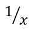

## **Přehled**

PowerPoint ukládá rovnice jako Office Math Markup Language (OMML). S Aspose.Slides pro Android přes Java můžete programově vytvořit stejný typ matematického obsahu: zlomky, odmocniny, funkce, limity, N-ary operátory, matice, pole a formátované matematické bloky.

V PowerPointu uživatelé obvykle přidávají rovnice přes **Vložit > Rovnice**:


Výsledek je editovatelný matematický text na snímku:


Aspose.Slides vytváří tento matematický text pomocí tří hlavních objektů:

- Matematický tvar, vytvořený pomocí [addMathShape](https://reference.aspose.com/slides/androidjava/com.aspose.slides/ishapecollection/), je tvar, který obsahuje rovnici.
- [MathPortion](https://reference.aspose.com/slides/androidjava/com.aspose.slides/mathportion/) ukládá matematický obsah uvnitř textového rámce tvaru.
- [MathParagraph](https://reference.aspose.com/slides/androidjava/com.aspose.slides/mathparagraph/) obsahuje jeden nebo více objektů [MathBlock](https://reference.aspose.com/slides/androidjava/com.aspose.slides/mathblock/).

Většina příkladů níže používá [MathematicalText](https://reference.aspose.com/slides/androidjava/com.aspose.slides/mathematicaltext/) a fluent metody z [IMathElement](https://reference.aspose.com/slides/androidjava/com.aspose.slides/imathelement/) pro stručný a čitelný kód.

Pro scénáře exportu MathML viz [Export Math Equations from Presentations on Android](/slides/cs/androidjava/exporting-math-equations/).

## **Vytvořit rovnici**

Tento příklad používá [addMathShape](https://reference.aspose.com/slides/androidjava/com.aspose.slides/ishapecollection/#addMathShape-float-float-float-float-) k vytvoření matematického tvaru a přidává Pythagorovu větu:


```java
import com.aspose.slides.*;

Presentation presentation = new Presentation();
try {
    ISlide slide = presentation.getSlides().get_Item(0);

    IAutoShape mathShape = slide.getShapes().addMathShape(20, 20, 700, 120);
    IMathParagraph mathParagraph = ((MathPortion) mathShape.getTextFrame().getParagraphs()
            .get_Item(0).getPortions().get_Item(0)).getMathParagraph();

    IMathBlock equation = new MathematicalText("c")
            .setSuperscript("2")
            .join("=")
            .join(new MathematicalText("a").setSuperscript("2"))
            .join("+")
            .join(new MathematicalText("b").setSuperscript("2"));

    mathParagraph.add(equation);

    presentation.save("pythagorean-theorem.pptx", SaveFormat.Pptx);
} finally {
    presentation.dispose();
}
```

{}
[addMathShape](https://reference.aspose.com/slides/androidjava/com.aspose.slides/ishapecollection/#addMathShape-float-float-float-float-) vytváří tvar, který již obsahuje matematický odstavec. Přistupte k prvnímu [MathPortion](https://reference.aspose.com/slides/androidjava/com.aspose.slides/mathportion/), zavolejte [getMathParagraph](https://reference.aspose.com/slides/androidjava/com.aspose.slides/imathportion/#getMathParagraph--), a přidejte matematické bloky nebo matematické elementy.
{}

## **Přidat zlomky**

Použijte [divide](https://reference.aspose.com/slides/androidjava/com.aspose.slides/imathelement/#divide-com.aspose.slides.IMathElement-) k vytvoření zlomku. Můžete zvolit styl zlomku pomocí [MathFractionTypes](https://reference.aspose.com/slides/androidjava/com.aspose.slides/mathfractiontypes/).



```java
import com.aspose.slides.*;

Presentation presentation = new Presentation();
try {
    ISlide slide = presentation.getSlides().get_Item(0);

    IAutoShape mathShape = slide.getShapes().addMathShape(20, 20, 700, 100);
    IMathParagraph mathParagraph = ((MathPortion) mathShape.getTextFrame().getParagraphs()
            .get_Item(0).getPortions().get_Item(0)).getMathParagraph();

    IMathFraction fraction = new MathematicalText("1")
            .divide("x", MathFractionTypes.Skewed);

    mathParagraph.add(new MathBlock(fraction));

    presentation.save("fraction.pptx", SaveFormat.Pptx);
} finally {
    presentation.dispose();
}
```

Pro sčítaný (stacked) zlomek použijte [MathFractionTypes.Bar](https://reference.aspose.com/slides/androidjava/com.aspose.slides/mathfractiontypes/#Bar):

```java
import com.aspose.slides.*;

IMathFraction stackedFraction = new MathematicalText("x + 1").divide("y - 1", MathFractionTypes.Bar);
```

## **Přidat odmocniny**

Použijte [radical](https://reference.aspose.com/slides/androidjava/com.aspose.slides/imathelement/#radical-com.aspose.slides.IMathElement-) k vytvoření druhé odmocniny, třetí odmocniny nebo jiné odmocniny. Aktuální element se stane základem a argument úrovní.


```java
import com.aspose.slides.*;

Presentation presentation = new Presentation();
try {
    ISlide slide = presentation.getSlides().get_Item(0);

    IAutoShape mathShape = slide.getShapes().addMathShape(20, 20, 700, 100);
    IMathParagraph mathParagraph = ((MathPortion) mathShape.getTextFrame().getParagraphs()
            .get_Item(0).getPortions().get_Item(0)).getMathParagraph();

    IMathRadical radical = new MathematicalText("x")
            .radical("n");

    mathParagraph.add(new MathBlock(radical));

    presentation.save("radical.pptx", SaveFormat.Pptx);
} finally {
    presentation.dispose();
}
```

## **Přidat funkce a limity**

Použijte [asArgumentOfFunction](https://reference.aspose.com/slides/androidjava/com.aspose.slides/imathelement/#asArgumentOfFunction-com.aspose.slides.IMathElement-) nebo [function](https://reference.aspose.com/slides/androidjava/com.aspose.slides/imathelement/#function-com.aspose.slides.IMathElement-) pro funkce jako `sin(x)`, `log(x)` nebo vlastní názvy funkcí. Pro limity vložte `lim` do [MathLimit](https://reference.aspose.com/slides/androidjava/com.aspose.slides/mathlimit/) nebo použijte [setLowerLimit](https://reference.aspose.com/slides/androidjava/com.aspose.slides/imathelement/#setLowerLimit-com.aspose.slides.IMathElement-).


```java
import com.aspose.slides.*;

Presentation presentation = new Presentation();
try {
    ISlide slide = presentation.getSlides().get_Item(0);

    IAutoShape mathShape = slide.getShapes().addMathShape(20, 20, 700, 100);
    IMathParagraph mathParagraph = ((MathPortion) mathShape.getTextFrame().getParagraphs()
            .get_Item(0).getPortions().get_Item(0)).getMathParagraph();

    IMathFunction limit = new MathematicalText("lim")
            .setLowerLimit("x→∞")
            .function("x");

    mathParagraph.add(new MathBlock(limit));

    presentation.save("functions-and-limits.pptx", SaveFormat.Pptx);
} finally {
    presentation.dispose();
}
```

Pro vlastní název funkce udělejte název funkce aktuálním elementem a zavolejte [function](https://reference.aspose.com/slides/androidjava/com.aspose.slides/imathelement/#function-com.aspose.slides.IMathElement-) s jeho argumentem:

```java
import com.aspose.slides.*;

IMathFunction customFunction = new MathematicalText("f").function("x + 1");
```

## **Přidat N-ární operátory a integrály**

Použijte [nary](https://reference.aspose.com/slides/androidjava/com.aspose.slides/imathelement/#nary-int-com.aspose.slides.IMathElement-com.aspose.slides.IMathElement-) pro součty, sjednocení, průniky a další velké operátory. Použijte [integral](https://reference.aspose.com/slides/androidjava/com.aspose.slides/imathelement/#integral-int-com.aspose.slides.IMathElement-com.aspose.slides.IMathElement-) pro integrály. Obě metody umožňují nastavit dolní a horní limity.


```java
import com.aspose.slides.*;

Presentation presentation = new Presentation();
try {
    ISlide slide = presentation.getSlides().get_Item(0);

    IAutoShape mathShape = slide.getShapes().addMathShape(20, 20, 700, 120);
    IMathParagraph mathParagraph = ((MathPortion) mathShape.getTextFrame().getParagraphs()
            .get_Item(0).getPortions().get_Item(0)).getMathParagraph();

    IMathBlock summationBase = new MathematicalText("x")
            .setSuperscript("k")
            .join(new MathematicalText("a").setSuperscript("n-k"));

    IMathNaryOperator summation = summationBase.nary(MathNaryOperatorTypes.Summation, "k=0", "n");

    mathParagraph.add(new MathBlock(summation));

    presentation.save("nary-operators.pptx", SaveFormat.Pptx);
} finally {
    presentation.dispose();
}
```

N-ární operátory slouží k velkým operátorům s volitelnými limity. Jednoduché operátory jako `+`, `-` a `=` se obvykle přidávají jako [MathematicalText](https://reference.aspose.com/slides/androidjava/com.aspose.slides/mathematicaltext/) a spojují do výrazu.

Pro integrál použijte [integral](https://reference.aspose.com/slides/androidjava/com.aspose.slides/imathelement/#integral-int-com.aspose.slides.IMathElement-com.aspose.slides.IMathElement-):

```java
import com.aspose.slides.*;

IMathBlock integralBase = new MathematicalText("x").join(new MathematicalText("dx").toBox());
IMathNaryOperator integral = integralBase.integral(MathIntegralTypes.Simple, "0", "1");
```

## **Přidat matice**

Použijte [MathMatrix](https://reference.aspose.com/slides/androidjava/com.aspose.slides/mathmatrix/) pro řádky a sloupce. Matice standardně nezahrnují závorky, takže je obtáčejte, pokud potřebujete kulaté, hranaté nebo složené závorky.


```java
import com.aspose.slides.*;

Presentation presentation = new Presentation();
try {
    ISlide slide = presentation.getSlides().get_Item(0);

    IAutoShape mathShape = slide.getShapes().addMathShape(20, 20, 700, 120);
    IMathParagraph mathParagraph = ((MathPortion) mathShape.getTextFrame().getParagraphs()
            .get_Item(0).getPortions().get_Item(0)).getMathParagraph();

    MathMatrix matrix = new MathMatrix(2, 3);
    matrix.set_Item(0, 0, new MathematicalText("1"));
    matrix.set_Item(0, 1, new MathematicalText("x"));
    matrix.set_Item(1, 0, new MathematicalText("x"));
    matrix.set_Item(1, 1, new MathematicalText("2"));
    matrix.set_Item(1, 2, new MathematicalText("y"));

    mathParagraph.add(new MathBlock(matrix));

    presentation.save("matrix.pptx", SaveFormat.Pptx);
} finally {
    presentation.dispose();
}
```

## **Přidat pole rovnic**

Použijte [toMathArray](https://reference.aspose.com/slides/androidjava/com.aspose.slides/imathelement/#toMathArray--) když potřebujete zarovnané rovnice nebo svislé uspořádání výrazů.


```java
import com.aspose.slides.*;

Presentation presentation = new Presentation();
try {
    ISlide slide = presentation.getSlides().get_Item(0);

    IAutoShape mathShape = slide.getShapes().addMathShape(20, 20, 700, 140);
    IMathParagraph mathParagraph = ((MathPortion) mathShape.getTextFrame().getParagraphs()
            .get_Item(0).getPortions().get_Item(0)).getMathParagraph();

    IMathArray equationArray = new MathematicalText("x")
            .join("y")
            .toMathArray();

    mathParagraph.add(new MathBlock(equationArray));

    presentation.save("equation-array.pptx", SaveFormat.Pptx);
} finally {
    presentation.dispose();
}
```

### **Zarovnat pole s okolními elementy**

[setBaseJustification](https://reference.aspose.com/slides/androidjava/com.aspose.slides/imatharray/#setBaseJustification-int-) řídí vertikální zarovnání pole vůči matematickým elementům vedle něj. Níže uvedený příklad porovnává zarovnání podle první řádky, středu pole a poslední řádky.

Následující příklad vytvoří tři identická pole, každé se třemi řádky a sousedními elementy `A=` a `=B`. Veškerý matematický text používá písmo Cambria Math o velikosti 24 bodů. Změní se pouze zarovnání pole.

```java
import com.aspose.slides.*;
import android.graphics.Color;

class MathTextFactory {
    MathematicalText createText(String value) {
        MathematicalText text = new MathematicalText(value);
        text.getFormat().setFontHeight(24);
        text.getFormat().setLatinFont(new FontData("Cambria Math"));
        return text;
    }
}

MathTextFactory factory = new MathTextFactory();
Presentation presentation = new Presentation();
try {
    presentation.getSlideSize().setSize(780, 200, SlideSizeScaleType.DoNotScale);
    ISlide slide = presentation.getSlides().get_Item(0);

    int[] alignments = { MathVerticalAlignment.Top, MathVerticalAlignment.Center, MathVerticalAlignment.Bottom };
    String[] alignmentNames = { "Top", "Center", "Bottom" };

    for (int i = 0; i < alignments.length; i++) {
        IAutoShape label = slide.getShapes().addAutoShape(ShapeType.Rectangle, 20 + i * 260, 10, 240, 30);
        label.getFillFormat().setFillType(FillType.NoFill);
        label.getLineFormat().getFillFormat().setFillType(FillType.NoFill);
        label.getTextFrame().setText(alignmentNames[i]);
        IPortionFormat labelFormat = label.getTextFrame().getParagraphs().get_Item(0).getPortions().get_Item(0).getPortionFormat();
        labelFormat.setFontHeight(16);
        labelFormat.getFillFormat().setFillType(FillType.Solid);
        labelFormat.getFillFormat().getSolidFillColor().setColor(Color.BLACK);

        IAutoShape mathShape = slide.getShapes().addMathShape(20 + i * 260, 60, 240, 130);
        mathShape.getTextFrame().getTextFrameFormat().setAnchoringType(TextAnchorType.Top);
        IMathParagraph mathParagraph = ((IMathPortion) mathShape.getTextFrame().getParagraphs().get_Item(0).getPortions().get_Item(0)).getMathParagraph();
        mathParagraph.setJustification(MathJustification.LeftJustified);

        IMathElement[] rows = { factory.createText("x+y=3"), factory.createText("x-y=1"), factory.createText("x=2") };
        MathArray equationArray = new MathArray(rows[0]);
        equationArray.getArguments().add(rows[1]);
        equationArray.getArguments().add(rows[2]);
        equationArray.setBaseJustification(alignments[i]);
        MathematicalText leftText = factory.createText("A=");
        MathematicalText rightText = factory.createText("=B");
        IMathBlock equation = new MathBlock(leftText).join(equationArray).join(rightText);
        mathParagraph.add(equation);
    }

    presentation.save("equation-array-alignment.pptx", SaveFormat.Pptx);
} finally {
    presentation.dispose();
}
```

Následující srovnání ukazuje uloženou prezentaci v PowerPointu. Všimněte si polohy `A=` a `=B` vedle každého pole.


### **Nastavit rozestup řádků**

[setRowSpacingRule](https://reference.aspose.com/slides/androidjava/com.aspose.slides/imatharray/#setRowSpacingRule-int-) vybírá pravidlo rozestupu pro řádky uvnitř pole. [setRowSpacing](https://reference.aspose.com/slides/androidjava/com.aspose.slides/imatharray/#setRowSpacing-long-) poskytuje číselnou hodnotu pro explicitní pravidlo a je ignorována přednastavenými pravidly.

Pro přesný rozestup se hodnota měří v bodech. Pro proporcionální rozestup se měří v půl řádcích: hodnota `3` v příkladu znamená 1,5 řádku. Nastavte obě vlastnosti, když zadáváte explicitní hodnotu; změna jen číselné hodnoty nevybere pravidlo rozestupu.

Níže uvedený příklad uloží pět prezentací se stejnými rovnicemi, zarovnáním a nastavením písma. První tři používají předvolby; poslední dvě ukazují explicitní hodnoty.

```java
import com.aspose.slides.*;

class MathTextFactory {
    MathematicalText createText(String value) {
        MathematicalText text = new MathematicalText(value);
        text.getFormat().setFontHeight(24);
        text.getFormat().setLatinFont(new FontData("Cambria Math"));
        return text;
    }
}

MathTextFactory factory = new MathTextFactory();
int[] rules = { MathRowSpacingRule.SingleLineGap, MathRowSpacingRule.OneAndAHalfLineGap, MathRowSpacingRule.TwoLineGap, MathRowSpacingRule.Exactly, MathRowSpacingRule.Multiple };
int[] spacingValues = { 0, 0, 0, 20, 3 };
String[] ruleNames = { "SingleLineGap", "OneAndAHalfLineGap", "TwoLineGap", "Exactly", "Multiple" };

for (int i = 0; i < rules.length; i++) {
    String fileName = "equation-array-" + ruleNames[i] + ".pptx";
    Presentation presentation = new Presentation();
    try {
        IAutoShape mathShape = presentation.getSlides().get_Item(0).getShapes().addMathShape(20, 20, 600, 300);
        IParagraph paragraph = mathShape.getTextFrame().getParagraphs().get_Item(0);
        paragraph.getParagraphFormat().setSpaceBefore(0);
        paragraph.getParagraphFormat().setSpaceAfter(0);
        IMathParagraph mathParagraph = ((IMathPortion) paragraph.getPortions().get_Item(0)).getMathParagraph();
        mathParagraph.setJustification(MathJustification.LeftJustified);

        IMathElement[] rows = { factory.createText("x+y=3"), factory.createText("x-y=1"), factory.createText("x=2") };
        MathArray equationArray = new MathArray(rows[0]);
        equationArray.getArguments().add(rows[1]);
        equationArray.getArguments().add(rows[2]);
        equationArray.setBaseJustification(MathVerticalAlignment.Center);
        equationArray.setRowSpacingRule(rules[i]);
        equationArray.setRowSpacing(spacingValues[i]);
        MathematicalText leftText = factory.createText("A=");
        MathematicalText rightText = factory.createText("=B");
        IMathBlock equation = new MathBlock(leftText).join(equationArray).join(rightText);
        mathParagraph.add(equation);

        presentation.save(fileName, SaveFormat.Pptx);
    } finally {
        presentation.dispose();
    }
}
```

Rozestup řádků pole je oddělený od rozestupu odstavce. [setSpaceBefore](https://reference.aspose.com/slides/androidjava/com.aspose.slides/iparagraphformat/#setSpaceBefore-float-) a [setSpaceAfter](https://reference.aspose.com/slides/androidjava/com.aspose.slides/iparagraphformat/#setSpaceAfter-float-) přidávají prostor kolem okolního odstavce, nikoli mezi řádky pole. Podobně [IMathParagraph.setJustification](https://reference.aspose.com/slides/androidjava/com.aspose.slides/imathparagraph/#setJustification-int-) pozičně umisťuje celý matematický odstavec; nenahrazuje nastavení vertikálního zarovnání pole.

## **Přidat trigonometrické funkce**

Použijte [asArgumentOfFunction](https://reference.aspose.com/slides/androidjava/com.aspose.slides/imathelement/#asArgumentOfFunction-com.aspose.slides.IMathElement-) když je argument aktuální element a název funkce je znám.


```java
import com.aspose.slides.*;

Presentation presentation = new Presentation();
try {
    ISlide slide = presentation.getSlides().get_Item(0);

    IAutoShape mathShape = slide.getShapes().addMathShape(20, 20, 700, 100);
    IMathParagraph mathParagraph = ((MathPortion) mathShape.getTextFrame().getParagraphs()
            .get_Item(0).getPortions().get_Item(0)).getMathParagraph();

    IMathFunction cosine = new MathematicalText("2x")
            .asArgumentOfFunction(MathFunctionsOfOneArgument.Cos);

    mathParagraph.add(new MathBlock(cosine));

    presentation.save("trigonometric-function.pptx", SaveFormat.Pptx);
} finally {
    presentation.dispose();
}
```

## **Přidat dolní a horní indexy**

Použijte pomocné funkce pro dolní a horní indexy pro indexy a exponenty. Když je potřeba, aby se indexy objevily vlevo od základu, použijte [setSubSuperscriptOnTheLeft](https://reference.aspose.com/slides/androidjava/com.aspose.slides/imathelement/#setSubSuperscriptOnTheLeft-com.aspose.slides.IMathElement-com.aspose.slides.IMathElement-).


```java
import com.aspose.slides.*;

Presentation presentation = new Presentation();
try {
    ISlide slide = presentation.getSlides().get_Item(0);

    IAutoShape mathShape = slide.getShapes().addMathShape(20, 20, 700, 100);
    IMathParagraph mathParagraph = ((MathPortion) mathShape.getTextFrame().getParagraphs()
            .get_Item(0).getPortions().get_Item(0)).getMathParagraph();

    IMathLeftSubSuperscriptElement scripts = new MathematicalText("Y")
            .setSubSuperscriptOnTheLeft("1", "n");

    mathParagraph.add(new MathBlock(scripts));

    presentation.save("subscript-superscript.pptx", SaveFormat.Pptx);
} finally {
    presentation.dispose();
}
```

## **Přidat oddělovače**

Použijte [enclose](https://reference.aspose.com/slides/androidjava/com.aspose.slides/imathelement/#enclose-char-char-) k vložení výrazu do oddělovačů. Můžete také nastavit znak oddělovače pro výrazy obsahující několik elementů.


```java
import com.aspose.slides.*;

Presentation presentation = new Presentation();
try {
    ISlide slide = presentation.getSlides().get_Item(0);

    IAutoShape mathShape = slide.getShapes().addMathShape(20, 20, 700, 100);
    IMathParagraph mathParagraph = ((MathPortion) mathShape.getTextFrame().getParagraphs()
            .get_Item(0).getPortions().get_Item(0)).getMathParagraph();

    IMathDelimiter delimiter = new MathematicalText("x")
            .join("y")
            .join("z")
            .enclose('<', '>');
    delimiter.setSeparatorCharacter('|');

    mathParagraph.add(new MathBlock(delimiter));

    presentation.save("delimiters.pptx", SaveFormat.Pptx);
} finally {
    presentation.dispose();
}
```

### **Velikost a zarovnání oddělovačů**

Předávejte `true` metodě [setGrowToMatchOperandHeight](https://reference.aspose.com/slides/androidjava/com.aspose.slides/imathdelimiter/#setGrowToMatchOperandHeight-boolean-) aby se závorky rozšířily kolem vysokého operandu, nebo `false` aby zůstaly v normální velikosti. Použijte [setDelimiterShape](https://reference.aspose.com/slides/androidjava/com.aspose.slides/imathdelimiter/#setDelimiterShape-int-) s jednou ze dvou hodnot [MathDelimiterShape](https://reference.aspose.com/slides/androidjava/com.aspose.slides/mathdelimitershape/). `Centered` centrované závorky na matematické ose, která prochází středem znaménka rovnosti. `Match` zarovnává závorky s obsahem uvnitř. Obě nastavení ovlivňují jen oddělovače. Výraz uvnitř zůstává stejný.

Příklad umístí zlomek do exponentu `x`, takže výraz vyčuhuje výše nad základní linii než pod ní. Všechny čtyři rovnice používají stejné závorky a nastavení písma.

```java
import com.aspose.slides.*;

Presentation presentation = new Presentation();
try {
    ISlide slide = presentation.getSlides().get_Item(0);
    for (int row = 0; row < 2; row++) {
        for (int column = 0; column < 2; column++) {
            IMathFraction fraction = new MathematicalText("a + b").divide("c + d");
            IMathSuperscriptElement power = new MathematicalText("x").setSuperscript(fraction);
            IMathDelimiter delimiter = power.enclose('(', ')');
            delimiter.setGrowToMatchOperandHeight(row == 0);
            delimiter.setDelimiterShape(column == 0 ? MathDelimiterShape.Centered : MathDelimiterShape.Match);

            IAutoShape mathShape = slide.getShapes().addMathShape(20 + 330 * column, 20 + 120 * row, 300, 100);
            MathPortion portion = (MathPortion) mathShape.getTextFrame().getParagraphs().get_Item(0).getPortions().get_Item(0);
            portion.getPortionFormat().setFontHeight(32);
            IMathBlock equation = new MathematicalText("y = ").join(delimiter);
            portion.getMathParagraph().add(equation);
        }
    }
    presentation.save("delimiter-sizing.pptx", SaveFormat.Pptx);
} finally {
    presentation.dispose();
}
```

V PowerPointu porovnejte řádky, abyste viděli efekt růstu. V horním řádku se závorky rozšiřují kolem exponentu a vypadají stejně pro oba typy. Ve spodním řádku je růst vypnutý. Menší závorky vlevo (`Centered`) se zarovnávají se znaménkem rovnosti, zatímco pravé (`Match`) jsou výše kolem výrazu.


## **Přidat ohraničený rámeček**

Zavolejte [toBorderBox](https://reference.aspose.com/slides/androidjava/com.aspose.slides/imathelement/#toBorderBox--) na zlomek, aby se celá struktura obklopila rámečkem. Vrácený [IMathBorderBox](https://reference.aspose.com/slides/androidjava/com.aspose.slides/imathborderbox/) standardně zobrazuje všechny čtyři strany. Použijte [setHideTop](https://reference.aspose.com/slides/androidjava/com.aspose.slides/imathborderbox/#setHideTop-boolean-), [setHideBottom](https://reference.aspose.com/slides/androidjava/com.aspose.slides/imathborderbox/#setHideBottom-boolean-), [setHideLeft](https://reference.aspose.com/slides/androidjava/com.aspose.slides/imathborderbox/#setHideLeft-boolean-), a [setHideRight](https://reference.aspose.com/slides/androidjava/com.aspose.slides/imathborderbox/#setHideRight-boolean-) pro odstranění jednotlivých stran.

Příklad umístí šest kopií stejného zlomku na jeden snímek. Pro zobrazení zrušení skryjte všechny čtyři strany a předávejte `true` metodě [setStrikethroughBottomLeftToTopRight](https://reference.aspose.com/slides/androidjava/com.aspose.slides/imathborderbox/#setStrikethroughBottomLeftToTopRight-boolean-) pro rostoucí úhlopříčnou čáru (↗) nebo [setStrikethroughTopLeftToBottomRight](https://reference.aspose.com/slides/androidjava/com.aspose.slides/imathborderbox/#setStrikethroughTopLeftToBottomRight-boolean-) pro klesající úhlopříčnou čáru (↘). Můžete také použít [setStrikethroughHorizontal](https://reference.aspose.com/slides/androidjava/com.aspose.slides/imathborderbox/#setStrikethroughHorizontal-boolean-) nebo [setStrikethroughVertical](https://reference.aspose.com/slides/androidjava/com.aspose.slides/imathborderbox/#setStrikethroughVertical-boolean-) s libovolnou kombinací viditelných stran.

```java
import com.aspose.slides.*;

Presentation presentation = new Presentation();
try {
    presentation.getSlideSize().setSize(540, 220, SlideSizeScaleType.DoNotScale);
    ISlide slide = presentation.getSlides().get_Item(0);

    class FractionBuilder {
        IMathBorderBox addFraction(float x, float y, boolean hideBorder) {
            IMathFraction fraction = new MathematicalText("x+1").divide("y+2");
            IMathBorderBox box = fraction.toBorderBox();
            box.setHideTop(hideBorder);
            box.setHideBottom(hideBorder);
            box.setHideLeft(hideBorder);
            box.setHideRight(hideBorder);

            IAutoShape shape = slide.getShapes().addMathShape(x, y, 160, 90);
            MathPortion portion = (MathPortion) shape.getTextFrame().getParagraphs().get_Item(0).getPortions().get_Item(0);
            portion.getPortionFormat().setFontHeight(28);
            portion.getMathParagraph().add(new MathBlock(box));
            return box;
        }
    }

    FractionBuilder builder = new FractionBuilder();
    builder.addFraction(10, 10, false);

    IMathBorderBox partial = builder.addFraction(190, 10, false);
    partial.setHideTop(true);
    partial.setHideRight(true);

    builder.addFraction(370, 10, true).setStrikethroughBottomLeftToTopRight(true);
    builder.addFraction(10, 120, true).setStrikethroughTopLeftToBottomRight(true);
    builder.addFraction(190, 120, true).setStrikethroughHorizontal(true);
    builder.addFraction(370, 120, false).setStrikethroughVertical(true);

    presentation.save("border-box.pptx", SaveFormat.Pptx);
} finally {
    presentation.dispose();
}
```


Na tomto zlomku horizontální čára překrývá čáru zlomku. Vertikální čára prochází jak čitatel, tak jmenovatelem, zatímco okolní rámeček zůstává viditelný. Tyto čáry dekorují celý výraz. Normální přeškrtnutí textu se vztahuje na znaky v textovém běhu. Po opětovném otevření prezentace v PowerPointu můžete stále samostatně upravovat čitatel i jmenovatel.

## **Ovládání viditelnosti a rozvržení s Phantom elementy**

Obalte výraz do [MathPhantom](https://reference.aspose.com/slides/androidjava/com.aspose.slides/mathphantom/), aby se nezávisle řídila jeho viditelnost a prostor, který k rovnici přispívá. Metody [IMathPhantom](https://reference.aspose.com/slides/androidjava/com.aspose.slides/imathphantom/) řídí následující:

| Metoda | Efekt |
| --- | --- |
| [setShow](https://reference.aspose.com/slides/androidjava/com.aspose.slides/imathphantom/#setShow-boolean-) | Předávejte `false` pro skrytí výrazu. Jeho rozměry stále přispívají k rozvržení, pokud níže uvedené metody nedostanou `true`. |
| [setZeroWidth](https://reference.aspose.com/slides/androidjava/com.aspose.slides/imathphantom/#setZeroWidth-boolean-) | Považuje vodorovnou šířku výrazu za nulu, což umožní sousedním elementům se přiblížit. |
| [setZeroAsc](https://reference.aspose.com/slides/androidjava/com.aspose.slides/imathphantom/#setZeroAsc-boolean-) | Považuje výstup (výšku nad základní linii) za nulu. To může snížit prostor nad sousedními elementy. |
| [setZeroDesc](https://reference.aspose.com/slides/androidjava/com.aspose.slides/imathphantom/#setZeroDesc-boolean-) | Považuje sestup (hloubku pod základní linií) za nulu. To může přiblížit čáru zlomku nebo jiný obsah pod výrazem k sousedům. |

Základní linie je referenční čára, na které spočívají běžná matematická písmena. Skrytí obsahu neodstraňuje jeho rozměry a považování rozměru za nulu neodstraňuje samotný výraz. Základní výraz zůstává dostupný přes [getBase](https://reference.aspose.com/slides/androidjava/com.aspose.slides/imathphantom/#getBase--). Předávejte `true` metodě [setShow](https://reference.aspose.com/slides/androidjava/com.aspose.slides/imathphantom/#setShow-boolean-) pro jeho opětovné zobrazení; nastavení rozměrů zůstane nezměněno.

```java
import com.aspose.slides.*;
import android.graphics.Color;

class MathTextFactory {
    MathematicalText createText(String value) {
        MathematicalText text = new MathematicalText(value);
        text.getFormat().setFontHeight(24);
        text.getFormat().setLatinFont(new FontData("Cambria Math"));
        return text;
    }
}

MathTextFactory factory = new MathTextFactory();
Presentation presentation = new Presentation();
try {
    presentation.getSlideSize().setSize(1000, 180, SlideSizeScaleType.DoNotScale);
    ISlide slide = presentation.getSlides().get_Item(0);

    String[] labels = { "Visible", "Hidden: reserves space", "Hidden: ZeroWidth", "Hidden: ZeroAsc", "Hidden: ZeroDesc" };

    IAutoShape guide = slide.getShapes().addAutoShape(ShapeType.Line, 10, 60, 980, 0);
    guide.getLineFormat().getFillFormat().setFillType(FillType.Solid);
    guide.getLineFormat().getFillFormat().getSolidFillColor().setColor(Color.LTGRAY);

    for (int i = 0; i < labels.length; i++) {
        int left = 10 + i * 200;

        IAutoShape label = slide.getShapes().addAutoShape(ShapeType.Rectangle, left, 10, 190, 30);
        label.getFillFormat().setFillType(FillType.NoFill);
        label.getLineFormat().getFillFormat().setFillType(FillType.NoFill);
        label.getTextFrame().setText(labels[i]);

        IPortionFormat labelFormat = label.getTextFrame().getParagraphs().get_Item(0).getPortions().get_Item(0).getPortionFormat();
        labelFormat.setFontHeight(14);
        labelFormat.getFillFormat().setFillType(FillType.Solid);
        labelFormat.getFillFormat().getSolidFillColor().setColor(Color.BLACK);

        MathematicalText fractionNumerator = factory.createText("a+b");
        MathematicalText fractionDenominator = factory.createText("c+d");
        MathFraction fraction = new MathFraction(fractionNumerator, fractionDenominator);
        MathPhantom phantom = new MathPhantom(fraction);
        phantom.setShow(i == 0);
        phantom.setZeroWidth(i == 2);
        phantom.setZeroAsc(i == 3);
        phantom.setZeroDesc(i == 4);

        MathematicalText leftText = factory.createText("x+");
        MathematicalText rightText = factory.createText("+y");
        IMathBlock numerator = new MathBlock(leftText).join(phantom).join(rightText);
        MathematicalText denominator = factory.createText("z");
        MathFraction equation = new MathFraction(numerator, denominator);

        IAutoShape shape = slide.getShapes().addMathShape(left, 60, 190, 100);
        shape.getTextFrame().getTextFrameFormat().setAnchoringType(TextAnchorType.Top);

        IMathPortion mathPortion = (IMathPortion) shape.getTextFrame().getParagraphs().get_Item(0).getPortions().get_Item(0);
        IMathParagraph mathParagraph = mathPortion.getMathParagraph();
        mathParagraph.add(new MathBlock(equation));
    }

    presentation.save("math-phantom.pptx", SaveFormat.Pptx);
} finally {
    presentation.dispose();
}
```


## **Seskupit termíny**

Použijte [group](https://reference.aspose.com/slides/androidjava/com.aspose.slides/imathelement/#group-char-int-int-) k umístění seskupovacího znaku nad nebo pod výraz. Přidejte limit pro popisek seskupených termínů.


```java
import com.aspose.slides.*;

Presentation presentation = new Presentation();
try {
    ISlide slide = presentation.getSlides().get_Item(0);

    IAutoShape mathShape = slide.getShapes().addMathShape(20, 20, 700, 120);
    IMathParagraph mathParagraph = ((MathPortion) mathShape.getTextFrame().getParagraphs()
            .get_Item(0).getPortions().get_Item(0)).getMathParagraph();

    IMathLimit grouped = new MathematicalText("x + y")
            .group('\u23DF', MathTopBotPositions.Bottom, MathTopBotPositions.Top)
            .setLowerLimit("any text");

    mathParagraph.add(new MathBlock(grouped));

    presentation.save("grouped-terms.pptx", SaveFormat.Pptx);
} finally {
    presentation.dispose();
}
```

## **Formátovat matematické elementy**

Používejte pomocné formátovací funkce jen tam, kde objasňují vzorec. Například [overbar](https://reference.aspose.com/slides/androidjava/com.aspose.slides/imathelement/#overbar--) umisťuje čáru nad matematický element.


```java
import com.aspose.slides.*;

Presentation presentation = new Presentation();
try {
    ISlide slide = presentation.getSlides().get_Item(0);

    IAutoShape mathShape = slide.getShapes().addMathShape(20, 20, 700, 100);
    IMathParagraph mathParagraph = ((MathPortion) mathShape.getTextFrame().getParagraphs()
            .get_Item(0).getPortions().get_Item(0)).getMathParagraph();

    IMathBar overbar = new MathematicalText("ABC").overbar();

    mathParagraph.add(new MathBlock(overbar));

    presentation.save("overbar.pptx", SaveFormat.Pptx);
} finally {
    presentation.dispose();
}
```

### **Formátovat text v existující rovnici**

Pro formátování textu v celé existující rovnici projděte strom elementů každého matematického bloku. [IMathElement.getChildren](https://reference.aspose.com/slides/androidjava/com.aspose.slides/imathelement/#getChildren--) vrací jen přímé děti, takže jej rekurzivně volajte, aby se dostalo k textu uvnitř zlomků, indexů, odmocnin a dalších vnořených struktur. Kontrolujte jak aktuální element, tak i jeho děti, aby se zahrnul počáteční element, pokud je [MathematicalText](https://reference.aspose.com/slides/androidjava/com.aspose.slides/mathematicaltext/).

Tento příklad předpokládá, že `input.pptx` obsahuje rovnici jako `z = xᵢ / ∛y`, kde zlomek obsahuje dolní index v čitateli a odmocninu v jmenovateli. Zpracování jen elementů nejvyšší úrovně by text uvnitř zlomku přehlédlo. Příklad najde matematické části v textových rámcích snímků, získá jejich bloky pomocí [IMathPortion.getMathParagraph](https://reference.aspose.com/slides/androidjava/com.aspose.slides/imathportion/#getMathParagraph--), a použije [setFontHeight](https://reference.aspose.com/slides/androidjava/com.aspose.slides/baseportionformat/#setFontHeight-float-) k nastavení velikosti písma na 28 bodů pro každý textový element přes jeho [getFormat](https://reference.aspose.com/slides/androidjava/com.aspose.slides/mathematicaltext/#getFormat--) metodu.

```java
import com.aspose.slides.*;

class MathTextFormatter {
    void formatMathText(IMathElement element) {
        if (element instanceof MathematicalText) {
            MathematicalText text = (MathematicalText) element;
            text.getFormat().setFontHeight(28);
        }

        for (IMathElement child : element.getChildren()) {
            formatMathText(child);
        }
    }
}

MathTextFormatter formatter = new MathTextFormatter();
Presentation presentation = new Presentation("input.pptx");
try {
    for (ISlide slide : presentation.getSlides()) {
        for (IShape shape : slide.getShapes()) {
            if (!(shape instanceof IAutoShape)) {
                continue;
            }

            IAutoShape autoShape = (IAutoShape) shape;
            if (autoShape.getTextFrame() == null) {
                continue;
            }

            for (IParagraph paragraph : autoShape.getTextFrame().getParagraphs()) {
                for (IPortion portion : paragraph.getPortions()) {
                    if (portion instanceof IMathPortion) {
                        IMathPortion mathPortion = (IMathPortion) portion;
                        for (IMathBlock block : mathPortion.getMathParagraph()) {
                            formatter.formatMathText(block);
                        }
                    }
                }
            }
        }
    }

    presentation.save("formatted-equations.pptx", SaveFormat.Pptx);
} finally {
    presentation.dispose();
}
```

Uložená prezentace obsahuje aktualizované formátování textu na každé úrovni každé zpracované rovnice a zachovává její textový obsah i matematickou strukturu.

## **Rychlý přehled**

| Úkol | Hlavní API |
| --- | --- |
| Vytvořit matematický text | [MathematicalText](https://reference.aspose.com/slides/androidjava/com.aspose.slides/mathematicaltext/) |
| Kombinovat elementy | [IMathElement.join](https://reference.aspose.com/slides/androidjava/com.aspose.slides/imathelement/) |
| Vytvořit zlomky | [IMathElement.divide](https://reference.aspose.com/slides/androidjava/com.aspose.slides/imathelement/) |
| Přidat horní nebo dolní index | [setSuperscript](https://reference.aspose.com/slides/androidjava/com.aspose.slides/imathelement/), [setSubscript](https://reference.aspose.com/slides/androidjava/com.aspose.slides/imathelement/) |
| Přidat funkce | [function](https://reference.aspose.com/slides/androidjava/com.aspose.slides/imathelement/), [asArgumentOfFunction](https://reference.aspose.com/slides/androidjava/com.aspose.slides/imathelement/) |
| Přidat odmocniny | [IMathElement.radical](https://reference.aspose.com/slides/androidjava/com.aspose.slides/imathelement/) |
| Přidat limity | [setLowerLimit](https://reference.aspose.com/slides/androidjava/com.aspose.slides/imathelement/), [setUpperLimit](https://reference.aspose.com/slides/androidjava/com.aspose.slides/imathelement/) |
| Přidat skripty na levé straně | [setSubSuperscriptOnTheLeft](https://reference.aspose.com/slides/androidjava/com.aspose.slides/imathelement/) |
| Přidat součty a integrály | [nary](https://reference.aspose.com/slides/androidjava/com.aspose.slides/imathelement/), [integral](https://reference.aspose.com/slides/androidjava/com.aspose.slides/imathelement/) |
| Přidat matice | [MathMatrix](https://reference.aspose.com/slides/androidjava/com.aspose.slides/mathmatrix/) |
| Přidat pole rovnic | [toMathArray](https://reference.aspose.com/slides/androidjava/com.aspose.slides/imathelement/) |
| Přidat oddělovače | [enclose](https://reference.aspose.com/slides/androidjava/com.aspose.slides/imathelement/) |
| Přidat čáry a okraje | [overbar](https://reference.aspose.com/slides/androidjava/com.aspose.slides/imathelement/), [toBorderBox](https://reference.aspose.com/slides/androidjava/com.aspose.slides/imathelement/) |
| Seskupit termíny | [group](https://reference.aspose.com/slides/androidjava/com.aspose.slides/imathelement/) |

## **Často kladené otázky**

**Mohu upravit existující rovnici v PowerPointu?**

Ano. Otevřete prezentaci, najděte tvar, který obsahuje [MathPortion](https://reference.aspose.com/slides/androidjava/com.aspose.slides/mathportion/), zavolejte [getMathParagraph](https://reference.aspose.com/slides/androidjava/com.aspose.slides/imathportion/#getMathParagraph--), a aktualizujte matematické bloky v tomto odstavci.

**Ukládají se rovnice jako editovatelná matematika v PowerPointu?**

Ano. Při uložení do formátu PPTX Aspose.Slides zapíše rovnici jako editovatelný Office matematický obsah.

**Mohu exportovat rovnice do LaTeXu?**

Ano. Získáte [IMathParagraph](https://reference.aspose.com/slides/androidjava/com.aspose.slides/imathparagraph/) z jeho [IMathPortion](https://reference.aspose.com/slides/androidjava/com.aspose.slides/imathportion/), a zavoláte [IMathParagraph.toLatex](https://reference.aspose.com/slides/androidjava/com.aspose.slides/imathparagraph/#toLatex--) pro přímý export. Kompletní příklad najdete v [Exportovat matematické rovnice z prezentací v Androidu přes Java](/slides/cs/androidjava/exporting-math-equations/#export-math-equations-to-latex).