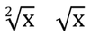
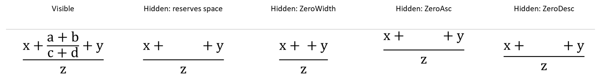

## **Přehled**

PowerPoint ukládá rovnice jako Office Math Markup Language (OMML). S Aspose.Slides pro C++ můžete programově vytvářet stejný typ matematického obsahu: zlomky, odmocniny, funkce, limity, N‑ární operátory, matice, pole a formátované matematické bloky.

V PowerPointu uživatelé obvykle přidávají rovnice pomocí **Insert > Equation**:


Výsledek je editovatelný matematický text na snímku:


Aspose.Slides vytváří tento matematický text pomocí tří hlavních objektů:

- Math tvar, vytvořený pomocí [AddMathShape](https://reference.aspose.com/slides/cpp/aspose.slides/shapecollection/), je tvar, který obsahuje rovnici.
- [MathPortion](https://reference.aspose.com/slides/cpp/aspose.slides.mathtext/mathportion/) ukládá matematický obsah uvnitř textového rámce tvaru.
- [MathParagraph](https://reference.aspose.com/slides/cpp/aspose.slides.mathtext/mathparagraph/) obsahuje jeden nebo více objektů [MathBlock](https://reference.aspose.com/slides/cpp/aspose.slides.mathtext/mathblock/).

Většina příkladů níže používá [MathematicalText](https://reference.aspose.com/slides/cpp/aspose.slides.mathtext/mathematicaltext/) a řetězené metody z [IMathElement](https://reference.aspose.com/slides/cpp/aspose.slides.mathtext/imathelement/) pro stručný a čitelný kód.

Pro scénáře exportu do MathML viz [Export Math Equations from Presentations in C++](/slides/cs/cpp/exporting-math-equations/).

## **Vytvoření rovnice**

Tento příklad používá [AddMathShape](https://reference.aspose.com/slides/cpp/aspose.slides/ishapecollection/addmathshape/) k vytvoření matematického tvaru a přidává Pythagorovu větu:


```cpp
#include <DOM/IAutoShape.h>
#include <DOM/IParagraph.h>
#include <DOM/IShapeCollection.h>
#include <DOM/ISlide.h>
#include <DOM/ITextFrame.h>
#include <DOM/MathText/IMathBlock.h>
#include <DOM/MathText/IMathParagraph.h>
#include <DOM/MathText/IMathSuperscriptElement.h>
#include <DOM/MathText/MathPortion.h>
#include <DOM/MathText/MathematicalText.h>
#include <DOM/Presentation.h>
#include <Export/SaveFormat.h>

using namespace Aspose::Slides;
using namespace Aspose::Slides::Export;
using namespace Aspose::Slides::MathText;

auto presentation = System::MakeObject<Presentation>();
auto slide = presentation->get_Slide(0);

auto mathShape = slide->get_Shapes()->AddMathShape(20.0f, 20.0f, 700.0f, 120.0f);
auto mathPortion = System::ExplicitCast<MathPortion>(mathShape->get_TextFrame()->get_Paragraph(0)->get_Portion(0));
auto mathParagraph = mathPortion->get_MathParagraph();

auto equation = System::MakeObject<MathematicalText>(u"c")
        - >SetSuperscript(u"2")
        - >Join(u"=")
        - >Join(System::MakeObject<MathematicalText>(u"a")->SetSuperscript(u"2"))
        - >Join(u"+")
        - >Join(System::MakeObject<MathematicalText>(u"b")->SetSuperscript(u"2"));

mathParagraph->Add(equation);

presentation->Save(u"pythagorean-theorem.pptx", SaveFormat::Pptx);
presentation->Dispose();
```

{}
[AddMathShape](https://reference.aspose.com/slides/cpp/aspose.slides/ishapecollection/addmathshape/) vytváří tvar, který již obsahuje matematický odstavec. Přistupte k prvnímu [MathPortion](https://reference.aspose.com/slides/cpp/aspose.slides.mathtext/mathportion/), zavolejte [get_MathParagraph](https://reference.aspose.com/slides/cpp/aspose.slides.mathtext/mathportion/get_mathparagraph/), a přidejte matematické bloky nebo elementy.
{}

### **Kombinování matematických bloků**

Když jsou části rovnice sestaveny nezávisle jako objekty [IMathBlock](https://reference.aspose.com/slides/cpp/aspose.slides.mathtext/imathblock/), použijte [JoinBlock](https://reference.aspose.com/slides/cpp/aspose.slides.mathtext/imathblock/joinblock/) k jejich sloučení. Příklad sestavuje `c² =` v levém bloku a `a² + b²` v pravém bloku. [SetSuperscript](https://reference.aspose.com/slides/cpp/aspose.slides.mathtext/imathelement/setsuperscript/) vytváří editovatelné matematické horní indexy pro všechny tři mocniny.

```cpp
#include <DOM/IAutoShape.h>
#include <DOM/IParagraph.h>
#include <DOM/IShapeCollection.h>
#include <DOM/ISlide.h>
#include <DOM/ITextFrame.h>
#include <DOM/MathText/IMathParagraph.h>
#include <DOM/MathText/IMathSuperscriptElement.h>
#include <DOM/MathText/MathBlock.h>
#include <DOM/MathText/MathPortion.h>
#include <DOM/MathText/MathematicalText.h>
#include <DOM/Presentation.h>
#include <Export/SaveFormat.h>

using namespace Aspose::Slides;
using namespace Aspose::Slides::Export;
using namespace Aspose::Slides::MathText;

auto presentation = System::MakeObject<Presentation>();
auto slide = presentation->get_Slide(0);

auto shape = slide->get_Shapes()->AddMathShape(20, 20, 600, 100);
auto mathPortion = System::ExplicitCast<MathPortion>(shape->get_TextFrame()->get_Paragraph(0)->get_Portion(0));
auto mathParagraph = mathPortion->get_MathParagraph();

auto leftBlock = System::MakeObject<MathBlock>();
auto cSquared = System::MakeObject<MathematicalText>(u"c")->SetSuperscript(u"2");
leftBlock->Add(cSquared);
auto equalsSign = System::MakeObject<MathematicalText>(u"=");
leftBlock->Add(equalsSign);

auto rightBlock = System::MakeObject<MathBlock>();
auto aSquared = System::MakeObject<MathematicalText>(u"a")->SetSuperscript(u"2");
rightBlock->Add(aSquared);
auto plusSign = System::MakeObject<MathematicalText>(u"+");
rightBlock->Add(plusSign);
auto bSquared = System::MakeObject<MathematicalText>(u"b")->SetSuperscript(u"2");
rightBlock->Add(bSquared);

auto combinedBlock = leftBlock->JoinBlock(rightBlock);
mathParagraph->Add(combinedBlock);

presentation->Save(u"equation.pptx", SaveFormat::Pptx);
presentation->Dispose();
```

[JoinBlock](https://reference.aspose.com/slides/cpp/aspose.slides.mathtext/imathblock/joinblock/) vrací samotný `leftBlock`, nyní obsahující oba díly v pořadí, a nechává `rightBlock` prázdný. Přidejte sloučený blok do [IMathParagraph](https://reference.aspose.com/slides/cpp/aspose.slides.mathtext/imathparagraph/) jen jednou. Po opětovném otevření `equation.pptx` odstavec obsahuje jeden blok představující `c² = a² + b²`, přičemž všechny tři mocniny jsou zachovány jako matematické horní indexy.

Volání [Add](https://reference.aspose.com/slides/cpp/aspose.slides.mathtext/imathelementcollection/add/) jako `leftBlock->Add(rightBlock)` se místo toho pokusí vložit jeden blok přímo do druhého a vyvolá `System::InvalidOperationException`.

## **Přidání zlomků**

Použijte [Divide](https://reference.aspose.com/slides/cpp/aspose.slides.mathtext/imathelement/divide/) k vytvoření zlomku. Můžete zvolit styl zlomku pomocí [MathFractionTypes](https://reference.aspose.com/slides/cpp/aspose.slides.mathtext/mathfractiontypes/).


```cpp
#include <DOM/IAutoShape.h>
#include <DOM/IParagraph.h>
#include <DOM/IShapeCollection.h>
#include <DOM/ISlide.h>
#include <DOM/ITextFrame.h>
#include <DOM/MathText/IMathParagraph.h>
#include <DOM/MathText/MathBlock.h>
#include <DOM/MathText/MathFractionTypes.h>
#include <DOM/MathText/MathPortion.h>
#include <DOM/MathText/MathematicalText.h>
#include <DOM/Presentation.h>
#include <Export/SaveFormat.h>

using namespace Aspose::Slides;
using namespace Aspose::Slides::Export;
using namespace Aspose::Slides::MathText;

auto presentation = System::MakeObject<Presentation>();
auto slide = presentation->get_Slide(0);

auto mathShape = slide->get_Shapes()->AddMathShape(20.0f, 20.0f, 700.0f, 100.0f);
auto mathPortion = System::ExplicitCast<MathPortion>(mathShape->get_TextFrame()->get_Paragraph(0)->get_Portion(0));
auto mathParagraph = mathPortion->get_MathParagraph();

auto fraction = System::MakeObject<MathematicalText>(u"1")
        - >Divide(u"x", MathFractionTypes::Skewed);

mathParagraph->Add(System::MakeObject<MathBlock>(fraction));

presentation->Save(u"fraction.pptx", SaveFormat::Pptx);
presentation->Dispose();
```

Pro zlomky s pruhovaným stylem použijte [MathFractionTypes::Bar](https://reference.aspose.com/slides/cpp/aspose.slides.mathtext/mathfractiontypes/):

```cpp
#include <DOM/MathText/MathFractionTypes.h>
#include <DOM/MathText/MathematicalText.h>
using namespace Aspose::Slides::MathText;

auto stackedFraction = System::MakeObject<MathematicalText>(u"x + 1")->Divide(u"y - 1", MathFractionTypes::Bar);
```

## **Přidání odmocnin**

Použijte [Radical](https://reference.aspose.com/slides/cpp/aspose.slides.mathtext/imathelement/radical/) k vytvoření čtvercové, kubické nebo jiné odmocniny. Aktuální element se stává základem a argument určuje stupeň.


```cpp
#include <DOM/IAutoShape.h>
#include <DOM/IParagraph.h>
#include <DOM/IShapeCollection.h>
#include <DOM/ISlide.h>
#include <DOM/ITextFrame.h>
#include <DOM/MathText/IMathParagraph.h>
#include <DOM/MathText/MathBlock.h>
#include <DOM/MathText/MathPortion.h>
#include <DOM/MathText/MathematicalText.h>
#include <DOM/Presentation.h>
#include <Export/SaveFormat.h>

using namespace Aspose::Slides;
using namespace Aspose::Slides::Export;
using namespace Aspose::Slides::MathText;

auto presentation = System::MakeObject<Presentation>();
auto slide = presentation->get_Slide(0);

auto mathShape = slide->get_Shapes()->AddMathShape(20.0f, 20.0f, 700.0f, 100.0f);
auto mathPortion = System::ExplicitCast<MathPortion>(mathShape->get_TextFrame()->get_Paragraph(0)->get_Portion(0));
auto mathParagraph = mathPortion->get_MathParagraph();

auto radical = System::MakeObject<MathematicalText>(u"x")
        - >Radical(u"n");

mathParagraph->Add(System::MakeObject<MathBlock>(radical));

presentation->Save(u"radical.pptx", SaveFormat::Pptx);
presentation->Dispose();
```

### **Zobrazit nebo skrýt stupeň čtvercové odmocniny**

Čtvercová odmocnina může zobrazovat explicitní 2 nebo použít konvenční zápis √x. Použijte [IMathRadical::set_HideDegree](https://reference.aspose.com/slides/cpp/aspose.slides.mathtext/imathradical/set_hidedegree/) k přepínání mezi těmito dvěma formami. Obě zachovávají stupeň 2 a radikand x v editovatelné rovnici.



Příklad ukládá stejnou čtvercovou odmocninu dvakrát. V `visible-degree.pptx` je 2 viditelné. V `hidden-degree.pptx` je skryté.

```cpp
#include <DOM/IAutoShape.h>
#include <DOM/IParagraph.h>
#include <DOM/IShapeCollection.h>
#include <DOM/ISlide.h>
#include <DOM/ITextFrame.h>
#include <DOM/MathText/IMathRadical.h>
#include <DOM/MathText/IMathParagraph.h>
#include <DOM/MathText/MathBlock.h>
#include <DOM/MathText/MathPortion.h>
#include <DOM/MathText/MathematicalText.h>
#include <DOM/Presentation.h>
#include <Export/SaveFormat.h>

using namespace Aspose::Slides;
using namespace Aspose::Slides::Export;
using namespace Aspose::Slides::MathText;

auto presentation = System::MakeObject<Presentation>();
auto slide = presentation->get_Slide(0);

auto radicand = System::MakeObject<MathematicalText>(u"x");
auto radical = radicand->Radical(u"2");
auto block = System::MakeObject<MathBlock>(radical);

auto mathShape = slide->get_Shapes()->AddMathShape(20.0f, 20.0f, 200.0f, 100.0f);
auto mathPortion = System::ExplicitCast<MathPortion>(mathShape->get_TextFrame()->get_Paragraph(0)->get_Portion(0));
auto mathParagraph = mathPortion->get_MathParagraph();
mathParagraph->Add(block);

radical->set_HideDegree(false);
presentation->Save(u"visible-degree.pptx", SaveFormat::Pptx);

radical->set_HideDegree(true);
presentation->Save(u"hidden-degree.pptx", SaveFormat::Pptx);
presentation->Dispose();
```

## **Přidání funkcí a limit**

Použijte [AsArgumentOfFunction](https://reference.aspose.com/slides/cpp/aspose.slides.mathtext/imathelement/asargumentoffunction/) nebo [Function](https://reference.aspose.com/slides/cpp/aspose.slides.mathtext/imathelement/function/) pro funkce jako `sin(x)`, `log(x)` nebo vlastní názvy funkcí. Pro limity vložte `lim` do [MathLimit](https://reference.aspose.com/slides/cpp/aspose.slides.mathtext/mathlimit/) nebo použijte [SetLowerLimit](https://reference.aspose.com/slides/cpp/aspose.slides.mathtext/imathelement/setlowerlimit/).


```cpp
#include <DOM/IAutoShape.h>
#include <DOM/IParagraph.h>
#include <DOM/IShapeCollection.h>
#include <DOM/ISlide.h>
#include <DOM/ITextFrame.h>
#include <DOM/MathText/IMathLimit.h>
#include <DOM/MathText/IMathParagraph.h>
#include <DOM/MathText/MathBlock.h>
#include <DOM/MathText/MathPortion.h>
#include <DOM/MathText/MathematicalText.h>
#include <DOM/Presentation.h>
#include <Export/SaveFormat.h>

using namespace Aspose::Slides;
using namespace Aspose::Slides::Export;
using namespace Aspose::Slides::MathText;

auto presentation = System::MakeObject<Presentation>();
auto slide = presentation->get_Slide(0);

auto mathShape = slide->get_Shapes()->AddMathShape(20.0f, 20.0f, 700.0f, 100.0f);
auto mathPortion = System::ExplicitCast<MathPortion>(mathShape->get_TextFrame()->get_Paragraph(0)->get_Portion(0));
auto mathParagraph = mathPortion->get_MathParagraph();

auto limit = System::MakeObject<MathematicalText>(u"lim")
        - >SetLowerLimit(u"x→∞")
        - >Function(u"x");

mathParagraph->Add(System::MakeObject<MathBlock>(limit));

presentation->Save(u"functions-and-limits.pptx", SaveFormat::Pptx);
presentation->Dispose();
```

Pro vlastní název funkce udělejte název funkce aktuálním elementem a zavolejte [Function](https://reference.aspose.com/slides/cpp/aspose.slides.mathtext/imathelement/function/) s jeho argumentem:

```cpp
#include <DOM/MathText/MathematicalText.h>
using namespace Aspose::Slides::MathText;

auto customFunction = System::MakeObject<MathematicalText>(u"f")->Function(u"x + 1");
```

## **Přidání N‑ary operátorů a integrálů**

Použijte [Nary](https://reference.aspose.com/slides/cpp/aspose.slides.mathtext/imathelement/nary/) pro sumace, sjednocení, průniky a další velké operátory. Použijte [Integral](https://reference.aspose.com/slides/cpp/aspose.slides.mathtext/imathelement/integral/) pro integrály. Obě metody umožňují nastavit dolní a horní limity.


```cpp
#include <DOM/IAutoShape.h>
#include <DOM/IParagraph.h>
#include <DOM/IShapeCollection.h>
#include <DOM/ISlide.h>
#include <DOM/ITextFrame.h>
#include <DOM/MathText/IMathParagraph.h>
#include <DOM/MathText/IMathSuperscriptElement.h>
#include <DOM/MathText/MathBlock.h>
#include <DOM/MathText/MathNaryOperatorTypes.h>
#include <DOM/MathText/MathPortion.h>
#include <DOM/MathText/MathematicalText.h>
#include <DOM/Presentation.h>
#include <Export/SaveFormat.h>

using namespace Aspose::Slides;
using namespace Aspose::Slides::Export;
using namespace Aspose::Slides::MathText;

auto presentation = System::MakeObject<Presentation>();
auto slide = presentation->get_Slide(0);

auto mathShape = slide->get_Shapes()->AddMathShape(20.0f, 20.0f, 700.0f, 120.0f);
auto mathPortion = System::ExplicitCast<MathPortion>(mathShape->get_TextFrame()->get_Paragraph(0)->get_Portion(0));
auto mathParagraph = mathPortion->get_MathParagraph();

auto summationBase = System::MakeObject<MathematicalText>(u"x")
        - >SetSuperscript(u"k")
        - >Join(System::MakeObject<MathematicalText>(u"a")->SetSuperscript(u"n-k"));

auto summation = summationBase->Nary(MathNaryOperatorTypes::Summation, u"k=0", u"n");

mathParagraph->Add(System::MakeObject<MathBlock>(summation));

presentation->Save(u"nary-operators.pptx", SaveFormat::Pptx);
presentation->Dispose();
```

N‑ary operátory jsou určeny pro velké operátory s volitelnými limity. Jednoduché operátory jako `+`, `-` a `=` se obvykle přidávají jako [MathematicalText](https://reference.aspose.com/slides/cpp/aspose.slides.mathtext/mathematicaltext/) a spojují se do výrazu.

Pro integrál použijte [Integral](https://reference.aspose.com/slides/cpp/aspose.slides.mathtext/imathelement/integral/):

```cpp
#include <DOM/MathText/IMathBlock.h>
#include <DOM/MathText/IMathBox.h>
#include <DOM/MathText/IMathElement.h>
#include <DOM/MathText/MathIntegralTypes.h>
#include <DOM/MathText/MathematicalText.h>

using namespace Aspose::Slides::MathText;

auto integralBase = System::MakeObject<MathematicalText>(u"x")->Join(System::MakeObject<MathematicalText>(u"dx")->ToBox());
auto integral = integralBase->Integral(MathIntegralTypes::Simple, u"0", u"1");
```

## **Přidání matic**

Použijte [MathMatrix](https://reference.aspose.com/slides/cpp/aspose.slides.mathtext/mathmatrix/) pro řádky a sloupce. Matice standardně neobsahují závorky, takže je třeba matice obalit, pokud potřebujete závorky, hranaté závorky nebo složené závorky.


```cpp
#include <DOM/IAutoShape.h>
#include <DOM/IParagraph.h>
#include <DOM/IShapeCollection.h>
#include <DOM/ISlide.h>
#include <DOM/ITextFrame.h>
#include <DOM/MathText/IMathBlock.h>
#include <DOM/MathText/IMathElement.h>
#include <DOM/MathText/IMathParagraph.h>
#include <DOM/MathText/MathBlock.h>
#include <DOM/MathText/MathMatrix.h>
#include <DOM/MathText/MathPortion.h>
#include <DOM/MathText/MathematicalText.h>
#include <DOM/Presentation.h>
#include <Export/SaveFormat.h>

using namespace Aspose::Slides;
using namespace Aspose::Slides::Export;
using namespace Aspose::Slides::MathText;

auto presentation = System::MakeObject<Presentation>();
auto slide = presentation->get_Slide(0);

auto mathShape = slide->get_Shapes()->AddMathShape(20.0f, 20.0f, 700.0f, 120.0f);
auto mathPortion = System::ExplicitCast<MathPortion>(mathShape->get_TextFrame()->get_Paragraph(0)->get_Portion(0));
auto mathParagraph = mathPortion->get_MathParagraph();

auto matrix = System::MakeObject<MathMatrix>(2, 3);
matrix->idx_set(0, 0, System::MakeObject<MathematicalText>(u"1"));
matrix->idx_set(0, 1, System::MakeObject<MathematicalText>(u"x"));
matrix->idx_set(1, 0, System::MakeObject<MathematicalText>(u"x"));
matrix->idx_set(1, 1, System::MakeObject<MathematicalText>(u"2"));
matrix->idx_set(1, 2, System::MakeObject<MathematicalText>(u"y"));

mathParagraph->Add(System::MakeObject<MathBlock>(matrix));

presentation->Save(u"matrix.pptx", SaveFormat::Pptx);
presentation->Dispose();
```

### **Úprava existující matice**

Předpokládejme, že lekce lineární algebry začíná koeficientovou maticí v `matrix.pptx`, uloženou předchozím příkladem. Pro další cvičení zachovejte první rovnici, druhou nahraďte dvěma novými rovnicemi a upravte sadu proměnných. Otevřete existující matici pomocí [IMathMatrix](https://reference.aspose.com/slides/cpp/aspose.slides.mathtext/imathmatrix/) a zachovejte koeficienty, které stále platí.


Indexy řádků a sloupců začínají od nuly a odkazují na matici v okamžiku každého volání. Vložení řádku před index 1 posune původní druhý řádek na index 2. Vložení po indexu 2 pak přidá řádek. Smazání řádku 2 odstraní původní druhou rovnici a posune přidaný řádek o jednu pozici výš. Sloupce se posouvají stejným způsobem.

```cpp
#include <DOM/IAutoShape.h>
#include <DOM/IParagraph.h>
#include <DOM/IPortion.h>
#include <DOM/ISlide.h>
#include <DOM/ITextFrame.h>
#include <DOM/MathText/IMathBlock.h>
#include <DOM/MathText/IMathElement.h>
#include <DOM/MathText/IMathMatrix.h>
#include <DOM/MathText/IMathParagraph.h>
#include <DOM/MathText/IMathPortion.h>
#include <DOM/MathText/MathHorizontalAlignment.h>
#include <DOM/MathText/MathematicalText.h>
#include <DOM/Presentation.h>
#include <Export/SaveFormat.h>

using namespace Aspose::Slides;
using namespace Aspose::Slides::Export;
using namespace Aspose::Slides::MathText;

auto presentation = System::MakeObject<Presentation>(u"matrix.pptx");

auto shape = System::ExplicitCast<IAutoShape>(presentation->get_Slide(0)->get_Shape(0));
auto portion = System::ExplicitCast<IMathPortion>(shape->get_TextFrame()->get_Paragraph(0)->get_Portion(0));
auto block = portion->get_MathParagraph()->idx_get(0);
auto matrix = System::ExplicitCast<IMathMatrix>(block->idx_get(0));

matrix->InsertRowBefore(1);
matrix->InsertRowAfter(2);
matrix->DeleteRow(2);

matrix->InsertColumnBefore(1);
matrix->InsertColumnAfter(3);
matrix->DeleteColumn(3);

// Nové buňky jsou zpočátku nulové. Nejprve nastavte nenulové koeficienty.
matrix->idx_set(1, 0, System::MakeObject<MathematicalText>(u"12"));
matrix->idx_set(1, 1, System::MakeObject<MathematicalText>(u"1"));
matrix->idx_set(2, 2, System::MakeObject<MathematicalText>(u"10"));
matrix->idx_set(2, 3, System::MakeObject<MathematicalText>(u"1"));
for (auto row = 0; row < matrix->get_RowCount(); ++row)
{
    for (auto column = 0; column < matrix->get_ColumnCount(); ++column)
    {
        if (matrix->idx_get(row, column) == nullptr)
            matrix->idx_set(row, column, System::MakeObject<MathematicalText>(u"0"));
    }
}

matrix->SetColumnAlignment(0, MathHorizontalAlignment::Left);
matrix->SetColumnsAlignment(1, 3, MathHorizontalAlignment::Right);

presentation->Save(u"updated-matrix.pptx", SaveFormat::Pptx);
presentation->Dispose();
```

[SetColumnAlignment](https://reference.aspose.com/slides/cpp/aspose.slides.mathtext/imathmatrix/setcolumnalignment/) zarovnává první sloupec vlevo. [SetColumnsAlignment](https://reference.aspose.com/slides/cpp/aspose.slides.mathtext/imathmatrix/setcolumnsalignment/) zarovnává tři po sobě jdoucí sloupce vpravo, počínaje indexem 1. V `updated-matrix.pptx` má matice tři rovnice a čtyři proměnné. Původní koeficienty prvního řádku `1` a `x` se nyní objevují v první a třetí sloupci.


## **Přidání polí rovnic**

Použijte [ToMathArray](https://reference.aspose.com/slides/cpp/aspose.slides.mathtext/imathelement/tomatharray/) když potřebujete zarovnané rovnice nebo svislý zásobník výrazů.


```cpp
#include <DOM/IAutoShape.h>
#include <DOM/IParagraph.h>
#include <DOM/IShapeCollection.h>
#include <DOM/ISlide.h>
#include <DOM/ITextFrame.h>
#include <DOM/MathText/IMathParagraph.h>
#include <DOM/MathText/MathBlock.h>
#include <DOM/MathText/MathPortion.h>
#include <DOM/MathText/MathematicalText.h>
#include <DOM/Presentation.h>
#include <Export/SaveFormat.h>

using namespace Aspose::Slides;
using namespace Aspose::Slides::Export;
using namespace Aspose::Slides::MathText;

auto presentation = System::MakeObject<Presentation>();
auto slide = presentation->get_Slide(0);

auto mathShape = slide->get_Shapes()->AddMathShape(20.0f, 20.0f, 700.0f, 140.0f);
auto mathPortion = System::ExplicitCast<MathPortion>(mathShape->get_TextFrame()->get_Paragraph(0)->get_Portion(0));
auto mathParagraph = mathPortion->get_MathParagraph();

auto equationArray = System::MakeObject<MathematicalText>(u"x")
        - >Join(u"y")
        - >ToMathArray();

mathParagraph->Add(System::MakeObject<MathBlock>(equationArray));

presentation->Save(u"equation-array.pptx", SaveFormat::Pptx);
presentation->Dispose();
```

### **Zarovnání pole s okolními elementy**

[IMathArray::set_BaseJustification](https://reference.aspose.com/slides/cpp/aspose.slides.mathtext/imatharray/set_basejustification/) řídí svislé zarovnání pole vzhledem k matematickým elementům vedle něj. Příklad níže porovnává zarovnání podle prvního řádku, středu pole a posledního řádku.

Následující příklad vytváří tři identické pole, každé se třemi řádky a sousedními elementy `A=` a `=B`. Veškerý matematický text používá písmo Cambria Math o velikosti 24 pt. Mění se jen zarovnání pole.

```cpp
#include <system/array.h>
#include <system/console.h>
#include <drawing/color.h>
#include <DOM/IAutoShape.h>
#include <DOM/IParagraph.h>
#include <DOM/IParagraphFormat.h>
#include <DOM/IPortion.h>
#include <DOM/IPortionFormat.h>
#include <DOM/IShapeCollection.h>
#include <DOM/ISlide.h>
#include <DOM/ITextFrame.h>
#include <DOM/Fonts/FontData.h>
#include <DOM/MathText/IMathParagraph.h>
#include <DOM/MathText/MathArray.h>
#include <DOM/MathText/MathBlock.h>
#include <DOM/MathText/MathJustification.h>
#include <DOM/MathText/MathPortion.h>
#include <DOM/MathText/MathVerticalAlignment.h>
#include <DOM/MathText/MathRowSpacingRule.h>
#include <DOM/MathText/MathematicalText.h>
#include <DOM/Presentation.h>
#include <Export/SaveFormat.h>
#include <DOM/FillType.h>
#include <DOM/IColorFormat.h>
#include <DOM/IFillFormat.h>
#include <DOM/ILineFormat.h>
#include <DOM/ISlideSize.h>
#include <DOM/ITextFrameFormat.h>
#include <DOM/ShapeType.h>
#include <DOM/SlideSizeScaleType.h>
#include <DOM/TextAnchorType.h>

using namespace Aspose::Slides;
using namespace Aspose::Slides::Export;
using namespace Aspose::Slides::MathText;

auto createText = [](System::String value)
{
    auto text = System::MakeObject<MathematicalText>(value);
    text->get_Format()->set_FontHeight(24);
    auto font = System::MakeObject<FontData>(u"Cambria Math");
    text->get_Format()->set_LatinFont(font);
    return text;
};

auto presentation = System::MakeObject<Presentation>();
presentation->get_SlideSize()->SetSize(780, 200, SlideSizeScaleType::DoNotScale);
auto slide = presentation->get_Slide(0);

MathVerticalAlignment alignments[] = {MathVerticalAlignment::Top, MathVerticalAlignment::Center, MathVerticalAlignment::Bottom};
System::String labels[] = {u"Top", u"Center", u"Bottom"};

for (auto i = 0; i < 3; i++)
{
    auto label = slide->get_Shapes()->AddAutoShape(ShapeType::Rectangle, 20 + i * 260, 10, 240, 30);
    label->get_FillFormat()->set_FillType(FillType::NoFill);
    label->get_LineFormat()->get_FillFormat()->set_FillType(FillType::NoFill);
    label->get_TextFrame()->set_Text(labels[i]);
    auto labelFormat = label->get_TextFrame()->get_Paragraph(0)->get_Portion(0)->get_PortionFormat();
    labelFormat->set_FontHeight(16);
    labelFormat->get_FillFormat()->set_FillType(FillType::Solid);
    labelFormat->get_FillFormat()->get_SolidFillColor()->set_Color(System::Drawing::Color::get_Black());

    auto mathShape = slide->get_Shapes()->AddMathShape(20 + i * 260, 60, 240, 130);
    mathShape->get_TextFrame()->get_TextFrameFormat()->set_AnchoringType(TextAnchorType::Top);
    auto mathPortion = System::ExplicitCast<MathPortion>(mathShape->get_TextFrame()->get_Paragraph(0)->get_Portion(0));
    auto mathParagraph = mathPortion->get_MathParagraph();
    mathParagraph->set_Justification(MathJustification::LeftJustified);

    auto rows = System::MakeArray<System::SharedPtr<IMathElement>>({createText(u"x+y=3"), createText(u"x-y=1"), createText(u"x=2")});
    auto equationArray = System::MakeObject<MathArray>(rows);
    equationArray->set_BaseJustification(alignments[i]);
    auto leftText = createText(u"A=");
    auto rightText = createText(u"=B");
    auto equation = System::MakeObject<MathBlock>(leftText)->Join(equationArray)->Join(rightText);
    mathParagraph->Add(equation);
}

presentation->Save(u"equation-array-alignment.pptx", SaveFormat::Pptx);
presentation->Dispose();
```

Následující srovnání ukazuje uloženou prezentaci v PowerPointu. Všimněte si polohy `A=` a `=B` vedle každého pole.


### **Nastavení mezery mezi řádky pole**

[set_RowSpacingRule](https://reference.aspose.com/slides/cpp/aspose.slides.mathtext/imatharray/set_rowspacingrule/) volí pravidlo mezery mezi řádky v poli. [set_RowSpacing](https://reference.aspose.com/slides/cpp/aspose.slides.mathtext/imatharray/set_rowspacing/) zadává číselnou hodnotu pro explicitní pravidlo a je ignorována přednastavenými pravidly.

Pro přesnou mezeru se hodnota měří v bodech. Pro proporcionální mezeru se měří v půlřádcích: hodnota `3` v příkladu představuje 1,5 řádku. Použijte oba nastavení, když specifikujete explicitní hodnotu; změna číselné hodnoty sama o sobě nevybere pravidlo mezery.

Níže uvedený příklad ukládá pět prezentací se stejnými rovnicemi, zarovnáním a nastavením písma. První tři používají přednastavení; poslední dvě ukazují explicitní hodnoty.

```cpp
#include <system/array.h>
#include <system/console.h>
#include <drawing/color.h>
#include <DOM/IAutoShape.h>
#include <DOM/IParagraph.h>
#include <DOM/IParagraphFormat.h>
#include <DOM/IPortion.h>
#include <DOM/IPortionFormat.h>
#include <DOM/IShapeCollection.h>
#include <DOM/ISlide.h>
#include <DOM/ITextFrame.h>
#include <DOM/Fonts/FontData.h>
#include <DOM/MathText/IMathParagraph.h>
#include <DOM/MathText/MathArray.h>
#include <DOM/MathText/MathBlock.h>
#include <DOM/MathText/MathJustification.h>
#include <DOM/MathText/MathPortion.h>
#include <DOM/MathText/MathVerticalAlignment.h>
#include <DOM/MathText/MathRowSpacingRule.h>
#include <DOM/MathText/MathematicalText.h>
#include <DOM/Presentation.h>
#include <Export/SaveFormat.h>

using namespace Aspose::Slides;
using namespace Aspose::Slides::Export;
using namespace Aspose::Slides::MathText;

auto createText = [](System::String value)
{
    auto text = System::MakeObject<MathematicalText>(value);
    text->get_Format()->set_FontHeight(24);
    auto font = System::MakeObject<FontData>(u"Cambria Math");
    text->get_Format()->set_LatinFont(font);
    return text;
};

struct ArraySettings
{
    MathRowSpacingRule rule;
    uint32_t spacing;
    System::String name;
};

ArraySettings settings[] =
{
    {MathRowSpacingRule::SingleLineGap, 0, u"SingleLineGap"},
    {MathRowSpacingRule::OneAndAHalfLineGap, 0, u"OneAndAHalfLineGap"},
    {MathRowSpacingRule::TwoLineGap, 0, u"TwoLineGap"},
    {MathRowSpacingRule::Exactly, 20, u"Exactly"},
    {MathRowSpacingRule::Multiple, 3, u"Multiple"}
};

for (const auto& setting : settings)
{
    auto fileName = u"equation-array-" + setting.name + u".pptx";
    auto presentation = System::MakeObject<Presentation>();
    auto mathShape = presentation->get_Slide(0)->get_Shapes()->AddMathShape(20, 20, 600, 300);
    auto paragraph = mathShape->get_TextFrame()->get_Paragraph(0);
    paragraph->get_ParagraphFormat()->set_SpaceBefore(0);
    paragraph->get_ParagraphFormat()->set_SpaceAfter(0);
    auto mathPortion = System::ExplicitCast<MathPortion>(paragraph->get_Portion(0));
    auto mathParagraph = mathPortion->get_MathParagraph();
    mathParagraph->set_Justification(MathJustification::LeftJustified);

    auto rows = System::MakeArray<System::SharedPtr<IMathElement>>({createText(u"x+y=3"), createText(u"x-y=1"), createText(u"x=2")});
    auto equationArray = System::MakeObject<MathArray>(rows);
    equationArray->set_BaseJustification(MathVerticalAlignment::Center);
    equationArray->set_RowSpacingRule(setting.rule);
    equationArray->set_RowSpacing(setting.spacing);
    auto leftText = createText(u"A=");
    auto rightText = createText(u"=B");
    auto equation = System::MakeObject<MathBlock>(leftText)->Join(equationArray)->Join(rightText);
    mathParagraph->Add(equation);

    presentation->Save(fileName, SaveFormat::Pptx);
    presentation->Dispose();
}
```

Mezera mezi řádky pole je oddělena od mezery odstavce. [set_SpaceBefore](https://reference.aspose.com/slides/cpp/aspose.slides/iparagraphformat/set_spacebefore/) a [set_SpaceAfter](https://reference.aspose.com/slides/cpp/aspose.slides/iparagraphformat/set_spaceafter/) přidávají prostor kolem celého odstavce, ne mezi řádky pole. Podobně [IMathParagraph::set_Justification](https://reference.aspose.com/slides/cpp/aspose.slides.mathtext/imathparagraph/set_justification/) horizontálně umisťuje celý matematický odstavec; nenahrazuje nastavení svislého zarovnání pole.

## **Přidání trigonometrických funkcí**

Použijte [AsArgumentOfFunction](https://reference.aspose.com/slides/cpp/aspose.slides.mathtext/imathelement/asargumentoffunction/) když je argument aktuální element a název funkce je známý.


```cpp
#include <DOM/IAutoShape.h>
#include <DOM/IParagraph.h>
#include <DOM/IShapeCollection.h>
#include <DOM/ISlide.h>
#include <DOM/ITextFrame.h>
#include <DOM/MathText/IMathParagraph.h>
#include <DOM/MathText/MathBlock.h>
#include <DOM/MathText/MathFunctionsOfOneArgument.h>
#include <DOM/MathText/MathPortion.h>
#include <DOM/MathText/MathematicalText.h>
#include <DOM/Presentation.h>
#include <Export/SaveFormat.h>

using namespace Aspose::Slides;
using namespace Aspose::Slides::Export;
using namespace Aspose::Slides::MathText;

auto presentation = System::MakeObject<Presentation>();
auto slide = presentation->get_Slide(0);

auto mathShape = slide->get_Shapes()->AddMathShape(20.0f, 20.0f, 700.0f, 100.0f);
auto mathPortion = System::ExplicitCast<MathPortion>(mathShape->get_TextFrame()->get_Paragraph(0)->get_Portion(0));
auto mathParagraph = mathPortion->get_MathParagraph();

auto cosine = System::MakeObject<MathematicalText>(u"2x")
        - >AsArgumentOfFunction(MathFunctionsOfOneArgument::Cos);

mathParagraph->Add(System::MakeObject<MathBlock>(cosine));

presentation->Save(u"trigonometric-function.pptx", SaveFormat::Pptx);
presentation->Dispose();
```

## **Přidání dolních a horních indexů**

Použijte pomocné funkce pro dolní a horní indexy pro indexy a mocniny. Když mají indexy být vlevo od základu, použijte [SetSubSuperscriptOnTheLeft](https://reference.aspose.com/slides/cpp/aspose.slides.mathtext/imathelement/setsubsuperscriptontheleft/).


```cpp
#include <DOM/IAutoShape.h>
#include <DOM/IParagraph.h>
#include <DOM/IShapeCollection.h>
#include <DOM/ISlide.h>
#include <DOM/ITextFrame.h>
#include <DOM/MathText/IMathParagraph.h>
#include <DOM/MathText/MathBlock.h>
#include <DOM/MathText/MathPortion.h>
#include <DOM/MathText/MathematicalText.h>
#include <DOM/Presentation.h>
#include <Export/SaveFormat.h>

using namespace Aspose::Slides;
using namespace Aspose::Slides::Export;
using namespace Aspose::Slides::MathText;

auto presentation = System::MakeObject<Presentation>();
auto slide = presentation->get_Slide(0);

auto mathShape = slide->get_Shapes()->AddMathShape(20.0f, 20.0f, 700.0f, 100.0f);
auto mathPortion = System::ExplicitCast<MathPortion>(mathShape->get_TextFrame()->get_Paragraph(0)->get_Portion(0));
auto mathParagraph = mathPortion->get_MathParagraph();

auto scripts = System::MakeObject<MathematicalText>(u"Y")
        - >SetSubSuperscriptOnTheLeft(u"1", u"n");

mathParagraph->Add(System::MakeObject<MathBlock>(scripts));

presentation->Save(u"subscript-superscript.pptx", SaveFormat::Pptx);
presentation->Dispose();
```

### **Zarovnání pravých dolních a horních indexů**

Když oba indexy patří ke stejnému základu, použijte [MathRightSubSuperscriptElement](https://reference.aspose.com/slides/cpp/aspose.slides.mathtext/mathrightsubsuperscriptelement/). Jeho metoda [set_AlignScripts](https://reference.aspose.com/slides/cpp/aspose.slides.mathtext/imathrightsubsuperscriptelement/set_alignscripts/) řídí jejich horizontální polohu: `false` (výchozí) nechává skripty podél kontury základu, zatímco `true` je zarovnává horizontálně vůči sobě.

Tento příklad umisťuje dvě kopie stejného editovatelného výrazu vedle sebe. Obě používají matematické kurzíva f (U+1D453), dolní index 1, horní index 2 a písmo Cambria Math o velikosti 72 pt. Šikmý základ zviditelňuje rozdíl v PowerPointu. Před spuštěním příkladu nainstalujte písmo Cambria Math.

```cpp
#include <DOM/Fonts/FontData.h>
#include <DOM/IAutoShape.h>
#include <DOM/IParagraph.h>
#include <DOM/IPortionFormat.h>
#include <DOM/IShapeCollection.h>
#include <DOM/ISlide.h>
#include <DOM/ISlideSize.h>
#include <DOM/ITextFrame.h>
#include <DOM/MathText/IMathParagraph.h>
#include <DOM/MathText/MathBlock.h>
#include <DOM/MathText/MathPortion.h>
#include <DOM/MathText/MathRightSubSuperscriptElement.h>
#include <DOM/MathText/MathematicalText.h>
#include <DOM/PortionFormat.h>
#include <DOM/Presentation.h>
#include <DOM/SlideSizeScaleType.h>
#include <Export/SaveFormat.h>

using namespace Aspose::Slides;
using namespace Aspose::Slides::Export;
using namespace Aspose::Slides::MathText;

auto presentation = System::MakeObject<Presentation>();
presentation->get_SlideSize()->SetSize(900, 250, SlideSizeScaleType::DoNotScale);
auto slide = presentation->get_Slide(0);

auto format = System::MakeObject<PortionFormat>();
format->set_FontHeight(72);
auto font = System::MakeObject<FontData>(u"Cambria Math");
format->set_LatinFont(font);

for (auto i = 0; i < 2; i++)
{
    auto left = 40 + i * 440;
    auto shape = slide->get_Shapes()->AddMathShape(left, 75, 380, 150);

    auto baseText = System::MakeObject<MathematicalText>(u"\U0001D453", format);
    auto subscript = System::MakeObject<MathematicalText>(u"1", format);
    auto superscript = System::MakeObject<MathematicalText>(u"2", format);
    auto scripts = System::MakeObject<MathRightSubSuperscriptElement>(baseText, subscript, superscript);
    scripts->set_AlignScripts(i == 1);

    auto portion = System::ExplicitCast<MathPortion>(shape->get_TextFrame()->get_Paragraph(0)->get_Portion(0));
    portion->get_PortionFormat()->set_FontHeight(format->get_FontHeight());
    portion->get_PortionFormat()->set_LatinFont(format->get_LatinFont());
    auto mathBlock = System::MakeObject<MathBlock>(scripts);
    portion->get_MathParagraph()->Add(mathBlock);
}

presentation->Save(u"aligned-scripts.pptx", SaveFormat::Pptx);
presentation->Dispose();
```


Vlevo dolní index začíná dále vlevo než horní index, následující konturu základu. Vpravo jsou oba indexy horizontálně zarovnané.

## **Přidání ohraničovačů**

Použijte [Enclose](https://reference.aspose.com/slides/cpp/aspose.slides.mathtext/imathelement/enclose/) k umístění výrazu do ohraničovačů. Můžete také nastavit oddělovací znak pro výrazy, které obsahují několik elementů.


```cpp
#include <DOM/IAutoShape.h>
#include <DOM/IParagraph.h>
#include <DOM/IShapeCollection.h>
#include <DOM/ISlide.h>
#include <DOM/ITextFrame.h>
#include <DOM/MathText/IMathParagraph.h>
#include <DOM/MathText/MathBlock.h>
#include <DOM/MathText/MathPortion.h>
#include <DOM/MathText/MathematicalText.h>
#include <DOM/Presentation.h>
#include <Export/SaveFormat.h>

using namespace Aspose::Slides;
using namespace Aspose::Slides::Export;
using namespace Aspose::Slides::MathText;

auto presentation = System::MakeObject<Presentation>();
auto slide = presentation->get_Slide(0);

auto mathShape = slide->get_Shapes()->AddMathShape(20.0f, 20.0f, 700.0f, 100.0f);
auto mathPortion = System::ExplicitCast<MathPortion>(mathShape->get_TextFrame()->get_Paragraph(0)->get_Portion(0));
auto mathParagraph = mathPortion->get_MathParagraph();

auto delimiter = System::MakeObject<MathematicalText>(u"x")
        - >Join(u"y")
        - >Join(u"z")
        - >Enclose(u'<', u'>', u'|');

mathParagraph->Add(System::MakeObject<MathBlock>(delimiter));

presentation->Save(u"delimiters.pptx", SaveFormat::Pptx);
presentation->Dispose();
```

### **Velikost a zarovnání ohraničovačů**

Předávejte `true` metodě [set_GrowToMatchOperandHeight](https://reference.aspose.com/slides/cpp/aspose.slides.mathtext/imathdelimiter/set_growtomatchoperandheight/) aby se závorky zvětšovaly podle výšky operandu, nebo `false` aby zůstaly v normální velikosti. [set_DelimiterShape](https://reference.aspose.com/slides/cpp/aspose.slides.mathtext/imathdelimiter/set_delimitershape/) přijímá jednu ze dvou hodnot [MathDelimiterShape](https://reference.aspose.com/slides/cpp/aspose.slides.mathtext/mathdelimitershape/). `Centered` centruje závorky na matematické ose, která prochází středem znaménka rovnosti. `Match` je zarovnává s obsahem uvnitř. Obě nastavení ovlivňují jen ohraničovače. Výraz uvnitř zůstává stejný.

Příklad umisťuje zlomek do exponentu `x`, takže se výraz rozšiřuje výše nad základní linku než pod ní. Všechny čtyři rovnice používají stejné závorky a nastavení písma.

```cpp
#include <DOM/IAutoShape.h>
#include <DOM/IParagraph.h>
#include <DOM/IShapeCollection.h>
#include <DOM/ISlide.h>
#include <DOM/ITextFrame.h>
#include <DOM/MathText/IMathParagraph.h>
#include <DOM/IPortionFormat.h>
#include <DOM/MathText/IMathBlock.h>
#include <DOM/MathText/IMathDelimiter.h>
#include <DOM/MathText/IMathFraction.h>
#include <DOM/MathText/IMathSuperscriptElement.h>
#include <DOM/MathText/MathDelimiterShape.h>
#include <DOM/MathText/MathPortion.h>
#include <DOM/MathText/MathematicalText.h>
#include <DOM/Presentation.h>
#include <Export/SaveFormat.h>

using namespace Aspose::Slides;
using namespace Aspose::Slides::Export;
using namespace Aspose::Slides::MathText;

auto presentation = System::MakeObject<Presentation>();
auto slide = presentation->get_Slide(0);

auto addExpression = [slide](float left, float top, bool grow, MathDelimiterShape shape)
{
    auto fraction = System::MakeObject<MathematicalText>(u"a + b")->Divide(u"c + d");
    auto power = System::MakeObject<MathematicalText>(u"x")->SetSuperscript(fraction);
    auto delimiter = power->Enclose(u'(', u')');
    delimiter->set_GrowToMatchOperandHeight(grow);
    delimiter->set_DelimiterShape(shape);

    auto mathShape = slide->get_Shapes()->AddMathShape(left, top, 300, 100);
    auto portion = System::ExplicitCast<MathPortion>(mathShape->get_TextFrame()->get_Paragraph(0)->get_Portion(0));
    portion->get_PortionFormat()->set_FontHeight(32);
    auto equation = System::MakeObject<MathematicalText>(u"y = ")->Join(delimiter);
    portion->get_MathParagraph()->Add(equation);
};

addExpression(20, 20, true, MathDelimiterShape::Centered);
addExpression(350, 20, true, MathDelimiterShape::Match);
addExpression(20, 140, false, MathDelimiterShape::Centered);
addExpression(350, 140, false, MathDelimiterShape::Match);

presentation->Save(u"delimiter-sizing.pptx", SaveFormat::Pptx);
presentation->Dispose();
```

V PowerPointu porovnejte řádky a uvidíte efekt růstu. V horním řádku se závorky rozšíří, aby obklopily exponent, a vypadají stejně pro oba tvary. Ve spodním řádku je růst vypnutý. Menší závorky vlevo (`Centered`) se zarovnávají se znaménkem rovnosti, zatímco pravé (`Match`) jsou výše kolem výrazu.


## **Přidání rámečku**

Zavolejte [ToBorderBox](https://reference.aspose.com/slides/cpp/aspose.slides.mathtext/imathelement/toborderbox/) na zlomek, aby se celý výraz ohraničil. Vrácený [IMathBorderBox](https://reference.aspose.com/slides/cpp/aspose.slides.mathtext/imathborderbox/) standardně zobrazuje všechny čtyři strany. Použijte [set_HideTop](https://reference.aspose.com/slides/cpp/aspose.slides.mathtext/imathborderbox/set_hidetop/), [set_HideBottom](https://reference.aspose.com/slides/cpp/aspose.slides.mathtext/imathborderbox/set_hidebottom/), [set_HideLeft](https://reference.aspose.com/slides/cpp/aspose.slides.mathtext/imathborderbox/set_hideleft/) a [set_HideRight](https://reference.aspose.com/slides/cpp/aspose.slides.mathtext/imathborderbox/set_hideright/) k odebrání jednotlivých stran.

Příklad umisťuje šest kopií stejného zlomku na jeden snímek. Pro zobrazení přeškrtnutí skryjte všechny čtyři strany a nastavte [set_StrikethroughBottomLeftToTopRight](https://reference.aspose.com/slides/cpp/aspose.slides.mathtext/imathborderbox/set_strikethroughbottomlefttotopright/) pro rostoucí úhlopříčku (↗) nebo [set_StrikethroughTopLeftToBottomRight](https://reference.aspose.com/slides/cpp/aspose.slides.mathtext/imathborderbox/set_strikethroughtoplefttobottomright/) pro klesající úhlopříčku (↘). Můžete také použít [set_StrikethroughHorizontal](https://reference.aspose.com/slides/cpp/aspose.slides.mathtext/imathborderbox/set_strikethroughhorizontal/) nebo [set_StrikethroughVertical](https://reference.aspose.com/slides/cpp/aspose.slides.mathtext/imathborderbox/set_strikethroughvertical/) s libovolnou kombinací viditelných stran.

```cpp
#include <DOM/IAutoShape.h>
#include <DOM/IParagraph.h>
#include <DOM/IPortionFormat.h>
#include <DOM/IShapeCollection.h>
#include <DOM/ISlide.h>
#include <DOM/ISlideSize.h>
#include <DOM/ITextFrame.h>
#include <DOM/MathText/IMathBorderBox.h>
#include <DOM/MathText/IMathFraction.h>
#include <DOM/MathText/IMathParagraph.h>
#include <DOM/MathText/MathBlock.h>
#include <DOM/MathText/MathPortion.h>
#include <DOM/MathText/MathematicalText.h>
#include <DOM/Presentation.h>
#include <DOM/SlideSizeScaleType.h>
#include <Export/SaveFormat.h>

using namespace Aspose::Slides;
using namespace Aspose::Slides::Export;
using namespace Aspose::Slides::MathText;

auto presentation = System::MakeObject<Presentation>();
presentation->get_SlideSize()->SetSize(540, 220, SlideSizeScaleType::DoNotScale);
auto slide = presentation->get_Slide(0);

auto addFraction = [slide](float x, float y, bool hideBorder = false)
{
    auto fraction = System::MakeObject<MathematicalText>(u"x+1")->Divide(u"y+2");
    auto box = fraction->ToBorderBox();
    box->set_HideTop(hideBorder);
    box->set_HideBottom(hideBorder);
    box->set_HideLeft(hideBorder);
    box->set_HideRight(hideBorder);

    auto shape = slide->get_Shapes()->AddMathShape(x, y, 160, 90);
    auto portion = System::ExplicitCast<MathPortion>(shape->get_TextFrame()->get_Paragraph(0)->get_Portion(0));
    portion->get_PortionFormat()->set_FontHeight(28);
    auto mathBlock = System::MakeObject<MathBlock>(box);
    portion->get_MathParagraph()->Add(mathBlock);
    return box;
};

addFraction(10, 10);

auto partial = addFraction(190, 10);
partial->set_HideTop(true);
partial->set_HideRight(true);

addFraction(370, 10, true)->set_StrikethroughBottomLeftToTopRight(true);
addFraction(10, 120, true)->set_StrikethroughTopLeftToBottomRight(true);
addFraction(190, 120, true)->set_StrikethroughHorizontal(true);
addFraction(370, 120)->set_StrikethroughVertical(true);

presentation->Save(u"border-box.pptx", SaveFormat::Pptx);
presentation->Dispose();
```


U tohoto zlomku se horizontální přeškrtnutí překrývá s linekou zlomku. Vertikální přeškrtnutí prochází jak čitatelem, tak jmenovatelem, zatímco okolní rámeček zůstává viditelný. Tyto čáry zdobí celý výraz. Běžné přeškrtnutí textu se vztahuje na znaky v textovém běhu. Po opětovném otevření prezentace v PowerPointu můžete nadále nezávisle upravovat čitatele i jmenovatele.

## **Řízení viditelnosti a rozvržení pomocí phantom elementů**

Obalte výraz pomocí [MathPhantom](https://reference.aspose.com/slides/cpp/aspose.slides.mathtext/mathphantom/) k řízení jeho viditelnosti a prostoru, který do rovnice přispívá, nezávisle. Metody nastavení v [IMathPhantom](https://reference.aspose.com/slides/cpp/aspose.slides.mathtext/imathphantom/) ovlivňují následující:

| Metoda | Efekt |
| --- | --- |
| [set_Show](https://reference.aspose.com/slides/cpp/aspose.slides.mathtext/imathphantom/set_show/) | Nastavte `false` pro skrytí výrazu. Jeho rozměry stále přispívají k rozvržení, pokud níže uvedená nastavení nejsou `true`. |
| [set_ZeroWidth](https://reference.aspose.com/slides/cpp/aspose.slides.mathtext/imathphantom/set_zerowidth/) | Považuje vodorovnou šířku výrazu za nulovou, umožňující sousedním elementům se posunout blíže. |
| [set_ZeroAsc](https://reference.aspose.com/slides/cpp/aspose.slides.mathtext/imathphantom/set_zeroasc/) | Považuje výšku nad základní linku za nulovou. To může snížit prostor nad sousedními elementy. |
| [set_ZeroDesc](https://reference.aspose.com/slides/cpp/aspose.slides.mathtext/imathphantom/set_zerodesc/) | Považuje hloubku pod základní linku za nulovou. To může přiblížit čáru zlomku nebo jiný obsah pod výrazem k sousedům. |

Základní linka je referenční čára, na které leží běžná matematická písmena. Skrytí obsahu neodstraňuje jeho rozměry a nastavení rozměru na nulu neodstraňuje samotný výraz. Výchozí výraz zůstává přístupný přes [get_Base](https://reference.aspose.com/slides/cpp/aspose.slides.mathtext/imathphantom/get_base/). Nastavte `true` v [set_Show](https://reference.aspose.com/slides/cpp/aspose.slides.mathtext/imathphantom/set_show/) pro jeho opětovné zobrazení; nastavení rozměrů zůstane beze změny.

Níže uvedený příklad vytváří pět variant vedle sebe: viditelný zlomek, skrytý zlomek, který rezervuje místo, a tři skryté zlomky s jedním rozměrem nastaveným na nulu. Každá varianta používá stejný okolní výraz a písmo Cambria Math o velikosti 24 pt. Všechny tvary rovnic mají stejnou horní pozici, označenou šedým vodítkem. Umístění phantom elementu do čitatele vnějšího zlomku usnadňuje vidět změny ve svislém rozvržení.

```cpp
#include <array>
#include <drawing/color.h>
#include <DOM/FillType.h>
#include <DOM/Fonts/FontData.h>
#include <DOM/IAutoShape.h>
#include <DOM/IColorFormat.h>
#include <DOM/IFillFormat.h>
#include <DOM/ILineFormat.h>
#include <DOM/IParagraph.h>
#include <DOM/IPortion.h>
#include <DOM/IPortionFormat.h>
#include <DOM/IShapeCollection.h>
#include <DOM/ISlide.h>
#include <DOM/ISlideSize.h>
#include <DOM/ITextFrame.h>
#include <DOM/ITextFrameFormat.h>
#include <DOM/MathText/IMathParagraph.h>
#include <DOM/MathText/MathBlock.h>
#include <DOM/MathText/MathFraction.h>
#include <DOM/MathText/MathPhantom.h>
#include <DOM/MathText/MathPortion.h>
#include <DOM/MathText/MathematicalText.h>
#include <DOM/Presentation.h>
#include <DOM/ShapeType.h>
#include <DOM/SlideSizeScaleType.h>
#include <DOM/TextAnchorType.h>
#include <Export/SaveFormat.h>

using namespace Aspose::Slides;
using namespace Aspose::Slides::Export;
using namespace Aspose::Slides::MathText;

auto createText = [](System::String value)
{
    auto text = System::MakeObject<MathematicalText>(value);
    text->get_Format()->set_FontHeight(24);
    auto font = System::MakeObject<FontData>(u"Cambria Math");
    text->get_Format()->set_LatinFont(font);
    return text;
};

auto presentation = System::MakeObject<Presentation>();
presentation->get_SlideSize()->SetSize(1000, 180, SlideSizeScaleType::DoNotScale);
auto slide = presentation->get_Slide(0);

std::array<System::String, 5> labels = {u"Visible", u"Hidden: reserves space", u"Hidden: ZeroWidth", u"Hidden: ZeroAsc", u"Hidden: ZeroDesc"};

auto guide = slide->get_Shapes()->AddAutoShape(ShapeType::Line, 10, 60, 980, 0);
guide->get_LineFormat()->get_FillFormat()->set_FillType(FillType::Solid);
guide->get_LineFormat()->get_FillFormat()->get_SolidFillColor()->set_Color(System::Drawing::Color::get_LightGray());

for (auto i = 0; i < labels.size(); i++)
{
    auto left = 10 + i * 200;

    auto label = slide->get_Shapes()->AddAutoShape(ShapeType::Rectangle, left, 10, 190, 30);
    label->get_FillFormat()->set_FillType(FillType::NoFill);
    label->get_LineFormat()->get_FillFormat()->set_FillType(FillType::NoFill);
    label->get_TextFrame()->set_Text(labels[i]);

    auto labelFormat = label->get_TextFrame()->get_Paragraph(0)->get_Portion(0)->get_PortionFormat();
    labelFormat->set_FontHeight(14);
    labelFormat->get_FillFormat()->set_FillType(FillType::Solid);
    labelFormat->get_FillFormat()->get_SolidFillColor()->set_Color(System::Drawing::Color::get_Black());

    auto fractionNumerator = createText(u"a+b");
    auto fractionDenominator = createText(u"c+d");
    auto fraction = System::MakeObject<MathFraction>(fractionNumerator, fractionDenominator);
    auto phantom = System::MakeObject<MathPhantom>(fraction);
    phantom->set_Show(i == 0);
    phantom->set_ZeroWidth(i == 2);
    phantom->set_ZeroAsc(i == 3);
    phantom->set_ZeroDesc(i == 4);

    auto leadingText = createText(u"x+");
    auto trailingText = createText(u"+y");
    auto numeratorBlock = System::MakeObject<MathBlock>(leadingText);
    auto numerator = numeratorBlock->Join(phantom)->Join(trailingText);
    auto denominator = createText(u"z");
    auto equation = System::MakeObject<MathFraction>(numerator, denominator);

    auto shape = slide->get_Shapes()->AddMathShape(left, 60, 190, 100);
    shape->get_TextFrame()->get_TextFrameFormat()->set_AnchoringType(TextAnchorType::Top);

    auto mathPortion = System::ExplicitCast<MathPortion>(shape->get_TextFrame()->get_Paragraph(0)->get_Portion(0));
    auto mathParagraph = mathPortion->get_MathParagraph();
    auto mathBlock = System::MakeObject<MathBlock>(equation);
    mathParagraph->Add(mathBlock);
}

presentation->Save(u"math-phantom.pptx", SaveFormat::Pptx);
presentation->Dispose();

```




## **Seskupení termínů**

Použijte [Group](https://reference.aspose.com/slides/cpp/aspose.slides.mathtext/imathelement/group/) k umístění seskupovacího znaku nad nebo pod výraz. Přidejte limitu pro označení seskupených termínů.


```cpp
#include <DOM/IAutoShape.h>
#include <DOM/IParagraph.h>
#include <DOM/IShapeCollection.h>
#include <DOM/ISlide.h>
#include <DOM/ITextFrame.h>
#include <DOM/MathText/IMathGroupingCharacter.h>
#include <DOM/MathText/IMathParagraph.h>
#include <DOM/MathText/MathBlock.h>
#include <DOM/MathText/MathPortion.h>
#include <DOM/MathText/MathTopBotPositions.h>
#include <DOM/MathText/MathematicalText.h>
#include <DOM/Presentation.h>
#include <Export/SaveFormat.h>

using namespace Aspose::Slides;
using namespace Aspose::Slides::Export;
using namespace Aspose::Slides::MathText;

auto presentation = System::MakeObject<Presentation>();
auto slide = presentation->get_Slide(0);

auto mathShape = slide->get_Shapes()->AddMathShape(20.0f, 20.0f, 700.0f, 120.0f);
auto mathPortion = System::ExplicitCast<MathPortion>(mathShape->get_TextFrame()->get_Paragraph(0)->get_Portion(0));
auto mathParagraph = mathPortion->get_MathParagraph();

auto grouped = System::MakeObject<MathematicalText>(u"x + y")
        - >Group(u'\u23DF', MathTopBotPositions::Bottom, MathTopBotPositions::Top)
        - >SetLowerLimit(u"any text");

mathParagraph->Add(System::MakeObject<MathBlock>(grouped));

presentation->Save(u"grouped-terms.pptx", SaveFormat::Pptx);
presentation->Dispose();
```

## **Formátování matematických elementů**

Používejte pomocné funkce formátování jen tam, kde zjednodušují vzorec. Například [Overbar](https://reference.aspose.com/slides/cpp/aspose.slides.mathtext/imathelement/overbar/) umístí čáru nad matematický element.


```cpp
#include <DOM/IAutoShape.h>
#include <DOM/IParagraph.h>
#include <DOM/IShapeCollection.h>
#include <DOM/ISlide.h>
#include <DOM/ITextFrame.h>
#include <DOM/MathText/IMathParagraph.h>
#include <DOM/MathText/MathBlock.h>
#include <DOM/MathText/MathPortion.h>
#include <DOM/MathText/MathematicalText.h>
#include <DOM/Presentation.h>
#include <Export/SaveFormat.h>

using namespace Aspose::Slides;
using namespace Aspose::Slides::Export;
using namespace Aspose::Slides::MathText;

auto presentation = System::MakeObject<Presentation>();
auto slide = presentation->get_Slide(0);

auto mathShape = slide->get_Shapes()->AddMathShape(20.0f, 20.0f, 700.0f, 100.0f);
auto mathPortion = System::ExplicitCast<MathPortion>(mathShape->get_TextFrame()->get_Paragraph(0)->get_Portion(0));
auto mathParagraph = mathPortion->get_MathParagraph();

auto overbar = System::MakeObject<MathematicalText>(u"ABC")->Overbar();

mathParagraph->Add(System::MakeObject<MathBlock>(overbar));

presentation->Save(u"overbar.pptx", SaveFormat::Pptx);
presentation->Dispose();
```

### **Formátování textu v existující rovnici**

Pro formátování textu v celé existující rovnici projděte strom elementů každého matematického bloku. [IMathElement::GetChildren](https://reference.aspose.com/slides/cpp/aspose.slides.mathtext/imathelement/getchildren/) vrací jen přímé potomky, takže jej volajte rekurzivně, aby byl dosažen text uvnitř zlomků, indexů, radikálů a dalších vnořených struktur. Kontrolujte aktuální element i jeho potomky, abyste zahrnuli počáteční element, pokud je [MathematicalText](https://reference.aspose.com/slides/cpp/aspose.slides.mathtext/mathematicaltext/).

Tento příklad předpokládá, že prezentace obsahuje rovnici jako `z = xᵢ / ∛y`, kde zlomek obsahuje dolní index v čitateli a radikál ve jmenovateli. Zpracování jen prvních úrovní bloku by vynechalo text uvnitř zlomku. Příklad nachází matematické části v textových rámcích snímků, přistupuje k jejich blokům přes [IMathPortion::get_MathParagraph](https://reference.aspose.com/slides/cpp/aspose.slides.mathtext/imathportion/get_mathparagraph/), a nastavuje výšku písma na 28 pt pomocí [set_FontHeight](https://reference.aspose.com/slides/cpp/aspose.slides/baseportionformat/set_fontheight/), přičemž formátování získává z [get_Format](https://reference.aspose.com/slides/cpp/aspose.slides.mathtext/mathematicaltext/get_format/) každého textového elementu.

```cpp
#include <functional>
#include <system/array.h>
#include <DOM/IAutoShape.h>
#include <DOM/IParagraph.h>
#include <DOM/IParagraphCollection.h>
#include <DOM/IPortion.h>
#include <DOM/IPortionCollection.h>
#include <DOM/IPortionFormat.h>
#include <DOM/IShapeCollection.h>
#include <DOM/ISlide.h>
#include <DOM/ISlideCollection.h>
#include <DOM/ITextFrame.h>
#include <DOM/MathText/IMathBlock.h>
#include <DOM/MathText/IMathElement.h>
#include <DOM/MathText/IMathParagraph.h>
#include <DOM/MathText/IMathPortion.h>
#include <DOM/MathText/MathematicalText.h>
#include <DOM/Presentation.h>
#include <Export/SaveFormat.h>

using namespace Aspose::Slides;
using namespace Aspose::Slides::Export;
using namespace Aspose::Slides::MathText;

std::function<void(System::SharedPtr<IMathElement>)> formatMathText;
formatMathText = [&formatMathText](System::SharedPtr<IMathElement> element)
{
    auto text = System::DynamicCast<MathematicalText>(element);
    if (text != nullptr)
        text->get_Format()->set_FontHeight(28.0f);

    for (auto child : element->GetChildren())
        formatMathText(child);
};

auto presentation = System::MakeObject<Presentation>(u"input.pptx");

for (auto slide : presentation->get_Slides())
{
    for (auto shape : slide->get_Shapes())
    {
        auto autoShape = System::DynamicCast<IAutoShape>(shape);
        if (autoShape == nullptr || autoShape->get_TextFrame() == nullptr)
            continue;

        for (auto paragraph : autoShape->get_TextFrame()->get_Paragraphs())
        {
            for (auto portion : paragraph->get_Portions())
            {
                auto mathPortion = System::DynamicCast<IMathPortion>(portion);
                if (mathPortion != nullptr)
                {
                    for (auto block : mathPortion->get_MathParagraph())
                        formatMathText(block);
                }
            }
        }
    }
}

presentation->Save(u"formatted-equations.pptx", SaveFormat::Pptx);
presentation->Dispose();
```

Uložená prezentace obsahuje aktualizované formátování textu na všech úrovních každé zpracované rovnice, přičemž zachovává její textový obsah a matematickou strukturu.

## **Rychlý přehled**

| Úkol | Hlavní API |
| --- | --- |
| Vytvořit matematický text | [MathematicalText](https://reference.aspose.com/slides/cpp/aspose.slides.mathtext/mathematicaltext/) |
| Kombinovat elementy | [IMathElement.Join](https://reference.aspose.com/slides/cpp/aspose.slides.mathtext/imathelement/join/) |
| Vytvořit zlomky | [IMathElement.Divide](https://reference.aspose.com/slides/cpp/aspose.slides.mathtext/imathelement/divide/) |
| Přidat horní nebo dolní index | [SetSuperscript](https://reference.aspose.com/slides/cpp/aspose.slides.mathtext/imathelement/setsuperscript/), [SetSubscript](https://reference.aspose.com/slides/cpp/aspose.slides.mathtext/imathelement/setsubscript/) |
| Přidat funkce | [Function](https://reference.aspose.com/slides/cpp/aspose.slides.mathtext/imathelement/function/), [AsArgumentOfFunction](https://reference.aspose.com/slides/cpp/aspose.slides.mathtext/imathelement/asargumentoffunction/) |
| Přidat radikály | [IMathElement.Radical](https://reference.aspose.com/slides/cpp/aspose.slides.mathtext/imathelement/radical/) |
| Přidat limity | [SetLowerLimit](https://reference.aspose.com/slides/cpp/aspose.slides.mathtext/imathelement/setlowerlimit/), [SetUpperLimit](https://reference.aspose.com/slides/cpp/aspose.slides.mathtext/imathelement/setupperlimit/) |
| Přidat levé skripty | [SetSubSuperscriptOnTheLeft](https://reference.aspose.com/slides/cpp/aspose.slides.mathtext/imathelement/setsubsuperscriptontheleft/) |
| Přidat sumace a integrály | [Nary](https://reference.aspose.com/slides/cpp/aspose.slides.mathtext/imathelement/nary/), [Integral](https://reference.aspose.com/slides/cpp/aspose.slides.mathtext/imathelement/integral/) |
| Přidat matice | [MathMatrix](https://reference.aspose.com/slides/cpp/aspose.slides.mathtext/mathmatrix/) |
| Přidat pole rovnic | [ToMathArray](https://reference.aspose.com/slides/cpp/aspose.slides.mathtext/imathelement/tomatharray/) |
| Přidat ohraničovače | [Enclose](https://reference.aspose.com/slides/cpp/aspose.slides.mathtext/imathelement/enclose/) |
| Přidat čáry a rámečky | [Overbar](https://reference.aspose.com/slides/cpp/aspose.slides.mathtext/imathelement/overbar/), [ToBorderBox](https://reference.aspose.com/slides/cpp/aspose.slides.mathtext/imathelement/toborderbox/) |
| Seskupit termíny | [Group](https://reference.aspose.com/slides/cpp/aspose.slides.mathtext/imathelement/group/) |

## **Často kladené dotazy**

**Mohu upravit existující rovnici v PowerPointu?**

Ano. Otevřete prezentaci, najděte tvar, který obsahuje [MathPortion](https://reference.aspose.com/slides/cpp/aspose.slides.mathtext/mathportion/), zavolejte [get_MathParagraph](https://reference.aspose.com/slides/cpp/aspose.slides.mathtext/mathportion/get_mathparagraph/), a aktualizujte matematické bloky v tomto odstavci.

**Ukládají se rovnice jako editovatelná matematika PowerPointu?**

Ano. Při uložení do PPTX Aspose.Slides zapisuje rovnici jako editovatelný obsah Office Math.

**Mohu exportovat rovnice do LaTeXu?**

Ano. Získejte [IMathParagraph](https://reference.aspose.com/slides/cpp/aspose.slides.mathtext/imathparagraph/) z jeho [IMathPortion](https://reference.aspose.com/slides/cpp/aspose.slides.mathtext/imathportion/), a zavolejte [IMathParagraph::ToLatex](https://reference.aspose.com/slides/cpp/aspose.slides.mathtext/imathparagraph/tolatex/) pro přímý export. Kompletní příklad najdete v [Export Math Equations from Presentations in C++](/slides/cs/cpp/exporting-math-equations/#export-math-equations-to-latex).