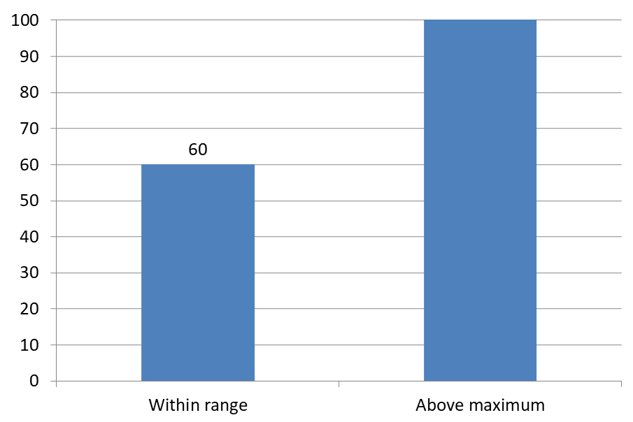

## **Úvod**

Popisky dat zobrazují informace o sériích grafu a jednotlivých datových bodech, což čtenářům pomáhá rozpoznávat hodnoty a pochopit graf. Tento článek vysvětluje, jak formátovat hodnoty, zobrazovat procenta, číst text popisky, řídit popisky mimo maximální hodnotu osy, upravit rozestupy popisků kategoriální osy a umístit popisky koláčových grafů.

## **Počet viditelných popisků dat**

Použijte [getCountOfVisibleDataLabels](https://reference.aspose.com/slides/java/com.aspose.slides/idatalabelcollection/#getCountOfVisibleDataLabels--) k ověření, kolik popisků dat je povoleno zobrazit před publikováním prezentace. Na rozdíl od [getCount](https://reference.aspose.com/slides/java/com.aspose.slides/idatalabelcollection/#getCount--), který vrací celkový počet popisků v kolekci, bere v úvahu výchozí nastavení sérií a individuální nastavení popisků.

Tento příklad vytvoří sloupcový graf s jednou sérií a třemi datovými body. Přistupuje ke kolekci popisků série pomocí [getLabels](https://reference.aspose.com/slides/java/com.aspose.slides/ichartseries/#getLabels--) a vypisuje počet viditelných popisků při změně nastavení: **0, 3, 2, 3**. Celkový počet zůstává **3**.

```java
import com.aspose.slides.*;

Presentation presentation = new Presentation();
try {
    ISlide slide = presentation.getSlides().get_Item(0);

    IChart chart = slide.getShapes().addChart(ChartType.ClusteredColumn, 50, 50, 500, 300);

    chart.getChartData().getSeries().clear();
    chart.getChartData().getCategories().clear();

    IChartDataWorkbook workbook = chart.getChartData().getChartDataWorkbook();
    IChartDataCell seriesCell = workbook.getCell(0, 0, 1, "Values");
    IChartSeries series = chart.getChartData().getSeries().add(seriesCell, chart.getType());

    for (int i = 0; i < 3; i++) {
        IChartDataCell categoryCell = workbook.getCell(0, i + 1, 0, "Category " + (i + 1));
        chart.getChartData().getCategories().add(categoryCell);
        IChartDataCell valueCell = workbook.getCell(0, i + 1, 1, (i + 1) * 10);
        series.getDataPoints().addDataPointForBarSeries(valueCell);
    }

    IDataLabelCollection labels = series.getLabels();
    System.out.println("Total: " + labels.getCount() + "; visible: " + labels.getCountOfVisibleDataLabels()); // Celkem: 3; viditelné: 0

    labels.getDefaultDataLabelFormat().setShowValue(true);
    System.out.println("Visible: " + labels.getCountOfVisibleDataLabels()); // Viditelné: 3

    labels.get_Item(1).getDataLabelFormat().setShowValue(false);
    System.out.println("Visible: " + labels.getCountOfVisibleDataLabels()); // Viditelné: 2

    labels.get_Item(1).getDataLabelFormat().setShowLegendKey(true);
    System.out.println("Visible: " + labels.getCountOfVisibleDataLabels()); // Viditelné: 3
} finally {
    presentation.dispose();
}
```

Metoda [getDefaultDataLabelFormat](https://reference.aspose.com/slides/java/com.aspose.slides/idatalabelcollection/#getDefaultDataLabelFormat--) série poskytuje výchozí nastavení. Předáním `true` metodě [setShowValue](https://reference.aspose.com/slides/java/com.aspose.slides/idatalabelformat/#setShowValue-boolean-) zobrazí hodnoty pro všechny tři popisky. Předání `false` prostřednictvím [getDataLabelFormat](https://reference.aspose.com/slides/java/com.aspose.slides/idatalabel/#getDataLabelFormat--) jedné popisky přepíše toto nastavení pro vybranou popisku. Předáním `true` metodě [setShowLegendKey](https://reference.aspose.com/slides/java/com.aspose.slides/idatalabelformat/#setShowLegendKey-boolean-) způsobí, že tato popiska se opět počítá jako viditelná, i když její hodnota zůstává skrytá.

Počet viditelných popisků odráží nastavení viditelnosti. Neměří, zda se popisky překrývají, jsou oříznuty nebo čitelné v vykresleném grafu.

## **Nastavení přesnosti dat v popiscích grafu**

Použijte [setNumberFormatOfValues](https://reference.aspose.com/slides/java/com.aspose.slides/ichartseries/#setNumberFormatOfValues-java.lang.String-) k formátování hodnot sérií. Tento příklad vytvoří spojnicový graf s výchozími daty, zobrazí jeho datovou tabulku a povolí popisky hodnot pro první sérii. Formát `#,##0.00` zobrazuje oddělovač tisíců a dvě desetinná místa, aniž by měnil podkladové hodnoty.

```java
import com.aspose.slides.*;

Presentation presentation = new Presentation();
try {
    ISlide slide = presentation.getSlides().get_Item(0);

    IChart chart = slide.getShapes().addChart(ChartType.Line, 50, 50, 450, 300);
    chart.setDataTable(true);

    IChartSeries series = chart.getChartData().getSeries().get_Item(0);
    series.setNumberFormatOfValues("#,##0.00");
    series.getLabels().getDefaultDataLabelFormat().setShowValue(true);

    presentation.save("PrecisionOfDatalabels_out.pptx", SaveFormat.Pptx);
} finally {
    presentation.dispose();
}
```

Pro formátování číselných buněk ve vložené sešitě grafu viz [Set Custom Number Formats for Workbook Cells](/slides/cs/java/chart-workbook/#set-custom-number-formats-for-workbook-cells). Tento příklad také ukazuje popisky hodnot, které následují formáty zdrojových buněk při zachování uložených číselných hodnot.

## **Zobrazení procent jako popisky**

Pro vrstvící sloupcový graf vypočtěte každou hodnotu jako procento celkového součtu kategorie a přiřaďte text do textového rámce vráceného metodou [getTextFrameForOverriding](https://reference.aspose.com/slides/java/com.aspose.slides/ioverridabletext/#getTextFrameForOverriding--). Tento příklad používá výchozí data grafu a zobrazuje procenta se dvěma desetinnými místy v písmeni o velikosti 8 bodů. Kategorie s nulovým součtem jsou přeskočeny, aby se zabránilo dělení nulou. Přepočítejte vlastní text popisky, pokud se data grafu změní.

```java
import com.aspose.slides.*;
import java.util.Locale;

Presentation presentation = new Presentation();
try {
    ISlide slide = presentation.getSlides().get_Item(0);

    IChart chart = slide.getShapes().addChart(ChartType.StackedColumn, 20, 20, 400, 400);

    double[] categoryTotals = new double[chart.getChartData().getCategories().size()];
    for (int k = 0; k < chart.getChartData().getCategories().size(); k++) {
        for (int i = 0; i < chart.getChartData().getSeries().size(); i++) {
            IChartSeries series = chart.getChartData().getSeries().get_Item(i);
            Number pointValue = (Number) series.getDataPoints().get_Item(k).getValue().getData();
            categoryTotals[k] += pointValue.doubleValue();
        }
    }

    for (int x = 0; x < chart.getChartData().getSeries().size(); x++) {
        IChartSeries series = chart.getChartData().getSeries().get_Item(x);
        series.getLabels().getDefaultDataLabelFormat().setShowLegendKey(false);

        for (int j = 0; j < series.getDataPoints().size(); j++) {
            IDataLabel label = series.getDataPoints().get_Item(j).getLabel();
            if (categoryTotals[j] == 0) {
                continue;
            }

            Number pointValue = (Number) series.getDataPoints().get_Item(j).getValue().getData();
            double dataPointPercent = (pointValue.doubleValue() / categoryTotals[j]) * 100;

            IPortion portion = new Portion();
            portion.setText(String.format(Locale.US, "%.2f %%", dataPointPercent));
            portion.getPortionFormat().setFontHeight(8f);

            label.getTextFrameForOverriding().setText("");
            IParagraph paragraph = label.getTextFrameForOverriding().getParagraphs().get_Item(0);
            paragraph.getPortions().add(portion);

            label.getDataLabelFormat().setShowValue(true);
            label.getDataLabelFormat().setShowSeriesName(false);
            label.getDataLabelFormat().setShowPercentage(false);
            label.getDataLabelFormat().setShowLegendKey(false);
            label.getDataLabelFormat().setShowCategoryName(false);
            label.getDataLabelFormat().setShowBubbleSize(false);
        }
    }

    presentation.save("DisplayPercentageAsLabels_out.pptx", SaveFormat.Pptx);
} finally {
    presentation.dispose();
}
```

## **Nastavení procentního znaménka v popiscích grafu**

Když jsou hodnoty uloženy jako zlomky, použijte [setNumberFormat](https://reference.aspose.com/slides/java/com.aspose.slides/idatalabelformat/#setNumberFormat-java.lang.String-) k zobrazení procent. Předáním `false` metodě [setNumberFormatLinkedToSource](https://reference.aspose.com/slides/java/com.aspose.slides/idatalabelformat/#setNumberFormatLinkedToSource-boolean-) použijete formát popisky nezávisle na zdrojových buňkách.

Tento příklad vytvoří 100 % vrstvu sloupcový graf s červenou a modrou sérií napříč čtyřmi kategoriemi. Každý pár hodnot sečte na 1. Formát popisky `0.0%` zobrazí 0,30 jako 30,0 %, zatímco svislá osa používá dvě desetinná místa. Obě série používají bílý text popisky o velikosti 10 bodů.

```java
import com.aspose.slides.*;
import java.awt.Color;

Presentation presentation = new Presentation();
try {
    ISlide slide = presentation.getSlides().get_Item(0);

    IChart chart = slide.getShapes().addChart(ChartType.PercentsStackedColumn, 20, 20, 500, 400);

    chart.getAxes().getVerticalAxis().setNumberFormatLinkedToSource(false);
    chart.getAxes().getVerticalAxis().setNumberFormat("0.00%");

    chart.getChartData().getSeries().clear();
    chart.getChartData().getCategories().clear();

    IChartDataWorkbook workbook = chart.getChartData().getChartDataWorkbook();
    int worksheetIndex = 0;
    for (int i = 0; i < 4; i++) {
        IChartDataCell categoryCell = workbook.getCell(worksheetIndex, i + 1, 0, "Category " + (i + 1));
        chart.getChartData().getCategories().add(categoryCell);
    }

    String[] seriesNames = { "Reds", "Blues" };
    Color[] seriesColors = { Color.RED, Color.BLUE };
    double[][] values = { { 0.30, 0.50, 0.80, 0.65 }, { 0.70, 0.50, 0.20, 0.35 } };

    for (int i = 0; i < seriesNames.length; i++) {
        IChartDataCell seriesCell = workbook.getCell(worksheetIndex, 0, i + 1, seriesNames[i]);
        IChartSeries series = chart.getChartData().getSeries().add(seriesCell, chart.getType());
        for (int j = 0; j < 4; j++) {
            IChartDataCell valueCell = workbook.getCell(worksheetIndex, j + 1, i + 1, values[i][j]);
            series.getDataPoints().addDataPointForBarSeries(valueCell);
        }

        series.getFormat().getFill().setFillType(FillType.Solid);
        series.getFormat().getFill().getSolidFillColor().setColor(seriesColors[i]);

        IDataLabelFormat labelFormat = series.getLabels().getDefaultDataLabelFormat();
        labelFormat.setShowValue(true);
        labelFormat.setNumberFormatLinkedToSource(false);
        labelFormat.setNumberFormat("0.0%");
        labelFormat.getTextFormat().getPortionFormat().setFontHeight(10);
        labelFormat.getTextFormat().getPortionFormat().getFillFormat().setFillType(FillType.Solid);
        labelFormat.getTextFormat().getPortionFormat().getFillFormat().getSolidFillColor().setColor(Color.WHITE);
    }

    presentation.save("SetDataLabelsPercentageSign_out.pptx", SaveFormat.Pptx);
} finally {
    presentation.dispose();
}
```

## **Načtení skutečného textu popisků dat**

Použijte [getActualLabelText](https://reference.aspose.com/slides/java/com.aspose.slides/idatalabel/#getActualLabelText--) k získání textu vytvořeného nastavením popisky dat. To je užitečné při extrahování popisků pro reporty, vyhledávání v obsahu prezentace nebo ověřování vygenerovaných grafů. V níže uvedeném příkladu výchozí [formát popisky dat](https://reference.aspose.com/slides/java/com.aspose.slides/idatalabelformat/) kombinuje název každé kategorie, název série a hodnotu. Jeden bod formátuje svou hodnotu jako procento a jiný používá vlastní text z [getTextFrameForOverriding](https://reference.aspose.com/slides/java/com.aspose.slides/ioverridabletext/#getTextFrameForOverriding--).

```java
import com.aspose.slides.*;

Presentation presentation = new Presentation();
try {
    ISlide slide = presentation.getSlides().get_Item(0);

    IChart chart = slide.getShapes().addChart(ChartType.ClusteredColumn, 20, 20, 500, 300);

    chart.getChartData().getSeries().clear();
    chart.getChartData().getCategories().clear();

    IChartDataWorkbook workbook = chart.getChartData().getChartDataWorkbook();
    IChartDataCell firstCategoryCell = workbook.getCell(0, 1, 0, "Q1");
    chart.getChartData().getCategories().add(firstCategoryCell);
    IChartDataCell secondCategoryCell = workbook.getCell(0, 2, 0, "Q2");
    chart.getChartData().getCategories().add(secondCategoryCell);

    IChartDataCell northSeriesCell = workbook.getCell(0, 0, 1, "North");
    IChartSeries north = chart.getChartData().getSeries().add(northSeriesCell, chart.getType());
    IChartDataCell northFirstValueCell = workbook.getCell(0, 1, 1, 0.25);
    north.getDataPoints().addDataPointForBarSeries(northFirstValueCell);
    IChartDataCell northSecondValueCell = workbook.getCell(0, 2, 1, 0.75);
    north.getDataPoints().addDataPointForBarSeries(northSecondValueCell);

    IChartDataCell southSeriesCell = workbook.getCell(0, 0, 2, "South");
    IChartSeries south = chart.getChartData().getSeries().add(southSeriesCell, chart.getType());
    IChartDataCell southFirstValueCell = workbook.getCell(0, 1, 2, 0.40);
    south.getDataPoints().addDataPointForBarSeries(southFirstValueCell);
    IChartDataCell southSecondValueCell = workbook.getCell(0, 2, 2, 0.60);
    south.getDataPoints().addDataPointForBarSeries(southSecondValueCell);

    for (IChartSeries series : chart.getChartData().getSeries()) {
        IDataLabelFormat format = series.getLabels().getDefaultDataLabelFormat();
        format.setShowCategoryName(true);
        format.setShowSeriesName(true);
        format.setShowValue(true);
    }

    north.getLabels().get_Item(1).getDataLabelFormat().setNumberFormatLinkedToSource(false);
    north.getLabels().get_Item(1).getDataLabelFormat().setNumberFormat("0%");
    south.getLabels().get_Item(0).getTextFrameForOverriding().setText("Reviewed");

    for (IChartSeries series : chart.getChartData().getSeries()) {
        for (IChartDataPoint point : series.getDataPoints()) {
            IDataLabel label = point.getLabel();
            if (!label.isVisible()) {
                continue;
            }

            System.out.println("Value: " + point.getValue().getData() + "; label: " + label.getActualLabelText());
        }
    }
} finally {
    presentation.dispose();
}
```

Číslo uložené v datovém bodu zůstává `0.75`, i když jeho popiska zobrazuje `75 %` spolu s názvem kategorie a série. Vlastní text nahrazuje vygenerovaný text popisky. [getActualLabelText](https://reference.aspose.com/slides/java/com.aspose.slides/idatalabel/#getActualLabelText--) vrací výsledný řetězec popisky v obou případech. Zkontrolujte [isVisible](https://reference.aspose.com/slides/java/com.aspose.slides/idatalabel/#isVisible--) zvlášť, jak je uvedeno výše, pokud chcete extrahovat pouze viditelné popisky.

## **Řízení popisků dat mimo maximální hodnotu osy**

Když omezíte rozsah osy ručně, některé datové body mohou přesáhnout její maximum. Použijte [setShowDataLabelsOverMaximum](https://reference.aspose.com/slides/java/com.aspose.slides/ichart/#setShowDataLabelsOverMaximum-boolean-) k řízení, zda jsou jejich popisky dat zobrazeny. Toto nastavení mění viditelnost popisků; nemění rozsah osy ani podkladové datové hodnoty.

Níže uvedený příklad vytvoří 2D seskupený sloupcový graf s hodnotami 60 a 120. Předá `false` metodě [setAutomaticMaxValue](https://reference.aspose.com/slides/java/com.aspose.slides/iaxis/#setAutomaticMaxValue-boolean-) a nastaví maximum na 100 pomocí [setMaxValue](https://reference.aspose.com/slides/java/com.aspose.slides/iaxis/#setMaxValue-double-) na svislé ose. První snímek umožňuje popisky mimo maximum; kopie tohoto snímku je zakáže. Oba snímky jsou uloženy v `DataLabelsOverMaximum.pptx`.

Povolte popisky hodnot pomocí [setShowValue](https://reference.aspose.com/slides/java/com.aspose.slides/idatalabelformat/#setShowValue-boolean-). Nastavení úrovně grafu samo o sobě nezpůsobí zobrazení hodnot ani nepřepíše zakázané zobrazení hodnot u jednotlivých popisků. Tento příklad povolí hodnoty pro celou sérii a používá [setPosition](https://reference.aspose.com/slides/java/com.aspose.slides/idatalabelformat/#setPosition-int-) k umístění popisků na vnější konec každého sloupce.

```java
import com.aspose.slides.*;

Presentation presentation = new Presentation();
try {
    ISlide slide = presentation.getSlides().get_Item(0);

    IChart chart = slide.getShapes().addChart(ChartType.ClusteredColumn, 50, 50, 600, 400);
    chart.setLegend(false);

    chart.getChartData().getSeries().clear();
    chart.getChartData().getCategories().clear();

    IChartDataWorkbook workbook = chart.getChartData().getChartDataWorkbook();

    IChartDataCell firstCategory = workbook.getCell(0, 1, 0, "Within range");
    IChartDataCell secondCategory = workbook.getCell(0, 2, 0, "Above maximum");

    chart.getChartData().getCategories().add(firstCategory);
    chart.getChartData().getCategories().add(secondCategory);

    IChartDataCell seriesName = workbook.getCell(0, 0, 1, "Values");
    IChartSeries series = chart.getChartData().getSeries().add(seriesName, chart.getType());

    IChartDataCell firstValue = workbook.getCell(0, 1, 1, 60);
    IChartDataCell secondValue = workbook.getCell(0, 2, 1, 120);

    series.getDataPoints().addDataPointForBarSeries(firstValue);
    series.getDataPoints().addDataPointForBarSeries(secondValue);

    series.getLabels().getDefaultDataLabelFormat().setShowValue(true);
    series.getLabels().getDefaultDataLabelFormat().setPosition(LegendDataLabelPosition.OutsideEnd);

    chart.getAxes().getVerticalAxis().setAutomaticMaxValue(false);
    chart.getAxes().getVerticalAxis().setMaxValue(100);
    chart.setShowDataLabelsOverMaximum(true);

    ISlide secondSlide = presentation.getSlides().addClone(slide);
    IChart secondChart = (IChart) secondSlide.getShapes().get_Item(0);
    secondChart.setShowDataLabelsOverMaximum(false);

    presentation.save("DataLabelsOverMaximum.pptx", SaveFormat.Pptx);
} finally {
    presentation.dispose();
}
```

Následující obrázky zobrazují uložené snímky vykreslené v Microsoft PowerPoint. S `true` je popiska **120** viditelná na horní hranici; s `false` je skrytá. Popiska **60** zůstává viditelná, maximum osy zůstává na **100** a druhý datový bod zůstává **120** v obou případech.

| setShowDataLabelsOverMaximum(true) | setShowDataLabelsOverMaximum(false) |
| --- | --- |
|  |  |

{}
Tento příklad používá 2D sloupcový graf s hodnotovou osou. Grafy bez hodnotové osy, například koláčové a prstencové grafy, nemají maximální hodnotu osy, kterou by šlo takto omezit.
{}

## **Nastavení vzdálenosti popisku od osy**

Použijte [setLabelOffset](https://reference.aspose.com/slides/java/com.aspose.slides/iaxis/#setLabelOffset-int-) k řízení vzdálenosti mezi popisky kategoriální osy a osou. Hodnota je procento maximální velikosti písma popisků osy. Tento příklad vytvoří seskupený sloupcový graf a nastaví posun popisků vodorovné osy na 500. Toto nastavení ovlivňuje popisky kategoriální osy spíše než popisky připojené k jednotlivým datovým bodům.

```java
import com.aspose.slides.*;

Presentation presentation = new Presentation();
try {
    ISlide slide = presentation.getSlides().get_Item(0);

    IChart chart = slide.getShapes().addChart(ChartType.ClusteredColumn, 20, 20, 500, 300);
    chart.getAxes().getHorizontalAxis().setLabelOffset(500);

    presentation.save("SetCategoryAxisLabelDistance_out.pptx", SaveFormat.Pptx);
} finally {
    presentation.dispose();
}
```

## **Úprava umístění popisků**

U koláčového grafu upravte umístění popisků dat, aby se zlepšilo rozestupení a vytvořilo místo pro pomocné čáry.

Tento příklad zobrazí hodnotu prvního datového bodu, umístí jeho popisku mimo výseč a upraví jeho vodorovné a svislé posuny pomocí [setX](https://reference.aspose.com/slides/java/com.aspose.slides/ilayoutable/#setX-float-) a [setY](https://reference.aspose.com/slides/java/com.aspose.slides/ilayoutable/#setY-float-). Tyto posuny jsou relativní k šířce a výšce grafu, respektive.

```java
import com.aspose.slides.*;

Presentation presentation = new Presentation();
try {
    ISlide slide = presentation.getSlides().get_Item(0);
    
    IChart chart = slide.getShapes().addChart(ChartType.Pie, 50, 50, 200, 200);
    IChartSeriesCollection series = chart.getChartData().getSeries();

    IDataLabel label = series.get_Item(0).getLabels().get_Item(0);
    label.getDataLabelFormat().setShowValue(true);
    label.getDataLabelFormat().setPosition(LegendDataLabelPosition.OutsideEnd);
    label.setX(0.71f);
    label.setY(0.04f);

    presentation.save("presentation.pptx", SaveFormat.Pptx);
} finally {
    presentation.dispose();
}
```


## **Formátování pomocných čar**

Když jsou popisky koláčového grafu umístěny mimo výseče, pomáhají pomocné čáry čtenářům přiřadit každou hodnotu ke správné výseči. Kontrastní barva a mírně silnější čára mohou usnadnit sledování těchto spojení, zatímco průhlednost a čárkový styl činí čáry vizuálně nenápadnými.

Použijte [getLeaderLinesFormat](https://reference.aspose.com/slides/java/com.aspose.slides/idatalabelcollection/#getLeaderLinesFormat--) k formátování pomocných čar na úrovni kolekce popisků dat série. Nastavení v `series.getLabels().getLeaderLinesFormat().getLine()` se vztahují na celou kolekci, nikoli na jednotlivou popisku.

Tento příklad vytvoří koláčový graf s výchozími daty, zobrazí hodnoty mimo výseče a povolí [setShowLeaderLines](https://reference.aspose.com/slides/java/com.aspose.slides/idatalabelformat/#setShowLeaderLines-boolean-). Posune dva popisky dál od jejich výsečů pomocí posunů [setX](https://reference.aspose.com/slides/java/com.aspose.slides/ilayoutable/#setX-float-) a [setY](https://reference.aspose.com/slides/java/com.aspose.slides/ilayoutable/#setY-float-), vyjádřených jako zlomky šířky a výšky grafu. Vstupní prezentace není vyžadována.

Metoda [getFillFormat](https://reference.aspose.com/slides/java/com.aspose.slides/ilineformat/#getFillFormat--) nastaví plnou modrou barvu s alfa hodnotou 191 ze 255, což poskytuje přibližně 25 % průhlednost. [setWidth](https://reference.aspose.com/slides/java/com.aspose.slides/ilineformat/#setWidth-double-) nastaví tloušťku na 2 body a [setDashStyle](https://reference.aspose.com/slides/java/com.aspose.slides/ilineformat/#setDashStyle-byte-) udělá čáru čárkovanou.

```java
import com.aspose.slides.*;
import java.awt.Color;

Presentation presentation = new Presentation();
try {
    ISlide slide = presentation.getSlides().get_Item(0);

    IChart chart = slide.getShapes().addChart(ChartType.Pie, 80, 50, 560, 400);
    chart.setLegend(false);

    IChartSeries series = chart.getChartData().getSeries().get_Item(0);

    IDataLabelFormat labelFormat = series.getLabels().getDefaultDataLabelFormat();
    labelFormat.setShowValue(true);
    labelFormat.setPosition(LegendDataLabelPosition.OutsideEnd);
    labelFormat.setShowLeaderLines(true);

    // Posuňte dva popisky dál od jejich výsečí.
    series.getLabels().get_Item(0).setX(0.10f);
    series.getLabels().get_Item(0).setY(-0.05f);
    series.getLabels().get_Item(1).setX(-0.10f);
    series.getLabels().get_Item(1).setY(0.05f);

    ILineFormat line = series.getLabels().getLeaderLinesFormat().getLine();
    line.getFillFormat().setFillType(FillType.Solid);
    line.getFillFormat().getSolidFillColor().setColor(new Color(30, 90, 160, 191));
    line.setWidth(2);
    line.setDashStyle(LineDashStyle.Dash);

    presentation.save("FormattedLeaderLines.pptx", SaveFormat.Pptx);
} finally {
    presentation.dispose();
}
```

Povolení pomocných čar nezaručuje, že se čára objeví u každé popisky. Viditelnost závisí na umístění popisky a chování rozložení grafu. V tomto příkladu mají dvě odsazené popisky viditelné pomocné čáry; popisky, které zůstávají blízko výsečím, je nepotřebují.

Následující obrázek zobrazuje uložený `FormattedLeaderLines.pptx` vykreslený pomocí Aspose.Slides:


## **Přidání více řádků popisků nad sloupcový graf**

Tento příklad vytvoří sloupcový graf se dvěma řádky popisků nad vykreslovací oblastí. Série A zobrazuje viditelné sloupce, zatímco série B a C poskytují dodatečné popisky. Jejich sloupce jsou skryty odstraněním výplně a obrysu. Metoda [ChartSeriesGroup.setOverlap](https://reference.aspose.com/slides/java/com.aspose.slides/chartseriesgroup/) zarovnává všechny tři série ke stejným středům kategorií.

Nastavení [ChartPlotArea](https://reference.aspose.com/slides/java/com.aspose.slides/chartplotarea/) rezervuje prostor pro řádky popisků. Po výpočtu výchozích pozic metodou [Chart.validateChartLayout](https://reference.aspose.com/slides/java/com.aspose.slides/chart/) zachovají [DataLabel.setX a DataLabel.setY](https://reference.aspose.com/slides/java/com.aspose.slides/datalabel/) vodorovné zarovnání a použijí svislé posuny k uspořádání popisků ve dvou řádcích. Čísla zůstávají popisky dat spojenými s hodnotami sérií; pouze nadpisy řádků jsou samostatné textové tvary.

```java
Presentation presentation = new Presentation();
try {
    ISlide slide = presentation.getSlides().get_Item(0);

    IChart chart = slide.getShapes().addChart(ChartType.ClusteredColumn, 40, 40, 640, 200);
    chart.setTitle(false);
    chart.setLegend(false);
    chart.getTextFormat().getPortionFormat().setFontHeight(12);

    chart.getChartData().getSeries().clear();
    chart.getChartData().getCategories().clear();

    IChartDataWorkbook workbook = chart.getChartData().getChartDataWorkbook();
    workbook.clear(0);

    String[] categories = {"North", "South", "East", "West"};
    String[] seriesNames = {"Series A", "Series B", "Series C"};
    double[][] seriesValues = {
            {35, 42, 28, 47},
            {22, 31, 19, 26},
            {12, 16, 14, 18}
    };

    for (int categoryIndex = 0; categoryIndex < categories.length; categoryIndex++) {
        chart.getChartData().getCategories().add(
                workbook.getCell(0, categoryIndex + 1, 0, categories[categoryIndex]));
    }

    for (int seriesIndex = 0; seriesIndex < seriesNames.length; seriesIndex++) {
        IChartSeries series = chart.getChartData().getSeries().add(
                workbook.getCell(0, 0, seriesIndex + 1, seriesNames[seriesIndex]),
                ChartType.ClusteredColumn);

        for (int categoryIndex = 0; categoryIndex < categories.length; categoryIndex++) {
            series.getDataPoints().addDataPointForBarSeries(workbook.getCell(
                    0, categoryIndex + 1, seriesIndex + 1,
                    seriesValues[seriesIndex][categoryIndex]));
        }

        if (seriesIndex > 0) {
            // Skrýt sloupce B a C, ale zachovat jejich popisky dat.
            series.getFormat().getFill().setFillType(FillType.NoFill);
            series.getFormat().getLine().getFillFormat().setFillType(FillType.NoFill);
            series.getLabels().getDefaultDataLabelFormat().setShowValue(true);
            series.getLabels().getDefaultDataLabelFormat()
                    .getTextFormat().getPortionFormat().setFontHeight(12);
            IFillFormat labelFill = series.getLabels().getDefaultDataLabelFormat()
                    .getTextFormat().getPortionFormat().getFillFormat();
            labelFill.setFillType(FillType.Solid);
            labelFill.getSolidFillColor().setColor(java.awt.Color.BLACK);
            series.getLabels().getDefaultDataLabelFormat().setPosition(
                    LegendDataLabelPosition.InsideBase);
        }
    }

    // Zarovnat všechny tři řady ke stejným středům kategorií.
    chart.getChartData().getSeries().get_Item(0)
            .getParentSeriesGroup().setOverlap((byte) 100);

    // Použít méně mřížkových čar pro tento kompaktní příklad.
    chart.getAxes().getVerticalAxis().setAutomaticMajorUnit(false);
    chart.getAxes().getVerticalAxis().setMajorUnit(10);

    // Rezervovat prostor nad diagramem pro dva řádky popisků dat.
    chart.getPlotArea().setLayoutTargetType(LayoutTargetType.Inner);
    chart.getPlotArea().setX(0.15f);
    chart.getPlotArea().setY(0.32f);
    chart.getPlotArea().setWidth(0.80f);
    chart.getPlotArea().setHeight(0.48f);
    chart.validateChartLayout();

    for (int seriesIndex = 1; seriesIndex < seriesNames.length; seriesIndex++) {
        IChartSeries series = chart.getChartData().getSeries().get_Item(seriesIndex);
        float rowTop = seriesIndex == 1 ? 0.15f : 0.03f;

        for (int categoryIndex = 0; categoryIndex < categories.length; categoryIndex++) {
            IDataLabel dataLabel = series.getDataPoints().get_Item(categoryIndex).getLabel();
            // Zachovat výchozí horizontální pozici. Y je posun od
            // výchozí pozice popisky, vyjádřené jako podíl výšky grafu.
            dataLabel.setX(0);
            dataLabel.setY(rowTop - dataLabel.getActualY() / chart.getHeight());
        }

        // Jen nadpis řádku je samostatný textový tvar.
        IAutoShape rowHeading = slide.getShapes().addAutoShape(
                ShapeType.Rectangle, chart.getX(),
                chart.getY() + rowTop * chart.getHeight(), 85, 18);
        rowHeading.getFillFormat().setFillType(FillType.NoFill);
        rowHeading.getLineFormat().getFillFormat().setFillType(FillType.NoFill);
        rowHeading.addTextFrame(seriesNames[seriesIndex]);
        rowHeading.getTextFrame().getTextFrameFormat().setMarginTop(0);
        rowHeading.getTextFrame().getTextFrameFormat().setMarginBottom(0);
        IPortionFormat headingFormat = rowHeading.getTextFrame().getParagraphs()
                .get_Item(0).getPortions().get_Item(0).getPortionFormat();
        headingFormat.setFontHeight(12);
        headingFormat.getFillFormat().setFillType(FillType.Solid);
        headingFormat.getFillFormat().getSolidFillColor().setColor(java.awt.Color.BLACK);
    }

    presentation.save("multiple-rows-of-labels.pptx", SaveFormat.Pptx);
} finally {
    presentation.dispose();
}
```


## **Často kladené otázky**

**Jak mohu zabránit překrývání popisků dat v hustých grafech?**

Kombinujte automatické umístění popisků, pomocné čáry a zmenšení velikosti písma; v případě potřeby skryjte některá pole (například kategorii) nebo zobrazte popisky jen pro extrémní hodnoty či klíčové body.

**Jak mohu zakázat popisky jen pro nulové, záporné nebo prázdné hodnoty?**

Odfiltrujte datové body před povolením popisků a vypněte zobrazování pro hodnoty 0, záporné hodnoty nebo chybějící hodnoty podle definovaného pravidla.

**Jak zajistit konzistentní styl popisků při exportu do PDF/obrázků?**

Explicitně nastavte rodinu a velikost písma a ověřte, že je písmo dostupné v prostředí vykreslování, aby nedošlo k náhradě.