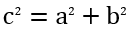

## **Přehled**

PowerPoint ukládá rovnice jako Office Math Markup Language (OMML). S Aspose.Slides pro Java můžete programově vytvářet stejný typ matematického obsahu: zlomky, odmocniny, funkce, limity, N‑ary operátory, matice, pole a formátované matematické bloky.

V PowerPointu uživatelé obvykle přidávají rovnice pomocí **Insert > Equation**:


Výsledkem je upravitelný matematický text na snímku:


Aspose.Slides vytváří tento matematický text pomocí tří hlavních objektů:

- Matematický tvar, vytvořený pomocí [addMathShape](https://reference.aspose.com/slides/java/com.aspose.slides/ishapecollection/#addMathShape-float-float-float-float-), je tvar, který obsahuje rovnici.
- [MathPortion](https://reference.aspose.com/slides/java/com.aspose.slides/mathportion/) ukládá matematický obsah uvnitř textového rámce tvaru.
- [MathParagraph](https://reference.aspose.com/slides/java/com.aspose.slides/mathparagraph/) obsahuje jeden nebo více objektů [MathBlock](https://reference.aspose.com/slides/java/com.aspose.slides/mathblock/).

Většina níže uvedených příkladů používá [MathematicalText](https://reference.aspose.com/slides/java/com.aspose.slides/mathematicaltext/) a plynulé metody z [IMathElement](https://reference.aspose.com/slides/java/com.aspose.slides/imathelement/), aby byl kód stručný a čitelný.

Pro scénáře exportu MathML viz [Export rovnic Math z prezentací v jazyce Java](/slides/cs/java/exporting-math-equations/).

## **Vytvoření rovnice**

Tento příklad používá [addMathShape](https://reference.aspose.com/slides/java/com.aspose.slides/ishapecollection/#addMathShape-float-float-float-float-) , aby vytvořil matematický tvar a přidal Pythagorovu větu:



```java
import com.aspose.slides.*;

Presentation presentation = new Presentation();
try {
    ISlide slide = presentation.getSlides().get_Item(0);

    IAutoShape mathShape = slide.getShapes().addMathShape(20, 20, 700, 120);
    IMathParagraph mathParagraph = ((MathPortion) mathShape.getTextFrame().getParagraphs()
            .get_Item(0).getPortions().get_Item(0)).getMathParagraph();

    IMathBlock equation = new MathematicalText("c")
            .setSuperscript("2")
            .join("=")
            .join(new MathematicalText("a").setSuperscript("2"))
            .join("+")
            .join(new MathematicalText("b").setSuperscript("2"));

    mathParagraph.add(equation);

    presentation.save("pythagorean-theorem.pptx", SaveFormat.Pptx);
} finally {
    presentation.dispose();
}
```

{}
[addMathShape](https://reference.aspose.com/slides/java/com.aspose.slides/ishapecollection/#addMathShape-float-float-float-float-) vytváří tvar, který již obsahuje matematický odstavec. Přistupte k prvnímu [MathPortion](https://reference.aspose.com/slides/java/com.aspose.slides/mathportion/), zavolejte [getMathParagraph](https://reference.aspose.com/slides/java/com.aspose.slides/imathportion/#getMathParagraph--), a přidejte matematické bloky nebo matematické elementy.
{}

## **Přidání zlomků**

Použijte [divide](https://reference.aspose.com/slides/java/com.aspose.slides/imathelement/#divide-com.aspose.slides.IMathElement-) , abyste vytvořili zlomek. Můžete zvolit styl zlomku pomocí [MathFractionTypes](https://reference.aspose.com/slides/java/com.aspose.slides/mathfractiontypes/).


```java
import com.aspose.slides.*;

Presentation presentation = new Presentation();
try {
    ISlide slide = presentation.getSlides().get_Item(0);

    IAutoShape mathShape = slide.getShapes().addMathShape(20, 20, 700, 100);
    IMathParagraph mathParagraph = ((MathPortion) mathShape.getTextFrame().getParagraphs()
            .get_Item(0).getPortions().get_Item(0)).getMathParagraph();

    IMathFraction fraction = new MathematicalText("1")
            .divide("x", MathFractionTypes.Skewed);

    mathParagraph.add(new MathBlock(fraction));

    presentation.save("fraction.pptx", SaveFormat.Pptx);
} finally {
    presentation.dispose();
}
```

Pro vrstvený zlomek použijte [MathFractionTypes.Bar](https://reference.aspose.com/slides/java/com.aspose.slides/mathfractiontypes/#Bar):

```java
import com.aspose.slides.*;

IMathFraction stackedFraction = new MathematicalText("x + 1").divide("y - 1", MathFractionTypes.Bar);
```

## **Přidání odmocnin**

Použijte [radical](https://reference.aspose.com/slides/java/com.aspose.slides/imathelement/#radical-com.aspose.slides.IMathElement-) , abyste vytvořili druhou odmocninu, třetí odmocninu nebo jinou odmocninu. Aktuální prvek se stane základem a argument se stane stupněm.


```java
import com.aspose.slides.*;

Presentation presentation = new Presentation();
try {
    ISlide slide = presentation.getSlides().get_Item(0);

    IAutoShape mathShape = slide.getShapes().addMathShape(20, 20, 700, 100);
    IMathParagraph mathParagraph = ((MathPortion) mathShape.getTextFrame().getParagraphs()
            .get_Item(0).getPortions().get_Item(0)).getMathParagraph();

    IMathRadical radical = new MathematicalText("x")
            .radical("n");

    mathParagraph.add(new MathBlock(radical));

    presentation.save("radical.pptx", SaveFormat.Pptx);
} finally {
    presentation.dispose();
}
```

## **Přidání funkcí a limit**

Použijte [asArgumentOfFunction](https://reference.aspose.com/slides/java/com.aspose.slides/imathelement/#asArgumentOfFunction-com.aspose.slides.IMathElement-) nebo [function](https://reference.aspose.com/slides/java/com.aspose.slides/imathelement/#function-com.aspose.slides.IMathElement-) pro funkce jako `sin(x)`, `log(x)` nebo vlastní názvy funkcí. Pro limity vložte `lim` do [MathLimit](https://reference.aspose.com/slides/java/com.aspose.slides/mathlimit/) nebo použijte [setLowerLimit](https://reference.aspose.com/slides/java/com.aspose.slides/imathelement/#setLowerLimit-com.aspose.slides.IMathElement-).


```java
import com.aspose.slides.*;

Presentation presentation = new Presentation();
try {
    ISlide slide = presentation.getSlides().get_Item(0);

    IAutoShape mathShape = slide.getShapes().addMathShape(20, 20, 700, 100);
    IMathParagraph mathParagraph = ((MathPortion) mathShape.getTextFrame().getParagraphs()
            .get_Item(0).getPortions().get_Item(0)).getMathParagraph();

    IMathFunction limit = new MathematicalText("lim")
            .setLowerLimit("x\u2192\u221E")
            .function("x");

    mathParagraph.add(new MathBlock(limit));

    presentation.save("functions-and-limits.pptx", SaveFormat.Pptx);
} finally {
    presentation.dispose();
}
```

Pro vlastní název funkce udělejte název funkce aktuálním prvkem a zavolejte [function](https://reference.aspose.com/slides/java/com.aspose.slides/imathelement/#function-com.aspose.slides.IMathElement-) s jeho argumentem:

```java
import com.aspose.slides.*;

IMathFunction customFunction = new MathematicalText("f").function("x + 1");
```

## **Přidání N‑ary operátorů a integrálů**

Použijte [nary](https://reference.aspose.com/slides/java/com.aspose.slides/imathelement/#nary-int-com.aspose.slides.IMathElement-com.aspose.slides.IMathElement-) , pro sumace, sjednocení, průniku a další velké operátory. Použijte [integral](https://reference.aspose.com/slides/java/com.aspose.slides/imathelement/#integral-int-com.aspose.slides.IMathElement-com.aspose.slides.IMathElement-) , pro integrály. Obě metody umožňují nastavit dolní a horní limity.


```java
import com.aspose.slides.*;

Presentation presentation = new Presentation();
try {
    ISlide slide = presentation.getSlides().get_Item(0);

    IAutoShape mathShape = slide.getShapes().addMathShape(20, 20, 700, 120);
    IMathParagraph mathParagraph = ((MathPortion) mathShape.getTextFrame().getParagraphs()
            .get_Item(0).getPortions().get_Item(0)).getMathParagraph();

    IMathBlock summationBase = new MathematicalText("x")
            .setSuperscript("k")
            .join(new MathematicalText("a").setSuperscript("n-k"));

    IMathNaryOperator summation = summationBase.nary(MathNaryOperatorTypes.Summation, "k=0", "n");

    mathParagraph.add(new MathBlock(summation));

    presentation.save("nary-operators.pptx", SaveFormat.Pptx);
} finally {
    presentation.dispose();
}
```

N‑ary operátory jsou určeny pro velké operátory s volitelnými limity. Jednoduché operátory jako `+`, `-` a `=` se obvykle přidávají jako [MathematicalText](https://reference.aspose.com/slides/java/com.aspose.slides/mathematicaltext/) a spojují do výrazu.

Pro integrál použijte [integral](https://reference.aspose.com/slides/java/com.aspose.slides/imathelement/#integral-int-com.aspose.slides.IMathElement-com.aspose.slides.IMathElement-):

```java
import com.aspose.slides.*;

IMathBlock integralBase = new MathematicalText("x").join(new MathematicalText("dx").toBox());
IMathNaryOperator integral = integralBase.integral(MathIntegralTypes.Simple, "0", "1");
```

## **Přidání matic**

Použijte [MathMatrix](https://reference.aspose.com/slides/java/com.aspose.slides/mathmatrix/) , pro řádky a sloupce. Matice ve výchozím nastavení neobsahují závorky, takže je obalte, pokud potřebujete závorky, hranaté závorky nebo složené závorky.


```java
import com.aspose.slides.*;

Presentation presentation = new Presentation();
try {
    ISlide slide = presentation.getSlides().get_Item(0);

    IAutoShape mathShape = slide.getShapes().addMathShape(20, 20, 700, 120);
    IMathParagraph mathParagraph = ((MathPortion) mathShape.getTextFrame().getParagraphs()
            .get_Item(0).getPortions().get_Item(0)).getMathParagraph();

    MathMatrix matrix = new MathMatrix(2, 3);
    matrix.set_Item(0, 0, new MathematicalText("1"));
    matrix.set_Item(0, 1, new MathematicalText("x"));
    matrix.set_Item(1, 0, new MathematicalText("x"));
    matrix.set_Item(1, 1, new MathematicalText("2"));
    matrix.set_Item(1, 2, new MathematicalText("y"));

    mathParagraph.add(new MathBlock(matrix));

    presentation.save("matrix.pptx", SaveFormat.Pptx);
} finally {
    presentation.dispose();
}
```

## **Přidání polí rovnic**

Použijte [toMathArray](https://reference.aspose.com/slides/java/com.aspose.slides/imathelement/#toMathArray--) , když potřebujete zarovnané rovnice nebo svislý zásobník výrazů.


```java
import com.aspose.slides.*;

Presentation presentation = new Presentation();
try {
    ISlide slide = presentation.getSlides().get_Item(0);

    IAutoShape mathShape = slide.getShapes().addMathShape(20, 20, 700, 140);
    IMathParagraph mathParagraph = ((MathPortion) mathShape.getTextFrame().getParagraphs()
            .get_Item(0).getPortions().get_Item(0)).getMathParagraph();

    IMathArray equationArray = new MathematicalText("x")
            .join("y")
            .toMathArray();

    mathParagraph.add(new MathBlock(equationArray));

    presentation.save("equation-array.pptx", SaveFormat.Pptx);
} finally {
    presentation.dispose();
}
```

## **Přidání trigonometrických funkcí**

Použijte [asArgumentOfFunction](https://reference.aspose.com/slides/java/com.aspose.slides/imathelement/#asArgumentOfFunction-com.aspose.slides.IMathElement-) , když je argument aktuálním prvkem a název funkce je známý.


```java
import com.aspose.slides.*;

Presentation presentation = new Presentation();
try {
    ISlide slide = presentation.getSlides().get_Item(0);

    IAutoShape mathShape = slide.getShapes().addMathShape(20, 20, 700, 100);
    IMathParagraph mathParagraph = ((MathPortion) mathShape.getTextFrame().getParagraphs()
            .get_Item(0).getPortions().get_Item(0)).getMathParagraph();

    IMathFunction cosine = new MathematicalText("2x")
            .asArgumentOfFunction(MathFunctionsOfOneArgument.Cos);

    mathParagraph.add(new MathBlock(cosine));

    presentation.save("trigonometric-function.pptx", SaveFormat.Pptx);
} finally {
    presentation.dispose();
}
```

## **Přidání dolních a horních indexů**

Použijte pomocníky pro dolní a horní indexy pro poznámky a mocniny. Když se indexy musí zobrazit na levé straně základu, použijte [setSubSuperscriptOnTheLeft](https://reference.aspose.com/slides/java/com.aspose.slides/imathelement/#setSubSuperscriptOnTheLeft-com.aspose.slides.IMathElement-com.aspose.slides.IMathElement-).


```java
import com.aspose.slides.*;

Presentation presentation = new Presentation();
try {
    ISlide slide = presentation.getSlides().get_Item(0);

    IAutoShape mathShape = slide.getShapes().addMathShape(20, 20, 700, 100);
    IMathParagraph mathParagraph = ((MathPortion) mathShape.getTextFrame().getParagraphs()
            .get_Item(0).getPortions().get_Item(0)).getMathParagraph();

    IMathLeftSubSuperscriptElement scripts = new MathematicalText("Y")
            .setSubSuperscriptOnTheLeft("1", "n");

    mathParagraph.add(new MathBlock(scripts));

    presentation.save("subscript-superscript.pptx", SaveFormat.Pptx);
} finally {
    presentation.dispose();
}
```

## **Přidání oddělovačů**

Použijte [enclose](https://reference.aspose.com/slides/java/com.aspose.slides/imathelement/#enclose-char-char-) , abyste vložili výraz dovnitř oddělovačů. Můžete také nastavit znak oddělovače pro výrazy s oddělovači, které obsahují několik prvků.


```java
import com.aspose.slides.*;

Presentation presentation = new Presentation();
try {
    ISlide slide = presentation.getSlides().get_Item(0);

    IAutoShape mathShape = slide.getShapes().addMathShape(20, 20, 700, 100);
    IMathParagraph mathParagraph = ((MathPortion) mathShape.getTextFrame().getParagraphs()
            .get_Item(0).getPortions().get_Item(0)).getMathParagraph();

    IMathDelimiter delimiter = new MathematicalText("x")
            .join("y")
            .join("z")
            .enclose('<', '>');
    delimiter.setSeparatorCharacter('|');

    mathParagraph.add(new MathBlock(delimiter));

    presentation.save("delimiters.pptx", SaveFormat.Pptx);
} finally {
    presentation.dispose();
}
```

### **Velikost a zarovnání oddělovačů**

Předávejte `true` do [setGrowToMatchOperandHeight](https://reference.aspose.com/slides/java/com.aspose.slides/imathdelimiter/#setGrowToMatchOperandHeight-boolean-), aby se závorky rozšířily kolem vysokého operandu, nebo `false`, aby zůstaly v normální velikosti. Použijte [setDelimiterShape](https://reference.aspose.com/slides/java/com.aspose.slides/imathdelimiter/#setDelimiterShape-int-) s jednou ze dvou hodnot [MathDelimiterShape](https://reference.aspose.com/slides/java/com.aspose.slides/mathdelimitershape/). `Centered` centruje závorky na matematické ose, která prochází středem znaménka rovnosti. `Match` je zarovná s obsaženým obsahem. Obě nastavení ovlivňují pouze oddělovače. Výraz uvnitř zůstává stejný.

Příklad umisťuje zlomek do exponentu `x`, takže výraz sahá výše nad základní linii než pod ní. Všechny čtyři rovnice používají stejné závorky a nastavení písma.

```java
import com.aspose.slides.*;

Presentation presentation = new Presentation();
try {
    ISlide slide = presentation.getSlides().get_Item(0);
    for (int row = 0; row < 2; row++) {
        for (int column = 0; column < 2; column++) {
            IMathFraction fraction = new MathematicalText("a + b").divide("c + d");
            IMathSuperscriptElement power = new MathematicalText("x").setSuperscript(fraction);
            IMathDelimiter delimiter = power.enclose('(', ')');
            delimiter.setGrowToMatchOperandHeight(row == 0);
            delimiter.setDelimiterShape(column == 0 ? MathDelimiterShape.Centered : MathDelimiterShape.Match);

            IAutoShape mathShape = slide.getShapes().addMathShape(20 + 330 * column, 20 + 120 * row, 300, 100);
            MathPortion portion = (MathPortion) mathShape.getTextFrame().getParagraphs().get_Item(0).getPortions().get_Item(0);
            portion.getPortionFormat().setFontHeight(32);
            IMathBlock equation = new MathematicalText("y = ").join(delimiter);
            portion.getMathParagraph().add(equation);
        }
    }
    presentation.save("delimiter-sizing.pptx", SaveFormat.Pptx);
} finally {
    presentation.dispose();
}
```

V PowerPointu porovnejte řádky, abyste viděli efekt růstu. V horním řádku se závorky rozšíří, aby obklopily exponent, a vypadají stejně pro oba tvary. Ve spodním řádku je růst vypnutý. Menší závorky vlevo (`Centered`) jsou zarovnány se znaménkem rovnosti, zatímco pravé (`Match`) jsou výše kolem výrazu.


## **Přidání ohraničeného pole**

Zavolejte [toBorderBox](https://reference.aspose.com/slides/java/com.aspose.slides/imathelement/#toBorderBox--) , na zlomek, abyste ohraničili celý výraz. Vrácený [IMathBorderBox](https://reference.aspose.com/slides/java/com.aspose.slides/imathborderbox/) zobrazuje ve výchozím nastavení všechny čtyři strany. Použijte [setHideTop](https://reference.aspose.com/slides/java/com.aspose.slides/imathborderbox/#setHideTop-boolean-), [setHideBottom](https://reference.aspose.com/slides/java/com.aspose.slides/imathborderbox/#setHideBottom-boolean-), [setHideLeft](https://reference.aspose.com/slides/java/com.aspose.slides/imathborderbox/#setHideLeft-boolean-), a [setHideRight](https://reference.aspose.com/slides/java/com.aspose.slides/imathborderbox/#setHideRight-boolean-), abyste odstranili jednotlivé strany.

Příklad umisťuje šest kopií stejného zlomku na jeden snímek. Pro zobrazení zrušení skryjte všechny čtyři strany a předávejte `true` do [setStrikethroughBottomLeftToTopRight](https://reference.aspose.com/slides/java/com.aspose.slides/imathborderbox/#setStrikethroughBottomLeftToTopRight-boolean-) , pro vzestupnou diagonálu (↗) nebo do [setStrikethroughTopLeftToBottomRight](https://reference.aspose.com/slides/java/com.aspose.slides/imathborderbox/#setStrikethroughTopLeftToBottomRight-boolean-) , pro sestupnou diagonálu (↘). Můžete také použít [setStrikethroughHorizontal](https://reference.aspose.com/slides/java/com.aspose.slides/imathborderbox/#setStrikethroughHorizontal-boolean-) nebo [setStrikethroughVertical](https://reference.aspose.com/slides/java/com.aspose.slides/imathborderbox/#setStrikethroughVertical-boolean-) s libovolnou kombinací viditelných stran.

```java
import com.aspose.slides.*;

Presentation presentation = new Presentation();
try {
    presentation.getSlideSize().setSize(540, 220, SlideSizeScaleType.DoNotScale);
    ISlide slide = presentation.getSlides().get_Item(0);

    class FractionBuilder {
        IMathBorderBox addFraction(float x, float y, boolean hideBorder) {
            IMathFraction fraction = new MathematicalText("x+1").divide("y+2");
            IMathBorderBox box = fraction.toBorderBox();
            box.setHideTop(hideBorder);
            box.setHideBottom(hideBorder);
            box.setHideLeft(hideBorder);
            box.setHideRight(hideBorder);

            IAutoShape shape = slide.getShapes().addMathShape(x, y, 160, 90);
            MathPortion portion = (MathPortion) shape.getTextFrame().getParagraphs().get_Item(0).getPortions().get_Item(0);
            portion.getPortionFormat().setFontHeight(28);
            portion.getMathParagraph().add(new MathBlock(box));
            return box;
        }
    }

    FractionBuilder builder = new FractionBuilder();
    builder.addFraction(10, 10, false);

    IMathBorderBox partial = builder.addFraction(190, 10, false);
    partial.setHideTop(true);
    partial.setHideRight(true);

    builder.addFraction(370, 10, true).setStrikethroughBottomLeftToTopRight(true);
    builder.addFraction(10, 120, true).setStrikethroughTopLeftToBottomRight(true);
    builder.addFraction(190, 120, true).setStrikethroughHorizontal(true);
    builder.addFraction(370, 120, false).setStrikethroughVertical(true);

    presentation.save("border-box.pptx", SaveFormat.Pptx);
} finally {
    presentation.dispose();
}
```


U tohoto zlomku se horizontální přeškrtnutí překrývá s pruhom zlomku. Vertikální přeškrtnutí prochází jak čitatelem, tak jmenovatelem, zatímco okolní okraj zůstává viditelný. Tyto čáry zdobí celý výraz. Běžné přeškrtnutí textu se vztahuje na znaky v textovém běhu. Po opětovném otevření prezentace v PowerPointu můžete i nadále samostatně upravovat čitatele i jmenovatele.

## **Seskupení termínů**

Použijte [group](https://reference.aspose.com/slides/java/com.aspose.slides/imathelement/#group-char-int-int-) , aby se nad nebo pod výraz vložil seskupovací znak. Přidejte limit pro označení seskupených termínů.


```java
import com.aspose.slides.*;

Presentation presentation = new Presentation();
try {
    ISlide slide = presentation.getSlides().get_Item(0);

    IAutoShape mathShape = slide.getShapes().addMathShape(20, 20, 700, 120);
    IMathParagraph mathParagraph = ((MathPortion) mathShape.getTextFrame().getParagraphs()
            .get_Item(0).getPortions().get_Item(0)).getMathParagraph();

    IMathLimit grouped = new MathematicalText("x + y")
            .group('\u23DF', MathTopBotPositions.Bottom, MathTopBotPositions.Top)
            .setLowerLimit("any text");

    mathParagraph.add(new MathBlock(grouped));

    presentation.save("grouped-terms.pptx", SaveFormat.Pptx);
} finally {
    presentation.dispose();
}
```

## **Formátování matematických prvků**

Používejte pomocníky pro formátování jen tam, kde objasňují vzorec. Například [overbar](https://reference.aspose.com/slides/java/com.aspose.slides/imathelement/#overbar--) umístí čáru nad matematický prvek.


```java
import com.aspose.slides.*;

Presentation presentation = new Presentation();
try {
    ISlide slide = presentation.getSlides().get_Item(0);

    IAutoShape mathShape = slide.getShapes().addMathShape(20, 20, 700, 100);
    IMathParagraph mathParagraph = ((MathPortion) mathShape.getTextFrame().getParagraphs()
            .get_Item(0).getPortions().get_Item(0)).getMathParagraph();

    IMathBar overbar = new MathematicalText("ABC").overbar();

    mathParagraph.add(new MathBlock(overbar));

    presentation.save("overbar.pptx", SaveFormat.Pptx);
} finally {
    presentation.dispose();
}
```

### **Formátování textu v existující rovnici**

Pro formátování textu v celé existující rovnici procházejte strom prvků každého matematického bloku. [IMathElement.getChildren](https://reference.aspose.com/slides/java/com.aspose.slides/imathelement/#getChildren--) vrací pouze bezprostřední děti, takže jej volejte rekurzivně, aby se dostalo k textu uvnitř zlomků, skriptů, odmocnin a dalších vnořených struktur. Zkontrolujte aktuální prvek i jeho děti, aby se zahrnul počáteční prvek, pokud je [MathematicalText](https://reference.aspose.com/slides/java/com.aspose.slides/mathematicaltext/).

Tento příklad předpokládá, že `input.pptx` obsahuje rovnici jako `z = xᵢ / ∛y`, se zlomkem, který má v čitateli pod‑index a v jmenovateli odmocninu. Zpracování pouze prvků nejvyšší úrovně bloku by opomenulo text uvnitř zlomku. Příklad najde matematické části v textových rámcích snímků, získá jejich bloky přes [IMathPortion.getMathParagraph](https://reference.aspose.com/slides/java/com.aspose.slides/imathportion/#getMathParagraph--), a použije [setFontHeight](https://reference.aspose.com/slides/java/com.aspose.slides/baseportionformat/#setFontHeight-float-) , aby nastavil velikost písma na 28 bodů pro každý textový prvek pomocí metody [getFormat](https://reference.aspose.com/slides/java/com.aspose.slides/mathematicaltext/#getFormat--) .

```java
import com.aspose.slides.*;

class MathTextFormatter {
    void formatMathText(IMathElement element) {
        if (element instanceof MathematicalText) {
            MathematicalText text = (MathematicalText) element;
            text.getFormat().setFontHeight(28);
        }

        for (IMathElement child : element.getChildren()) {
            formatMathText(child);
        }
    }
}

MathTextFormatter formatter = new MathTextFormatter();
Presentation presentation = new Presentation("input.pptx");
try {
    for (ISlide slide : presentation.getSlides()) {
        for (IShape shape : slide.getShapes()) {
            if (!(shape instanceof IAutoShape)) {
                continue;
            }

            IAutoShape autoShape = (IAutoShape) shape;
            if (autoShape.getTextFrame() == null) {
                continue;
            }

            for (IParagraph paragraph : autoShape.getTextFrame().getParagraphs()) {
                for (IPortion portion : paragraph.getPortions()) {
                    if (portion instanceof IMathPortion) {
                        IMathPortion mathPortion = (IMathPortion) portion;
                        for (IMathBlock block : mathPortion.getMathParagraph()) {
                            formatter.formatMathText(block);
                        }
                    }
                }
            }
        }
    }

    presentation.save("formatted-equations.pptx", SaveFormat.Pptx);
} finally {
    presentation.dispose();
}
```

Uložená prezentace obsahuje aktualizované formátování textu na každé úrovni každé zpracované rovnice, přičemž zachovává její textový obsah a matematickou strukturu.

## **Rychlý přehled**

| Úkol | Hlavní API |
| --- | --- |
| Vytvořit matematický text | [MathematicalText](https://reference.aspose.com/slides/java/com.aspose.slides/mathematicaltext/) |
| Kombinovat prvky | [IMathElement.join](https://reference.aspose.com/slides/java/com.aspose.slides/imathelement/#join-com.aspose.slides.IMathElement-) |
| Vytvořit zlomky | [IMathElement.divide](https://reference.aspose.com/slides/java/com.aspose.slides/imathelement/#divide-com.aspose.slides.IMathElement-) |
| Přidat horní index nebo dolní index | [setSuperscript](https://reference.aspose.com/slides/java/com.aspose.slides/imathelement/#setSuperscript-com.aspose.slides.IMathElement-), [setSubscript](https://reference.aspose.com/slides/java/com.aspose.slides/imathelement/#setSubscript-com.aspose.slides.IMathElement-) |
| Přidat funkce | [function](https://reference.aspose.com/slides/java/com.aspose.slides/imathelement/#function-com.aspose.slides.IMathElement-), [asArgumentOfFunction](https://reference.aspose.com/slides/java/com.aspose.slides/imathelement/#asArgumentOfFunction-com.aspose.slides.IMathElement-) |
| Přidat odmocniny | [IMathElement.radical](https://reference.aspose.com/slides/java/com.aspose.slides/imathelement/#radical-com.aspose.slides.IMathElement-) |
| Přidat limity | [setLowerLimit](https://reference.aspose.com/slides/java/com.aspose.slides/imathelement/#setLowerLimit-com.aspose.slides.IMathElement-), [setUpperLimit](https://reference.aspose.com/slides/java/com.aspose.slides/imathelement/#setUpperLimit-com.aspose.slides.IMathElement-) |
| Přidat skripty na levé straně | [setSubSuperscriptOnTheLeft](https://reference.aspose.com/slides/java/com.aspose.slides/imathelement/#setSubSuperscriptOnTheLeft-com.aspose.slides.IMathElement-com.aspose.slides.IMathElement-) |
| Přidat sumace a integrály | [nary](https://reference.aspose.com/slides/java/com.aspose.slides/imathelement/#nary-int-com.aspose.slides.IMathElement-com.aspose.slides.IMathElement-), [integral](https://reference.aspose.com/slides/java/com.aspose.slides/imathelement/#integral-int-com.aspose.slides.IMathElement-com.aspose.slides.IMathElement-) |
| Přidat matice | [MathMatrix](https://reference.aspose.com/slides/java/com.aspose.slides/mathmatrix/) |
| Přidat pole rovnic | [toMathArray](https://reference.aspose.com/slides/java/com.aspose.slides/imathelement/#toMathArray--) |
| Přidat oddělovače | [enclose](https://reference.aspose.com/slides/java/com.aspose.slides/imathelement/#enclose-char-char-) |
| Přidat čáry a okraje | [overbar](https://reference.aspose.com/slides/java/com.aspose.slides/imathelement/#overbar--), [toBorderBox](https://reference.aspose.com/slides/java/com.aspose.slides/imathelement/#toBorderBox--) |
| Seskupit termíny | [group](https://reference.aspose.com/slides/java/com.aspose.slides/imathelement/#group-char-int-int-) |

## **Často kladené otázky**

**Mohu upravit existující rovnici v PowerPointu?**

Ano. Otevřete prezentaci, najděte tvar, který obsahuje [MathPortion](https://reference.aspose.com/slides/java/com.aspose.slides/mathportion/), zavolejte [getMathParagraph](https://reference.aspose.com/slides/java/com.aspose.slides/imathportion/#getMathParagraph--), a aktualizujte matematické bloky v tomto odstavci.

**Ukládají se rovnice jako upravitelná matematika v PowerPointu?**

Ano. Při uložení do PPTX Aspose.Slides zapíše rovnici jako upravitelný obsah Office Math.

**Mohu exportovat rovnice do LaTeXu?**

Ano. Získejte [IMathParagraph](https://reference.aspose.com/slides/java/com.aspose.slides/imathparagraph/) rovnice z jeho [IMathPortion](https://reference.aspose.com/slides/java/com.aspose.slides/imathportion/), a zavolejte [IMathParagraph.toLatex](https://reference.aspose.com/slides/java/com.aspose.slides/imathparagraph/#toLatex--) , abyste ji exportovali přímo. Kompletní příklad naleznete v [Export rovnic Math z prezentací v jazyce Java](/slides/cs/java/exporting-math-equations/#export-math-equations-to-latex).