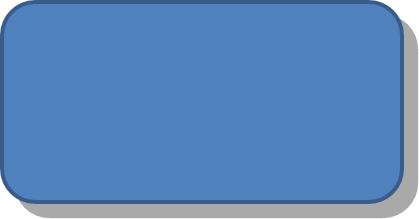

## **Úvod**

Zatímco efekty v PowerPointu lze použít k zvýraznění tvaru, liší se od [vyplnění](/slides/cs/java/shape-formatting/#gradient-fill) či obrysů. Pomocí efektů PowerPointu můžete vytvořit přesvědčivé odrazy na tvaru, rozšířit záři tvaru atd.


PowerPoint poskytuje šest efektů, které lze použít na tvary. Na tvar můžete použít jeden nebo více efektů.

Některé kombinace efektů vypadají lépe než jiné. Z tohoto důvodu PowerPoint nabízí možnosti pod **Preset**. Možnosti Preset jsou kombinace dvou a více efektů, o nichž se ví, že vypadají dobře. Tímto způsobem, výběrem předvolby, nebudete muset ztrácet čas testováním nebo kombinováním různých efektů, abyste našli vhodnou kombinaci.

Aspose.Slides poskytuje vlastnosti a metody ve třídě [EffectFormat](https://reference.aspose.com/slides/java/com.aspose.slides/effectformat/), které umožňují použít stejné efekty na tvary v PowerPoint prezentacích.

## **Použít efekt stínu**

Aspose.Slides for Java podporuje vnější a vnitřní stíny pro tvary. Můžete upravit jejich barvu, směr, vzdálenost a poloměr rozostření tak, aby odpovídaly návrhu vaší prezentace.

### **Použít vnější stín**

Použijte vnější stín, aby karta nebo panel vynikl na pozadí snímku. Stín přesahuje okraje tvaru a vytváří dojem, že tvar je nad snímkem. Přizpůsobte jeho barvu, směr, vzdálenost a poloměr rozostření tak, aby odpovídaly osvětlení a stylu vaší šablony.

Tento Java kód ukazuje, jak použít [efekt vnějšího stínu](https://reference.aspose.com/slides/java/com.aspose.slides/effectformat/#getOuterShadowEffect--) na obdélník:

```java
import com.aspose.slides.*;
import java.awt.Color;

Presentation presentation = new Presentation();
try {
    ISlide slide = presentation.getSlides().get_Item(0);

    IShape shape = slide.getShapes().addAutoShape(ShapeType.RoundCornerRectangle, 20, 20, 200, 100);
    shape.getEffectFormat().enableOuterShadowEffect();
    shape.getEffectFormat().getOuterShadowEffect().getShadowColor().setColor(new Color(169, 169, 169));
    shape.getEffectFormat().getOuterShadowEffect().setDistance(10);
    shape.getEffectFormat().getOuterShadowEffect().setDirection(45);

    presentation.save("shadow_effect.pptx", SaveFormat.Pptx);
} finally {
    presentation.dispose();
}
```



#### **Řízení směru stínu při otáčení tvaru**

Ve výchozím nastavení se vnější stín otáčí spolu s tvarem. Aby se tvary s různými otáčkami jevit jako osvětlené ze stejného směru, zavolejte [setRotateShadowWithShape](https://reference.aspose.com/slides/java/com.aspose.slides/ioutershadow/#setRotateShadowWithShape-boolean-) s hodnotou `false` a použijte [setDirection](https://reference.aspose.com/slides/java/com.aspose.slides/ioutershadow/#setDirection-float-) k nastavení stejného směru jejich stínů.

Příklad vytvoří dvě modré šipky s šedými stíny posunutými o 42 bodů doprava (0°). Poté duplikuje snímek a otočí obě šipky o 90° ve směru hodinových ručiček.

```java
import com.aspose.slides.*;
import java.awt.Color;

Presentation presentation = new Presentation();
try {
    ISlide before = presentation.getSlides().get_Item(0);

    IAutoShape left = before.getShapes().addAutoShape(ShapeType.RightArrow, 55, 130, 110, 60);
    left.getFillFormat().setFillType(FillType.Solid);
    left.getFillFormat().getSolidFillColor().setColor(new Color(70, 130, 180));
    left.getLineFormat().getFillFormat().setFillType(FillType.NoFill);

    left.getEffectFormat().enableOuterShadowEffect();
    IOuterShadow shadow = left.getEffectFormat().getOuterShadowEffect();
    shadow.getShadowColor().setColor(Color.GRAY);
    shadow.setDirection(0);
    shadow.setDistance(42);
    shadow.setBlurRadius(0);
    shadow.setRotateShadowWithShape(true);

    IShape right = before.getShapes().addClone(left);
    right.setX(395);
    right.getEffectFormat().getOuterShadowEffect().setRotateShadowWithShape(false);

    ISlide after = presentation.getSlides().addClone(before);
    for (IShape arrow : after.getShapes()) {
        arrow.setRotation(90);
    }

    presentation.save("arrow_shadows.pptx", SaveFormat.Pptx);
} finally {
    presentation.dispose();
}
```

Na druhém snímku vrhá levá šipka svůj stín dolů, zatímco pravá šipka stále vrhá stín doprava. Nastavený směr zůstává 0° pro oba stíny.


### **Použít vnitřní stín**

Při reprodukci vizuálního stylu šablony použijte vnitřní stín, aby karta nebo panel měly zapuštěný vzhled. Vnější stín se rozprostírá mimo tvar a působí, že je vyvýšený, zatímco vnitřní stín zahalí vnitřek jeho okrajů.

Zavolejte [enableInnerShadowEffect](https://reference.aspose.com/slides/java/com.aspose.slides/effectformat/#enableInnerShadowEffect--), poté nakonfigurujte stín vrácený metodou [getInnerShadowEffect](https://reference.aspose.com/slides/java/com.aspose.slides/effectformat/#getInnerShadowEffect--). Větší hodnoty poloměru rozostření vytvářejí měkčí hrany.

Tento Java příklad vytvoří světle modrou kartu s tmavě šedým vnitřním stínem a uloží ji jako soubor PPTX. Směr stínu je 225 stupňů, jeho vzdálenost je 7 bodů a poloměr rozostření je 6 bodů:

```java
import com.aspose.slides.*;
import java.awt.Color;

Presentation presentation = new Presentation();
try {
    ISlide slide = presentation.getSlides().get_Item(0);

    IAutoShape shape = slide.getShapes().addAutoShape(ShapeType.Rectangle, 20, 20, 200, 100);
    shape.getFillFormat().setFillType(FillType.Solid);
    shape.getFillFormat().getSolidFillColor().setColor(new Color(173, 216, 230));
    shape.getLineFormat().getFillFormat().setFillType(FillType.NoFill);

    shape.getEffectFormat().enableInnerShadowEffect();
    IInnerShadow shadow = shape.getEffectFormat().getInnerShadowEffect();
    shadow.getShadowColor().setColor(new Color(105, 105, 105));
    shadow.setDirection(225);
    shadow.setDistance(7);
    shadow.setBlurRadius(6);

    presentation.save("inner_shadow_effect.pptx", SaveFormat.Pptx);
} finally {
    presentation.dispose();
}
```


Pro odstranění vnitřního stínu zavolejte [disableInnerShadowEffect](https://reference.aspose.com/slides/java/com.aspose.slides/effectformat/#disableInnerShadowEffect--) na formát efektu tvaru.

### **Použít, změnit a odstranit předvolený stín**

Zavolejte [enablePresetShadowEffect](https://reference.aspose.com/slides/java/com.aspose.slides/ieffectformat/#enablePresetShadowEffect--) a použijte [setPreset](https://reference.aspose.com/slides/java/com.aspose.slides/ipresetshadow/#setPreset-int-) , abyste vybrali [PresetShadowType](https://reference.aspose.com/slides/java/com.aspose.slides/presetshadowtype/). Pro změnu stylu změňte předvolbu na stejném tvaru. Zavolejte [disablePresetShadowEffect](https://reference.aspose.com/slides/java/com.aspose.slides/ieffectformat/#disablePresetShadowEffect--) , aby se stín odstranil při zachování výplně a obrysu.

Tento příklad zobrazuje čtyři fáze vedle sebe na jednom snímku. Oba stíny jsou posunuty o 10 bodů. Směr 225° umístí první stín nad a vlevo od obdélníku a 45° umístí druhý pod a vpravo.

```java
import com.aspose.slides.*;
import java.awt.Color;

Presentation presentation = new Presentation();
try {
    presentation.getSlideSize().setSize(800, 120, SlideSizeScaleType.DoNotScale);
    IShapeCollection shapes = presentation.getSlides().get_Item(0).getShapes();

    IAutoShape shape = shapes.addAutoShape(ShapeType.Rectangle, 15, 30, 170, 60);
    shape.getFillFormat().setFillType(FillType.Solid);
    shape.getFillFormat().getSolidFillColor().setColor(new Color(70, 130, 180));
    shape.getLineFormat().getFillFormat().setFillType(FillType.Solid);
    shape.getLineFormat().getFillFormat().getSolidFillColor().setColor(new Color(0, 0, 139));
    shape.getTextFrame().setText("No shadow");
    shape.getTextFrame().getParagraphs().get_Item(0).getParagraphFormat().getDefaultPortionFormat().setFontHeight(14);
    shapes.addClone(shape);

    shape.setX(shape.getX() + 200);
    shape.getEffectFormat().enablePresetShadowEffect();
    IPresetShadow shadow = shape.getEffectFormat().getPresetShadowEffect();
    shadow.setPreset(PresetShadowType.TopLeftDropShadow);
    shadow.setDistance(10);
    shadow.setDirection(225);
    shape.getTextFrame().setText("TopLeftDropShadow");
    shapes.addClone(shape);

    shape.setX(shape.getX() + 200);
    shadow.setPreset(PresetShadowType.BottomRightDropShadow);
    shadow.setDirection(45);
    shape.getTextFrame().setText("BottomRightDropShadow");
    shapes.addClone(shape);

    shape.setX(shape.getX() + 200);
    shape.getEffectFormat().disablePresetShadowEffect();
    shape.getTextFrame().setText("No shadow");

    presentation.save("preset_shadows.pptx", SaveFormat.Pptx);
} finally {
    presentation.dispose();
}
```

| Původní | První předvolba | Druhá předvolba | Po odstranění |
| :---: | :---: | :---: | :---: |
|  |  |  |  |

## **Použít efekt odrazu**

Pro použití efektu odrazu v Aspose.Slides for Java můžete přidat zrcadlový odraz k tvarům, upravit parametry jako vzdálenost, průhlednost a velikost. Tento efekt zvyšuje estetiku vašich prezentací tím, že tvarům dodá uhlazenější a sofistikovanější vzhled. Je snadno implementovatelný pomocí jednoduchého kódu, což umožňuje rychlé uplatnění na více prvků pro jednotný design.

Tento Java kód ukazuje, jak použít [efekt odrazu](https://reference.aspose.com/slides/java/com.aspose.slides/effectformat/#getReflectionEffect--) na tvar:

```java
import com.aspose.slides.*;

Presentation presentation = new Presentation();
try {
    ISlide slide = presentation.getSlides().get_Item(0);

    IShape shape = slide.getShapes().addAutoShape(ShapeType.RoundCornerRectangle, 20, 20, 200, 100);
    shape.getEffectFormat().enableReflectionEffect();
    shape.getEffectFormat().getReflectionEffect().setRectangleAlign(RectangleAlignment.Bottom);
    shape.getEffectFormat().getReflectionEffect().setDirection(90);
    shape.getEffectFormat().getReflectionEffect().setDistance(40);
    shape.getEffectFormat().getReflectionEffect().setBlurRadius(2);

    presentation.save("reflection_effect.pptx", SaveFormat.Pptx);
} finally {
    presentation.dispose();
}
```


## **Použít efekt záře**

Pro použití efektu záře na tvar v Aspose.Slides for Java můžete přidat měkkou, zářivou auru kolem tvarů, upravit vlastnosti jako barvu a velikost. Tento efekt pomáhá tvary zvýraznit a přidává atraktivní, upoutávající vizuální prvek do vaší prezentace. Je snadno implementovatelný s minimálním kódem, čímž se zlepšuje celkový vzhled vašich snímků.

Tento Java kód ukazuje, jak použít [efekt záře](https://reference.aspose.com/slides/java/com.aspose.slides/effectformat/#getGlowEffect--) na tvar:

```java
import com.aspose.slides.*;
import java.awt.Color;

Presentation presentation = new Presentation();
try {
    ISlide slide = presentation.getSlides().get_Item(0);

    IShape shape = slide.getShapes().addAutoShape(ShapeType.RoundCornerRectangle, 20, 20, 200, 100);
    shape.getEffectFormat().enableGlowEffect();
    shape.getEffectFormat().getGlowEffect().getColor().setColor(Color.MAGENTA);
    shape.getEffectFormat().getGlowEffect().setRadius(15);

    presentation.save("glow_effect.pptx", SaveFormat.Pptx);
} finally {
    presentation.dispose();
}
```


## **Použít efekt měkkých hran**

Pro použití efektu měkkých hran v Aspose.Slides for Java můžete vytvořit hladký, rozmazaný přechod kolem okrajů tvaru. Tento efekt přidává jemnější a vyladěnější vzhled, ideální pro návrhy, které vyžadují jemný, měkčí vzhled. Můžete snadno upravit parametry jako poloměr, abyste dosáhli požadovaného efektu na různých tvarech ve své prezentaci.

Tento Java kód ukazuje, jak použít [efekt měkkých hran](https://reference.aspose.com/slides/java/com.aspose.slides/effectformat/#getSoftEdgeEffect--) na tvar:

```java
import com.aspose.slides.*;

Presentation presentation = new Presentation();
try {
    ISlide slide = presentation.getSlides().get_Item(0);

    IShape shape = slide.getShapes().addAutoShape(ShapeType.RoundCornerRectangle, 20, 20, 200, 150);
    shape.getEffectFormat().enableSoftEdgeEffect();
    shape.getEffectFormat().getSoftEdgeEffect().setRadius(8);

    presentation.save("soft_edges_effect.pptx", SaveFormat.Pptx);
} finally {
    presentation.dispose();
}
```


## **Použít efekt rozostření**

Použijte rozostření tvaru k změkčení výplně a obrysu tvaru při zachování možnosti úpravy tvaru. Zavolejte [setBlurEffect](https://reference.aspose.com/slides/java/com.aspose.slides/ieffectformat/#setBlurEffect-double-boolean-) na formát efektu tvaru. Poloměr se měří v bodech (1/72 palce): použijte nezápornou hodnotu, přičemž větší hodnoty vytvářejí silnější rozostření. Poloměr nula ponechá vzhled nezměněný.

Nastavení [getGrow](https://reference.aspose.com/slides/java/com.aspose.slides/iblur/#getGrow--) řídí viditelné hranice efektu. S `false` je rozostření oříznuto na původní vykreslené hranice, včetně obrysu. S `true` může rozostření přesáhnout tyto hranice. Žádné z nastavení nemění pozici ani rozměry tvaru.

Níže uvedené srovnání používá po celou dobu stejnou výplň, obrys a rozměry tvaru. Horní řada používá `grow = false`; dolní řada používá `grow = true`.


Tento Java příklad vytvoří oranžový obdélník s tmavě modrým obrysem, použije rozostření 5 bodů a poté jej aktualizuje na rozostření 15 bodů voláním [setBlurEffect](https://reference.aspose.com/slides/java/com.aspose.slides/ieffectformat/#setBlurEffect-double-boolean-) znovu. Uloží oba rozostřené stavy, poté zavolá [disableBlurEffect](https://reference.aspose.com/slides/java/com.aspose.slides/ieffectformat/#disableBlurEffect--) a uloží tvar bez rozostření.

```java
import com.aspose.slides.*;
import java.awt.Color;

Presentation presentation = new Presentation();
try {
    ISlide slide = presentation.getSlides().get_Item(0);

    IAutoShape shape = slide.getShapes().addAutoShape(ShapeType.Rectangle, 100, 80, 160, 100);
    shape.getFillFormat().setFillType(FillType.Solid);
    shape.getFillFormat().getSolidFillColor().setColor(new Color(255, 165, 0));
    shape.getLineFormat().getFillFormat().setFillType(FillType.Solid);
    shape.getLineFormat().getFillFormat().getSolidFillColor().setColor(new Color(0, 0, 139));
    shape.getLineFormat().setWidth(8);

    shape.getEffectFormat().setBlurEffect(5, false);
    presentation.save("shape_blur_5.pptx", SaveFormat.Pptx);

    shape.getEffectFormat().setBlurEffect(15, true);
    presentation.save("shape_blur_15.pptx", SaveFormat.Pptx);

    shape.getEffectFormat().disableBlurEffect();
    presentation.save("shape_blur_removed.pptx", SaveFormat.Pptx);
} finally {
    presentation.dispose();
}
```

Rozostření tvaru ovlivňuje výplň i obrys najednou. Efekt měkkých hran zeslabuje hrany tvaru, zatímco rozostření stínu změkčuje jen stín. Efekty transformace obrázku pracují s obsahem obrázku; tento příklad aplikuje rozostření přímo na formát efektu tvaru, aniž by tvar převáděl na obrázek.

## **Často kladené otázky**

**Mohu použít více efektů na stejný tvar?**

Ano, můžete kombinovat různé efekty, jako stín, odraz a záři, na jediném tvaru a vytvořit tak dynamický vzhled.

**Na jaké tvary mohu aplikovat efekty?**

Efekty můžete aplikovat na různé tvary, včetně automatických tvarů, grafů, tabulek, obrázků, objektů SmartArt, OLE objektů a dalších.

**Mohu aplikovat efekty na seskupené tvary?**

Ano, můžete aplikovat efekty na seskupené tvary. Efekt se použije na celou skupinu.