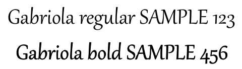

## **Přehled**

Převod prezentací PowerPoint (PPT, PPTX, ODP atd.) do formátu PDF v C# přináší několik výhod, včetně kompatibility napříč různými zařízeními a zachování rozvržení a formátování vaší prezentace. Tento průvodce ukazuje, jak převést prezentace do PDF dokumentů, používat různé možnosti pro kontrolu kvality obrázků, zahrnout skryté snímky, chránit PDF soubory heslem, zjistit nahrazení fontů, vybrat konkrétní snímky pro převod a aplikovat standardy souladu na výstupní dokumenty.

## **Konverze PowerPoint do PDF**

Pomocí Aspose.Slides můžete převést prezentace v následujících formátech do PDF:

* **PPT**
* **PPTX**
* **ODP**

Pro převod prezentace do PDF předáte název souboru jako argument třídě [Presentation](https://reference.aspose.com/slides/net/aspose.slides/presentation/) a poté prezentaci uložíte jako PDF pomocí metody [Save](https://reference.aspose.com/slides/net/aspose.slides/presentation/save/). Třída [Presentation](https://reference.aspose.com/slides/net/aspose.slides/presentation/) zveřejňuje metodu [Save](https://reference.aspose.com/slides/net/aspose.slides/presentation/save/), která se obvykle používá k převodu prezentace do PDF.

{}
Aspose.Slides pro .NET vkládá informace o svém API a číslo verze do výstupních dokumentů. Například při převodu prezentace do PDF Aspose.Slides vyplní pole Application hodnotou "*Aspose.Slides*" a pole PDF Producer hodnotou ve formátu "*Aspose.Slides v XX.XX*". **Poznámka** že nemůžete Aspose.Slides instruovat, aby tuto informaci ve výstupních dokumentech změnil nebo odstranil.
{}

Aspose.Slides umožňuje převést:

* Celé prezentace do PDF
* Vybrané snímky z prezentace do PDF

Aspose.Slides exportuje prezentace do PDF a zajišťuje, že výsledná PDF úzce odpovídají původním prezentacím. Elementy a atributy jsou během konverze vykresleny přesně, včetně:

* Obrázky
* Textové rámečky a tvary
* Formátování textu
* Formátování odstavců
* Hyperlinky
* Záhlaví a zápatí
* Odrážky
* Tabulky

## **Převod PowerPoint do PDF**

Standardní proces převodu PowerPoint do PDF používá výchozí možnosti. V tomto případě se Aspose.Slides pokouší převést poskytnutou prezentaci do PDF s optimálním nastavením a maximální úrovní kvality.

Následující příklad načte prezentaci a uloží všechny viditelné snímky do PDF pomocí výchozího nastavení exportu.

```csharp
using Aspose.Slides;
using Aspose.Slides.Export;

using var presentation = new Presentation("PowerPoint.ppt");
presentation.Save("PDF-result.pdf", SaveFormat.Pdf);
```

{}
Aspose nabízí bezplatný online [**konvertor PowerPoint do PDF**](https://products.aspose.app/slides/conversion/ppt-to-pdf), který demonstruje proces převodu prezentace do PDF. Můžete spustit test s tímto konvertorem pro živou ukázku postupu popsaného zde.
{}

## **Převod PowerPoint do PDF s možnostmi**

Aspose.Slides poskytuje vlastní možnosti — vlastnosti ve třídě [PdfOptions](https://reference.aspose.com/slides/net/aspose.slides.export/pdfoptions/) které vám umožňují přizpůsobit výsledné PDF, uzamknout PDF heslem nebo určit, jak má proces konverze probíhat.

### **Převod PowerPoint do PDF s vlastními možnostmi**

Pomocí vlastních možností konverze můžete definovat preferované nastavení kvality rastrových obrázků, určit, jak mají být zacházeno s metafily, nastavit úroveň komprese pro text, konfigurovat DPI pro obrázky a další.

Následující příklad exportuje prezentaci do PDF 1.5 s kvalitou JPEG nastavenou na 90, rozlišením obrázku nastaveným na 300 DPI, metafily uloženými jako PNG a kompresí textu Flate.

```csharp
using Aspose.Slides;
using Aspose.Slides.Export;

var pdfOptions = new PdfOptions
{
    JpegQuality = 90,
    SufficientResolution = 300,
    SaveMetafilesAsPng = true,
    TextCompression = PdfTextCompression.Flate,
    Compliance = PdfCompliance.Pdf15
};

using var presentation = new Presentation("PowerPoint.pptx");
presentation.Save("PowerPoint-to-PDF.pdf", SaveFormat.Pdf, pdfOptions);
```

> **Poznámka:** Můžete zlepšit kvalitu vykreslování textových stínů a efektů odrazu při převodu do PDF nastavením `PdfOptions.SufficientResolution` na vyšší hodnotu (např. `300`). To vytvoří výstup PDF, který lépe odpovídá vzhledu v Microsoft PowerPoint.

### **Automatický výběr komprese obrázků**

Když prezentace obsahuje mnoho fotografií nebo snímků obrazovky, zmenšení velikosti exportovaného PDF může usnadnit jeho odeslání e-mailem nebo stažení. Nastavte [PdfOptions.BestImagesCompressionRatio](https://reference.aspose.com/slides/net/aspose.slides.export/pdfoptions/bestimagescompressionratio/) na `true`, aby se během exportu PDF automaticky vybral nejvhodnější kompresní algoritmus pro každý obrázek.

Následující příklad načte existující prezentaci, povolí automatický výběr komprese obrázků a uloží ji jako PDF dokument. Všechny ostatní nastavení exportu PDF si ponechají výchozí hodnoty.

```csharp
using Aspose.Slides;
using Aspose.Slides.Export;

var pdfOptions = new PdfOptions { BestImagesCompressionRatio = true };

using var presentation = new Presentation("image-heavy.pptx");
presentation.Save("image-heavy.pdf", SaveFormat.Pdf, pdfOptions);
```

Tato volba vybírá kompresní algoritmus pro každý obrázek. Snížením [JpegQuality](https://reference.aspose.com/slides/net/aspose.slides.export/pdfoptions/jpegquality/) se snižuje kvalita JPEG obrázků, zatímco snížením [SufficientResolution](https://reference.aspose.com/slides/net/aspose.slides.export/pdfoptions/sufficientresolution/) se umožní downsampling obrázků na nižší rozlišení, což může snížit detail. Povolení automatického výběru komprese samo o sobě nesnižuje žádné z těchto nastavení.

Výběr kompresních algoritmů pro obrázky vyžaduje další čas zpracování a paměť. Snížení velikosti závisí na obrázcích v prezentaci a nastaveních exportu; pevné snížení není u každé prezentace garantováno.

### **Zachovat vložené OLE soubory jako PDF přílohy**

Pokud prezentace obsahuje vložený sešit Excelu, můžete chtít, aby příjemci PDF měli přístup k datům sešitu i k zobrazení snímků. Nastavte [PdfOptions.IncludeOleData](https://reference.aspose.com/slides/net/aspose.slides.export/pdfoptions/includeoledata/) na `true`, aby se vložené OLE soubory zachovaly jako přílohy v výsledném PDF.

Výchozí hodnota je `false`: náhledový obrázek nebo ikona OLE objektu je vykreslena na stránce PDF, ale jeho vložený soubor není zahrnut jako příloha. Nastavením volby na `true` se doplní i data souboru. Náhled zůstává vizuální reprezentací; příloha umožňuje příjemcům otevřít nebo uložit vložený soubor samostatně. OLE objekt se na stránce PDF nestane interaktivním listem Excelu.

Následující příklad načte prezentaci, která již obsahuje vložený sešit Excelu, a exportuje ji do PDF s připojeným sešitem.

```csharp
using Aspose.Slides;
using Aspose.Slides.Export;

var pdfOptions = new PdfOptions { IncludeOleData = true };

using var presentation = new Presentation("presentation.pptx");
presentation.Save("presentation.pdf", SaveFormat.Pdf, pdfOptions);
```

Pro kontrolu výsledku:

1. Otevřete exportované PDF v prohlížeči, který podporuje souborové přílohy, např. Adobe Acrobat Reader.
2. Otevřete panel **Attachments** (Přílohy) prohlížeče a najděte vložený sešit.
3. Uložte přílohu a otevřete ji v Excelu pro kontrolu dat, nebo ji otevřete přímo, pokud to prohlížeč umožňuje. Náhled na stránce PDF je oddělený od přílohy.

{}
Standardy PDF/A ukládají omezení na přílohy: PDF/A-1 zakazuje vložené soubory, PDF/A-2 povoluje jen PDF/A přílohy a PDF/A-3 povoluje jiné typy souborů, včetně sešitů Excelu. Jedná se o požadavky standardů, nikoli o omezení specifická pro Aspose.Slides. Tento příklad používá výchozí nastavení souladu PDF a neukazuje export PDF/A.
{}

### **Převod PowerPoint do PDF s skrytými snímky**

Pokud prezentace obsahuje skryté snímky, můžete použít vlastnost [ShowHiddenSlides](https://reference.aspose.com/slides/net/aspose.slides.export/pdfoptions/showhiddenslides/) ze třídy [PdfOptions](https://reference.aspose.com/slides/net/aspose.slides.export/pdfoptions/), aby se skryté snímky zahrnuly jako stránky ve výsledném PDF.

Následující příklad exportuje prezentaci do PDF a zahrnuje všechny skryté snímky.

```csharp
using Aspose.Slides;
using Aspose.Slides.Export;

var pdfOptions = new PdfOptions();
pdfOptions.ShowHiddenSlides = true;

using var presentation = new Presentation("PowerPoint.pptx");
presentation.Save("PowerPoint-to-PDF.pdf", SaveFormat.Pdf, pdfOptions);
```

### **Převod PowerPoint do heslem chráněného PDF**

Následující příklad exportuje prezentaci do PDF, který vyžaduje heslo `password` pro otevření. Přístupová oprávnění umožňují tisk, včetně tisku ve vysoké kvalitě.

```csharp
using Aspose.Slides;
using Aspose.Slides.Export;

var pdfOptions = new PdfOptions();
pdfOptions.Password = "password";
pdfOptions.AccessPermissions = PdfAccessPermissions.PrintDocument | PdfAccessPermissions.HighQualityPrint;

using var presentation = new Presentation("PowerPoint.pptx");
presentation.Save("PPTX-to-PDF.pdf", SaveFormat.Pdf, pdfOptions);
```

### **Detekce nahrazení fontů**

Aspose.Slides poskytuje vlastnost [WarningCallback](https://reference.aspose.com/slides/net/aspose.slides.export/saveoptions/warningcallback/) pod třídou [PdfOptions](https://reference.aspose.com/slides/net/aspose.slides.export/pdfoptions/), která vám umožní zjistit nahrazení fontů během procesu převodu prezentace do PDF.

Následující příklad exportuje prezentaci do PDF a vypíše upozornění na nahrazení fontů do konzole. Upozornění se vypíše pouze tehdy, když během exportu dojde k nahrazení nedostupného fontu.

```csharp
using Aspose.Slides;
using Aspose.Slides.Export;
using Aspose.Slides.Warnings;
using System;

var pdfOptions = new PdfOptions();
pdfOptions.WarningCallback = new FontSubstitutionHandler();

using var presentation = new Presentation("sample.pptx");
presentation.Save("output.pdf", SaveFormat.Pdf, pdfOptions);

class FontSubstitutionHandler : IWarningCallback
{
    public ReturnAction Warning(IWarningInfo warning)
    {
        if (warning.WarningType == WarningType.DataLoss && warning.Description.StartsWith("Font will be substituted"))
        {
            Console.WriteLine($"Font substitution warning: {warning.Description}");
        }

        return ReturnAction.Continue;
    }
}
```

{}
Pro více informací o nahrazování fontů si přečtěte článek [Font Substitution](/slides/cs/net/font-substitution/).
{}

### **Zpracování fontů bez samostatného tučného řezu**

Prezentace může použít tučné formátování textu i když její font nemá samostatný tučný řez. Text se může i tak zobrazit tučně pomocí syntetického ztučnění, které uměle zhušťuje běžné glify. Když takový text vypadá příliš těžce nebo jinak neodpovídá zamýšlenému vzhledu v PDF, zkuste nastavit [PdfOptions.RasterizeUnsupportedFontStyles](https://reference.aspose.com/slides/net/aspose.slides.export/pdfoptions/rasterizeunsupportedfontstyles/) na `true`. Tato volba během exportu PDF vykreslí dotčený text jako bitmapu a může zlepšit jeho vzhled pro určité fonty. Jeho výchozí hodnota je `false`.

Ukázková prezentace obsahuje dva textové rámečky: jeden s normálním textem a druhý s tučným formátováním aplikovaným na stejný font, který nemá samostatný tučný řez. Následující příklad načte prezentaci, povolí rastrování nepodporovaných stylů fontu a exportuje ji do PDF:

```csharp
using Aspose.Slides;
using Aspose.Slides.Export;

var pdfOptions = new PdfOptions
{
    RasterizeUnsupportedFontStyles = true
};

using var presentation = new Presentation("unsupported-bold.pptx");
presentation.Save("rasterized.pdf", SaveFormat.Pdf, pdfOptions);
```

Následující náhledy ukazují výstup s vypnutou a zapnutou volbou. V tomto příkladu má tučný text těžší tahy při vypnuté volbě. Se zapnutou volbou jsou tahy lehčí; normální text zůstává beze změny. Porovnejte výsledky před výběrem nastavení pro vaši prezentaci.

| Volba vypnutá (`false`, výchozí) | Volba zapnutá (`true`) |
|---|---|
|  |  |

V tomto příkladu zapnutí volby převádí pouze tučný text na bitmapu: nelze jej vybrat, kopírovat ani vyhledávat jako text bez OCR a jeho hrany vypadají měkčeji při 800 % přiblížení. Normální text zůstává vyhledávatelný. při vypnuté volbě zůstávají oba řetězce jako text.

Tato volba rasterizuje text formátovaný jako tučný, když jeho font nemá samostatný tučný řez. [Font substitution](/slides/cs/net/font-substitution/) místo toho vybere jiný font, když originál není k dispozici.

## **Převod vybraných snímků z PowerPoint do PDF**

Následující příklad exportuje snímky 1 a 3 z prezentace do PDF. Čísla snímků v tomto poli jsou číslována od jedné a vstupní prezentace musí obsahovat alespoň tři snímky.

```csharp
using Aspose.Slides;
using Aspose.Slides.Export;

using var presentation = new Presentation("PowerPoint.pptx");
var slides = new[] { 1, 3 };
presentation.Save("PPTX-to-PDF.pdf", slides, SaveFormat.Pdf);
```

## **Převod PowerPoint do PDF s vlastní velikostí snímku**

Následující příklad zkopíruje první snímek z prezentace do nové prezentace s velikostí snímku 612 × 792 bodů (8,5 × 11 palců). Přizpůsobí obsah snímku tak, aby se vešel, a exportuje jediný snímek do PDF.

```csharp
using Aspose.Slides;
using Aspose.Slides.Export;

var slideWidth = 612;
var slideHeight = 792;

using var presentation = new Presentation("SelectedSlides.pptx");
using var resizedPresentation = new Presentation();

resizedPresentation.SlideSize.SetSize(slideWidth, slideHeight, SlideSizeScaleType.EnsureFit);
var slide = presentation.Slides[0];
resizedPresentation.Slides.InsertClone(0, slide);

// Remove the blank slide that the new presentation was created with.
resizedPresentation.Slides.RemoveAt(1);
resizedPresentation.Save("PDF_with_custom_slide_size.pdf", SaveFormat.Pdf);
```

## **Převod PowerPoint do PDF v zobrazení poznámek ke snímkům**

Následující příklad exportuje prezentaci do PDF, přičemž poznámky přednášejícího každého snímku jsou umístěny pod snímkem. Použijte prezentaci obsahující poznámky, abyste viděli výsledek.

```csharp
using Aspose.Slides;
using Aspose.Slides.Export;

var pdfOptions = new PdfOptions
{
    SlidesLayoutOptions = new NotesCommentsLayoutingOptions
    {
        NotesPosition = NotesPositions.BottomFull
    }
};

using var presentation = new Presentation("NotesFile.pptx");
presentation.Save("PDF_with_notes.pdf", SaveFormat.Pdf, pdfOptions);
```

## **Standardy přístupnosti a souladu pro PDF**

Aspose.Slides vám umožňuje použít postup převodu, který splňuje [Web Content Accessibility Guidelines (**WCAG**)](https://www.w3.org/TR/WCAG-TECHS/pdf.html). Můžete exportovat dokument PowerPoint do PDF s použitím některého z těchto standardů souladu: **PDF/A1a**, **PDF/A1b** a **PDF/UA**.

Tento C# kód ukazuje proces převodu PowerPoint do PDF, který vytváří více PDF na základě různých standardů souladu:

```csharp
using Aspose.Slides;
using Aspose.Slides.Export;

using var presentation = new Presentation("pres.pptx");

presentation.Save("pres-a1a-compliance.pdf", SaveFormat.Pdf, new PdfOptions
{
    Compliance = PdfCompliance.PdfA1a
});

presentation.Save("pres-a1b-compliance.pdf", SaveFormat.Pdf, new PdfOptions
{
    Compliance = PdfCompliance.PdfA1b
});

presentation.Save("pres-ua-compliance.pdf", SaveFormat.Pdf, new PdfOptions
{
    Compliance = PdfCompliance.PdfUa
});
```

{}
Aspose.Slides podporuje operace převodu PDF, které vám umožňují převádět PDF soubory do populárních formátů. Můžete provést konverze [PDF to HTML](https://products.aspose.com/slides/net/conversion/pdf-to-html/), [PDF to image](https://products.aspose.com/slides/net/conversion/pdf-to-image/), [PDF to JPG](https://products.aspose.com/slides/net/conversion/pdf-to-jpg/), a [PDF to PNG](https://products.aspose.com/slides/net/conversion/pdf-to-png/). Další konverze PDF do specializovaných formátů — [PDF to SVG](https://products.aspose.com/slides/net/conversion/pdf-to-svg/), [PDF to TIFF](https://products.aspose.com/slides/net/conversion/pdf-to-tiff/), a [PDF to XML](https://products.aspose.com/slides/net/conversion/pdf-to-xml/) — jsou také podporovány.
{}

> **Poznámka:** Při exportu do PDF/UA Aspose.Slides zachází s komplexní grafikou, jako je SmartArt, grafy a vzorce, jako s jednou figürou. Jednotlivé elementy cesty nejsou zachovány jako samostatný obsah a mohou být označeny jako artefakty; alternativní text je poskytován pouze pro celou figuru.

## **FAQ**

**Mohu převádět více souborů PowerPoint do PDF najednou?**

Ano, Aspose.Slides podporuje dávkový převod více souborů PPT nebo PPTX do PDF. Můžete iterovat přes své soubory a aplikovat proces převodu programově.

**Je možné zabezpečit převod PDF heslem?**

Ano. Použijte třídu [PdfOptions](https://reference.aspose.com/slides/net/aspose.slides.export/pdfoptions/) k nastavení hesla a definování přístupových oprávnění během procesu převodu.

**Jak zahrnout skryté snímky do PDF?**

Nastavte vlastnost [ShowHiddenSlides](https://reference.aspose.com/slides/net/aspose.slides.export/pdfoptions/showhiddenslides/) ve třídě [PdfOptions](https://reference.aspose.com/slides/net/aspose.slides.export/pdfoptions/) na `true`, aby se skryté snímky zahrnuly do výsledného PDF.

**Může Aspose.Slides zachovat vysokou kvalitu obrázků v PDF?**

Ano, můžete kontrolovat kvalitu obrázků nastavením vlastností jako [JpegQuality](https://reference.aspose.com/slides/net/aspose.slides.export/pdfoptions/jpegquality/) a [SufficientResolution](https://reference.aspose.com/slides/net/aspose.slides.export/pdfoptions/sufficientresolution/) v třídě [PdfOptions](https://reference.aspose.com/slides/net/aspose.slides.export/pdfoptions/), aby byly ve vašem PDF zachovány obrázky ve vysoké kvalitě.

**Podporuje Aspose.Slides standardy souladu PDF/A?**

Ano, Aspose.Slides vám umožňuje exportovat PDF, která splňují různé standardy, včetně PDF/A1a, PDF/A1b a PDF/UA, čímž zajistíte, že vaše dokumenty splňují požadavky na přístupnost a archivaci.

## **Další zdroje**

- [Dokumentace Aspose.Slides pro .NET](/slides/cs/net/)
- [Reference API Aspose.Slides pro .NET](https://reference.aspose.com/slides/net/)
- [Bezplatné online konvertory Aspose](https://products.aspose.app/slides/conversion)

Related feature: [Exportovat prezentace do PDF](/slides/cs/features/pdf-export/).