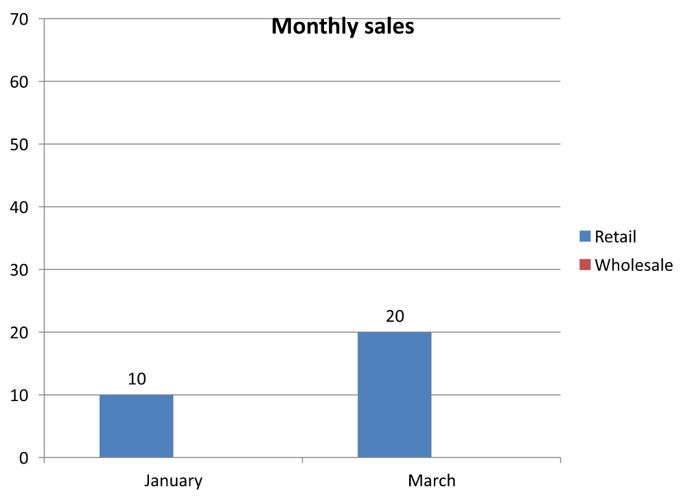

## **Přehled**

Tento článek vysvětluje, jak pracovat s sešity grafů v Aspose.Slides. Ukazuje, jak číst a zapisovat data grafu prostřednictvím proudů sešitu, používat buňky sešitu jako popisky dat grafu, přistupovat ke kolekcím listů a určit typ zdroje dat pro hodnoty grafu.

Také se zabývá používáním externích sešitů jako zdrojů dat pro grafy. Příklady ukazují, jak vytvořit a přiřadit externí sešit, získat cestu k externímu sešitu propojenému s grafem a upravit data grafu, když je sešit k dispozici.

Pro buňky sešitu, které představují chybějící data, viz [Ovládání zobrazení prázdných buněk](/slides/cs/net/chart-series/) pro rozdíl mezi prázdnou buňkou a nulou a porovnání čárových grafů dostupných režimů zobrazení.

## **Zahrnout data ze skrytých řádků a sloupců**

Použijte [IChart.PlotVisibleCellsOnly](https://reference.aspose.com/slides/net/aspose.slides.charts/ichart/plotvisiblecellsonly/) ke kontrole, zda graf vykresluje data ze skrytých řádků a sloupců listu. Nastavte jej na `true`, aby se vykreslovaly pouze viditelné buňky, nebo na `false`, aby se zahrnuly jak viditelné, tak skryté buňky. Toto nastavení řídí vykreslování grafu; neškrtá ani nezobrazí skryté řádky nebo sloupce listu.

[Ukázková prezentace](hidden-source-data.pptx) obsahuje sloupcový graf jako první tvar na první snímku. Vložený list `Sheet1` má následující zdrojový rozsah `A1:C4`. Řádek 3 a sloupec C jsou skryté, ale jejich buňky stále obsahují hodnoty.

| Řádek listu | A: Měsíc | B: Maloobchod | C: Velkoobchod (skrytý sloupec) |
| --- | --- | --- | --- |
| 2 | Leden | 10 | 30 |
| 3 (skrytý řádek) | Únor | 40 | 60 |
| 4 | Březen | 20 | 50 |

Přistupujte ke zdrojovým buňkám přes [IChartData.ChartDataWorkbook](https://reference.aspose.com/slides/net/aspose.slides.charts/ichartdata/chartdataworkbook/) a čtěte [IChartDataCell.IsHidden](https://reference.aspose.com/slides/net/aspose.slides.charts/ichartdatacell/ishidden/) k inspekci jejich skrytého stavu. Tato vlastnost je jen pro čtení. V tomto souboru je B2 viditelná, B3 patří ke skrytému řádku a C2 patří ke skrytému sloupci; příklad vypíše `False`, `True` a `True`.

Pro tento příklad obnovte data grafu po změně nastavení vykreslování: ponechte vložený sešit pomocí [ReadWorkbookStream](https://reference.aspose.com/slides/net/aspose.slides.charts/ichartdata/readworkbookstream/) a znovu jej načtěte pomocí [WriteWorkbookStream](https://reference.aspose.com/slides/net/aspose.slides.charts/ichartdata/writeworkbookstream/). Při zahrnutí všech buněk také použijte [SetRange](https://reference.aspose.com/slides/net/aspose.slides.charts/ichartdata/setrange/) k obnovení celého rozsahu, včetně skrytého únorového kategorie. Pouze změna příznaku není dostatečná k obnovení keše dat a popisků kategorií v tomto příkladu.

```csharp
using System;
using Aspose.Slides;
using Aspose.Slides.Charts;
using Aspose.Slides.Export;

using var presentation = new Presentation("hidden-source-data.pptx");
var slide = presentation.Slides[0];

if (slide.Shapes[0] is IChart chart)
{
    var workbook = chart.ChartData.ChartDataWorkbook;
    Console.WriteLine($"B2 hidden: {workbook.GetCell(0, "B2").IsHidden}");
    Console.WriteLine($"B3 hidden: {workbook.GetCell(0, "B3").IsHidden}");
    Console.WriteLine($"C2 hidden: {workbook.GetCell(0, "C2").IsHidden}");

    using var workbookStream = chart.ChartData.ReadWorkbookStream();
    foreach (var visibleOnly in new[] { true, false })
    {
        chart.PlotVisibleCellsOnly = visibleOnly;

        // Obnovit data grafu z vloženého sešitu.
        workbookStream.Position = 0;
        chart.ChartData.WriteWorkbookStream(workbookStream);
        if (!visibleOnly)
        {
            // Obnovit kompletní zdrojový rozsah, včetně skrytých kategorií.
            chart.ChartData.SetRange("Sheet1!$A$1:$C$4");
        }

        presentation.Save($"hidden_cells_{visibleOnly}.pptx", SaveFormat.Pptx);
    }
}
else
{
    Console.WriteLine("The first shape is not a chart.");
}
```

Příklad uloží dvě verze prezentace: jednu pouze se zobrazovanými hodnotami maloobchodu (10 a 20) a druhou se všemi šesti hodnotami. Obrázky níže byly vygenerovány ze uložených prezentací po jejich opětovném otevření; oba soubory zachovávají přiřazené nastavení vykreslování. Řádek 3 a sloupec C zůstávají skryté v obou vložených sešitech.

| Pouze viditelné buňky (`true`) | Všechny buňky (`false`) |
| --- | --- |
|  |  |

Skrytá buňka obsahující hodnotu se liší od prázdné buňky. [IChart.DisplayBlanksAs](https://reference.aspose.com/slides/net/aspose.slides.charts/ichart/displayblanksas/) řídí, jak se chybějící hodnoty zobrazují; nezahrnuje ani nevynechává skrytá zdrojová data. Viz [Ovládání zobrazení prázdných buněk](/slides/cs/net/chart-series/#control-the-display-of-empty-cells) pro příklad.

## **Získat rozsah dat grafu**

Před aktualizací dat sešitu v existující prezentaci si prohlédněte zdrojové rozsahy, abyste zjistili, které buňky listu každý graf používá. Metoda [IChartData.GetRange](https://reference.aspose.com/slides/net/aspose.slides.charts/ichartdata/getrange/) vrací aktuální datový rozsah jako formulář kvalifikovaný listem, např. `Sheet1!$A$1:$D$5`. Zde `Sheet1` je název listu, `!` jej odděluje od rozsahu buněk a `$A$1:$D$5` určuje buňky A1 až D5 včetně. Znak `$` označuje absolutní odkazy na řádky a sloupce.

Metoda načte aktuální rozsah bez změny grafu nebo jeho sešitu. Pokud graf nepoužívá sešit jako zdroj dat, vyhodí [InvalidOperationException](https://learn.microsoft.com/en-us/dotnet/api/system.invalidoperationexception). Další informace najdete v [ChartData API Reference](https://reference.aspose.com/slides/net/aspose.slides.charts/chartdata/).

Tento příklad otevře prezentaci a zkontroluje tvary přímo na každém snímku pro grafy. Vypíše název každého grafu a jeho zdrojový rozsah. Pokud graf nepoužívá sešit, vypíše zprávu a pokračuje dalším grafem.

```csharp
using System;
using Aspose.Slides;
using Aspose.Slides.Charts;

using var presentation = new Presentation("presentation.pptx");

foreach (var slide in presentation.Slides)
{
    foreach (var shape in slide.Shapes)
    {
        if (shape is IChart chart)
        {
            try
            {
                var range = chart.ChartData.GetRange();
                Console.WriteLine($"{chart.Name}: {range}");
            }
            catch (InvalidOperationException)
            {
                Console.WriteLine($"{chart.Name}: The chart does not use a workbook as its data source.");
            }
        }
    }
}
```

## **Číst a zapisovat data grafu ze sešitu**

Aspose.Slides for .NET poskytuje metody [ReadWorkbookStream](https://reference.aspose.com/slides/net/aspose.slides.charts/ichartdata/readworkbookstream/) a [WriteWorkbookStream](https://reference.aspose.com/slides/net/aspose.slides.charts/ichartdata/writeworkbookstream/), které umožňují číst a zapisovat sešity dat grafu (obsahující data grafu upravená pomocí Aspose.Cells). **Poznámka**: data grafu musejí být uspořádána stejným způsobem nebo mít podobnou strukturu jako zdroj.

Tento příklad používá prezentaci s grafem jako první tvar na první snímku. Načte vložený sešit do proudu, vymaže existující řady a kategorie a zapíše ten samý sešit zpět. Změny zůstávají v paměti; příklad prezentaci neukládá.

```csharp
using System;
using Aspose.Slides;
using Aspose.Slides.Charts;

using var presentation = new Presentation("chart.pptx");
var slide = presentation.Slides[0];

var shapeCount = slide.Shapes.Count;
if (shapeCount > 0 && slide.Shapes[0] is IChart chart)
{
    var chartData = chart.ChartData;
    using var workbookStream = chartData.ReadWorkbookStream();

    chartData.Series.Clear();
    chartData.Categories.Clear();

    workbookStream.Position = 0;
    chartData.WriteWorkbookStream(workbookStream);
}
else
{
    Console.WriteLine("The first shape is not a chart.");
}
```

### **Ověřit rozvržení grafu po úpravě sešitu**

Když nahradíte vložený sešit upraveným, graf si ponechá původní kolekce řad a kategorií. Tento nesoulad může způsobit selhání [IChart.ValidateChartLayout](https://reference.aspose.com/slides/net/aspose.slides.charts/ichart/validatechartlayout/) s chybou indexu mimo rozsah. Před zápisem aktualizovaného sešitu do grafu vymažte existující řady a kategorie. Tento příklad používá graf, který je prvním tvarem na prvním snímku. Komentář označuje místo, kde by se upravoval sešit; spustitelný příklad zapíše původní sešit zpět a ověří rozvržení v paměti.

```csharp
using System;
using Aspose.Slides;
using Aspose.Slides.Charts;

using var presentation = new Presentation("chart.pptx");
var slide = presentation.Slides[0];

var shapeCount = slide.Shapes.Count;
if (shapeCount > 0 && slide.Shapes[0] is IChart chart)
{
    var chartData = chart.ChartData;
    using var workbookStream = chartData.ReadWorkbookStream();

    // Upravte proud sešitu zde, například pomocí Aspose.Cells.

    chartData.Series.Clear();
    chartData.Categories.Clear();

    workbookStream.Position = 0;
    chartData.WriteWorkbookStream(workbookStream);
    chart.ValidateChartLayout();
}
else
{
    Console.WriteLine("The first shape is not a chart.");
}
```

Vymazání kolekcí odstraní zastaralé odkazy před zápisem sešitu zpět. Před použitím grafu obnovte všechny potřebné mapování řad a kategorií pro aktualizovaný sešit.

## **Nastavit vlastní formáty čísel pro buňky sešitu**

Použijte [ChartDataCell.CustomNumberFormat](https://reference.aspose.com/slides/net/aspose.slides.charts/chartdatacell/customnumberformat/) k řízení, jak se číselné hodnoty zobrazují ve vloženém sešitu grafu. Například zpráva může potřebovat konverzní poměr zobrazený jako procento se čtyřmi desetinnými místy a koeficient zobrazený s pěti desetinnými místy. Obě hodnoty uchovávejte jako číselné, aby byly k dispozici pro výpočty a vykreslování grafu.

Formát čísla mění jen zobrazení, ne uloženou hodnotu. Formát `0.0000%` zobrazí `0.125` jako `12.5000%`; nenahradí uložené číslo `12.5`. Podobně `0.00000` zobrazí `0.1234567` jako `0.12346` bez zaokrouhlení uložené hodnoty. Pokud je vlastní formát prázdný řetězec (`""`), použije se [PresetNumberFormat](https://reference.aspose.com/slides/net/aspose.slides.charts/chartdatacell/presetnumberformat/).

Následující příklad vytvoří sloupcový graf a přistoupí k jeho buňkám pomocí [ChartDataWorkbook](https://reference.aspose.com/slides/net/aspose.slides.charts/ichartdata/chartdataworkbook/). Na listu 0 obsahuje B2 konverzní poměr a C2 koeficient. Obě buňky dodávají hodnoty grafu. Příklad také povoluje popisky hodnot spojené se zdrojovými formáty.

```csharp
using Aspose.Slides;
using Aspose.Slides.Charts;
using Aspose.Slides.Export;

using var presentation = new Presentation();
presentation.SlideSize.SetSize(720, 270, SlideSizeScaleType.DoNotScale);
var slide = presentation.Slides[0];

var chart = slide.Shapes.AddChart(ChartType.ClusteredColumn, 50, 20, 620, 210);
chart.HasTitle = false;

chart.Axes.VerticalAxis.IsNumberFormatLinkedToSource = false;
chart.Axes.VerticalAxis.NumberFormat = "0.00";
chart.Axes.VerticalAxis.IsAutomaticMinValue = false;
chart.Axes.VerticalAxis.MinValue = 0;

chart.ChartData.Series.Clear();
chart.ChartData.Categories.Clear();

var workbook = chart.ChartData.ChartDataWorkbook;
workbook.Clear(0);

var categoryCell = workbook.GetCell(0, "A2", "Sample");
chart.ChartData.Categories.Add(categoryCell);

var percentageCell = workbook.GetCell(0, "B2", 0.125);
percentageCell.CustomNumberFormat = "0.0000%";
var percentageName = workbook.GetCell(0, "B1", "Conversion rate");
var percentageSeries = chart.ChartData.Series.Add(percentageName, chart.Type);
percentageSeries.DataPoints.AddDataPointForBarSeries(percentageCell);

var precisionCell = workbook.GetCell(0, "C2", 0.1234567);
precisionCell.CustomNumberFormat = "0.00000";
var precisionName = workbook.GetCell(0, "C1", "Coefficient");
var precisionSeries = chart.ChartData.Series.Add(precisionName, chart.Type);
precisionSeries.DataPoints.AddDataPointForBarSeries(precisionCell);

foreach (var series in chart.ChartData.Series)
{
    var labelFormat = series.DataPoints[0].Label.DataLabelFormat;
    labelFormat.ShowValue = true;
    labelFormat.IsNumberFormatLinkedToSource = true;
}

presentation.Save("CustomCellFormats.pptx", SaveFormat.Pptx);
```

Formáty buněk sešitu jsou oddělené od formátů nastavených přímo na osách grafu nebo popiscích dat. V tomto příkladu každý popisek zobrazuje hodnotu své zdrojové buňky, protože je povoleno [ShowValue](https://reference.aspose.com/slides/net/aspose.slides.charts/idatalabelformat/showvalue/) a následuje zdrojový číselný formát, protože [IsNumberFormatLinkedToSource](https://reference.aspose.com/slides/net/aspose.slides.charts/idatalabelformat/isnumberformatlinkedtosource/) je `true`. Po uložení a opětovném otevření prezentace popisky zobrazí `12.5000%` a `0.12346`, jak je zobrazeno níže. Vertikální osa používá vlastní [NumberFormat](https://reference.aspose.com/slides/net/aspose.slides.charts/iaxis/numberformat/) `0.00`, přičemž [IsNumberFormatLinkedToSource](https://reference.aspose.com/slides/net/aspose.slides.charts/iaxis/isnumberformatlinkedtosource/) je nastaven na `false`.

Pro nezávislé formátování popisku nastavte jeho příznak spojení se zdrojem na `false` a přiřaďte mu [NumberFormat](https://reference.aspose.com/slides/net/aspose.slides.charts/idatalabelformat/numberformat/). Tím se nezmění formát buňky sešitu. Například nezávislý formát popisku `0.00` zobrazí první hodnotu jako `0.13`, zatímco B2 stále zobrazuje `12.5000%`. Viz [Chart Data Labels](/slides/cs/net/chart-data-label/#set-percentage-sign-with-chart-data-labels) pro přímé formátování popisků.

Obrázek níže byl vygenerován ze uložené prezentace po jejím opětovném otevření:


## **Nastavit buňku sešitu jako popisek dat grafu**

Můžete použít text z buněk sešitu jako popisky dat grafu.

Tento příklad přidá bublinový graf s výchozími daty na první snímek existující prezentace. Použije buňky A10:A12 na listu 0 pro první tři popisky v první řadě, povolí popisky z buněk a uloží aktualizovanou prezentaci.

```csharp
using Aspose.Slides;
using Aspose.Slides.Charts;
using Aspose.Slides.Export;

using var presentation = new Presentation("chart2.pptx");
var slide = presentation.Slides[0];

var chart = slide.Shapes.AddChart(ChartType.Bubble, 50, 50, 600, 400, true);
var series = chart.ChartData.Series[0];
var workbook = chart.ChartData.ChartDataWorkbook;

series.Labels.DefaultDataLabelFormat.ShowLabelValueFromCell = true;
series.Labels[0].ValueFromCell = workbook.GetCell(0, "A10", "Label 0 cell value");
series.Labels[1].ValueFromCell = workbook.GetCell(0, "A11", "Label 1 cell value");
series.Labels[2].ValueFromCell = workbook.GetCell(0, "A12", "Label 2 cell value");

presentation.Save("resultchart.pptx", SaveFormat.Pptx);
```

## **Správa listů**

Vlastnost [IChartDataWorkbook.Worksheets](https://reference.aspose.com/slides/net/aspose.slides.charts/ichartdataworkbook/worksheets/) poskytuje přístup k listům v sešitu grafu. Tento příklad vytvoří výsečový graf s výchozími daty a vypíše každý název listu do konzole.

```csharp
using System;
using Aspose.Slides;
using Aspose.Slides.Charts;

using var presentation = new Presentation();
var slide = presentation.Slides[0];

var chart = slide.Shapes.AddChart(ChartType.Pie, 50, 50, 400, 500);
var workbook = chart.ChartData.ChartDataWorkbook;

for (var i = 0; i < workbook.Worksheets.Count; i++)
{
    Console.WriteLine(workbook.Worksheets[i].Name);
}
```

## **Zadat typ zdroje dat**

Hodnoty bodů řady mohou být také uloženy přímo jako číselné literály. Viz [Set Series Values Using Numeric Literals](/slides/cs/net/chart-series/#set-series-values-using-numeric-literals) pro kompletní příklad, který je ukládá a načítá. Typ zdroje hodnot bodů je oddělený od interní nebo externí konfigurace sešitu grafu; použití číselných literálů samo o sobě neodstraňuje vložený sešit.

Tento příklad vytvoří 3D sloupcový graf s výchozími daty a nastaví dva názvy řad pomocí různých zdrojů dat. První název používá řetězcový literál; druhý používá buňku C1 na listu 0. Výčtový typ [DataSourceType](https://reference.aspose.com/slides/net/aspose.slides.charts/datasourcetype/) vybírá zdroj pro každý název. Příklad uloží prezentaci s aktualizovanými názvy řad.

```csharp
using Aspose.Slides;
using Aspose.Slides.Charts;
using Aspose.Slides.Export;

using var presentation = new Presentation();
var slide = presentation.Slides[0];

var chart = slide.Shapes.AddChart(ChartType.Column3D, 50, 50, 600, 400, true);
var literalName = chart.ChartData.Series[0].Name;

literalName.DataSourceType = DataSourceType.StringLiterals;
literalName.Data = "LiteralString";

var cellName = chart.ChartData.Series[1].Name;
var nameCell = chart.ChartData.ChartDataWorkbook.GetCell(0, "C1", "NewCell");
cellName.DataSourceType = DataSourceType.Worksheet;
cellName.Data = nameCell;

presentation.Save("pres.pptx", SaveFormat.Pptx);
```

## **Detekce nepodporovaných formátů vložených sešitů**

Aspose.Slides nepodporuje binární formát Excelu (.xlsb), který může být vložen v některých grafech. Můžete použít vlastnost [EmbeddedWorkbookType](https://reference.aspose.com/slides/net/aspose.slides.charts/ichartdata/embeddedworkbooktype/) na [IChartData](https://reference.aspose.com/slides/net/aspose.slides.charts/ichartdata/) společně s výčtem [WorkbookType](https://reference.aspose.com/slides/net/aspose.slides.charts/workbooktype/) k detekci nepodporovaných formátů a přeskočení těchto grafů. Tento příklad kontroluje tvary na prvním snímku existující prezentace, přeskočí ne‑grafické tvary a vypíše diagnostickou zprávu pro každý graf s vloženým sešitem .xlsb.

```csharp
using System;
using Aspose.Slides;
using Aspose.Slides.Charts;

using var presentation = new Presentation("sample.pptx");
var slide = presentation.Slides[0];

foreach (var shape in slide.Shapes)
{
    if (shape is not IChart chart)
    {
        continue;
    }

    var chartData = chart.ChartData;
    var isInternalWorkbook = chartData.DataSourceType == ChartDataSourceType.InternalWorkbook;
    var isBinaryMacro = chartData.EmbeddedWorkbookType == WorkbookType.WorkbookBinaryMacro;

    if (isInternalWorkbook && isBinaryMacro)
    {
        Console.WriteLine("Skipping a chart with an unsupported .xlsb workbook.");
        continue;
    }

    // Přečtěte nebo upravte podporovaná data sešitu grafu zde.
}
```

## **Externí sešit**

Aspose.Slides podporuje používání externích sešitů jako zdroje dat pro grafy.

### **Vytvořit externí sešit**

Použijte [ReadWorkbookStream](https://reference.aspose.com/slides/net/aspose.slides.charts/ichartdata/readworkbookstream/) a [SetExternalWorkbook](https://reference.aspose.com/slides/net/aspose.slides.charts/ichartdata/setexternalworkbook/) k exportu vloženého sešitu grafu do souboru a propojení grafu s tímto externím sešitem.

Tento příklad vytvoří výsečový graf s výchozími daty a exportuje jeho sešit. Zavře výstupní proud před přiřazením externího sešitu jako zdroje dat grafu, poté uloží propojenou prezentaci.

```csharp
using System.IO;
using Aspose.Slides;
using Aspose.Slides.Charts;
using Aspose.Slides.Export;

using var presentation = new Presentation();
var slide = presentation.Slides[0];

var chart = slide.Shapes.AddChart(ChartType.Pie, 50, 50, 400, 600);
var workbookPath = Path.GetFullPath("externalWorkbook1.xlsx");

using (var workbookStream = chart.ChartData.ReadWorkbookStream())
using (var fileStream = File.Create(workbookPath))
{
    workbookStream.CopyTo(fileStream);
}

chart.ChartData.SetExternalWorkbook(workbookPath);
presentation.Save("externalWorkbook.pptx", SaveFormat.Pptx);
```

### **Nastavit externí sešit**

Pomocí metody [SetExternalWorkbook](https://reference.aspose.com/slides/net/aspose.slides.charts/ichartdata/setexternalworkbook/) můžete přiřadit externí sešit grafu jako jeho zdroj dat. Tato metoda může být také použita k aktualizaci cesty k externímu sešitu (pokud byl přesunut).

I když nelze upravovat data v sešitech uložených na vzdálených místech nebo zdrojích, můžete takové sešity stále používat jako externí zdroj dat. Pokud je zadána relativní cesta k externímu sešitu, automaticky se převede na úplnou cestu.

Tento příklad používá externí sešit, jehož list pojmenovaný `Sheet1` obsahuje název řady v B1, názvy kategorií v A2:A4 a číselné hodnoty v B2:B4. Příklad vytvoří výsečový graf, propojí sešit a použije [SetRange](https://reference.aspose.com/slides/net/aspose.slides.charts/ichartdata/setrange/) k mapování A1:B4 na jednu řadu a tři kategorie. Uloží prezentaci s propojeným grafem.

```csharp
using System.IO;
using Aspose.Slides;
using Aspose.Slides.Charts;
using Aspose.Slides.Export;

using var presentation = new Presentation();
var slide = presentation.Slides[0];

var chart = slide.Shapes.AddChart(ChartType.Pie, 50, 50, 400, 600, true);
var chartData = chart.ChartData;
var workbookPath = Path.GetFullPath("externalWorkbook.xlsx");

chartData.SetExternalWorkbook(workbookPath);
chartData.SetRange("Sheet1!$A$1:$B$4");

presentation.Save("Presentation_with_externalWorkbook.pptx", SaveFormat.Pptx);
```

Parametr `updateChartData` metody [SetExternalWorkbook](https://reference.aspose.com/slides/net/aspose.slides.charts/ichartdata/setexternalworkbook/) řídí, zda je sešit načten.

* Když je `updateChartData` `false`, aktualizuje se jen cesta k sešitu. Data grafu nejsou načtena ani aktualizována z cílového sešitu, takže sešit může být nedostupný.
* Když je `updateChartData` `true`, data grafu jsou aktualizována z cílového sešitu.

Následující příklad přiřadí zástupnou URL s `updateChartData` nastaveným na `false`. Zachová výchozí data výsečového grafu a uloží prezentaci bez načtení nedostupného sešitu.

```csharp
using Aspose.Slides;
using Aspose.Slides.Charts;
using Aspose.Slides.Export;

using var presentation = new Presentation();
var slide = presentation.Slides[0];

var chart = slide.Shapes.AddChart(ChartType.Pie, 50, 50, 400, 600, true);

chart.ChartData.SetExternalWorkbook("https://example.com/unavailable-workbook.xlsx", false);
presentation.Save("SetExternalWorkbookWithUpdateChartData.pptx", SaveFormat.Pptx);
```

### **Získat cestu externího zdroje sešitu grafu**

Pro identifikaci sešitu propojeného s grafem ověřte, zda graf používá externí zdroj dat, a načtěte jeho cestu k sešitu.

Tento příklad kontroluje první tvar na prvním snímku prezentace s propojeným externím sešitem. Pokud se jedná o graf propojený s externím sešitem, příklad vypíše [ExternalWorkbookPath](https://reference.aspose.com/slides/net/aspose.slides.charts/ichartdata/externalworkbookpath/) do konzole. Pak uloží kopii prezentace.

```csharp
using System;
using Aspose.Slides;
using Aspose.Slides.Charts;
using Aspose.Slides.Export;

using var presentation = new Presentation("externalWorkbook.pptx");
var slide = presentation.Slides[0];

var shapeCount = slide.Shapes.Count;
if (shapeCount > 0 && slide.Shapes[0] is IChart chart)
{
    var chartData = chart.ChartData;
    if (chartData.DataSourceType == ChartDataSourceType.ExternalWorkbook)
    {
        Console.WriteLine(chartData.ExternalWorkbookPath);
    }
    else
    {
        Console.WriteLine("The chart does not use an external workbook.");
    }
}
else
{
    Console.WriteLine("The first shape is not a chart.");
}

presentation.Save("Result.pptx", SaveFormat.Pptx);
```

### **Upravit data grafu**

Můžete upravovat data v externích sešitech stejným způsobem, jako provádíte změny v obsahu interních sešitů. Když nelze externí sešit načíst, je vyvolána výjimka.

Tento příklad používá graf, který je prvním tvarem na prvním snímku a je propojen s přístupným externím sešitem. Nastaví hodnotu buňky první datové bodu v první řadě na 100 a uloží aktualizovanou prezentaci. Úprava hodnot buněk může aktualizovat odkazovaný externí soubor XLSX, proto použijte kopii, pokud musíte zachovat původní sešit.

```csharp
using System;
using Aspose.Slides;
using Aspose.Slides.Charts;
using Aspose.Slides.Export;

using var presentation = new Presentation("presentation.pptx");
var slide = presentation.Slides[0];

var shapeCount = slide.Shapes.Count;
if (shapeCount > 0 && slide.Shapes[0] is IChart chart)
{
    var series = chart.ChartData.Series;
    if (series.Count > 0 && series[0].DataPoints.Count > 0)
    {
        var valueCell = series[0].DataPoints[0].Value.AsCell;
        if (valueCell != null)
        {
            valueCell.Value = 100;
            presentation.Save("presentation_out.pptx", SaveFormat.Pptx);
        }
        else
        {
            Console.WriteLine("The first data point is not linked to a workbook cell.");
        }
    }
    else
    {
        Console.WriteLine("The chart has no data points to edit.");
    }
}
else
{
    Console.WriteLine("The first shape is not a chart.");
}
```

## **Obnovit data grafu ze zdrojových sešitů**

Aspose.Slides for .NET 26.11 přidává [IChartData.RefreshData](https://reference.aspose.com/slides/net/aspose.slides.charts/ichartdata/refreshdata/) pro jeden graf a [IPresentation.RefreshChartsData](https://reference.aspose.com/slides/net/aspose.slides/ipresentation/refreshchartsdata/) pro prezentaci. Použijte je po změně hodnot ve zdrojovém sešitě. Externí sešity musí být přístupné a podporované.

S [Aspose.Slides for .NET](/slides/cs/net/installation/) 26.11 nebo novějším, tento příklad obnoví první graf na prvním snímku `charts.pptx`. Jeho zdrojový sešit musí být k dispozici. Uložte výsledek, aby se aktualizovaná data grafu zachovala.

```csharp
using System;
using System.Linq;
using Aspose.Slides;
using Aspose.Slides.Charts;
using Aspose.Slides.Export;

using var presentation = new Presentation("charts.pptx");
var chart = presentation.Slides[0].Shapes.OfType<IChart>().FirstOrDefault();
if (chart == null)
{
    Console.WriteLine("The first slide must contain a chart.");
    return;
}

chart.ChartData.RefreshData();
presentation.Save("refreshed-chart.pptx", SaveFormat.Pptx);
```

Pro obnovení všech grafů použijte samostatnou instanci prezentace následovně. Předání `false` způsobí, že selhání obnovy se propaguje volajícímu; nevrací zpět grafy, které již byly obnoveny.

```csharp
using Aspose.Slides;
using Aspose.Slides.Export;

using var presentation = new Presentation("charts.pptx");
presentation.RefreshChartsData(skipFailedCharts: false);
presentation.Save("refreshed-charts.pptx", SaveFormat.Pptx);
```

Parametr má výchozí hodnotu `true`: [RefreshChartsData](https://reference.aspose.com/slides/net/aspose.slides/ipresentation/refreshchartsdata/) přeskakuje neúspěšný graf a pokračuje s ostatními. Nevrací výsledky po grafu, takže úspěšné zavolání neprokazuje, že byl obnoven každý graf. Použijte jednotlivé volání [RefreshData](https://reference.aspose.com/slides/net/aspose.slides.charts/ichartdata/refreshdata/) pokud potřebujete identifikovat každý selhávající graf.

Obnovení načítá zdrojová data. Je oddělené od výpočtu vzorců, validace rozvržení grafu a aktualizace OLE náhledu. Pro kontrolu obnovení v paměti prohlédněte hodnoty buněk. [CachedValue](https://reference.aspose.com/slides/net/aspose.slides.charts/ichartdatapoint/cachedvalue/) může stále popisovat dříve uložený graf, dokud neuložíte a neotevřete prezentaci znovu.

### **Číst kešované hodnoty grafu bez sešitu**

Ve .NET 26.11 kešové přístupy čtou hodnoty uložené s grafem bez otevření jeho sešitu. Jsou užitečné, když je odkazovaný soubor nedostupný a potřebujete jen poslední uložená data grafu. To se liší od rekonstrukce sešitu pomocí níže uvedené možnosti obnovy.

| Objekt | Kešový přístup |
| --- | --- |
| Běžný datový bod řady | [CachedValue](https://reference.aspose.com/slides/net/aspose.slides.charts/ichartdatapoint/cachedvalue/) |
| Rozptylový nebo bublinový datový bod | [CachedXValue](https://reference.aspose.com/slides/net/aspose.slides.charts/ichartdatapoint/cachedxvalue/), [CachedYValue](https://reference.aspose.com/slides/net/aspose.slides.charts/ichartdatapoint/cachedyvalue/) |
| Bublinový datový bod | [CachedBubbleSize](https://reference.aspose.com/slides/net/aspose.slides.charts/ichartdatapoint/cachedbubblesize/) |
| Kategorie grafu | [CachedValue](https://reference.aspose.com/slides/net/aspose.slides.charts/ichartcategory/cachedvalue/) |

Každý přístup vrací [ICachedChartValue](https://reference.aspose.com/slides/net/aspose.slides.charts/icachedchartvalue/). [Data](https://reference.aspose.com/slides/net/aspose.slides.charts/icachedchartvalue/data/) vystavuje uložený objekt; [ToString](https://reference.aspose.com/slides/net/aspose.slides.charts/cachedchartvalue/tostring/) poskytuje text; [ToDouble](https://reference.aspose.com/slides/net/aspose.slides.charts/icachedchartvalue/todouble/) vrací `NaN` pro chybějící nebo nečíselnou hodnotu. Keš může chybět nebo být zastaralý, včetně nově vytvořeného grafu, který ještě nebyl uložen. Nepředpokládejte, že každé pole existuje nebo obsahuje číslo.

Tento příklad čte všechna tato pole ze souboru `cached-chart.pptx`, uložené prezentace obsahující grafy. Chybějící externí sešit je přijatelný, protože kód nepřistupuje k [ChartDataWorkbook](https://reference.aspose.com/slides/net/aspose.slides.charts/ichartdata/chartdataworkbook/) ani k živým buňkám sešitu.

```csharp
using System;
using Aspose.Slides;
using Aspose.Slides.Charts;

using var presentation = new Presentation("cached-chart.pptx");
foreach (var slide in presentation.Slides)
foreach (var shape in slide.Shapes)
{
    if (shape is not IChart chart)
        continue;

    foreach (var category in chart.ChartData.Categories)
        PrintCache("Category", category.CachedValue);

    foreach (var series in chart.ChartData.Series)
    foreach (var point in series.DataPoints)
    {
        PrintCache("Value", point.CachedValue);
        PrintCache("X", point.CachedXValue);
        PrintCache("Y", point.CachedYValue);
        PrintCache("Bubble size", point.CachedBubbleSize);
    }
}

static void PrintCache(string name, ICachedChartValue value)
{
    var number = value.ToDouble();
    if (value.Data == null)
        Console.WriteLine($"{name}: no cached value");
    else if (double.IsNaN(number))
        Console.WriteLine($"{name}: {value} (not numeric)");
    else
        Console.WriteLine($"{name}: {number}");
}
```

Používejte obnovu, když potřebujete aktuální zdrojová data; používejte kešované čtení, když stačí uložený snímek. Keš není kompletní kopií sešitu a nemůže dodat změny provedené po poslední aktualizaci.

### **Obnovit sešit z keše grafu**

Pokud graf používá externí sešit, který chybí nebo není dostupný, Aspose.Slides může rekonstruovat sešit grafu z dat uložených v prezentaci. Vytvořte [LoadOptions](https://reference.aspose.com/slides/net/aspose.slides/loadoptions/), nakonfigurujte jeho [SpreadsheetOptions](https://reference.aspose.com/slides/net/aspose.slides/loadoptions/spreadsheetoptions/), a nastavte [ISpreadsheetOptions.RecoverWorkbookFromChartCache](https://reference.aspose.com/slides/net/aspose.slides/ispreadsheetoptions/recoverworkbookfromchartcache/) na `true` před otevřením prezentace.

Následující C# příklad obnoví data sešitu pro graf, který je prvním tvarem na prvním snímku a odkazuje na nedostupný externí sešit. Přistupuje k obnoveným datům přes [IChart.ChartData](https://reference.aspose.com/slides/net/aspose.slides.charts/ichart/chartdata/) a [IChartData.ChartDataWorkbook](https://reference.aspose.com/slides/net/aspose.slides.charts/ichartdata/chartdataworkbook/):

```csharp
using System;
using Aspose.Slides;
using Aspose.Slides.Charts;

var spreadsheetOptions = new SpreadsheetOptions
{
    RecoverWorkbookFromChartCache = true
};
var loadOptions = new LoadOptions
{
    SpreadsheetOptions = spreadsheetOptions
};

using var presentation = new Presentation("presentation.pptx", loadOptions);
var slide = presentation.Slides[0];

var shapeCount = slide.Shapes.Count;
if (shapeCount > 0 && slide.Shapes[0] is IChart chart)
{
    var recoveredWorkbook = chart.ChartData.ChartDataWorkbook;

    // Přečtěte nebo upravte obnovená data sešitu zde.
}
else
{
    Console.WriteLine("The first shape is not a chart.");
}
```

Pokud kód přistupuje k externímu sešitu, když není dostupný, a obnova je zakázána, Aspose.Slides vyhodí [InvalidOperationException](https://learn.microsoft.com/en-us/dotnet/api/system.invalidoperationexception). Povolte obnovu jen tehdy, když je akceptovatelná záloha na kešovaných datech grafu, protože keš nemusí obsahovat změny provedené v externím sešitu po poslední aktualizaci prezentace.

## **Často kladené otázky**

**Mohu určit, zda je konkrétní graf propojen s externím nebo vloženým sešitem?**

Ano. Graf má [data source type](https://reference.aspose.com/slides/net/aspose.slides.charts/chartdata/datasourcetype/) a [path to an external workbook](https://reference.aspose.com/slides/net/aspose.slides.charts/chartdata/externalworkbookpath/); pokud je zdroj externí sešit, můžete přečíst úplnou cestu a ujistit se, že je používán externí soubor.

**Podporují se relativní cesty k externím sešitům a jak jsou uloženy?**

Ano. Pokud zadáte relativní cestu, automaticky se převede na absolutní cestu. Prezentace uloží absolutní cestu v souboru PPTX, takže přesunutí sešitu může vyžadovat aktualizaci odkazu.

**Mohu používat sešity umístěné na síťových zdrojích nebo sdíleních?**

Ano, takové sešity mohou být použity jako externí zdroj dat. Úprava vzdálených sešitů přímo z Aspose.Slides však není podporována – mohou být použity jen jako zdroj.

**Přepisuje Aspose.Slides externí XLSX při ukládání prezentace?**

Prezentace ukládá [link to the external file](https://reference.aspose.com/slides/net/aspose.slides.charts/chartdata/externalworkbookpath/). Úprava hodnot grafu v buňkách může také aktualizovat propojený lokální soubor XLSX. Použijte kopii sešitu, pokud musí zůstat originál nezměněn.

**Co mám dělat, pokud je externí soubor chráněn heslem?**

Aspose.Slides nepřijímá heslo při propojování. Běžný postup je odstranit ochranu předem nebo připravit dešifrovanou kopii (např. pomocí [Aspose.Cells](https://reference.aspose.com/cells/net/)) a odkazovat se na tuto kopii.

**Může více grafů odkazovat na stejný externí sešit?**

Ano. Každý graf ukládá svůj vlastní odkaz. Pokud všechny ukazují na stejný soubor, jeho aktualizace se projeví v každém grafu při dalším načtení dat.