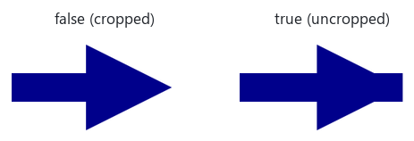

## **Přehled**

SVG je škálovatelný formát obrázků založený na XML, který se dobře hodí pro webové publikování, prohlížeče snímků, workflow přístupnosti a automatické následné zpracování. Aspose.Slides pro Node.js přes Java exportuje každý snímek do samostatného souboru SVG a umožňuje vám řídit, jak jsou zapisovány text, písma, obrázky a prvky SVG.

Použijte [SVGOptions](https://reference.aspose.com/slides/nodejs-java/aspose.slides/svgoptions/) když exportovaný SVG musí být kompaktní, předvídatelný napříč prohlížeči nebo připravený k interaktivnímu použití.

## **Export snímku jako SVG**

Vytvořte [Presentation](https://reference.aspose.com/slides/nodejs-java/aspose.slides/presentation/), vyberte snímek a zapište jej do proudu pomocí [Slide.writeAsSvg](https://reference.aspose.com/slides/nodejs-java/aspose.slides/slide/writeassvg/). Následující příklad exportuje každý snímek v prezentaci jako samostatný soubor SVG.

```javascript
const slides = require("aspose.slides.via.java");
const java = require("java");

const presentation = new slides.Presentation("presentation.pptx");
try {
    const slideCount = presentation.getSlides().size();
    for (let slideIndex = 0; slideIndex < slideCount; slideIndex++) {
        const slide = presentation.getSlides().get_Item(slideIndex);
        const outputFileName = `slide-${slide.getSlideNumber()}.svg`;
        const svgStream = java.newInstanceSync("java.io.FileOutputStream", outputFileName);
        try {
            slide.writeAsSvg(svgStream);
        } finally {
            svgStream.close();
        }
    }
} finally {
    presentation.dispose();
}
```

Název souboru používá [Slide.getSlideNumber](https://reference.aspose.com/slides/nodejs-java/aspose.slides/slide/getslidenumber/) místo indexu smyčky. Také můžete exportovat jednotlivý tvar pomocí [Shape.writeAsSvg](https://reference.aspose.com/slides/nodejs-java/aspose.slides/shape/writeassvg/), když prohlížeč snímků nebo webová stránka potřebuje pouze tento tvar.

## **Konfigurace výstupu SVG**

[SVGOptions](https://reference.aspose.com/slides/nodejs-java/aspose.slides/svgoptions/) řídí vykreslování SVG. Pro textové rámečky [SVGOptions.setUseFrameSize](https://reference.aspose.com/slides/nodejs-java/aspose.slides/svgoptions/setuseframesize/) zahrnuje textový rámeček do oblasti vykreslování a [SVGOptions.setUseFrameRotation](https://reference.aspose.com/slides/nodejs-java/aspose.slides/svgoptions/setuseframerotation/) určuje, zda se použije rotace rámečku. Nastavte [SVGOptions.setDisableFontLigatures](https://reference.aspose.com/slides/nodejs-java/aspose.slides/svgoptions/#setDisableFontLigatures) na `true`, když musí být text vykreslen bez ligatur.

```javascript
const slides = require("aspose.slides.via.java");
const java = require("java");

const presentation = new slides.Presentation("presentation.pptx");
try {
    const svgOptions = new slides.SVGOptions();
    svgOptions.setDisableFontLigatures(true);
    svgOptions.setUseFrameSize(true);
    svgOptions.setUseFrameRotation(false);

    const slide = presentation.getSlides().get_Item(0);
    const svgStream = java.newInstanceSync(
        "java.io.FileOutputStream",
        "slide-with-custom-options.svg"
    );
    try {
        slide.writeAsSvg(svgStream, svgOptions);
    } finally {
        svgStream.close();
    }
} finally {
    presentation.dispose();
}
```

## **Řízení oříznutí konců čar u šipek**

SVG 1.1 nemá nastavení vkládání značky, které by určovalo, kde má čára skončit pod šipkou. Ve výchozím nastavení Aspose.Slides zkracuje exportovanou čáru, aby se tah nevyčníval přes značku. Zavolejte [SVGOptions.setDisableLineEndCropping](https://reference.aspose.com/slides/nodejs-java/aspose.slides/svgoptions/#setDisableLineEndCropping) s hodnotou `true`, aby se tah kreslil až po původní koncový bod čáry. Toto nastavení ovlivňuje pouze výstup SVG. Čára si zachovává svou pozici a délku na snímku.

Příklad kreslí trojúhelníkové a diamantové šipky na čáry o šířce 2 a 10 bodů. Exportuje stejný snímek dvakrát, mění pouze možnost oříznutí.

```javascript
const slides = require("aspose.slides.via.java");
const java = require("java");

const presentation = new slides.Presentation();
try {
    const slide = presentation.getSlides().get_Item(0);
    const lineColor = java.newInstanceSync("java.awt.Color", 0, 0, 139);
    let y = 40;

    for (const style of [slides.LineArrowheadStyle.Triangle, slides.LineArrowheadStyle.Diamond]) {
        for (const width of [2, 10]) {
            const line = slide.getShapes().addAutoShape(slides.ShapeType.Line, 40, y, 200, 0);
            const format = line.getLineFormat();
            format.getFillFormat().setFillType(java.newByte(slides.FillType.Solid));
            format.getFillFormat().getSolidFillColor().setColor(lineColor);
            format.setWidth(width);
            format.setEndArrowheadStyle(java.newByte(style));
            y += 50;
        }
    }

    const options = new slides.SVGOptions();
    options.setDisableLineEndCropping(false);
    const cropped = java.newInstanceSync("java.io.FileOutputStream", "cropped.svg");
    try {
        slide.writeAsSvg(cropped, options);
    } finally {
        cropped.close();
    }

    options.setDisableLineEndCropping(true);
    const uncropped = java.newInstanceSync("java.io.FileOutputStream", "uncropped.svg");
    try {
        slide.writeAsSvg(uncropped, options);
    } finally {
        uncropped.close();
    }
} finally {
    presentation.dispose();
}
```

Porovnání ukazuje trojúhelníkovou šipku na 10bodové čáře. Při povoleném oříznutí je špička ostrá. Při zakázaném oříznutí se tah vyčnívá přes šikmé strany značky a zanechává plochý konec.



V dalších čarách z příkladu je vyčnívající tah méně viditelný na trojúhelníku o šířce 2 body. Vyplněný diamant pokrývá konec tahu u obou šířek.

## **Řízení textu a písem**

Při exportu snímků do SVG můžete řídit, zda text zůstane jako text nebo se převádí na vektorovou grafiku, a jak jsou externí písma zahrnuta nebo odkazována. Následující možnosti vám pomohou vyvážit vizuální konzistenci, výběr textu a závislosti na písmu v exportovaném SVG.

### **Vektorizovat celý text**

Nastavte [SVGOptions.setVectorizeText](https://reference.aspose.com/slides/nodejs-java/aspose.slides/svgoptions/setvectorizetext/) na `true`, aby byl veškerý text snímku zapisován jako vektorová grafika. Tím se eliminují závislosti na písmu a výsledek je vizuálně konzistentnější napříč prohlížeči, ale text již není možné vybírat ani vyhledávat jako SVG text.

```javascript
const slides = require("aspose.slides.via.java");
const java = require("java");

const presentation = new slides.Presentation("presentation.pptx");
try {
    const svgOptions = new slides.SVGOptions();
    svgOptions.setVectorizeText(true);

    const slide = presentation.getSlides().get_Item(0);
    const svgStream = java.newInstanceSync(
        "java.io.FileOutputStream",
        "slide-with-vectorized-text.svg"
    );
    try {
        slide.writeAsSvg(svgStream, svgOptions);
    } finally {
        svgStream.close();
    }
} finally {
    presentation.dispose();
}
```

### **Zvolte, jak se zachází s externími písmami**

[SVGOptions.setExternalFontsHandling](https://reference.aspose.com/slides/nodejs-java/aspose.slides/svgoptions/setexternalfontshandling/) používá hodnotu [SvgExternalFontsHandling](https://reference.aspose.com/slides/nodejs-java/aspose.slides/svgexternalfontshandling/) pro písma načítaná externě. Zvolte `AddLinksToFontFiles` pro odkaz na samostatné soubory písem, `Embed` pro zahrnutí dat písem do SVG, nebo `Vectorize` pro vykreslení pouze textu používajícího externí písma jako grafiku. Před zahrnutím písem ověřte licencování písem.

```javascript
const slides = require("aspose.slides.via.java");
const java = require("java");

const presentation = new slides.Presentation("presentation.pptx");
try {
    const slide = presentation.getSlides().get_Item(0);

    const linkedFontsOptions = new slides.SVGOptions();
    linkedFontsOptions.setExternalFontsHandling(
        slides.SvgExternalFontsHandling.AddLinksToFontFiles
    );
    const linkedFontsStream = java.newInstanceSync(
        "java.io.FileOutputStream",
        "slide-with-font-links.svg"
    );
    try {
        slide.writeAsSvg(linkedFontsStream, linkedFontsOptions);
    } finally {
        linkedFontsStream.close();
    }

    const embeddedFontsOptions = new slides.SVGOptions();
    embeddedFontsOptions.setExternalFontsHandling(
        slides.SvgExternalFontsHandling.Embed
    );
    const embeddedFontsStream = java.newInstanceSync(
        "java.io.FileOutputStream",
        "slide-with-embedded-fonts.svg"
    );
    try {
        slide.writeAsSvg(embeddedFontsStream, embeddedFontsOptions);
    } finally {
        embeddedFontsStream.close();
    }

    const vectorizedExternalFontsOptions = new slides.SVGOptions();
    vectorizedExternalFontsOptions.setExternalFontsHandling(
        slides.SvgExternalFontsHandling.Vectorize
    );
    const vectorizedExternalFontsStream = java.newInstanceSync(
        "java.io.FileOutputStream",
        "slide-with-vectorized-external-fonts.svg"
    );
    try {
        slide.writeAsSvg(vectorizedExternalFontsStream, vectorizedExternalFontsOptions);
    } finally {
        vectorizedExternalFontsStream.close();
    }
} finally {
    presentation.dispose();
}
```

## **Snížení velikosti vložených obrázků**

Použijte [SVGOptions.setPicturesCompression](https://reference.aspose.com/slides/nodejs-java/aspose.slides/svgoptions/setpicturescompression/) k snížení rozlišení vložených obrázků, [SVGOptions.setDeletePicturesCroppedAreas](https://reference.aspose.com/slides/nodejs-java/aspose.slides/svgoptions/setdeletepicturescroppedareas/) k vynechání oříznutých zdrojových oblastí a [SVGOptions.setJpegQuality](https://reference.aspose.com/slides/nodejs-java/aspose.slides/svgoptions/setjpegquality/) k řízení kvality JPEG kódování. Tato nastavení snižují velikost souboru na úkor věrnosti obrazu nebo zachovaných dat obrázku.

```javascript
const slides = require("aspose.slides.via.java");
const java = require("java");

const presentation = new slides.Presentation("presentation.pptx");
try {
    const svgOptions = new slides.SVGOptions();
    svgOptions.setPicturesCompression(slides.PicturesCompression.Dpi150);
    svgOptions.setDeletePicturesCroppedAreas(true);
    svgOptions.setJpegQuality(80);

    const slide = presentation.getSlides().get_Item(0);
    const svgStream = java.newInstanceSync("java.io.FileOutputStream", "compressed-slide.svg");
    try {
        slide.writeAsSvg(svgStream, svgOptions);
    } finally {
        svgStream.close();
    }
} finally {
    presentation.dispose();
}
```

## **Řízení rozlišení rastru metafile**

[SVGOptions.setMetafileRasterizationDpi](https://reference.aspose.com/slides/nodejs-java/aspose.slides/svgoptions/setmetafilerasterizationdpi/) nastavuje spodní hranici rozlišení pro rasterizaci metafile během exportu SVG. Použijte to k vyvážení detailu a velikosti souboru, když se rasterizuje obrázek EMF nebo WMF. Nedefinuje to globální DPI pro SVG ani nenutí každý objekt na snímku stát se rastrovým obrázkem.

Stáhněte [metafile-rasterization.pptx](metafile-rasterization.pptx), který obsahuje EMF obrázek s těsně umístěnými úhlopříčnými čarami. Následující příklad exportuje jeho první snímek ve třech rozlišeních rasterizace pomocí [Slide.writeAsSvg](https://reference.aspose.com/slides/nodejs-java/aspose.slides/slide/writeassvg/). Všechna ostatní nastavení exportu zůstávají stejné, aby bylo možné výsledky porovnat.

```javascript
const slides = require("aspose.slides.via.java");
const java = require("java");

const presentation = new slides.Presentation("metafile-rasterization.pptx");
try {
    for (const dpi of [72, 150, 300]) {
        const svgOptions = new slides.SVGOptions();
        svgOptions.setMetafileRasterizationDpi(dpi);
        svgOptions.setPicturesCompression(slides.PicturesCompression.Dpi330);
        svgOptions.setJpegQuality(90);

        const outputFileName = `slide-${dpi}.svg`;
        const svgStream = java.newInstanceSync("java.io.FileOutputStream", outputFileName);
        try {
            presentation.getSlides().get_Item(0).writeAsSvg(svgStream, svgOptions);
        } finally {
            svgStream.close();
        }
    }
} finally {
    presentation.dispose();
}
```

Ve výstupu se EMF stal jedním vloženým PNG v každém SVG. Následující měření jsou pro dodanou prezentaci; nejsou obecnou formulí pro převod DPI na rozměry v pixelech.

| Rasterizace metafile DPI | Rozměry vloženého PNG | Velikost souboru SVG (bajty) |
| --- | --- | --- |
| 72 | 1196 × 596 | 170,221 |
| 150 | 2492 × 1242 | 423,149 |
| 300 | 4983 × 2483 | 1,027,169 |

Porovnání níže ukazuje stejnou oblast vloženého rastru při stejném zvětšeném zobrazovacím rozměru. Úhlopříčné čáry ukazují viditelnou pixelaci při 72 DPI a hladší hrany při vyšších rozlišeních, zatímco soubor SVG roste. Zvyšování hodnoty nutně neznamená zlepšení každého detailu nebo změnu každého exportovaného obrázku.


[SVGOptions.setPicturesCompression](https://reference.aspose.com/slides/nodejs-java/aspose.slides/svgoptions/setpicturescompression/) řídí snížení rozlišení obrázku a může maskovat efekt změny rozlišení rasterizace metafile. [SVGOptions.setJpegQuality](https://reference.aspose.com/slides/nodejs-java/aspose.slides/svgoptions/setjpegquality/) řídí kvalitu JPEG kódování, nikoli rozlišení rasterizace metafile.

## **Přiřazení stabilních ID tvarům a textu**

Předávejte formátovací kontroler do [SVGOptions.setShapeFormattingController](https://reference.aspose.com/slides/nodejs-java/aspose.slides/svgoptions/setshapeformattingcontroller/), aby se nastavil [SvgShape.setId](https://reference.aspose.com/slides/nodejs-java/aspose.slides/svgshape/setid/) pro každý SVG tvar. Kontroler, který také zpracovává textové úseky, může nastavit hodnoty [SvgTSpan.setId](https://reference.aspose.com/slides/nodejs-java/aspose.slides/svgtspan/setid/) na `tspan` elementech textu.

Následující kontroler používá [Shape.getOfficeInteropShapeId](https://reference.aspose.com/slides/nodejs-java/aspose.slides/shape/getofficeinteropshapeid/), který je stabilní po celou životnost tvaru, a opakovatelný čítač pro jeho textové úseky. To umožňuje, aby vygenerovaná ID byla vhodná pro následné zpracování nezměněné prezentace.

```javascript
const slides = require("aspose.slides.via.java");
const java = require("java");

class StableSvgIdController {
    constructor() {
        this.currentShapeId = "";
        this.textSpanIndex = 0;
    }

    formatShape(svgShape, shape) {
        this.currentShapeId = `shape-${shape.getOfficeInteropShapeId()}`;
        this.textSpanIndex = 0;
        svgShape.setId(this.currentShapeId);
    }

    formatText(svgTSpan, portion, textFrame) {
        const textSpanId = `${this.currentShapeId}-text-${this.textSpanIndex++}`;
        svgTSpan.setId(textSpanId);
    }

    createProxy() {
        const controller = this;
        const interfaceName = "com.aspose.slides.ISvgShapeAndTextFormattingController";
        const proxyMethods = {
            formatShape(svgShape, shape) {
                controller.formatShape(svgShape, shape);
            },
            formatText(svgTSpan, portion, textFrame) {
                controller.formatText(svgTSpan, portion, textFrame);
            }
        };
        return java.newProxy(interfaceName, proxyMethods);
    }
}

const presentation = new slides.Presentation("presentation.pptx");
try {
    const svgOptions = new slides.SVGOptions();
    const stableSvgIdController = new StableSvgIdController();
    const controllerProxy = stableSvgIdController.createProxy();
    svgOptions.setShapeFormattingController(controllerProxy);

    const slide = presentation.getSlides().get_Item(0);
    const svgStream = java.newInstanceSync(
        "java.io.FileOutputStream",
        "slide-with-stable-ids.svg"
    );
    try {
        slide.writeAsSvg(svgStream, svgOptions);
    } finally {
        svgStream.close();
    }
} finally {
    presentation.dispose();
}
```

## **Přidání obsluhovačů událostí SVG**

Ve formátovacím kontroleru zavolejte [SvgShape.setEventHandler](https://reference.aspose.com/slides/nodejs-java/aspose.slides/svgshape/seteventhandler/) s hodnotou [SvgEvent](https://reference.aspose.com/slides/nodejs-java/aspose.slides/svgevent/), abyste přidali JavaScriptový obsluhovač události k exportovanému tvaru. Přiřaďte kontroler pomocí [SVGOptions.setShapeFormattingController](https://reference.aspose.com/slides/nodejs-java/aspose.slides/svgoptions/setshapeformattingcontroller/) a definujte JavaScriptovou funkci na stránce nebo v SVG dokumentu, který výsledek hostí.

```javascript
const slides = require("aspose.slides.via.java");
const java = require("java");

class SvgEventController {
    formatShape(svgShape, shape) {
        if (shape.getName() === "ActionButton") {
            svgShape.setId("action-button");
            svgShape.setEventHandler(
                slides.SvgEvent.OnClick,
                "handleShapeClick(event)"
            );
        }
    }

    createProxy() {
        const controller = this;
        const interfaceName = "com.aspose.slides.ISvgShapeFormattingController";
        const proxyMethods = {
            formatShape(svgShape, shape) {
                controller.formatShape(svgShape, shape);
            }
        };
        return java.newProxy(interfaceName, proxyMethods);
    }
}

const presentation = new slides.Presentation("presentation.pptx");
try {
    const svgOptions = new slides.SVGOptions();
    const svgEventController = new SvgEventController();
    const controllerProxy = svgEventController.createProxy();
    svgOptions.setShapeFormattingController(controllerProxy);

    const slide = presentation.getSlides().get_Item(0);
    const svgStream = java.newInstanceSync("java.io.FileOutputStream", "interactive-slide.svg");
    try {
        slide.writeAsSvg(svgStream, svgOptions);
    } finally {
        svgStream.close();
    }
} finally {
    presentation.dispose();
}
```

Hostitelská stránka může definovat JavaScriptovou funkci odkazovanou obsluhovačem. Přiřazení ID a obsluhovačů událostí umožňuje prohlížeče snímků, vylepšení přístupnosti a další interaktivní workflow s SVG.

## **Často kladené otázky**

**Kdy bych měl použít [SVGOptions.setVectorizeText](https://reference.aspose.com/slides/nodejs-java/aspose.slides/svgoptions/setvectorizetext/) místo [SvgExternalFontsHandling.Vectorize](https://reference.aspose.com/slides/nodejs-java/aspose.slides/svgexternalfontshandling/)?**

Použijte [SVGOptions.setVectorizeText](https://reference.aspose.com/slides/nodejs-java/aspose.slides/svgoptions/setvectorizetext/), když musí být veškerý text nezávislý na písměch. Použijte [SvgExternalFontsHandling.Vectorize](https://reference.aspose.com/slides/nodejs-java/aspose.slides/svgexternalfontshandling/), když by měl být pouze text používající externí písma převeden na grafiku.

**Jaký je nejlepší způsob, jak zmenšit SVG?**

Začněte kompresí vložených obrázků, odstraněním oříznutých oblastí obrázků a výběrem odkazovaných souborů písem, pokud cílové prostředí může tyto soubory poskytovat. Výsledek otestujte, protože nižší rozlišení obrázku, nižší kvalita JPEG a vektorizovaný text mají různé kompromisy mezi kvalitou a velikostí.

**Mohu po exportu upravovat exportované SVG elementy?**

Ano. Přidělte ID pomocí formátovacího kontroleru a poté vyberte odpovídající SVG elementy ve svém nástroji pro následné zpracování nebo v prohlížečovém skriptu.