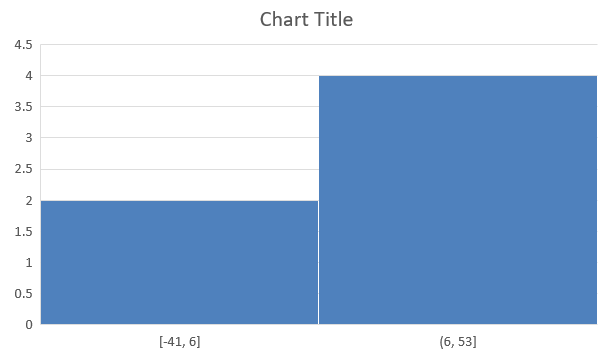

## **Přehled**

Tento článek poskytuje komplexní průvodce, jak vytvářet a přizpůsobovat grafy pomocí Aspose.Slides pro Node.js přes Java. Naučíte se, jak programově přidat graf do snímku, naplnit jej daty a použít různé možnosti formátování, aby odpovídal vašim konkrétním požadavkům na design. V celém článku podrobné ukázky kódu ilustrují každý krok, od inicializace prezentace a objektu grafu po konfiguraci sérií, os a legend. Dodržením tohoto průvodce získáte pevné pochopení toho, jak integrovat dynamické generování grafů do vašich aplikací Node.js a zjednodušit proces vytváření prezentací založených na datech.

## **Vytvoření grafu**

Grafy pomáhají lidem rychle vizualizovat data a získat poznatky, které nemusí být okamžitě zřejmé z tabulky nebo tabulkového kalkulátoru.

**Proč vytvářet grafy?**

* shromažďovat, zhušťovat nebo sumarizovat velké množství dat na jediném snímku v prezentaci;
* odhalovat vzory a trendy v datech;
* odhadnout směr a dynamiku dat v čase nebo vzhledem ke konkrétní měrné jednotce;
* identifikovat odlehlé hodnoty, odchylky, chyby a nesmyslná data;
* komunikovat nebo prezentovat složitá data.

V PowerPointu můžete vytvářet grafy pomocí funkce *Insert*, která poskytuje šablony pro návrh mnoha typů grafů. Pomocí Aspose.Slides můžete vytvářet jak běžné grafy (založené na populárních typech grafů), tak vlastní grafy.

{}
Použijte výčtový typ [ChartType](https://reference.aspose.com/slides/nodejs-java/aspose.slides/charttype/) v modulu [aspose.slides](https://reference.aspose.com/slides/nodejs-java/aspose.slides/). Hodnoty v tomto výčtu odpovídají různým typům grafů.
{}

### **Vytvoření seskupených sloupcových grafů**

Tento příklad používá [addChart](https://reference.aspose.com/slides/nodejs-java/aspose.slides/shapecollection/#addChart) k vytvoření seskupeného sloupcového grafu, který porovnává dvě série ve třech kategoriích. Série používají červené a zelené výplně a jednotlivé popisky ukazují názvy kategorií, názvy sérií a hodnoty. Index listu 0 odkazuje na první list v vloženém sešitu grafu.

```javascript
const aspose = { slides: require("aspose.slides.via.java") };
const java = require("java");

let presentation = new aspose.slides.Presentation();
try
{
    let slide = presentation.getSlides().get_Item(0);

    let chart = slide.getShapes().addChart(aspose.slides.ChartType.ClusteredColumn, 20, 20, 500, 300);

    chart.getChartTitle().addTextFrameForOverriding("Sample Title");
    chart.getChartTitle().getTextFrameForOverriding().getTextFrameFormat().setCenterText(java.newByte(aspose.slides.NullableBool.True));
    chart.getChartTitle().setHeight(20);
    chart.setTitle(true);

    let workbook = chart.getChartData().getChartDataWorkbook();
    let worksheetIndex = 0;

    chart.getChartData().getSeries().clear();
    chart.getChartData().getCategories().clear();

    let seriesNameCell = workbook.getCell(worksheetIndex, 0, 1, "Series 1");
    chart.getChartData().getSeries().add(seriesNameCell, chart.getType());
    seriesNameCell = workbook.getCell(worksheetIndex, 0, 2, "Series 2");
    chart.getChartData().getSeries().add(seriesNameCell, chart.getType());

    let categoryCell = workbook.getCell(worksheetIndex, 1, 0, "Category 1");
    chart.getChartData().getCategories().add(categoryCell);
    categoryCell = workbook.getCell(worksheetIndex, 2, 0, "Category 2");
    chart.getChartData().getCategories().add(categoryCell);
    categoryCell = workbook.getCell(worksheetIndex, 3, 0, "Category 3");
    chart.getChartData().getCategories().add(categoryCell);

    let series = chart.getChartData().getSeries().get_Item(0);

    let valueCell = workbook.getCell(worksheetIndex, 1, 1, 20);
    series.getDataPoints().addDataPointForBarSeries(valueCell);
    valueCell = workbook.getCell(worksheetIndex, 2, 1, 50);
    series.getDataPoints().addDataPointForBarSeries(valueCell);
    valueCell = workbook.getCell(worksheetIndex, 3, 1, 30);
    series.getDataPoints().addDataPointForBarSeries(valueCell);

    series.getFormat().getFill().setFillType(java.newByte(aspose.slides.FillType.Solid));
    series.getFormat().getFill().getSolidFillColor().setColor(java.getStaticFieldValue("java.awt.Color", "RED"));

    series = chart.getChartData().getSeries().get_Item(1);

    valueCell = workbook.getCell(worksheetIndex, 1, 2, 30);
    series.getDataPoints().addDataPointForBarSeries(valueCell);
    valueCell = workbook.getCell(worksheetIndex, 2, 2, 10);
    series.getDataPoints().addDataPointForBarSeries(valueCell);
    valueCell = workbook.getCell(worksheetIndex, 3, 2, 60);
    series.getDataPoints().addDataPointForBarSeries(valueCell);

    series.getFormat().getFill().setFillType(java.newByte(aspose.slides.FillType.Solid));
    series.getFormat().getFill().getSolidFillColor().setColor(java.newInstanceSync("java.awt.Color", 0, 128, 0));

    let label = series.getDataPoints().get_Item(0).getLabel();
    label.getDataLabelFormat().setShowCategoryName(true);

    label = series.getDataPoints().get_Item(1).getLabel();
    label.getDataLabelFormat().setShowSeriesName(true);

    label = series.getDataPoints().get_Item(2).getLabel();
    label.getDataLabelFormat().setShowValue(true);
    label.getDataLabelFormat().setShowSeriesName(true);
    label.getDataLabelFormat().setSeparator("/");

    presentation.save("AsposeChart.pptx", aspose.slides.SaveFormat.Pptx);
}
finally
{
    presentation.dispose();
}
```

Výsledek:


### **Vytvoření bodových grafů**

Bodové grafy (také známé jako rozptylové diagramy nebo x‑y grafy) se často používají k ověření vzorů nebo demonstraci korelací mezi dvěma proměnnými.

Použijte bodový graf, když:

* Máte spárovaná číselná data.
* Máte dvě proměnné, které dobře spolu souvisejí.
* Chcete zjistit, zda jsou dvě proměnné vzájemně související.
* Máte nezávislou proměnnou, která má více hodnot pro závislou proměnnou.

Tento příklad vykresluje dvě sady hodnot x‑y. První série používá přímé čáry s hvězdicovými značkami, zatímco druhá používá hladké čáry s kruhovými značkami; obě používají velikost značky 10, nastavenou pomocí [setSize](https://reference.aspose.com/slides/nodejs-java/aspose.slides/marker/#setSize). Metoda [setSymbol](https://reference.aspose.com/slides/nodejs-java/aspose.slides/marker/#setSymbol) řídí tvar značky.

```javascript
const aspose = { slides: require("aspose.slides.via.java") };

let presentation = new aspose.slides.Presentation();
try
{
    let slide = presentation.getSlides().get_Item(0);

    let chart = slide.getShapes().addChart(aspose.slides.ChartType.ScatterWithSmoothLines, 20, 20, 500, 300);

    let workbook = chart.getChartData().getChartDataWorkbook();
    let worksheetIndex = 0;

    chart.getChartData().getSeries().clear();

    let seriesNameCell = workbook.getCell(worksheetIndex, 1, 1, "Series 1");
    chart.getChartData().getSeries().add(seriesNameCell, chart.getType());
    seriesNameCell = workbook.getCell(worksheetIndex, 1, 3, "Series 2");
    chart.getChartData().getSeries().add(seriesNameCell, chart.getType());

    let series = chart.getChartData().getSeries().get_Item(0);

    let xValueCell = workbook.getCell(worksheetIndex, 2, 1, 1);
    let yValueCell = workbook.getCell(worksheetIndex, 2, 2, 3);
    series.getDataPoints().addDataPointForScatterSeries(xValueCell, yValueCell);

    xValueCell = workbook.getCell(worksheetIndex, 3, 1, 2);
    yValueCell = workbook.getCell(worksheetIndex, 3, 2, 10);
    series.getDataPoints().addDataPointForScatterSeries(xValueCell, yValueCell);

    series.setType(aspose.slides.ChartType.ScatterWithStraightLinesAndMarkers);

    series.getMarker().setSize(10);
    series.getMarker().setSymbol(aspose.slides.MarkerStyleType.Star);

    series = chart.getChartData().getSeries().get_Item(1);

    xValueCell = workbook.getCell(worksheetIndex, 2, 3, 5);
    yValueCell = workbook.getCell(worksheetIndex, 2, 4, 2);
    series.getDataPoints().addDataPointForScatterSeries(xValueCell, yValueCell);

    xValueCell = workbook.getCell(worksheetIndex, 3, 3, 3);
    yValueCell = workbook.getCell(worksheetIndex, 3, 4, 1);
    series.getDataPoints().addDataPointForScatterSeries(xValueCell, yValueCell);

    xValueCell = workbook.getCell(worksheetIndex, 4, 3, 2);
    yValueCell = workbook.getCell(worksheetIndex, 4, 4, 2);
    series.getDataPoints().addDataPointForScatterSeries(xValueCell, yValueCell);

    xValueCell = workbook.getCell(worksheetIndex, 5, 3, 5);
    yValueCell = workbook.getCell(worksheetIndex, 5, 4, 1);
    series.getDataPoints().addDataPointForScatterSeries(xValueCell, yValueCell);

    series.getMarker().setSize(10);
    series.getMarker().setSymbol(aspose.slides.MarkerStyleType.Circle);

    presentation.save("AsposeChart.pptx", aspose.slides.SaveFormat.Pptx);
}
finally
{
    presentation.dispose();
}
```

Výsledek:


### **Vytvoření koláčových grafů**

Koláčové grafy jsou nejvhodnější pro zobrazení vztahu část‑celku v datech, zejména když data obsahují kategoriální štítky s číselnými hodnotami. Pokud však data obsahují mnoho částí nebo štítků, můžete zvážit použití sloupcového grafu.

Tento příklad vytváří koláčový graf se třemi čtvrtletními hodnotami. Každý výsek má vlastní výplň a okraj a popisky zobrazují různé kombinace hodnot, procent a informací o sérii. Metoda [setFirstSliceAngle](https://reference.aspose.com/slides/nodejs-java/aspose.slides/chartseriesgroup/#setFirstSliceAngle) nastavuje první výsek, který začíná v 180 stupních.

```javascript
const aspose = { slides: require("aspose.slides.via.java") };
const java = require("java");

let presentation = new aspose.slides.Presentation();
try
{
    let slide = presentation.getSlides().get_Item(0);

    let chart = slide.getShapes().addChart(aspose.slides.ChartType.Pie, 20, 20, 500, 300);

    chart.getChartTitle().addTextFrameForOverriding("Sample Title");
    chart.getChartTitle().getTextFrameForOverriding().getTextFrameFormat().setCenterText(java.newByte(aspose.slides.NullableBool.True));
    chart.getChartTitle().setHeight(20);
    chart.setTitle(true);

    chart.getChartData().getSeries().get_Item(0).getLabels().getDefaultDataLabelFormat().setShowValue(true);

    let workbook = chart.getChartData().getChartDataWorkbook();
    let worksheetIndex = 0;

    chart.getChartData().getSeries().clear();
    chart.getChartData().getCategories().clear();

    let categoryCell = workbook.getCell(0, 1, 0, "1st Qtr");
    chart.getChartData().getCategories().add(categoryCell);
    categoryCell = workbook.getCell(0, 2, 0, "2nd Qtr");
    chart.getChartData().getCategories().add(categoryCell);
    categoryCell = workbook.getCell(0, 3, 0, "3rd Qtr");
    chart.getChartData().getCategories().add(categoryCell);

    let seriesNameCell = workbook.getCell(0, 0, 1, "Series 1");
    let series = chart.getChartData().getSeries().add(seriesNameCell, chart.getType());

    let valueCell = workbook.getCell(worksheetIndex, 1, 1, 20);
    series.getDataPoints().addDataPointForPieSeries(valueCell);
    valueCell = workbook.getCell(worksheetIndex, 2, 1, 50);
    series.getDataPoints().addDataPointForPieSeries(valueCell);
    valueCell = workbook.getCell(worksheetIndex, 3, 1, 30);
    series.getDataPoints().addDataPointForPieSeries(valueCell);

    chart.getChartData().getSeriesGroups().get_Item(0).setColorVaried(true);

    let firstSlice = series.getDataPoints().get_Item(0);
    firstSlice.getFormat().getFill().setFillType(java.newByte(aspose.slides.FillType.Solid));
    firstSlice.getFormat().getFill().getSolidFillColor().setColor(java.getStaticFieldValue("java.awt.Color", "CYAN"));

    firstSlice.getFormat().getLine().getFillFormat().setFillType(java.newByte(aspose.slides.FillType.Solid));
    firstSlice.getFormat().getLine().getFillFormat().getSolidFillColor().setColor(java.getStaticFieldValue("java.awt.Color", "GRAY"));
    firstSlice.getFormat().getLine().setWidth(3.0);
    firstSlice.getFormat().getLine().setStyle(java.newByte(aspose.slides.LineStyle.ThinThick));
    firstSlice.getFormat().getLine().setDashStyle(java.newByte(aspose.slides.LineDashStyle.LargeDash));

    let secondSlice = series.getDataPoints().get_Item(1);
    secondSlice.getFormat().getFill().setFillType(java.newByte(aspose.slides.FillType.Solid));
    secondSlice.getFormat().getFill().getSolidFillColor().setColor(java.newInstanceSync("java.awt.Color", 165, 42, 42));

    secondSlice.getFormat().getLine().getFillFormat().setFillType(java.newByte(aspose.slides.FillType.Solid));
    secondSlice.getFormat().getLine().getFillFormat().getSolidFillColor().setColor(java.getStaticFieldValue("java.awt.Color", "BLUE"));
    secondSlice.getFormat().getLine().setWidth(3.0);
    secondSlice.getFormat().getLine().setStyle(java.newByte(aspose.slides.LineStyle.Single));
    secondSlice.getFormat().getLine().setDashStyle(java.newByte(aspose.slides.LineDashStyle.LargeDashDot));

    let thirdSlice = series.getDataPoints().get_Item(2);
    thirdSlice.getFormat().getFill().setFillType(java.newByte(aspose.slides.FillType.Solid));
    thirdSlice.getFormat().getFill().getSolidFillColor().setColor(java.newInstanceSync("java.awt.Color", 255, 127, 80));

    thirdSlice.getFormat().getLine().getFillFormat().setFillType(java.newByte(aspose.slides.FillType.Solid));
    thirdSlice.getFormat().getLine().getFillFormat().getSolidFillColor().setColor(java.getStaticFieldValue("java.awt.Color", "RED"));
    thirdSlice.getFormat().getLine().setWidth(2.0);
    thirdSlice.getFormat().getLine().setStyle(java.newByte(aspose.slides.LineStyle.ThinThin));
    thirdSlice.getFormat().getLine().setDashStyle(java.newByte(aspose.slides.LineDashStyle.LargeDashDotDot));

    let firstLabel = series.getDataPoints().get_Item(0).getLabel();
    firstLabel.getDataLabelFormat().setShowValue(true);

    let secondLabel = series.getDataPoints().get_Item(1).getLabel();
    secondLabel.getDataLabelFormat().setShowValue(true);
    secondLabel.getDataLabelFormat().setShowLegendKey(true);
    secondLabel.getDataLabelFormat().setShowPercentage(true);

    let thirdLabel = series.getDataPoints().get_Item(2).getLabel();
    thirdLabel.getDataLabelFormat().setShowSeriesName(true);
    thirdLabel.getDataLabelFormat().setShowPercentage(true);

    series.getLabels().getDefaultDataLabelFormat().setShowLeaderLines(true);

    chart.getChartData().getSeriesGroups().get_Item(0).setFirstSliceAngle(180);

    presentation.save("PieChart.pptx", aspose.slides.SaveFormat.Pptx);
}
finally
{
    presentation.dispose();
}
```

Výsledek:


### **Vytvoření čárových grafů**

Čárové grafy (také známé jako lineární grafy) jsou nejvhodnější v situacích, kdy chcete demonstrovat změny hodnot v čase. Pomocí čárového grafu můžete najednou porovnat velké množství dat, sledovat změny a trendy v čase, zvýraznit anomálie v sériích dat a další.

Tento příklad používá [addChart](https://reference.aspose.com/slides/nodejs-java/aspose.slides/shapecollection/#addChart) k vytvoření čárového grafu s výchozími sériemi a kategoriemi a poté ukládá prezentaci jako PPTX.

```javascript
const aspose = { slides: require("aspose.slides.via.java") };

let presentation = new aspose.slides.Presentation();
try
{
    let slide = presentation.getSlides().get_Item(0);

    let lineChart = slide.getShapes().addChart(aspose.slides.ChartType.Line, 20, 20, 500, 300);

    presentation.save("lineChart.pptx", aspose.slides.SaveFormat.Pptx);
}
finally
{
    presentation.dispose();
}
```

Ve výchozím nastavení jsou body v čárovém grafu spojeny přímými souvislými čarami. Pokud chcete, aby byly body spojeny pomlčkami, zavolejte [setDashStyle](https://reference.aspose.com/slides/nodejs-java/aspose.slides/lineformat/#setDashStyle) s hodnotou z [LineDashStyle](https://reference.aspose.com/slides/nodejs-java/aspose.slides/linedashstyle/):

```javascript
const aspose = { slides: require("aspose.slides.via.java") };
const java = require("java");

let presentation = new aspose.slides.Presentation();
try
{
    let slide = presentation.getSlides().get_Item(0);

    let lineChart = slide.getShapes().addChart(aspose.slides.ChartType.Line, 20, 20, 500, 300);

    for (let i = 0; i < lineChart.getChartData().getSeries().size(); i++)
    {
        let series = lineChart.getChartData().getSeries().get_Item(i);
        series.getFormat().getLine().setDashStyle(java.newByte(aspose.slides.LineDashStyle.Dash));
    }
}
finally
{
    presentation.dispose();
}
```

Výsledek:


### **Vytvoření stromových mapových grafů**

Stromové mapové grafy jsou nejvhodnější pro prodejní data, když chcete zobrazit relativní velikost kategorií a rychle přitáhnout pozornost k položkám, které jsou velkými přispěvateli v rámci každé kategorie.

Tento příklad vytváří stromovou mapu se osmi listy seskupenými do čtyř kmínů a dvou větví. Metoda [setGroupingItem](https://reference.aspose.com/slides/nodejs-java/aspose.slides/chartcategorylevelsmanager/#setGroupingItem) přiřazuje kmíny na úrovni seskupení 1 a větve na úrovni 2. Hodnoty určují relativní velikosti obdélníků, zatímco štítky kategorií a překrývající se nadřazené štítky identifikují hierarchii.

```javascript
const aspose = { slides: require("aspose.slides.via.java") };

let presentation = new aspose.slides.Presentation();
try
{
    let slide = presentation.getSlides().get_Item(0);

    let chart = slide.getShapes().addChart(aspose.slides.ChartType.Treemap, 20, 20, 500, 300);

    chart.getChartData().getCategories().clear();
    chart.getChartData().getSeries().clear();

    let workbook = chart.getChartData().getChartDataWorkbook();
    workbook.clear(0);

    // Větev 1
    let categoryCell = workbook.getCell(0, "C1", "Leaf1");
    let leaf = chart.getChartData().getCategories().add(categoryCell);
    leaf.getGroupingLevels().setGroupingItem(1, "Stem1");
    leaf.getGroupingLevels().setGroupingItem(2, "Branch1");

    categoryCell = workbook.getCell(0, "C2", "Leaf2");
    chart.getChartData().getCategories().add(categoryCell);

    categoryCell = workbook.getCell(0, "C3", "Leaf3");
    leaf = chart.getChartData().getCategories().add(categoryCell);
    leaf.getGroupingLevels().setGroupingItem(1, "Stem2");

    categoryCell = workbook.getCell(0, "C4", "Leaf4");
    chart.getChartData().getCategories().add(categoryCell);

    // Větev 2
    categoryCell = workbook.getCell(0, "C5", "Leaf5");
    leaf = chart.getChartData().getCategories().add(categoryCell);
    leaf.getGroupingLevels().setGroupingItem(1, "Stem3");
    leaf.getGroupingLevels().setGroupingItem(2, "Branch2");

    categoryCell = workbook.getCell(0, "C6", "Leaf6");
    chart.getChartData().getCategories().add(categoryCell);

    categoryCell = workbook.getCell(0, "C7", "Leaf7");
    leaf = chart.getChartData().getCategories().add(categoryCell);
    leaf.getGroupingLevels().setGroupingItem(1, "Stem4");

    categoryCell = workbook.getCell(0, "C8", "Leaf8");
    chart.getChartData().getCategories().add(categoryCell);

    let series = chart.getChartData().getSeries().add(aspose.slides.ChartType.Treemap);
    series.getLabels().getDefaultDataLabelFormat().setShowCategoryName(true);
    let valueCell = workbook.getCell(0, "D1", 4);
    series.getDataPoints().addDataPointForTreemapSeries(valueCell);
    valueCell = workbook.getCell(0, "D2", 5);
    series.getDataPoints().addDataPointForTreemapSeries(valueCell);
    valueCell = workbook.getCell(0, "D3", 3);
    series.getDataPoints().addDataPointForTreemapSeries(valueCell);
    valueCell = workbook.getCell(0, "D4", 6);
    series.getDataPoints().addDataPointForTreemapSeries(valueCell);
    valueCell = workbook.getCell(0, "D5", 9);
    series.getDataPoints().addDataPointForTreemapSeries(valueCell);
    valueCell = workbook.getCell(0, "D6", 9);
    series.getDataPoints().addDataPointForTreemapSeries(valueCell);
    valueCell = workbook.getCell(0, "D7", 4);
    series.getDataPoints().addDataPointForTreemapSeries(valueCell);
    valueCell = workbook.getCell(0, "D8", 3);
    series.getDataPoints().addDataPointForTreemapSeries(valueCell);

    series.setParentLabelLayout(aspose.slides.ParentLabelLayoutType.Overlapping);

    presentation.save("Treemap.pptx", aspose.slides.SaveFormat.Pptx);
}
finally
{
    presentation.dispose();
}
```

Výsledek:


### **Vytvoření vodopádových grafů**

Vodopádový graf ukazuje, jak pozitivní a negativní změny přispívají k konečné hodnotě. Například rozklad zisku může začít tržbami, odečíst náklady a přidat další příjmy. Sloupce změn plavou mezi předchozí a novou běžící hodnotou, zatímco celkové sloupce sahají od nuly k akumulované hodnotě.

| Kategorie | Hodnota v sešitu | Typ sloupce |
| --- | ---: | --- |
| Tržby | 1000 | Nárůst |
| Náklady na prodej | -400 | Pokles |
| Hrubý zisk | 600 | Mezivýsledek |
| Provozní náklady | -200 | Pokles |
| Ostatní příjmy | 50 | Nárůst |
| Čistý zisk | 450 | Konečný součet |

Aby byl bod označen jako mezivýsledek nebo konečný součet, zavolejte jeho metodu [setSetAsTotal](https://reference.aspose.com/slides/nodejs-java/aspose.slides/chartdatapoint/#setSetAsTotal) s hodnotou `true`. Zadejte skutečnou akumulovanou částku v buňce sešitu tohoto bodu: `600` pro hrubý zisk (`1000 - 400`) a `450` pro čistý zisk (`600 - 200 + 50`). Metoda označí sloupec jako součet; nepočítá ani nevyplňuje hodnotu buňky. Nepoužívejte nulu jako zástupný znak ani nepřidávejte další změnu pro bod součtu. Sloupec součtu zobrazuje akumulovanou hodnotu bez opětovného přičtení k běžící hodnotě.

Tento kompletní JavaScriptový příklad vytváří graf pomocí členu `Waterfall` výčtu [ChartType](https://reference.aspose.com/slides/nodejs-java/aspose.slides/charttype/), vymaže výchozí data a naplní vložený sešit. Index listu `0` vybírá první list; sloupec A obsahuje názvy kategorií a sloupec B obsahuje hodnoty. Každá buňka s hodnotou je přidána pomocí [addDataPointForWaterfallSeries](https://reference.aspose.com/slides/nodejs-java/aspose.slides/chartdatapointcollection/#addDataPointForWaterfallSeries). Indexy bodů od nuly `2` a `5` identifikují mezivýsledek a konečný součet. Volání [setShowValue](https://reference.aspose.com/slides/nodejs-java/aspose.slides/datalabelformat/#setShowValue) s `true` zobrazuje částky na sloupcích. Žádná vstupní prezentace ani sešit není vyžadována.

```javascript
const aspose = { slides: require("aspose.slides.via.java") };

let presentation = new aspose.slides.Presentation();
try
{
    let slide = presentation.getSlides().get_Item(0);

    let chart = slide.getShapes().addChart(aspose.slides.ChartType.Waterfall, 20, 20, 680, 200);

    chart.setTitle(true);
    chart.getChartTitle().addTextFrameForOverriding("Profit breakdown (USD thousands)");
    chart.getChartTitle().setOverlay(false);
    chart.setLegend(false);

    chart.getChartData().getSeries().clear();
    chart.getChartData().getCategories().clear();

    let workbook = chart.getChartData().getChartDataWorkbook();
    let worksheetIndex = 0;

    workbook.clear(worksheetIndex);

    let seriesNameCell = workbook.getCell(worksheetIndex, 0, 1, "Profit");
    let series = chart.getChartData().getSeries().add(seriesNameCell, aspose.slides.ChartType.Waterfall);
    let categories = [ "Revenue", "Cost of sales", "Gross profit", "Operating expenses", "Other income", "Net profit" ];
    let values = [ 1000, -400, 600, -200, 50, 450 ];

    for (let i = 0; i < categories.length; i++)
    {
        let categoryCell = workbook.getCell(worksheetIndex, i + 1, 0, categories[i]);
        chart.getChartData().getCategories().add(categoryCell);
        let valueCell = workbook.getCell(worksheetIndex, i + 1, 1, values[i]);
        series.getDataPoints().addDataPointForWaterfallSeries(valueCell);
    }

    // Třetí a šestý bod představují součty, nikoli další změny.
    series.getDataPoints().get_Item(2).setSetAsTotal(true);
    series.getDataPoints().get_Item(5).setSetAsTotal(true);
    series.setShowConnectorLines(true);
    series.getLabels().getDefaultDataLabelFormat().setShowValue(true);

    presentation.save("WaterfallChart.pptx", aspose.slides.SaveFormat.Pptx);
}
finally
{
    presentation.dispose();
}
```

Zavolejte metodu [setShowConnectorLines](https://reference.aspose.com/slides/nodejs-java/aspose.slides/chartseries/#setShowConnectorLines) na úrovni série s `true`, aby se zobrazily čáry spojující po sobě jdoucí sloupce a usnadnily sledování běžící hodnoty. Pro skrytí těchto čar nahraďte volání metody v příkladu za `series.setShowConnectorLines(false);` před uložením. Tím se změní pouze viditelnost čar, nejen data nebo součty.

Uložená prezentace zobrazuje hrubý zisk 600 a čistý zisk 450, přičemž oba součty jsou vykresleny od nuly:


### **Vytvoření burzovních grafů**

Burzovní grafy se používají k zobrazení finančních údajů, jako jsou otevírací, nejvyšší, nejnižší a uzavírací ceny, což pomáhá analyzovat tržní trendy a volatilitu. Poskytují zásadní přehled o výkonnosti akcií a pomáhají investorům a analytikům činit informovaná rozhodnutí.

Tento příklad vytváří graf typu open‑high‑low‑close se čtyřmi sériemi v tomto pořadí a třemi kategoriemi. Metoda [setUpDownBars](https://reference.aspose.com/slides/nodejs-java/aspose.slides/updownbarsmanager/#setUpDownBars) povoluje up/down pruhy a [getHiLowLinesFormat](https://reference.aspose.com/slides/nodejs-java/aspose.slides/chartseriesgroup/#getHiLowLinesFormat) řídí čáry high‑low, které ukazují cenové rozpětí, zatímco jednotlivé linie sérií a menší vodorovné mřížky jsou skryté.

```javascript
const aspose = { slides: require("aspose.slides.via.java") };
const java = require("java");

let presentation = new aspose.slides.Presentation();
try
{
    let slide = presentation.getSlides().get_Item(0);

    let chart = slide.getShapes().addChart(aspose.slides.ChartType.OpenHighLowClose, 20, 20, 500, 300, false);

    let workbook = chart.getChartData().getChartDataWorkbook();

    let categoryCell = workbook.getCell(0, 1, 0, "A");
    chart.getChartData().getCategories().add(categoryCell);
    categoryCell = workbook.getCell(0, 2, 0, "B");
    chart.getChartData().getCategories().add(categoryCell);
    categoryCell = workbook.getCell(0, 3, 0, "C");
    chart.getChartData().getCategories().add(categoryCell);

    let seriesNameCell = workbook.getCell(0, 0, 1, "Open");
    chart.getChartData().getSeries().add(seriesNameCell, aspose.slides.ChartType.OpenHighLowClose);
    seriesNameCell = workbook.getCell(0, 0, 2, "High");
    chart.getChartData().getSeries().add(seriesNameCell, aspose.slides.ChartType.OpenHighLowClose);
    seriesNameCell = workbook.getCell(0, 0, 3, "Low");
    chart.getChartData().getSeries().add(seriesNameCell, aspose.slides.ChartType.OpenHighLowClose);
    seriesNameCell = workbook.getCell(0, 0, 4, "Close");
    chart.getChartData().getSeries().add(seriesNameCell, aspose.slides.ChartType.OpenHighLowClose);

    let series = chart.getChartData().getSeries().get_Item(0);
    let valueCell = workbook.getCell(0, 1, 1, 72);
    series.getDataPoints().addDataPointForStockSeries(valueCell);
    valueCell = workbook.getCell(0, 2, 1, 25);
    series.getDataPoints().addDataPointForStockSeries(valueCell);
    valueCell = workbook.getCell(0, 3, 1, 38);
    series.getDataPoints().addDataPointForStockSeries(valueCell);

    series = chart.getChartData().getSeries().get_Item(1);
    valueCell = workbook.getCell(0, 1, 2, 172);
    series.getDataPoints().addDataPointForStockSeries(valueCell);
    valueCell = workbook.getCell(0, 2, 2, 57);
    series.getDataPoints().addDataPointForStockSeries(valueCell);
    valueCell = workbook.getCell(0, 3, 2, 57);
    series.getDataPoints().addDataPointForStockSeries(valueCell);

    series = chart.getChartData().getSeries().get_Item(2);
    valueCell = workbook.getCell(0, 1, 3, 12);
    series.getDataPoints().addDataPointForStockSeries(valueCell);
    valueCell = workbook.getCell(0, 2, 3, 12);
    series.getDataPoints().addDataPointForStockSeries(valueCell);
    valueCell = workbook.getCell(0, 3, 3, 13);
    series.getDataPoints().addDataPointForStockSeries(valueCell);

    series = chart.getChartData().getSeries().get_Item(3);
    valueCell = workbook.getCell(0, 1, 4, 25);
    series.getDataPoints().addDataPointForStockSeries(valueCell);
    valueCell = workbook.getCell(0, 2, 4, 38);
    series.getDataPoints().addDataPointForStockSeries(valueCell);
    valueCell = workbook.getCell(0, 3, 4, 50);
    series.getDataPoints().addDataPointForStockSeries(valueCell);

    chart.getChartData().getSeriesGroups().get_Item(0).getUpDownBars().setUpDownBars(true);
    chart.getChartData().getSeriesGroups().get_Item(0).getHiLowLinesFormat().getLine().getFillFormat().setFillType(java.newByte(aspose.slides.FillType.Solid));

    for (let i = 0; i < chart.getChartData().getSeries().size(); i++)
    {
        let stockSeries = chart.getChartData().getSeries().get_Item(i);
        stockSeries.getFormat().getLine().getFillFormat().setFillType(java.newByte(aspose.slides.FillType.NoFill));
    }

    chart.getAxes().getVerticalAxis().getMinorGridLinesFormat().getLine().getFillFormat().setFillType(java.newByte(aspose.slides.FillType.NoFill));

    presentation.save("Stock-chart.pptx", aspose.slides.SaveFormat.Pptx);
}
finally
{
    presentation.dispose();
}
```

Výsledek:


### **Vytvoření krabicových a vousových grafů**

Krabicové a vousové grafy se používají k zobrazení rozdělení dat shrnutím klíčových statistických měr, jako jsou medián, kvartily a možné odlehlé hodnoty. Jsou obzvláště užitečné v průzkumné analýze dat a statistických studiích pro rychlé pochopení variability dat a identifikaci anomálií.

Tento příklad vytváří krabicový a vousový graf ze šesti hodnot. Metoda [setQuartileMethod](https://reference.aspose.com/slides/nodejs-java/aspose.slides/chartseries/#setQuartileMethod) vybírá výlučný výpočet kvartilů. Příklad také povoluje čáry průměru, značky průměru, vnitřní body a odlehlé body.

```javascript
const aspose = { slides: require("aspose.slides.via.java") };

let presentation = new aspose.slides.Presentation();
try
{
    let slide = presentation.getSlides().get_Item(0);

    let chart = slide.getShapes().addChart(aspose.slides.ChartType.BoxAndWhisker, 20, 20, 500, 300);

    chart.getChartData().getCategories().clear();
    chart.getChartData().getSeries().clear();

    let workbook = chart.getChartData().getChartDataWorkbook();
    workbook.clear(0);

    let categoryCell = workbook.getCell(0, "A1", "Category 1");
    chart.getChartData().getCategories().add(categoryCell);
    categoryCell = workbook.getCell(0, "A2", "Category 2");
    chart.getChartData().getCategories().add(categoryCell);
    categoryCell = workbook.getCell(0, "A3", "Category 3");
    chart.getChartData().getCategories().add(categoryCell);
    categoryCell = workbook.getCell(0, "A4", "Category 4");
    chart.getChartData().getCategories().add(categoryCell);
    categoryCell = workbook.getCell(0, "A5", "Category 5");
    chart.getChartData().getCategories().add(categoryCell);
    categoryCell = workbook.getCell(0, "A6", "Category 6");
    chart.getChartData().getCategories().add(categoryCell);

    let series = chart.getChartData().getSeries().add(aspose.slides.ChartType.BoxAndWhisker);

    series.setQuartileMethod(aspose.slides.QuartileMethodType.Exclusive);
    series.setShowMeanLine(true);
    series.setShowMeanMarkers(true);
    series.setShowInnerPoints(true);
    series.setShowOutlierPoints(true);

    let valueCell = workbook.getCell(0, "B1", 15);
    series.getDataPoints().addDataPointForBoxAndWhiskerSeries(valueCell);
    valueCell = workbook.getCell(0, "B2", 41);
    series.getDataPoints().addDataPointForBoxAndWhiskerSeries(valueCell);
    valueCell = workbook.getCell(0, "B3", 16);
    series.getDataPoints().addDataPointForBoxAndWhiskerSeries(valueCell);
    valueCell = workbook.getCell(0, "B4", 10);
    series.getDataPoints().addDataPointForBoxAndWhiskerSeries(valueCell);
    valueCell = workbook.getCell(0, "B5", 23);
    series.getDataPoints().addDataPointForBoxAndWhiskerSeries(valueCell);
    valueCell = workbook.getCell(0, "B6", 16);
    series.getDataPoints().addDataPointForBoxAndWhiskerSeries(valueCell);

    presentation.save("BoxAndWhisker.pptx", aspose.slides.SaveFormat.Pptx);
}
finally
{
    presentation.dispose();
}
```

### **Vytvoření trychtýřových grafů**

Trychtýřové grafy se používají k vizualizaci procesů, které zahrnují sekvenční fáze, kde objem dat klesá při postupu z jednoho kroku na další. Jsou zvláště užitečné pro analýzu konverzních poměrů, identifikaci úzkých míst a sledování efektivity prodejních nebo marketingových procesů.

Tento příklad používá [addChart](https://reference.aspose.com/slides/nodejs-java/aspose.slides/shapecollection/#addChart) k přidání trychtýřového grafu na první snímek existující prezentace. Nahrazuje výchozí data šesti kategoriemi a hodnotami v rozmezí od 50 do 500, poté uloží aktualizovanou prezentaci. Vstupní prezentace musí obsahovat alespoň jeden snímek.

```javascript
const aspose = { slides: require("aspose.slides.via.java") };

let presentation = new aspose.slides.Presentation("test.pptx");
try
{
    let slide = presentation.getSlides().get_Item(0);

    let chart = slide.getShapes().addChart(aspose.slides.ChartType.Funnel, 50, 50, 500, 400);

    chart.getChartData().getCategories().clear();
    chart.getChartData().getSeries().clear();

    let workbook = chart.getChartData().getChartDataWorkbook();
    workbook.clear(0);

    let categoryCell = workbook.getCell(0, "A1", "Category 1");
    chart.getChartData().getCategories().add(categoryCell);
    categoryCell = workbook.getCell(0, "A2", "Category 2");
    chart.getChartData().getCategories().add(categoryCell);
    categoryCell = workbook.getCell(0, "A3", "Category 3");
    chart.getChartData().getCategories().add(categoryCell);
    categoryCell = workbook.getCell(0, "A4", "Category 4");
    chart.getChartData().getCategories().add(categoryCell);
    categoryCell = workbook.getCell(0, "A5", "Category 5");
    chart.getChartData().getCategories().add(categoryCell);
    categoryCell = workbook.getCell(0, "A6", "Category 6");
    chart.getChartData().getCategories().add(categoryCell);

    let series = chart.getChartData().getSeries().add(aspose.slides.ChartType.Funnel);

    let valueCell = workbook.getCell(0, "B1", 50);
    series.getDataPoints().addDataPointForFunnelSeries(valueCell);
    valueCell = workbook.getCell(0, "B2", 100);
    series.getDataPoints().addDataPointForFunnelSeries(valueCell);
    valueCell = workbook.getCell(0, "B3", 200);
    series.getDataPoints().addDataPointForFunnelSeries(valueCell);
    valueCell = workbook.getCell(0, "B4", 300);
    series.getDataPoints().addDataPointForFunnelSeries(valueCell);
    valueCell = workbook.getCell(0, "B5", 400);
    series.getDataPoints().addDataPointForFunnelSeries(valueCell);
    valueCell = workbook.getCell(0, "B6", 500);
    series.getDataPoints().addDataPointForFunnelSeries(valueCell);

    presentation.save("Funnel.pptx", aspose.slides.SaveFormat.Pptx);
}
finally
{
    presentation.dispose();
}
```

Výsledek:


### **Vytvoření Sunburst grafů**

Sunburst grafy se používají k vizualizaci hierarchických dat, zobrazujících úrovně jako soustředné kruhy. Pomáhají ilustrovat vztahy část‑celku a jsou ideální pro reprezentaci vnořených kategorií a podkategorií v přehledném, kompaktním formátu.

Tento příklad vytváří Sunburst graf s osmi listy seskupenými do čtyř kmínů a dvou větví. Metoda [setGroupingItem](https://reference.aspose.com/slides/nodejs-java/aspose.slides/chartcategorylevelsmanager/#setGroupingItem) přiřazuje kmíny na úrovni seskupení 1 a větve na úrovni 2. Štítky kategorií identifikují segmenty a hodnoty určují jejich relativní velikosti.

```javascript
const aspose = { slides: require("aspose.slides.via.java") };

let presentation = new aspose.slides.Presentation();
try
{
    let slide = presentation.getSlides().get_Item(0);

    let chart = slide.getShapes().addChart(aspose.slides.ChartType.Sunburst, 20, 20, 500, 300);

    chart.getChartData().getCategories().clear();
    chart.getChartData().getSeries().clear();

    let workbook = chart.getChartData().getChartDataWorkbook();
    workbook.clear(0);

    // Větev 1
    let categoryCell = workbook.getCell(0, "C1", "Leaf1");
    let leaf = chart.getChartData().getCategories().add(categoryCell);
    leaf.getGroupingLevels().setGroupingItem(1, "Stem1");
    leaf.getGroupingLevels().setGroupingItem(2, "Branch1");

    categoryCell = workbook.getCell(0, "C2", "Leaf2");
    chart.getChartData().getCategories().add(categoryCell);

    categoryCell = workbook.getCell(0, "C3", "Leaf3");
    leaf = chart.getChartData().getCategories().add(categoryCell);
    leaf.getGroupingLevels().setGroupingItem(1, "Stem2");

    categoryCell = workbook.getCell(0, "C4", "Leaf4");
    chart.getChartData().getCategories().add(categoryCell);

    // Větev 2
    categoryCell = workbook.getCell(0, "C5", "Leaf5");
    leaf = chart.getChartData().getCategories().add(categoryCell);
    leaf.getGroupingLevels().setGroupingItem(1, "Stem3");
    leaf.getGroupingLevels().setGroupingItem(2, "Branch2");

    categoryCell = workbook.getCell(0, "C6", "Leaf6");
    chart.getChartData().getCategories().add(categoryCell);

    categoryCell = workbook.getCell(0, "C7", "Leaf7");
    leaf = chart.getChartData().getCategories().add(categoryCell);
    leaf.getGroupingLevels().setGroupingItem(1, "Stem4");

    categoryCell = workbook.getCell(0, "C8", "Leaf8");
    chart.getChartData().getCategories().add(categoryCell);

    let series = chart.getChartData().getSeries().add(aspose.slides.ChartType.Sunburst);
    series.getLabels().getDefaultDataLabelFormat().setShowCategoryName(true);
    let valueCell = workbook.getCell(0, "D1", 4);
    series.getDataPoints().addDataPointForSunburstSeries(valueCell);
    valueCell = workbook.getCell(0, "D2", 5);
    series.getDataPoints().addDataPointForSunburstSeries(valueCell);
    valueCell = workbook.getCell(0, "D3", 3);
    series.getDataPoints().addDataPointForSunburstSeries(valueCell);
    valueCell = workbook.getCell(0, "D4", 6);
    series.getDataPoints().addDataPointForSunburstSeries(valueCell);
    valueCell = workbook.getCell(0, "D5", 9);
    series.getDataPoints().addDataPointForSunburstSeries(valueCell);
    valueCell = workbook.getCell(0, "D6", 9);
    series.getDataPoints().addDataPointForSunburstSeries(valueCell);
    valueCell = workbook.getCell(0, "D7", 4);
    series.getDataPoints().addDataPointForSunburstSeries(valueCell);
    valueCell = workbook.getCell(0, "D8", 3);
    series.getDataPoints().addDataPointForSunburstSeries(valueCell);

    presentation.save("Sunburst.pptx", aspose.slides.SaveFormat.Pptx);
}
finally
{
    presentation.dispose();
}
```

Výsledek:


### **Vytvoření histogramových grafů**

Histogramové grafy se používají k zobrazení rozdělení číselných dat seskupováním hodnot do intervalů nebo košů. Jsou zvláště užitečné pro identifikaci vzorů v datech, jako je frekvence, sklon a rozptyl, a pro detekci odlehlých hodnot v datovém souboru.

Tento příklad vytváří histogram ze šesti číselných hodnot, včetně záporných hodnot. Volání [setAggregationType](https://reference.aspose.com/slides/nodejs-java/aspose.slides/axis/#setAggregationType) s automatickým typem agregace umožní grafu určit koše použité k zobrazení rozdělení.

```javascript
const aspose = { slides: require("aspose.slides.via.java") };

let presentation = new aspose.slides.Presentation();
try
{
    let slide = presentation.getSlides().get_Item(0);

    let chart = slide.getShapes().addChart(aspose.slides.ChartType.Histogram, 20, 20, 500, 300);

    chart.getChartData().getCategories().clear();
    chart.getChartData().getSeries().clear();

    let workbook = chart.getChartData().getChartDataWorkbook();
    workbook.clear(0);

    let series = chart.getChartData().getSeries().add(aspose.slides.ChartType.Histogram);
    let valueCell = workbook.getCell(0, "A1", 15);
    series.getDataPoints().addDataPointForHistogramSeries(valueCell);
    valueCell = workbook.getCell(0, "A2", -41);
    series.getDataPoints().addDataPointForHistogramSeries(valueCell);
    valueCell = workbook.getCell(0, "A3", 16);
    series.getDataPoints().addDataPointForHistogramSeries(valueCell);
    valueCell = workbook.getCell(0, "A4", 10);
    series.getDataPoints().addDataPointForHistogramSeries(valueCell);
    valueCell = workbook.getCell(0, "A5", -23);
    series.getDataPoints().addDataPointForHistogramSeries(valueCell);
    valueCell = workbook.getCell(0, "A6", 16);
    series.getDataPoints().addDataPointForHistogramSeries(valueCell);

    chart.getAxes().getHorizontalAxis().setAggregationType(aspose.slides.AxisAggregationType.Automatic);

    presentation.save("Histogram.pptx", aspose.slides.SaveFormat.Pptx);
}
finally
{
    presentation.dispose();
}
```

Výsledek:



### **Vytvoření radarových grafů**

Radarové grafy se používají k zobrazení vícevariabilních dat ve dvourozměrném formátu, což umožňuje snadné porovnání několika proměnných současně. Jsou zvláště užitečné pro identifikaci vzorů, silných a slabých stránek napříč více výkonových metrik nebo atributů.

Tento příklad používá [addChart](https://reference.aspose.com/slides/nodejs-java/aspose.slides/shapecollection/#addChart) k vytvoření radarového grafu s výchozími sériemi a kategoriemi a poté ukládá prezentaci jako PPTX.

```javascript
const aspose = { slides: require("aspose.slides.via.java") };

let presentation = new aspose.slides.Presentation();
try
{
    let slide = presentation.getSlides().get_Item(0);

    slide.getShapes().addChart(aspose.slides.ChartType.Radar, 20, 20, 500, 300);

    presentation.save("Radar-chart.pptx", aspose.slides.SaveFormat.Pptx);
}
finally
{
    presentation.dispose();
}
```

Výsledek:


### **Vytvoření vícekategoriových grafů**

Vícekategoriové grafy se používají k zobrazení dat, která zahrnují více než jedno kategoriální seskupení, což vám umožní porovnat hodnoty napříč několika rozměry současně. Jsou zvláště užitečné, když potřebujete analyzovat trendy a vztahy v komplexních, vícevrstvých datových sadách.

Tento příklad vytváří seskupený sloupcový graf s osmi kategoriemi uspořádanými do čtyř párů. Metoda [setGroupingItem](https://reference.aspose.com/slides/nodejs-java/aspose.slides/chartcategorylevelsmanager/#setGroupingItem) dává každému páru sdílený štítek na úrovni seskupení 1, čímž vzniká osa kategorií s jak jednotlivými, tak skupinovými štítky.

```javascript
const aspose = { slides: require("aspose.slides.via.java") };

let presentation = new aspose.slides.Presentation();
try
{
    let slide = presentation.getSlides().get_Item(0);

    let chart = slide.getShapes().addChart(aspose.slides.ChartType.ClusteredColumn, 20, 20, 500, 300);

    chart.getChartData().getSeries().clear();
    chart.getChartData().getCategories().clear();

    let workbook = chart.getChartData().getChartDataWorkbook();
    workbook.clear(0);

    let worksheetIndex = 0;

    let categoryCell = workbook.getCell(0, "c2", "A");
    let category = chart.getChartData().getCategories().add(categoryCell);
    category.getGroupingLevels().setGroupingItem(1, "Group1");
    categoryCell = workbook.getCell(0, "c3", "B");
    category = chart.getChartData().getCategories().add(categoryCell);

    categoryCell = workbook.getCell(0, "c4", "C");
    category = chart.getChartData().getCategories().add(categoryCell);
    category.getGroupingLevels().setGroupingItem(1, "Group2");
    categoryCell = workbook.getCell(0, "c5", "D");
    category = chart.getChartData().getCategories().add(categoryCell);

    categoryCell = workbook.getCell(0, "c6", "E");
    category = chart.getChartData().getCategories().add(categoryCell);
    category.getGroupingLevels().setGroupingItem(1, "Group3");
    categoryCell = workbook.getCell(0, "c7", "F");
    category = chart.getChartData().getCategories().add(categoryCell);

    categoryCell = workbook.getCell(0, "c8", "G");
    category = chart.getChartData().getCategories().add(categoryCell);
    category.getGroupingLevels().setGroupingItem(1, "Group4");
    categoryCell = workbook.getCell(0, "c9", "H");
    category = chart.getChartData().getCategories().add(categoryCell);

    let seriesNameCell = workbook.getCell(0, "D1", "Series 1");
    let series = chart.getChartData().getSeries().add(seriesNameCell, aspose.slides.ChartType.ClusteredColumn);

    let valueCell = workbook.getCell(worksheetIndex, "D2", 10);
    series.getDataPoints().addDataPointForBarSeries(valueCell);
    valueCell = workbook.getCell(worksheetIndex, "D3", 20);
    series.getDataPoints().addDataPointForBarSeries(valueCell);
    valueCell = workbook.getCell(worksheetIndex, "D4", 30);
    series.getDataPoints().addDataPointForBarSeries(valueCell);
    valueCell = workbook.getCell(worksheetIndex, "D5", 40);
    series.getDataPoints().addDataPointForBarSeries(valueCell);
    valueCell = workbook.getCell(worksheetIndex, "D6", 50);
    series.getDataPoints().addDataPointForBarSeries(valueCell);
    valueCell = workbook.getCell(worksheetIndex, "D7", 60);
    series.getDataPoints().addDataPointForBarSeries(valueCell);
    valueCell = workbook.getCell(worksheetIndex, "D8", 70);
    series.getDataPoints().addDataPointForBarSeries(valueCell);
    valueCell = workbook.getCell(worksheetIndex, "D9", 80);
    series.getDataPoints().addDataPointForBarSeries(valueCell);

    presentation.save("AsposeChart.pptx", aspose.slides.SaveFormat.Pptx);
}
finally
{
    presentation.dispose();
}
```

Výsledek:


### **Vytvoření mapových grafů**

Mapové grafy se používají k vizualizaci geografických dat mapováním informací na konkrétní lokality, jako jsou země, státy nebo města. Jsou zvláště užitečné pro analýzu regionálních trendů, demografických dat a prostorových rozložení v přehledném a vizuálně atraktivním způsobu.

Tento příklad používá [addChart](https://reference.aspose.com/slides/nodejs-java/aspose.slides/shapecollection/#addChart) k vytvoření mapového grafu s výchozími geografickými daty a ukládá jej pro zobrazení v PowerPointu.

```javascript
const aspose = { slides: require("aspose.slides.via.java") };

let presentation = new aspose.slides.Presentation();
try
{
    let slide = presentation.getSlides().get_Item(0);

    let chart = slide.getShapes().addChart(aspose.slides.ChartType.Map, 20, 20, 500, 300);

    presentation.save("mapChart.pptx", aspose.slides.SaveFormat.Pptx);
}
finally
{
    presentation.dispose();
}
```

Výsledek:


{}
Na obrázku výše je ukázána uložená prezentace otevřená v PowerPointu. Aspose.Slides zapisuje mapový graf a jeho data správně, ale samotné mapové grafy nevykresluje: když je snímek obsahující takový graf renderován jako obrázek nebo převeden do PDF či SVG, oblast grafu zůstane prázdná. Ostatní tvary na stejném snímku nejsou ovlivněny.
{}

### **Vytvoření kombinovaných grafů**

Kombinovaný graf (nebo combo graf) spojuje dva nebo více typů grafů v jednom diagramu. Tento graf vám umožňuje zvýraznit, porovnat nebo zkoumat rozdíly mezi dvěma nebo více datovými sadami, což pomáhá identifikovat vztahy mezi nimi.


Tento příklad kombinuje dvě seskupené sloupcové série s čárovou sérií napříč čtyřmi kategoriemi. Sloupce používají primární vertikální osu, zatímco [setPlotOnSecondAxis](https://reference.aspose.com/slides/nodejs-java/aspose.slides/chartseries/#setPlotOnSecondAxis) umisťuje čáru na sekundární vertikální osu napravo. Pomocné funkce nastavují název, legendu, popisky os a mřížky.

```javascript
const aspose = { slides: require("aspose.slides.via.java") };
const java = require("java");

function createComboChart()
{
    let presentation = new aspose.slides.Presentation();
    try
    {
        let chart = createChartWithFirstSeries(presentation.getSlides().get_Item(0));

        addSecondSeriesToChart(chart);
        addThirdSeriesToChart(chart);

        setPrimaryAxesFormat(chart);
        setSecondaryAxesFormat(chart);

        presentation.save("combo-chart.pptx", aspose.slides.SaveFormat.Pptx);
    }
    finally
    {
        presentation.dispose();
    }
}

function createChartWithFirstSeries(slide)
{
    let chart = slide.getShapes().addChart(aspose.slides.ChartType.ClusteredColumn, 50, 50, 600, 400);

    chart.setTitle(true);
    chart.getChartTitle().addTextFrameForOverriding("Chart Title");
    chart.getChartTitle().setOverlay(false);
    let portionFormat = chart.getChartTitle().getTextFrameForOverriding().getParagraphs().get_Item(0).getParagraphFormat().getDefaultPortionFormat();
    portionFormat.setFontBold(java.newByte(aspose.slides.NullableBool.False));
    portionFormat.setFontHeight(18);

    chart.getLegend().setPosition(aspose.slides.LegendPositionType.Bottom);
    chart.getLegend().getTextFormat().getPortionFormat().setFontHeight(12);

    chart.getChartData().getSeries().clear();
    chart.getChartData().getCategories().clear();

    let workbook = chart.getChartData().getChartDataWorkbook();
    let worksheetIndex = 0;

    let categoryCell = workbook.getCell(worksheetIndex, 1, 0, "Category 1");
    chart.getChartData().getCategories().add(categoryCell);
    categoryCell = workbook.getCell(worksheetIndex, 2, 0, "Category 2");
    chart.getChartData().getCategories().add(categoryCell);
    categoryCell = workbook.getCell(worksheetIndex, 3, 0, "Category 3");
    chart.getChartData().getCategories().add(categoryCell);
    categoryCell = workbook.getCell(worksheetIndex, 4, 0, "Category 4");
    chart.getChartData().getCategories().add(categoryCell);

    let seriesNameCell = workbook.getCell(worksheetIndex, 0, 1, "Series 1");
    let series = chart.getChartData().getSeries().add(seriesNameCell, chart.getType());

    series.getParentSeriesGroup().setOverlap(java.newByte(-25));
    series.getParentSeriesGroup().setGapWidth(220);

    let valueCell = workbook.getCell(worksheetIndex, 1, 1, 4.3);
    series.getDataPoints().addDataPointForBarSeries(valueCell);
    valueCell = workbook.getCell(worksheetIndex, 2, 1, 2.5);
    series.getDataPoints().addDataPointForBarSeries(valueCell);
    valueCell = workbook.getCell(worksheetIndex, 3, 1, 3.5);
    series.getDataPoints().addDataPointForBarSeries(valueCell);
    valueCell = workbook.getCell(worksheetIndex, 4, 1, 4.5);
    series.getDataPoints().addDataPointForBarSeries(valueCell);

    return chart;
}

function addSecondSeriesToChart(chart)
{
    let workbook = chart.getChartData().getChartDataWorkbook();
    let worksheetIndex = 0;

    let seriesNameCell = workbook.getCell(worksheetIndex, 0, 2, "Series 2");
    let series = chart.getChartData().getSeries().add(seriesNameCell, aspose.slides.ChartType.ClusteredColumn);

    series.getParentSeriesGroup().setOverlap(java.newByte(-25));
    series.getParentSeriesGroup().setGapWidth(220);

    let valueCell = workbook.getCell(worksheetIndex, 1, 2, 2.4);
    series.getDataPoints().addDataPointForBarSeries(valueCell);
    valueCell = workbook.getCell(worksheetIndex, 2, 2, 4.4);
    series.getDataPoints().addDataPointForBarSeries(valueCell);
    valueCell = workbook.getCell(worksheetIndex, 3, 2, 1.8);
    series.getDataPoints().addDataPointForBarSeries(valueCell);
    valueCell = workbook.getCell(worksheetIndex, 4, 2, 2.8);
    series.getDataPoints().addDataPointForBarSeries(valueCell);
}

function addThirdSeriesToChart(chart)
{
    let workbook = chart.getChartData().getChartDataWorkbook();
    let worksheetIndex = 0;

    let seriesNameCell = workbook.getCell(worksheetIndex, 0, 3, "Series 3");
    let series = chart.getChartData().getSeries().add(seriesNameCell, aspose.slides.ChartType.Line);

    let valueCell = workbook.getCell(worksheetIndex, 1, 3, 2.0);
    series.getDataPoints().addDataPointForLineSeries(valueCell);
    valueCell = workbook.getCell(worksheetIndex, 2, 3, 2.0);
    series.getDataPoints().addDataPointForLineSeries(valueCell);
    valueCell = workbook.getCell(worksheetIndex, 3, 3, 3.0);
    series.getDataPoints().addDataPointForLineSeries(valueCell);
    valueCell = workbook.getCell(worksheetIndex, 4, 3, 5.0);
    series.getDataPoints().addDataPointForLineSeries(valueCell);

    series.setPlotOnSecondAxis(true);
}

function setPrimaryAxesFormat(chart)
{
    let horizontalAxis = chart.getAxes().getHorizontalAxis();
    horizontalAxis.getTextFormat().getPortionFormat().setFontHeight(12);
    horizontalAxis.getFormat().getLine().getFillFormat().setFillType(java.newByte(aspose.slides.FillType.NoFill));

    setAxisTitle(horizontalAxis, "X Axis");

    let verticalAxis = chart.getAxes().getVerticalAxis();
    verticalAxis.getTextFormat().getPortionFormat().setFontHeight(12);
    verticalAxis.getFormat().getLine().setFillType(java.newByte(aspose.slides.FillType.NoFill));

    setAxisTitle(verticalAxis, "Y Axis 1");

    let majorGridLinesFormat = verticalAxis.getMajorGridLinesFormat().getLine().getFillFormat();
    majorGridLinesFormat.setFillType(java.newByte(aspose.slides.FillType.Solid));
    majorGridLinesFormat.getSolidFillColor().setColor(java.newInstanceSync("java.awt.Color", 217, 217, 217));
}

function setSecondaryAxesFormat(chart)
{
    let secondaryHorizontalAxis = chart.getAxes().getSecondaryHorizontalAxis();
    secondaryHorizontalAxis.setPosition(aspose.slides.AxisPositionType.Bottom);
    secondaryHorizontalAxis.setCrossType(aspose.slides.CrossesType.Maximum);
    secondaryHorizontalAxis.setVisible(false);
    secondaryHorizontalAxis.getMajorGridLinesFormat().getLine().getFillFormat().setFillType(java.newByte(aspose.slides.FillType.NoFill));
    secondaryHorizontalAxis.getMinorGridLinesFormat().getLine().getFillFormat().setFillType(java.newByte(aspose.slides.FillType.NoFill));

    let secondaryVerticalAxis = chart.getAxes().getSecondaryVerticalAxis();
    secondaryVerticalAxis.setPosition(aspose.slides.AxisPositionType.Right);
    secondaryVerticalAxis.getTextFormat().getPortionFormat().setFontHeight(12);
    secondaryVerticalAxis.getFormat().getLine().getFillFormat().setFillType(java.newByte(aspose.slides.FillType.NoFill));
    secondaryVerticalAxis.getMajorGridLinesFormat().getLine().getFillFormat().setFillType(java.newByte(aspose.slides.FillType.NoFill));
    secondaryVerticalAxis.getMinorGridLinesFormat().getLine().getFillFormat().setFillType(java.newByte(aspose.slides.FillType.NoFill));

    setAxisTitle(secondaryVerticalAxis, "Y Axis 2");
}

function setAxisTitle(axis, axisTitle)
{
    axis.setTitle(true);
    axis.getTitle().setOverlay(false);
    let titlePortionFormat = axis.getTitle().addTextFrameForOverriding(axisTitle).getParagraphs().get_Item(0).getParagraphFormat().getDefaultPortionFormat();
    titlePortionFormat.setFontBold(java.newByte(aspose.slides.NullableBool.False));
    titlePortionFormat.setFontHeight(12);
}

createComboChart();
```

## **Aktualizace grafů**

Aspose.Slides pro Node.js přes Java umožňuje aktualizovat grafy v PowerPointu úpravou dat grafu, formátování a stylování. Tato funkčnost zjednodušuje proces udržování prezentací aktuálními s dynamickým obsahem a zajišťuje, že grafy přesně odrážejí aktuální data a vizuální standardy.

Tento příklad aktualizuje graf s názvem "My chart" na prvním snímku existující prezentace. Vyžaduje dvě sloupcové série se třemi datovými body každá, s názvy kategorií ve sloupci A a názvy sérií v prvním řádku prvního listu. Příklad používá [getCell](https://reference.aspose.com/slides/nodejs-java/aspose.slides/chartdataworkbook/#getCell) k změně buněk sešitu, aktualizuje hodnoty sérií, přidá třetí sérii a změní typ grafu na seskupené válecové pomocí [setType](https://reference.aspose.com/slides/nodejs-java/aspose.slides/chart/#setType).

```javascript
const aspose = { slides: require("aspose.slides.via.java") };
const java = require("java");

let chartName = "My chart";

let presentation = new aspose.slides.Presentation("ExistingChart.pptx");
try
{
    let slide = presentation.getSlides().get_Item(0);

    for (let i = 0; i < slide.getShapes().size(); i++)
    {
        let shape = slide.getShapes().get_Item(i);
        if (java.instanceOf(shape, "com.aspose.slides.IChart") && chartName === shape.getName())
        {
            let chart = shape;
            let worksheetIndex = 0;

            let workbook = chart.getChartData().getChartDataWorkbook();

            workbook.getCell(worksheetIndex, 1, 0, "Modified Category 1");
            workbook.getCell(worksheetIndex, 2, 0, "Modified Category 2");

            let series = chart.getChartData().getSeries().get_Item(0);

            workbook.getCell(worksheetIndex, 0, 1, "New_Series 1");
            series.getDataPoints().get_Item(0).getValue().setData(90);
            series.getDataPoints().get_Item(1).getValue().setData(123);
            series.getDataPoints().get_Item(2).getValue().setData(44);

            series = chart.getChartData().getSeries().get_Item(1);

            workbook.getCell(worksheetIndex, 0, 2, "New_Series 2");
            series.getDataPoints().get_Item(0).getValue().setData(23);
            series.getDataPoints().get_Item(1).getValue().setData(67);
            series.getDataPoints().get_Item(2).getValue().setData(99);

            let seriesNameCell = workbook.getCell(worksheetIndex, 0, 3, "Series 3");
            series = chart.getChartData().getSeries().add(seriesNameCell, chart.getType());

            let valueCell = workbook.getCell(worksheetIndex, 1, 3, 20);
            series.getDataPoints().addDataPointForBarSeries(valueCell);
            valueCell = workbook.getCell(worksheetIndex, 2, 3, 50);
            series.getDataPoints().addDataPointForBarSeries(valueCell);
            valueCell = workbook.getCell(worksheetIndex, 3, 3, 30);
            series.getDataPoints().addDataPointForBarSeries(valueCell);

            chart.setType(aspose.slides.ChartType.ClusteredCylinder);
        }
    }

    presentation.save("AsposeChartModified.pptx", aspose.slides.SaveFormat.Pptx);
}
finally
{
    presentation.dispose();
}
```

## **Nastavení rozsahu dat pro graf**

Pro zobrazení rozsahu již používaného existujícím grafem viz [Retrieve a Chart's Data Range](/slides/cs/nodejs-java/chart-workbook/#retrieve-a-charts-data-range).

Aspose.Slides for Node.js via Java poskytuje flexibilitu definovat konkrétní rozsah dat z listu jako zdroj pro data vašeho grafu. To znamená, že můžete přímo mapovat část listu na graf, což vám umožní řídit, které buňky přispívají k sériím a kategoriím grafu. Výsledkem je snadná aktualizace a synchronizace vašich grafů s nejnovějšími změnami v listu, což zajišťuje, že vaše PowerPoint prezentace odrážejí aktuální a přesné informace.

Tento příklad používá [setRange](https://reference.aspose.com/slides/nodejs-java/aspose.slides/chartdata/#setRange) k nastavení datového zdroje grafu s názvem "My chart" na prvním snímku existující prezentace na `Sheet1!A1:B4`. Sešit grafu musí obsahovat tento list a naplněný rozsah s nadpisem série v prvním řádku, štítky kategorií ve sloupci A a třemi hodnotami ve sloupci B.

```javascript
const aspose = { slides: require("aspose.slides.via.java") };
const java = require("java");

let chartName = "My chart";

let presentation = new aspose.slides.Presentation("ExistingChart.pptx");
try
{
    let slide = presentation.getSlides().get_Item(0);

    for (let i = 0; i < slide.getShapes().size(); i++)
    {
        let shape = slide.getShapes().get_Item(i);
        if (java.instanceOf(shape, "com.aspose.slides.IChart") && chartName === shape.getName())
        {
            let chart = shape;
            chart.getChartData().setRange("Sheet1!A1:B4");
        }
    }

    presentation.save("SetDataRange.pptx", aspose.slides.SaveFormat.Pptx);
}
finally
{
    presentation.dispose();
}
```

## **Použití výchozích značek v grafech**

Při použití výchozích značek v grafech získá každá série grafu automaticky jiný výchozí symbol značky.

Tento příklad používá [addChart](https://reference.aspose.com/slides/nodejs-java/aspose.slides/shapecollection/#addChart) k vytvoření grafu se dvěma čárovými sériemi a legendou. Nastavení značek přístupné přes [getMarker](https://reference.aspose.com/slides/nodejs-java/aspose.slides/chartseries/#getMarker) zachovává automaticky přiřazené symboly značek. První série zahrnuje zápornou hodnotu a chybějící hodnotu reprezentovanou `null`, zatímco druhá má hodnotu pro každou kategorii.

```javascript
const aspose = { slides: require("aspose.slides.via.java") };

let presentation = new aspose.slides.Presentation();
try
{
    let slide = presentation.getSlides().get_Item(0);

    let chart = slide.getShapes().addChart(aspose.slides.ChartType.LineWithMarkers, 10, 10, 400, 400);

    chart.getChartData().getSeries().clear();
    chart.getChartData().getCategories().clear();

    let workbook = chart.getChartData().getChartDataWorkbook();

    let seriesNameCell = workbook.getCell(0, 0, 1, "Series 1");
    let series = chart.getChartData().getSeries().add(seriesNameCell, chart.getType());

    let categoryCell = workbook.getCell(0, 1, 0, "C1");
    chart.getChartData().getCategories().add(categoryCell);
    let valueCell = workbook.getCell(0, 1, 1, 24);
    series.getDataPoints().addDataPointForLineSeries(valueCell);

    categoryCell = workbook.getCell(0, 2, 0, "C2");
    chart.getChartData().getCategories().add(categoryCell);
    valueCell = workbook.getCell(0, 2, 1, 23);
    series.getDataPoints().addDataPointForLineSeries(valueCell);

    categoryCell = workbook.getCell(0, 3, 0, "C3");
    chart.getChartData().getCategories().add(categoryCell);
    valueCell = workbook.getCell(0, 3, 1, -10);
    series.getDataPoints().addDataPointForLineSeries(valueCell);

    categoryCell = workbook.getCell(0, 4, 0, "C4");
    chart.getChartData().getCategories().add(categoryCell);
    valueCell = workbook.getCell(0, 4, 1, null);
    series.getDataPoints().addDataPointForLineSeries(valueCell);

    seriesNameCell = workbook.getCell(0, 0, 2, "Series 2");
    let secondSeries = chart.getChartData().getSeries().add(seriesNameCell, chart.getType());

    valueCell = workbook.getCell(0, 1, 2, 30);
    secondSeries.getDataPoints().addDataPointForLineSeries(valueCell);
    valueCell = workbook.getCell(0, 2, 2, 10);
    secondSeries.getDataPoints().addDataPointForLineSeries(valueCell);
    valueCell = workbook.getCell(0, 3, 2, 60);
    secondSeries.getDataPoints().addDataPointForLineSeries(valueCell);
    valueCell = workbook.getCell(0, 4, 2, 40);
    secondSeries.getDataPoints().addDataPointForLineSeries(valueCell);

    chart.setLegend(true);
    chart.getLegend().setOverlay(false);

    presentation.save("DefaultMarkersInChart.pptx", aspose.slides.SaveFormat.Pptx);
}
finally
{
    presentation.dispose();
}
```

## **Často kladené otázky**

**Jaké typy grafů jsou podporovány v Aspose.Slides pro Node.js přes Java?**

Aspose.Slides pro Node.js přes Java podporuje širokou škálu typů grafů, včetně sloupcových, čárových, koláčových, plošných, bodových, histogramových, radarových a mnoha dalších. Tato flexibilita vám umožňuje vybrat nejvhodnější typ grafu pro potřeby vizualizace vašich dat.

**Jak přidám nový graf do snímku?**

Aby jste přidali graf, nejprve vytvoříte instanci třídy [Presentation](https://reference.aspose.com/slides/nodejs-java/aspose.slides/presentation/), získáte požadovaný snímek pomocí jeho indexu a poté zavoláte metodu pro přidání grafu, specifikujete typ grafu a počáteční data. Tento proces integruje graf přímo do vaší prezentace.

**Jak mohu aktualizovat data zobrazená v grafu?**

Data grafu můžete aktualizovat přístupem k jeho datovému sešitu ([ChartDataWorkbook](https://reference.aspose.com/slides/nodejs-java/aspose.slides/chartdataworkbook/)), vymazáním výchozích sérií a kategorií a následným přidáním vlastních dat. To vám umožní programově obnovit graf tak, aby odrážel nejnovější data.

**Je možné přizpůsobit vzhled grafu?**

Ano, Aspose.Slides pro Node.js přes Java poskytuje rozsáhlé možnosti přizpůsobení. Můžete upravovat barvy, písma, popisky, legendy a další formátovací prvky tak, aby vzhled grafu odpovídal vašim konkrétním požadavkům na design.