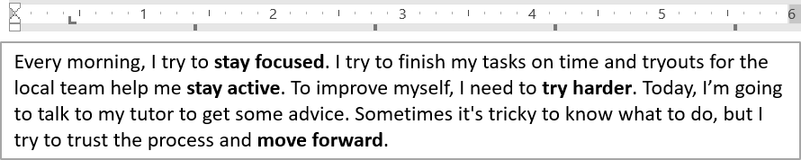

## **Přehled**

Tento článek ukazuje, jak formátovat text v prezentacích PowerPoint a OpenDocument pomocí Aspose.Slides pro PHP přes Java. Pokrývá barvy pozadí, průhlednost, mezery mezi znaky, vlastnosti písma, otočení, mezery odstavců, chování automatického přizpůsobení, ukotvení textu, tabulátory a nastavení jazyka.

Pokud není uvedeno jinak, příklady používají [sample.pptx](sample.pptx). První tvar na první snímku je textové pole a jeho první odstavec obsahuje text zobrazený níže. Indexy snímků i tvarů jsou nulové. Příklady, které vybírají tučné části, používají efektivní formátování, včetně zděděného tučného formátování:


Pro vyhledání a zvýraznění doslovného textu nebo shod regulárních výrazů viz [Vyhledávání a nahrazování textu](/slides/cs/php-java/search-and-replace-text/).

## **Nastavit barvu pozadí textu**

Použijte [ParagraphFormat::getDefaultPortionFormat](https://reference.aspose.com/slides/php-java/aspose.slides/paragraphformat/#getDefaultPortionFormat) pro nastavení výchozí barvy zvýraznění odstavce nebo [BasePortionFormat::getHighlightColor](https://reference.aspose.com/slides/php-java/aspose.slides/baseportionformat/#getHighlightColor) pro jednotlivé textové úseky.

Následující příklad nastaví světle šedé zvýraznění jako výchozí pro první odstavec. Explicitní barvy zvýraznění na jednotlivých úsecích mají přednost před tímto výchozím nastavením:

```php
use aspose\slides\Presentation;
use aspose\slides\SaveFormat;

$presentation = new Presentation("sample.pptx");
try {
    $slide = $presentation->getSlides()->get_Item(0);

    $autoShape = $slide->getShapes()->get_Item(0);
    $paragraph = $autoShape->getTextFrame()->getParagraphs()->get_Item(0);
    $highlightColor = java("java.awt.Color")->LIGHT_GRAY;

    // Nastavte barvu zvýraznění pro celý odstavec.
    $paragraph->getParagraphFormat()->getDefaultPortionFormat()->getHighlightColor()->setColor($highlightColor);

    $presentation->save("gray_paragraph.pptx", SaveFormat::Pptx);
} finally {
    $presentation->dispose();
}
```

Výsledek:


Níže uvedený příklad kódu ukazuje, jak nastavit barvu pozadí **textových úseků s tučným písmem**:

```php
use aspose\slides\Presentation;
use aspose\slides\SaveFormat;

$presentation = new Presentation("sample.pptx");
try {
    $slide = $presentation->getSlides()->get_Item(0);

    $autoShape = $slide->getShapes()->get_Item(0);
    $paragraph = $autoShape->getTextFrame()->getParagraphs()->get_Item(0);
    $highlightColor = java("java.awt.Color")->LIGHT_GRAY;

    $portionCount = java_values($paragraph->getPortions()->getCount());
    for ($portionIndex = 0; $portionIndex < $portionCount; $portionIndex++) {
        $portion = $paragraph->getPortions()->get_Item($portionIndex);
        if (java_values($portion->getPortionFormat()->getEffective()->getFontBold())) {
            // Nastavte barvu zvýraznění pro textový úsek.
            $portion->getPortionFormat()->getHighlightColor()->setColor($highlightColor);
        }
    }

    $presentation->save("gray_text_portions.pptx", SaveFormat::Pptx);
} finally {
    $presentation->dispose();
}
```

Výsledek:


## **Zarovnat odstavce textu**

Použijte [ParagraphFormat::setAlignment](https://reference.aspose.com/slides/php-java/aspose.slides/paragraphformat/#setAlignment) pro nastavení zarovnání odstavce v textovém rámečku. Hodnota může být centrovaná, zarovnaná vlevo, vpravo, zarovnaná do bloku atd.

Následující ukázka kódu ukazuje, jak zarovnat odstavec **do středu**:

```php
use aspose\slides\Presentation;
use aspose\slides\SaveFormat;
use aspose\slides\TextAlignment;

$presentation = new Presentation("sample.pptx");
try {
    $slide = $presentation->getSlides()->get_Item(0);

    $autoShape = $slide->getShapes()->get_Item(0);
    $paragraph = $autoShape->getTextFrame()->getParagraphs()->get_Item(0);

    // Nastavte zarovnání odstavce na střed.
    $paragraph->getParagraphFormat()->setAlignment(TextAlignment::Center);

    $presentation->save("aligned_paragraph.pptx", SaveFormat::Pptx);
} finally {
    $presentation->dispose();
}
```

Výsledek:


## **Zarovnat písma v řádku**

Použijte [ParagraphFormat::setFontAlignment](https://reference.aspose.com/slides/php-java/aspose.slides/paragraphformat/#setFontAlignment) pro vertikální zarovnání textových úseků s různými velikostmi písma v rámci řádku. Toto nastavení se vztahuje na celý odstavec a řídí zarovnání v každém řádku.

Následující samostatný příklad vytváří čtyři označená textová pole na jednom snímku. Každý odstavec obsahuje stejný text v 18, 36 a 54 bodech s různým zarovnáním písma. Používá Arial, vypíná automatické přizpůsobení a zalamování a ponechává textové rámečky dostatečně velké pro jediný řádek.

```php
use aspose\slides\FillType;
use aspose\slides\FontAlignment;
use aspose\slides\FontData;
use aspose\slides\NullableBool;
use aspose\slides\Paragraph;
use aspose\slides\Portion;
use aspose\slides\Presentation;
use aspose\slides\SaveFormat;
use aspose\slides\ShapeType;
use aspose\slides\TextAlignment;
use aspose\slides\TextAnchorType;
use aspose\slides\TextAutofitType;

$presentation = new Presentation();
try {
    $slide = $presentation->getSlides()->get_Item(0);

    $alignments = [FontAlignment::Baseline, FontAlignment::Top, FontAlignment::Center, FontAlignment::Bottom];
    $alignmentNames = ["Baseline", "Top", "Center", "Bottom"];
    $fontSizes = [18, 36, 54];
    $font = new FontData("Arial");
    $gray = java("java.awt.Color")->GRAY;
    $black = java("java.awt.Color")->BLACK;

    for ($i = 0; $i < count($alignments); $i++) {
        $shape = $slide->getShapes()->addAutoShape(ShapeType::Rectangle, 30, 20 + $i * 130, 660, 120);
        $shape->getFillFormat()->setFillType(FillType::NoFill);
        $shape->getLineFormat()->getFillFormat()->setFillType(FillType::NoFill);

        $textFrame = $shape->getTextFrame();
        $textFrame->getTextFrameFormat()->setAnchoringType(TextAnchorType::Top);
        $textFrame->getTextFrameFormat()->setAutofitType(TextAutofitType::None);
        $textFrame->getTextFrameFormat()->setWrapText(NullableBool::False);

        $label = $textFrame->getParagraphs()->get_Item(0);
        $label->setText($alignmentNames[$i]);
        $label->getParagraphFormat()->setAlignment(TextAlignment::Left);
        $label->getParagraphFormat()->getDefaultPortionFormat()->setFontHeight(14);
        $label->getParagraphFormat()->getDefaultPortionFormat()->setLatinFont($font);
        $label->getParagraphFormat()->getDefaultPortionFormat()->getFillFormat()->setFillType(FillType::Solid);
        $label->getParagraphFormat()->getDefaultPortionFormat()->getFillFormat()->getSolidFillColor()->setColor($gray);

        $paragraph = new Paragraph();
        $paragraph->getParagraphFormat()->setFontAlignment($alignments[$i]);
        $paragraph->getParagraphFormat()->setAlignment(TextAlignment::Left);
        $paragraph->getParagraphFormat()->getDefaultPortionFormat()->setLatinFont($font);
        $paragraph->getParagraphFormat()->getDefaultPortionFormat()->getFillFormat()->setFillType(FillType::Solid);
        $paragraph->getParagraphFormat()->getDefaultPortionFormat()->getFillFormat()->getSolidFillColor()->setColor($black);

        foreach ($fontSizes as $fontSize) {
            $portion = new Portion("Ag ");
            $portion->getPortionFormat()->setFontHeight($fontSize);
            $paragraph->getPortions()->add($portion);
        }

        $textFrame->getParagraphs()->add($paragraph);
    }

    $presentation->save("font_alignment.pptx", SaveFormat::Pptx);
} finally {
    $presentation->dispose();
}
```

Výsledek:


Zarovnání písma používá fontové metriky, takže viditelné hrany jednotlivých znaků se nemusí přesně slévat. Příklad zahrnuje jak velké písmeno, tak spádový znak, aby ukázal rozdíl mezi zarovnáním na základní čáru a dole. Dostupnost fontu a jeho náhrada, použité znaky a rozdíl ve velikostech písma ovlivňují výsledek. Rozměry rámečků, okraje, mezery řádků, zalamování a automatické přizpůsobení také ovlivňují rozvržení; při porovnávání režimů použijte stejné fonty a nastavení rozvržení.

Toto nastavení se liší od [ParagraphFormat::setAlignment](https://reference.aspose.com/slides/php-java/aspose.slides/paragraphformat/#setAlignment), který řídí horizontální zarovnání odstavce, a od [TextFrameFormat::setAnchoringType](https://reference.aspose.com/slides/php-java/aspose.slides/textframeformat/#setAnchoringType), který vertikálně umisťuje textový blok uvnitř tvaru. Formátování horního a dolního indexu pomocí [BasePortionFormat::setEscapement](https://reference.aspose.com/slides/php-java/aspose.slides/baseportionformat/#setEscapement) posouvá jednotlivé úseky relativně k základní čáře místo nastavení zarovnání písma pro řádky odstavce.

## **Nastavit průhlednost textu**

Průhlednost textu se řídí alfa komponentou barvy přiřazené pomocí [BasePortionFormat::getFillFormat](https://reference.aspose.com/slides/php-java/aspose.slides/baseportionformat/#getFillFormat). V níže uvedených příkladech je `alpha = 50` hodnota alfa kanálu ARGB v rozsahu 0–255, nikoli procento průhlednosti.

Ukázka kódu níže ukazuje, jak aplikovat průhlednost na **celý odstavec**:

```php
use aspose\slides\FillType;
use aspose\slides\Presentation;
use aspose\slides\SaveFormat;

$alpha = 50;

$presentation = new Presentation("sample.pptx");
try {
    $slide = $presentation->getSlides()->get_Item(0);

    $autoShape = $slide->getShapes()->get_Item(0);
    $paragraph = $autoShape->getTextFrame()->getParagraphs()->get_Item(0);
    $fillFormat = $paragraph->getParagraphFormat()->getDefaultPortionFormat()->getFillFormat();

    // Nastavte barvu výplně textu na průhlednou barvu.
    $fillFormat->setFillType(FillType::Solid);
    $transparentColor = new Java("java.awt.Color", 0, 0, 0, $alpha);
    $fillFormat->getSolidFillColor()->setColor($transparentColor);

    $presentation->save("transparent_paragraph.pptx", SaveFormat::Pptx);
} finally {
    $presentation->dispose();
}
```

Výsledek:


Následující ukázka kódu ukazuje, jak aplikovat průhlednost na **textové úseky s tučným písmem**:

```php
use aspose\slides\FillType;
use aspose\slides\Presentation;
use aspose\slides\SaveFormat;

$alpha = 50;

$presentation = new Presentation("sample.pptx");
try {
    $slide = $presentation->getSlides()->get_Item(0);

    $autoShape = $slide->getShapes()->get_Item(0);
    $paragraph = $autoShape->getTextFrame()->getParagraphs()->get_Item(0);
    $transparentColor = new Java("java.awt.Color", 0, 0, 0, $alpha);

    $portionCount = java_values($paragraph->getPortions()->getCount());
    for ($portionIndex = 0; $portionIndex < $portionCount; $portionIndex++) {
        $portion = $paragraph->getPortions()->get_Item($portionIndex);
        if (java_values($portion->getPortionFormat()->getEffective()->getFontBold())) {
            // Nastavte průhlednost textového úseku.
            $fillFormat = $portion->getPortionFormat()->getFillFormat();
            $fillFormat->setFillType(FillType::Solid);
            $fillFormat->getSolidFillColor()->setColor($transparentColor);
        }
    }

    $presentation->save("transparent_text_portions.pptx", SaveFormat::Pptx);
} finally {
    $presentation->dispose();
}
```

Výsledek:


## **Nastavit mezery mezi znaky textu**

Použijte [BasePortionFormat::setSpacing](https://reference.aspose.com/slides/php-java/aspose.slides/baseportionformat/#setSpacing) pro rozšíření nebo zmenšení mezer mezi znaky v textovém poli. Příklady přidávají 3 body mezery; záporné hodnoty text zmenšují.

Níže uvedený PHP kód ukazuje, jak rozšířit mezery mezi znaky v **celém odstavci**:

```php
use aspose\slides\Presentation;
use aspose\slides\SaveFormat;

$presentation = new Presentation("sample.pptx");
try {
    $slide = $presentation->getSlides()->get_Item(0);

    $autoShape = $slide->getShapes()->get_Item(0);
    $paragraph = $autoShape->getTextFrame()->getParagraphs()->get_Item(0);

    // Poznámka: Použijte záporné hodnoty pro zkompresování mezer mezi znaky.
    $paragraph->getParagraphFormat()->getDefaultPortionFormat()->setSpacing(3); // Rozšířit mezery mezi znaky.

    $presentation->save("character_spacing_in_paragraph.pptx", SaveFormat::Pptx);
} finally {
    $presentation->dispose();
}
```

Výsledek:


Ukázka kódu níže ukazuje, jak rozšířit mezery mezi znaky v **textových úsecích s tučným písmem**:

```php
use aspose\slides\Presentation;
use aspose\slides\SaveFormat;

$presentation = new Presentation("sample.pptx");
try {
    $slide = $presentation->getSlides()->get_Item(0);

    $autoShape = $slide->getShapes()->get_Item(0);
    $paragraph = $autoShape->getTextFrame()->getParagraphs()->get_Item(0);

    $portionCount = java_values($paragraph->getPortions()->getCount());
    for ($portionIndex = 0; $portionIndex < $portionCount; $portionIndex++) {
        $portion = $paragraph->getPortions()->get_Item($portionIndex);
        if (java_values($portion->getPortionFormat()->getEffective()->getFontBold())) {
            // Poznámka: Použijte záporné hodnoty pro zkomprimování mezer mezi znaky.
            $portion->getPortionFormat()->setSpacing(3); // Rozšířit mezery mezi znaky.
        }
    }

    $presentation->save("character_spacing_in_text_portions.pptx", SaveFormat::Pptx);
} finally {
    $presentation->dispose();
}
```

Výsledek:


### **Zakázat kerning pro konkrétní fonty**

V některých případech může text vykreslený Aspose.Slides vypadat mírně těsněji než stejný text zobrazený v PowerPointu. K tomu může dojít, protože PowerPoint může ignorovat kerningová data pro určité fonty, i když font obsahuje platné kerningové informace a kerning je v nastavení PowerPointu povolen.

Aby byl výstup v takových případech blíže PowerPointu, můžete zakázat kerning pro textové úseky používající dotčený font. Nastavte [BasePortionFormat::setKerningMinimalSize](https://reference.aspose.com/slides/php-java/aspose.slides/baseportionformat/#setKerningMinimalSize) na hodnotu větší než skutečná velikost písma. Tento příklad vyžaduje soubor "presentation.pptx" s textovým polem jako první tvar na prvním snímku. Kontroluje efektivní názvy fontů, včetně zděděných, a nastavuje práh 100 bodů pro úseky používající Roboto. Tím se pro úseky pod 100 bodů kerning zakáže:

```php
use aspose\slides\Presentation;
use aspose\slides\SaveFormat;

$presentation = new Presentation("presentation.pptx");
try {
    $slide = $presentation->getSlides()->get_Item(0);

    $autoShape = $slide->getShapes()->get_Item(0);
    $targetFont = "Roboto";

    $paragraphCount = java_values($autoShape->getTextFrame()->getParagraphs()->getCount());
    for ($paragraphIndex = 0; $paragraphIndex < $paragraphCount; $paragraphIndex++) {
        $paragraph = $autoShape->getTextFrame()->getParagraphs()->get_Item($paragraphIndex);
        $portionCount = java_values($paragraph->getPortions()->getCount());
        for ($portionIndex = 0; $portionIndex < $portionCount; $portionIndex++) {
            $portion = $paragraph->getPortions()->get_Item($portionIndex);
            $portionFormat = $portion->getPortionFormat()->getEffective();
            $latinFont = $portionFormat->getLatinFont();
            $eastAsianFont = $portionFormat->getEastAsianFont();
            $complexScriptFont = $portionFormat->getComplexScriptFont();

            if ((!java_is_null($latinFont) && $latinFont->getFontName() == $targetFont) ||
                (!java_is_null($eastAsianFont) && $eastAsianFont->getFontName() == $targetFont) ||
                (!java_is_null($complexScriptFont) && $complexScriptFont->getFontName() == $targetFont)) {
                $portion->getPortionFormat()->setKerningMinimalSize(100);
            }
        }
    }

    $presentation->save("output.pptx", SaveFormat::Pptx);
} finally {
    $presentation->dispose();
}
```

Pro odpovídající text pod prahem toto nastavení zabraňuje kerningu a může pomoci sladit vykreslování Aspose.Slides s vizuálním výstupem PowerPointu u fontů, na které tento specifický PowerPoint‑specifický chování působí.

## **Spravovat vlastnosti písma textu**

Vlastnosti písma lze nastavit na úrovni odstavce pomocí [ParagraphFormat::getDefaultPortionFormat](https://reference.aspose.com/slides/php-java/aspose.slides/paragraphformat/#getDefaultPortionFormat) nebo na jednotlivých úsecích pomocí [PortionFormat](https://reference.aspose.com/slides/php-java/aspose.slides/portionformat/).

Následující příklad nastaví výchozí písmo prvního odstavce na 12‑bodové Times New Roman s tučným, kurzívním a puntíkovaným podtržením. Explicitní formátování na jednotlivých úsecích má přednost před těmito výchozími nastaveními:

```php
use aspose\slides\FontData;
use aspose\slides\NullableBool;
use aspose\slides\Presentation;
use aspose\slides\SaveFormat;
use aspose\slides\TextUnderlineType;

$presentation = new Presentation("sample.pptx");
try {
    $slide = $presentation->getSlides()->get_Item(0);

    $autoShape = $slide->getShapes()->get_Item(0);
    $paragraph = $autoShape->getTextFrame()->getParagraphs()->get_Item(0);
    $defaultPortionFormat = $paragraph->getParagraphFormat()->getDefaultPortionFormat();
    $font = new FontData("Times New Roman");

    // Nastavte vlastnosti písma pro odstavec.
    $defaultPortionFormat->setFontHeight(12);
    $defaultPortionFormat->setFontBold(NullableBool::True);
    $defaultPortionFormat->setFontItalic(NullableBool::True);
    $defaultPortionFormat->setFontUnderline(TextUnderlineType::Dotted);
    $defaultPortionFormat->setLatinFont($font);

    $presentation->save("font_properties_for_paragraph.pptx", SaveFormat::Pptx);
} finally {
    $presentation->dispose();
}
```

Výsledek:


Následující příklad použije 13‑bodové Times New Roman, kurzívu a puntíkované podtržení na úseky, jejichž efektivní formátování je tučné:

```php
use aspose\slides\FontData;
use aspose\slides\NullableBool;
use aspose\slides\Presentation;
use aspose\slides\SaveFormat;
use aspose\slides\TextUnderlineType;

$presentation = new Presentation("sample.pptx");
try {
    $slide = $presentation->getSlides()->get_Item(0);

    $autoShape = $slide->getShapes()->get_Item(0);
    $paragraph = $autoShape->getTextFrame()->getParagraphs()->get_Item(0);
    $font = new FontData("Times New Roman");

    $portionCount = java_values($paragraph->getPortions()->getCount());
    for ($portionIndex = 0; $portionIndex < $portionCount; $portionIndex++) {
        $portion = $paragraph->getPortions()->get_Item($portionIndex);
        if (java_values($portion->getPortionFormat()->getEffective()->getFontBold())) {
            // Nastavte vlastnosti písma pro textový úsek.
            $portionFormat = $portion->getPortionFormat();
            $portionFormat->setFontHeight(13);
            $portionFormat->setFontItalic(NullableBool::True);
            $portionFormat->setFontUnderline(TextUnderlineType::Dotted);
            $portionFormat->setLatinFont($font);
        }
    }

    $presentation->save("font_properties_for_text_portions.pptx", SaveFormat::Pptx);
} finally {
    $presentation->dispose();
}
```

Výsledek:


## **Řídit normalizaci výšky textu**

Použijte [BasePortionFormat::setNormaliseHeight](https://reference.aspose.com/slides/php-java/aspose.slides/baseportionformat/#setNormaliseHeight) při reprodukci typografie šablony nebo zkoumání rozdílů ve výšce znaků. V PowerPointu povolení normalizace natahuje nebo stlačuje jednotlivé znaky vertikálně tak, aby měly jednotnou viditelnou výšku v rámci textového úseku. Není zaručeno, že výšky textu budou stejné napříč různými fonty.

Nastavte vlastnost na [NullableBool::True nebo False](https://reference.aspose.com/slides/php-java/aspose.slides/nullablebool/) pro explicitní povolení nebo zakázání normalizace. `NullableBool::NotDefined` ponechá lokální nastavení nenastavené, takže úsek zdědí hodnotu, například z [getDefaultPortionFormat](https://reference.aspose.com/slides/php-java/aspose.slides/paragraphformat/#getDefaultPortionFormat) odstavce. To neznamená `False`. Použijte [PortionFormat::getEffective](https://reference.aspose.com/slides/php-java/aspose.slides/portionformat/#getEffective) a přečtěte `getNormaliseHeight` z vrácených efektivních dat pro získání vyřešené Boolean hodnoty.

Následující samostatný příklad vyžaduje nainstalovaný **Arial**. Vytvoří dva textové bloky obsahující stejné velké a malé písmena, spádové znaky a znaky s diakritikou v 54 bodech. Oba odstavce mají výchozí povolenou normalizaci. Horní úsek ji explicitně zakazuje; spodní úsek ji dědí. Rozměry rámečků, okraje a mezery odstavců jsou identické, zalamování a automatické přizpůsobení jsou vypnuté, aby byl srovnávací test konzistentní. Příklad vypíše `False: false` a `NotDefined: true` a uloží „text_height_normalization.pptx“.

```php
use aspose\slides\FillType;
use aspose\slides\FontData;
use aspose\slides\NullableBool;
use aspose\slides\Presentation;
use aspose\slides\SaveFormat;
use aspose\slides\ShapeType;
use aspose\slides\TextAlignment;
use aspose\slides\TextAnchorType;
use aspose\slides\TextAutofitType;

$presentation = new Presentation();
try {
    $slide = $presentation->getSlides()->get_Item(0);

    $settings = [NullableBool::False, NullableBool::NotDefined];
    $settingNames = ["False", "NotDefined"];

    for ($i = 0; $i < count($settings); $i++) {
        $shape = $slide->getShapes()->addAutoShape(ShapeType::Rectangle, 30, 60 + $i * 200, 660, 150);
        $shape->getFillFormat()->setFillType(FillType::NoFill);
        $shape->getLineFormat()->getFillFormat()->setFillType(FillType::NoFill);

        $textFrame = $shape->getTextFrame();
        $textFrame->setText("Hxgjpq ÅÉ 0123");
        $textFrame->getTextFrameFormat()->setAutofitType(TextAutofitType::None);
        $textFrame->getTextFrameFormat()->setWrapText(NullableBool::False);
        $textFrame->getTextFrameFormat()->setAnchoringType(TextAnchorType::Top);
        $textFrame->getTextFrameFormat()->setMarginTop(0);
        $textFrame->getTextFrameFormat()->setMarginLeft(0);

        $paragraph = $textFrame->getParagraphs()->get_Item(0);
        $paragraph->getParagraphFormat()->setAlignment(TextAlignment::Left);
        $paragraph->getParagraphFormat()->setSpaceBefore(0);
        $paragraph->getParagraphFormat()->setSpaceAfter(0);
        $paragraph->getParagraphFormat()->setSpaceWithin(100);
        $paragraph->getParagraphFormat()->getDefaultPortionFormat()->setNormaliseHeight(NullableBool::True);

        $portion = $paragraph->getPortions()->get_Item(0);
        $font = new FontData("Arial");
        $portion->getPortionFormat()->setLatinFont($font);
        $portion->getPortionFormat()->setFontHeight(54);
        $portion->getPortionFormat()->getFillFormat()->setFillType(FillType::Solid);
        $black = java("java.awt.Color")->BLACK;
        $portion->getPortionFormat()->getFillFormat()->getSolidFillColor()->setColor($black);
        $portion->getPortionFormat()->setNormaliseHeight($settings[$i]);

        $normaliseHeight = java_values($portion->getPortionFormat()->getEffective()->getNormaliseHeight());
        echo $settingNames[$i], ": ", $normaliseHeight ? "true" : "false", PHP_EOL;
    }

    $presentation->save("text_height_normalization.pptx", SaveFormat::Pptx);
} finally {
    $presentation->dispose();
}
```

Porovnání níže bylo exportováno ze uložené prezentace. Horní řádek má normalizaci zakázanou (`False`); spodní řádek ji dědí (`NotDefined` → `True`). Pro reprodukci vzhledu mějte nainstalovaný Arial.


Normalizace mění výšku znaků, aniž by měnila přiřazenou hodnotu [getFontHeight](https://reference.aspose.com/slides/php-java/aspose.slides/baseportionformat/#getFontHeight), která udává velikost písma v bodech. Odstavec [setSpaceWithin](https://reference.aspose.com/slides/php-java/aspose.slides/paragraphformat/#setSpaceWithin) řídí řádkování, zatímco text‑frame [setAutofitType](https://reference.aspose.com/slides/php-java/aspose.slides/textframeformat/#setAutofitType) řídí, jak se text nebo jeho kontejner přizpůsobuje. Tato nastavení slouží k různým účelům a mohou nezávisle ovlivnit celkové rozvržení. Další informace o formátování odstavců a dědičnosti najdete v [Spravovat odstavec](/slides/cs/php-java/manage-paragraph/).

## **Použít a odstranit přeškrtnutí**

Použijte [BasePortionFormat::setStrikethroughType](https://reference.aspose.com/slides/php-java/aspose.slides/baseportionformat/#setStrikethroughType) na textový úsek pro zobrazení oprav, zrušených výrazů nebo původních cen bez odstranění původního textu. Nastavte na [TextStrikethroughType::Single nebo Double](https://reference.aspose.com/slides/php-java/aspose.slides/textstrikethroughtype/) pro jednu nebo dvě čáry přes text.

Pro odstranění přeškrtnutí použijte [TextStrikethroughType::None](https://reference.aspose.com/slides/php-java/aspose.slides/textstrikethroughtype/#None). Tím se efekt explicitně zakáže, i když okolní formátování přeškrtnutí určuje. Naopak [TextStrikethroughType::NotDefined](https://reference.aspose.com/slides/php-java/aspose.slides/textstrikethroughtype/#NotDefined) ponechá lokální nastavení nedefinované, což umožní úseku zdědit formátování, například z odstavce. To nezaručuje, že přeškrtnutí bude odstraněno. Použijte [PortionFormat::getEffective](https://reference.aspose.com/slides/php-java/aspose.slides/portionformat/#getEffective) pro čtení výsledného formátování, včetně zděděných hodnot.

Následující samostatný příklad vytváří tři srovnání cen. Každý odstavec má samostatné úseky pro popisek, původní cenu a aktuální cenu, takže pouze původní cena je ovlivněna. V první řadě se přeškrtnutí použije a následně odstraní; ostatní řádky zachovají jednoduché a dvojité přeškrtnutí. Změna tohoto nastavení zachovává text a jeho ostatní formátování, včetně tučné původní ceny.

```php
use aspose\slides\FillType;
use aspose\slides\FontData;
use aspose\slides\NullableBool;
use aspose\slides\Paragraph;
use aspose\slides\Portion;
use aspose\slides\Presentation;
use aspose\slides\SaveFormat;
use aspose\slides\ShapeType;
use aspose\slides\TextAlignment;
use aspose\slides\TextStrikethroughType;

$presentation = new Presentation();
try {
    $slide = $presentation->getSlides()->get_Item(0);

    $shape = $slide->getShapes()->addAutoShape(ShapeType::Rectangle, 50, 50, 620, 220);
    $shape->getFillFormat()->setFillType(FillType::NoFill);
    $shape->getLineFormat()->getFillFormat()->setFillType(FillType::NoFill);
    $shape->getTextFrame()->getParagraphs()->clear();

    $labels = [ "None: ", "Single: ", "Double: " ];

    foreach ($labels as $label) {
        $paragraph = new Paragraph();
        $paragraph->getParagraphFormat()->setAlignment(TextAlignment::Left);
        $paragraph->getParagraphFormat()->setSpaceAfter(20);

        $format = $paragraph->getParagraphFormat()->getDefaultPortionFormat();
        $format->setFontHeight(28);
        $font = new FontData("Arial");
        $format->setLatinFont($font);
        $format->getFillFormat()->setFillType(FillType::Solid);
        $blackColor = java("java.awt.Color")->BLACK;
        $format->getFillFormat()->getSolidFillColor()->setColor($blackColor);

        $labelPortion = new Portion($label);
        $paragraph->getPortions()->add($labelPortion);

        $previousPrice = new Portion("$100");
        $previousPrice->getPortionFormat()->setFontBold(NullableBool::True);
        $paragraph->getPortions()->add($previousPrice);
        $currentPrice = new Portion(" → $80");
        $paragraph->getPortions()->add($currentPrice);

        $shape->getTextFrame()->getParagraphs()->add($paragraph);
    }

    $paragraphs = $shape->getTextFrame()->getParagraphs();

    // Aplikujte přeškrtnutí a poté jej explicitně odeberte od první předchozí ceny.
    $paragraphs->get_Item(0)->getPortions()->get_Item(1)->getPortionFormat()->setStrikethroughType(TextStrikethroughType::Single);
    $paragraphs->get_Item(0)->getPortions()->get_Item(1)->getPortionFormat()->setStrikethroughType(TextStrikethroughType::None);

    $paragraphs->get_Item(1)->getPortions()->get_Item(1)->getPortionFormat()->setStrikethroughType(TextStrikethroughType::Single);
    $paragraphs->get_Item(2)->getPortions()->get_Item(1)->getPortionFormat()->setStrikethroughType(TextStrikethroughType::Double);

    $presentation->save("strikethrough.pptx", SaveFormat::Pptx);
} finally {
    $presentation->dispose();
}
```

Výsledek zhora dolů: žádné přeškrtnutí, jednoduché přeškrtnutí a dvojité přeškrtnutí.


## **Nastavit natočení textu**

Použijte [TextFrameFormat::setTextVerticalType](https://reference.aspose.com/slides/php-java/aspose.slides/textframeformat/#setTextVerticalType) pro nastavení předdefinované orientace textu uvnitř tvaru.

Následující ukázka kódu nastaví orientaci textu v tvaru na [TextVerticalType::Vertical270](https://reference.aspose.com/slides/php-java/aspose.slides/textverticaltype/), což otáčí text **90 stupňů proti směru hodinových ručiček**:

```php
use aspose\slides\Presentation;
use aspose\slides\SaveFormat;
use aspose\slides\TextVerticalType;

$presentation = new Presentation("sample.pptx");
try {
    $slide = $presentation->getSlides()->get_Item(0);

    $autoShape = $slide->getShapes()->get_Item(0);
    $autoShape->getTextFrame()->getTextFrameFormat()->setTextVerticalType(TextVerticalType::Vertical270);

    $presentation->save("text_rotation.pptx", SaveFormat::Pptx);
} finally {
    $presentation->dispose();
}
```

Výsledek:


## **Nastavit vlastní natočení textových rámečků**

Použijte [TextFrameFormat::setRotationAngle](https://reference.aspose.com/slides/php-java/aspose.slides/textframeformat/#setRotationAngle) pro nastavení vlastního úhlu natočení pro [TextFrame](https://reference.aspose.com/slides/php-java/aspose.slides/textframe/).

Níže uvedený kód otáčí textový rámeček o 3 stupně po směru hodinových ručiček uvnitř tvaru:

```php
use aspose\slides\Presentation;
use aspose\slides\SaveFormat;

$presentation = new Presentation("sample.pptx");
try {
    $slide = $presentation->getSlides()->get_Item(0);

    $autoShape = $slide->getShapes()->get_Item(0);
    $autoShape->getTextFrame()->getTextFrameFormat()->setRotationAngle(3);

    $presentation->save("custom_text_rotation.pptx", SaveFormat::Pptx);
} finally {
    $presentation->dispose();
}
```

Výsledek:


## **Nastavit řádkování odstavců**

Aspose.Slides poskytuje [ParagraphFormat::setSpaceAfter](https://reference.aspose.com/slides/php-java/aspose.slides/paragraphformat/#setSpaceAfter), [ParagraphFormat::setSpaceBefore](https://reference.aspose.com/slides/php-java/aspose.slides/paragraphformat/#setSpaceBefore) a [ParagraphFormat::setSpaceWithin](https://reference.aspose.com/slides/php-java/aspose.slides/paragraphformat/#setSpaceWithin) pro řízení mezer odstavců. Tyto vlastnosti se používají následovně:

* Použijte kladnou hodnotu pro zadání řádkování jako procenta výšky řádku.
* Použijte zápornou hodnotu pro zadání řádkování v bodech.

Následující příklad nastaví mezery uvnitř prvního odstavce na 200 % výšky řádku (dvojité řádkování):

```php
use aspose\slides\Presentation;
use aspose\slides\SaveFormat;

$presentation = new Presentation("sample.pptx");
try {
    $slide = $presentation->getSlides()->get_Item(0);

    $autoShape = $slide->getShapes()->get_Item(0);

    $paragraph = $autoShape->getTextFrame()->getParagraphs()->get_Item(0);
    $paragraph->getParagraphFormat()->setSpaceWithin(200);

    $presentation->save("line_spacing.pptx", SaveFormat::Pptx);
} finally {
    $presentation->dispose();
}
```

Výsledek:


## **Řídit zalamování řádků**

Pravidla zalamování řádků odstavce jsou užitečná v úzkých textových blocích a prezentacích, které kombinují latinský a východoasijský text. Následující metody patří do [ParagraphFormat](https://reference.aspose.com/slides/php-java/aspose.slides/paragraphformat/), takže se vztahují na celý odstavec:

- [setLatinLineBreak](https://reference.aspose.com/slides/php-java/aspose.slides/paragraphformat/#setLatinLineBreak) řídí pravidla zalamování latinského textu. V mixovaném textu může změna také ovlivnit, kde se zalamuje sousední východoasijský text a interpunkce.
- [setEastAsianLineBreak](https://reference.aspose.com/slides/php-java/aspose.slides/paragraphformat/#setEastAsianLineBreak) řídí pravidla zalamování východoasijského textu, včetně omezení znaků na začátku a konci řádku.

Tato pravidla nenahrazují [TextFrameFormat::setWrapText](https://reference.aspose.com/slides/php-java/aspose.slides/textframeformat/#setWrapText), který povoluje automatické zalamování uvnitř textového rámečku. Ovlivňují rozvržení, když k zalamování dochází; nevkládají znaky konce řádku. Explicitní zalomení řádku vynutí nový řádek v odstavci nezávisle na dostupné šířce.

Následující samostatný příklad vytváří úzký textový blok obsahující čínštinu a latinku. Explicitně nastaví obě možnosti zalamování a uloží „line_breaking.pptx“. Pro experimentování s libovolným pravidlem změňte odpovídající hodnotu a ostatní nastavení nechte beze změny. Příklad používá 24‑bodové Arial a SimSun, šířku rámce 160 bodů a nulové horizontální okraje textového rámečku. [TextFrameFormat::setAutofitType](https://reference.aspose.com/slides/php-java/aspose.slides/textframeformat/#setAutofitType) je voláno s [TextAutofitType::None](https://reference.aspose.com/slides/php-java/aspose.slides/textautofittype/), aby velikost textu a rozměry rámce zůstaly pevné.

```php
use aspose\slides\FillType;
use aspose\slides\FontData;
use aspose\slides\NullableBool;
use aspose\slides\Presentation;
use aspose\slides\SaveFormat;
use aspose\slides\ShapeType;
use aspose\slides\TextAlignment;
use aspose\slides\TextAutofitType;

$presentation = new Presentation();
try {
    $slide = $presentation->getSlides()->get_Item(0);

    $shape = $slide->getShapes()->addAutoShape(ShapeType::Rectangle, 50, 50, 160, 300);
    $shape->getFillFormat()->setFillType(FillType::NoFill);

    $textFrame = $shape->getTextFrame();
    $textFrame->getTextFrameFormat()->setWrapText(NullableBool::True);
    $textFrame->getTextFrameFormat()->setAutofitType(TextAutofitType::None);
    $textFrame->getTextFrameFormat()->setMarginLeft(0);
    $textFrame->getTextFrameFormat()->setMarginRight(0);

    $paragraph = $textFrame->getParagraphs()->get_Item(0);
    $paragraph->setText("中文排版测试，PowerPoint 中文演示。");

    $format = $paragraph->getParagraphFormat();
    $format->setAlignment(TextAlignment::Left);
    $format->getDefaultPortionFormat()->setFontHeight(24);
    $latinFont = new FontData("Arial");
    $format->getDefaultPortionFormat()->setLatinFont($latinFont);
    $eastAsianFont = new FontData("SimSun");
    $format->getDefaultPortionFormat()->setEastAsianFont($eastAsianFont);
    $format->getDefaultPortionFormat()->getFillFormat()->setFillType(FillType::Solid);
    $blackColor = java("java.awt.Color")->BLACK;
    $format->getDefaultPortionFormat()->getFillFormat()->getSolidFillColor()->setColor($blackColor);
    $format->setLatinLineBreak(NullableBool::False);
    $format->setEastAsianLineBreak(NullableBool::True);

    $presentation->save("line_breaking.pptx", SaveFormat::Pptx);
} finally {
    $presentation->dispose();
}
```

## **Řídit zavěšenou interpunkci**

[ParagraphFormat::setHangingPunctuation](https://reference.aspose.com/slides/php-java/aspose.slides/paragraphformat/#setHangingPunctuation) umožňuje oprávněné interpunkční znaky prodloužit se za pravý okraj řádku místo aby zabraly další řádek. Používá se pro celý odstavec a liší se od zavěšeného odsazení.

Následující samostatný příklad povoluje zavěšenou interpunkci v 100‑bodovém širokém textovém rámečku a uloží „hanging_punctuation.pptx“. S 24‑bodovým Arial a nulovými horizontálními okraji textového rámečku zůstane poslední tečka za slovem „věta“ a prodlouží se za pravý okraj. Nastavte vlastnost na [NullableBool::False](https://reference.aspose.com/slides/php-java/aspose.slides/nullablebool/) pro srovnání: s těmito nastaveními tečka zabere samostatný řádek. Zalamování je povoleno a automatické přizpůsobení vypnuto, aby byla šířka pevná.

```php
use aspose\slides\FillType;
use aspose\slides\FontData;
use aspose\slides\NullableBool;
use aspose\slides\Presentation;
use aspose\slides\SaveFormat;
use aspose\slides\ShapeType;
use aspose\slides\TextAlignment;
use aspose\slides\TextAutofitType;

$presentation = new Presentation();
try {
    $slide = $presentation->getSlides()->get_Item(0);

    $shape = $slide->getShapes()->addAutoShape(ShapeType::Rectangle, 50, 50, 100, 200);
    $shape->getFillFormat()->setFillType(FillType::NoFill);

    $textFrame = $shape->getTextFrame();
    $textFrame->getTextFrameFormat()->setWrapText(NullableBool::True);
    $textFrame->getTextFrameFormat()->setAutofitType(TextAutofitType::None);
    $textFrame->getTextFrameFormat()->setMarginLeft(0);
    $textFrame->getTextFrameFormat()->setMarginRight(0);

    $paragraph = $textFrame->getParagraphs()->get_Item(0);
    $paragraph->setText("Simple text, next sentence.");

    $format = $paragraph->getParagraphFormat();
    $format->setAlignment(TextAlignment::Left);
    $format->getDefaultPortionFormat()->setFontHeight(24);
    $latinFont = new FontData("Arial");
    $format->getDefaultPortionFormat()->setLatinFont($latinFont);
    $format->getDefaultPortionFormat()->getFillFormat()->setFillType(FillType::Solid);
    $blackColor = java("java.awt.Color")->BLACK;
    $format->getDefaultPortionFormat()->getFillFormat()->getSolidFillColor()->setColor($blackColor);
    $format->setHangingPunctuation(NullableBool::True);

    $presentation->save("hanging_punctuation.pptx", SaveFormat::Pptx);
} finally {
    $presentation->dispose();
}
```

Ne každá interpunkční značka může viset. Na tento srovnávací test se vztahují také [podmínky fontu a rozvržení popsané výše](#control-line-breaking): změna fontu, dostupné šířky, okrajů nebo nastavení autofitu může viditelný rozdíl odstranit.

## **Nastavit typ automatického přizpůsobení pro textové rámečky**

[TextFrameFormat::setAutofitType](https://reference.aspose.com/slides/php-java/aspose.slides/textframeformat/#setAutofitType) určuje, jak se text chová, když překročí hranice svého kontejneru. Použijte jej k řízení, zda se text zmenší, přeteče nebo automaticky změní velikost tvaru. Následující příklad konfiguruje tvar tak, aby změnil velikost a vešel tak do textu, a výsledek uloží do „autofit_type.pptx“.

```php
use aspose\slides\Presentation;
use aspose\slides\SaveFormat;
use aspose\slides\TextAutofitType;

$presentation = new Presentation("sample.pptx");
try {
    $slide = $presentation->getSlides()->get_Item(0);

    $autoShape = $slide->getShapes()->get_Item(0);
    $autoShape->getTextFrame()->getTextFrameFormat()->setAutofitType(TextAutofitType::Shape);

    $presentation->save("autofit_type.pptx", SaveFormat::Pptx);
} finally {
    $presentation->dispose();
}
```

Pro spočítání řádků po automatickém zalamování a zjištění, jak se mění šířka textu nebo tvar, viz [Počítání vykreslených řádků](/slides/cs/php-java/manage-paragraph/). Počet řádků sám o sobě neznamená, že text přesahuje svůj kontejner.

## **Nastavit ukotvení textových rámečků**

[TextFrameFormat::setAnchoringType](https://reference.aspose.com/slides/php-java/aspose.slides/textframeformat/#setAnchoringType) určuje, jak je text vertikálně umístěn uvnitř tvaru, například nahoře, uprostřed nebo dole. Následující příklad ukotví text k dolnímu okraji prvního tvaru a výsledek uloží do „text_anchor.pptx“.

```php
use aspose\slides\Presentation;
use aspose\slides\SaveFormat;
use aspose\slides\TextAnchorType;

$presentation = new Presentation("sample.pptx");
try {
    $slide = $presentation->getSlides()->get_Item(0);

    $autoShape = $slide->getShapes()->get_Item(0);
    $autoShape->getTextFrame()->getTextFrameFormat()->setAnchoringType(TextAnchorType::Bottom);

    $presentation->save("text_anchor.pptx", SaveFormat::Pptx);
} finally {
    $presentation->dispose();
}
```

## **Nastavit tabulaci textu**

Použijte [ParagraphFormat::setDefaultTabSize](https://reference.aspose.com/slides/php-java/aspose.slides/paragraphformat/#setDefaultTabSize) a [ParagraphFormat::getTabs](https://reference.aspose.com/slides/php-java/aspose.slides/paragraphformat/#getTabs) pro konfiguraci tabulátorů v odstavci. Následující příklad nastaví výchozí interval tabulátoru na 100 bodů a přidá levý zarovnaný tabulátor na 30 bodů. Tato nastavení ovlivňují text obsahující znak tabulátoru.

```php
use aspose\slides\Presentation;
use aspose\slides\SaveFormat;
use aspose\slides\TabAlignment;

$presentation = new Presentation("sample.pptx");
try {
    $slide = $presentation->getSlides()->get_Item(0);

    $autoShape = $slide->getShapes()->get_Item(0);

    $paragraph = $autoShape->getTextFrame()->getParagraphs()->get_Item(0);
    $paragraph->getParagraphFormat()->setDefaultTabSize(100);
    $paragraph->getParagraphFormat()->getTabs()->add(30, TabAlignment::Left);

    $presentation->save("paragraph_tabs.pptx", SaveFormat::Pptx);
} finally {
    $presentation->dispose();
}
```

Výsledek:



## **Nastavit jazyk kontroly pravopisu**

Aspose.Slides poskytuje [BasePortionFormat::setLanguageId](https://reference.aspose.com/slides/php-java/aspose.slides/baseportionformat/#setLanguageId), který umožňuje nastavit jazyk kontroly pravopisu pro textový úsek. Jazyk kontroly pravopisu určuje jazyk používaný pro kontrolu pravopisu a gramatiky v PowerPointu.

Následující příklad vyžaduje „presentation.pptx“ s textovým polem jako první tvar na prvním snímku a alespoň jeden odstavec. Nahrazuje obsah prvního odstavce textem „1。」“, nastaví SimSun jako jeho font a přiřadí zjednodušený čínský jazyk kontroly pravopisu (`zh-CN`). Výsledek uloží do „proofing_language.pptx“:

```php
use aspose\slides\FontData;
use aspose\slides\Portion;
use aspose\slides\Presentation;
use aspose\slides\SaveFormat;

$presentation = new Presentation("presentation.pptx");
try {
    $slide = $presentation->getSlides()->get_Item(0);

    $autoShape = $slide->getShapes()->get_Item(0);

    $paragraph = $autoShape->getTextFrame()->getParagraphs()->get_Item(0);
    $paragraph->getPortions()->clear();

    $font = new FontData("SimSun");

    $textPortion = new Portion();
    $textPortion->getPortionFormat()->setComplexScriptFont($font);
    $textPortion->getPortionFormat()->setEastAsianFont($font);
    $textPortion->getPortionFormat()->setLatinFont($font);

    // Nastavte Id jazyka kontroly pravopisu.
    $textPortion->getPortionFormat()->setLanguageId("zh-CN");

    $textPortion->setText("1。");
    $paragraph->getPortions()->add($textPortion);

    $presentation->save("proofing_language.pptx", SaveFormat::Pptx);
} finally {
    $presentation->dispose();
}
```

## **Nastavit výchozí jazyk**

Použijte [LoadOptions::setDefaultTextLanguage](https://reference.aspose.com/slides/php-java/aspose.slides/loadoptions/#setDefaultTextLanguage) pro definování výchozího jazyka pro text vytvářený během načítání nebo tvorby prezentace. Následující příklad vytvoří prezentaci s US English jako výchozím jazykem textu, přidá textové pole a vytiskne `en-US` pro jeho první textový úsek.

```php
use aspose\slides\LoadOptions;
use aspose\slides\Presentation;
use aspose\slides\ShapeType;

$loadOptions = new LoadOptions();
$loadOptions->setDefaultTextLanguage("en-US");

$presentation = new Presentation($loadOptions);
try {
    $slide = $presentation->getSlides()->get_Item(0);

    // Přidejte nový obdélníkový tvar s textem.
    $shape = $slide->getShapes()->addAutoShape(ShapeType::Rectangle, 20, 20, 150, 50);
    $shape->getTextFrame()->setText("Sample text");

    // Zkontrolujte jazyk první úseky.
    $portion = $shape->getTextFrame()->getParagraphs()->get_Item(0)->getPortions()->get_Item(0);
    echo $portion->getPortionFormat()->getLanguageId();
} finally {
    $presentation->dispose();
}
```

## **Nastavit výchozí styl textu**

Pro aplikaci výchozího formátování textu na úrovni prezentace použijte [Presentation::getDefaultTextStyle](https://reference.aspose.com/slides/php-java/aspose.slides/presentation/#getDefaultTextStyle).

Následující příklad nastaví 14‑bodové tučné písmo jako výchozí pro odstavce nejvyšší úrovně v nové prezentaci a uloží ji do „default_text_style.pptx“. Text může tyto výchozí hodnoty zdědit, pokud není přepsáno konkrétnějším formátováním.

```php
use aspose\slides\NullableBool;
use aspose\slides\Presentation;
use aspose\slides\SaveFormat;

$presentation = new Presentation();
try {
    // Získejte formát odstavce nejvyšší úrovně.
    $paragraphFormat = $presentation->getDefaultTextStyle()->getLevel(0);

    if (!java_is_null($paragraphFormat)) {
        $paragraphFormat->getDefaultPortionFormat()->setFontHeight(14);
        $paragraphFormat->getDefaultPortionFormat()->setFontBold(NullableBool::True);
    }

    $presentation->save("default_text_style.pptx", SaveFormat::Pptx);
} finally {
    $presentation->dispose();
}
```

## **Extrahovat text s efektem VŠECH PÍSMEN VELKÝMI**

V PowerPointu aplikace efektu **All Caps** způsobí, že se text na snímku zobrazuje velkými písmeny, i když byl původně zadán malými. Při získání takového textového úseku pomocí Aspose.Slides knihovna vrátí text přesně tak, jak byl zadán. Pro odpovídající zobrazený text zkontrolujte [TextCapType](https://reference.aspose.com/slides/php-java/aspose.slides/textcaptype/) a převeďte vrácený řetězec na velká písmena, když je hodnota `All`.

Tento příklad vyžaduje „sample2.pptx“ s textovým polem jako první tvar na prvním snímku. První odstavec jeho prvního úseku obsahuje „Hello, Aspose!“ s aplikovaným efektem All Caps, jak je zobrazeno níže.


Níže uvedený kód ukazuje, jak extrahovat text s aplikovaným efektem **All Caps**:

```php
use aspose\slides\Presentation;
use aspose\slides\TextCapType;

$presentation = new Presentation("sample2.pptx");
try {
    $slide = $presentation->getSlides()->get_Item(0);
    
    $autoShape = $slide->getShapes()->get_Item(0);
    $textPortion = $autoShape->getTextFrame()->getParagraphs()->get_Item(0)->getPortions()->get_Item(0);

    $originalText = $textPortion->getText();
    echo "Original text: ", $originalText, "\n";

    $textFormat = $textPortion->getPortionFormat()->getEffective();
    if (java_values($textFormat->getTextCapType()) === TextCapType::All) {
        $text = strtoupper($originalText);
        echo "All-Caps effect: ", $text, "\n";
    }
} finally {
    $presentation->dispose();
}
```

Výstup:

```text
Original text: Hello, Aspose!
All-Caps effect: HELLO, ASPOSE!
```

## **Často kladené otázky**

**Jak mohu upravit text v tabulce na snímku?**

Pro úpravu textu v tabulce na snímku použijte [Table](https://reference.aspose.com/slides/php-java/aspose.slides/table/). Procházejte buňky a aktualizujte každou buňku pomocí [Cell::getTextFrame](https://reference.aspose.com/slides/php-java/aspose.slides/cell/#getTextFrame) a formátování odstavců pomocí [Paragraph::getParagraphFormat](https://reference.aspose.com/slides/php-java/aspose.slides/paragraph/#getParagraphFormat).

**Jak mohu aplikovat gradientní barvu na text na snímku PowerPoint?**

Pro aplikaci gradientní barvy na text použijte [BasePortionFormat::getFillFormat](https://reference.aspose.com/slides/php-java/aspose.slides/baseportionformat/#getFillFormat). Nastavte [FillFormat::setFillType](https://reference.aspose.com/slides/php-java/aspose.slides/fillformat/#setFillType) na [FillType::Gradient](https://reference.aspose.com/slides/php-java/aspose.slides/filltype/) a nakonfigurujte gradientní zastávky, směr a průhlednost.