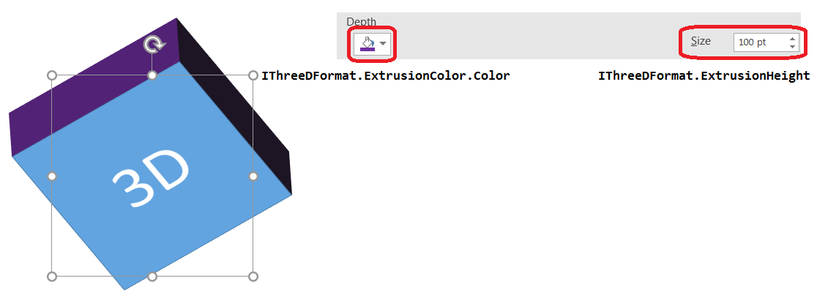

## **Přehled**

Aspose.Slides for Python via .NET může vytvářet, upravovat, zachovávat a vykreslovat 3D formátování ve stylu PowerPointu pro tvary a text. Tento článek popisuje 3D efekty jako rotaci, extruzi, zkosení, osvětlení, materiál, gradientové nebo obrázkové výplně a 3D text.

{}

Tento článek se zabývá 3D formátovacími efekty na tvarech a textu v PowerPointu. Nejedná se o vkládání nebo úpravu samostatných souborů 3D modelů. Při exportu snímku do obrázku, PDF nebo HTML Aspose.Slides vykreslí tyto 3D efekty do exportovaného 2D výstupu.

{}

## **Koncepty 3D formátování**

Použijte vlastnost [Shape.three_d_format](https://reference.aspose.com/slides/python-net/aspose.slides/shape/three_d_format/) pro aplikaci 3D formátování na tvar. Vlastnost poskytuje [ThreeDFormat](https://reference.aspose.com/slides/python-net/aspose.slides/threedformat/), který řídí 3D scénu pro daný tvar.

Pro text použijte vlastnost [TextFrameFormat.three_d_format](https://reference.aspose.com/slides/python-net/aspose.slides/textframeformat/three_d_format/). Tím se použije 3D formátování na textový rámec místo těla tvaru.

Nejdůležitější vlastnosti jsou:

| Vlastnost | Co řídí | Kdy použít |
|---|---|---|
| [camera](https://reference.aspose.com/slides/python-net/aspose.slides/threedformat/camera/) | Pohled, přednastavený typ kamery, rotace, zoom a perspektiva. | Otočit objekt ve 3D prostoru nebo použít přednastavený 3D rotaci z PowerPointu. |
| [light_rig](https://reference.aspose.com/slides/python-net/aspose.slides/threedformat/light_rig/) | Přednastavení světla, směr a rotace světla. | Změnit, jak se zobrazují zvýraznění a stíny na 3D povrchu. |
| [material](https://reference.aspose.com/slides/python-net/aspose.slides/threedformat/material/) | Materiál povrchu, např. plochý, matný, plastový nebo kovový. | Získat stejnou geometrii s plochějším, měkčím, lesklým nebo kovovým vzhledem. |
| [extrusion_height](https://reference.aspose.com/slides/python-net/aspose.slides/threedformat/extrusion_height/) | Jak daleko tvar vyčnívá dozadu od své přední plochy. | Proměnit plochý tvar na viditelně silný 3D objekt. |
| [extrusion_color](https://reference.aspose.com/slides/python-net/aspose.slides/threedformat/extrusion_color/) | Barva extrudovaných stěn. | Zobrazit hloubku nebo sladit barvu stran s přední výplní. |
| [depth](https://reference.aspose.com/slides/python-net/aspose.slides/threedformat/depth/) | Další 3D hloubka použita v PowerPointu. | Jemně doladit hloubku tvarů nebo textu, zejména spolu s nastavením zkosení a materiálu. |
| [bevel_top](https://reference.aspose.com/slides/python-net/aspose.slides/threedformat/bevel_top/) a [bevel_bottom](https://reference.aspose.com/slides/python-net/aspose.slides/threedformat/bevel_bottom/) | Zvýšené nebo zaoblené hrany na přední a zadní ploše. | Přidat zjemněnou nebo formovanou hranu místo ostré ploché plochy. |
| [contour_color](https://reference.aspose.com/slides/python-net/aspose.slides/threedformat/contour_color/) a [contour_width](https://reference.aspose.com/slides/python-net/aspose.slides/threedformat/contour_width/) | Obrys kolem 3D objektu. | Zvýraznit hranice objektu ve vykresleném výstupu. |

## **Vytvoření 3D tvaru**

Tvar obvykle potřebuje čtyři typy nastavení, než vypadá přesvědčivě 3D:

- Nastavení kamery, protože výchozí přední pohled může skrýt extruzi.
- Nastavení světla, protože osvětlení dělá povrchy a strany čitelné.
- Nastavení materiálu, protože povrch ovlivňuje, jak je světlo vykresleno.
- Nastavení extruze nebo hloubky, protože plochý tvar potřebuje tloušťku.

Následující příklad vytvoří obdélník, přidá text na jeho přední plochu a použije 3D formátování. Hodnoty rotace kamery jsou ve stupních a výška extruze je 100 bodů. Příklad vykreslí snímek do PNG obrázku při dvojnásobné výchozí velikosti a uloží prezentaci jako PPTX.

```py
import aspose.pydrawing as drawing
import aspose.slides as slides

image_scale = 2

with slides.Presentation() as presentation:
    slide = presentation.slides[0]

    shape = slide.shapes.add_auto_shape(slides.ShapeType.RECTANGLE, 200, 150, 200, 200)

    shape.text_frame.text = "3D"
    shape.text_frame.paragraphs[0].paragraph_format.default_portion_format.font_height = 64

    shape.fill_format.fill_type = slides.FillType.SOLID
    shape.fill_format.solid_fill_color.color = drawing.Color.cornflower_blue

    shape.three_d_format.camera.camera_type = slides.CameraPresetType.ORTHOGRAPHIC_FRONT
    shape.three_d_format.camera.set_rotation(20, 30, 40)
    shape.three_d_format.light_rig.light_type = slides.LightRigPresetType.FLAT
    shape.three_d_format.light_rig.direction = slides.LightingDirection.TOP
    shape.three_d_format.material = slides.MaterialPresetType.FLAT
    shape.three_d_format.extrusion_height = 100
    shape.three_d_format.extrusion_color.color = drawing.Color.blue

    with slide.get_image(image_scale, image_scale) as thumbnail:
        thumbnail.save("shape_3d.png")

    presentation.save("shape_3d.pptx", slides.export.SaveFormat.PPTX)
```

Vykreslený obrázek snímku ukazuje obdélník jako silný 3D blok:


## **Otočení tvaru pomocí kamery**

V PowerPointu se 3D rotace nastavuje v podokně 3‑D Rotation. Hodnoty rotace X, Y a Z odpovídají rotaci nastavené pomocí API kamery.


V Aspose.Slides přistupujte ke kameře přes [ThreeDFormat.camera](https://reference.aspose.com/slides/python-net/aspose.slides/threedformat/camera/). Tento příklad vytvoří obdélník, vybere ortografický přední pohled a nastaví jeho rotace X, Y a Z na 20, 30 a 40 stupňů. Konfigurace proběhne v paměti bez ukládání souboru:

```py
import aspose.slides as slides

with slides.Presentation() as presentation:
    slide = presentation.slides[0]

    shape = slide.shapes.add_auto_shape(slides.ShapeType.RECTANGLE, 200, 150, 200, 200)

    shape.three_d_format.camera.camera_type = slides.CameraPresetType.ORTHOGRAPHIC_FRONT
    shape.three_d_format.camera.set_rotation(20, 30, 40)
```

Použijte kameru, když potřebujete změnit, jak divák objekt vidí. Nemění 2D geometrii tvaru na snímku. Mění 3D pohled, který používá PowerPoint i Aspose.Slides při vykreslování.

### **Zkopírování orientace kamery ze šablonového tvaru**

Pro sladění orientace šablonového tvaru zkopírujte jeho přednastavení [camera_type](https://reference.aspose.com/slides/python-net/aspose.slides/camera/camera_type/) a načtěte jeho rotaci pomocí [get_rotation](https://reference.aspose.com/slides/python-net/aspose.slides/camera/get_rotation/). Příklad otevře `template.pptx` a zkopíruje orientaci kamery z prvního tvaru na první snímku na druhý tvar. Oba tvary již mají 3D osvětlení a druhý tvar nemá explicitní rotaci kamery.

Úhly jsou ve stupních. Indexy `0`, `1` a `2` představují šířku, výšku a otáčku. Předávejte je do [set_rotation](https://reference.aspose.com/slides/python-net/aspose.slides/camera/set_rotation/) v tomto pořadí. Pokud zdroj nemá explicitní rotaci, `get_rotation` vrátí `None`, takže ponechte cílové úhly nenastavené. Pokud zdroj explicitně nastaví všechny tři úhly na nulu, zkopírujte tyto nuly.

```python
import aspose.slides as slides

with slides.Presentation("template.pptx") as presentation:
    shapes = presentation.slides[0].shapes
    
    source_camera = shapes[0].three_d_format.camera
    destination_camera = shapes[1].three_d_format.camera

    destination_camera.camera_type = source_camera.camera_type
    angles = source_camera.get_rotation()
    if angles is not None:
        destination_camera.set_rotation(angles[0], angles[1], angles[2])

    presentation.save("camera-copy.pptx", slides.export.SaveFormat.PPTX)
```

Když znovu otevřete `camera-copy.pptx` v PowerPointu, oba tvary mají stejné přednastavení kamery a rotaci. Šipka vpravo používá orientaci zkopírovanou z obdélníku vlevo. Oba tvary používají stejné osvětlení a hloubku extruze.


## **Přidání extruze a hloubky**

Extruze dává tvaru objem tím, že ho prodlouží za přední plochu. V PowerPointu ovládá hloubka tuto viditelnou tloušťku a barva ovládá barvu bočních ploch.



Nastavte [ThreeDFormat.extrusion_height](https://reference.aspose.com/slides/python-net/aspose.slides/threedformat/extrusion_height/) pro tloušťku a [ThreeDFormat.extrusion_color](https://reference.aspose.com/slides/python-net/aspose.slides/threedformat/extrusion_color/) pro barvu stran. Tento příklad dává obdélníku extruzi 100 bodů s fialovými stranami a otáčí kameru, aby odhalila jeho tloušťku. Konfigurace proběhne v paměti bez ukládání souboru:

```py
import aspose.pydrawing as drawing
import aspose.slides as slides

with slides.Presentation() as presentation:
    slide = presentation.slides[0]

    shape = slide.shapes.add_auto_shape(slides.ShapeType.RECTANGLE, 200, 150, 200, 200)

    shape.three_d_format.camera.camera_type = slides.CameraPresetType.ORTHOGRAPHIC_FRONT
    shape.three_d_format.camera.set_rotation(20, 30, 40)
    shape.three_d_format.light_rig.light_type = slides.LightRigPresetType.FLAT
    shape.three_d_format.light_rig.direction = slides.LightingDirection.TOP
    shape.three_d_format.material = slides.MaterialPresetType.FLAT
    shape.three_d_format.extrusion_height = 100
    shape.three_d_format.extrusion_color.color = drawing.Color.purple
```

Vlastnost [ThreeDFormat.depth](https://reference.aspose.com/slides/python-net/aspose.slides/threedformat/depth/) nastavuje hloubku 3D tvaru. Vlastnost [extrusion_height](https://reference.aspose.com/slides/python-net/aspose.slides/threedformat/extrusion_height/) řídí výšku efektu extruze, jak je ukázáno v tomto příkladu.

## **Použití gradientových nebo obrázkových výplní s 3D efekty**

3D formátování je nezávislé na výplni tvaru. Můžete použít jednolitou barvu, gradient, vzor nebo obrázkovou výplň na přední plochu a přesto používat stejnou kameru, světlo, materiál a nastavení extruze.

Tento příklad použije gradient od modré po oranžovou na přední plochu a tmavě oranžovou barvu na 150‑bodovou extruzi. Zastávky gradientu na 0 % a 100 % označují začátek a konec gradientu. Hodnoty rotace kamery jsou ve stupních. Snímek je vykreslen do PNG obrázku při dvojnásobné výchozí velikosti:

```py
import aspose.pydrawing as drawing
import aspose.slides as slides

image_scale = 2

with slides.Presentation() as presentation:
    slide = presentation.slides[0]

    shape = slide.shapes.add_auto_shape(slides.ShapeType.RECTANGLE, 200, 150, 250, 250)

    shape.text_frame.text = "3D Gradient"
    shape.text_frame.paragraphs[0].paragraph_format.default_portion_format.font_height = 64

    shape.fill_format.fill_type = slides.FillType.GRADIENT
    shape.fill_format.gradient_format.gradient_stops.add(0, drawing.Color.blue)
    shape.fill_format.gradient_format.gradient_stops.add(100, drawing.Color.orange)

    shape.three_d_format.camera.camera_type = slides.CameraPresetType.ORTHOGRAPHIC_FRONT
    shape.three_d_format.camera.set_rotation(10, 20, 30)
    shape.three_d_format.light_rig.light_type = slides.LightRigPresetType.FLAT
    shape.three_d_format.light_rig.direction = slides.LightingDirection.TOP
    shape.three_d_format.material = slides.MaterialPresetType.FLAT
    shape.three_d_format.extrusion_height = 150
    shape.three_d_format.extrusion_color.color = drawing.Color.dark_orange

    with slide.get_image(image_scale, image_scale) as thumbnail:
        thumbnail.save("gradient_3d.png")
```

Vykreslený výstup zachovává gradient na přední ploše a extruzi vykresluje samostatně:


Pro použití obrázkové výplně přidejte obrázek do prezentace a přiřaďte jej výplni tvaru. Tento příklad vyžaduje existující soubor s názvem „image.jpg“ v pracovním adresáři. Obrázek roztáhne tak, aby vyplnil obdélník, použije extruzi 150 bodů a nastaví rotaci kamery ve stupních. Konfigurace proběhne v paměti bez ukládání nebo vykreslování souboru:

```py
import aspose.pydrawing as drawing
import aspose.slides as slides

with open("image.jpg", "rb") as image_file:
    image_data = image_file.read()

with slides.Presentation() as presentation:
    slide = presentation.slides[0]

    shape = slide.shapes.add_auto_shape(slides.ShapeType.RECTANGLE, 200, 150, 250, 250)

    image = presentation.images.add_image(image_data)

    shape.fill_format.fill_type = slides.FillType.PICTURE
    shape.fill_format.picture_fill_format.picture.image = image
    shape.fill_format.picture_fill_format.picture_fill_mode = slides.PictureFillMode.STRETCH

    shape.three_d_format.camera.camera_type = slides.CameraPresetType.ORTHOGRAPHIC_FRONT
    shape.three_d_format.camera.set_rotation(10, 20, 30)
    shape.three_d_format.light_rig.light_type = slides.LightRigPresetType.FLAT
    shape.three_d_format.light_rig.direction = slides.LightingDirection.TOP
    shape.three_d_format.material = slides.MaterialPresetType.FLAT
    shape.three_d_format.extrusion_height = 150
    shape.three_d_format.extrusion_color.color = drawing.Color.dark_orange
```

Obrázek je vykreslen na přední ploše, zatímco extruze je vykreslena jako 3D boční povrch:


## **Aplikace 3D formátování na text**

3D formátování tvaru ovlivňuje tělo tvaru. 3D formátování textu ovlivňuje textový rámec. To je užitečné pro efekty podobné WordArt, kde samotná písmena potřebují extruzi, materiál, osvětlení a nastavení kamery.

Následující příklad vytvoří text s oranžovo‑bílem mřížkovým vzorem, použije zakřivení nahoru a nastaví 3D parametry přes [TextFrameFormat.three_d_format](https://reference.aspose.com/slides/python-net/aspose.slides/textframeformat/three_d_format/). Výška extruze a hloubka jsou v bodech, rotace světla ve stupních. Výplň a obrys tvaru jsou skryté, aby byl viditelný jen text. Příklad vykreslí PNG obrázek při dvojnásobné výchozí velikosti snímku a uloží prezentaci jako PPTX:

```py
import aspose.pydrawing as drawing
import aspose.slides as slides

image_scale = 2

with slides.Presentation() as presentation:
    slide = presentation.slides[0]

    shape = slide.shapes.add_auto_shape(slides.ShapeType.RECTANGLE, 200, 150, 250, 250)
    
    shape.fill_format.fill_type = slides.FillType.NO_FILL
    shape.line_format.fill_format.fill_type = slides.FillType.NO_FILL
    shape.text_frame.text = "3D Text"

    portion = shape.text_frame.paragraphs[0].portions[0]
    portion.portion_format.fill_format.fill_type = slides.FillType.PATTERN
    portion.portion_format.fill_format.pattern_format.fore_color.color = drawing.Color.dark_orange
    portion.portion_format.fill_format.pattern_format.back_color.color = drawing.Color.white
    portion.portion_format.fill_format.pattern_format.pattern_style = slides.PatternStyle.LARGE_GRID

    shape.text_frame.paragraphs[0].paragraph_format.default_portion_format.font_height = 128

    text_frame_format = shape.text_frame.text_frame_format
    text_frame_format.transform = slides.TextShapeType.ARCH_UP
    text_frame_format.three_d_format.extrusion_height = 3.5
    text_frame_format.three_d_format.depth = 3
    text_frame_format.three_d_format.material = slides.MaterialPresetType.PLASTIC
    text_frame_format.three_d_format.light_rig.direction = slides.LightingDirection.TOP
    text_frame_format.three_d_format.light_rig.light_type = slides.LightRigPresetType.BALANCED
    text_frame_format.three_d_format.light_rig.set_rotation(0, 0, 40)
    text_frame_format.three_d_format.camera.camera_type = slides.CameraPresetType.PERSPECTIVE_CONTRASTING_RIGHT_FACING

    with slide.get_image(image_scale, image_scale) as thumbnail:
        thumbnail.save("text_3d.png")

    presentation.save("text_3d.pptx", slides.export.SaveFormat.PPTX)
```

Text je vykreslen jako zakřivené, extrudované 3D písmo:


## **Udržet text plochý na 3D tvaru**

Aby text zůstal čitelný a zároveň tvar zachovával 3D vzhled, nastavte [TextFrameFormat.keep_text_flat](https://reference.aspose.com/slides/python-net/aspose.slides/textframeformat/keep_text_flat/) přes [TextFrame.text_frame_format](https://reference.aspose.com/slides/python-net/aspose.slides/textframe/text_frame_format/). Když je hodnota `True`, text zůstává mimo 3D scénu. Když je `False`, text se podílí na scéně a následuje její 3D orientaci.

Toto nastavení neodstraňuje 3D formátování tvaru: jeho kamera, osvětlení, materiál a extruze zůstávají nastaveny přes [Shape.three_d_format](https://reference.aspose.com/slides/python-net/aspose.slides/shape/three_d_format/). Liší se to také od běžné rotace. [Shape.rotation](https://reference.aspose.com/slides/python-net/aspose.slides/shape/rotation/) otáčí tvar v rovině snímku, zatímco [TextFrameFormat.rotation_angle](https://reference.aspose.com/slides/python-net/aspose.slides/textframeformat/rotation_angle/) řídí vlastní rotaci textu v jeho ohraničující krabici. Zachování textu mimo 3D scénu neresetuje žádný z těchto úhlů.

Následující samostatný příklad vytvoří modrý obdélník s textem a duplikuje jej vedle originálu. Oba tvary mají stejné 3D formátování; liší se jen nastavením textu: `False` vlevo a `True` vpravo. Úhly kamery jsou ve stupních a výška extruze 40 bodů. Příklad uloží prezentaci jako PPTX a vykreslí srovnávací snímek do PNG při dvojnásobné výchozí velikosti.

```py
import aspose.pydrawing as drawing
import aspose.slides as slides

with slides.Presentation() as presentation:
    slide = presentation.slides[0]

    shape = slide.shapes.add_auto_shape(slides.ShapeType.RECTANGLE, 70, 160, 240, 140)

    shape.text_frame.text = "Readable text"
    shape.text_frame.paragraphs[0].paragraph_format.default_portion_format.font_height = 28
    shape.text_frame.paragraphs[0].paragraph_format.alignment = slides.TextAlignment.CENTER
    shape.text_frame.text_frame_format.anchoring_type = slides.TextAnchorType.CENTER
    shape.fill_format.fill_type = slides.FillType.SOLID
    shape.fill_format.solid_fill_color.color = drawing.Color.cornflower_blue

    shape.three_d_format.camera.camera_type = slides.CameraPresetType.ORTHOGRAPHIC_FRONT
    shape.three_d_format.camera.set_rotation(30, 30, 0)
    shape.three_d_format.light_rig.light_type = slides.LightRigPresetType.FLAT
    shape.three_d_format.light_rig.direction = slides.LightingDirection.TOP
    shape.three_d_format.material = slides.MaterialPresetType.FLAT
    shape.three_d_format.extrusion_height = 40
    shape.three_d_format.extrusion_color.color = drawing.Color.royal_blue
    shape.text_frame.text_frame_format.keep_text_flat = False

    flat_text_shape = slide.shapes.add_clone(shape, 400, 160)
    flat_text_shape.text_frame.text_frame_format.keep_text_flat = True

    presentation.save("keep_text_flat.pptx", slides.export.SaveFormat.PPTX)
    with slide.get_image(2, 2) as image:
        image.save("keep_text_flat.png")
```

Vlevo text následuje 3D orientaci. Vpravo zůstává plochý a snadněji čitelný. Oba obdélníky si zachovávají stejnou viditelnou extruzi a 3D orientaci.


## **Export a chování při renderování**

Aspose.Slides zachovává 3D formátování při ukládání do formátů PowerPointu, jako je PPTX. Při renderování nebo exportu do formátů s pevnou rozlohou je 3D scéna rasterizována nebo nakreslena do výstupu jako 2D výsledek. To platí, když renderujete snímky do [PNG](/slides/cs/python-net/convert-powerpoint-to-png/), exportujete do [PDF](/slides/cs/python-net/convert-powerpoint-to-pdf/), exportujete do [HTML](/slides/cs/python-net/convert-powerpoint-to-html/), nebo generujete snímky pro [konverzi videa](/slides/cs/python-net/convert-powerpoint-to-video/).

Mějte na paměti následující body:

- Exportované obrázky a PDF nejsou interaktivní. Objekt nelze po exportu otáčet.
- Konečný vzhled závisí na kombinaci kamery, osvětlení, materiálu, extruze, výplně a měřítka snímku.
- Pokud potřebujete zkontrolovat zděděné nebo na tématu založené hodnoty formátování, přečtěte si [efektivní vlastnosti tvaru](/slides/cs/python-net/shape-effective-properties/).
- Některé výstupní formáty nemohou uložit editovatelné 3D formátování PowerPointu. V takových formátech je vizuální výsledek vykreslený místo toho, aby byl uložen jako editovatelné 3D nastavení.

## **Často kladené otázky**

**Může Aspose.Slides vytvářet interaktivní 3D prezentace?**

Aspose.Slides vytváří a renderuje 3D efekty PowerPointu pro tvary a text. Nevytváří interaktivní 3D scény v exportovaných obrázcích, PDF nebo HTML, které by uživatel mohl otáčet. V PPTX zůstává 3D formátování editovatelné v PowerPointu, pokud formát podporuje editaci.

**Jaký je rozdíl mezi 3D modelem a 3D efektem?**

3D model je samostatný 3D objekt vložený do prezentace. 3D efekt je formátování aplikované na běžný tvar nebo text v PowerPointu, jako je rotace, extruze, zkosení, osvětlení a materiál. Tento článek se zabývá 3D efekty.

**Která nastavení jsou potřebná pro viditelný 3D tvar?**

Minimálně nastavte rotaci kamery a buď extruzi, nebo hloubku. V praxi také nastavte osvětlení a materiál, aby měly vykreslené povrchy jasná zvýraznění a stíny.

**Mohu aplikovat 3D efekty jak na tvary, tak na text?**

Ano. Použijte [Shape.three_d_format](https://reference.aspose.com/slides/python-net/aspose.slides/shape/three_d_format/) pro tělo tvaru a [TextFrameFormat.three_d_format](https://reference.aspose.com/slides/python-net/aspose.slides/textframeformat/three_d_format/) pro text.

**Objeví se 3D efekty při exportu do obrázků, PDF, HTML nebo video snímků?**

Ano. Aspose.Slides vykresluje 3D efekty při tvorbě obrázků snímků, PDF, HTML a snímků použité pro konverzi videa. Exportovaný výstup obsahuje vykreslený vzhled, nikoli editovatelný 3D objekt.

**Mohu přečíst finální 3D hodnoty po aplikaci dědičnosti a témat?**

Ano. Použijte API efektivního formátování popsané v [Shape Effective Properties](/slides/cs/python-net/shape-effective-properties/) k načtení konečních hodnot kamery, osvětlení, zkosení a souvisejících 3D parametrů.