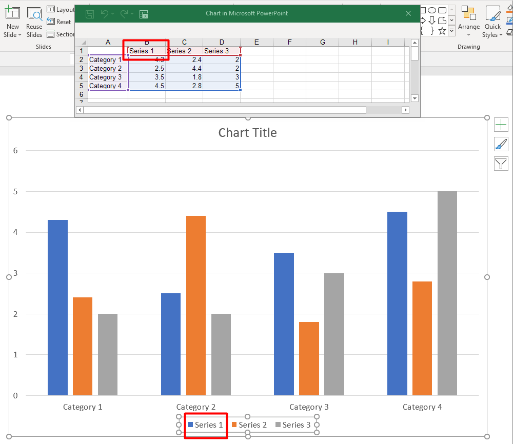

## **Přehled**

Graf může ukládat své vykreslené hodnoty do buněk pracovního sešitu nebo přímo jako číselné literály. [ChartSeries](https://reference.aspose.com/slides/python-net/aspose.slides.charts/chartseries/) představuje jednu sadu souvisejících hodnot a každý [ChartDataPoint](https://reference.aspose.com/slides/python-net/aspose.slides.charts/chartdatapoint/) představuje bod v této sérii. Objekt [ChartCategory](https://reference.aspose.com/slides/python-net/aspose.slides.charts/chartcategory/) poskytuje štítky nebo hodnoty seskupení sdílené sériemi. V grafech vytvořených s výchozími daty se názvy sérií, kategorie a hodnoty bodů používají objekty [ChartDataCell](https://reference.aspose.com/slides/python-net/aspose.slides.charts/chartdatacell/) z pracovního sešitu grafu.

Pro typický kategoriální graf výchozí sešit používá řádek 0 pro názvy sérií, sloupec 0 pro názvy kategorií a zbývající buňky pro hodnoty sérií. Indexy listu, řádku a sloupce předávané metodě [ChartDataWorkbook.get_cell](https://reference.aspose.com/slides/python-net/aspose.slides.charts/chartdataworkbook/get_cell/) jsou nulové. Toto rozvržení je užitečné při tvorbě grafu s výchozími daty, ale nemělo by se předpokládat, že jej používá každý existující graf. Pro načtenou prezentaci před změnou hodnot v sešitu zkontrolujte buňky, na které odkazují série, kategorie a datové body.

Nastavení grafu mají tři různé úrovně:

- Nastavení na úrovni série, například [ChartSeries.format](https://reference.aspose.com/slides/python-net/aspose.slides.charts/chartseries/format/), poskytuje výchozí vzhled pro všechny body v jedné sérii.
- Nastavení datového bodu, například [ChartDataPoint.format](https://reference.aspose.com/slides/python-net/aspose.slides.charts/chartdatapoint/format/), přebíjí vzhled série pro jeden bod.
- Skupinová nastavení se vztahují na kompatibilní série, které patří do stejné [ChartSeriesGroup](https://reference.aspose.com/slides/python-net/aspose.slides.charts/chartseriesgroup/). Přístup ke skupině získáte přes [ChartSeries.parent_series_group](https://reference.aspose.com/slides/python-net/aspose.slides.charts/chartseries/parent_series_group/) když potřebujete nastavit možnosti jako překrytí nebo šířku mezery.

Když není nastaven výplňový styl pro bod ani sérii, určuje automatický vzhled styl grafu a motiv. Když jsou přítomny formátování série i bodu, má přednost formátování bodu.



## **Nastavení hodnot sérií pomocí číselných literálů**

Používejte číselné literály, když hodnoty sérií pocházejí z aplikací nebo výpočtů a nepotřebují odkazy na buňky listu. Nastavte [data_source_type_for_values](https://reference.aspose.com/slides/python-net/aspose.slides.charts/chartdatapointcollection/data_source_type_for_values/) na [DataSourceType.DOUBLE_LITERALS](https://reference.aspose.com/slides/python-net/aspose.slides.charts/datasourcetype/) před přiřazením [value](https://reference.aspose.com/slides/python-net/aspose.slides.charts/chartdatapoint/value/) každého bodu pomocí [as_literal_double](https://reference.aspose.com/slides/python-net/aspose.slides.charts/doublechartvalue/as_literal_double/).

Nastavení kolekce řídí typ zdroje všech hodnot bodů v dané sérii. Každý bod vrací [value.data_source_type](https://reference.aspose.com/slides/python-net/aspose.slides.charts/basechartvalue/data_source_type/) vybraný typ; změňte jej přes nastavení kolekce. S typem `WORKSHEET` použijte [as_cell](https://reference.aspose.com/slides/python-net/aspose.slides.charts/doublechartvalue/as_cell/) pro přístup k odkazované buňce. S typem `DOUBLE_LITERALS` použijte `as_literal_double` pro přímý zápis nebo čtení čísla.

Následující příklad vytváří sloupcový graf s výchozími sériemi a kategoriemi a přiřazuje vypočtené hodnoty 10, 20 … k existujícím bodům první série. Uloží prezentaci, znovu ji otevře a vypíše uložené hodnoty.

```py
import aspose.slides as slides
import aspose.slides.charts as charts

with slides.Presentation() as presentation:
    slide = presentation.slides[0]

    chart = slide.shapes.add_chart(charts.ChartType.CLUSTERED_COLUMN, 20, 20, 500, 300)
    series = chart.chart_data.series[0]

    series.data_points.data_source_type_for_values = charts.DataSourceType.DOUBLE_LITERALS
    for i in range(len(series.data_points)):
        series.data_points[i].value.as_literal_double = (i + 1) * 10

    presentation.save("numeric_literals.pptx", slides.export.SaveFormat.PPTX)

with slides.Presentation("numeric_literals.pptx") as reopened_presentation:
    reopened_slide = reopened_presentation.slides[0]
    reopened_chart = reopened_slide.shapes[0]
    reopened_series = reopened_chart.chart_data.series[0]
    for point in reopened_series.data_points:
        print(point.value.as_literal_double)
```

Typ zdroje hodnoty bodu je oddělený od [ChartData.data_source_type](https://reference.aspose.com/slides/python-net/aspose.slides.charts/chartdata/data_source_type/), který určuje konfiguraci interního nebo externího sešitu grafu. Použití číselných literálů samo o sobě neodstraňuje vložený sešit. V tomto příkladu sešit zůstává dostupný pro popisky kategorií, názvy sérií a další série. Viz [Chart Workbook](/slides/cs/python-net/chart-workbook/) pro správu sešitu.

Pro rozptylové a bublinové grafy nastavte [data_source_type_for_x_values](https://reference.aspose.com/slides/python-net/aspose.slides.charts/chartdatapointcollection/data_source_type_for_x_values/) a [data_source_type_for_y_values](https://reference.aspose.com/slides/python-net/aspose.slides.charts/chartdatapointcollection/data_source_type_for_y_values/) a vyberte zdroje pro [x_value](https://reference.aspose.com/slides/python-net/aspose.slides.charts/chartdatapoint/x_value/) a [y_value](https://reference.aspose.com/slides/python-net/aspose.slides.charts/chartdatapoint/y_value/). Bublinové grafy také používají [data_source_type_for_bubble_sizes](https://reference.aspose.com/slides/python-net/aspose.slides.charts/chartdatapointcollection/data_source_type_for_bubble_sizes/) pro [bubble_size](https://reference.aspose.com/slides/python-net/aspose.slides.charts/chartdatapoint/bubble_size/). Nastavte každý relevantní zdroj na `DOUBLE_LITERALS` před přiřazením čísel přes vlastnost `as_literal_double`.

## **Nastavení překrytí sérií grafu**

[ChartSeries.overlap](https://reference.aspose.com/slides/python-net/aspose.slides.charts/chartseries/overlap/) udává, jak moc se překrývají pruhy nebo sloupce ve 2D grafu, v rozmezí –100 % až 100 %. Jedná se o pouze ke čtení projekci nastavení na nadřazenou skupinu sérií. Nastavte [ChartSeriesGroup.overlap](https://reference.aspose.com/slides/python-net/aspose.slides.charts/chartseriesgroup/overlap/) a aktualizujete tak všechny kompatibilní série ve skupině. Tato možnost se vztahuje na typy grafů, které zobrazují seskupené pruhy nebo sloupce; neovlivní nesouvisející skupiny sérií v kombinovaném grafu.

Následující příklad nastavuje překrytí pro skupinu, která obsahuje první sérii:

```py
import aspose.slides as slides
import aspose.slides.charts as charts

first_slide_index = 0
first_series_index = 0
overlap_percent = 30

with slides.Presentation() as presentation:
    slide = presentation.slides[first_slide_index]

    # Nový graf obsahuje ukázkové série, kategorie a hodnoty.
    chart = slide.shapes.add_chart(charts.ChartType.CLUSTERED_COLUMN, 20, 20, 500, 200)

    series = chart.chart_data.series[first_series_index]
    series.parent_series_group.overlap = overlap_percent

    presentation.save("series_overlap.pptx", slides.export.SaveFormat.PPTX)
```

Výsledek:


## **Změna barvy výplně série**

Použijte [ChartSeries.format](https://reference.aspose.com/slides/python-net/aspose.slides.charts/chartseries/format/) k nastavení výchozí výplně celé série. Pokud má bod explicitně nastavenou výplň, její nastavení [ChartDataPoint.format](https://reference.aspose.com/slides/python-net/aspose.slides.charts/chartdatapoint/format/) přebije výplň série pro tento bod.

Následující příklad aplikuje jednolitou modrou výplň na první sérii:

```py
import aspose.pydrawing as drawing
import aspose.slides as slides
import aspose.slides.charts as charts

first_slide_index = 0
first_series_index = 0

with slides.Presentation() as presentation:
    slide = presentation.slides[first_slide_index]

    chart = slide.shapes.add_chart(charts.ChartType.CLUSTERED_COLUMN, 20, 20, 500, 200)

    series = chart.chart_data.series[first_series_index]
    series.format.fill.fill_type = slides.FillType.SOLID
    series.format.fill.solid_fill_color.color = drawing.Color.blue

    presentation.save("series_color.pptx", slides.export.SaveFormat.PPTX)
```

Výsledek:


## **Změna názvu série**

Název série je uložen v pracovním sešitu grafu a obvykle se zobrazuje v legendě. Ve výchozím sešitu vytvořeném pro seskupený sloupcový graf je buňka B1 v řádku 0, sloupci 1 a obsahuje název první série. Následující pojmenované konstanty dělají tuto strukturu explicitní:

```py
import aspose.slides as slides
import aspose.slides.charts as charts

first_slide_index = 0
worksheet_index = 0
series_name_row_index = 0
first_series_column_index = 1

with slides.Presentation() as presentation:
    slide = presentation.slides[first_slide_index]

    chart = slide.shapes.add_chart(charts.ChartType.CLUSTERED_COLUMN, 20, 20, 500, 200)

    workbook = chart.chart_data.chart_data_workbook
    series_name_cell = workbook.get_cell(worksheet_index, series_name_row_index, first_series_column_index)
    series_name_cell.value = "Revenue"

    presentation.save("series_name.pptx", slides.export.SaveFormat.PPTX)
```

Můžete také aktualizovat buňku, na kterou již odkazuje [ChartSeries.name](https://reference.aspose.com/slides/python-net/aspose.slides.charts/chartseries/name/). Tento přístup se vyhýbá předpokladu konkrétního řádku a sloupce v existujícím grafu:

```py
import aspose.slides as slides
import aspose.slides.charts as charts

first_slide_index = 0
first_series_index = 0
first_name_cell_index = 0

with slides.Presentation() as presentation:
    slide = presentation.slides[first_slide_index]

    chart = slide.shapes.add_chart(charts.ChartType.CLUSTERED_COLUMN, 20, 20, 500, 200)

    series = chart.chart_data.series[first_series_index]
    series_name_cell = series.name.as_cells[first_name_cell_index]
    series_name_cell.value = "Revenue"

    presentation.save("series_name.pptx", slides.export.SaveFormat.PPTX)
```

Výsledek:


### **Vytvoření série s názvem z více buněk**

Složený název série je užitečný, když jsou název produktu a vykazovací období uloženy v samostatných buňkách sešitu. Například můžete zkombinovat `Product A` v B1 a `2026` v C1 do jednoho názvu série při zachování propojení na zdrojové buňky.

Použijte [ChartDataWorkbook.get_cell_collection](https://reference.aspose.com/slides/python-net/aspose.slides.charts/chartdataworkbook/get_cell_collection/) k získání rozsahu názvu a tento sběr předávejte metodě [ChartSeriesCollection.add](https://reference.aspose.com/slides/python-net/aspose.slides.charts/chartseriescollection/add/). Argument `skip_hidden_cells` určuje, zda jsou zahrnuty skryté buňky: `True` je vyloučí, `False` zahrne. Tento příklad používá `False` pro zahrnutí všech buněk v rozsahu názvu.

Následující příklad vytváří prezentaci s jednou sérií a dvěma datovými body. Buňky B1:C1 obsahují jen název série; A2:A3 dodávají štítky kategorií a B2:B3 číselné hodnoty.

```py
import aspose.slides as slides
import aspose.slides.charts as charts

with slides.Presentation() as presentation:
    slide = presentation.slides[0]

    chart = slide.shapes.add_chart(charts.ChartType.CLUSTERED_COLUMN, 50, 50, 620, 180)

    chart.chart_data.series.clear()
    chart.chart_data.categories.clear()
    chart.has_legend = True

    workbook = chart.chart_data.chart_data_workbook
    workbook.clear(0)

    # Tyto dvě buňky poskytují název série.
    workbook.get_cell(0, 0, 1, "Product A")
    workbook.get_cell(0, 0, 2, "2026")
    name_cells = workbook.get_cell_collection("Sheet1!$B$1:$C$1", False)
    series = chart.chart_data.series.add(name_cells, charts.ChartType.CLUSTERED_COLUMN)

    # Samostatné buňky poskytují kategorie a číselné datové body.
    north_category = workbook.get_cell(0, 1, 0, "North")
    south_category = workbook.get_cell(0, 2, 0, "South")
    chart.chart_data.categories.add(north_category)
    chart.chart_data.categories.add(south_category)
    north_value = workbook.get_cell(0, 1, 1, 120)
    south_value = workbook.get_cell(0, 2, 1, 150)
    series.data_points.add_data_point_for_bar_series(north_value)
    series.data_points.add_data_point_for_bar_series(south_value)

    presentation.save("composite_series_name.pptx", slides.export.SaveFormat.PPTX)
```

Výsledný název série je `Product A 2026` s mezerou mezi dvěma hodnotami buněk. Legenda zobrazuje tuto kombinaci jako jednu položku pro oba sloupce. Obrázek níže byl vygenerován ze uložené prezentace:


## **Získání automatické barvy výplně série**

[ChartSeries.get_automatic_series_color](https://reference.aspose.com/slides/python-net/aspose.slides.charts/chartseries/get_automatic_series_color/) vrací barvu vypočtenou z indexu série a stylu grafu. Jedná se o barvu používanou, pokud výplň série není explicitně definována. Volání metody pouze čte vypočtenou barvu; nenastavuje novou výplň.

Následující příklad vypisuje automatickou barvu každé výchozí série:

```py
import aspose.slides as slides
import aspose.slides.charts as charts

first_slide_index = 0

with slides.Presentation() as presentation:
    slide = presentation.slides[first_slide_index]

    chart = slide.shapes.add_chart(charts.ChartType.CLUSTERED_COLUMN, 20, 20, 500, 200)

    series_count = len(chart.chart_data.series)
    for series_index in range(series_count):
        series = chart.chart_data.series[series_index]
        automatic_color = series.get_automatic_series_color()
        print(f"Series {series_index}: {automatic_color.name}")
```

Výstup pro výchozí styl grafu:

```text
Series 0: ff4f81bd
Series 1: ffc0504d
Series 2: ff9bbb59
```

Přesné barvy závisí na stylu a motivu grafu.

## **Nastavení inverzní barvy výplně pro sérii grafu**

U sloupcových, pruhových a bublinových sérií může [ChartSeries.invert_if_negative](https://reference.aspose.com/slides/python-net/aspose.slides.charts/chartseries/invert_if_negative/) zobrazovat záporné hodnoty jinou výplní. Nastavte běžnou výplň série na plnou barvu, povolte inverzi a přiřaďte barvu záporných hodnot pomocí [ChartSeries.inverted_solid_fill_color](https://reference.aspose.com/slides/python-net/aspose.slides.charts/chartseries/inverted_solid_fill_color/). Záporná čísla v sešitu zůstávají beze změny; mění se jen jejich barva při vykreslení.

Následující příklad nahrazuje výchozí data grafu jednou sérií. Řádek 0 listu obsahuje název série, sloupec 0 názvy kategorií a sloupec 1 hodnoty:

```py
import aspose.pydrawing as drawing
import aspose.slides as slides
import aspose.slides.charts as charts

first_slide_index = 0
worksheet_index = 0
header_row_index = 0
category_column_index = 0
first_series_column_index = 1
first_data_row_index = 1

category_names = ["Category 1", "Category 2", "Category 3"]
series_values = [-20, 50, -30]

with slides.Presentation() as presentation:
    slide = presentation.slides[first_slide_index]

    chart = slide.shapes.add_chart(charts.ChartType.CLUSTERED_COLUMN, 20, 20, 500, 200)
    chart_data = chart.chart_data
    workbook = chart_data.chart_data_workbook

    chart_data.series.clear()
    chart_data.categories.clear()

    series_name_cell = workbook.get_cell(worksheet_index, header_row_index, first_series_column_index, "Series 1")
    series = chart_data.series.add(series_name_cell, chart.type)

    category_count = len(category_names)
    for category_index in range(category_count):
        data_row_index = first_data_row_index + category_index
        category_name = category_names[category_index]
        series_value = series_values[category_index]

        category_cell = workbook.get_cell(worksheet_index, data_row_index, category_column_index, category_name)
        chart_data.categories.add(category_cell)

        value_cell = workbook.get_cell(worksheet_index, data_row_index, first_series_column_index, series_value)
        series.data_points.add_data_point_for_bar_series(value_cell)

    automatic_series_color = series.get_automatic_series_color()
    series.format.fill.fill_type = slides.FillType.SOLID
    series.format.fill.solid_fill_color.color = automatic_series_color
    series.invert_if_negative = True
    series.inverted_solid_fill_color.color = drawing.Color.red

    presentation.save("inverted_solid_fill_color.pptx", slides.export.SaveFormat.PPTX)
```

Výsledek:


Inverzi můžete povolit pro jeden bod pomocí [ChartDataPoint.invert_if_negative](https://reference.aspose.com/slides/python-net/aspose.slides.charts/chartdatapoint/invert_if_negative/). V následujícím příkladu je inverze vypnuta pro sérii a zapnuta pouze pro vybraný bod. Bod také získá zápornou hodnotu, aby byl efekt viditelný:

```py
import aspose.pydrawing as drawing
import aspose.slides as slides
import aspose.slides.charts as charts

first_slide_index = 0
first_series_index = 0
target_data_point_index = 2
negative_value = -30

with slides.Presentation() as presentation:
    slide = presentation.slides[first_slide_index]

    chart = slide.shapes.add_chart(charts.ChartType.CLUSTERED_COLUMN, 20, 20, 500, 200)

    series = chart.chart_data.series[first_series_index]
    automatic_series_color = series.get_automatic_series_color()
    series.format.fill.fill_type = slides.FillType.SOLID
    series.format.fill.solid_fill_color.color = automatic_series_color
    series.inverted_solid_fill_color.color = drawing.Color.red
    series.invert_if_negative = False

    data_point = series.data_points[target_data_point_index]
    data_point.value.as_cell.value = negative_value
    data_point.invert_if_negative = True

    presentation.save("data_point_invert_color_if_negative.pptx", slides.export.SaveFormat.PPTX)
```

## **Vymazání konkrétní hodnoty datového bodu**

Chcete-li udělat jeden bod prázdný bez odebrání ostatních bodů, nastavte jeho odkazovanou buňku v sešitu na `None`. U sloupcového grafu je vykreslená hodnota dostupná přes [ChartDataPoint.value](https://reference.aspose.com/slides/python-net/aspose.slides.charts/chartdatapoint/value/). Datový bod zůstane na stejné pozici kategorie, ale graf ho bude považovat za prázdný podle nastavení prázdných hodnot grafu.

Následující příklad vymaže pouze druhý bod v první sérii:

```py
import aspose.slides as slides
import aspose.slides.charts as charts

first_slide_index = 0
first_series_index = 0
target_data_point_index = 1

with slides.Presentation() as presentation:
    slide = presentation.slides[first_slide_index]

    chart = slide.shapes.add_chart(charts.ChartType.CLUSTERED_COLUMN, 20, 20, 500, 200)

    series = chart.chart_data.series[first_series_index]
    data_point = series.data_points[target_data_point_index]
    data_point.value.as_cell.value = None

    presentation.save("clear_data_point_value.pptx", slides.export.SaveFormat.PPTX)
```

Rozptylové grafy používají samostatné buňky X a Y a bublinové grafy také buňku velikosti. Vymažte jen buňku, která představuje hodnotu, kterou chcete odstranit. Nepoužívejte [ChartDataPointCollection.clear](https://reference.aspose.com/slides/python-net/aspose.slides.charts/chartdatapointcollection/clear/) pokud chcete zachovat ostatní body, protože tato metoda odstraní všechny datové body ze sbírky.

## **Řízení zobrazení prázdných buněk**

Skryté buňky, které obsahují hodnoty, jsou odlišné od prázdných buněk. Pro zahrnutí nebo vyloučení dat ze skrytých řádků a sloupců listu viz [Include Data from Hidden Rows and Columns](/slides/cs/python-net/chart-workbook/#include-data-from-hidden-rows-and-columns).

Prázdná buňka v sešitu představuje chybějící data; buňka obsahující `0` představuje známou číselnou hodnotu. Nastavte [ChartDataCell.value](https://reference.aspose.com/slides/python-net/aspose.slides.charts/chartdatacell/value/) na `None`, aby buňka byla prázdná. Číselná nula zůstává nulou bez ohledu na nastavení prázdných buněk.

Použijte [Chart.display_blanks_as](https://reference.aspose.com/slides/python-net/aspose.slides.charts/chart/display_blanks_as/) k výběru, jak má graf zobrazovat prázdné buňky. Toto nastavení se vztahuje na celý graf. Mění způsob vykreslování mezer, aniž by prázdná buňka byla vyplněna nulou či interpolovanou hodnotou.

Následující samostatný příklad vytváří čárový graf s jednou sérií, vymaže hodnotu pro den 3 a uloží stejný graf ve všech třech režimech. Nepotřebuje vstupní soubor. [ChartDataWorkbook](https://reference.aspose.com/slides/python-net/aspose.slides.charts/chartdataworkbook/) používá list 0, sloupec 0 pro štítky kategorií a sloupec 1 pro hodnoty; řádek 0 obsahuje název série. Výsledná data jsou `10, 20, empty, 30, 40`.

```py
import aspose.slides as slides
import aspose.slides.charts as charts

with slides.Presentation() as presentation:
    slide = presentation.slides[0]

    chart = slide.shapes.add_chart(charts.ChartType.LINE_WITH_MARKERS, 40, 40, 640, 400)
    chart_data = chart.chart_data
    workbook = chart_data.chart_data_workbook

    chart_data.series.clear()
    chart_data.categories.clear()

    series_name_cell = workbook.get_cell(0, 0, 1, "Measurements")
    series = chart_data.series.add(series_name_cell, chart.type)
    values = [10, 20, 25, 30, 40]

    for i, value in enumerate(values):
        category_cell = workbook.get_cell(0, i + 1, 0, f"Day {i + 1}")
        chart_data.categories.add(category_cell)
        value_cell = workbook.get_cell(0, i + 1, 1, value)
        series.data_points.add_data_point_for_line_series(value_cell)

    # Nechte den 3 skutečně prázdný, přičemž zachováte jeho kategorii a datový bod.
    workbook.get_cell(0, 3, 1).value = None

    modes = [("Gap", charts.DisplayBlanksAsType.GAP), ("Zero", charts.DisplayBlanksAsType.ZERO), ("Span", charts.DisplayBlanksAsType.SPAN)]
    for mode_name, mode in modes:
        chart.display_blanks_as = mode
        presentation.save(f"empty_cells_{mode_name}.pptx", slides.export.SaveFormat.PPTX)
```

Každý výstupní soubor ukládá režim přiřazený před uložením: `empty_cells_Gap.pptx`, `empty_cells_Zero.pptx` a `empty_cells_Span.pptx`. Pro uložení pouze jedné verze nastavte požadovaný režim a uložte prezentaci jednou místo iterace přes režimy.

Srovnání níže ukazuje stejná data ve všech třech souborech. Den 3 je v sešitu v každém případě prázdný:


Viditelný efekt závisí na typu grafu. Čárový graf umožňuje snadné srovnání všech tří režimů. Bar a sloupcové grafy nemají čáru, kterou by spojovaly chybějící kategorii, takže `SPAN` nemůže vytvořit spojovací úsek; prázdný sloupec a sloupec nulové výšky mohou vypadat podobně. Podobně rozptylový graf s pouze značkami nemá spojovací čáru. Neočekávejte tři odlišné výsledky pro každý typ grafu; ověřte výstup pro typ, který používáte.

## **Nastavení šířky mezery mezi sériemi**

Šířka mezery je prostor mezi sousedními shluky pruhů nebo sloupců, vyjádřený jako procento šířky pruhu nebo sloupce. Stejně jako překrytí patří k nadřazené skupině sérií, nikoli k jedné sérii. Nastavte [ChartSeriesGroup.gap_width](https://reference.aspose.com/slides/python-net/aspose.slides.charts/chartseriesgroup/gap_width/) jednou pro celou skupinu. Větší hodnota vytvoří více prostoru mezi shluky; menší hodnota je učiní hustšími.

Následující příklad mění šířku mezery a ukládá pouze finální prezentaci:

```py
import aspose.slides as slides
import aspose.slides.charts as charts

first_slide_index = 0
first_series_index = 0
gap_width_percent = 30

with slides.Presentation() as presentation:
    slide = presentation.slides[first_slide_index]

    chart = slide.shapes.add_chart(charts.ChartType.STACKED_COLUMN, 20, 20, 500, 200)

    series = chart.chart_data.series[first_series_index]
    series.parent_series_group.gap_width = gap_width_percent

    presentation.save("gap_width_30.pptx", slides.export.SaveFormat.PPTX)
```

Výsledek:


## **Často kladené otázky**

**Které typy grafů podporují datové série?**

Všechny typy grafů reprezentované výčtem [ChartType](https://reference.aspose.com/slides/python-net/aspose.slides.charts/charttype/) používají data grafu, ale jejich série nemají vždy stejnou strukturu hodnot nebo nastavení. Například kategoriální grafy používají kategorie a hodnoty, rozptylové grafy používají X a Y hodnoty a bublinové grafy přidávají velikosti bublin. Používejte metodu tvorby datových bodů, která odpovídá typu série. Nastavení jako překrytí a šířka mezery se vztahují jen na kompatibilní skupiny pruhů nebo sloupců.

**Co je skupina sérií grafu?**

[ChartSeriesGroup](https://reference.aspose.com/slides/python-net/aspose.slides.charts/chartseriesgroup/) obsahuje kompatibilní série, které sdílejí nastavení úrovně skupiny. Kombinovaný graf může obsahovat více než jednu skupinu, takže změna skupiny získané přes jednu sérii nemusí nutně změnit všechny série v grafu.

**Obsahuje nově vytvořený graf výchozí data?**

Ano. Ve výchozím nastavení metoda [ShapeCollection.add_chart](https://reference.aspose.com/slides/python-net/aspose.slides/shapecollection/add_chart/) vytváří ukázkové série, kategorie a hodnoty. Tyto buňky můžete upravit nebo vymazat obě kolekce sérií i kategorií před přidáním zcela vlastního datového souboru. Přetížená verze může také vytvořit graf bez výchozích dat.

**Jak jsou objekty grafu propojeny s buňkami sešitu?**

Názvy sérií, štítky kategorií a hodnoty datových bodů odkazují na buňky v [ChartDataWorkbook](https://reference.aspose.com/slides/python-net/aspose.slides.charts/chartdataworkbook/). Změna odkazované buňky aktualizuje odpovídající prvek grafu. Při vytváření vlastních dat udržujte řádky kategorií a řádky hodnot sérií zarovnané, aby každý bod byl vykreslen pod zamýšlenou kategorií.

**Jak vymazat jeden bod místo celé série?**

Nastavte příslušnou buňku hodnoty na `None`, aby bod zůstal na své pozici kategorie jako prázdný bod. Používejte [ChartDataPointCollection.clear](https://reference.aspose.com/slides/python-net/aspose.slides.charts/chartdatapointcollection/clear/) jen pokud chcete odstranit všechny body z dané série. Pokud také odstraňujete kategorie, aktualizujte všechny série, aby jejich hodnoty zůstaly v souladu s kolekcí kategorií.

**Jak jsou prázdné body zobrazeny?**

Výsledek závisí na typu grafu a na [Chart.display_blanks_as](https://reference.aspose.com/slides/python-net/aspose.slides.charts/chart/display_blanks_as/). Podporované grafy mohou zobrazovat mezery jako prázdná místa, jako nuly nebo spojením sousedních bodů. Vyberte nastavení, které odpovídá významu chybějících dat ve vaší prezentaci. Viz [Control the Display of Empty Cells](#control-the-display-of-empty-cells) pro kompletní příklad a vizuální srovnání.

**Jak jsou formátovány záporné hodnoty?**

U podporovaných pruhových, sloupcových a bublinových sérií povolte [ChartSeries.invert_if_negative](https://reference.aspose.com/slides/python-net/aspose.slides.charts/chartseries/invert_if_negative/) a nastavte [ChartSeries.inverted_solid_fill_color](https://reference.aspose.com/slides/python-net/aspose.slides.charts/chartseries/inverted_solid_fill_color/). Chování můžete přepsat pro jednotlivý bod pomocí [ChartDataPoint.invert_if_negative](https://reference.aspose.com/slides/python-net/aspose.slides.charts/chartdatapoint/invert_if_negative/). Tyto vlastnosti ovlivňují formátování, nikoli uložené číselné hodnoty.

**Které formátování má přednost, když je formátována jak série, tak bod?**

Explicitní formátování datového bodu má přednost pro tento bod. Ostatní body nadále používají explicitní formátování série nebo, pokud není definováno, automatický styl a motiv grafu. Vlastnosti skupiny, jako jsou překrytí a šířka mezery, řídí rozvržení a nejsou přepsanými formáty na úrovni bodu.

**Existuje limit počtu sérií, které může graf obsahovat?**

Aspose.Slides neukládá samostatný pevný limit počtu sérií. V praxi určují praktické limity omezení souboru prezentace, dostupná paměť, doba vykreslování a čitelnost grafu.

**Co změnit, když jsou sloupce příliš blízko nebo příliš daleko od sebe?**

Nastavte [ChartSeriesGroup.gap_width](https://reference.aspose.com/slides/python-net/aspose.slides.charts/chartseriesgroup/gap_width/) na příslušné nadřazené skupině sérií. Zvýšením hodnoty rozšíříte prostor mezi shluky, snížením ho přiblížíte.