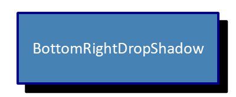

## **Úvod**

Zatímco efekty v PowerPointu lze použít k zvýraznění tvaru, liší se od [výplní](/slides/cs/python-net/shape-formatting/#gradient-fill) nebo obrysů. Pomocí efektů v PowerPointu můžete vytvořit přesvědčivé odrazy na tvaru, rozšířit záři tvaru atd.


PowerPoint poskytuje šest efektů, které lze použít na tvary. Můžete na tvar použít jeden nebo více efektů.

Některé kombinace efektů vypadají lépe než jiné. Z tohoto důvodu má PowerPoint možnosti pod **Preset**. Možnosti předvoleb jsou v podstatě známé dobře vypadající kombinace dvou nebo více efektů. Tímto způsobem, výběrem předvolby, nebudete muset ztrácet čas testováním nebo kombinováním různých efektů k nalezení hezké kombinace.

Aspose.Slides poskytuje vlastnosti a metody ve třídě [EffectFormat](https://reference.aspose.com/slides/python-net/aspose.slides/effectformat/), které vám umožní použít stejné efekty na tvary v prezentacích PowerPoint.

## **Použití stínového efektu**

Aspose.Slides pro Python via .NET podporuje vnější a vnitřní stíny pro tvary. Můžete přizpůsobit jejich barvu, směr, vzdálenost a poloměr rozostření tak, aby ladily s designem vaší prezentace.

### **Použít vnější stín**

Použijte vnější stín k zvýraznění karty nebo panelu proti pozadí snímku. Stín přesahuje okraje tvaru a vytváří dojem, že je tvar nad snímkem. Nastavte jeho barvu, směr, vzdálenost a poloměr rozostření tak, aby odpovídaly světlu a stylu vaší šablony.

Tento Python kód ukazuje, jak použít [vnější stín](https://reference.aspose.com/slides/python-net/aspose.slides/effectformat/outer_shadow_effect/) na obdélník:

```python
import aspose.slides as slides

with slides.Presentation() as presentation:
    slide = presentation.slides[0]

    shape = slide.shapes.add_auto_shape(slides.ShapeType.ROUND_CORNER_RECTANGLE, 20, 20, 200, 100)
    shape.effect_format.enable_outer_shadow_effect()
    shape.effect_format.outer_shadow_effect.shadow_color.color = slides.Color.dark_gray
    shape.effect_format.outer_shadow_effect.distance = 10
    shape.effect_format.outer_shadow_effect.direction = 45

    presentation.save("shadow_effect.pptx", slides.export.SaveFormat.PPTX)
```


#### **Řízení směru stínu při otáčení tvaru**

Ve výchozím nastavení je [OuterShadow.rotate_shadow_with_shape](https://reference.aspose.com/slides/python-net/aspose.slides.effects/outershadow/rotate_shadow_with_shape/) `True`, takže se stín otáčí spolu s tvarem. Chcete‑li, aby tvary s různými otočeními vypadaly osvětlené ze stejného směru, nastavte tuto vlastnost na `False` a přiřaďte jejich stínům stejný [směr](https://reference.aspose.com/slides/python-net/aspose.slides.effects/outershadow/direction/).

Příklad vytvoří dvě šipky se šedými stíny posunutými o 42 bodů doprava (`direction = 0`). Poté duplikuje snímek a otočí obě šipky o 90° po směru hodinových ručiček.

```python
import aspose.slides as slides

with slides.Presentation() as presentation:
    before = presentation.slides[0]

    left = before.shapes.add_auto_shape(slides.ShapeType.RIGHT_ARROW, 55, 130, 110, 60)
    left.fill_format.fill_type = slides.FillType.SOLID
    left.fill_format.solid_fill_color.color = slides.Color.steel_blue
    left.line_format.fill_format.fill_type = slides.FillType.NO_FILL

    left.effect_format.enable_outer_shadow_effect()
    shadow = left.effect_format.outer_shadow_effect
    shadow.shadow_color.color = slides.Color.gray
    shadow.direction = 0
    shadow.distance = 42
    shadow.blur_radius = 0
    shadow.rotate_shadow_with_shape = True

    right = before.shapes.add_clone(left)
    right.x = 395
    right.effect_format.outer_shadow_effect.rotate_shadow_with_shape = False

    after = presentation.slides.add_clone(before)
    for arrow in after.shapes:
        arrow.rotation = 90

    presentation.save("arrow_shadows.pptx", slides.export.SaveFormat.PPTX)
```

Na druhém snímku vrhá levá šipka svůj stín dolů, zatímco pravá šipka stále vrhá stín doprava. Nastavený směr zůstává 0° pro oba stíny.


### **Použít vnitřní stín**

Při reprodukci vizuálního stylu šablony použijte vnitřní stín, aby karta nebo panel měly zapuštěný vzhled. Vnější stín se rozprostírá mimo tvar a dává mu vzhled vyvýšeného, zatímco vnitřní stín zastíní vnitřek jeho okrajů.

Zavolejte [enable_inner_shadow_effect](https://reference.aspose.com/slides/python-net/aspose.slides/effectformat/enable_inner_shadow_effect/), poté nakonfigurujte [inner_shadow_effect](https://reference.aspose.com/slides/python-net/aspose.slides/effectformat/inner_shadow_effect/). Větší hodnoty poloměru rozostření produkují měkčí hrany.

Tento Python příklad vytvoří světle modrou kartu s tmavě šedým vnitřním stínem a uloží ji jako soubor PPTX:

```python
import aspose.slides as slides

with slides.Presentation() as presentation:
    slide = presentation.slides[0]

    shape = slide.shapes.add_auto_shape(slides.ShapeType.RECTANGLE, 20, 20, 200, 100)
    shape.fill_format.fill_type = slides.FillType.SOLID
    shape.fill_format.solid_fill_color.color = slides.Color.light_blue
    shape.line_format.fill_format.fill_type = slides.FillType.NO_FILL

    shape.effect_format.enable_inner_shadow_effect()
    shadow = shape.effect_format.inner_shadow_effect
    shadow.shadow_color.color = slides.Color.dim_gray
    shadow.direction = 225
    shadow.distance = 7
    shadow.blur_radius = 6

    presentation.save("inner_shadow_effect.pptx", slides.export.SaveFormat.PPTX)
```


Pro odstranění vnitřního stínu zavolejte [disable_inner_shadow_effect](https://reference.aspose.com/slides/python-net/aspose.slides/effectformat/disable_inner_shadow_effect/) na formátu efektu tvaru.

### **Použít, změnit a odstranit přednastavený stín**

Zavolejte [enable_preset_shadow_effect](https://reference.aspose.com/slides/python-net/aspose.slides/effectformat/enable_preset_shadow_effect/) a nastavte vlastnost [preset](https://reference.aspose.com/slides/python-net/aspose.slides.effects/presetshadow/preset/) stínu na hodnotu typu [PresetShadowType](https://reference.aspose.com/slides/python-net/aspose.slides/presetshadowtype/). Pro přepnutí stylu změňte předvolbu na stejném tvaru. Zavolejte [disable_preset_shadow_effect](https://reference.aspose.com/slides/python-net/aspose.slides/effectformat/disable_preset_shadow_effect/) pro odstranění stínu při zachování výplně a obrysu.

Tento příklad ukazuje čtyři fáze vedle sebe na jednom snímku. Před každou změnou klonuje obdélník, abyste mohli porovnat výsledky. Oba stíny jsou posunuty o 10 bodů. Směr 225° umístí první stín nad a vlevo od obdélníku a 45° umístí druhý pod a vpravo.

```python
import aspose.slides as slides

with slides.Presentation() as presentation:
    presentation.slide_size.set_size(800, 120, slides.SlideSizeScaleType.DO_NOT_SCALE)
    shapes = presentation.slides[0].shapes

    shape = shapes.add_auto_shape(slides.ShapeType.RECTANGLE, 15, 30, 170, 60)
    shape.fill_format.fill_type = slides.FillType.SOLID
    shape.fill_format.solid_fill_color.color = slides.Color.steel_blue
    shape.line_format.fill_format.fill_type = slides.FillType.SOLID
    shape.line_format.fill_format.solid_fill_color.color = slides.Color.dark_blue
    shape.text_frame.text = "No shadow"
    shape.text_frame.paragraphs[0].paragraph_format.default_portion_format.font_height = 14
    shapes.add_clone(shape)

    shape.x += 200
    shape.effect_format.enable_preset_shadow_effect()
    shadow = shape.effect_format.preset_shadow_effect
    shadow.preset = slides.PresetShadowType.TOP_LEFT_DROP_SHADOW
    shadow.distance = 10
    shadow.direction = 225
    shape.text_frame.text = "TopLeftDropShadow"
    shapes.add_clone(shape)

    shape.x += 200
    shadow.preset = slides.PresetShadowType.BOTTOM_RIGHT_DROP_SHADOW
    shadow.direction = 45
    shape.text_frame.text = "BottomRightDropShadow"
    shapes.add_clone(shape)

    shape.x += 200
    shape.effect_format.disable_preset_shadow_effect()
    shape.text_frame.text = "No shadow"

    presentation.save("preset_shadows.pptx", slides.export.SaveFormat.PPTX)
```

| Originál | První předvolba | Druhá předvolba | Po odebrání |
| :---: | :---: | :---: | :---: |
|  |  |  |  |

## **Použití odrazového efektu**

Pro použití odrazového efektu v Aspose.Slides pro Python via .NET můžete přidat zrcadlový odraz na tvary a upravit parametry jako vzdálenost, průhlednost a velikost. Tento efekt vylepšuje estetiku vašich prezentací tím, že tvary získají uhlazenější a sofistikovanější vzhled. Implementace je jednoduchá pomocí stručného kódu, což umožňuje rychlé využití napříč více prvky pro konzistentní design.

Tento Python kód ukazuje, jak použít [odrazový efekt](https://reference.aspose.com/slides/python-net/aspose.slides/effectformat/reflection_effect/) na tvar:

```python
import aspose.slides as slides

with slides.Presentation() as presentation:
    slide = presentation.slides[0]

    shape = slide.shapes.add_auto_shape(slides.ShapeType.ROUND_CORNER_RECTANGLE, 20, 20, 200, 100)
    shape.effect_format.enable_reflection_effect()
    shape.effect_format.reflection_effect.rectangle_align = slides.RectangleAlignment.BOTTOM
    shape.effect_format.reflection_effect.direction = 90
    shape.effect_format.reflection_effect.distance = 40
    shape.effect_format.reflection_effect.blur_radius = 2

    presentation.save("reflection_effect.pptx", slides.export.SaveFormat.PPTX)
```


## **Použití efektu záře**

Pro použití efektu záře na tvar v Aspose.Slides pro Python via .NET můžete přidat měkkou, zářivou auru kolem tvarů a upravit vlastnosti jako barvu a velikost. Tento efekt pomáhá tvarům vyniknout a přidává atraktivní, upoutávající vizuální prvek do vaší prezentace. Implementace je snadná s minimálním kódem, čímž se zlepšuje celkový vzhled vašich snímků.

Tento Python kód ukazuje, jak použít [efekt záře](https://reference.aspose.com/slides/python-net/aspose.slides/effectformat/glow_effect/) na tvar:

```python
import aspose.slides as slides

with slides.Presentation() as presentation:
    slide = presentation.slides[0]

    shape = slide.shapes.add_auto_shape(slides.ShapeType.ROUND_CORNER_RECTANGLE, 20, 20, 200, 100)
    shape.effect_format.enable_glow_effect()
    shape.effect_format.glow_effect.color.color = slides.Color.magenta
    shape.effect_format.glow_effect.radius = 15

    presentation.save("glow_effect.pptx", slides.export.SaveFormat.PPTX)
```


## **Použití efektu měkkých okrajů**

Pro použití efektu měkkých okrajů v Aspose.Slides pro Python via .NET můžete vytvořit plynulý, rozostřený přechod kolem okrajů tvaru. Tento efekt dodává jemnější a rafinovanější vzhled, ideální pro návrhy, které vyžadují něžný, měkčí vzhled. Parametry, jako je poloměr, lze snadno upravit tak, aby byl dosažen požadovaný efekt napříč různými tvary ve vaší prezentaci.

Tento Python kód ukazuje, jak použít [měkké okraje](https://reference.aspose.com/slides/python-net/aspose.slides/effectformat/soft_edge_effect/) na tvar:

```python
import aspose.slides as slides

with slides.Presentation() as presentation:
    slide = presentation.slides[0]

    shape = slide.shapes.add_auto_shape(slides.ShapeType.ROUND_CORNER_RECTANGLE, 20, 20, 200, 150)
    shape.effect_format.enable_soft_edge_effect()
    shape.effect_format.soft_edge_effect.radius = 8

    presentation.save("soft_edges_effect.pptx", slides.export.SaveFormat.PPTX)
```


## **Použití rozostření**

Použijte rozostření tvaru k změkčení výplně a obrysu tvaru při zachování možnosti úpravy tvaru. Zavolejte [set_blur_effect](https://reference.aspose.com/slides/python-net/aspose.slides/effectformat/set_blur_effect/) na formátu efektu tvaru. Poloměr se měří v bodech (1/72 palce): použijte nezápornou hodnotu, přičemž větší hodnoty produkují silnější rozostření. Poloměr nula ponechá vzhled beze změny.

Nastavení [grow](https://reference.aspose.com/slides/python-net/aspose.slides.effects/blur/grow/) řídí viditelné hranice efektu. Při `False` je rozostření oříznuto na původní vykreslené hranice, včetně obrysu. Při `True` může rozostření přesahovat tyto hranice. Žádné nastavení nemění polohu ani rozměry tvaru.

Srovnání níže používá stejnou výplň, obrys a rozměry tvaru po celé ukázce. Horní řada používá `grow = False`; dolní řada používá `grow = True`.


Tento Python příklad vytvoří oranžový obdélník s tmavě modrým obrysem, použije 5‑bodové rozostření a poté ho aktualizuje na 15‑bodové rozostření opětovným zavoláním [set_blur_effect](https://reference.aspose.com/slides/python-net/aspose.slides/effectformat/set_blur_effect/). Uloží oba rozostřené stavy, poté zavolá [disable_blur_effect](https://reference.aspose.com/slides/python-net/aspose.slides/effectformat/disable_blur_effect/) a uloží tvar bez rozostření.

```python
import aspose.slides as slides

with slides.Presentation() as presentation:
    slide = presentation.slides[0]

    shape = slide.shapes.add_auto_shape(slides.ShapeType.RECTANGLE, 100, 80, 160, 100)
    shape.fill_format.fill_type = slides.FillType.SOLID
    shape.fill_format.solid_fill_color.color = slides.Color.orange
    shape.line_format.fill_format.fill_type = slides.FillType.SOLID
    shape.line_format.fill_format.solid_fill_color.color = slides.Color.dark_blue
    shape.line_format.width = 8

    shape.effect_format.set_blur_effect(5, False)
    presentation.save("shape_blur_5.pptx", slides.export.SaveFormat.PPTX)

    shape.effect_format.set_blur_effect(15, True)
    presentation.save("shape_blur_15.pptx", slides.export.SaveFormat.PPTX)

    shape.effect_format.disable_blur_effect()
    presentation.save("shape_blur_removed.pptx", slides.export.SaveFormat.PPTX)
```

Rozostření tvaru ovlivňuje výplň i obrys společně. Efekt měkkých okrajů zeslabuje hrany tvaru, zatímco rozostření stínu měkčuje jen stín. Efekty transformace obrazu působí na obsah obrazu; tento příklad aplikuje rozostření přímo na formát efektu tvaru bez převodu tvaru na obrázek.

## **Často kladené otázky**

**Mohu použít více efektů na stejný tvar?**

Ano, můžete kombinovat různé efekty, jako jsou stín, odraz a záře, na jednom tvaru a vytvořit tak dynamičtější vzhled.

**Na jaké tvary mohu aplikovat efekty?**

Efekty můžete aplikovat na různé tvary, včetně automatických tvarů, grafů, tabulek, obrázků, objektů SmartArt, OLE objektů a dalších.

**Mohu použít efekty na seskupené tvary?**

Ano, můžete použít efekty na seskupené tvary. Efekt se použije na celou skupinu.