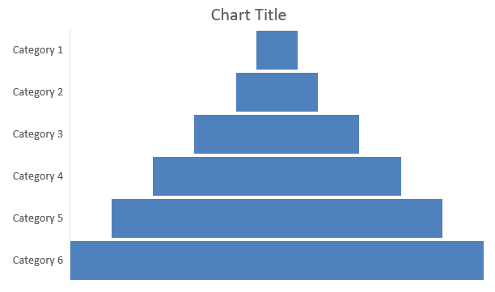

## **Übersicht**

Dieser Beitrag bietet eine umfassende Anleitung zum Erstellen und Anpassen von Diagrammen mit Aspose.Slides für C++. Sie lernen, wie Sie programmgesteuert ein Diagramm zu einer Folie hinzufügen, es mit Daten füllen und verschiedene Formatierungsoptionen anwenden, um Ihre spezifischen Designanforderungen zu erfüllen. Im gesamten Beitrag veranschaulichen detaillierte Codebeispiele jeden Schritt, vom Initialisieren der Präsentation und des Diagrammobjekts bis hin zur Konfiguration von Serien, Achsen und Legenden. Durch Befolgen dieser Anleitung erhalten Sie ein fundiertes Verständnis dafür, wie Sie die dynamische Diagrammerstellung in Ihre C++‑Anwendungen integrieren und damit den Prozess der Erstellung datengetriebener Präsentationen vereinfachen.

## **Diagramm erstellen**

Diagramme helfen Menschen, Daten schnell zu visualisieren und Erkenntnisse zu gewinnen, die aus einer Tabelle oder einem Tabellenblatt nicht sofort ersichtlich sind.

**Warum Diagramme erstellen?**

Mit Diagrammen können Sie:

* große Datenmengen auf einer einzigen Folie in einer Präsentation aggregieren, komprimieren oder zusammenfassen;
* Muster und Trends in Daten aufdecken;
* die Richtung und Dynamik von Daten über die Zeit oder bezogen auf eine bestimmte Einheit ableiten;
* Ausreißer, Abweichungen, Fehler und unsinnige Daten erkennen;
* komplexe Daten kommunizieren oder präsentieren.

In PowerPoint können Sie Diagramme über die *Einfügen*-Funktion erstellen, die Vorlagen für viele Diagrammtypen bereitstellt. Mit Aspose.Slides können Sie sowohl reguläre Diagramme (basierend auf gängigen Diagrammtypen) als auch benutzerdefinierte Diagramme erzeugen.

{}

Verwenden Sie die Enumeration [ChartType](https://reference.aspose.com/slides/cpp/aspose.slides.charts/charttype/) im Namensraum [Aspose::Slides::Charts](https://reference.aspose.com/slides/cpp/aspose.slides.charts/). Die Werte dieser Enumeration entsprechen verschiedenen Diagrammtypen.

{}

### **Gestapelte Säulendiagramme erstellen**

Dieses Beispiel verwendet [AddChart](https://reference.aspose.com/slides/cpp/aspose.slides/ishapecollection/addchart/), um ein gruppiertes Säulendiagramm zu erstellen, das zwei Serien über drei Kategorien vergleicht. Die Serien verwenden rote bzw. grüne Füllungen, und einzelne Beschriftungen zeigen Kategorienamen, Seriendaten und Werte an. Der Arbeitsblatt‑Index 0 bezieht sich auf das erste Blatt in der eingebetteten Diagramm‑Arbeitsmappe.

```cpp
#include <system/shared_ptr.h>
#include <system/object_ext.h>
#include <system/string.h>
#include <drawing/color.h>
#include <DOM/Chart/ChartType.h>
#include <DOM/Chart/IChartCategoryCollection.h>
#include <DOM/Chart/IChartData.h>
#include <DOM/Chart/IChartDataCell.h>
#include <DOM/Chart/IChartDataPoint.h>
#include <DOM/Chart/IChartDataPointCollection.h>
#include <DOM/Chart/IChartDataWorkbook.h>
#include <DOM/Chart/IChartSeries.h>
#include <DOM/Chart/IChartSeriesCollection.h>
#include <DOM/Chart/IChartTitle.h>
#include <DOM/Chart/IDataLabel.h>
#include <DOM/Chart/IDataLabelCollection.h>
#include <DOM/Chart/IDataLabelFormat.h>
#include <DOM/Chart/IDoubleChartValue.h>
#include <DOM/Chart/IFormat.h>
#include <DOM/FillType.h>
#include <DOM/IChart.h>
#include <DOM/IColorFormat.h>
#include <DOM/IFillFormat.h>
#include <DOM/ILineFillFormat.h>
#include <DOM/ILineFormat.h>
#include <DOM/IShapeCollection.h>
#include <DOM/ISlide.h>
#include <DOM/ITextFrame.h>
#include <DOM/ITextFrameFormat.h>
#include <DOM/NullableBool.h>
#include <DOM/Presentation.h>
#include <Export/SaveFormat.h>

using namespace System;
using namespace System::Drawing;
using namespace Aspose::Slides;
using namespace Aspose::Slides::Charts;
using namespace Aspose::Slides::Export;

auto presentation = MakeObject<Presentation>();
auto slide = presentation->get_Slide(0);

auto chart = slide->get_Shapes()->AddChart(ChartType::ClusteredColumn, 20, 20, 500, 300);

chart->get_ChartTitle()->AddTextFrameForOverriding(u"Sample Title");
chart->get_ChartTitle()->get_TextFrameForOverriding()->get_TextFrameFormat()->set_CenterText(NullableBool::True);
chart->get_ChartTitle()->set_Height(20);
chart->set_HasTitle(true);

auto workbook = chart->get_ChartData()->get_ChartDataWorkbook();
auto worksheetIndex = 0;

chart->get_ChartData()->get_Series()->Clear();
chart->get_ChartData()->get_Categories()->Clear();

auto seriesNameCell = workbook->GetCell(worksheetIndex, 0, 1, ObjectExt::Box(String(u"Series 1")));
chart->get_ChartData()->get_Series()->Add(seriesNameCell, chart->get_Type());
seriesNameCell = workbook->GetCell(worksheetIndex, 0, 2, ObjectExt::Box(String(u"Series 2")));
chart->get_ChartData()->get_Series()->Add(seriesNameCell, chart->get_Type());

auto categoryCell = workbook->GetCell(worksheetIndex, 1, 0, ObjectExt::Box(String(u"Category 1")));
chart->get_ChartData()->get_Categories()->Add(categoryCell);
categoryCell = workbook->GetCell(worksheetIndex, 2, 0, ObjectExt::Box(String(u"Category 2")));
chart->get_ChartData()->get_Categories()->Add(categoryCell);
categoryCell = workbook->GetCell(worksheetIndex, 3, 0, ObjectExt::Box(String(u"Category 3")));
chart->get_ChartData()->get_Categories()->Add(categoryCell);

auto series = chart->get_ChartData()->get_Series()->idx_get(0);

auto valueCell = workbook->GetCell(worksheetIndex, 1, 1, ObjectExt::Box(20));
series->get_DataPoints()->AddDataPointForBarSeries(valueCell);
valueCell = workbook->GetCell(worksheetIndex, 2, 1, ObjectExt::Box(50));
series->get_DataPoints()->AddDataPointForBarSeries(valueCell);
valueCell = workbook->GetCell(worksheetIndex, 3, 1, ObjectExt::Box(30));
series->get_DataPoints()->AddDataPointForBarSeries(valueCell);

series->get_Format()->get_Fill()->set_FillType(FillType::Solid);
series->get_Format()->get_Fill()->get_SolidFillColor()->set_Color(Color::get_Red());

series = chart->get_ChartData()->get_Series()->idx_get(1);

valueCell = workbook->GetCell(worksheetIndex, 1, 2, ObjectExt::Box(30));
series->get_DataPoints()->AddDataPointForBarSeries(valueCell);
valueCell = workbook->GetCell(worksheetIndex, 2, 2, ObjectExt::Box(10));
series->get_DataPoints()->AddDataPointForBarSeries(valueCell);
valueCell = workbook->GetCell(worksheetIndex, 3, 2, ObjectExt::Box(60));
series->get_DataPoints()->AddDataPointForBarSeries(valueCell);

series->get_Format()->get_Fill()->set_FillType(FillType::Solid);
series->get_Format()->get_Fill()->get_SolidFillColor()->set_Color(Color::get_Green());

auto label = series->get_DataPoints()->idx_get(0)->get_Label();
label->get_DataLabelFormat()->set_ShowCategoryName(true);

label = series->get_DataPoints()->idx_get(1)->get_Label();
label->get_DataLabelFormat()->set_ShowSeriesName(true);

label = series->get_DataPoints()->idx_get(2)->get_Label();
label->get_DataLabelFormat()->set_ShowValue(true);
label->get_DataLabelFormat()->set_ShowSeriesName(true);
label->get_DataLabelFormat()->set_Separator(u"/");

presentation->Save(u"AsposeChart.pptx", SaveFormat::Pptx);
```

Das Ergebnis:


### **Punkt‑Diagramme erstellen**

Punkt‑Diagramme (auch Scatter‑Plots oder X‑Y‑Diagramme genannt) werden häufig verwendet, um Muster zu prüfen oder Korrelationen zwischen zwei Variablen darzustellen.

Verwenden Sie ein Punkt‑Diagramm, wenn:

* Sie gepaarte numerische Daten besitzen.
* Sie zwei Variablen haben, die gut zueinander passen.
* Sie feststellen möchten, ob die beiden Variablen zusammenhängen.
* Sie eine unabhängige Variable haben, die für eine abhängige Variable mehrere Werte liefert.

Dieses Beispiel plottet zwei Sätze von X‑Y‑Werten. Die erste Serie verwendet durchgezogene Linien mit Stern‑Markierungen, während die zweite glatte Linien mit Kreis‑Markierungen nutzt; beide verwenden eine Markierungsgröße von 10, festgelegt mit [set_Size](https://reference.aspose.com/slides/cpp/aspose.slides.charts/imarker/set_size/). Die Methode [set_Symbol](https://reference.aspose.com/slides/cpp/aspose.slides.charts/imarker/set_symbol/) steuert die Form der Markierung.

```cpp
#include <system/shared_ptr.h>
#include <system/object_ext.h>
#include <system/string.h>
#include <DOM/Chart/ChartType.h>
#include <DOM/Chart/IChartCategoryCollection.h>
#include <DOM/Chart/IChartData.h>
#include <DOM/Chart/IChartDataCell.h>
#include <DOM/Chart/IChartDataPoint.h>
#include <DOM/Chart/IChartDataPointCollection.h>
#include <DOM/Chart/IChartDataWorkbook.h>
#include <DOM/Chart/IChartSeries.h>
#include <DOM/Chart/IChartSeriesCollection.h>
#include <DOM/Chart/IDoubleChartValue.h>
#include <DOM/Chart/IFormat.h>
#include <DOM/Chart/IMarker.h>
#include <DOM/Chart/MarkerStyleType.h>
#include <DOM/IChart.h>
#include <DOM/IColorFormat.h>
#include <DOM/IFillFormat.h>
#include <DOM/ILineFillFormat.h>
#include <DOM/ILineFormat.h>
#include <DOM/IShapeCollection.h>
#include <DOM/ISlide.h>
#include <DOM/Presentation.h>
#include <Export/SaveFormat.h>

using namespace System;
using namespace Aspose::Slides;
using namespace Aspose::Slides::Charts;
using namespace Aspose::Slides::Export;

auto presentation = MakeObject<Presentation>();
auto slide = presentation->get_Slide(0);

auto chart = slide->get_Shapes()->AddChart(ChartType::ScatterWithSmoothLines, 20, 20, 500, 300);

auto workbook = chart->get_ChartData()->get_ChartDataWorkbook();
auto worksheetIndex = 0;

chart->get_ChartData()->get_Series()->Clear();

auto seriesNameCell = workbook->GetCell(worksheetIndex, 1, 1, ObjectExt::Box(String(u"Series 1")));
chart->get_ChartData()->get_Series()->Add(seriesNameCell, chart->get_Type());
seriesNameCell = workbook->GetCell(worksheetIndex, 1, 3, ObjectExt::Box(String(u"Series 2")));
chart->get_ChartData()->get_Series()->Add(seriesNameCell, chart->get_Type());

auto series = chart->get_ChartData()->get_Series()->idx_get(0);

auto xValueCell = workbook->GetCell(worksheetIndex, 2, 1, ObjectExt::Box(1));
auto yValueCell = workbook->GetCell(worksheetIndex, 2, 2, ObjectExt::Box(3));
series->get_DataPoints()->AddDataPointForScatterSeries(xValueCell, yValueCell);

xValueCell = workbook->GetCell(worksheetIndex, 3, 1, ObjectExt::Box(2));
yValueCell = workbook->GetCell(worksheetIndex, 3, 2, ObjectExt::Box(10));
series->get_DataPoints()->AddDataPointForScatterSeries(xValueCell, yValueCell);

series->set_Type(ChartType::ScatterWithStraightLinesAndMarkers);

series->get_Marker()->set_Size(10);
series->get_Marker()->set_Symbol(MarkerStyleType::Star);

series = chart->get_ChartData()->get_Series()->idx_get(1);

xValueCell = workbook->GetCell(worksheetIndex, 2, 3, ObjectExt::Box(5));
yValueCell = workbook->GetCell(worksheetIndex, 2, 4, ObjectExt::Box(2));
series->get_DataPoints()->AddDataPointForScatterSeries(xValueCell, yValueCell);

xValueCell = workbook->GetCell(worksheetIndex, 3, 3, ObjectExt::Box(3));
yValueCell = workbook->GetCell(worksheetIndex, 3, 4, ObjectExt::Box(1));
series->get_DataPoints()->AddDataPointForScatterSeries(xValueCell, yValueCell);

xValueCell = workbook->GetCell(worksheetIndex, 4, 3, ObjectExt::Box(2));
yValueCell = workbook->GetCell(worksheetIndex, 4, 4, ObjectExt::Box(2));
series->get_DataPoints()->AddDataPointForScatterSeries(xValueCell, yValueCell);

xValueCell = workbook->GetCell(worksheetIndex, 5, 3, ObjectExt::Box(5));
yValueCell = workbook->GetCell(worksheetIndex, 5, 4, ObjectExt::Box(1));
series->get_DataPoints()->AddDataPointForScatterSeries(xValueCell, yValueCell);

series->get_Marker()->set_Size(10);
series->get_Marker()->set_Symbol(MarkerStyleType::Circle);

presentation->Save(u"AsposeChart.pptx", SaveFormat::Pptx);
```

Das Ergebnis:


### **Kreis‑Diagramme erstellen**

Kreis‑Diagramme eignen sich am besten, um das Teil‑zu‑Ganz‑Verhältnis in Daten zu zeigen, insbesondere wenn die Daten kategoriale Beschriftungen mit numerischen Werten enthalten. Enthält Ihre Daten jedoch viele Teile oder Beschriftungen, sollten Sie stattdessen ein Balkendiagramm in Betracht ziehen.

Dieses Beispiel erzeugt ein Kreis‑Diagramm mit drei Quartalswerten. Jeder Sektor hat eine benutzerdefinierte Füllung und Kontur, und die Beschriftungen zeigen unterschiedliche Kombinationen aus Wert, Prozentsatz und Serieninformationen. Die Methode [set_FirstSliceAngle](https://reference.aspose.com/slides/cpp/aspose.slides.charts/ichartseriesgroup/set_firstsliceangle/) legt den ersten Sektor auf 180 Grad fest.

```cpp
#include <system/shared_ptr.h>
#include <system/object_ext.h>
#include <system/string.h>
#include <drawing/color.h>
#include <DOM/Chart/ChartType.h>
#include <DOM/Chart/IChartCategoryCollection.h>
#include <DOM/Chart/IChartData.h>
#include <DOM/Chart/IChartDataCell.h>
#include <DOM/Chart/IChartDataPoint.h>
#include <DOM/Chart/IChartDataPointCollection.h>
#include <DOM/Chart/IChartDataWorkbook.h>
#include <DOM/Chart/IChartSeries.h>
#include <DOM/Chart/IChartSeriesCollection.h>
#include <DOM/Chart/IChartSeriesGroup.h>
#include <DOM/Chart/IChartSeriesGroupCollection.h>
#include <DOM/Chart/IChartTextFormat.h>
#include <DOM/Chart/IChartTitle.h>
#include <DOM/Chart/IDataLabel.h>
#include <DOM/Chart/IDataLabelCollection.h>
#include <DOM/Chart/IDataLabelFormat.h>
#include <DOM/Chart/IDoubleChartValue.h>
#include <DOM/Chart/IFormat.h>
#include <DOM/Chart/ILegend.h>
#include <DOM/FillType.h>
#include <DOM/IChart.h>
#include <DOM/IColorFormat.h>
#include <DOM/IFillFormat.h>
#include <DOM/ILineFillFormat.h>
#include <DOM/ILineFormat.h>
#include <DOM/IPortionFormat.h>
#include <DOM/IShapeCollection.h>
#include <DOM/ISlide.h>
#include <DOM/ITextFrame.h>
#include <DOM/ITextFrameFormat.h>
#include <DOM/LineDashStyle.h>
#include <DOM/LineStyle.h>
#include <DOM/NullableBool.h>
#include <DOM/Presentation.h>
#include <Export/SaveFormat.h>

using namespace System;
using namespace System::Drawing;
using namespace Aspose::Slides;
using namespace Aspose::Slides::Charts;
using namespace Aspose::Slides::Export;

auto presentation = MakeObject<Presentation>();
auto slide = presentation->get_Slide(0);

auto chart = slide->get_Shapes()->AddChart(ChartType::Pie, 20, 20, 500, 300);

chart->get_ChartTitle()->AddTextFrameForOverriding(u"Sample Title");
chart->get_ChartTitle()->get_TextFrameForOverriding()->get_TextFrameFormat()->set_CenterText(NullableBool::True);
chart->get_ChartTitle()->set_Height(20);
chart->set_HasTitle(true);

chart->get_ChartData()->get_Series()->idx_get(0)->get_Labels()->get_DefaultDataLabelFormat()->set_ShowValue(true);

auto workbook = chart->get_ChartData()->get_ChartDataWorkbook();
auto worksheetIndex = 0;

chart->get_ChartData()->get_Series()->Clear();
chart->get_ChartData()->get_Categories()->Clear();

auto categoryCell = workbook->GetCell(0, 1, 0, ObjectExt::Box(String(u"1st Qtr")));
chart->get_ChartData()->get_Categories()->Add(categoryCell);
categoryCell = workbook->GetCell(0, 2, 0, ObjectExt::Box(String(u"2nd Qtr")));
chart->get_ChartData()->get_Categories()->Add(categoryCell);
categoryCell = workbook->GetCell(0, 3, 0, ObjectExt::Box(String(u"3rd Qtr")));
chart->get_ChartData()->get_Categories()->Add(categoryCell);

auto seriesNameCell = workbook->GetCell(0, 0, 1, ObjectExt::Box(String(u"Series 1")));
auto series = chart->get_ChartData()->get_Series()->Add(seriesNameCell, chart->get_Type());

auto valueCell = workbook->GetCell(worksheetIndex, 1, 1, ObjectExt::Box(20));
series->get_DataPoints()->AddDataPointForPieSeries(valueCell);
valueCell = workbook->GetCell(worksheetIndex, 2, 1, ObjectExt::Box(50));
series->get_DataPoints()->AddDataPointForPieSeries(valueCell);
valueCell = workbook->GetCell(worksheetIndex, 3, 1, ObjectExt::Box(30));
series->get_DataPoints()->AddDataPointForPieSeries(valueCell);

chart->get_ChartData()->get_SeriesGroups()->idx_get(0)->set_IsColorVaried(true);

auto firstSlice = series->get_DataPoints()->idx_get(0);
firstSlice->get_Format()->get_Fill()->set_FillType(FillType::Solid);
firstSlice->get_Format()->get_Fill()->get_SolidFillColor()->set_Color(Color::get_Cyan());

firstSlice->get_Format()->get_Line()->get_FillFormat()->set_FillType(FillType::Solid);
firstSlice->get_Format()->get_Line()->get_FillFormat()->get_SolidFillColor()->set_Color(Color::get_Gray());
firstSlice->get_Format()->get_Line()->set_Width(3.0);
firstSlice->get_Format()->get_Line()->set_Style(LineStyle::ThinThick);
firstSlice->get_Format()->get_Line()->set_DashStyle(LineDashStyle::LargeDash);

auto secondSlice = series->get_DataPoints()->idx_get(1);
secondSlice->get_Format()->get_Fill()->set_FillType(FillType::Solid);
secondSlice->get_Format()->get_Fill()->get_SolidFillColor()->set_Color(Color::get_Brown());

secondSlice->get_Format()->get_Line()->get_FillFormat()->set_FillType(FillType::Solid);
secondSlice->get_Format()->get_Line()->get_FillFormat()->get_SolidFillColor()->set_Color(Color::get_Blue());
secondSlice->get_Format()->get_Line()->set_Width(3.0);
secondSlice->get_Format()->get_Line()->set_Style(LineStyle::Single);
secondSlice->get_Format()->get_Line()->set_DashStyle(LineDashStyle::LargeDashDot);

auto thirdSlice = series->get_DataPoints()->idx_get(2);
thirdSlice->get_Format()->get_Fill()->set_FillType(FillType::Solid);
thirdSlice->get_Format()->get_Fill()->get_SolidFillColor()->set_Color(Color::get_Coral());

thirdSlice->get_Format()->get_Line()->get_FillFormat()->set_FillType(FillType::Solid);
thirdSlice->get_Format()->get_Line()->get_FillFormat()->get_SolidFillColor()->set_Color(Color::get_Red());
thirdSlice->get_Format()->get_Line()->set_Width(2.0);
thirdSlice->get_Format()->get_Line()->set_Style(LineStyle::ThinThin);
thirdSlice->get_Format()->get_Line()->set_DashStyle(LineDashStyle::LargeDashDotDot);

auto firstLabel = series->get_DataPoints()->idx_get(0)->get_Label();
firstLabel->get_DataLabelFormat()->set_ShowValue(true);

auto secondLabel = series->get_DataPoints()->idx_get(1)->get_Label();
secondLabel->get_DataLabelFormat()->set_ShowValue(true);
secondLabel->get_DataLabelFormat()->set_ShowLegendKey(true);
secondLabel->get_DataLabelFormat()->set_ShowPercentage(true);

auto thirdLabel = series->get_DataPoints()->idx_get(2)->get_Label();
thirdLabel->get_DataLabelFormat()->set_ShowSeriesName(true);
thirdLabel->get_DataLabelFormat()->set_ShowPercentage(true);

series->get_Labels()->get_DefaultDataLabelFormat()->set_ShowLeaderLines(true);

chart->get_ChartData()->get_SeriesGroups()->idx_get(0)->set_FirstSliceAngle(180);

presentation->Save(u"PieChart.pptx", SaveFormat::Pptx);
```

Das Ergebnis:


### **Liniendiagramme erstellen**

Liniendiagramme (auch Liniendiagramme genannt) eignen sich am besten, wenn Sie Änderungen von Werten über die Zeit darstellen möchten. Mit einem Liniendiagramm können Sie große Datenmengen gleichzeitig vergleichen, Änderungen und Trends über die Zeit nachverfolgen, Anomalien in Datenserien hervorheben und mehr.

Dieses Beispiel verwendet [AddChart](https://reference.aspose.com/slides/cpp/aspose.slides/ishapecollection/addchart/), um ein Liniendiagramm mit den Standard‑Serien und -Kategorien zu erstellen und speichert die Präsentation als PPTX.

```cpp
#include <system/shared_ptr.h>
#include <DOM/Chart/ChartType.h>
#include <DOM/Chart/IChartCategoryCollection.h>
#include <DOM/Chart/IChartData.h>
#include <DOM/Chart/IChartSeriesCollection.h>
#include <DOM/Chart/IFormat.h>
#include <DOM/IChart.h>
#include <DOM/IColorFormat.h>
#include <DOM/IFillFormat.h>
#include <DOM/ILineFillFormat.h>
#include <DOM/ILineFormat.h>
#include <DOM/IShapeCollection.h>
#include <DOM/ISlide.h>
#include <DOM/Presentation.h>
#include <Export/SaveFormat.h>

using namespace System;
using namespace Aspose::Slides;
using namespace Aspose::Slides::Charts;
using namespace Aspose::Slides::Export;

auto presentation = MakeObject<Presentation>();
auto slide = presentation->get_Slide(0);

auto lineChart = slide->get_Shapes()->AddChart(ChartType::Line, 20, 20, 500, 300);

presentation->Save(u"lineChart.pptx", SaveFormat::Pptx);
```

Standardmäßig werden Punkte in einem Liniendiagramm durch gerade, kontinuierliche Linien verbunden. Wenn die Punkte stattdessen durch Striche verbunden werden sollen, rufen Sie [set_DashStyle](https://reference.aspose.com/slides/cpp/aspose.slides/ilineformat/set_dashstyle/) mit einem Wert aus [LineDashStyle](https://reference.aspose.com/slides/cpp/aspose.slides/linedashstyle/) auf:

```cpp
#include <system/shared_ptr.h>
#include <DOM/Chart/ChartType.h>
#include <DOM/Chart/IChartCategoryCollection.h>
#include <DOM/Chart/IChartData.h>
#include <DOM/Chart/IChartSeries.h>
#include <DOM/Chart/IChartSeriesCollection.h>
#include <DOM/Chart/IFormat.h>
#include <DOM/IChart.h>
#include <DOM/IColorFormat.h>
#include <DOM/IFillFormat.h>
#include <DOM/ILineFillFormat.h>
#include <DOM/ILineFormat.h>
#include <DOM/IShapeCollection.h>
#include <DOM/ISlide.h>
#include <DOM/LineDashStyle.h>
#include <DOM/Presentation.h>

using namespace System;
using namespace Aspose::Slides;
using namespace Aspose::Slides::Charts;

auto presentation = MakeObject<Presentation>();
auto slide = presentation->get_Slide(0);

auto lineChart = slide->get_Shapes()->AddChart(ChartType::Line, 20, 20, 500, 300);

for (auto series : lineChart->get_ChartData()->get_Series())
{
    series->get_Format()->get_Line()->set_DashStyle(LineDashStyle::Dash);
}
```

Das Ergebnis:


### **Tree‑Map‑Diagramme erstellen**

Tree‑Map‑Diagramme eignen sich am besten für Verkaufsdaten, wenn Sie die relative Größe von Datenkategorien zeigen und schnell die größten Beitragszahler innerhalb jeder Kategorie hervorheben wollen.

Dieses Beispiel erstellt eine Tree‑Map mit acht Blättern, gruppiert in vier Stämmen und zwei Zweigen. Die Methode [SetGroupingItem](https://reference.aspose.com/slides/cpp/aspose.slides.charts/ichartcategorylevelsmanager/setgroupingitem/) ordnet Stämme Ebene 1 und Zweige Ebene 2 zu. Werte bestimmen die relative Rechteckgröße, während Kategorien‑ und überlappende Eltern‑Labels die Hierarchie kennzeichnen.

```cpp
#include <system/shared_ptr.h>
#include <system/object_ext.h>
#include <system/string.h>
#include <DOM/Chart/ChartType.h>
#include <DOM/Chart/IChartCategory.h>
#include <DOM/Chart/IChartCategoryCollection.h>
#include <DOM/Chart/IChartCategoryLevelsManager.h>
#include <DOM/Chart/IChartData.h>
#include <DOM/Chart/IChartDataCell.h>
#include <DOM/Chart/IChartDataPoint.h>
#include <DOM/Chart/IChartDataPointCollection.h>
#include <DOM/Chart/IChartDataWorkbook.h>
#include <DOM/Chart/IChartSeries.h>
#include <DOM/Chart/IChartSeriesCollection.h>
#include <DOM/Chart/IDataLabel.h>
#include <DOM/Chart/IDataLabelCollection.h>
#include <DOM/Chart/IDataLabelFormat.h>
#include <DOM/Chart/IFormat.h>
#include <DOM/Chart/ParentLabelLayoutType.h>
#include <DOM/IChart.h>
#include <DOM/IColorFormat.h>
#include <DOM/IFillFormat.h>
#include <DOM/ILineFillFormat.h>
#include <DOM/ILineFormat.h>
#include <DOM/IShapeCollection.h>
#include <DOM/ISlide.h>
#include <DOM/Presentation.h>
#include <Export/SaveFormat.h>

using namespace System;
using namespace Aspose::Slides;
using namespace Aspose::Slides::Charts;
using namespace Aspose::Slides::Export;

auto presentation = MakeObject<Presentation>();
auto slide = presentation->get_Slide(0);

auto chart = slide->get_Shapes()->AddChart(ChartType::Treemap, 20, 20, 500, 300);

chart->get_ChartData()->get_Categories()->Clear();
chart->get_ChartData()->get_Series()->Clear();

auto workbook = chart->get_ChartData()->get_ChartDataWorkbook();
workbook->Clear(0);

// Zweig 1
auto categoryCell = workbook->GetCell(0, u"C1", ObjectExt::Box(String(u"Leaf1")));
auto leaf = chart->get_ChartData()->get_Categories()->Add(categoryCell);
leaf->get_GroupingLevels()->SetGroupingItem(1, ObjectExt::Box(String(u"Stem1")));
leaf->get_GroupingLevels()->SetGroupingItem(2, ObjectExt::Box(String(u"Branch1")));

categoryCell = workbook->GetCell(0, u"C2", ObjectExt::Box(String(u"Leaf2")));
chart->get_ChartData()->get_Categories()->Add(categoryCell);

categoryCell = workbook->GetCell(0, u"C3", ObjectExt::Box(String(u"Leaf3")));
leaf = chart->get_ChartData()->get_Categories()->Add(categoryCell);
leaf->get_GroupingLevels()->SetGroupingItem(1, ObjectExt::Box(String(u"Stem2")));

categoryCell = workbook->GetCell(0, u"C4", ObjectExt::Box(String(u"Leaf4")));
chart->get_ChartData()->get_Categories()->Add(categoryCell);

// Zweig 2
categoryCell = workbook->GetCell(0, u"C5", ObjectExt::Box(String(u"Leaf5")));
leaf = chart->get_ChartData()->get_Categories()->Add(categoryCell);
leaf->get_GroupingLevels()->SetGroupingItem(1, ObjectExt::Box(String(u"Stem3")));
leaf->get_GroupingLevels()->SetGroupingItem(2, ObjectExt::Box(String(u"Branch2")));

categoryCell = workbook->GetCell(0, u"C6", ObjectExt::Box(String(u"Leaf6")));
chart->get_ChartData()->get_Categories()->Add(categoryCell);

categoryCell = workbook->GetCell(0, u"C7", ObjectExt::Box(String(u"Leaf7")));
leaf = chart->get_ChartData()->get_Categories()->Add(categoryCell);
leaf->get_GroupingLevels()->SetGroupingItem(1, ObjectExt::Box(String(u"Stem4")));

categoryCell = workbook->GetCell(0, u"C8", ObjectExt::Box(String(u"Leaf8")));
chart->get_ChartData()->get_Categories()->Add(categoryCell);

auto series = chart->get_ChartData()->get_Series()->Add(ChartType::Treemap);
series->get_Labels()->get_DefaultDataLabelFormat()->set_ShowCategoryName(true);
auto valueCell = workbook->GetCell(0, u"D1", ObjectExt::Box(4));
series->get_DataPoints()->AddDataPointForTreemapSeries(valueCell);
valueCell = workbook->GetCell(0, u"D2", ObjectExt::Box(5));
series->get_DataPoints()->AddDataPointForTreemapSeries(valueCell);
valueCell = workbook->GetCell(0, u"D3", ObjectExt::Box(3));
series->get_DataPoints()->AddDataPointForTreemapSeries(valueCell);
valueCell = workbook->GetCell(0, u"D4", ObjectExt::Box(6));
series->get_DataPoints()->AddDataPointForTreemapSeries(valueCell);
valueCell = workbook->GetCell(0, u"D5", ObjectExt::Box(9));
series->get_DataPoints()->AddDataPointForTreemapSeries(valueCell);
valueCell = workbook->GetCell(0, u"D6", ObjectExt::Box(9));
series->get_DataPoints()->AddDataPointForTreemapSeries(valueCell);
valueCell = workbook->GetCell(0, u"D7", ObjectExt::Box(4));
series->get_DataPoints()->AddDataPointForTreemapSeries(valueCell);
valueCell = workbook->GetCell(0, u"D8", ObjectExt::Box(3));
series->get_DataPoints()->AddDataPointForTreemapSeries(valueCell);

series->set_ParentLabelLayout(ParentLabelLayoutType::Overlapping);

presentation->Save(u"Treemap.pptx", SaveFormat::Pptx);
```

Das Ergebnis:


### **Wasserfalldiagramme erstellen**

Ein Wasserfalldiagramm zeigt, wie positive und negative Änderungen zu einem Endwert beitragen. Beispielsweise kann eine Gewinnaufstellung mit Umsatz beginnen, Kosten abziehen und weitere Einnahmen hinzufügen. Änderungs‑Spalten schweben zwischen vorherigem und neuem laufenden Wert, während Gesamtsäulen von 0 bis zum akkumulierten Wert reichen.

Das folgende Beispiel verwendet Beträge in Tausend US‑Dollar:

| Kategorie | Arbeitsmappenwert | Spaltentyp |
| --- | ---: | --- |
| Umsatz | 1000 | Zunahme |
| Kosten der verkauften Waren | -400 | Abnahme |
| Bruttogewinn | 600 | Zwischensumme |
| Betriebskosten | -200 | Abnahme |
| Sonstige Erträge | 50 | Zunahme |
| Nettogewinn | 450 | Endsumme |

Um einen Punkt als Zwischensumme oder Endsumme zu kennzeichnen, rufen Sie dessen Methode [set_SetAsTotal](https://reference.aspose.com/slides/cpp/aspose.slides.charts/chartdatapoint/set_setastotal/) mit `true` auf. Geben Sie den tatsächlich akkumulierten Betrag in der Arbeitsmappen‑Zelle dieses Punktes an: `600` für Bruttogewinn (`1000 - 400`) und `450` für Nettogewinn (`600 - 200 + 50`). Die Methode markiert die Spalte als Gesamtsumme; sie berechnet den Zellwert nicht. Verwenden Sie nicht 0 als Platzhalter und geben Sie keinen anderen Änderungswert für einen Gesamtsummen‑Punkt an. Eine Gesamtsäule zeigt den akkumulierten Wert, ohne ihn erneut zum laufenden Wert hinzuzufügen.

Dieses vollständige C++‑Beispiel erstellt ein Diagramm mit dem `Waterfall`‑Mitglied von [ChartType](https://reference.aspose.com/slides/cpp/aspose.slides.charts/charttype/), löscht die Standarddaten und füllt die eingebettete Arbeitsmappe. Der Arbeitsblatt‑Index `0` wählt das erste Arbeitsblatt; Spalte A enthält Kategorienamen und Spalte B Werte. Jeder Werte‑Zelle wird mit [AddDataPointForWaterfallSeries](https://reference.aspose.com/slides/cpp/aspose.slides.charts/ichartdatapointcollection/adddatapointforwaterfallseries/) hinzugefügt. Die nullbasierten Punkt‑Indizes `2` und `5` identifizieren die Zwischensumme bzw. die Endsumme. Durch Aufruf von [set_ShowValue](https://reference.aspose.com/slides/cpp/aspose.slides.charts/idatalabelformat/set_showvalue/) mit `true` werden die Beträge auf den Säulen angezeigt. Eine Eingabepäsentation oder Arbeitsmappe ist nicht erforderlich.

```cpp
#include <system/shared_ptr.h>
#include <system/object_ext.h>
#include <system/string.h>
#include <system/array.h>
#include <DOM/Chart/ChartType.h>
#include <DOM/Chart/IChartCategoryCollection.h>
#include <DOM/Chart/IChartData.h>
#include <DOM/Chart/IChartDataCell.h>
#include <DOM/Chart/IChartDataPoint.h>
#include <DOM/Chart/IChartDataPointCollection.h>
#include <DOM/Chart/IChartDataWorkbook.h>
#include <DOM/Chart/IChartSeries.h>
#include <DOM/Chart/IChartSeriesCollection.h>
#include <DOM/Chart/IChartTextFormat.h>
#include <DOM/Chart/IChartTitle.h>
#include <DOM/Chart/IDataLabel.h>
#include <DOM/Chart/IDataLabelCollection.h>
#include <DOM/Chart/IDataLabelFormat.h>
#include <DOM/Chart/IDoubleChartValue.h>
#include <DOM/Chart/IFormat.h>
#include <DOM/Chart/ILegend.h>
#include <DOM/IChart.h>
#include <DOM/IColorFormat.h>
#include <DOM/IFillFormat.h>
#include <DOM/ILineFillFormat.h>
#include <DOM/ILineFormat.h>
#include <DOM/IPortionFormat.h>
#include <DOM/IShapeCollection.h>
#include <DOM/ISlide.h>
#include <DOM/ITextFrame.h>
#include <DOM/ITextFrameFormat.h>
#include <DOM/NullableBool.h>
#include <DOM/Presentation.h>
#include <Export/SaveFormat.h>

using namespace System;
using namespace Aspose::Slides;
using namespace Aspose::Slides::Charts;
using namespace Aspose::Slides::Export;

auto presentation = MakeObject<Presentation>();
auto slide = presentation->get_Slide(0);

auto chart = slide->get_Shapes()->AddChart(ChartType::Waterfall, 20, 20, 680, 200);

chart->set_HasTitle(true);
chart->get_ChartTitle()->AddTextFrameForOverriding(u"Profit breakdown (USD thousands)");
chart->get_ChartTitle()->set_Overlay(false);
chart->set_HasLegend(false);

chart->get_ChartData()->get_Series()->Clear();
chart->get_ChartData()->get_Categories()->Clear();

auto workbook = chart->get_ChartData()->get_ChartDataWorkbook();
auto worksheetIndex = 0;

workbook->Clear(worksheetIndex);

auto seriesNameCell = workbook->GetCell(worksheetIndex, 0, 1, ObjectExt::Box(String(u"Profit")));
auto series = chart->get_ChartData()->get_Series()->Add(seriesNameCell, ChartType::Waterfall);
auto categories = MakeArray<String>({ u"Revenue", u"Cost of sales", u"Gross profit", u"Operating expenses", u"Other income", u"Net profit" });
auto values = MakeArray<double>({ 1000, -400, 600, -200, 50, 450 });

for (auto i = 0; i < categories->get_Length(); i++)
{
    auto categoryCell = workbook->GetCell(worksheetIndex, i + 1, 0, ObjectExt::Box(categories->idx_get(i)));
    chart->get_ChartData()->get_Categories()->Add(categoryCell);
    auto valueCell = workbook->GetCell(worksheetIndex, i + 1, 1, ObjectExt::Box(values->idx_get(i)));
    series->get_DataPoints()->AddDataPointForWaterfallSeries(valueCell);
}

// Der dritte und sechste Punkt stellen Summen dar, nicht zusätzliche Änderungen.
series->get_DataPoints()->idx_get(2)->set_SetAsTotal(true);
series->get_DataPoints()->idx_get(5)->set_SetAsTotal(true);
series->set_ShowConnectorLines(true);
series->get_Labels()->get_DefaultDataLabelFormat()->set_ShowValue(true);

presentation->Save(u"WaterfallChart.pptx", SaveFormat::Pptx);
```

Rufen Sie die serienbezogene Methode [set_ShowConnectorLines](https://reference.aspose.com/slides/cpp/aspose.slides.charts/chartseries/set_showconnectorlines/) mit `true` auf, um Linien zwischen aufeinanderfolgenden Säulen anzuzeigen und den laufenden Wert leichter nachzuvollziehen. Um diese Linien zu verbergen, ersetzen Sie die Zuweisung im Beispiel durch `series->set_ShowConnectorLines(false);` vor dem Speichern. Dies ändert nur die Sichtbarkeit der Linien, nicht die Daten oder Summen.

Die gespeicherte Präsentation zeigt einen Bruttogewinn von 600 und einen Nettogewinn von 450, wobei beide Summen von 0 aus starten:


### **Börsen‑Diagramme erstellen**

Börsen‑Diagramme werden verwendet, um Finanzdaten wie Eröffnungs-, Höchst‑, Tief‑ und Schlusskurse darzustellen und so Markttrends sowie Volatilität zu analysieren. Sie liefern wichtige Einblicke in die Kursentwicklung und unterstützen Investoren sowie Analysten bei fundierten Entscheidungen.

Dieses Beispiel erstellt ein Open‑High‑Low‑Close‑Diagramm mit vier Serien in dieser Reihenfolge und drei Kategorien. Die Methode [set_HasUpDownBars](https://reference.aspose.com/slides/cpp/aspose.slides.charts/iupdownbarsmanager/set_hasupdownbars/) aktiviert Auf‑/Ab‑Balken, und [get_HiLowLinesFormat](https://reference.aspose.com/slides/cpp/aspose.slides.charts/ichartseriesgroup/get_hilowlinesformat/) steuert die Hoch‑/Tief‑Linien, die Preisbereiche anzeigen, während die einzelnen Serien‑Linien und kleinere horizontale Gitternetzlinien ausgeblendet werden.

```cpp
#include <DOM/Chart/IChartLinesFormat.h>
#include <system/shared_ptr.h>
#include <system/object_ext.h>
#include <system/string.h>
#include <DOM/Chart/ChartType.h>
#include <DOM/Chart/IAxesManager.h>
#include <DOM/Chart/IAxis.h>
#include <DOM/Chart/IChartCategoryCollection.h>
#include <DOM/Chart/IChartData.h>
#include <DOM/Chart/IChartDataCell.h>
#include <DOM/Chart/IChartDataPoint.h>
#include <DOM/Chart/IChartDataPointCollection.h>
#include <DOM/Chart/IChartDataWorkbook.h>
#include <DOM/Chart/IChartSeries.h>
#include <DOM/Chart/IChartSeriesCollection.h>
#include <DOM/Chart/IChartSeriesGroup.h>
#include <DOM/Chart/IChartSeriesGroupCollection.h>
#include <DOM/Chart/IFormat.h>
#include <DOM/Chart/IUpDownBarsManager.h>
#include <DOM/FillType.h>
#include <DOM/IChart.h>
#include <DOM/IColorFormat.h>
#include <DOM/IFillFormat.h>
#include <DOM/ILineFillFormat.h>
#include <DOM/ILineFormat.h>
#include <DOM/IShapeCollection.h>
#include <DOM/ISlide.h>
#include <DOM/Presentation.h>
#include <Export/SaveFormat.h>

using namespace System;
using namespace Aspose::Slides;
using namespace Aspose::Slides::Charts;
using namespace Aspose::Slides::Export;

auto presentation = MakeObject<Presentation>();
auto slide = presentation->get_Slide(0);

auto chart = slide->get_Shapes()->AddChart(ChartType::OpenHighLowClose, 20, 20, 500, 300, false);

auto workbook = chart->get_ChartData()->get_ChartDataWorkbook();

auto categoryCell = workbook->GetCell(0, 1, 0, ObjectExt::Box(String(u"A")));
chart->get_ChartData()->get_Categories()->Add(categoryCell);
categoryCell = workbook->GetCell(0, 2, 0, ObjectExt::Box(String(u"B")));
chart->get_ChartData()->get_Categories()->Add(categoryCell);
categoryCell = workbook->GetCell(0, 3, 0, ObjectExt::Box(String(u"C")));
chart->get_ChartData()->get_Categories()->Add(categoryCell);

auto seriesNameCell = workbook->GetCell(0, 0, 1, ObjectExt::Box(String(u"Open")));
chart->get_ChartData()->get_Series()->Add(seriesNameCell, ChartType::OpenHighLowClose);
seriesNameCell = workbook->GetCell(0, 0, 2, ObjectExt::Box(String(u"High")));
chart->get_ChartData()->get_Series()->Add(seriesNameCell, ChartType::OpenHighLowClose);
seriesNameCell = workbook->GetCell(0, 0, 3, ObjectExt::Box(String(u"Low")));
chart->get_ChartData()->get_Series()->Add(seriesNameCell, ChartType::OpenHighLowClose);
seriesNameCell = workbook->GetCell(0, 0, 4, ObjectExt::Box(String(u"Close")));
chart->get_ChartData()->get_Series()->Add(seriesNameCell, ChartType::OpenHighLowClose);

auto series = chart->get_ChartData()->get_Series()->idx_get(0);
auto valueCell = workbook->GetCell(0, 1, 1, ObjectExt::Box(72));
series->get_DataPoints()->AddDataPointForStockSeries(valueCell);
valueCell = workbook->GetCell(0, 2, 1, ObjectExt::Box(25));
series->get_DataPoints()->AddDataPointForStockSeries(valueCell);
valueCell = workbook->GetCell(0, 3, 1, ObjectExt::Box(38));
series->get_DataPoints()->AddDataPointForStockSeries(valueCell);

series = chart->get_ChartData()->get_Series()->idx_get(1);
valueCell = workbook->GetCell(0, 1, 2, ObjectExt::Box(172));
series->get_DataPoints()->AddDataPointForStockSeries(valueCell);
valueCell = workbook->GetCell(0, 2, 2, ObjectExt::Box(57));
series->get_DataPoints()->AddDataPointForStockSeries(valueCell);
valueCell = workbook->GetCell(0, 3, 2, ObjectExt::Box(57));
series->get_DataPoints()->AddDataPointForStockSeries(valueCell);

series = chart->get_ChartData()->get_Series()->idx_get(2);
valueCell = workbook->GetCell(0, 1, 3, ObjectExt::Box(12));
series->get_DataPoints()->AddDataPointForStockSeries(valueCell);
valueCell = workbook->GetCell(0, 2, 3, ObjectExt::Box(12));
series->get_DataPoints()->AddDataPointForStockSeries(valueCell);
valueCell = workbook->GetCell(0, 3, 3, ObjectExt::Box(13));
series->get_DataPoints()->AddDataPointForStockSeries(valueCell);

series = chart->get_ChartData()->get_Series()->idx_get(3);
valueCell = workbook->GetCell(0, 1, 4, ObjectExt::Box(25));
series->get_DataPoints()->AddDataPointForStockSeries(valueCell);
valueCell = workbook->GetCell(0, 2, 4, ObjectExt::Box(38));
series->get_DataPoints()->AddDataPointForStockSeries(valueCell);
valueCell = workbook->GetCell(0, 3, 4, ObjectExt::Box(50));
series->get_DataPoints()->AddDataPointForStockSeries(valueCell);

chart->get_ChartData()->get_SeriesGroups()->idx_get(0)->get_UpDownBars()->set_HasUpDownBars(true);
chart->get_ChartData()->get_SeriesGroups()->idx_get(0)->get_HiLowLinesFormat()->get_Line()->get_FillFormat()->set_FillType(FillType::Solid);

for (auto stockSeries : chart->get_ChartData()->get_Series())
{
    stockSeries->get_Format()->get_Line()->get_FillFormat()->set_FillType(FillType::NoFill);
}

chart->get_Axes()->get_VerticalAxis()->get_MinorGridLinesFormat()->get_Line()->get_FillFormat()->set_FillType(FillType::NoFill);

presentation->Save(u"Stock-chart.pptx", SaveFormat::Pptx);
```

Das Ergebnis:


### **Box‑Und‑Whisker‑Diagramme erstellen**

Box‑Und‑Whisker‑Diagramme visualisieren die Datenverteilung, indem sie zentrale statistische Kennzahlen wie Median, Quartile und mögliche Ausreißer zusammenfassen. Sie sind besonders nützlich in der explorativen Datenanalyse und bei statistischen Studien, um die Datenvariabilität schnell zu erfassen und Anomalien zu erkennen.

Dieses Beispiel erstellt ein Box‑Und‑Whisker‑Diagramm aus sechs Werten. Die Methode [set_QuartileMethod](https://reference.aspose.com/slides/cpp/aspose.slides.charts/ichartseries/set_quartilemethod/) wählt die exklusive Quartilberechnung. Das Beispiel aktiviert außerdem Mittelwert‑Linien, Mittelwert‑Markierungen, innere Punkte und Ausreißer‑Punkte.

```cpp
#include <system/shared_ptr.h>
#include <system/object_ext.h>
#include <system/string.h>
#include <DOM/Chart/ChartType.h>
#include <DOM/Chart/IChartCategoryCollection.h>
#include <DOM/Chart/IChartData.h>
#include <DOM/Chart/IChartDataCell.h>
#include <DOM/Chart/IChartDataPoint.h>
#include <DOM/Chart/IChartDataPointCollection.h>
#include <DOM/Chart/IChartDataWorkbook.h>
#include <DOM/Chart/IChartSeries.h>
#include <DOM/Chart/IChartSeriesCollection.h>
#include <DOM/Chart/IFormat.h>
#include <DOM/Chart/IMarker.h>
#include <DOM/Chart/QuartileMethodType.h>
#include <DOM/IChart.h>
#include <DOM/IColorFormat.h>
#include <DOM/IFillFormat.h>
#include <DOM/ILineFillFormat.h>
#include <DOM/ILineFormat.h>
#include <DOM/IShapeCollection.h>
#include <DOM/ISlide.h>
#include <DOM/Presentation.h>
#include <Export/SaveFormat.h>

using namespace System;
using namespace Aspose::Slides;
using namespace Aspose::Slides::Charts;
using namespace Aspose::Slides::Export;

auto presentation = MakeObject<Presentation>();
auto slide = presentation->get_Slide(0);

auto chart = slide->get_Shapes()->AddChart(ChartType::BoxAndWhisker, 20, 20, 500, 300);

chart->get_ChartData()->get_Categories()->Clear();
chart->get_ChartData()->get_Series()->Clear();

auto workbook = chart->get_ChartData()->get_ChartDataWorkbook();
workbook->Clear(0);

auto categoryCell = workbook->GetCell(0, u"A1", ObjectExt::Box(String(u"Category 1")));
chart->get_ChartData()->get_Categories()->Add(categoryCell);
categoryCell = workbook->GetCell(0, u"A2", ObjectExt::Box(String(u"Category 2")));
chart->get_ChartData()->get_Categories()->Add(categoryCell);
categoryCell = workbook->GetCell(0, u"A3", ObjectExt::Box(String(u"Category 3")));
chart->get_ChartData()->get_Categories()->Add(categoryCell);
categoryCell = workbook->GetCell(0, u"A4", ObjectExt::Box(String(u"Category 4")));
chart->get_ChartData()->get_Categories()->Add(categoryCell);
categoryCell = workbook->GetCell(0, u"A5", ObjectExt::Box(String(u"Category 5")));
chart->get_ChartData()->get_Categories()->Add(categoryCell);
categoryCell = workbook->GetCell(0, u"A6", ObjectExt::Box(String(u"Category 6")));
chart->get_ChartData()->get_Categories()->Add(categoryCell);

auto series = chart->get_ChartData()->get_Series()->Add(ChartType::BoxAndWhisker);

series->set_QuartileMethod(QuartileMethodType::Exclusive);
series->set_ShowMeanLine(true);
series->set_ShowMeanMarkers(true);
series->set_ShowInnerPoints(true);
series->set_ShowOutlierPoints(true);

auto valueCell = workbook->GetCell(0, u"B1", ObjectExt::Box(15));
series->get_DataPoints()->AddDataPointForBoxAndWhiskerSeries(valueCell);
valueCell = workbook->GetCell(0, u"B2", ObjectExt::Box(41));
series->get_DataPoints()->AddDataPointForBoxAndWhiskerSeries(valueCell);
valueCell = workbook->GetCell(0, u"B3", ObjectExt::Box(16));
series->get_DataPoints()->AddDataPointForBoxAndWhiskerSeries(valueCell);
valueCell = workbook->GetCell(0, u"B4", ObjectExt::Box(10));
series->get_DataPoints()->AddDataPointForBoxAndWhiskerSeries(valueCell);
valueCell = workbook->GetCell(0, u"B5", ObjectExt::Box(23));
series->get_DataPoints()->AddDataPointForBoxAndWhiskerSeries(valueCell);
valueCell = workbook->GetCell(0, u"B6", ObjectExt::Box(16));
series->get_DataPoints()->AddDataPointForBoxAndWhiskerSeries(valueCell);

presentation->Save(u"BoxAndWhisker.pptx", SaveFormat::Pptx);
```

### **Trichter‑Diagramme erstellen**

Trichter‑Diagramme visualisieren Prozesse mit sequenziellen Stufen, bei denen das Datenvolumen von einer Stufe zur nächsten abnimmt. Sie sind besonders hilfreich zur Analyse von Konversionsraten, zur Identifizierung von Engpässen und zur Verfolgung der Effizienz von Vertriebs‑ oder Marketing‑Prozessen.

Dieses Beispiel verwendet [AddChart](https://reference.aspose.com/slides/cpp/aspose.slides/ishapecollection/addchart/), um einem bestehenden Präsentations‑Slide ein Trichter‑Diagramm hinzuzufügen. Es ersetzt die Standarddaten durch sechs Kategorien und Werte von 50 bis 500 und speichert die aktualisierte Präsentation. Die Eingabepäsentation muss mindestens eine Folie enthalten.

```cpp
#include <system/shared_ptr.h>
#include <system/object_ext.h>
#include <system/string.h>
#include <DOM/Chart/ChartType.h>
#include <DOM/Chart/IChartCategoryCollection.h>
#include <DOM/Chart/IChartData.h>
#include <DOM/Chart/IChartDataCell.h>
#include <DOM/Chart/IChartDataPoint.h>
#include <DOM/Chart/IChartDataPointCollection.h>
#include <DOM/Chart/IChartDataWorkbook.h>
#include <DOM/Chart/IChartSeries.h>
#include <DOM/Chart/IChartSeriesCollection.h>
#include <DOM/Chart/IFormat.h>
#include <DOM/IChart.h>
#include <DOM/IColorFormat.h>
#include <DOM/IFillFormat.h>
#include <DOM/ILineFillFormat.h>
#include <DOM/ILineFormat.h>
#include <DOM/IShapeCollection.h>
#include <DOM/ISlide.h>
#include <DOM/Presentation.h>
#include <Export/SaveFormat.h>

using namespace System;
using namespace Aspose::Slides;
using namespace Aspose::Slides::Charts;
using namespace Aspose::Slides::Export;

auto presentation = MakeObject<Presentation>(u"test.pptx");
auto slide = presentation->get_Slide(0);

auto chart = slide->get_Shapes()->AddChart(ChartType::Funnel, 50, 50, 500, 400);

chart->get_ChartData()->get_Categories()->Clear();
chart->get_ChartData()->get_Series()->Clear();

auto workbook = chart->get_ChartData()->get_ChartDataWorkbook();
workbook->Clear(0);

auto categoryCell = workbook->GetCell(0, u"A1", ObjectExt::Box(String(u"Category 1")));
chart->get_ChartData()->get_Categories()->Add(categoryCell);
categoryCell = workbook->GetCell(0, u"A2", ObjectExt::Box(String(u"Category 2")));
chart->get_ChartData()->get_Categories()->Add(categoryCell);
categoryCell = workbook->GetCell(0, u"A3", ObjectExt::Box(String(u"Category 3")));
chart->get_ChartData()->get_Categories()->Add(categoryCell);
categoryCell = workbook->GetCell(0, u"A4", ObjectExt::Box(String(u"Category 4")));
chart->get_ChartData()->get_Categories()->Add(categoryCell);
categoryCell = workbook->GetCell(0, u"A5", ObjectExt::Box(String(u"Category 5")));
chart->get_ChartData()->get_Categories()->Add(categoryCell);
categoryCell = workbook->GetCell(0, u"A6", ObjectExt::Box(String(u"Category 6")));
chart->get_ChartData()->get_Categories()->Add(categoryCell);

auto series = chart->get_ChartData()->get_Series()->Add(ChartType::Funnel);

auto valueCell = workbook->GetCell(0, u"B1", ObjectExt::Box(50));
series->get_DataPoints()->AddDataPointForFunnelSeries(valueCell);
valueCell = workbook->GetCell(0, u"B2", ObjectExt::Box(100));
series->get_DataPoints()->AddDataPointForFunnelSeries(valueCell);
valueCell = workbook->GetCell(0, u"B3", ObjectExt::Box(200));
series->get_DataPoints()->AddDataPointForFunnelSeries(valueCell);
valueCell = workbook->GetCell(0, u"B4", ObjectExt::Box(300));
series->get_DataPoints()->AddDataPointForFunnelSeries(valueCell);
valueCell = workbook->GetCell(0, u"B5", ObjectExt::Box(400));
series->get_DataPoints()->AddDataPointForFunnelSeries(valueCell);
valueCell = workbook->GetCell(0, u"B6", ObjectExt::Box(500));
series->get_DataPoints()->AddDataPointForFunnelSeries(valueCell);

presentation->Save(u"Funnel.pptx", SaveFormat::Pptx);
```

Das Ergebnis:



### **Sunburst‑Diagramme erstellen**

Sunburst‑Diagramme visualisieren hierarchische Daten, indem sie Ebenen als konzentrische Ringe darstellen. Sie veranschaulichen Teil‑zu‑Ganz‑Beziehungen und eignen sich ideal zur Darstellung verschachtelter Kategorien und Unterkategorien in einem kompakten Format.

Dieses Beispiel erzeugt ein Sunburst‑Diagramm mit acht Blättern, gruppiert in vier Stämmen und zwei Zweigen. Die Methode [SetGroupingItem](https://reference.aspose.com/slides/cpp/aspose.slides.charts/ichartcategorylevelsmanager/setgroupingitem/) ordnet Stämme Ebene 1 und Zweige Ebene 2 zu. Kategorien‑Labels kennzeichnen die Segmente, und die Werte bestimmen ihre relative Größe.

```cpp
#include <system/shared_ptr.h>
#include <system/object_ext.h>
#include <system/string.h>
#include <DOM/Chart/ChartType.h>
#include <DOM/Chart/IChartCategory.h>
#include <DOM/Chart/IChartCategoryCollection.h>
#include <DOM/Chart/IChartCategoryLevelsManager.h>
#include <DOM/Chart/IChartData.h>
#include <DOM/Chart/IChartDataCell.h>
#include <DOM/Chart/IChartDataPoint.h>
#include <DOM/Chart/IChartDataPointCollection.h>
#include <DOM/Chart/IChartDataWorkbook.h>
#include <DOM/Chart/IChartSeries.h>
#include <DOM/Chart/IChartSeriesCollection.h>
#include <DOM/Chart/IDataLabel.h>
#include <DOM/Chart/IDataLabelCollection.h>
#include <DOM/Chart/IDataLabelFormat.h>
#include <DOM/Chart/IFormat.h>
#include <DOM/IChart.h>
#include <DOM/IColorFormat.h>
#include <DOM/IFillFormat.h>
#include <DOM/ILineFillFormat.h>
#include <DOM/ILineFormat.h>
#include <DOM/IShapeCollection.h>
#include <DOM/ISlide.h>
#include <DOM/Presentation.h>
#include <Export/SaveFormat.h>

using namespace System;
using namespace Aspose::Slides;
using namespace Aspose::Slides::Charts;
using namespace Aspose::Slides::Export;

auto presentation = MakeObject<Presentation>();
auto slide = presentation->get_Slide(0);

auto chart = slide->get_Shapes()->AddChart(ChartType::Sunburst, 20, 20, 500, 300);

chart->get_ChartData()->get_Categories()->Clear();
chart->get_ChartData()->get_Series()->Clear();

auto workbook = chart->get_ChartData()->get_ChartDataWorkbook();
workbook->Clear(0);

// Zweig 1
auto categoryCell = workbook->GetCell(0, u"C1", ObjectExt::Box(String(u"Leaf1")));
auto leaf = chart->get_ChartData()->get_Categories()->Add(categoryCell);
leaf->get_GroupingLevels()->SetGroupingItem(1, ObjectExt::Box(String(u"Stem1")));
leaf->get_GroupingLevels()->SetGroupingItem(2, ObjectExt::Box(String(u"Branch1")));

categoryCell = workbook->GetCell(0, u"C2", ObjectExt::Box(String(u"Leaf2")));
chart->get_ChartData()->get_Categories()->Add(categoryCell);

categoryCell = workbook->GetCell(0, u"C3", ObjectExt::Box(String(u"Leaf3")));
leaf = chart->get_ChartData()->get_Categories()->Add(categoryCell);
leaf->get_GroupingLevels()->SetGroupingItem(1, ObjectExt::Box(String(u"Stem2")));

categoryCell = workbook->GetCell(0, u"C4", ObjectExt::Box(String(u"Leaf4")));
chart->get_ChartData()->get_Categories()->Add(categoryCell);

// Zweig 2
categoryCell = workbook->GetCell(0, u"C5", ObjectExt::Box(String(u"Leaf5")));
leaf = chart->get_ChartData()->get_Categories()->Add(categoryCell);
leaf->get_GroupingLevels()->SetGroupingItem(1, ObjectExt::Box(String(u"Stem3")));
leaf->get_GroupingLevels()->SetGroupingItem(2, ObjectExt::Box(String(u"Branch2")));

categoryCell = workbook->GetCell(0, u"C6", ObjectExt::Box(String(u"Leaf6")));
chart->get_ChartData()->get_Categories()->Add(categoryCell);

categoryCell = workbook->GetCell(0, u"C7", ObjectExt::Box(String(u"Leaf7")));
leaf = chart->get_ChartData()->get_Categories()->Add(categoryCell);
leaf->get_GroupingLevels()->SetGroupingItem(1, ObjectExt::Box(String(u"Stem4")));

categoryCell = workbook->GetCell(0, u"C8", ObjectExt::Box(String(u"Leaf8")));
chart->get_ChartData()->get_Categories()->Add(categoryCell);

auto series = chart->get_ChartData()->get_Series()->Add(ChartType::Sunburst);
series->get_Labels()->get_DefaultDataLabelFormat()->set_ShowCategoryName(true);
auto valueCell = workbook->GetCell(0, u"D1", ObjectExt::Box(4));
series->get_DataPoints()->AddDataPointForSunburstSeries(valueCell);
valueCell = workbook->GetCell(0, u"D2", ObjectExt::Box(5));
series->get_DataPoints()->AddDataPointForSunburstSeries(valueCell);
valueCell = workbook->GetCell(0, u"D3", ObjectExt::Box(3));
series->get_DataPoints()->AddDataPointForSunburstSeries(valueCell);
valueCell = workbook->GetCell(0, u"D4", ObjectExt::Box(6));
series->get_DataPoints()->AddDataPointForSunburstSeries(valueCell);
valueCell = workbook->GetCell(0, u"D5", ObjectExt::Box(9));
series->get_DataPoints()->AddDataPointForSunburstSeries(valueCell);
valueCell = workbook->GetCell(0, u"D6", ObjectExt::Box(9));
series->get_DataPoints()->AddDataPointForSunburstSeries(valueCell);
valueCell = workbook->GetCell(0, u"D7", ObjectExt::Box(4));
series->get_DataPoints()->AddDataPointForSunburstSeries(valueCell);
valueCell = workbook->GetCell(0, u"D8", ObjectExt::Box(3));
series->get_DataPoints()->AddDataPointForSunburstSeries(valueCell);

presentation->Save(u"Sunburst.pptx", SaveFormat::Pptx);
```

Das Ergebnis:


### **Histogramm‑Diagramme erstellen**

Histogramm‑Diagramme zeigen, wie numerische Werte über Intervalle (Bins) verteilt sind. Für monatliche Berichte über Bestell‑Bearbeitungszeiten verwenden Sie dieselbe Bin‑Breite und dieselben Schwellenwerte, um die Intervalle konsistent zu halten und die Verteilungen leichter vergleichen zu können.

Rufen Sie die Methode der Horizontalachse [set_AggregationType](https://reference.aspose.com/slides/cpp/aspose.slides.charts/iaxis/set_aggregationtype/) mit einem Modus aus [AxisAggregationType](https://reference.aspose.com/slides/cpp/aspose.slides.charts/axisaggregationtype/) auf. [set_BinWidth](https://reference.aspose.com/slides/cpp/aspose.slides.charts/iaxis/set_binwidth/) gilt nur für `ByBinWidth`; [set_NumberOfBins](https://reference.aspose.com/slides/cpp/aspose.slides.charts/iaxis/set_numberofbins/) gilt nur für `ByNumberOfBins`. Verwenden Sie `Automatic`, damit das Diagramm die Bins selbst wählt.

#### **Feste Bin‑Breite verwenden**

Dieses Beispiel gruppiert Bearbeitungszeiten in 10‑Minute‑Intervalle, mit separaten Bins für Zeiten ≤ 10 Minuten und > 40 Minuten. Aktivieren Sie diese Bins mit [set_IsUnderflowBin](https://reference.aspose.com/slides/cpp/aspose.slides.charts/iaxis/set_isunderflowbin/) und [set_IsOverflowBin](https://reference.aspose.com/slides/cpp/aspose.slides.charts/iaxis/set_isoverflowbin/). Wenn Sie explizite Schwellenwerte über [set_UnderflowBin](https://reference.aspose.com/slides/cpp/aspose.slides.charts/iaxis/set_underflowbin/) und [set_OverflowBin](https://reference.aspose.com/slides/cpp/aspose.slides.charts/iaxis/set_overflowbin/) angeben, rufen Sie [set_IsAutomaticUnderflowBin](https://reference.aspose.com/slides/cpp/aspose.slides.charts/iaxis/set_isautomaticunderflowbin/) bzw. [set_IsAutomaticOverflowBin](https://reference.aspose.com/slides/cpp/aspose.slides.charts/iaxis/set_isautomaticoverflowbin/) mit `false` auf.

```cpp
#include <system/array.h>
#include <system/shared_ptr.h>
#include <system/object_ext.h>
#include <system/string.h>
#include <DOM/Chart/AxisAggregationType.h>
#include <DOM/Chart/ChartType.h>
#include <DOM/Chart/IAxesManager.h>
#include <DOM/Chart/IAxis.h>
#include <DOM/Chart/IChartCategoryCollection.h>
#include <DOM/Chart/IChartData.h>
#include <DOM/Chart/IChartDataCell.h>
#include <DOM/Chart/IChartDataPoint.h>
#include <DOM/Chart/IChartDataPointCollection.h>
#include <DOM/Chart/IChartDataWorkbook.h>
#include <DOM/Chart/IChartSeries.h>
#include <DOM/Chart/IChartSeriesCollection.h>
#include <DOM/Chart/IFormat.h>
#include <DOM/IChart.h>
#include <DOM/IColorFormat.h>
#include <DOM/IFillFormat.h>
#include <DOM/ILineFillFormat.h>
#include <DOM/ILineFormat.h>
#include <DOM/IShapeCollection.h>
#include <DOM/ISlide.h>
#include <DOM/Presentation.h>
#include <Export/SaveFormat.h>

using namespace System;
using namespace Aspose::Slides;
using namespace Aspose::Slides::Charts;
using namespace Aspose::Slides::Export;

auto presentation = MakeObject<Presentation>();
auto slide = presentation->get_Slide(0);

auto chart = slide->get_Shapes()->AddChart(ChartType::Histogram, 20, 20, 680, 200);

chart->set_HasLegend(false);
chart->set_HasTitle(false);

chart->get_ChartData()->get_Categories()->Clear();
chart->get_ChartData()->get_Series()->Clear();

auto workbook = chart->get_ChartData()->get_ChartDataWorkbook();
workbook->Clear(0);

auto series = chart->get_ChartData()->get_Series()->Add(ChartType::Histogram);
auto values = MakeArray<double>({ 5, 10, 10, 11, 15, 20, 20, 21, 25, 30, 30, 31, 35, 40, 40, 41, 50 });
for (auto i = 0; i < values->get_Length(); i++)
{
    auto valueCell = workbook->GetCell(0, i, 0, ObjectExt::Box(values[i]));
    series->get_DataPoints()->AddDataPointForHistogramSeries(valueCell);
}

auto axis = chart->get_Axes()->get_HorizontalAxis();
axis->set_AggregationType(AxisAggregationType::ByBinWidth);
axis->set_BinWidth(10);
axis->set_IsUnderflowBin(true);
axis->set_IsAutomaticUnderflowBin(false);
axis->set_UnderflowBin(10);
axis->set_IsOverflowBin(true);
axis->set_IsAutomaticOverflowBin(false);
axis->set_OverflowBin(40);

presentation->Save(u"Histogram-bin-width.pptx", SaveFormat::Pptx);
```

Die in PowerPoint angezeigte Präsentation zeigt Bin‑Zählungen von **3, 4, 4, 4 und 2**. Der Unterlauf‑Bin enthält `5, 10, 10`, sodass seine Schwelle inklusiv ist. Der Überlauf‑Bin enthält nur `41, 50`, sodass seine Schwelle exklusiv ist; beide Werte gleich `40` bleiben im vorherigen Intervall. Die Innen‑Bins enthalten Werte größer als ihre untere Grenze und kleiner‑gleich ihrer oberen Grenze.


#### **Anzahl der Bins angeben**

Für ein festes Detailniveau statt fester Intervalle fordern Sie fünf Bins für dieselben Daten an. Dieses Beispiel lässt Unter‑ und Überlauf‑Bins deaktiviert. Das Diagramm ermittelt die Breite aus dem Datenbereich, sodass sich die Grenzen zwischen Berichten ändern können.

```cpp
#include <system/array.h>
#include <system/shared_ptr.h>
#include <system/object_ext.h>
#include <system/string.h>
#include <DOM/Chart/AxisAggregationType.h>
#include <DOM/Chart/ChartType.h>
#include <DOM/Chart/IAxesManager.h>
#include <DOM/Chart/IAxis.h>
#include <DOM/Chart/IChartCategoryCollection.h>
#include <DOM/Chart/IChartData.h>
#include <DOM/Chart/IChartDataCell.h>
#include <DOM/Chart/IChartDataPoint.h>
#include <DOM/Chart/IChartDataPointCollection.h>
#include <DOM/Chart/IChartDataWorkbook.h>
#include <DOM/Chart/IChartSeries.h>
#include <DOM/Chart/IChartSeriesCollection.h>
#include <DOM/Chart/IFormat.h>
#include <DOM/IChart.h>
#include <DOM/IColorFormat.h>
#include <DOM/IFillFormat.h>
#include <DOM/ILineFillFormat.h>
#include <DOM/ILineFormat.h>
#include <DOM/IShapeCollection.h>
#include <DOM/ISlide.h>
#include <DOM/Presentation.h>
#include <Export/SaveFormat.h>

using namespace System;
using namespace Aspose::Slides;
using namespace Aspose::Slides::Charts;
using namespace Aspose::Slides::Export;

auto presentation = MakeObject<Presentation>();
auto slide = presentation->get_Slide(0);

auto chart = slide->get_Shapes()->AddChart(ChartType::Histogram, 20, 20, 680, 200);

chart->set_HasLegend(false);
chart->set_HasTitle(false);

chart->get_ChartData()->get_Categories()->Clear();
chart->get_ChartData()->get_Series()->Clear();

auto workbook = chart->get_ChartData()->get_ChartDataWorkbook();
workbook->Clear(0);

auto series = chart->get_ChartData()->get_Series()->Add(ChartType::Histogram);
auto values = MakeArray<double>({ 5, 10, 10, 11, 15, 20, 20, 21, 25, 30, 30, 31, 35, 40, 40, 41, 50 });
for (auto i = 0; i < values->get_Length(); i++)
{
    auto valueCell = workbook->GetCell(0, i, 0, ObjectExt::Box(values[i]));
    series->get_DataPoints()->AddDataPointForHistogramSeries(valueCell);
}

auto axis = chart->get_Axes()->get_HorizontalAxis();
axis->set_AggregationType(AxisAggregationType::ByNumberOfBins);
axis->set_NumberOfBins(5);

presentation->Save(u"Histogram-bin-count.pptx", SaveFormat::Pptx);
```

Die fünf Bins haben Zählungen von **4, 4, 4, 4 und 1**. Vergleichen Sie diese Verteilung mit dem Ergebnis fester Breite oben: Die Eingabewerte sind identisch, die Grenzen jedoch unterschiedlich.


### **Radar‑Diagramme erstellen**

Radar‑Diagramme visualisieren multivariate Daten in einem zweidimensionalen Format und ermöglichen den einfachen Vergleich mehrerer Variablen gleichzeitig. Sie sind besonders nützlich, um Muster, Stärken und Schwächen über mehrere Leistungskennzahlen oder Attribute hinweg zu erkennen.

Dieses Beispiel verwendet [AddChart](https://reference.aspose.com/slides/cpp/aspose.slides/ishapecollection/addchart/), um ein Radar‑Diagramm mit den Standard‑Serien und -Kategorien zu erzeugen und speichert die Präsentation als PPTX.

```cpp
#include <system/shared_ptr.h>
#include <DOM/Chart/ChartType.h>
#include <DOM/Chart/IChartCategoryCollection.h>
#include <DOM/Chart/IChartData.h>
#include <DOM/Chart/IChartSeriesCollection.h>
#include <DOM/Chart/IFormat.h>
#include <DOM/IChart.h>
#include <DOM/IColorFormat.h>
#include <DOM/IFillFormat.h>
#include <DOM/ILineFillFormat.h>
#include <DOM/ILineFormat.h>
#include <DOM/IShapeCollection.h>
#include <DOM/ISlide.h>
#include <DOM/Presentation.h>
#include <Export/SaveFormat.h>

using namespace System;
using namespace Aspose::Slides;
using namespace Aspose::Slides::Charts;
using namespace Aspose::Slides::Export;

auto presentation = MakeObject<Presentation>();
auto slide = presentation->get_Slide(0);

slide->get_Shapes()->AddChart(ChartType::Radar, 20, 20, 500, 300);

presentation->Save(u"Radar-chart.pptx", SaveFormat::Pptx);
```

Das Ergebnis:


### **Multi‑Kategorien‑Diagramme erstellen**

Multi‑Kategorien‑Diagramme visualisieren Daten, die mehr als eine kategoriale Gruppierung enthalten, sodass Sie Werte über mehrere Dimensionen gleichzeitig vergleichen können. Sie sind besonders hilfreich, wenn Sie Trends und Zusammenhänge in komplexen, mehrschichtigen Datensätzen analysieren müssen.

Dieses Beispiel erstellt ein gruppiertes Säulendiagramm mit acht Kategorien, die in vier Paaren angeordnet sind. Die Methode [SetGroupingItem](https://reference.aspose.com/slides/cpp/aspose.slides.charts/ichartcategorylevelsmanager/setgroupingitem/) verleiht jedem Paar ein gemeinsames Label auf Ebene 1 und erzeugt eine Kategorienachse mit sowohl einzelnen als auch Gruppen‑Labels.

```cpp
#include <system/shared_ptr.h>
#include <system/object_ext.h>
#include <system/string.h>
#include <DOM/Chart/ChartType.h>
#include <DOM/Chart/IChartCategory.h>
#include <DOM/Chart/IChartCategoryCollection.h>
#include <DOM/Chart/IChartCategoryLevelsManager.h>
#include <DOM/Chart/IChartData.h>
#include <DOM/Chart/IChartDataCell.h>
#include <DOM/Chart/IChartDataPoint.h>
#include <DOM/Chart/IChartDataPointCollection.h>
#include <DOM/Chart/IChartDataWorkbook.h>
#include <DOM/Chart/IChartSeries.h>
#include <DOM/Chart/IChartSeriesCollection.h>
#include <DOM/Chart/IFormat.h>
#include <DOM/IChart.h>
#include <DOM/IColorFormat.h>
#include <DOM/IFillFormat.h>
#include <DOM/ILineFillFormat.h>
#include <DOM/ILineFormat.h>
#include <DOM/IShapeCollection.h>
#include <DOM/ISlide.h>
#include <DOM/Presentation.h>
#include <Export/SaveFormat.h>

using namespace System;
using namespace Aspose::Slides;
using namespace Aspose::Slides::Charts;
using namespace Aspose::Slides::Export;

auto presentation = MakeObject<Presentation>();
auto slide = presentation->get_Slide(0);

auto chart = slide->get_Shapes()->AddChart(ChartType::ClusteredColumn, 20, 20, 500, 300);

chart->get_ChartData()->get_Series()->Clear();
chart->get_ChartData()->get_Categories()->Clear();

auto workbook = chart->get_ChartData()->get_ChartDataWorkbook();
workbook->Clear(0);

auto worksheetIndex = 0;

auto categoryCell = workbook->GetCell(0, u"c2", ObjectExt::Box(String(u"A")));
auto category = chart->get_ChartData()->get_Categories()->Add(categoryCell);
category->get_GroupingLevels()->SetGroupingItem(1, ObjectExt::Box(String(u"Group1")));
categoryCell = workbook->GetCell(0, u"c3", ObjectExt::Box(String(u"B")));
category = chart->get_ChartData()->get_Categories()->Add(categoryCell);

categoryCell = workbook->GetCell(0, u"c4", ObjectExt::Box(String(u"C")));
category = chart->get_ChartData()->get_Categories()->Add(categoryCell);
category->get_GroupingLevels()->SetGroupingItem(1, ObjectExt::Box(String(u"Group2")));
categoryCell = workbook->GetCell(0, u"c5", ObjectExt::Box(String(u"D")));
category = chart->get_ChartData()->get_Categories()->Add(categoryCell);

categoryCell = workbook->GetCell(0, u"c6", ObjectExt::Box(String(u"E")));
category = chart->get_ChartData()->get_Categories()->Add(categoryCell);
category->get_GroupingLevels()->SetGroupingItem(1, ObjectExt::Box(String(u"Group3")));
categoryCell = workbook->GetCell(0, u"c7", ObjectExt::Box(String(u"F")));
category = chart->get_ChartData()->get_Categories()->Add(categoryCell);

categoryCell = workbook->GetCell(0, u"c8", ObjectExt::Box(String(u"G")));
category = chart->get_ChartData()->get_Categories()->Add(categoryCell);
category->get_GroupingLevels()->SetGroupingItem(1, ObjectExt::Box(String(u"Group4")));
categoryCell = workbook->GetCell(0, u"c9", ObjectExt::Box(String(u"H")));
category = chart->get_ChartData()->get_Categories()->Add(categoryCell);

auto seriesNameCell = workbook->GetCell(0, u"D1", ObjectExt::Box(String(u"Series 1")));
auto series = chart->get_ChartData()->get_Series()->Add(seriesNameCell, ChartType::ClusteredColumn);

auto valueCell = workbook->GetCell(worksheetIndex, u"D2", ObjectExt::Box(10));
series->get_DataPoints()->AddDataPointForBarSeries(valueCell);
valueCell = workbook->GetCell(worksheetIndex, u"D3", ObjectExt::Box(20));
series->get_DataPoints()->AddDataPointForBarSeries(valueCell);
valueCell = workbook->GetCell(worksheetIndex, u"D4", ObjectExt::Box(30));
series->get_DataPoints()->AddDataPointForBarSeries(valueCell);
valueCell = workbook->GetCell(worksheetIndex, u"D5", ObjectExt::Box(40));
series->get_DataPoints()->AddDataPointForBarSeries(valueCell);
valueCell = workbook->GetCell(worksheetIndex, u"D6", ObjectExt::Box(50));
series->get_DataPoints()->AddDataPointForBarSeries(valueCell);
valueCell = workbook->GetCell(worksheetIndex, u"D7", ObjectExt::Box(60));
series->get_DataPoints()->AddDataPointForBarSeries(valueCell);
valueCell = workbook->GetCell(worksheetIndex, u"D8", ObjectExt::Box(70));
series->get_DataPoints()->AddDataPointForBarSeries(valueCell);
valueCell = workbook->GetCell(worksheetIndex, u"D9", ObjectExt::Box(80));
series->get_DataPoints()->AddDataPointForBarSeries(valueCell);

presentation->Save(u"AsposeChart.pptx", SaveFormat::Pptx);
```

Das Ergebnis:


### **Karten‑Diagramme erstellen**

Karten‑Diagramme visualisieren geografische Daten, indem sie Informationen bestimmten Orten wie Ländern, Bundesländern oder Städten zuordnen. Sie sind besonders nützlich, um regionale Trends, demografische Daten und räumliche Verteilungen klar und ansprechend darzustellen.

Dieses Beispiel verwendet [AddChart](https://reference.aspose.com/slides/cpp/aspose.slides/ishapecollection/addchart/), um ein Karten‑Diagramm mit den Standard‑Geodaten zu erzeugen und speichert es zur Ansicht in PowerPoint.

```cpp
#include <system/shared_ptr.h>
#include <DOM/Chart/ChartType.h>
#include <DOM/Chart/IChartCategoryCollection.h>
#include <DOM/Chart/IChartData.h>
#include <DOM/Chart/IChartSeriesCollection.h>
#include <DOM/Chart/IFormat.h>
#include <DOM/IChart.h>
#include <DOM/IColorFormat.h>
#include <DOM/IFillFormat.h>
#include <DOM/ILineFillFormat.h>
#include <DOM/ILineFormat.h>
#include <DOM/IShapeCollection.h>
#include <DOM/ISlide.h>
#include <DOM/Presentation.h>
#include <Export/SaveFormat.h>

using namespace System;
using namespace Aspose::Slides;
using namespace Aspose::Slides::Charts;
using namespace Aspose::Slides::Export;

auto presentation = MakeObject<Presentation>();
auto slide = presentation->get_Slide(0);

auto chart = slide->get_Shapes()->AddChart(ChartType::Map, 20, 20, 500, 300);

presentation->Save(u"mapChart.pptx", SaveFormat::Pptx);
```

Das Ergebnis:


{}

Das obige Bild zeigt die gespeicherte Präsentation, geöffnet in PowerPoint. Aspose.Slides schreibt das Karten‑Diagramm und seine Daten korrekt, zeichnet jedoch selbst keine Karten‑Diagramme: Wenn eine Folie, die ein solches Diagramm enthält, zu einem Bild gerendert oder in PDF bzw. SVG konvertiert wird, bleibt der Diagrammbereich leer. Andere Formen auf derselben Folie bleiben unverändert.

{}

### **Kombinations‑Diagramme erstellen**

Ein Kombinations‑Diagramm (oder Combo‑Diagramm) kombiniert zwei oder mehr Diagrammtypen in einem einzigen Diagramm. Dieses Diagramm ermöglicht es Ihnen, Unterschiede zwischen zwei oder mehr Datensätzen hervorzuheben, zu vergleichen oder zu untersuchen, um Beziehungen zwischen ihnen zu erkennen.


Dieses Beispiel kombiniert zwei gruppierte Säulen‑Serien mit einer Linien‑Serie über vier Kategorien. Die Säulen verwenden die primäre vertikale Achse, während [set_PlotOnSecondAxis](https://reference.aspose.com/slides/cpp/aspose.slides.charts/ichartseries/set_plotonsecondaxis/) die Linie auf eine sekundäre vertikale Achse rechts platziert. Hilfsfunktionen konfigurieren Titel, Legende, Achsenbeschriftungen und Gitternetzlinien.

```cpp
#include <DOM/Chart/IChartLinesFormat.h>
#include <DOM/Chart/IChartPortionFormat.h>
#include <DOM/Chart/IAxisFormat.h>
#include <system/shared_ptr.h>
#include <system/object_ext.h>
#include <system/string.h>
#include <drawing/color.h>
#include <DOM/Chart/AxisPositionType.h>
#include <DOM/Chart/ChartType.h>
#include <DOM/Chart/CrossesType.h>
#include <DOM/Chart/IAxesManager.h>
#include <DOM/Chart/IAxis.h>
#include <DOM/Chart/IChartCategoryCollection.h>
#include <DOM/Chart/IChartData.h>
#include <DOM/Chart/IChartDataCell.h>
#include <DOM/Chart/IChartDataPoint.h>
#include <DOM/Chart/IChartDataPointCollection.h>
#include <DOM/Chart/IChartDataWorkbook.h>
#include <DOM/Chart/IChartSeries.h>
#include <DOM/Chart/IChartSeriesCollection.h>
#include <DOM/Chart/IChartSeriesGroup.h>
#include <DOM/Chart/IChartSeriesGroupCollection.h>
#include <DOM/Chart/IChartTextFormat.h>
#include <DOM/Chart/IChartTitle.h>
#include <DOM/Chart/IFormat.h>
#include <DOM/Chart/ILegend.h>
#include <DOM/Chart/LegendPositionType.h>
#include <DOM/FillType.h>
#include <DOM/IChart.h>
#include <DOM/IColorFormat.h>
#include <DOM/IFillFormat.h>
#include <DOM/ILineFillFormat.h>
#include <DOM/ILineFormat.h>
#include <DOM/IParagraph.h>
#include <DOM/IParagraphCollection.h>
#include <DOM/IParagraphFormat.h>
#include <DOM/IPortionFormat.h>
#include <DOM/IShapeCollection.h>
#include <DOM/ISlide.h>
#include <DOM/ITextFrame.h>
#include <DOM/ITextFrameFormat.h>
#include <DOM/NullableBool.h>
#include <DOM/Presentation.h>
#include <Export/SaveFormat.h>

using namespace System;
using namespace System::Drawing;
using namespace Aspose::Slides;
using namespace Aspose::Slides::Charts;
using namespace Aspose::Slides::Export;

struct ComboChartExample
{
    static void CreateComboChart()
    {
        auto presentation = MakeObject<Presentation>();
        auto chart = CreateChartWithFirstSeries(presentation->get_Slide(0));

        AddSecondSeriesToChart(chart);
        AddThirdSeriesToChart(chart);

        SetPrimaryAxesFormat(chart);
        SetSecondaryAxesFormat(chart);

        presentation->Save(u"combo-chart.pptx", SaveFormat::Pptx);
    }

    static SharedPtr<IChart> CreateChartWithFirstSeries(SharedPtr<ISlide> slide)
    {
        auto chart = slide->get_Shapes()->AddChart(ChartType::ClusteredColumn, 50, 50, 600, 400);

        chart->set_HasTitle(true);
        chart->get_ChartTitle()->AddTextFrameForOverriding(u"Chart Title");
        chart->get_ChartTitle()->set_Overlay(false);
        auto portionFormat = chart->get_ChartTitle()->get_TextFrameForOverriding()->get_Paragraphs()->idx_get(0)->get_ParagraphFormat()->get_DefaultPortionFormat();
        portionFormat->set_FontBold(NullableBool::False);
        portionFormat->set_FontHeight(18.0f);

        chart->get_Legend()->set_Position(LegendPositionType::Bottom);
        chart->get_Legend()->get_TextFormat()->get_PortionFormat()->set_FontHeight(12.0f);

        chart->get_ChartData()->get_Series()->Clear();
        chart->get_ChartData()->get_Categories()->Clear();

        auto workbook = chart->get_ChartData()->get_ChartDataWorkbook();
        auto worksheetIndex = 0;

        auto categoryCell = workbook->GetCell(worksheetIndex, 1, 0, ObjectExt::Box(String(u"Category 1")));
        chart->get_ChartData()->get_Categories()->Add(categoryCell);
        categoryCell = workbook->GetCell(worksheetIndex, 2, 0, ObjectExt::Box(String(u"Category 2")));
        chart->get_ChartData()->get_Categories()->Add(categoryCell);
        categoryCell = workbook->GetCell(worksheetIndex, 3, 0, ObjectExt::Box(String(u"Category 3")));
        chart->get_ChartData()->get_Categories()->Add(categoryCell);
        categoryCell = workbook->GetCell(worksheetIndex, 4, 0, ObjectExt::Box(String(u"Category 4")));
        chart->get_ChartData()->get_Categories()->Add(categoryCell);

        auto seriesNameCell = workbook->GetCell(worksheetIndex, 0, 1, ObjectExt::Box(String(u"Series 1")));
        auto series = chart->get_ChartData()->get_Series()->Add(seriesNameCell, chart->get_Type());

        series->get_ParentSeriesGroup()->set_Overlap(-25);
        series->get_ParentSeriesGroup()->set_GapWidth(220);

        auto valueCell = workbook->GetCell(worksheetIndex, 1, 1, ObjectExt::Box(4.3));
        series->get_DataPoints()->AddDataPointForBarSeries(valueCell);
        valueCell = workbook->GetCell(worksheetIndex, 2, 1, ObjectExt::Box(2.5));
        series->get_DataPoints()->AddDataPointForBarSeries(valueCell);
        valueCell = workbook->GetCell(worksheetIndex, 3, 1, ObjectExt::Box(3.5));
        series->get_DataPoints()->AddDataPointForBarSeries(valueCell);
        valueCell = workbook->GetCell(worksheetIndex, 4, 1, ObjectExt::Box(4.5));
        series->get_DataPoints()->AddDataPointForBarSeries(valueCell);

        return chart;
    }

    static void AddSecondSeriesToChart(SharedPtr<IChart> chart)
    {
        auto workbook = chart->get_ChartData()->get_ChartDataWorkbook();
        const int worksheetIndex = 0;

        auto seriesNameCell = workbook->GetCell(worksheetIndex, 0, 2, ObjectExt::Box(String(u"Series 2")));
        auto series = chart->get_ChartData()->get_Series()->Add(seriesNameCell, ChartType::ClusteredColumn);

        series->get_ParentSeriesGroup()->set_Overlap(-25);
        series->get_ParentSeriesGroup()->set_GapWidth(220);

        auto valueCell = workbook->GetCell(worksheetIndex, 1, 2, ObjectExt::Box(2.4));
        series->get_DataPoints()->AddDataPointForBarSeries(valueCell);
        valueCell = workbook->GetCell(worksheetIndex, 2, 2, ObjectExt::Box(4.4));
        series->get_DataPoints()->AddDataPointForBarSeries(valueCell);
        valueCell = workbook->GetCell(worksheetIndex, 3, 2, ObjectExt::Box(1.8));
        series->get_DataPoints()->AddDataPointForBarSeries(valueCell);
        valueCell = workbook->GetCell(worksheetIndex, 4, 2, ObjectExt::Box(2.8));
        series->get_DataPoints()->AddDataPointForBarSeries(valueCell);
    }

    static void AddThirdSeriesToChart(SharedPtr<IChart> chart)
    {
        auto workbook = chart->get_ChartData()->get_ChartDataWorkbook();
        const int worksheetIndex = 0;

        auto seriesNameCell = workbook->GetCell(worksheetIndex, 0, 3, ObjectExt::Box(String(u"Series 3")));
        auto series = chart->get_ChartData()->get_Series()->Add(seriesNameCell, ChartType::Line);

        auto valueCell = workbook->GetCell(worksheetIndex, 1, 3, ObjectExt::Box(2.0));
        series->get_DataPoints()->AddDataPointForLineSeries(valueCell);
        valueCell = workbook->GetCell(worksheetIndex, 2, 3, ObjectExt::Box(2.0));
        series->get_DataPoints()->AddDataPointForLineSeries(valueCell);
        valueCell = workbook->GetCell(worksheetIndex, 3, 3, ObjectExt::Box(3.0));
        series->get_DataPoints()->AddDataPointForLineSeries(valueCell);
        valueCell = workbook->GetCell(worksheetIndex, 4, 3, ObjectExt::Box(5.0));
        series->get_DataPoints()->AddDataPointForLineSeries(valueCell);

        series->set_PlotOnSecondAxis(true);
    }

    static void SetPrimaryAxesFormat(SharedPtr<IChart> chart)
    {
        auto horizontalAxis = chart->get_Axes()->get_HorizontalAxis();
        horizontalAxis->get_TextFormat()->get_PortionFormat()->set_FontHeight(12.0f);
        horizontalAxis->get_Format()->get_Line()->get_FillFormat()->set_FillType(FillType::NoFill);

        SetAxisTitle(horizontalAxis, u"X Axis");

        auto verticalAxis = chart->get_Axes()->get_VerticalAxis();
        verticalAxis->get_TextFormat()->get_PortionFormat()->set_FontHeight(12.0f);
        verticalAxis->get_Format()->get_Line()->get_FillFormat()->set_FillType(FillType::NoFill);

        SetAxisTitle(verticalAxis, u"Y Axis 1");

        auto majorGridLinesFormat = verticalAxis->get_MajorGridLinesFormat()->get_Line()->get_FillFormat();
        majorGridLinesFormat->set_FillType(FillType::Solid);
        majorGridLinesFormat->get_SolidFillColor()->set_Color(Color::FromArgb(217, 217, 217));
    }

    static void SetSecondaryAxesFormat(SharedPtr<IChart> chart)
    {
        auto secondaryHorizontalAxis = chart->get_Axes()->get_SecondaryHorizontalAxis();
        secondaryHorizontalAxis->set_Position(AxisPositionType::Bottom);
        secondaryHorizontalAxis->set_CrossType(CrossesType::Maximum);
        secondaryHorizontalAxis->set_IsVisible(false);
        secondaryHorizontalAxis->get_MajorGridLinesFormat()->get_Line()->get_FillFormat()->set_FillType(FillType::NoFill);
        secondaryHorizontalAxis->get_MinorGridLinesFormat()->get_Line()->get_FillFormat()->set_FillType(FillType::NoFill);

        auto secondaryVerticalAxis = chart->get_Axes()->get_SecondaryVerticalAxis();
        secondaryVerticalAxis->set_Position(AxisPositionType::Right);
        secondaryVerticalAxis->get_TextFormat()->get_PortionFormat()->set_FontHeight(12.0f);
        secondaryVerticalAxis->get_Format()->get_Line()->get_FillFormat()->set_FillType(FillType::NoFill);
        secondaryVerticalAxis->get_MajorGridLinesFormat()->get_Line()->get_FillFormat()->set_FillType(FillType::NoFill);
        secondaryVerticalAxis->get_MinorGridLinesFormat()->get_Line()->get_FillFormat()->set_FillType(FillType::NoFill);

        SetAxisTitle(secondaryVerticalAxis, u"Y Axis 2");
    }

    static void SetAxisTitle(SharedPtr<IAxis> axis, String axisTitle)
    {
        axis->set_HasTitle(true);
        axis->get_Title()->set_Overlay(false);
        auto titlePortionFormat = axis->get_Title()->AddTextFrameForOverriding(axisTitle)->get_Paragraphs()->idx_get(0)->get_ParagraphFormat()->get_DefaultPortionFormat();
        titlePortionFormat->set_FontBold(NullableBool::False);
        titlePortionFormat->set_FontHeight(12.0f);
    }
};

ComboChartExample::CreateComboChart();
```

## **Diagramme aktualisieren**

Aspose.Slides für C++ ermöglicht das Aktualisieren von PowerPoint‑Diagrammen durch Modifizieren von Diagrammdaten, Formatierung und Gestaltung. Diese Funktionalität vereinfacht das Aktualisieren von Präsentationen mit dynamischen Inhalten und stellt sicher, dass Diagramme aktuelle Daten und visuelle Standards exakt wiedergeben.

Dieses Beispiel aktualisiert das Diagramm mit dem Namen "My chart" auf der ersten Folie einer bestehenden Präsentation. Es benötigt zwei Spalten‑Serien mit je drei Datenpunkten, wobei Kategorienamen in Spalte A und Seriennamen in der ersten Zeile des ersten Arbeitsblatts stehen. Das Beispiel nutzt [GetCell](https://reference.aspose.com/slides/cpp/aspose.slides.charts/ichartdataworkbook/getcell/) zum Ändern von Arbeitsmappen‑Zellen, aktualisiert Serienwerte, fügt eine dritte Serie hinzu und ändert das Diagramm zu gruppierten Zylindern über [set_Type](https://reference.aspose.com/slides/cpp/aspose.slides.charts/ichart/set_type/).

```cpp
#include <system/shared_ptr.h>
#include <system/object_ext.h>
#include <system/string.h>
#include <DOM/Chart/ChartType.h>
#include <DOM/Chart/IChartCategoryCollection.h>
#include <DOM/Chart/IChartData.h>
#include <DOM/Chart/IChartDataCell.h>
#include <DOM/Chart/IChartDataPoint.h>
#include <DOM/Chart/IChartDataPointCollection.h>
#include <DOM/Chart/IChartDataWorkbook.h>
#include <DOM/Chart/IChartSeries.h>
#include <DOM/Chart/IChartSeriesCollection.h>
#include <DOM/Chart/IDoubleChartValue.h>
#include <DOM/Chart/IFormat.h>
#include <DOM/IChart.h>
#include <DOM/IColorFormat.h>
#include <DOM/IFillFormat.h>
#include <DOM/ILineFillFormat.h>
#include <DOM/ILineFormat.h>
#include <DOM/IShape.h>
#include <DOM/IShapeCollection.h>
#include <DOM/ISlide.h>
#include <DOM/Presentation.h>
#include <Export/SaveFormat.h>

using namespace System;
using namespace Aspose::Slides;
using namespace Aspose::Slides::Charts;
using namespace Aspose::Slides::Export;

const String chartName = u"My chart";

auto presentation = MakeObject<Presentation>(u"ExistingChart.pptx");
auto slide = presentation->get_Slide(0);

for (auto shape : slide->get_Shapes())
{
    auto chart = System::DynamicCast<IChart>(shape);
    if (chart != nullptr && chart->get_Name() == chartName)
    {
        auto worksheetIndex = 0;

        auto workbook = chart->get_ChartData()->get_ChartDataWorkbook();

        workbook->GetCell(worksheetIndex, 1, 0, ObjectExt::Box(String(u"Modified Category 1")));
        workbook->GetCell(worksheetIndex, 2, 0, ObjectExt::Box(String(u"Modified Category 2")));

        auto series = chart->get_ChartData()->get_Series()->idx_get(0);

        workbook->GetCell(worksheetIndex, 0, 1, ObjectExt::Box(String(u"New_Series 1")));
        series->get_DataPoints()->idx_get(0)->get_Value()->set_Data(ObjectExt::Box(90));
        series->get_DataPoints()->idx_get(1)->get_Value()->set_Data(ObjectExt::Box(123));
        series->get_DataPoints()->idx_get(2)->get_Value()->set_Data(ObjectExt::Box(44));

        series = chart->get_ChartData()->get_Series()->idx_get(1);

        workbook->GetCell(worksheetIndex, 0, 2, ObjectExt::Box(String(u"New_Series 2")));
        series->get_DataPoints()->idx_get(0)->get_Value()->set_Data(ObjectExt::Box(23));
        series->get_DataPoints()->idx_get(1)->get_Value()->set_Data(ObjectExt::Box(67));
        series->get_DataPoints()->idx_get(2)->get_Value()->set_Data(ObjectExt::Box(99));

        auto seriesNameCell = workbook->GetCell(worksheetIndex, 0, 3, ObjectExt::Box(String(u"Series 3")));
        series = chart->get_ChartData()->get_Series()->Add(seriesNameCell, chart->get_Type());

        auto valueCell = workbook->GetCell(worksheetIndex, 1, 3, ObjectExt::Box(20));
        series->get_DataPoints()->AddDataPointForBarSeries(valueCell);
        valueCell = workbook->GetCell(worksheetIndex, 2, 3, ObjectExt::Box(50));
        series->get_DataPoints()->AddDataPointForBarSeries(valueCell);
        valueCell = workbook->GetCell(worksheetIndex, 3, 3, ObjectExt::Box(30));
        series->get_DataPoints()->AddDataPointForBarSeries(valueCell);

        chart->set_Type(ChartType::ClusteredCylinder);
    }
}

presentation->Save(u"AsposeChartModified.pptx", SaveFormat::Pptx);
```

## **Datenbereich für ein Diagramm festlegen**

Um den bereits von einem bestehenden Diagramm genutzten Bereich zu prüfen, siehe [Retrieve a Chart's Data Range](/slides/de/cpp/chart-workbook/#retrieve-a-charts-data-range).

Aspose.Slides für C++ bietet die Flexibilität, einen bestimmten Datenbereich aus einem Arbeitsblatt als Quelle für Ihre Diagrammdaten festzulegen. Das bedeutet, dass Sie einen Teil Ihrer Arbeitsmappe direkt dem Diagramm zuordnen können, um zu steuern, welche Zellen zu den Serien und Kategorien des Diagramms beitragen. Dadurch können Sie Ihre Diagramme leicht mit den neuesten Datenänderungen im Arbeitsblatt aktualisieren und synchronisieren, sodass Ihre PowerPoint‑Präsentationen aktuelle und korrekte Informationen wiedergeben.

Dieses Beispiel verwendet [SetRange](https://reference.aspose.com/slides/cpp/aspose.slides.charts/ichartdata/setrange/), um die Datenquelle des Diagramms mit dem Namen "My chart" auf der ersten Folie einer bestehenden Präsentation auf `Sheet1!A1:B4` zu setzen. Die Diagramm‑Arbeitsmappe muss dieses Arbeitsblatt und einen befüllten Bereich mit einer Serien‑Überschrift in der ersten Zeile, Kategorienamen in Spalte A und drei Werte in Spalte B enthalten.

```cpp
#include <system/shared_ptr.h>
#include <DOM/Chart/ChartType.h>
#include <DOM/Chart/IChartCategoryCollection.h>
#include <DOM/Chart/IChartData.h>
#include <DOM/Chart/IChartSeriesCollection.h>
#include <DOM/Chart/IFormat.h>
#include <DOM/IChart.h>
#include <DOM/IColorFormat.h>
#include <DOM/IFillFormat.h>
#include <DOM/ILineFillFormat.h>
#include <DOM/ILineFormat.h>
#include <DOM/IShape.h>
#include <DOM/IShapeCollection.h>
#include <DOM/ISlide.h>
#include <DOM/Presentation.h>
#include <Export/SaveFormat.h>

using namespace System;
using namespace Aspose::Slides;
using namespace Aspose::Slides::Charts;
using namespace Aspose::Slides::Export;

const String chartName = u"My chart";

auto presentation = MakeObject<Presentation>(u"ExistingChart.pptx");
auto slide = presentation->get_Slide(0);

for (auto shape : slide->get_Shapes())
{
    auto chart = System::DynamicCast<IChart>(shape);
    if (chart != nullptr && chart->get_Name() == chartName)
    {
        chart->get_ChartData()->SetRange(u"Sheet1!A1:B4");
    }
}

presentation->Save(u"SetDataRange.pptx", SaveFormat::Pptx);
```

## **Standard‑Markierungen in Diagrammen verwenden**

Wenn Sie Standard‑Markierungen in Diagrammen verwenden, erhält jede Diagramm‑Serie automatisch ein unterschiedliches Standard‑Markierungssymbol.

Dieses Beispiel nutzt [AddChart](https://reference.aspose.com/slides/cpp/aspose.slides/ishapecollection/addchart/), um ein Diagramm mit zwei Linien‑Serien und einer Legende zu erzeugen. Die Einstellungen von [get_Marker](https://reference.aspose.com/slides/cpp/aspose.slides.charts/ichartseries/get_marker/) behalten die automatisch zugewiesenen Markierungssymbole bei. Die erste Serie enthält einen negativen Wert und einen fehlenden Wert, dargestellt durch `nullptr`, während die zweite für jede Kategorie einen Wert hat.

```cpp
#include <system/shared_ptr.h>
#include <system/object_ext.h>
#include <system/string.h>
#include <DOM/Chart/ChartType.h>
#include <DOM/Chart/IChartCategoryCollection.h>
#include <DOM/Chart/IChartData.h>
#include <DOM/Chart/IChartDataCell.h>
#include <DOM/Chart/IChartDataPoint.h>
#include <DOM/Chart/IChartDataPointCollection.h>
#include <DOM/Chart/IChartDataWorkbook.h>
#include <DOM/Chart/IChartSeries.h>
#include <DOM/Chart/IChartSeriesCollection.h>
#include <DOM/Chart/IChartTextFormat.h>
#include <DOM/Chart/IFormat.h>
#include <DOM/Chart/ILegend.h>
#include <DOM/Chart/IMarker.h>
#include <DOM/IChart.h>
#include <DOM/IColorFormat.h>
#include <DOM/IFillFormat.h>
#include <DOM/ILineFillFormat.h>
#include <DOM/ILineFormat.h>
#include <DOM/IPortionFormat.h>
#include <DOM/IShapeCollection.h>
#include <DOM/ISlide.h>
#include <DOM/Presentation.h>
#include <Export/SaveFormat.h>

using namespace System;
using namespace Aspose::Slides;
using namespace Aspose::Slides::Charts;
using namespace Aspose::Slides::Export;

auto presentation = MakeObject<Presentation>();
auto slide = presentation->get_Slide(0);

auto chart = slide->get_Shapes()->AddChart(ChartType::LineWithMarkers, 10, 10, 400, 400);

chart->get_ChartData()->get_Series()->Clear();
chart->get_ChartData()->get_Categories()->Clear();

auto workbook = chart->get_ChartData()->get_ChartDataWorkbook();

auto seriesNameCell = workbook->GetCell(0, 0, 1, ObjectExt::Box(String(u"Series 1")));
auto series = chart->get_ChartData()->get_Series()->Add(seriesNameCell, chart->get_Type());

auto categoryCell = workbook->GetCell(0, 1, 0, ObjectExt::Box(String(u"C1")));
chart->get_ChartData()->get_Categories()->Add(categoryCell);
auto valueCell = workbook->GetCell(0, 1, 1, ObjectExt::Box(24));
series->get_DataPoints()->AddDataPointForLineSeries(valueCell);

categoryCell = workbook->GetCell(0, 2, 0, ObjectExt::Box(String(u"C2")));
chart->get_ChartData()->get_Categories()->Add(categoryCell);
valueCell = workbook->GetCell(0, 2, 1, ObjectExt::Box(23));
series->get_DataPoints()->AddDataPointForLineSeries(valueCell);

categoryCell = workbook->GetCell(0, 3, 0, ObjectExt::Box(String(u"C3")));
chart->get_ChartData()->get_Categories()->Add(categoryCell);
valueCell = workbook->GetCell(0, 3, 1, ObjectExt::Box(-10));
series->get_DataPoints()->AddDataPointForLineSeries(valueCell);

categoryCell = workbook->GetCell(0, 4, 0, ObjectExt::Box(String(u"C4")));
chart->get_ChartData()->get_Categories()->Add(categoryCell);
valueCell = workbook->GetCell(0, 4, 1, nullptr);
series->get_DataPoints()->AddDataPointForLineSeries(valueCell);

seriesNameCell = workbook->GetCell(0, 0, 2, ObjectExt::Box(String(u"Series 2")));
auto secondSeries = chart->get_ChartData()->get_Series()->Add(seriesNameCell, chart->get_Type());

valueCell = workbook->GetCell(0, 1, 2, ObjectExt::Box(30));
secondSeries->get_DataPoints()->AddDataPointForLineSeries(valueCell);
valueCell = workbook->GetCell(0, 2, 2, ObjectExt::Box(10));
secondSeries->get_DataPoints()->AddDataPointForLineSeries(valueCell);
valueCell = workbook->GetCell(0, 3, 2, ObjectExt::Box(60));
secondSeries->get_DataPoints()->AddDataPointForLineSeries(valueCell);
valueCell = workbook->GetCell(0, 4, 2, ObjectExt::Box(40));
secondSeries->get_DataPoints()->AddDataPointForLineSeries(valueCell);

chart->set_HasLegend(true);
chart->get_Legend()->set_Overlay(false);

presentation->Save(u"DefaultMarkersInChart.pptx", SaveFormat::Pptx);
```

## **FAQ**

**Welche Diagrammtypen werden von Aspose.Slides für C++ unterstützt?**

Aspose.Slides für C++ unterstützt eine breite Palette von Diagrammtypen, darunter Balken, Linien, Kreise, Flächen, Streu-, Histogramm‑, Radar‑ und viele weitere. Diese Flexibilität ermöglicht die Auswahl des am besten geeigneten Diagrammtyps für Ihre Datenvisualisierungs‑Bedürfnisse.

**Wie füge ich einem Slide ein neues Diagramm hinzu?**

Um ein Diagramm hinzuzufügen, erstellen Sie zunächst eine Instanz der Klasse [Presentation](https://reference.aspose.com/slides/cpp/aspose.slides/presentation), rufen das gewünschte Slide über dessen Index ab und rufen dann die Methode zum Hinzufügen eines Diagramms auf, wobei Sie den Diagrammtyp und die Anfangsdaten angeben. Dieser Vorgang integriert das Diagramm direkt in Ihre Präsentation.

**Wie kann ich die in einem Diagramm angezeigten Daten aktualisieren?**

Sie können die Daten eines Diagramms aktualisieren, indem Sie dessen Daten‑Arbeitsmappe ([IChartDataWorkbook](https://reference.aspose.com/slides/cpp/aspose.slides.charts/ichartdataworkbook/)) zugreifen, Standard‑Serien und -Kategorien löschen und anschließend Ihre eigenen Daten hinzufügen. Dadurch lässt sich das Diagramm programmgesteuert auffrischen, um die neuesten Daten widerzuspiegeln.

**Ist es möglich, das Aussehen des Diagramms anzupassen?**

Ja, Aspose.Slides für C++ bietet umfangreiche Anpassungsoptionen. Sie können Farben, Schriftarten, Beschriftungen, Legenden und andere Formatierungselemente ändern, um das Diagramm an Ihre spezifischen Designanforderungen anzupassen.