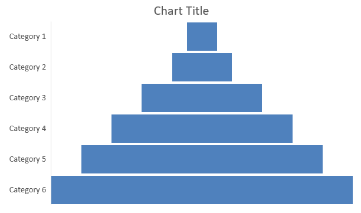

## **Übersicht**

Dieser Artikel bietet eine umfassende Anleitung, wie man Diagramme mit Aspose.Slides für Java erstellt und anpasst. Sie lernen, wie Sie programmgesteuert ein Diagramm zu einer Folie hinzufügen, es mit Daten füllen und verschiedene Formatierungsoptionen anwenden, um Ihren spezifischen Designanforderungen zu entsprechen. Im gesamten Artikel veranschaulichen detaillierte Codebeispiele jeden Schritt, von der Initialisierung der Präsentation und des Diagrammobjekts bis zur Konfiguration von Serien, Achsen und Legenden. Wenn Sie dieser Anleitung folgen, erhalten Sie ein fundiertes Verständnis dafür, wie Sie die dynamische Diagrammerstellung in Ihre Java-Anwendungen integrieren und den Prozess der Erstellung datengetriebener Präsentationen rationalisieren.

## **Diagramm erstellen**

Diagramme helfen Benutzern, Daten schnell zu visualisieren und Erkenntnisse zu gewinnen, die aus einer Tabelle oder einem Tabellenblatt nicht sofort ersichtlich sind.

**Warum Diagramme erstellen?**

* große Datenmengen auf einer einzigen Folie in einer Präsentation aggregieren, komprimieren oder zusammenfassen;
* Muster und Trends in den Daten aufzeigen;
* die Richtung und das Momentum der Daten über die Zeit oder in Bezug auf eine bestimmte Maßeinheit ableiten;
* Ausreißer, Abweichungen, Fehler und unsinnige Daten erkennen;
* komplexe Daten kommunizieren oder präsentieren.

In PowerPoint können Sie Diagramme über die *Einfügen*-Funktion erstellen, die Vorlagen für die Gestaltung vieler Diagrammtypen bereitstellt. Mit Aspose.Slides können Sie sowohl reguläre Diagramme (basierend auf gängigen Diagrammtypen) als auch benutzerdefinierte Diagramme erstellen.

{}
Verwenden Sie die [ChartType](https://reference.aspose.com/slides/java/com.aspose.slides/charttype/) Aufzählung im [com.aspose.slides](https://reference.aspose.com/slides/java/com.aspose.slides/) Paket. Die Werte in dieser Aufzählung entsprechen verschiedenen Diagrammtypen.
{}

### **Gruppierte Säulendiagramme erstellen**

Dieses Beispiel verwendet [addChart](https://reference.aspose.com/slides/java/com.aspose.slides/ishapecollection/#addChart-int-float-float-float-float-) , um ein gruppiertes Säulendiagramm zu erstellen, das zwei Serien über drei Kategorien vergleicht. Die Serien verwenden rote und grüne Füllungen, und einzelne Beschriftungen zeigen Kategorienamen, Seriendnamen und Werte. Der Arbeitsblattindex 0 bezieht sich auf das erste Blatt im eingebetteten Diagramm‑Arbeitsbuch.

```java
import com.aspose.slides.*;
import java.awt.Color;

Presentation presentation = new Presentation();
try
{
    ISlide slide = presentation.getSlides().get_Item(0);

    IChart chart = slide.getShapes().addChart(ChartType.ClusteredColumn, 20, 20, 500, 300);

    chart.getChartTitle().addTextFrameForOverriding("Sample Title");
    chart.getChartTitle().getTextFrameForOverriding().getTextFrameFormat().setCenterText(NullableBool.True);
    chart.getChartTitle().setHeight(20);
    chart.setTitle(true);

    IChartDataWorkbook workbook = chart.getChartData().getChartDataWorkbook();
    int worksheetIndex = 0;

    chart.getChartData().getSeries().clear();
    chart.getChartData().getCategories().clear();

    IChartDataCell seriesNameCell = workbook.getCell(worksheetIndex, 0, 1, "Series 1");
    chart.getChartData().getSeries().add(seriesNameCell, chart.getType());
    seriesNameCell = workbook.getCell(worksheetIndex, 0, 2, "Series 2");
    chart.getChartData().getSeries().add(seriesNameCell, chart.getType());

    IChartDataCell categoryCell = workbook.getCell(worksheetIndex, 1, 0, "Category 1");
    chart.getChartData().getCategories().add(categoryCell);
    categoryCell = workbook.getCell(worksheetIndex, 2, 0, "Category 2");
    chart.getChartData().getCategories().add(categoryCell);
    categoryCell = workbook.getCell(worksheetIndex, 3, 0, "Category 3");
    chart.getChartData().getCategories().add(categoryCell);

    IChartSeries series = chart.getChartData().getSeries().get_Item(0);

    IChartDataCell valueCell = workbook.getCell(worksheetIndex, 1, 1, 20);
    series.getDataPoints().addDataPointForBarSeries(valueCell);
    valueCell = workbook.getCell(worksheetIndex, 2, 1, 50);
    series.getDataPoints().addDataPointForBarSeries(valueCell);
    valueCell = workbook.getCell(worksheetIndex, 3, 1, 30);
    series.getDataPoints().addDataPointForBarSeries(valueCell);

    series.getFormat().getFill().setFillType(FillType.Solid);
    series.getFormat().getFill().getSolidFillColor().setColor(Color.RED);

    series = chart.getChartData().getSeries().get_Item(1);

    valueCell = workbook.getCell(worksheetIndex, 1, 2, 30);
    series.getDataPoints().addDataPointForBarSeries(valueCell);
    valueCell = workbook.getCell(worksheetIndex, 2, 2, 10);
    series.getDataPoints().addDataPointForBarSeries(valueCell);
    valueCell = workbook.getCell(worksheetIndex, 3, 2, 60);
    series.getDataPoints().addDataPointForBarSeries(valueCell);

    series.getFormat().getFill().setFillType(FillType.Solid);
    series.getFormat().getFill().getSolidFillColor().setColor(new Color(0, 128, 0));

    IDataLabel label = series.getDataPoints().get_Item(0).getLabel();
    label.getDataLabelFormat().setShowCategoryName(true);

    label = series.getDataPoints().get_Item(1).getLabel();
    label.getDataLabelFormat().setShowSeriesName(true);

    label = series.getDataPoints().get_Item(2).getLabel();
    label.getDataLabelFormat().setShowValue(true);
    label.getDataLabelFormat().setShowSeriesName(true);
    label.getDataLabelFormat().setSeparator("/");

    presentation.save("AsposeChart.pptx", SaveFormat.Pptx);
}
finally
{
    presentation.dispose();
}
```

Das Ergebnis:


### **Streudiagramme erstellen**

Streudiagramme (auch bekannt als Scatter‑Plots oder X‑Y‑Grafiken) werden häufig verwendet, um Muster zu prüfen oder Korrelationen zwischen zwei Variablen zu zeigen.

Verwenden Sie ein Streudiagramm, wenn:

* Sie über mehrere numerische Datenpaare verfügen.
* Sie zwei Variablen besitzen, die gut zusammenpassen.
* Sie feststellen möchten, ob die beiden Variablen miteinander verbunden sind.
* Sie eine unabhängige Variable haben, die mehrere Werte für eine abhängige Variable besitzt.

Dieses Beispiel zeichnet zwei Sätze von x‑y‑Werten. Die erste Serie verwendet gerade Linien mit Stern‑Markierungen, während die zweite glatte Linien mit Kreis‑Markierungen nutzt; beide verwenden eine Markierungsgröße von 10, konfiguriert mit [setSize](https://reference.aspose.com/slides/java/com.aspose.slides/imarker/#setSize-int-). Die [setSymbol](https://reference.aspose.com/slides/java/com.aspose.slides/imarker/#setSymbol-int-) Methode steuert die Form der Markierung.

```java
import com.aspose.slides.*;

Presentation presentation = new Presentation();
try
{
    ISlide slide = presentation.getSlides().get_Item(0);

    IChart chart = slide.getShapes().addChart(ChartType.ScatterWithSmoothLines, 20, 20, 500, 300);

    IChartDataWorkbook workbook = chart.getChartData().getChartDataWorkbook();
    int worksheetIndex = 0;

    chart.getChartData().getSeries().clear();

    IChartDataCell seriesNameCell = workbook.getCell(worksheetIndex, 1, 1, "Series 1");
    chart.getChartData().getSeries().add(seriesNameCell, chart.getType());
    seriesNameCell = workbook.getCell(worksheetIndex, 1, 3, "Series 2");
    chart.getChartData().getSeries().add(seriesNameCell, chart.getType());

    IChartSeries series = chart.getChartData().getSeries().get_Item(0);

    IChartDataCell xValueCell = workbook.getCell(worksheetIndex, 2, 1, 1);
    IChartDataCell yValueCell = workbook.getCell(worksheetIndex, 2, 2, 3);
    series.getDataPoints().addDataPointForScatterSeries(xValueCell, yValueCell);

    xValueCell = workbook.getCell(worksheetIndex, 3, 1, 2);
    yValueCell = workbook.getCell(worksheetIndex, 3, 2, 10);
    series.getDataPoints().addDataPointForScatterSeries(xValueCell, yValueCell);

    series.setType(ChartType.ScatterWithStraightLinesAndMarkers);

    series.getMarker().setSize(10);
    series.getMarker().setSymbol(MarkerStyleType.Star);

    series = chart.getChartData().getSeries().get_Item(1);

    xValueCell = workbook.getCell(worksheetIndex, 2, 3, 5);
    yValueCell = workbook.getCell(worksheetIndex, 2, 4, 2);
    series.getDataPoints().addDataPointForScatterSeries(xValueCell, yValueCell);

    xValueCell = workbook.getCell(worksheetIndex, 3, 3, 3);
    yValueCell = workbook.getCell(worksheetIndex, 3, 4, 1);
    series.getDataPoints().addDataPointForScatterSeries(xValueCell, yValueCell);

    xValueCell = workbook.getCell(worksheetIndex, 4, 3, 2);
    yValueCell = workbook.getCell(worksheetIndex, 4, 4, 2);
    series.getDataPoints().addDataPointForScatterSeries(xValueCell, yValueCell);

    xValueCell = workbook.getCell(worksheetIndex, 5, 3, 5);
    yValueCell = workbook.getCell(worksheetIndex, 5, 4, 1);
    series.getDataPoints().addDataPointForScatterSeries(xValueCell, yValueCell);

    series.getMarker().setSize(10);
    series.getMarker().setSymbol(MarkerStyleType.Circle);

    presentation.save("AsposeChart.pptx", SaveFormat.Pptx);
}
finally
{
    presentation.dispose();
}
```

Das Ergebnis:


### **Kreisdiagramme erstellen**

Dieses Beispiel erstellt ein Kreisdiagramm mit drei Quartalswerten. Jeder Abschnitt hat eine benutzerdefinierte Füllung und einen Rand, und die Beschriftungen zeigen verschiedene Kombinationen aus Werten, Prozentsätzen und Serieninformationen. Die [setFirstSliceAngle](https://reference.aspose.com/slides/java/com.aspose.slides/ichartseriesgroup/#setFirstSliceAngle-int-) Methode setzt den ersten Abschnitt so, dass er bei 180 Grad startet.

```java
import com.aspose.slides.*;
import java.awt.Color;

Presentation presentation = new Presentation();
try
{
    ISlide slide = presentation.getSlides().get_Item(0);

    IChart chart = slide.getShapes().addChart(ChartType.Pie, 20, 20, 500, 300);

    chart.getChartTitle().addTextFrameForOverriding("Sample Title");
    chart.getChartTitle().getTextFrameForOverriding().getTextFrameFormat().setCenterText(NullableBool.True);
    chart.getChartTitle().setHeight(20);
    chart.setTitle(true);

    chart.getChartData().getSeries().get_Item(0).getLabels().getDefaultDataLabelFormat().setShowValue(true);

    IChartDataWorkbook workbook = chart.getChartData().getChartDataWorkbook();
    int worksheetIndex = 0;

    chart.getChartData().getSeries().clear();
    chart.getChartData().getCategories().clear();

    IChartDataCell categoryCell = workbook.getCell(0, 1, 0, "1st Qtr");
    chart.getChartData().getCategories().add(categoryCell);
    categoryCell = workbook.getCell(0, 2, 0, "2nd Qtr");
    chart.getChartData().getCategories().add(categoryCell);
    categoryCell = workbook.getCell(0, 3, 0, "3rd Qtr");
    chart.getChartData().getCategories().add(categoryCell);

    IChartDataCell seriesNameCell = workbook.getCell(0, 0, 1, "Series 1");
    IChartSeries series = chart.getChartData().getSeries().add(seriesNameCell, chart.getType());

    IChartDataCell valueCell = workbook.getCell(worksheetIndex, 1, 1, 20);
    series.getDataPoints().addDataPointForPieSeries(valueCell);
    valueCell = workbook.getCell(worksheetIndex, 2, 1, 50);
    series.getDataPoints().addDataPointForPieSeries(valueCell);
    valueCell = workbook.getCell(worksheetIndex, 3, 1, 30);
    series.getDataPoints().addDataPointForPieSeries(valueCell);

    chart.getChartData().getSeriesGroups().get_Item(0).setColorVaried(true);

    IChartDataPoint firstSlice = series.getDataPoints().get_Item(0);
    firstSlice.getFormat().getFill().setFillType(FillType.Solid);
    firstSlice.getFormat().getFill().getSolidFillColor().setColor(Color.CYAN);

    firstSlice.getFormat().getLine().getFillFormat().setFillType(FillType.Solid);
    firstSlice.getFormat().getLine().getFillFormat().getSolidFillColor().setColor(Color.GRAY);
    firstSlice.getFormat().getLine().setWidth(3.0);
    firstSlice.getFormat().getLine().setStyle(LineStyle.ThinThick);
    firstSlice.getFormat().getLine().setDashStyle(LineDashStyle.LargeDash);

    IChartDataPoint secondSlice = series.getDataPoints().get_Item(1);
    secondSlice.getFormat().getFill().setFillType(FillType.Solid);
    secondSlice.getFormat().getFill().getSolidFillColor().setColor(new Color(165, 42, 42));

    secondSlice.getFormat().getLine().getFillFormat().setFillType(FillType.Solid);
    secondSlice.getFormat().getLine().getFillFormat().getSolidFillColor().setColor(Color.BLUE);
    secondSlice.getFormat().getLine().setWidth(3.0);
    secondSlice.getFormat().getLine().setStyle(LineStyle.Single);
    secondSlice.getFormat().getLine().setDashStyle(LineDashStyle.LargeDashDot);

    IChartDataPoint thirdSlice = series.getDataPoints().get_Item(2);
    thirdSlice.getFormat().getFill().setFillType(FillType.Solid);
    thirdSlice.getFormat().getFill().getSolidFillColor().setColor(new Color(255, 127, 80));

    thirdSlice.getFormat().getLine().getFillFormat().setFillType(FillType.Solid);
    thirdSlice.getFormat().getLine().getFillFormat().getSolidFillColor().setColor(Color.RED);
    thirdSlice.getFormat().getLine().setWidth(2.0);
    thirdSlice.getFormat().getLine().setStyle(LineStyle.ThinThin);
    thirdSlice.getFormat().getLine().setDashStyle(LineDashStyle.LargeDashDotDot);

    IDataLabel firstLabel = series.getDataPoints().get_Item(0).getLabel();
    firstLabel.getDataLabelFormat().setShowValue(true);

    IDataLabel secondLabel = series.getDataPoints().get_Item(1).getLabel();
    secondLabel.getDataLabelFormat().setShowValue(true);
    secondLabel.getDataLabelFormat().setShowLegendKey(true);
    secondLabel.getDataLabelFormat().setShowPercentage(true);

    IDataLabel thirdLabel = series.getDataPoints().get_Item(2).getLabel();
    thirdLabel.getDataLabelFormat().setShowSeriesName(true);
    thirdLabel.getDataLabelFormat().setShowPercentage(true);

    series.getLabels().getDefaultDataLabelFormat().setShowLeaderLines(true);

    chart.getChartData().getSeriesGroups().get_Item(0).setFirstSliceAngle(180);

    presentation.save("PieChart.pptx", SaveFormat.Pptx);
}
finally
{
    presentation.dispose();
}
```

Das Ergebnis:


Um die Lesbarkeit von Beschriftungen außerhalb des Kreises zu verbessern, siehe [Format Führungs‑linien](/slides/de/java/chart-data-label/#format-leader-lines) für ein Beispiel, das Beschriftungen positioniert und die Farbe, Breite, Transparenz und Strichart der Linien anpasst.

### **Liniendiagramme erstellen**

Liniendiagramme (auch bekannt als Liniendiagramme) werden am besten verwendet, wenn Sie Änderungen von Werten über die Zeit demonstrieren möchten. Mit einem Liniendiagramm können Sie große Datenmengen gleichzeitig vergleichen, Änderungen und Trends über die Zeit verfolgen, Anomalien in Datenreihen hervorheben und mehr.

Dieses Beispiel verwendet [addChart](https://reference.aspose.com/slides/java/com.aspose.slides/ishapecollection/#addChart-int-float-float-float-float-) , um ein Liniendiagramm mit den Standardserien und -kategorien zu erstellen, dann wird die Präsentation als PPTX gespeichert.

```java
import com.aspose.slides.*;

Presentation presentation = new Presentation();
try
{
    ISlide slide = presentation.getSlides().get_Item(0);

    IChart lineChart = slide.getShapes().addChart(ChartType.Line, 20, 20, 500, 300);

    presentation.save("lineChart.pptx", SaveFormat.Pptx);
}
finally
{
    presentation.dispose();
}
```

Standardmäßig werden Punkte in einem Liniendiagramm durch gerade kontinuierliche Linien verbunden. Wenn Sie die Punkte stattdessen durch Striche verbinden möchten, rufen Sie [setDashStyle](https://reference.aspose.com/slides/java/com.aspose.slides/ilineformat/#setDashStyle-byte-) mit einem Wert aus [LineDashStyle](https://reference.aspose.com/slides/java/com.aspose.slides/linedashstyle/) auf:

```java
import com.aspose.slides.*;

Presentation presentation = new Presentation();
try
{
    ISlide slide = presentation.getSlides().get_Item(0);

    IChart lineChart = slide.getShapes().addChart(ChartType.Line, 20, 20, 500, 300);

    for (IChartSeries series : lineChart.getChartData().getSeries())
    {
        series.getFormat().getLine().setDashStyle(LineDashStyle.Dash);
    }
}
finally
{
    presentation.dispose();
}
```

Das Ergebnis:


### **Baumkarten erstellen**

Baumkarten werden am besten für Verkaufsdaten verwendet, wenn Sie die relative Größe von Datenkategorien zeigen und schnell die Aufmerksamkeit auf Elemente lenken möchten, die große Beiträge innerhalb jeder Kategorie leisten.

Dieses Beispiel erstellt eine Baumkarte mit acht Blättern, gruppiert in vier Stämmen und zwei Zweigen. Die [setGroupingItem](https://reference.aspose.com/slides/java/com.aspose.slides/ichartcategorylevelsmanager/#setGroupingItem-int-java.lang.Object-) Methode weist Stämme auf Gruppierungsebene 1 und Zweige auf Ebene 2 zu. Werte bestimmen die relativen Rechteckgrößen, während Kategorienbeschriftungen und überlappende Elternbeschriftungen die Hierarchie identifizieren.

```java
import com.aspose.slides.*;

Presentation presentation = new Presentation();
try
{
    ISlide slide = presentation.getSlides().get_Item(0);

    IChart chart = slide.getShapes().addChart(ChartType.Treemap, 20, 20, 500, 300);

    chart.getChartData().getCategories().clear();
    chart.getChartData().getSeries().clear();

    IChartDataWorkbook workbook = chart.getChartData().getChartDataWorkbook();
    workbook.clear(0);

    // Zweig 1
    IChartDataCell categoryCell = workbook.getCell(0, "C1", "Leaf1");
    IChartCategory leaf = chart.getChartData().getCategories().add(categoryCell);
    leaf.getGroupingLevels().setGroupingItem(1, "Stem1");
    leaf.getGroupingLevels().setGroupingItem(2, "Branch1");

    categoryCell = workbook.getCell(0, "C2", "Leaf2");
    chart.getChartData().getCategories().add(categoryCell);

    categoryCell = workbook.getCell(0, "C3", "Leaf3");
    leaf = chart.getChartData().getCategories().add(categoryCell);
    leaf.getGroupingLevels().setGroupingItem(1, "Stem2");

    categoryCell = workbook.getCell(0, "C4", "Leaf4");
    chart.getChartData().getCategories().add(categoryCell);

    // Zweig 2
    categoryCell = workbook.getCell(0, "C5", "Leaf5");
    leaf = chart.getChartData().getCategories().add(categoryCell);
    leaf.getGroupingLevels().setGroupingItem(1, "Stem3");
    leaf.getGroupingLevels().setGroupingItem(2, "Branch2");

    categoryCell = workbook.getCell(0, "C6", "Leaf6");
    chart.getChartData().getCategories().add(categoryCell);

    categoryCell = workbook.getCell(0, "C7", "Leaf7");
    leaf = chart.getChartData().getCategories().add(categoryCell);
    leaf.getGroupingLevels().setGroupingItem(1, "Stem4");

    categoryCell = workbook.getCell(0, "C8", "Leaf8");
    chart.getChartData().getCategories().add(categoryCell);

    IChartSeries series = chart.getChartData().getSeries().add(ChartType.Treemap);
    series.getLabels().getDefaultDataLabelFormat().setShowCategoryName(true);
    IChartDataCell valueCell = workbook.getCell(0, "D1", 4);
    series.getDataPoints().addDataPointForTreemapSeries(valueCell);
    valueCell = workbook.getCell(0, "D2", 5);
    series.getDataPoints().addDataPointForTreemapSeries(valueCell);
    valueCell = workbook.getCell(0, "D3", 3);
    series.getDataPoints().addDataPointForTreemapSeries(valueCell);
    valueCell = workbook.getCell(0, "D4", 6);
    series.getDataPoints().addDataPointForTreemapSeries(valueCell);
    valueCell = workbook.getCell(0, "D5", 9);
    series.getDataPoints().addDataPointForTreemapSeries(valueCell);
    valueCell = workbook.getCell(0, "D6", 9);
    series.getDataPoints().addDataPointForTreemapSeries(valueCell);
    valueCell = workbook.getCell(0, "D7", 4);
    series.getDataPoints().addDataPointForTreemapSeries(valueCell);
    valueCell = workbook.getCell(0, "D8", 3);
    series.getDataPoints().addDataPointForTreemapSeries(valueCell);

    series.setParentLabelLayout(ParentLabelLayoutType.Overlapping);

    presentation.save("Treemap.pptx", SaveFormat.Pptx);
}
finally
{
    presentation.dispose();
}
```

Das Ergebnis:


### **Wasserfalldiagramme erstellen**

Ein Wasserfalldiagramm zeigt, wie positive und negative Änderungen zu einem Endwert beitragen. Zum Beispiel kann eine Gewinnaufschlüsselung mit Umsatz beginnen, Kosten abziehen und andere Einnahmen hinzufügen. Änderungs‑Spalten schwimmen zwischen dem vorherigen und dem neuen Laufwert, während Gesamtsäulen von Null bis zum kumulierten Wert reichen.

Das folgende Beispiel verwendet Beträge in Tausend US‑Dollar:

| Kategorie | Arbeitsbuchwert | Spaltentyp |
| --- | ---: | --- |
| Umsatz | 1000 | Zunahme |
| Verkaufskosten | -400 | Abnahme |
| Bruttogewinn | 600 | Zwischensumme |
| Betriebskosten | -200 | Abnahme |
| Sonstige Erträge | 50 | Zunahme |
| Nettoergebnis | 450 | Endsumme |

Um einen Punkt als Zwischensumme oder Endsumme zu markieren, rufen Sie dessen [setSetAsTotal](https://reference.aspose.com/slides/java/com.aspose.slides/chartdatapoint/#setSetAsTotal-boolean-) Methode mit `true` auf. Geben Sie den tatsächlich kumulierten Betrag in der Arbeitsbuchzelle dieses Punktes an: `600` für Bruttogewinn (`1000 - 400`) und `450` für Nettoergebnis (`600 - 200 + 50`). Die Methode markiert die Spalte als Summe; sie berechnet oder füllt den Zellenwert nicht. Verwenden Sie nicht Null als Platzhalter und geben Sie keinen anderen Änderungswert für einen Summenpunkt an. Eine Gesamtsäule zeigt den kumulierten Wert, ohne ihn erneut zum Laufwert hinzuzufügen.

Dieses vollständige Java‑Beispiel erstellt ein Diagramm mit dem `Waterfall`‑Element von [ChartType](https://reference.aspose.com/slides/java/com.aspose.slides/charttype/), löscht die Standarddaten und füllt das eingebettete Arbeitsbuch. Arbeitsblattindex `0` wählt das erste Arbeitsblatt; Spalte A enthält Kategorienamen und Spalte B die Werte. Jeder Wert wird mit [addDataPointForWaterfallSeries](https://reference.aspose.com/slides/java/com.aspose.slides/ichartdatapointcollection/#addDataPointForWaterfallSeries-com.aspose.slides.IChartDataCell-) hinzugefügt. Die nullbasierten Punktindizes `2` und `5` identifizieren die Zwischensummen‑ bzw. Endsummen. Durch Aufruf von [setShowValue](https://reference.aspose.com/slides/java/com.aspose.slides/idatalabelformat/#setShowValue-boolean-) mit `true` werden die Beträge auf den Spalten angezeigt. Keine Eingabepräsentation oder Arbeitsbuch ist erforderlich.

```java
import com.aspose.slides.*;

Presentation presentation = new Presentation();
try
{
    ISlide slide = presentation.getSlides().get_Item(0);

    IChart chart = slide.getShapes().addChart(ChartType.Waterfall, 20, 20, 680, 200);

    chart.setTitle(true);
    chart.getChartTitle().addTextFrameForOverriding("Profit breakdown (USD thousands)");
    chart.getChartTitle().setOverlay(false);
    chart.setLegend(false);

    chart.getChartData().getSeries().clear();
    chart.getChartData().getCategories().clear();

    IChartDataWorkbook workbook = chart.getChartData().getChartDataWorkbook();
    int worksheetIndex = 0;

    workbook.clear(worksheetIndex);

    IChartDataCell seriesNameCell = workbook.getCell(worksheetIndex, 0, 1, "Profit");
    IChartSeries series = chart.getChartData().getSeries().add(seriesNameCell, ChartType.Waterfall);
    String[] categories = new String[] { "Revenue", "Cost of sales", "Gross profit", "Operating expenses", "Other income", "Net profit" };
    double[] values = new double[] { 1000, -400, 600, -200, 50, 450 };

    for (int i = 0; i < categories.length; i++)
    {
        IChartDataCell categoryCell = workbook.getCell(worksheetIndex, i + 1, 0, categories[i]);
        chart.getChartData().getCategories().add(categoryCell);
        IChartDataCell valueCell = workbook.getCell(worksheetIndex, i + 1, 1, values[i]);
        series.getDataPoints().addDataPointForWaterfallSeries(valueCell);
    }

    // Der dritte und der sechste Punkt stellen Summen dar, nicht zusätzliche Änderungen.
    series.getDataPoints().get_Item(2).setSetAsTotal(true);
    series.getDataPoints().get_Item(5).setSetAsTotal(true);
    series.setShowConnectorLines(true);
    series.getLabels().getDefaultDataLabelFormat().setShowValue(true);

    presentation.save("WaterfallChart.pptx", SaveFormat.Pptx);
}
finally
{
    presentation.dispose();
}
```

Rufen Sie die serienbezogene [setShowConnectorLines](https://reference.aspose.com/slides/java/com.aspose.slides/chartseries/#setShowConnectorLines-boolean-) Methode mit `true` auf, um Linien anzuzeigen, die aufeinanderfolgende Spalten verbinden und den Laufwert leichter nachvollziehbar machen. Um diese Linien zu verbergen, ersetzen Sie den Methodenaufruf im Beispiel durch `series.setShowConnectorLines(false);` vor dem Speichern. Dies ändert nur die Sichtbarkeit der Linien, nicht die Daten oder Summen.

Das gespeicherte Ergebnis zeigt einen Bruttogewinn von 600 und ein Nettoergebnis von 450, wobei beide Summen von Null aus gezeichnet werden:


### **Börsendiagramme erstellen**

Börsendiagramme werden verwendet, um Finanzdaten wie Eröffnung, Höchst, Tiefst und Schlusskurse darzustellen und helfen, Markttrends und Volatilität zu analysieren. Sie bieten wesentliche Einblicke in die Aktienperformance und unterstützen Investoren und Analysten bei fundierten Entscheidungen.

Dieses Beispiel erstellt ein Open‑High‑Low‑Close‑Diagramm mit vier Serien in dieser Reihenfolge und drei Kategorien. Die [setUpDownBars](https://reference.aspose.com/slides/java/com.aspose.slides/iupdownbarsmanager/#setUpDownBars-boolean-) Methode aktiviert Auf‑/Ab‑Balken, und [getHiLowLinesFormat](https://reference.aspose.com/slides/java/com.aspose.slides/ichartseriesgroup/#getHiLowLinesFormat--) steuert die Hoch‑Tief‑Linien, die die Preisspannen anzeigen, während die einzelnen Serienlinien und die feinen horizontalen Gitternetzlinien ausgeblendet sind.

Der Manager, der von [getUpDownBars](https://reference.aspose.com/slides/java/com.aspose.slides/ichartseriesgroup/#getUpDownBars--) zurückgegeben wird, stellt separate Formatierungsobjekte über [getUpBarsFormat](https://reference.aspose.com/slides/java/com.aspose.slides/iupdownbarsmanager/#getUpBarsFormat--) und [getDownBarsFormat](https://reference.aspose.com/slides/java/com.aspose.slides/iupdownbarsmanager/#getDownBarsFormat--) bereit. Verwenden Sie die jeweiligen [getFill](https://reference.aspose.com/slides/java/com.aspose.slides/iformat/#getFill--) und [getLine](https://reference.aspose.com/slides/java/com.aspose.slides/iformat/#getLine--) Methoden, um Füllung und Kontur unabhängig zu setzen. Dieses Beispiel verwendet grüne Balken mit dunkelgrünen Konturen für steigende Intervalle und orange‑rote Balken mit dunkelroten Konturen für fallende Intervalle.

Geben Sie für jede Kategorie numerische Werte für alle vier Serien an, wobei Hoch und Tief die Öffnungs‑ und Schlusswerte umschließen. Die Balken vergleichen den Schlusskurs mit dem Eröffnungskurs **innerhalb derselben Kategorie**, nicht mit der vorherigen Kategorie: A fällt von 72 auf 25, während B von 25 auf 38 steigt und C von 38 auf 50. Gleiche Öffnungs‑ und Schlusswerte erzeugen kein sichtbares gefülltes Intervall. Auf‑/Ab‑Balken erstrecken sich über Öffnen–Schließen; Hoch‑Tief‑Linien über Tief–Hoch. Diese Balken gehören zur Seriengruppe und sind keine normalen Balkendiagramm‑Serien.

Diese Formatierung funktioniert auch mit [Line und LineWithMarkers](https://reference.aspose.com/slides/java/com.aspose.slides/charttype/) Diagrammen, die mindestens zwei Serien in derselben Gruppe und entsprechende numerische Werte für jede Kategorie enthalten. Für diese nicht‑gestapelten Liniendiagramme vergleichen Auf‑/Ab‑Balken die erste und letzte Serie: ein höherer letzter Wert erzeugt einen Auf‑Balken, ein niedrigerer letzter Wert einen Ab‑Balken. Das Umkehren dieser Serien kehrt die Klassifizierung um. Das Beispiel unten verwendet [OpenHighLowClose](https://reference.aspose.com/slides/java/com.aspose.slides/charttype/); gehen Sie nicht davon aus, dass andere Börsen‑, gestapelten Linien‑ oder 3D‑Varianten dieselbe Datenanordnung oder Intervallinterpretation verwenden.

```java
import com.aspose.slides.*;
import java.awt.Color;

Presentation presentation = new Presentation();
try
{
    ISlide slide = presentation.getSlides().get_Item(0);

    IChart chart = slide.getShapes().addChart(ChartType.OpenHighLowClose, 20, 20, 500, 150, false);

    IChartDataWorkbook workbook = chart.getChartData().getChartDataWorkbook();

    IChartDataCell categoryCell = workbook.getCell(0, 1, 0, "A");
    chart.getChartData().getCategories().add(categoryCell);
    categoryCell = workbook.getCell(0, 2, 0, "B");
    chart.getChartData().getCategories().add(categoryCell);
    categoryCell = workbook.getCell(0, 3, 0, "C");
    chart.getChartData().getCategories().add(categoryCell);

    IChartDataCell seriesNameCell = workbook.getCell(0, 0, 1, "Open");
    chart.getChartData().getSeries().add(seriesNameCell, ChartType.OpenHighLowClose);
    seriesNameCell = workbook.getCell(0, 0, 2, "High");
    chart.getChartData().getSeries().add(seriesNameCell, ChartType.OpenHighLowClose);
    seriesNameCell = workbook.getCell(0, 0, 3, "Low");
    chart.getChartData().getSeries().add(seriesNameCell, ChartType.OpenHighLowClose);
    seriesNameCell = workbook.getCell(0, 0, 4, "Close");
    chart.getChartData().getSeries().add(seriesNameCell, ChartType.OpenHighLowClose);

    IChartSeries series = chart.getChartData().getSeries().get_Item(0);
    IChartDataCell valueCell = workbook.getCell(0, 1, 1, 72);
    series.getDataPoints().addDataPointForStockSeries(valueCell);
    valueCell = workbook.getCell(0, 2, 1, 25);
    series.getDataPoints().addDataPointForStockSeries(valueCell);
    valueCell = workbook.getCell(0, 3, 1, 38);
    series.getDataPoints().addDataPointForStockSeries(valueCell);

    series = chart.getChartData().getSeries().get_Item(1);
    valueCell = workbook.getCell(0, 1, 2, 172);
    series.getDataPoints().addDataPointForStockSeries(valueCell);
    valueCell = workbook.getCell(0, 2, 2, 57);
    series.getDataPoints().addDataPointForStockSeries(valueCell);
    valueCell = workbook.getCell(0, 3, 2, 57);
    series.getDataPoints().addDataPointForStockSeries(valueCell);

    series = chart.getChartData().getSeries().get_Item(2);
    valueCell = workbook.getCell(0, 1, 3, 12);
    series.getDataPoints().addDataPointForStockSeries(valueCell);
    valueCell = workbook.getCell(0, 2, 3, 12);
    series.getDataPoints().addDataPointForStockSeries(valueCell);
    valueCell = workbook.getCell(0, 3, 3, 13);
    series.getDataPoints().addDataPointForStockSeries(valueCell);

    series = chart.getChartData().getSeries().get_Item(3);
    valueCell = workbook.getCell(0, 1, 4, 25);
    series.getDataPoints().addDataPointForStockSeries(valueCell);
    valueCell = workbook.getCell(0, 2, 4, 38);
    series.getDataPoints().addDataPointForStockSeries(valueCell);
    valueCell = workbook.getCell(0, 3, 4, 50);
    series.getDataPoints().addDataPointForStockSeries(valueCell);

    IUpDownBarsManager upDownBars = chart.getChartData().getSeriesGroups().get_Item(0).getUpDownBars();
    upDownBars.setUpDownBars(true);

    upDownBars.getUpBarsFormat().getFill().setFillType(FillType.Solid);
    upDownBars.getUpBarsFormat().getFill().getSolidFillColor().setColor(new Color(50, 205, 50));
    upDownBars.getUpBarsFormat().getLine().getFillFormat().setFillType(FillType.Solid);
    upDownBars.getUpBarsFormat().getLine().getFillFormat().getSolidFillColor().setColor(new Color(0, 100, 0));
    upDownBars.getUpBarsFormat().getLine().setWidth(2);

    upDownBars.getDownBarsFormat().getFill().setFillType(FillType.Solid);
    upDownBars.getDownBarsFormat().getFill().getSolidFillColor().setColor(new Color(255, 69, 0));
    upDownBars.getDownBarsFormat().getLine().getFillFormat().setFillType(FillType.Solid);
    upDownBars.getDownBarsFormat().getLine().getFillFormat().getSolidFillColor().setColor(new Color(139, 0, 0));
    upDownBars.getDownBarsFormat().getLine().setWidth(2);
    chart.getChartData().getSeriesGroups().get_Item(0).getHiLowLinesFormat().getLine().getFillFormat().setFillType(FillType.Solid);

    for (IChartSeries stockSeries : chart.getChartData().getSeries())
    {
        stockSeries.getFormat().getLine().getFillFormat().setFillType(FillType.NoFill);
    }

    chart.getAxes().getVerticalAxis().getMinorGridLinesFormat().getLine().getFillFormat().setFillType(FillType.NoFill);

    presentation.save("Stock-chart.pptx", SaveFormat.Pptx);
}
finally
{
    presentation.dispose();
}
```

Das Ergebnis, exportiert aus PowerPoint:


### **Box‑Und‑Whisker‑Diagramme erstellen**

Box‑Und‑Whisker‑Diagramme werden verwendet, um die Verteilung von Daten zusammenzufassen, indem zentrale statistische Kennzahlen wie Median, Quartile und mögliche Ausreißer dargestellt werden. Sie sind besonders nützlich in explorativen Analysen und statistischen Studien, um Datenvariabilität schnell zu verstehen und Anomalien zu identifizieren.

Dieses Beispiel erstellt ein Box‑Und‑Whisker‑Diagramm aus sechs Werten. Die [setQuartileMethod](https://reference.aspose.com/slides/java/com.aspose.slides/ichartseries/#setQuartileMethod-int-) Methode wählt die exklusive Quartilsberechnung. Das Beispiel aktiviert zudem Mittelwertlinien, Mittelwert‑Markierungen, innere Punkte und Ausreißerpunkte.

```java
import com.aspose.slides.*;

Presentation presentation = new Presentation();
try
{
    ISlide slide = presentation.getSlides().get_Item(0);

    IChart chart = slide.getShapes().addChart(ChartType.BoxAndWhisker, 20, 20, 500, 300);

    chart.getChartData().getCategories().clear();
    chart.getChartData().getSeries().clear();

    IChartDataWorkbook workbook = chart.getChartData().getChartDataWorkbook();
    workbook.clear(0);

    IChartDataCell categoryCell = workbook.getCell(0, "A1", "Category 1");
    chart.getChartData().getCategories().add(categoryCell);
    categoryCell = workbook.getCell(0, "A2", "Category 2");
    chart.getChartData().getCategories().add(categoryCell);
    categoryCell = workbook.getCell(0, "A3", "Category 3");
    chart.getChartData().getCategories().add(categoryCell);
    categoryCell = workbook.getCell(0, "A4", "Category 4");
    chart.getChartData().getCategories().add(categoryCell);
    categoryCell = workbook.getCell(0, "A5", "Category 5");
    chart.getChartData().getCategories().add(categoryCell);
    categoryCell = workbook.getCell(0, "A6", "Category 6");
    chart.getChartData().getCategories().add(categoryCell);

    IChartSeries series = chart.getChartData().getSeries().add(ChartType.BoxAndWhisker);

    series.setQuartileMethod(QuartileMethodType.Exclusive);
    series.setShowMeanLine(true);
    series.setShowMeanMarkers(true);
    series.setShowInnerPoints(true);
    series.setShowOutlierPoints(true);

    IChartDataCell valueCell = workbook.getCell(0, "B1", 15);
    series.getDataPoints().addDataPointForBoxAndWhiskerSeries(valueCell);
    valueCell = workbook.getCell(0, "B2", 41);
    series.getDataPoints().addDataPointForBoxAndWhiskerSeries(valueCell);
    valueCell = workbook.getCell(0, "B3", 16);
    series.getDataPoints().addDataPointForBoxAndWhiskerSeries(valueCell);
    valueCell = workbook.getCell(0, "B4", 10);
    series.getDataPoints().addDataPointForBoxAndWhiskerSeries(valueCell);
    valueCell = workbook.getCell(0, "B5", 23);
    series.getDataPoints().addDataPointForBoxAndWhiskerSeries(valueCell);
    valueCell = workbook.getCell(0, "B6", 16);
    series.getDataPoints().addDataPointForBoxAndWhiskerSeries(valueCell);

    presentation.save("BoxAndWhisker.pptx", SaveFormat.Pptx);
}
finally
{
    presentation.dispose();
}
```

### **Trichterdiagramme erstellen**

Trichterdiagramme visualisieren Prozesse mit aufeinanderfolgenden Stufen, bei denen das Datenvolumen von einem Schritt zum nächsten abnimmt. Sie sind besonders hilfreich, um Konversionsraten zu analysieren, Engpässe zu identifizieren und die Effizienz von Vertriebs‑ oder Marketingprozessen zu verfolgen.

Dieses Beispiel verwendet [addChart](https://reference.aspose.com/slides/java/com.aspose.slides/ishapecollection/#addChart-int-float-float-float-float-) , um einem bestehenden Präsentations‑Slide ein Trichterdiagramm hinzuzufügen. Es ersetzt die Standarddaten durch sechs Kategorien und Werte von 50 bis 500 und speichert dann die aktualisierte Präsentation. Die Eingabepäsentation muss mindestens einen Slide enthalten.

```java
import com.aspose.slides.*;

Presentation presentation = new Presentation("test.pptx");
try
{
    ISlide slide = presentation.getSlides().get_Item(0);

    IChart chart = slide.getShapes().addChart(ChartType.Funnel, 50, 50, 500, 400);

    chart.getChartData().getCategories().clear();
    chart.getChartData().getSeries().clear();

    IChartDataWorkbook workbook = chart.getChartData().getChartDataWorkbook();
    workbook.clear(0);

    IChartDataCell categoryCell = workbook.getCell(0, "A1", "Category 1");
    chart.getChartData().getCategories().add(categoryCell);
    categoryCell = workbook.getCell(0, "A2", "Category 2");
    chart.getChartData().getCategories().add(categoryCell);
    categoryCell = workbook.getCell(0, "A3", "Category 3");
    chart.getChartData().getCategories().add(categoryCell);
    categoryCell = workbook.getCell(0, "A4", "Category 4");
    chart.getChartData().getCategories().add(categoryCell);
    categoryCell = workbook.getCell(0, "A5", "Category 5");
    chart.getChartData().getCategories().add(categoryCell);
    categoryCell = workbook.getCell(0, "A6", "Category 6");
    chart.getChartData().getCategories().add(categoryCell);

    IChartSeries series = chart.getChartData().getSeries().add(ChartType.Funnel);

    IChartDataCell valueCell = workbook.getCell(0, "B1", 50);
    series.getDataPoints().addDataPointForFunnelSeries(valueCell);
    valueCell = workbook.getCell(0, "B2", 100);
    series.getDataPoints().addDataPointForFunnelSeries(valueCell);
    valueCell = workbook.getCell(0, "B3", 200);
    series.getDataPoints().addDataPointForFunnelSeries(valueCell);
    valueCell = workbook.getCell(0, "B4", 300);
    series.getDataPoints().addDataPointForFunnelSeries(valueCell);
    valueCell = workbook.getCell(0, "B5", 400);
    series.getDataPoints().addDataPointForFunnelSeries(valueCell);
    valueCell = workbook.getCell(0, "B6", 500);
    series.getDataPoints().addDataPointForFunnelSeries(valueCell);

    presentation.save("Funnel.pptx", SaveFormat.Pptx);
}
finally
{
    presentation.dispose();
}
```

Das Ergebnis:



### **Sonnenstrahl‑Diagramme erstellen**

Sonnenstrahl‑Diagramme visualisieren hierarchische Daten, wobei Ebenen als konzentrische Ringe dargestellt werden. Sie veranschaulichen Teil‑zu‑Ganz‑Beziehungen und eignen sich ideal, um verschachtelte Kategorien und Unterkategorien kompakt darzustellen.

Dieses Beispiel erstellt ein Sonnenstrahl‑Diagramm mit acht Blättern, gruppiert in vier Stämmen und zwei Zweigen. Die [setGroupingItem](https://reference.aspose.com/slides/java/com.aspose.slides/ichartcategorylevelsmanager/#setGroupingItem-int-java.lang.Object-) Methode weist Stämme auf Gruppierungsebene 1 und Zweige auf Ebene 2 zu. Kategorienbeschriftungen identifizieren die Segmente, und die Werte bestimmen ihre relative Größe.

```java
import com.aspose.slides.*;

Presentation presentation = new Presentation();
try
{
    ISlide slide = presentation.getSlides().get_Item(0);

    IChart chart = slide.getShapes().addChart(ChartType.Sunburst, 20, 20, 500, 300);

    chart.getChartData().getCategories().clear();
    chart.getChartData().getSeries().clear();

    IChartDataWorkbook workbook = chart.getChartData().getChartDataWorkbook();
    workbook.clear(0);

    // Zweig 1
    IChartDataCell categoryCell = workbook.getCell(0, "C1", "Leaf1");
    IChartCategory leaf = chart.getChartData().getCategories().add(categoryCell);
    leaf.getGroupingLevels().setGroupingItem(1, "Stem1");
    leaf.getGroupingLevels().setGroupingItem(2, "Branch1");

    categoryCell = workbook.getCell(0, "C2", "Leaf2");
    chart.getChartData().getCategories().add(categoryCell);

    categoryCell = workbook.getCell(0, "C3", "Leaf3");
    leaf = chart.getChartData().getCategories().add(categoryCell);
    leaf.getGroupingLevels().setGroupingItem(1, "Stem2");

    categoryCell = workbook.getCell(0, "C4", "Leaf4");
    chart.getChartData().getCategories().add(categoryCell);

    // Zweig 2
    categoryCell = workbook.getCell(0, "C5", "Leaf5");
    leaf = chart.getChartData().getCategories().add(categoryCell);
    leaf.getGroupingLevels().setGroupingItem(1, "Stem3");
    leaf.getGroupingLevels().setGroupingItem(2, "Branch2");

    categoryCell = workbook.getCell(0, "C6", "Leaf6");
    chart.getChartData().getCategories().add(categoryCell);

    categoryCell = workbook.getCell(0, "C7", "Leaf7");
    leaf = chart.getChartData().getCategories().add(categoryCell);
    leaf.getGroupingLevels().setGroupingItem(1, "Stem4");

    categoryCell = workbook.getCell(0, "C8", "Leaf8");
    chart.getChartData().getCategories().add(categoryCell);

    IChartSeries series = chart.getChartData().getSeries().add(ChartType.Sunburst);
    series.getLabels().getDefaultDataLabelFormat().setShowCategoryName(true);
    IChartDataCell valueCell = workbook.getCell(0, "D1", 4);
    series.getDataPoints().addDataPointForSunburstSeries(valueCell);
    valueCell = workbook.getCell(0, "D2", 5);
    series.getDataPoints().addDataPointForSunburstSeries(valueCell);
    valueCell = workbook.getCell(0, "D3", 3);
    series.getDataPoints().addDataPointForSunburstSeries(valueCell);
    valueCell = workbook.getCell(0, "D4", 6);
    series.getDataPoints().addDataPointForSunburstSeries(valueCell);
    valueCell = workbook.getCell(0, "D5", 9);
    series.getDataPoints().addDataPointForSunburstSeries(valueCell);
    valueCell = workbook.getCell(0, "D6", 9);
    series.getDataPoints().addDataPointForSunburstSeries(valueCell);
    valueCell = workbook.getCell(0, "D7", 4);
    series.getDataPoints().addDataPointForSunburstSeries(valueCell);
    valueCell = workbook.getCell(0, "D8", 3);
    series.getDataPoints().addDataPointForSunburstSeries(valueCell);

    presentation.save("Sunburst.pptx", SaveFormat.Pptx);
}
finally
{
    presentation.dispose();
}
```

Das Ergebnis:


### **Histogramm‑Diagramme erstellen**

Histogramm‑Diagramme zeigen, wie numerische Werte über Intervalle (Bins) verteilt sind. Für monatliche Berichte über Bearbeitungszeiten von Bestellungen verwenden Sie dieselbe Bin‑Breite und Schwellenwerte, um Intervalle konsistent zu halten und Verteilungen leichter vergleichen zu können.

Rufen Sie [setAggregationType](https://reference.aspose.com/slides/java/com.aspose.slides/iaxis/#setAggregationType-int-) auf der horizontalen Achse mit einem Modus aus [AxisAggregationType](https://reference.aspose.com/slides/java/com.aspose.slides/axisaggregationtype/) auf. [setBinWidth](https://reference.aspose.com/slides/java/com.aspose.slides/iaxis/#setBinWidth-double-) gilt nur für `ByBinWidth`; [setNumberOfBins](https://reference.aspose.com/slides/java/com.aspose.slides/iaxis/#setNumberOfBins-long-) gilt nur für `ByNumberOfBins`. Verwenden Sie `Automatic`, um das Diagramm die Bins selbst bestimmen zu lassen.

#### **Feste Bin‑Breite verwenden**

Dieses Beispiel gruppiert Bearbeitungszeiten in 10‑Minute‑Intervalle, mit separaten Bins für Zeiten ≤ 10 Minuten und > 40 Minuten. Aktivieren Sie diese Bins mit [setUnderflowBin](https://reference.aspose.com/slides/java/com.aspose.slides/iaxis/#setUnderflowBin-boolean-) und [setOverflowBin](https://reference.aspose.com/slides/java/com.aspose.slides/iaxis/#setOverflowBin-boolean-). Wenn Sie explizite Schwellenwerte über [setUnderflowBin](https://reference.aspose.com/slides/java/com.aspose.slides/iaxis/#setUnderflowBin-double-) und [setOverflowBin](https://reference.aspose.com/slides/java/com.aspose.slides/iaxis/#setOverflowBin-double-) angeben, rufen Sie [setAutomaticUnderflowBin](https://reference.aspose.com/slides/java/com.aspose.slides/iaxis/#setAutomaticUnderflowBin-boolean-) und [setAutomaticOverflowBin](https://reference.aspose.com/slides/java/com.aspose.slides/iaxis/#setAutomaticOverflowBin-boolean-) mit `false` auf.

```java
import com.aspose.slides.*;

Presentation presentation = new Presentation();
try
{
    ISlide slide = presentation.getSlides().get_Item(0);

    IChart chart = slide.getShapes().addChart(ChartType.Histogram, 20, 20, 680, 200);

    chart.setLegend(false);
    chart.setTitle(false);

    chart.getChartData().getCategories().clear();
    chart.getChartData().getSeries().clear();

    IChartDataWorkbook workbook = chart.getChartData().getChartDataWorkbook();
    workbook.clear(0);

    IChartSeries series = chart.getChartData().getSeries().add(ChartType.Histogram);
    double[] values = { 5, 10, 10, 11, 15, 20, 20, 21, 25, 30, 30, 31, 35, 40, 40, 41, 50 };
    for (int i = 0; i < values.length; i++)
    {
        IChartDataCell valueCell = workbook.getCell(0, i, 0, values[i]);
        series.getDataPoints().addDataPointForHistogramSeries(valueCell);
    }

    IAxis axis = chart.getAxes().getHorizontalAxis();
    axis.setAggregationType(AxisAggregationType.ByBinWidth);
    axis.setBinWidth(10);
    axis.setUnderflowBin(true);
    axis.setAutomaticUnderflowBin(false);
    axis.setUnderflowBin(10);
    axis.setOverflowBin(true);
    axis.setAutomaticOverflowBin(false);
    axis.setOverflowBin(40);

    presentation.save("Histogram-bin-width.pptx", SaveFormat.Pptx);
}
finally
{
    presentation.dispose();
}
```

Die in PowerPoint angezeigte Präsentation hat Bin‑Zählungen von **3, 4, 4, 4 und 2**. Der Unterlauf‑Bin enthält `5, 10, 10`, daher ist seine Schwelle inklusiv. Der Überlauf‑Bin enthält nur `41, 50`, daher ist seine Schwelle exklusiv; beide Werte gleich `40` verbleiben im vorherigen Intervall. Die inneren Bins enthalten Werte, die größer als ihre untere Grenze und kleiner oder gleich ihrer oberen Grenze sind.


#### **Anzahl der Bins angeben**

Für ein festes Detailniveau statt fester Intervalle fordern Sie fünf Bins für dieselben Daten an. Dieses Beispiel lässt Unter‑ und Überlauf‑Bins deaktiviert. Das Diagramm bestimmt die Breite aus dem Datenbereich, sodass Grenzen zwischen Berichten variieren können.

```java
import com.aspose.slides.*;

Presentation presentation = new Presentation();
try
{
    ISlide slide = presentation.getSlides().get_Item(0);

    IChart chart = slide.getShapes().addChart(ChartType.Histogram, 20, 20, 680, 200);

    chart.setLegend(false);
    chart.setTitle(false);

    chart.getChartData().getCategories().clear();
    chart.getChartData().getSeries().clear();

    IChartDataWorkbook workbook = chart.getChartData().getChartDataWorkbook();
    workbook.clear(0);

    IChartSeries series = chart.getChartData().getSeries().add(ChartType.Histogram);
    double[] values = { 5, 10, 10, 11, 15, 20, 20, 21, 25, 30, 30, 31, 35, 40, 40, 41, 50 };
    for (int i = 0; i < values.length; i++)
    {
        IChartDataCell valueCell = workbook.getCell(0, i, 0, values[i]);
        series.getDataPoints().addDataPointForHistogramSeries(valueCell);
    }

    IAxis axis = chart.getAxes().getHorizontalAxis();
    axis.setAggregationType(AxisAggregationType.ByNumberOfBins);
    axis.setNumberOfBins(5);

    presentation.save("Histogram-bin-count.pptx", SaveFormat.Pptx);
}
finally
{
    presentation.dispose();
}
```

Die fünf Bins haben Zählungen von **4, 4, 4, 4 und 1**. Vergleichen Sie diese Verteilung mit dem Ergebnis fester Breite oben: die Eingabewerte sind identisch, aber die Grenzen unterscheiden sich.


### **Radar‑Diagramme erstellen**

Radar‑Diagramme werden verwendet, um multivariate Daten in einem zweidimensionalen Format darzustellen, sodass mehrere Variablen gleichzeitig leicht verglichen werden können. Sie sind besonders nützlich, um Muster, Stärken und Schwächen über mehrere Leistungsmetriken oder Attribute hinweg zu erkennen.

Dieses Beispiel verwendet [addChart](https://reference.aspose.com/slides/java/com.aspose.slides/ishapecollection/#addChart-int-float-float-float-float-) , um ein Radar‑Diagramm mit den Standardserien und -kategorien zu erstellen, dann wird die Präsentation als PPTX gespeichert.

```java
import com.aspose.slides.*;

Presentation presentation = new Presentation();
try
{
    ISlide slide = presentation.getSlides().get_Item(0);

    slide.getShapes().addChart(ChartType.Radar, 20, 20, 500, 300);

    presentation.save("Radar-chart.pptx", SaveFormat.Pptx);
}
finally
{
    presentation.dispose();
}
```

Das Ergebnis:


### **Mehrkategorie‑Diagramme erstellen**

Mehrkategorie‑Diagramme werden verwendet, um Daten anzuzeigen, die mehr als eine kategoriale Gruppierung umfassen, sodass Sie Werte über mehrere Dimensionen gleichzeitig vergleichen können. Sie sind besonders hilfreich, wenn Sie Trends und Beziehungen in komplexen, mehrschichtigen Datensätzen analysieren müssen.

Dieses Beispiel erstellt ein gruppiertes Säulendiagramm mit acht Kategorien, angeordnet in vier Paaren. Die [setGroupingItem](https://reference.aspose.com/slides/java/com.aspose.slides/ichartcategorylevelsmanager/#setGroupingItem-int-java.lang.Object-) Methode gibt jedem Paar ein gemeinsames Label auf Gruppierungsebene 1, wodurch eine Kategorienachse mit sowohl einzelnen als auch Gruppenbeschriftungen entsteht.

```java
import com.aspose.slides.*;

Presentation presentation = new Presentation();
try
{
    ISlide slide = presentation.getSlides().get_Item(0);

    IChart chart = slide.getShapes().addChart(ChartType.ClusteredColumn, 20, 20, 500, 300);

    chart.getChartData().getSeries().clear();
    chart.getChartData().getCategories().clear();

    IChartDataWorkbook workbook = chart.getChartData().getChartDataWorkbook();
    workbook.clear(0);

    int worksheetIndex = 0;

    IChartDataCell categoryCell = workbook.getCell(0, "c2", "A");
    IChartCategory category = chart.getChartData().getCategories().add(categoryCell);
    category.getGroupingLevels().setGroupingItem(1, "Group1");
    categoryCell = workbook.getCell(0, "c3", "B");
    category = chart.getChartData().getCategories().add(categoryCell);

    categoryCell = workbook.getCell(0, "c4", "C");
    category = chart.getChartData().getCategories().add(categoryCell);
    category.getGroupingLevels().setGroupingItem(1, "Group2");
    categoryCell = workbook.getCell(0, "c5", "D");
    category = chart.getChartData().getCategories().add(categoryCell);

    categoryCell = workbook.getCell(0, "c6", "E");
    category = chart.getChartData().getCategories().add(categoryCell);
    category.getGroupingLevels().setGroupingItem(1, "Group3");
    categoryCell = workbook.getCell(0, "c7", "F");
    category = chart.getChartData().getCategories().add(categoryCell);

    categoryCell = workbook.getCell(0, "c8", "G");
    category = chart.getChartData().getCategories().add(categoryCell);
    category.getGroupingLevels().setGroupingItem(1, "Group4");
    categoryCell = workbook.getCell(0, "c9", "H");
    category = chart.getChartData().getCategories().add(categoryCell);

    IChartDataCell seriesNameCell = workbook.getCell(0, "D1", "Series 1");
    IChartSeries series = chart.getChartData().getSeries().add(seriesNameCell, ChartType.ClusteredColumn);

    IChartDataCell valueCell = workbook.getCell(worksheetIndex, "D2", 10);
    series.getDataPoints().addDataPointForBarSeries(valueCell);
    valueCell = workbook.getCell(worksheetIndex, "D3", 20);
    series.getDataPoints().addDataPointForBarSeries(valueCell);
    valueCell = workbook.getCell(worksheetIndex, "D4", 30);
    series.getDataPoints().addDataPointForBarSeries(valueCell);
    valueCell = workbook.getCell(worksheetIndex, "D5", 40);
    series.getDataPoints().addDataPointForBarSeries(valueCell);
    valueCell = workbook.getCell(worksheetIndex, "D6", 50);
    series.getDataPoints().addDataPointForBarSeries(valueCell);
    valueCell = workbook.getCell(worksheetIndex, "D7", 60);
    series.getDataPoints().addDataPointForBarSeries(valueCell);
    valueCell = workbook.getCell(worksheetIndex, "D8", 70);
    series.getDataPoints().addDataPointForBarSeries(valueCell);
    valueCell = workbook.getCell(worksheetIndex, "D9", 80);
    series.getDataPoints().addDataPointForBarSeries(valueCell);

    presentation.save("AsposeChart.pptx", SaveFormat.Pptx);
}
finally
{
    presentation.dispose();
}
```

Das Ergebnis:


#### **Ein Quartals‑Label entfernen**

Laden Sie [quarters.pptx](quarters.pptx) herunter und legen Sie sie im Arbeitsverzeichnis ab. Das Diagramm zeigt neun Monate und eine einzelne Verkaufsserie mit Werten von 10 bis 18. Auf der Kategorienachse erstreckt sich Q1 über Januar bis März, Q2 über April bis Juni und Q3 über Juli bis September.

April ist die vierte Kategorie (Index 3) und enthält das Q2‑Label. Verwenden Sie [getGroupingLevels](https://reference.aspose.com/slides/java/com.aspose.slides/ichartcategory/#getGroupingLevels--) , um Aprils Gruppierungsebenen abzurufen, und rufen Sie dann [deleteGroupingItem](https://reference.aspose.com/slides/java/com.aspose.slides/ichartcategorylevelsmanager/#deleteGroupingItem-int-) mit Ebene 1 auf, um sein Quartals‑Label zu entfernen. Ebene 0 ist der Monat selbst und kann mit dieser Methode nicht entfernt werden.

```java
import com.aspose.slides.*;
import java.util.StringJoiner;

Presentation presentation = new Presentation("quarters.pptx");
try {
    IChart chart = (IChart) presentation.getSlides().get_Item(0).getShapes().get_Item(0);
    IChartCategory april = chart.getChartData().getCategories().get_Item(3);
    april.getGroupingLevels().deleteGroupingItem(1);

    presentation.save("quarters-updated.pptx", SaveFormat.Pptx);
} finally {
    presentation.dispose();
}

Presentation reopened = new Presentation("quarters-updated.pptx");
try {
    IChart updatedChart = (IChart) reopened.getSlides().get_Item(0).getShapes().get_Item(0);
    IChartData data = updatedChart.getChartData();
    
    StringJoiner months = new StringJoiner(", ");
    for (IChartCategory month : data.getCategories()) {
        months.add(String.valueOf(month.getAsCell().getValue()));
    }
    StringJoiner sales = new StringJoiner(", ");
    for (IChartDataPoint point : data.getSeries().get_Item(0).getDataPoints()) {
        sales.add(String.valueOf(point.getValue().getData()));
    }
    System.out.println(months);
    System.out.println(sales);
} finally {
    reopened.dispose();
}
```

Nach dem erneuten Öffnen des Diagramms gibt das Beispiel die ursprünglichen Monate (`Jan, Feb, Mar, Apr, May, Jun, Jul, Aug, Sep`) und Verkaufswerte (`10, 11, 12, 13, 14, 15, 16, 17, 18`) in derselben Reihenfolge aus. Öffnen Sie `quarters-updated.pptx` in PowerPoint, um die Achsenbeschriftungen zu vergleichen. Das Q2‑Label und die Gruppenbegrenzung vor April verschwinden, sodass Q1 von Januar bis Juni reicht. Q3 beginnt weiterhin im Juli.


### **Karten‑Diagramme erstellen**

Karten‑Diagramme visualisieren geografische Daten, indem sie Informationen bestimmten Orten wie Ländern, Bundesländern oder Städten zuordnen. Sie sind besonders nützlich, um regionale Trends, demografische Daten und räumliche Verteilungen klar und ansprechend darzustellen.

Dieses Beispiel verwendet [addChart](https://reference.aspose.com/slides/java/com.aspose.slides/ishapecollection/#addChart-int-float-float-float-float-) , um ein Karten‑Diagramm mit den Standardgeodaten zu erstellen und speichert es zur Anzeige in PowerPoint.

```java
import com.aspose.slides.*;

Presentation presentation = new Presentation();
try
{
    ISlide slide = presentation.getSlides().get_Item(0);

    IChart chart = slide.getShapes().addChart(ChartType.Map, 20, 20, 500, 300);

    presentation.save("mapChart.pptx", SaveFormat.Pptx);
}
finally
{
    presentation.dispose();
}
```

Das Ergebnis:


{}
Das obige Bild zeigt die gespeicherte Präsentation, die in PowerPoint geöffnet wurde. Aspose.Slides schreibt das Karten‑Diagramm und seine Daten korrekt, zeichnet jedoch selbst keine Karten‑Diagramme: Wenn ein Slide, der ein solches Diagramm enthält, zu einem Bild gerendert oder in PDF oder SVG konvertiert wird, erscheint der Diagrammbereich leer. Andere Formen auf demselben Slide bleiben unverändert.
{}

### **Kombinations‑Diagramme erstellen**

Ein Kombinations‑Diagramm (oder Combo‑Diagramm) kombiniert zwei oder mehr Diagrammtypen in einem einzigen Diagramm. Mit diesem Diagramm können Sie Unterschiede zwischen zwei oder mehr Datensätzen hervorheben, vergleichen oder untersuchen und so Beziehungen zwischen ihnen identifizieren.


Dieses Beispiel kombiniert zwei gruppierte Säulenserien mit einer Liniereihe über vier Kategorien. Die Säulen verwenden die primäre vertikale Achse, während [setPlotOnSecondAxis](https://reference.aspose.com/slides/java/com.aspose.slides/ichartseries/#setPlotOnSecondAxis-boolean-) die Linie auf einer sekundären vertikalen Achse rechts platziert. Die Hilfsfunktionen konfigurieren Titel, Legende, Achsenbeschriftungen und Gitternetzlinien.

```java
import com.aspose.slides.*;
import java.awt.Color;

class ComboChartExample
{
    void createComboChart()
    {
        Presentation presentation = new Presentation();
        try
        {
            IChart chart = createChartWithFirstSeries(presentation.getSlides().get_Item(0));

            addSecondSeriesToChart(chart);
            addThirdSeriesToChart(chart);

            setPrimaryAxesFormat(chart);
            setSecondaryAxesFormat(chart);

            presentation.save("combo-chart.pptx", SaveFormat.Pptx);
        }
        finally
        {
            presentation.dispose();
        }
    }

    IChart createChartWithFirstSeries(ISlide slide)
    {
        IChart chart = slide.getShapes().addChart(ChartType.ClusteredColumn, 50, 50, 600, 400);

        chart.setTitle(true);
        chart.getChartTitle().addTextFrameForOverriding("Chart Title");
        chart.getChartTitle().setOverlay(false);
        IPortionFormat portionFormat = chart.getChartTitle().getTextFrameForOverriding().getParagraphs().get_Item(0).getParagraphFormat().getDefaultPortionFormat();
        portionFormat.setFontBold(NullableBool.False);
        portionFormat.setFontHeight(18f);

        chart.getLegend().setPosition(LegendPositionType.Bottom);
        chart.getLegend().getTextFormat().getPortionFormat().setFontHeight(12f);

        chart.getChartData().getSeries().clear();
        chart.getChartData().getCategories().clear();

        IChartDataWorkbook workbook = chart.getChartData().getChartDataWorkbook();
        int worksheetIndex = 0;

        IChartDataCell categoryCell = workbook.getCell(worksheetIndex, 1, 0, "Category 1");
        chart.getChartData().getCategories().add(categoryCell);
        categoryCell = workbook.getCell(worksheetIndex, 2, 0, "Category 2");
        chart.getChartData().getCategories().add(categoryCell);
        categoryCell = workbook.getCell(worksheetIndex, 3, 0, "Category 3");
        chart.getChartData().getCategories().add(categoryCell);
        categoryCell = workbook.getCell(worksheetIndex, 4, 0, "Category 4");
        chart.getChartData().getCategories().add(categoryCell);

        IChartDataCell seriesNameCell = workbook.getCell(worksheetIndex, 0, 1, "Series 1");
        IChartSeries series = chart.getChartData().getSeries().add(seriesNameCell, chart.getType());

        series.getParentSeriesGroup().setOverlap((byte) -25);
        series.getParentSeriesGroup().setGapWidth(220);

        IChartDataCell valueCell = workbook.getCell(worksheetIndex, 1, 1, 4.3);
        series.getDataPoints().addDataPointForBarSeries(valueCell);
        valueCell = workbook.getCell(worksheetIndex, 2, 1, 2.5);
        series.getDataPoints().addDataPointForBarSeries(valueCell);
        valueCell = workbook.getCell(worksheetIndex, 3, 1, 3.5);
        series.getDataPoints().addDataPointForBarSeries(valueCell);
        valueCell = workbook.getCell(worksheetIndex, 4, 1, 4.5);
        series.getDataPoints().addDataPointForBarSeries(valueCell);

        return chart;
    }

    void addSecondSeriesToChart(IChart chart)
    {
        IChartDataWorkbook workbook = chart.getChartData().getChartDataWorkbook();
        final int worksheetIndex = 0;

        IChartDataCell seriesNameCell = workbook.getCell(worksheetIndex, 0, 2, "Series 2");
        IChartSeries series = chart.getChartData().getSeries().add(seriesNameCell, ChartType.ClusteredColumn);

        series.getParentSeriesGroup().setOverlap((byte) -25);
        series.getParentSeriesGroup().setGapWidth(220);

        IChartDataCell valueCell = workbook.getCell(worksheetIndex, 1, 2, 2.4);
        series.getDataPoints().addDataPointForBarSeries(valueCell);
        valueCell = workbook.getCell(worksheetIndex, 2, 2, 4.4);
        series.getDataPoints().addDataPointForBarSeries(valueCell);
        valueCell = workbook.getCell(worksheetIndex, 3, 2, 1.8);
        series.getDataPoints().addDataPointForBarSeries(valueCell);
        valueCell = workbook.getCell(worksheetIndex, 4, 2, 2.8);
        series.getDataPoints().addDataPointForBarSeries(valueCell);
    }

    void addThirdSeriesToChart(IChart chart)
    {
        IChartDataWorkbook workbook = chart.getChartData().getChartDataWorkbook();
        final int worksheetIndex = 0;

        IChartDataCell seriesNameCell = workbook.getCell(worksheetIndex, 0, 3, "Series 3");
        IChartSeries series = chart.getChartData().getSeries().add(seriesNameCell, ChartType.Line);

        IChartDataCell valueCell = workbook.getCell(worksheetIndex, 1, 3, 2.0);
        series.getDataPoints().addDataPointForLineSeries(valueCell);
        valueCell = workbook.getCell(worksheetIndex, 2, 3, 2.0);
        series.getDataPoints().addDataPointForLineSeries(valueCell);
        valueCell = workbook.getCell(worksheetIndex, 3, 3, 3.0);
        series.getDataPoints().addDataPointForLineSeries(valueCell);
        valueCell = workbook.getCell(worksheetIndex, 4, 3, 5.0);
        series.getDataPoints().addDataPointForLineSeries(valueCell);

        series.setPlotOnSecondAxis(true);
    }

    void setPrimaryAxesFormat(IChart chart)
    {
        IAxis horizontalAxis = chart.getAxes().getHorizontalAxis();
        horizontalAxis.getTextFormat().getPortionFormat().setFontHeight(12f);
        horizontalAxis.getFormat().getLine().getFillFormat().setFillType(FillType.NoFill);

        setAxisTitle(horizontalAxis, "X Axis");

        IAxis verticalAxis = chart.getAxes().getVerticalAxis();
        verticalAxis.getTextFormat().getPortionFormat().setFontHeight(12f);
        verticalAxis.getFormat().getLine().getFillFormat().setFillType(FillType.NoFill);

        setAxisTitle(verticalAxis, "Y Axis 1");

        ILineFillFormat majorGridLinesFormat = verticalAxis.getMajorGridLinesFormat().getLine().getFillFormat();
        majorGridLinesFormat.setFillType(FillType.Solid);
        majorGridLinesFormat.getSolidFillColor().setColor(new Color(217, 217, 217));
    }

    void setSecondaryAxesFormat(IChart chart)
    {
        IAxis secondaryHorizontalAxis = chart.getAxes().getSecondaryHorizontalAxis();
        secondaryHorizontalAxis.setPosition(AxisPositionType.Bottom);
        secondaryHorizontalAxis.setCrossType(CrossesType.Maximum);
        secondaryHorizontalAxis.setVisible(false);
        secondaryHorizontalAxis.getMajorGridLinesFormat().getLine().getFillFormat().setFillType(FillType.NoFill);
        secondaryHorizontalAxis.getMinorGridLinesFormat().getLine().getFillFormat().setFillType(FillType.NoFill);

        IAxis secondaryVerticalAxis = chart.getAxes().getSecondaryVerticalAxis();
        secondaryVerticalAxis.setPosition(AxisPositionType.Right);
        secondaryVerticalAxis.getTextFormat().getPortionFormat().setFontHeight(12f);
        secondaryVerticalAxis.getFormat().getLine().getFillFormat().setFillType(FillType.NoFill);
        secondaryVerticalAxis.getMajorGridLinesFormat().getLine().getFillFormat().setFillType(FillType.NoFill);
        secondaryVerticalAxis.getMinorGridLinesFormat().getLine().getFillFormat().setFillType(FillType.NoFill);

        setAxisTitle(secondaryVerticalAxis, "Y Axis 2");
    }

    void setAxisTitle(IAxis axis, String axisTitle)
    {
        axis.setTitle(true);
        axis.getTitle().setOverlay(false);
        IPortionFormat titlePortionFormat = axis.getTitle().addTextFrameForOverriding(axisTitle).getParagraphs().get_Item(0).getParagraphFormat().getDefaultPortionFormat();
        titlePortionFormat.setFontBold(NullableBool.False);
        titlePortionFormat.setFontHeight(12f);
    }
}

ComboChartExample example = new ComboChartExample();
example.createComboChart();
```

## **Diagramme aktualisieren**

Aspose.Slides für Java ermöglicht das Aktualisieren von PowerPoint‑Diagrammen durch Ändern von Diagrammdaten, Formatierungen und Stil. Diese Funktion vereinfacht das Aktualisieren von Präsentationen mit dynamischen Inhalten und stellt sicher, dass Diagramme aktuelle Daten und visuelle Standards exakt wiedergeben.

Dieses Beispiel aktualisiert das Diagramm mit dem Namen „My chart“ auf dem ersten Slide einer bestehenden Präsentation. Es erfordert zwei Spaltenserien mit jeweils drei Datenpunkten, wobei Kategorienamen in Spalte A und Seriennamen in der ersten Zeile des ersten Arbeitsblatts stehen. Das Beispiel verwendet [getCell](https://reference.aspose.com/slides/java/com.aspose.slides/ichartdataworkbook/#getCell-int-int-int-java.lang.Object-) , um Arbeitsbuchzellen zu ändern, aktualisiert Serienwerte, fügt eine dritte Serie hinzu und ändert das Diagramm zu gruppierten Zylindern über [setType](https://reference.aspose.com/slides/java/com.aspose.slides/ichart/#setType-int-).

```java
import com.aspose.slides.*;

final String chartName = "My chart";

Presentation presentation = new Presentation("ExistingChart.pptx");
try
{
    ISlide slide = presentation.getSlides().get_Item(0);

    for (IShape shape : slide.getShapes())
    {
        if (shape instanceof IChart && chartName.equals(shape.getName()))
        {
            IChart chart = (IChart) shape;
            int worksheetIndex = 0;

            IChartDataWorkbook workbook = chart.getChartData().getChartDataWorkbook();

            workbook.getCell(worksheetIndex, 1, 0, "Modified Category 1");
            workbook.getCell(worksheetIndex, 2, 0, "Modified Category 2");

            IChartSeries series = chart.getChartData().getSeries().get_Item(0);

            workbook.getCell(worksheetIndex, 0, 1, "New_Series 1");
            series.getDataPoints().get_Item(0).getValue().setData(90);
            series.getDataPoints().get_Item(1).getValue().setData(123);
            series.getDataPoints().get_Item(2).getValue().setData(44);

            series = chart.getChartData().getSeries().get_Item(1);

            workbook.getCell(worksheetIndex, 0, 2, "New_Series 2");
            series.getDataPoints().get_Item(0).getValue().setData(23);
            series.getDataPoints().get_Item(1).getValue().setData(67);
            series.getDataPoints().get_Item(2).getValue().setData(99);

            IChartDataCell seriesNameCell = workbook.getCell(worksheetIndex, 0, 3, "Series 3");
            series = chart.getChartData().getSeries().add(seriesNameCell, chart.getType());

            IChartDataCell valueCell = workbook.getCell(worksheetIndex, 1, 3, 20);
            series.getDataPoints().addDataPointForBarSeries(valueCell);
            valueCell = workbook.getCell(worksheetIndex, 2, 3, 50);
            series.getDataPoints().addDataPointForBarSeries(valueCell);
            valueCell = workbook.getCell(worksheetIndex, 3, 3, 30);
            series.getDataPoints().addDataPointForBarSeries(valueCell);

            chart.setType(ChartType.ClusteredCylinder);
        }
    }

    presentation.save("AsposeChartModified.pptx", SaveFormat.Pptx);
}
finally
{
    presentation.dispose();
}
```

## **Datenbereich für ein Diagramm festlegen**

Um den bereits von einem bestehenden Diagramm genutzten Bereich zu prüfen, siehe [Datenbereich eines Diagramms abrufen](/slides/de/java/chart-workbook/#retrieve-a-charts-data-range).

Aspose.Slides für Java bietet die Flexibilität, einen bestimmten Datenbereich aus einem Arbeitsblatt als Quelle für die Diagrammdaten zu definieren. Das bedeutet, dass Sie einen Teil Ihres Arbeitsblatts direkt dem Diagramm zuordnen können, wodurch Sie steuern, welche Zellen zu den Diagrammserien und -kategorien beitragen. Dadurch können Sie Ihre Diagramme leicht aktualisieren und mit den neuesten Datenänderungen in Ihrem Arbeitsblatt synchronisieren, sodass Ihre PowerPoint‑Präsentationen aktuelle und präzise Informationen widerspiegeln.

Dieses Beispiel verwendet [setRange](https://reference.aspose.com/slides/java/com.aspose.slides/ichartdata/#setRange-java.lang.String-) , um die Datenquelle des Diagramms mit dem Namen „My chart“ auf dem ersten Slide einer bestehenden Präsentation auf `Sheet1!A1:B4` zu setzen. Das Diagramm‑Arbeitsbuch muss dieses Arbeitsblatt und einen ausgefüllten Bereich mit einer Serienüberschrift in der ersten Zeile, Kategorienamen in Spalte A und drei Werten in Spalte B enthalten.

```java
import com.aspose.slides.*;

final String chartName = "My chart";

Presentation presentation = new Presentation("ExistingChart.pptx");
try
{
    ISlide slide = presentation.getSlides().get_Item(0);

    for (IShape shape : slide.getShapes())
    {
        if (shape instanceof IChart && chartName.equals(shape.getName()))
        {
            IChart chart = (IChart) shape;
            chart.getChartData().setRange("Sheet1!A1:B4");
        }
    }

    presentation.save("SetDataRange.pptx", SaveFormat.Pptx);
}
finally
{
    presentation.dispose();
}
```

## **Standard‑Markierungen in Diagrammen verwenden**

Wenn Sie Standard‑Markierungen in Diagrammen verwenden, erhält jede Diagrammserie automatisch ein unterschiedliches Standard‑Markierungssymbol.

Dieses Beispiel verwendet [addChart](https://reference.aspose.com/slides/java/com.aspose.slides/ishapecollection/#addChart-int-float-float-float-float-) , um ein Diagramm mit zwei Liniereihen und einer Legende zu erstellen. Die über [getMarker](https://reference.aspose.com/slides/java/com.aspose.slides/ichartseries/#getMarker--) abgerufenen Markierungseinstellungen behalten die automatisch zugewiesenen Markierungssymbole. Die erste Serie enthält einen negativen Wert und einen fehlenden Wert, dargestellt durch `null`, während die zweite für jede Kategorie einen Wert hat.

```java
import com.aspose.slides.*;

Presentation presentation = new Presentation();
try
{
    ISlide slide = presentation.getSlides().get_Item(0);

    IChart chart = slide.getShapes().addChart(ChartType.LineWithMarkers, 10, 10, 400, 400);

    chart.getChartData().getSeries().clear();
    chart.getChartData().getCategories().clear();

    IChartDataWorkbook workbook = chart.getChartData().getChartDataWorkbook();

    IChartDataCell seriesNameCell = workbook.getCell(0, 0, 1, "Series 1");
    IChartSeries series = chart.getChartData().getSeries().add(seriesNameCell, chart.getType());

    IChartDataCell categoryCell = workbook.getCell(0, 1, 0, "C1");
    chart.getChartData().getCategories().add(categoryCell);
    IChartDataCell valueCell = workbook.getCell(0, 1, 1, 24);
    series.getDataPoints().addDataPointForLineSeries(valueCell);

    categoryCell = workbook.getCell(0, 2, 0, "C2");
    chart.getChartData().getCategories().add(categoryCell);
    valueCell = workbook.getCell(0, 2, 1, 23);
    series.getDataPoints().addDataPointForLineSeries(valueCell);

    categoryCell = workbook.getCell(0, 3, 0, "C3");
    chart.getChartData().getCategories().add(categoryCell);
    valueCell = workbook.getCell(0, 3, 1, -10);
    series.getDataPoints().addDataPointForLineSeries(valueCell);

    categoryCell = workbook.getCell(0, 4, 0, "C4");
    chart.getChartData().getCategories().add(categoryCell);
    valueCell = workbook.getCell(0, 4, 1, null);
    series.getDataPoints().addDataPointForLineSeries(valueCell);

    seriesNameCell = workbook.getCell(0, 0, 2, "Series 2");
    IChartSeries secondSeries = chart.getChartData().getSeries().add(seriesNameCell, chart.getType());

    valueCell = workbook.getCell(0, 1, 2, 30);
    secondSeries.getDataPoints().addDataPointForLineSeries(valueCell);
    valueCell = workbook.getCell(0, 2, 2, 10);
    secondSeries.getDataPoints().addDataPointForLineSeries(valueCell);
    valueCell = workbook.getCell(0, 3, 2, 60);
    secondSeries.getDataPoints().addDataPointForLineSeries(valueCell);
    valueCell = workbook.getCell(0, 4, 2, 40);
    secondSeries.getDataPoints().addDataPointForLineSeries(valueCell);

    chart.setLegend(true);
    chart.getLegend().setOverlay(false);

    presentation.save("DefaultMarkersInChart.pptx", SaveFormat.Pptx);
}
finally
{
    presentation.dispose();
}
```

## **FAQ**

**Welche Diagrammtypen werden von Aspose.Slides für Java unterstützt?**

Aspose.Slides für Java unterstützt eine breite Palette von Diagrammtypen, darunter Balken, Linien, Kreis, Fläche, Scatter, Histogramm, Radar und viele mehr. Diese Flexibilität ermöglicht es Ihnen, den für Ihre Datenvisualisierung am besten geeigneten Diagrammtyp auszuwählen.

**Wie füge ich ein neues Diagramm zu einer Folie hinzu?**

Um ein Diagramm hinzuzufügen, erstellen Sie zunächst eine Instanz der [Presentation](https://reference.aspose.com/slides/java/com.aspose.slides/presentation/)‑Klasse, rufen das gewünschte Slide über seinen Index ab und rufen dann die Methode zum Hinzufügen eines Diagramms auf, wobei Sie den Diagrammtyp und die Anfangsdaten angeben. Dieser Prozess integriert das Diagramm direkt in Ihre Präsentation.

**Wie kann ich die in einem Diagramm angezeigten Daten aktualisieren?**

Sie können die Daten eines Diagramms aktualisieren, indem Sie auf das zugehörige Datenarbeitsbuch ([IChartDataWorkbook](https://reference.aspose.com/slides/java/com.aspose.slides/ichartdataworkbook/)) zugreifen, Standardserien und -kategorien löschen und dann Ihre eigenen Daten hinzufügen. So können Sie das Diagramm programmgesteuert aktualisieren, um die neuesten Daten widerzuspiegeln.

**Ist es möglich, das Aussehen des Diagramms anzupassen?**

Ja, Aspose.Slides für Java bietet umfangreiche Anpassungsoptionen. Sie können Farben, Schriftarten, Beschriftungen, Legenden und andere Formatierungselemente ändern, um das Erscheinungsbild des Diagramms an Ihre spezifischen Designanforderungen anzupassen.

Related feature: [Erstellbare Diagramme](/slides/de/features/create-charts/).