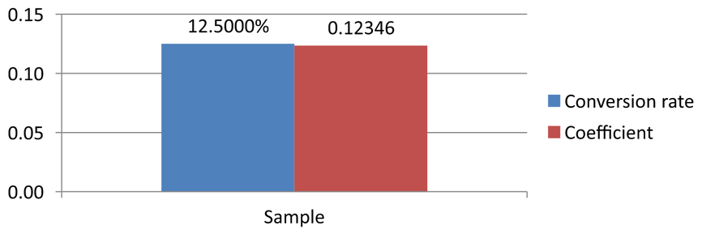

## **Übersicht**

Dieser Artikel erklärt, wie man mit Diagramm‑Arbeitsmappen in Aspose.Slides arbeitet. Er zeigt, wie man Diagrammdaten über Arbeitsmappen‑Streams liest und schreibt, Arbeitsmappen‑Zellen als Diagramm‑Datenbeschriftungen verwendet, auf Arbeitsblatt‑Sammlungen zugreift und den Datentyp für Diagrammwerte festlegt.

Er behandelt außerdem die Arbeit mit externen Arbeitsmappen als Diagrammdatenquellen. Die Beispiele demonstrieren, wie man eine externe Arbeitsmappe erstellt und zuweist, den Pfad einer externen Arbeitsmappe, die mit einem Diagramm verknüpft ist, abruft und Diagrammdaten bearbeitet, wenn die Arbeitsmappe verfügbar ist.

Für Arbeitsmappen‑Zellen, die fehlende Daten darstellen, siehe [Steuerung der Anzeige leerer Zellen](/slides/de/net/chart-series/) für den Unterschied zwischen einer leeren Zelle und Null sowie einen Liniendiagramm‑Vergleich der verfügbaren Anzeigemodi.

## **Daten aus ausgeblendeten Zeilen und Spalten einbeziehen**

Verwenden Sie [IChart.PlotVisibleCellsOnly](https://reference.aspose.com/slides/net/aspose.slides.charts/ichart/plotvisiblecellsonly/), um zu steuern, ob ein Diagramm Daten aus ausgeblendeten Arbeitsblatt‑Zeilen und -Spalten abbildet. Setzen Sie es auf `true`, um nur sichtbare Zellen abzubilden, oder auf `false`, um sowohl sichtbare als auch ausgeblendete Zellen einzubeziehen. Diese Einstellung beeinflusst die Diagramm‑Darstellung; sie blendet Arbeitsblatt‑Zeilen oder -Spalten nicht ein oder aus.

Die [Beispielpräsentation](hidden-source-data.pptx) enthält ein Säulendiagramm als erste Form auf der ersten Folie. Das eingebettete Arbeitsblatt `Sheet1` enthält den Quellbereich `A1:C4`. Zeile 3 und Spalte C sind ausgeblendet, ihre Zellen enthalten jedoch Werte.

| Arbeitsblattzeile | A: Monat | B: Einzelhandel | C: Großhandel (versteckte Spalte) |
| --- | --- | --- | --- |
| 2 | January | 10 | 30 |
| 3 (versteckte Zeile) | February | 40 | 60 |
| 4 | March | 20 | 50 |

Greifen Sie über [IChartData.ChartDataWorkbook](https://reference.aspose.com/slides/net/aspose.slides.charts/ichartdata/chartdataworkbook/) auf Quellzellen zu und lesen Sie [IChartDataCell.IsHidden](https://reference.aspose.com/slides/net/aspose.slides.charts/ichartdatacell/ishidden/), um deren Ausblendestatus zu prüfen. Diese Eigenschaft ist schreibgeschützt. In dieser Datei ist B2 sichtbar, B3 gehört zur ausgeblendeten Zeile und C2 zur ausgeblendeten Spalte; das Beispiel gibt `False`, `True` und `True` aus.

Für dieses Beispiel aktualisieren Sie die Diagrammdaten nach Änderung der Darstellungs‑Einstellung: behalten Sie die eingebettete Arbeitsmappe mit [ReadWorkbookStream](https://reference.aspose.com/slides/net/aspose.slides.charts/ichartdata/readworkbookstream/) und laden Sie sie mit [WriteWorkbookStream](https://reference.aspose.com/slides/net/aspose.slides.charts/ichartdata/writeworkbookstream/) erneut. Beim Einbeziehen aller Zellen nutzen Sie außerdem [SetRange](https://reference.aspose.com/slides/net/aspose.slides.charts/ichartdata/setrange/), um den vollständigen Bereich einschließlich der ausgeblendeten Februar‑Kategorie wiederherzustellen. Allein das Ändern des Flags reicht nicht aus, um die zwischengespeicherten Diagrammdaten und Kategorienamen dieses Beispiels zu aktualisieren.

```csharp
using System;
using Aspose.Slides;
using Aspose.Slides.Charts;
using Aspose.Slides.Export;

using var presentation = new Presentation("hidden-source-data.pptx");
var slide = presentation.Slides[0];

if (slide.Shapes[0] is IChart chart)
{
    var workbook = chart.ChartData.ChartDataWorkbook;
    Console.WriteLine($"B2 hidden: {workbook.GetCell(0, "B2").IsHidden}");
    Console.WriteLine($"B3 hidden: {workbook.GetCell(0, "B3").IsHidden}");
    Console.WriteLine($"C2 hidden: {workbook.GetCell(0, "C2").IsHidden}");

    using var workbookStream = chart.ChartData.ReadWorkbookStream();
    foreach (var visibleOnly in new[] { true, false })
    {
        chart.PlotVisibleCellsOnly = visibleOnly;

        // Aktualisieren Sie die Diagrammdaten aus der eingebetteten Arbeitsmappe.
        workbookStream.Position = 0;
        chart.ChartData.WriteWorkbookStream(workbookStream);
        if (!visibleOnly)
        {
            // Stellen Sie den vollständigen Quellbereich wieder her, einschließlich ausgeblendeter Kategorien.
            chart.ChartData.SetRange("Sheet1!$A$1:$C$4");
        }

        presentation.Save($"hidden_cells_{visibleOnly}.pptx", SaveFormat.Pptx);
    }
}
else
{
    Console.WriteLine("The first shape is not a chart.");
}
```

Das Beispiel speichert zwei Versionen der Präsentation: eine nur mit den sichtbaren Einzelhandelswerten (10 und 20) und eine mit allen sechs Werten. Die untenstehenden Bilder wurden aus den gespeicherten Präsentationen nach erneutem Öffnen gerendert; beide Dateien behalten die zugewiesene Darstellungs‑Einstellung bei. Zeile 3 und Spalte C bleiben in beiden eingebetteten Arbeitsmappen ausgeblendet.

| Nur sichtbare Zellen (`true`) | Alle Zellen (`false`) |
| --- | --- |
|  |  |

Eine ausgeblendete Zelle mit einem Wert unterscheidet sich von einer leeren Zelle. [IChart.DisplayBlanksAs](https://reference.aspose.com/slides/net/aspose.slides.charts/ichart/displayblanksas/) steuert, wie fehlende Werte angezeigt werden; sie fügt ausgeblendete Quelldaten nicht ein oder entfernt sie. Siehe [Steuerung der Anzeige leerer Zellen](/slides/de/net/chart-series/#control-the-display-of-empty-cells) für ein Beispiel.

## **Abrufen des Datenbereichs eines Diagramms**

Bevor Sie Arbeitsmappendaten in einer vorhandenen Präsentation aktualisieren, prüfen Sie die Quellbereiche, um zu erkennen, welche Arbeitsblatt‑Zellen jedes Diagramm verwendet. Die Methode [IChartData.GetRange](https://reference.aspose.com/slides/net/aspose.slides.charts/ichartdata/getrange/) gibt den aktuellen Datenbereich als arbeitsblattqualifizierte Formel zurück, z. B. `Sheet1!$A$1:$D$5`. Hier ist `Sheet1` der Arbeitsblattname, `!` trennt ihn vom Zellbereich, und `$A$1:$D$5` bezeichnet die Zellen A1 bis D5 inklusive. Die Dollarzeichen kennzeichnen absolute Zeilen‑ und Spaltenbezüge.

Die Methode liest den aktuellen Bereich, ohne das Diagramm oder seine Arbeitsmappe zu ändern. Wenn das Diagramm keine Arbeitsmappe als Datenquelle verwendet, wirft sie eine [InvalidOperationException](https://learn.microsoft.com/en-us/dotnet/api/system.invalidoperationexception). Weitere Informationen finden Sie in der [ChartData‑API‑Referenz](https://reference.aspose.com/slides/net/aspose.slides.charts/chartdata/).

Dieses Beispiel öffnet eine Präsentation und prüft die Formen direkt auf jeder Folie auf Diagramme. Es gibt den Namen und den Quellbereich jedes Diagramms aus. Wenn ein Diagramm keine Arbeitsmappe verwendet, wird eine Meldung ausgegeben und mit dem nächsten Diagramm fortgefahren.

```csharp
using System;
using Aspose.Slides;
using Aspose.Slides.Charts;

using var presentation = new Presentation("presentation.pptx");

foreach (var slide in presentation.Slides)
{
    foreach (var shape in slide.Shapes)
    {
        if (shape is IChart chart)
        {
            try
            {
                var range = chart.ChartData.GetRange();
                Console.WriteLine($"{chart.Name}: {range}");
            }
            catch (InvalidOperationException)
            {
                Console.WriteLine($"{chart.Name}: The chart does not use a workbook as its data source.");
            }
        }
    }
}
```

## **Lesen und Schreiben von Diagrammdaten aus einer Arbeitsmappe**

Aspose.Slides for .NET stellt die Methoden [ReadWorkbookStream](https://reference.aspose.com/slides/net/aspose.slides.charts/ichartdata/readworkbookstream/) und [WriteWorkbookStream](https://reference.aspose.com/slides/net/aspose.slides.charts/ichartdata/writeworkbookstream/) bereit, mit denen Sie Diagramm‑Arbeitsmappen (die mit Aspose.Cells bearbeitete Diagrammdaten enthalten) lesen und schreiben können. **Hinweis**: Die Diagrammdaten müssen in derselben Weise organisiert sein oder eine ähnliche Struktur wie die Quelle aufweisen.

Dieses Beispiel verwendet eine Präsentation mit einem Diagramm als erste Form auf der ersten Folie. Es liest die eingebettete Arbeitsmappe in einen Stream, löscht die vorhandenen Reihen und Kategorien und schreibt dieselbe Arbeitsmappe zurück. Die Änderungen bleiben im Speicher; das Beispiel speichert die Präsentation nicht.

```csharp
using System;
using Aspose.Slides;
using Aspose.Slides.Charts;

using var presentation = new Presentation("chart.pptx");
var slide = presentation.Slides[0];

var shapeCount = slide.Shapes.Count;
if (shapeCount > 0 && slide.Shapes[0] is IChart chart)
{
    var chartData = chart.ChartData;
    using var workbookStream = chartData.ReadWorkbookStream();

    chartData.Series.Clear();
    chartData.Categories.Clear();

    workbookStream.Position = 0;
    chartData.WriteWorkbookStream(workbookStream);
}
else
{
    Console.WriteLine("The first shape is not a chart.");
}
```

### **Diagrammlayout nach Arbeitsmappen‑Änderung validieren**

Wenn Sie eine eingebettete Arbeitsmappe durch eine geänderte ersetzen, behält das Diagramm seine ursprünglichen Reihen‑ und Kategorien‑Sammlungen bei. Diese Diskrepanz kann dazu führen, dass [IChart.ValidateChartLayout](https://reference.aspose.com/slides/net/aspose.slides.charts/ichart/validatechartlayout/) mit einem Index‑Out‑Of‑Range‑Fehler fehlschlägt. Löschen Sie die vorhandenen Reihen und Kategorien, bevor Sie die aktualisierte Arbeitsmappe zurückschreiben. Dieses Beispiel verwendet ein Diagramm, das die erste Form auf der ersten Folie ist. Der Kommentar markiert die Stelle, an der die Arbeitsmappen‑Bearbeitung stattfinden würde; das ausführbare Beispiel schreibt die ursprüngliche Arbeitsmappe zurück und validiert das Layout im Speicher.

```csharp
using System;
using Aspose.Slides;
using Aspose.Slides.Charts;

using var presentation = new Presentation("chart.pptx");
var slide = presentation.Slides[0];

var shapeCount = slide.Shapes.Count;
if (shapeCount > 0 && slide.Shapes[0] is IChart chart)
{
    var chartData = chart.ChartData;
    using var workbookStream = chartData.ReadWorkbookStream();

    // Ändern Sie den Arbeitsmappen-Stream hier, zum Beispiel mit Aspose.Cells.

    chartData.Series.Clear();
    chartData.Categories.Clear();

    workbookStream.Position = 0;
    chartData.WriteWorkbookStream(workbookStream);
    chart.ValidateChartLayout();
}
else
{
    Console.WriteLine("The first shape is not a chart.");
}
```

Das Leeren der Sammlungen entfernt veraltete Datenverweise, bevor die Arbeitsmappe zurückgeschrieben wird. Rekonstruieren Sie ggf. erforderliche Reihen‑ und Kategorien‑Zuordnungen für die aktualisierte Arbeitsmappe, bevor Sie das Diagramm verwenden.

## **Benutzerdefinierte Zahlenformate für Arbeitsmappen‑Zellen festlegen**

Verwenden Sie [ChartDataCell.CustomNumberFormat](https://reference.aspose.com/slides/net/aspose.slides.charts/chartdatacell/customnumberformat/), um zu steuern, wie numerische Werte in einer im Diagramm eingebetteten Arbeitsmappe angezeigt werden. Beispielsweise muss ein Bericht eine Konversionsrate als Prozentsatz mit vier Dezimalstellen und einen Koeffizienten mit fünf Dezimalstellen anzeigen. Beide Werte bleiben numerisch, damit sie für Berechnungen und Diagrammdarstellungen verfügbar bleiben.

Ein Zahlenformat ändert die Anzeige, nicht den gespeicherten Wert. Das Format `0.0000%` zeigt `0.125` als `12.5000%` an; es ersetzt nicht die gespeicherte Zahl durch `12.5`. Ebenso zeigt `0.00000` `0.1234567` als `0.12346` an, ohne den gespeicherten Wert zu runden. Wenn das benutzerdefinierte Format ein leerer String (`""`) ist, wird stattdessen [PresetNumberFormat](https://reference.aspose.com/slides/net/aspose.slides.charts/chartdatacell/presetnumberformat/) verwendet.

Das folgende Beispiel erstellt ein Säulendiagramm und greift über [ChartDataWorkbook](https://reference.aspose.com/slides/net/aspose.slides.charts/ichartdata/chartdataworkbook/) auf dessen Zellen zu. Auf Arbeitsblatt 0 enthält B2 die Konversionsrate und C2 den Koeffizienten. Beide Zellen liefern Diagrammwerte. Das Beispiel aktiviert außerdem Wertebeschriftungen, die an die Quellformate gebunden sind.

```csharp
using Aspose.Slides;
using Aspose.Slides.Charts;
using Aspose.Slides.Export;

using var presentation = new Presentation();
presentation.SlideSize.SetSize(720, 270, SlideSizeScaleType.DoNotScale);
var slide = presentation.Slides[0];

var chart = slide.Shapes.AddChart(ChartType.ClusteredColumn, 50, 20, 620, 210);
chart.HasTitle = false;

chart.Axes.VerticalAxis.IsNumberFormatLinkedToSource = false;
chart.Axes.VerticalAxis.NumberFormat = "0.00";
chart.Axes.VerticalAxis.IsAutomaticMinValue = false;
chart.Axes.VerticalAxis.MinValue = 0;

chart.ChartData.Series.Clear();
chart.ChartData.Categories.Clear();

var workbook = chart.ChartData.ChartDataWorkbook;
workbook.Clear(0);

var categoryCell = workbook.GetCell(0, "A2", "Sample");
chart.ChartData.Categories.Add(categoryCell);

var percentageCell = workbook.GetCell(0, "B2", 0.125);
percentageCell.CustomNumberFormat = "0.0000%";
var percentageName = workbook.GetCell(0, "B1", "Conversion rate");
var percentageSeries = chart.ChartData.Series.Add(percentageName, chart.Type);
percentageSeries.DataPoints.AddDataPointForBarSeries(percentageCell);

var precisionCell = workbook.GetCell(0, "C2", 0.1234567);
precisionCell.CustomNumberFormat = "0.00000";
var precisionName = workbook.GetCell(0, "C1", "Coefficient");
var precisionSeries = chart.ChartData.Series.Add(precisionName, chart.Type);
precisionSeries.DataPoints.AddDataPointForBarSeries(precisionCell);

foreach (var series in chart.ChartData.Series)
{
    var labelFormat = series.DataPoints[0].Label.DataLabelFormat;
    labelFormat.ShowValue = true;
    labelFormat.IsNumberFormatLinkedToSource = true;
}

presentation.Save("CustomCellFormats.pptx", SaveFormat.Pptx);
```

Arbeitsmappen‑Zellformate sind getrennt von direkt auf Diagrammachsen oder Datenbeschriftungen gesetzten Formaten. In diesem Beispiel zeigt jede Beschriftung den Wert ihrer Quellzelle, weil [ShowValue](https://reference.aspose.com/slides/net/aspose.slides.charts/idatalabelformat/showvalue/) aktiviert ist und weil [IsNumberFormatLinkedToSource](https://reference.aspose.com/slides/net/aspose.slides.charts/idatalabelformat/isnumberformatlinkedtosource/) `true` ist. Nach dem Speichern und erneuten Öffnen der Präsentation zeigen die Beschriftungen `12.5000%` und `0.12346`, wie unten dargestellt. Die vertikale Achse verwendet ihr eigenes [NumberFormat](https://reference.aspose.com/slides/net/aspose.slides.charts/iaxis/numberformat/) `0.00`, wobei [IsNumberFormatLinkedToSource](https://reference.aspose.com/slides/net/aspose.slides.charts/iaxis/isnumberformatlinkedtosource/) auf `false` gesetzt ist.

Um ein Datenbeschriftungsformat unabhängig zu ändern, setzen Sie die Quell‑Verknüpfungs‑Flagge auf `false` und weisen Sie ein [NumberFormat](https://reference.aspose.com/slides/net/aspose.slides.charts/idatalabelformat/numberformat/) zu. Dies ändert das Format der Arbeitsmappen‑Zelle nicht. Beispielsweise zeigt ein unabhängiges Beschriftungsformat `0.00` den ersten Wert als `0.13` an, während B2 weiterhin `12.5000%` anzeigt. Siehe [Diagrammdatenbeschriftungen](/slides/de/net/chart-data-label/#set-percentage-sign-with-chart-data-labels) für direkte Beschriftungsformatierung.

Das untenstehende Bild wurde aus der gespeicherten Präsentation nach erneutem Öffnen gerendert:



## **Eine Arbeitsmappen‑Zelle als Diagrammdatenbeschriftung festlegen**

Sie können Text aus Arbeitsmappen‑Zellen als Diagrammdatenbeschriftungen verwenden.

Dieses Beispiel fügt einer bestehenden Präsentation auf der ersten Folie ein Blasendiagramm mit Standarddaten hinzu. Es nutzt die Zellen A10:A12 auf Arbeitsblatt 0 für die ersten drei Beschriftungen der ersten Reihe, aktiviert Beschriftungen aus Zellen und speichert die aktualisierte Präsentation.

```csharp
using Aspose.Slides;
using Aspose.Slides.Charts;
using Aspose.Slides.Export;

using var presentation = new Presentation("chart2.pptx");
var slide = presentation.Slides[0];

var chart = slide.Shapes.AddChart(ChartType.Bubble, 50, 50, 600, 400, true);
var series = chart.ChartData.Series[0];
var workbook = chart.ChartData.ChartDataWorkbook;

series.Labels.DefaultDataLabelFormat.ShowLabelValueFromCell = true;
series.Labels[0].ValueFromCell = workbook.GetCell(0, "A10", "Label 0 cell value");
series.Labels[1].ValueFromCell = workbook.GetCell(0, "A11", "Label 1 cell value");
series.Labels[2].ValueFromCell = workbook.GetCell(0, "A12", "Label 2 cell value");

presentation.Save("resultchart.pptx", SaveFormat.Pptx);
```

## **Arbeitsblätter verwalten**

Die Eigenschaft [IChartDataWorkbook.Worksheets](https://reference.aspose.com/slides/net/aspose.slides.charts/ichartdataworkbook/worksheets/) bietet Zugriff auf die Arbeitsblätter in einer Diagramm‑Arbeitsmappe. Dieses Beispiel erstellt ein Kuchendiagramm mit Standarddaten und gibt jeden Arbeitsblattnamen in der Konsole aus.

```csharp
using System;
using Aspose.Slides;
using Aspose.Slides.Charts;

using var presentation = new Presentation();
var slide = presentation.Slides[0];

var chart = slide.Shapes.AddChart(ChartType.Pie, 50, 50, 400, 500);
var workbook = chart.ChartData.ChartDataWorkbook;

for (var i = 0; i < workbook.Worksheets.Count; i++)
{
    Console.WriteLine(workbook.Worksheets[i].Name);
}
```

## **Datentyp für die Datenquelle festlegen**

Reihenpunkt‑Werte können auch direkt als numerische Literale gespeichert werden. Siehe [Series Values Using Numeric Literals setzen](/slides/de/net/chart-series/#set-series-values-using-numeric-literals) für ein vollständiges Beispiel zum Speichern und Lesen. Der Quelltyp der Punktwerte ist getrennt von der internen oder externen Arbeitsmappen‑Konfiguration des Diagramms; die Verwendung numerischer Literale entfernt die eingebettete Arbeitsmappe nicht automatisch.

Dieses Beispiel erstellt ein 3D‑Säulendiagramm mit Standarddaten und setzt zwei Reihen‑Namen mithilfe unterschiedlicher Datenquellen. Der erste Name verwendet ein String‑Literal; der zweite nutzt Zelle C1 auf Arbeitsblatt 0. Die Aufzählung [DataSourceType](https://reference.aspose.com/slides/net/aspose.slides.charts/datasourcetype/) wählt die Quelle für jeden Namen aus. Das Beispiel speichert die Präsentation mit den aktualisierten Reihen‑Namen.

```csharp
using Aspose.Slides;
using Aspose.Slides.Charts;
using Aspose.Slides.Export;

using var presentation = new Presentation();
var slide = presentation.Slides[0];

var chart = slide.Shapes.AddChart(ChartType.Column3D, 50, 50, 600, 400, true);
var literalName = chart.ChartData.Series[0].Name;

literalName.DataSourceType = DataSourceType.StringLiterals;
literalName.Data = "LiteralString";

var cellName = chart.ChartData.Series[1].Name;
var nameCell = chart.ChartData.ChartDataWorkbook.GetCell(0, "C1", "NewCell");
cellName.DataSourceType = DataSourceType.Worksheet;
cellName.Data = nameCell;

presentation.Save("pres.pptx", SaveFormat.Pptx);
```

## **Nicht unterstützte Formate eingebetteter Arbeitsmappen erkennen**

Aspose.Slides unterstützt das Excel‑Binärarbeitsmappen‑Format (.xlsb) nicht, das in manchen Diagrammen eingebettet werden kann. Sie können die Eigenschaft [EmbeddedWorkbookType](https://reference.aspose.com/slides/net/aspose.slides.charts/ichartdata/embeddedworkbooktype/) auf [IChartData](https://reference.aspose.com/slides/net/aspose.slides.charts/ichartdata/) zusammen mit der Aufzählung [WorkbookType](https://reference.aspose.com/slides/net/aspose.slides.charts/workbooktype/) verwenden, um nicht unterstützte Formate zu erkennen und diese Diagramme zu überspringen. Dieses Beispiel untersucht die Formen auf der ersten Folie einer vorhandenen Präsentation, überspringt Nicht‑Diagramm‑Formen und gibt für jedes Diagramm mit einer eingebetteten .xlsb‑Arbeitsmappe eine Diagnosemeldung aus.

```csharp
using System;
using Aspose.Slides;
using Aspose.Slides.Charts;

using var presentation = new Presentation("sample.pptx");
var slide = presentation.Slides[0];

foreach (var shape in slide.Shapes)
{
    if (shape is not IChart chart)
    {
        continue;
    }

    var chartData = chart.ChartData;
    var isInternalWorkbook = chartData.DataSourceType == ChartDataSourceType.InternalWorkbook;
    var isBinaryMacro = chartData.EmbeddedWorkbookType == WorkbookType.WorkbookBinaryMacro;

    if (isInternalWorkbook && isBinaryMacro)
    {
        Console.WriteLine("Skipping a chart with an unsupported .xlsb workbook.");
        continue;
    }

    // Lesen oder ändern Sie hier unterstützte Diagramm-Arbeitsmappendaten.
}
```

## **Externe Arbeitsmappe**

Aspose.Slides unterstützt die Verwendung externer Arbeitsmappen als Datenquelle für Diagramme.

### **Externe Arbeitsmappe erstellen**

Verwenden Sie [ReadWorkbookStream](https://reference.aspose.com/slides/net/aspose.slides.charts/ichartdata/readworkbookstream/) und [SetExternalWorkbook](https://reference.aspose.com/slides/net/aspose.slides.charts/ichartdata/setexternalworkbook/), um die eingebettete Diagramm‑Arbeitsmappe in eine Datei zu exportieren und das Diagramm mit dieser externen Arbeitsmappe zu verknüpfen.

Dieses Beispiel erstellt ein Kuchendiagramm mit Standarddaten und exportiert dessen Arbeitsmappe. Es schließt den Ausgabestream, bevor es die externe Arbeitsmappe als Diagrammdatenquelle zuweist, und speichert anschließend die verknüpfte Präsentation.

```csharp
using System.IO;
using Aspose.Slides;
using Aspose.Slides.Charts;
using Aspose.Slides.Export;

using var presentation = new Presentation();
var slide = presentation.Slides[0];

var chart = slide.Shapes.AddChart(ChartType.Pie, 50, 50, 400, 600);
var workbookPath = Path.GetFullPath("externalWorkbook1.xlsx");

using (var workbookStream = chart.ChartData.ReadWorkbookStream())
using (var fileStream = File.Create(workbookPath))
{
    workbookStream.CopyTo(fileStream);
}

chart.ChartData.SetExternalWorkbook(workbookPath);
presentation.Save("externalWorkbook.pptx", SaveFormat.Pptx);
```

### **Externe Arbeitsmappe zuweisen**

Mit der Methode [SetExternalWorkbook](https://reference.aspose.com/slides/net/aspose.slides.charts/ichartdata/setexternalworkbook/) können Sie einem Diagramm eine externe Arbeitsmappe als Datenquelle zuweisen. Diese Methode kann auch verwendet werden, um einen Pfad zu einer externen Arbeitsmappe zu aktualisieren (wenn diese verschoben wurde).

Während Sie Daten in Arbeitsmappen, die an entfernten Speicherorten oder Ressourcen liegen, nicht bearbeiten können, können Sie solche Arbeitsmappen dennoch als externe Datenquelle nutzen. Wird ein relativer Pfad für eine externe Arbeitsmappe angegeben, wird er automatisch in einen absoluten Pfad umgewandelt.

Dieses Beispiel verwendet eine externe Arbeitsmappe, deren Arbeitsblatt `Sheet1` einen Reihen‑Namen in B1, Kategorienamen in A2:A4 und numerische Werte in B2:B4 enthält. Das Beispiel erstellt ein Kuchendiagramm, verknüpft die Arbeitsmappe und verwendet [SetRange](https://reference.aspose.com/slides/net/aspose.slides.charts/ichartdata/setrange/), um A1:B4 einer Reihe und drei Kategorien zuzuordnen. Es speichert die Präsentation mit dem verknüpften Diagramm.

```csharp
using System.IO;
using Aspose.Slides;
using Aspose.Slides.Charts;
using Aspose.Slides.Export;

using var presentation = new Presentation();
var slide = presentation.Slides[0];

var chart = slide.Shapes.AddChart(ChartType.Pie, 50, 50, 400, 600, true);
var chartData = chart.ChartData;
var workbookPath = Path.GetFullPath("externalWorkbook.xlsx");

chartData.SetExternalWorkbook(workbookPath);
chartData.SetRange("Sheet1!$A$1:$B$4");

presentation.Save("Presentation_with_externalWorkbook.pptx", SaveFormat.Pptx);
```

Der Parameter `updateChartData` der Methode [SetExternalWorkbook](https://reference.aspose.com/slides/net/aspose.slides.charts/ichartdata/setexternalworkbook/) steuert, ob die Arbeitsmappe geladen wird.

* Wenn `updateChartData` `false` ist, wird nur der Arbeitsmappen‑Pfad aktualisiert. Die Diagrammdaten werden nicht aus der Zielarbeitsmappe geladen oder aktualisiert, sodass die Arbeitsmappe nicht verfügbar sein kann.
* Wenn `updateChartData` `true` ist, werden die Diagrammdaten aus der Zielarbeitsmappe aktualisiert.

Das folgende Beispiel weist eine Platzhalter‑URL zu, wobei `updateChartData` auf `false` gesetzt ist. Es behält die Standarddaten des Kuchendiagramms bei und speichert die Präsentation, ohne die nicht verfügbare Arbeitsmappe zu laden.

```csharp
using Aspose.Slides;
using Aspose.Slides.Charts;
using Aspose.Slides.Export;

using var presentation = new Presentation();
var slide = presentation.Slides[0];

var chart = slide.Shapes.AddChart(ChartType.Pie, 50, 50, 400, 600, true);

chart.ChartData.SetExternalWorkbook("https://example.com/unavailable-workbook.xlsx", false);
presentation.Save("SetExternalWorkbookWithUpdateChartData.pptx", SaveFormat.Pptx);
```

### **Pfad der externen Datenquellen‑Arbeitsmappe eines Diagramms ermitteln**

Um die mit einem Diagramm verknüpfte Arbeitsmappe zu identifizieren, prüfen Sie, ob das Diagramm eine externe Datenquelle verwendet, und rufen Sie dessen Arbeitsmappen‑Pfad ab.

Dieses Beispiel untersucht die erste Form auf der ersten Folie einer Präsentation mit verknüpfter externer Arbeitsmappe. Handelt es sich um ein Diagramm, das mit einer externen Arbeitsmappe verknüpft ist, gibt das Beispiel [ExternalWorkbookPath](https://reference.aspose.com/slides/net/aspose.slides.charts/ichartdata/externalworkbookpath/) in der Konsole aus und speichert anschließend eine Kopie der Präsentation.

```csharp
using System;
using Aspose.Slides;
using Aspose.Slides.Charts;
using Aspose.Slides.Export;

using var presentation = new Presentation("externalWorkbook.pptx");
var slide = presentation.Slides[0];

var shapeCount = slide.Shapes.Count;
if (shapeCount > 0 && slide.Shapes[0] is IChart chart)
{
    var chartData = chart.ChartData;
    if (chartData.DataSourceType == ChartDataSourceType.ExternalWorkbook)
    {
        Console.WriteLine(chartData.ExternalWorkbookPath);
    }
    else
    {
        Console.WriteLine("The chart does not use an external workbook.");
    }
}
else
{
    Console.WriteLine("The first shape is not a chart.");
}

presentation.Save("Result.pptx", SaveFormat.Pptx);
```

### **Diagrammdaten bearbeiten**

Sie können die Daten in externen Arbeitsmappen genauso bearbeiten, wie Sie Änderungen an internen Arbeitsmappen vornehmen. Wenn eine externe Arbeitsmappe nicht geladen werden kann, wird eine Ausnahme ausgelöst.

Dieses Beispiel verwendet ein Diagramm, das die erste Form auf der ersten Folie ist und mit einer zugänglichen externen Arbeitsmappe verknüpft ist. Es setzt den zellbasierten Wert des ersten Datenpunkts der ersten Reihe auf 100 und speichert die aktualisierte Präsentation. Das Bearbeiten von Zellwerten kann die verknüpfte externe XLSX‑Datei aktualisieren; verwenden Sie eine Kopie, wenn das Original unverändert bleiben muss.

```csharp
using System;
using Aspose.Slides;
using Aspose.Slides.Charts;
using Aspose.Slides.Export;

using var presentation = new Presentation("presentation.pptx");
var slide = presentation.Slides[0];

var shapeCount = slide.Shapes.Count;
if (shapeCount > 0 && slide.Shapes[0] is IChart chart)
{
    var series = chart.ChartData.Series;
    if (series.Count > 0 && series[0].DataPoints.Count > 0)
    {
        var valueCell = series[0].DataPoints[0].Value.AsCell;
        if (valueCell != null)
        {
            valueCell.Value = 100;
            presentation.Save("presentation_out.pptx", SaveFormat.Pptx);
        }
        else
        {
            Console.WriteLine("The first data point is not linked to a workbook cell.");
        }
    }
    else
    {
        Console.WriteLine("The chart has no data points to edit.");
    }
}
else
{
    Console.WriteLine("The first shape is not a chart.");
}
```

## **Diagrammdaten aus Quellarbeitsmappen aktualisieren**

Aspose.Slides for .NET 26.11 fügt [IChartData.RefreshData](https://reference.aspose.com/slides/net/aspose.slides.charts/ichartdata/refreshdata/) für ein Diagramm und [IPresentation.RefreshChartsData](https://reference.aspose.com/slides/net/aspose.slides/ipresentation/refreshchartsdata/) für die Präsentation hinzu. Verwenden Sie sie, nachdem sich Werte in der Quellarbeitsmappe geändert haben. Externe Arbeitsmappen müssen zugänglich und unterstützt sein.

Mit [Aspose.Slides for .NET](/slides/de/net/installation/) 26.11 oder neuer aktualisiert dieses Beispiel das erste Diagramm auf der ersten Folie von `charts.pptx`. Seine Quellarbeitsmappe muss verfügbar sein. Speichern Sie das Ergebnis, um die aktualisierten Diagrammdaten zu erhalten.

```csharp
using System;
using System.Linq;
using Aspose.Slides;
using Aspose.Slides.Charts;
using Aspose.Slides.Export;

using var presentation = new Presentation("charts.pptx");
var chart = presentation.Slides[0].Shapes.OfType<IChart>().FirstOrDefault();
if (chart == null)
{
    Console.WriteLine("The first slide must contain a chart.");
    return;
}

chart.ChartData.RefreshData();
presentation.Save("refreshed-chart.pptx", SaveFormat.Pptx);
```

Um alle Diagramme zu aktualisieren, verwenden Sie eine separate Präsentationsinstanz wie folgt. Das Übergeben von `false` lässt einen Aktualisierungsfehler an den Aufrufer weitergeben; bereits aktualisierte Diagramme werden nicht zurückgesetzt.

```csharp
using Aspose.Slides;
using Aspose.Slides.Export;

using var presentation = new Presentation("charts.pptx");
presentation.RefreshChartsData(skipFailedCharts: false);
presentation.Save("refreshed-charts.pptx", SaveFormat.Pptx);
```

Der Parameter ist standardmäßig `true`: [RefreshChartsData](https://reference.aspose.com/slides/net/aspose.slides/ipresentation/refreshchartsdata/) überspringt ein fehlerhaftes Diagramm und fährt mit den anderen fort. Es liefert keine Ergebnis‑Informationen pro Diagramm, sodass ein erfolgreicher Aufruf nicht beweist, dass jedes Diagramm aktualisiert wurde. Verwenden Sie einzelne [RefreshData](https://reference.aspose.com/slides/net/aspose.slides.charts/ichartdata/refreshdata/)‑Aufrufe, wenn Sie jedes fehlerhafte Diagramm identifizieren müssen.

Refresh lädt Quelldaten neu. Es ist getrennt von Formelkalkulation, Diagrammlayout‑Validierung und OLE‑Vorschau‑Aktualisierung. Prüfen Sie live‑zellbasierte Werte, um einen Refresh im Speicher zu überprüfen. Ein [CachedValue](https://reference.aspose.com/slides/net/aspose.slides.charts/ichartdatapoint/cachedvalue/) kann das zuvor gespeicherte Diagramm noch beschreiben, bis Sie die Präsentation speichern und erneut öffnen.

### **Zwischengespeicherte Diagrammwerte ohne Arbeitsmappe lesen**

In .NET 26.11 lesen Zwischenspeicher‑Zugriffsmethoden die mit dem Diagramm gespeicherten Werte, ohne dessen Arbeitsmappe zu öffnen. Sie sind nützlich, wenn die verknüpfte Datei nicht verfügbar ist und Sie nur die zuletzt gespeicherten Diagrammdaten benötigen. Dies unterscheidet sich vom Wiederaufbau einer Arbeitsmappe mittels der unten beschriebenen Wiederherstellungs‑Option.

| Objekt | Zwischenspeicher‑Zugriff |
| --- | --- |
| Gewöhnlicher Reihen‑Datenpunkt | [CachedValue](https://reference.aspose.com/slides/net/aspose.slides.charts/ichartdatapoint/cachedvalue/) |
| Streu‑ oder Blasendiagramm‑Datenpunkt | [CachedXValue](https://reference.aspose.com/slides/net/aspose.slides.charts/ichartdatapoint/cachedxvalue/), [CachedYValue](https://reference.aspose.com/slides/net/aspose.slides.charts/ichartdatapoint/cachedyvalue/) |
| Blasendiagramm‑Datenpunkt | [CachedBubbleSize](https://reference.aspose.com/slides/net/aspose.slides.charts/ichartdatapoint/cachedbubblesize/) |
| Diagramm‑Kategorie | [CachedValue](https://reference.aspose.com/slides/net/aspose.slides.charts/ichartcategory/cachedvalue/) |

Jeder Zugriff gibt ein [ICachedChartValue](https://reference.aspose.com/slides/net/aspose.slides.charts/icachedchartvalue/) zurück. [Data](https://reference.aspose.com/slides/net/aspose.slides.charts/icachedchartvalue/data/) liefert das gespeicherte Objekt; [ToString](https://reference.aspose.com/slides/net/aspose.slides.charts/cachedchartvalue/tostring/) liefert Text; [ToDouble](https://reference.aspose.com/slides/net/aspose.slides.charts/icachedchartvalue/todouble/) gibt `NaN` zurück, wenn kein Wert vorhanden oder nicht numerisch ist. Ein Cache kann fehlen oder veraltet sein, auch bei einem neu erstellten Diagramm, das noch nicht gespeichert wurde. Gehen Sie nicht davon aus, dass jedes Feld existiert oder eine Zahl enthält.

Dieses Beispiel liest all diese Felder aus `cached-chart.pptx`, einer gespeicherten Präsentation mit Diagrammen. Eine fehlende externe Arbeitsmappe ist akzeptabel, weil der Code nicht auf [ChartDataWorkbook](https://reference.aspose.com/slides/net/aspose.slides.charts/ichartdata/chartdataworkbook/) oder Live‑Arbeitsmappen‑Zellen zugreift.

```csharp
using System;
using Aspose.Slides;
using Aspose.Slides.Charts;

using var presentation = new Presentation("cached-chart.pptx");
foreach (var slide in presentation.Slides)
foreach (var shape in slide.Shapes)
{
    if (shape is not IChart chart)
        continue;

    foreach (var category in chart.ChartData.Categories)
        PrintCache("Category", category.CachedValue);

    foreach (var series in chart.ChartData.Series)
    foreach (var point in series.DataPoints)
    {
        PrintCache("Value", point.CachedValue);
        PrintCache("X", point.CachedXValue);
        PrintCache("Y", point.CachedYValue);
        PrintCache("Bubble size", point.CachedBubbleSize);
    }
}

static void PrintCache(string name, ICachedChartValue value)
{
    var number = value.ToDouble();
    if (value.Data == null)
        Console.WriteLine($"{name}: no cached value");
    else if (double.IsNaN(number))
        Console.WriteLine($"{name}: {value} (not numeric)");
    else
        Console.WriteLine($"{name}: {number}");
}
```

Verwenden Sie Refresh, wenn Sie aktuelle Quelldaten benötigen; verwenden Sie zwischengespeicherte Lesevorgänge, wenn der gespeicherte Schnappschuss ausreicht. Der Cache ist keine vollständige Kopie der Arbeitsmappe und kann Änderungen, die nach dem letzten Update vorgenommen wurden, nicht liefern.

### **Arbeitsmappe aus dem Diagramm‑Cache wiederherstellen**

Wenn ein Diagramm eine externe Arbeitsmappe verwendet, die fehlt oder nicht verfügbar ist, kann Aspose.Slides die Diagramm‑Arbeitsmappe aus den im Präsentations‑Cache gespeicherten Daten rekonstruieren. Erzeugen Sie [LoadOptions](https://reference.aspose.com/slides/net/aspose.slides/loadoptions/), konfigurieren Sie dessen [SpreadsheetOptions](https://reference.aspose.com/slides/net/aspose.slides/loadoptions/spreadsheetoptions/), und setzen Sie [ISpreadsheetOptions.RecoverWorkbookFromChartCache](https://reference.aspose.com/slides/net/aspose.slides/ispreadsheetoptions/recoverworkbookfromchartcache/) auf `true`, bevor Sie die Präsentation öffnen.

Das nachfolgende C#‑Beispiel stellt Arbeitsmappe‑Daten für ein Diagramm wieder her, das die erste Form auf der ersten Folie ist und eine nicht verfügbare externe Arbeitsmappe referenziert. Es greift über [IChart.ChartData](https://reference.aspose.com/slides/net/aspose.slides.charts/ichart/chartdata/) und [IChartData.ChartDataWorkbook](https://reference.aspose.com/slides/net/aspose.slides.charts/ichartdata/chartdataworkbook/) auf die wiederhergestellten Daten zu:

```csharp
using System;
using Aspose.Slides;
using Aspose.Slides.Charts;

var spreadsheetOptions = new SpreadsheetOptions
{
    RecoverWorkbookFromChartCache = true
};
var loadOptions = new LoadOptions
{
    SpreadsheetOptions = spreadsheetOptions
};

using var presentation = new Presentation("presentation.pptx", loadOptions);
var slide = presentation.Slides[0];

var shapeCount = slide.Shapes.Count;
if (shapeCount > 0 && slide.Shapes[0] is IChart chart)
{
    var recoveredWorkbook = chart.ChartData.ChartDataWorkbook;

    // Lesen oder ändern Sie hier die wiederhergestellten Arbeitsmappendaten.
}
else
{
    Console.WriteLine("The first shape is not a chart.");
}
```

Greift Code auf die externe Arbeitsmappe zu, während sie nicht verfügbar ist und die Wiederherstellung deaktiviert ist, wirft Aspose.Slides eine [InvalidOperationException](https://learn.microsoft.com/en-us/dotnet/api/system.invalidoperationexception). Aktivieren Sie die Wiederherstellung nur, wenn die Nutzung des zwischengespeicherten Diagramms ein akzeptabler Rückgriff ist, da der Cache möglicherweise Änderungen, die nach dem letzten Präsentations‑Update an der externen Arbeitsmappe vorgenommen wurden, nicht enthält.

## **FAQ**

**Kann ich feststellen, ob ein bestimmtes Diagramm mit einer externen oder eingebetteten Arbeitsmappe verknüpft ist?**

Ja. Ein Diagramm hat einen [data source type](https://reference.aspose.com/slides/net/aspose.slides.charts/chartdata/datasourcetype/) und einen [path to an external workbook](https://reference.aspose.com/slides/net/aspose.slides.charts/chartdata/externalworkbookpath/); wenn die Quelle eine externe Arbeitsmappe ist, können Sie den vollständigen Pfad auslesen, um sicherzustellen, dass eine externe Datei verwendet wird.

**Werden relative Pfade zu externen Arbeitsmappen unterstützt und wie werden sie gespeichert?**

Ja. Wenn Sie einen relativen Pfad angeben, wird er automatisch in einen absoluten Pfad konvertiert. Die Präsentation speichert den absoluten Pfad in der PPTX‑Datei, sodass ein Verschieben der Arbeitsmappe eventuell ein Aktualisieren des Links erfordert.

**Kann ich Arbeitsmappen auf Netzwerkressourcen/Freigaben verwenden?**

Ja, solche Arbeitsmappen können als externe Datenquelle verwendet werden. Das direkte Bearbeiten entfernter Arbeitsmappen über Aspose.Slides wird jedoch nicht unterstützt – sie können nur als Quelle verwendet werden.

**Überschreibt Aspose.Slides die externe XLSX‑Datei beim Speichern der Präsentation?**

Die Präsentation speichert einen [link to the external file](https://reference.aspose.com/slides/net/aspose.slides.charts/chartdata/externalworkbookpath/). Das Bearbeiten von zellbasierten Diagrammdaten kann die verknüpfte lokale XLSX‑Datei ebenfalls aktualisieren. Verwenden Sie eine Kopie der Arbeitsmappe, wenn das Original unverändert bleiben muss.

**Was tun, wenn die externe Datei passwortgeschützt ist?**

Aspose.Slides akzeptiert kein Passwort beim Verknüpfen. Ein gängiger Ansatz ist, den Schutz im Voraus zu entfernen oder eine entschlüsselte Kopie vorzubereiten (zum Beispiel mit [Aspose.Cells](https://reference.aspose.com/cells/net/)) und diese Kopie zu verknüpfen.

**Können mehrere Diagramme dieselbe externe Arbeitsmappe referenzieren?**

Ja. Jedes Diagramm speichert seinen eigenen Link. Wenn alle auf dieselbe Datei zeigen, werden Änderungen an dieser Datei in jedem Diagramm beim nächsten Laden der Daten wirksam.