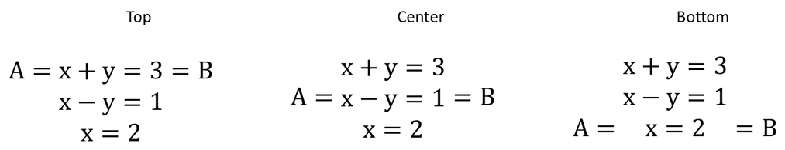

## **Επισκόπηση**

Το PowerPoint αποθηκεύει εξισώσεις ως Office Math Markup Language (OMML). Με το Aspose.Slides για C++, μπορείτε να δημιουργήσετε το ίδιο είδος μαθηματικού περιεχομένου προγραμματιστικά: κλασματικά, ριζικά, συναρτήσεις, όρια, N‑ary τελεστές, πίνακες, διανύσματα και μορφοποιημένα μαθηματικά μπλοκ.

Στο PowerPoint, οι χρήστες συνήθως προσθέτουν εξισώσεις από **Insert > Equation**:


Το αποτέλεσμα είναι επεξεργάσιμο μαθηματικό κείμενο στη διαφάνεια:


Το Aspose.Slides δημιουργεί αυτό το μαθηματικό κείμενο μέσω τριών κύριων αντικειμένων:

- Ένα μαθηματικό σχήμα, δημιουργούμενο με [AddMathShape](https://reference.aspose.com/slides/cpp/aspose.slides/shapecollection/), είναι το σχήμα που περιέχει την εξίσωση.
- Το [MathPortion](https://reference.aspose.com/slides/cpp/aspose.slides.mathtext/mathportion/) αποθηκεύει το μαθηματικό περιεχόμενο μέσα στο πλαίσιο κειμένου του σχήματος.
- Το [MathParagraph](https://reference.aspose.com/slides/cpp/aspose.slides.mathtext/mathparagraph/) περιέχει ένα ή περισσότερα αντικείμενα [MathBlock](https://reference.aspose.com/slides/cpp/aspose.slides.mathtext/mathblock/).

Τα περισσότερα παραδείγματα παρακάτω χρησιμοποιούν το [MathematicalText](https://reference.aspose.com/slides/cpp/aspose.slides.mathtext/mathematicaltext/) και τις fluent μεθόδους από το [IMathElement](https://reference.aspose.com/slides/cpp/aspose.slides.mathtext/imathelement/) για σύντομο και ευανάγνωστο κώδικα.

Για σενάρια εξαγωγής MathML, δείτε το [Export Math Equations from Presentations in C++](/slides/el/cpp/exporting-math-equations/).

## **Δημιουργία Εξίσωσης**

Αυτό το παράδειγμα χρησιμοποιεί το [AddMathShape](https://reference.aspose.com/slides/cpp/aspose.slides/ishapecollection/addmathshape/) για να δημιουργήσει ένα μαθηματικό σχήμα και προσθέτει το πυθαγόρειο θεώρημα:


```cpp
#include <DOM/IAutoShape.h>
#include <DOM/IParagraph.h>
#include <DOM/IShapeCollection.h>
#include <DOM/ISlide.h>
#include <DOM/ITextFrame.h>
#include <DOM/MathText/IMathBlock.h>
#include <DOM/MathText/IMathParagraph.h>
#include <DOM/MathText/IMathSuperscriptElement.h>
#include <DOM/MathText/MathPortion.h>
#include <DOM/MathText/MathematicalText.h>
#include <DOM/Presentation.h>
#include <Export/SaveFormat.h>

using namespace Aspose::Slides;
using namespace Aspose::Slides::Export;
using namespace Aspose::Slides::MathText;

auto presentation = System::MakeObject<Presentation>();
auto slide = presentation->get_Slide(0);

auto mathShape = slide->get_Shapes()->AddMathShape(20.0f, 20.0f, 700.0f, 120.0f);
auto mathPortion = System::ExplicitCast<MathPortion>(mathShape->get_TextFrame()->get_Paragraph(0)->get_Portion(0));
auto mathParagraph = mathPortion->get_MathParagraph();

auto equation = System::MakeObject<MathematicalText>(u"c")
        - >SetSuperscript(u"2")
        - >Join(u"=")
        - >Join(System::MakeObject<MathematicalText>(u"a")->SetSuperscript(u"2"))
        - >Join(u"+")
        - >Join(System::MakeObject<MathematicalText>(u"b")->SetSuperscript(u"2"));

mathParagraph->Add(equation);

presentation->Save(u"pythagorean-theorem.pptx", SaveFormat::Pptx);
presentation->Dispose();
```

{}

[AddMathShape](https://reference.aspose.com/slides/cpp/aspose.slides/ishapecollection/addmathshape/) δημιουργεί ένα σχήμα που περιέχει ήδη μια μαθηματική παράγραφο. Πρόσβαση στο πρώτο [MathPortion](https://reference.aspose.com/slides/cpp/aspose.slides.mathtext/mathportion/), κλήση του [get_MathParagraph](https://reference.aspose.com/slides/cpp/aspose.slides.mathtext/mathportion/get_mathparagraph/), και προσθήκη μαθηματικών μπλοκ ή στοιχείων σε αυτήν.

{}

### **Συνδυασμός Μαθηματικών Μπλοκ**

Όταν μέρη μιας εξίσωσης κατασκευάζονται ανεξάρτητα ως αντικείμενα [IMathBlock](https://reference.aspose.com/slides/cpp/aspose.slides.mathtext/imathblock/), χρησιμοποιήστε το [JoinBlock](https://reference.aspose.com/slides/cpp/aspose.slides.mathtext/imathblock/joinblock/) για να τα συνδυάσετε. Το παράδειγμα δημιουργεί το `c² =` στο αριστερό μπλοκ και το `a² + b²` στο δεξιό μπλοκ. Το [SetSuperscript](https://reference.aspose.com/slides/cpp/aspose.slides.mathtext/imathelement/setsuperscript/) δημιουργεί επεξεργάσιμα μαθηματικά εκθέτες για και τις τρεις δυνάμεις.

```cpp
#include <DOM/IAutoShape.h>
#include <DOM/IParagraph.h>
#include <DOM/IShapeCollection.h>
#include <DOM/ISlide.h>
#include <DOM/ITextFrame.h>
#include <DOM/MathText/IMathParagraph.h>
#include <DOM/MathText/IMathSuperscriptElement.h>
#include <DOM/MathText/MathBlock.h>
#include <DOM/MathText/MathPortion.h>
#include <DOM/MathText/MathematicalText.h>
#include <DOM/Presentation.h>
#include <Export/SaveFormat.h>

using namespace Aspose::Slides;
using namespace Aspose::Slides::Export;
using namespace Aspose::Slides::MathText;

auto presentation = System::MakeObject<Presentation>();
auto slide = presentation->get_Slide(0);

auto shape = slide->get_Shapes()->AddMathShape(20, 20, 600, 100);
auto mathPortion = System::ExplicitCast<MathPortion>(shape->get_TextFrame()->get_Paragraph(0)->get_Portion(0));
auto mathParagraph = mathPortion->get_MathParagraph();

auto leftBlock = System::MakeObject<MathBlock>();
auto cSquared = System::MakeObject<MathematicalText>(u"c")->SetSuperscript(u"2");
leftBlock->Add(cSquared);
auto equalsSign = System::MakeObject<MathematicalText>(u"=");
leftBlock->Add(equalsSign);

auto rightBlock = System::MakeObject<MathBlock>();
auto aSquared = System::MakeObject<MathematicalText>(u"a")->SetSuperscript(u"2");
rightBlock->Add(aSquared);
auto plusSign = System::MakeObject<MathematicalText>(u"+");
rightBlock->Add(plusSign);
auto bSquared = System::MakeObject<MathematicalText>(u"b")->SetSuperscript(u"2");
rightBlock->Add(bSquared);

auto combinedBlock = leftBlock->JoinBlock(rightBlock);
mathParagraph->Add(combinedBlock);

presentation->Save(u"equation.pptx", SaveFormat::Pptx);
presentation->Dispose();
```

Το [JoinBlock](https://reference.aspose.com/slides/cpp/aspose.slides.mathtext/imathblock/joinblock/) επιστρέφει το ίδιο το `leftBlock`, που πλέον περιέχει και τα δύο μέρη με τη σωστή σειρά, και αφήνει το `rightBlock` κενό. Προσθέστε το συνδυασμένο μπλοκ στο [IMathParagraph](https://reference.aspose.com/slides/cpp/aspose.slides.mathtext/imathparagraph/) μόνο μία φορά. Αφού ανοίξετε ξανά το `equation.pptx`, η παράγραφος περιέχει ένα μπλοκ που αντιπροσωπεύει το `c² = a² + b²`, με όλες τις δυνάμεις διατηρημένες ως μαθηματικοί εκθέτες.

Κλήση του [Add](https://reference.aspose.com/slides/cpp/aspose.slides.mathtext/imathelementcollection/add/) ως `leftBlock->Add(rightBlock)` προσπαθεί να ενσωματώσει ένα μπλοκ μέσα σε άλλο και ρίχνει `System::InvalidOperationException`.

## **Προσθήκη Κλασματικών**

Χρησιμοποιήστε το [Divide](https://reference.aspose.com/slides/cpp/aspose.slides.mathtext/imathelement/divide/) για να δημιουργήσετε κλάσμα. Μπορείτε να επιλέξετε στυλ κλάσματος με το [MathFractionTypes](https://reference.aspose.com/slides/cpp/aspose.slides.mathtext/mathfractiontypes/).


```cpp
#include <DOM/IAutoShape.h>
#include <DOM/IParagraph.h>
#include <DOM/IShapeCollection.h>
#include <DOM/ISlide.h>
#include <DOM/ITextFrame.h>
#include <DOM/MathText/IMathParagraph.h>
#include <DOM/MathText/MathBlock.h>
#include <DOM/MathText/MathFractionTypes.h>
#include <DOM/MathText/MathPortion.h>
#include <DOM/MathText/MathematicalText.h>
#include <DOM/Presentation.h>
#include <Export/SaveFormat.h>

using namespace Aspose::Slides;
using namespace Aspose::Slides::Export;
using namespace Aspose::Slides::MathText;

auto presentation = System::MakeObject<Presentation>();
auto slide = presentation->get_Slide(0);

auto mathShape = slide->get_Shapes()->AddMathShape(20.0f, 20.0f, 700.0f, 100.0f);
auto mathPortion = System::ExplicitCast<MathPortion>(mathShape->get_TextFrame()->get_Paragraph(0)->get_Portion(0));
auto mathParagraph = mathPortion->get_MathParagraph();

auto fraction = System::MakeObject<MathematicalText>(u"1")
        - >Divide(u"x", MathFractionTypes::Skewed);

mathParagraph->Add(System::MakeObject<MathBlock>(fraction));

presentation->Save(u"fraction.pptx", SaveFormat::Pptx);
presentation->Dispose();
```

Για κατακόρυφο κλάσμα, χρησιμοποιήστε το [MathFractionTypes::Bar](https://reference.aspose.com/slides/cpp/aspose.slides.mathtext/mathfractiontypes/):

```cpp
#include <DOM/MathText/MathFractionTypes.h>
#include <DOM/MathText/MathematicalText.h>
using namespace Aspose::Slides::MathText;

auto stackedFraction = System::MakeObject<MathematicalText>(u"x + 1")->Divide(u"y - 1", MathFractionTypes::Bar);
```

## **Προσθήκη Ριζών**

Χρησιμοποιήστε το [Radical](https://reference.aspose.com/slides/cpp/aspose.slides.mathtext/imathelement/radical/) για να δημιουργήσετε τετραγωνική ρίζα, κυβική ρίζα ή άλλη ρίζα. Το τρέχων στοιχείο γίνεται η βάση και το όρισμα γίνεται ο δείκτης.


```cpp
#include <DOM/IAutoShape.h>
#include <DOM/IParagraph.h>
#include <DOM/IShapeCollection.h>
#include <DOM/ISlide.h>
#include <DOM/ITextFrame.h>
#include <DOM/MathText/IMathParagraph.h>
#include <DOM/MathText/MathBlock.h>
#include <DOM/MathText/MathPortion.h>
#include <DOM/MathText/MathematicalText.h>
#include <DOM/Presentation.h>
#include <Export/SaveFormat.h>

using namespace Aspose::Slides;
using namespace Aspose::Slides::Export;
using namespace Aspose::Slides::MathText;

auto presentation = System::MakeObject<Presentation>();
auto slide = presentation->get_Slide(0);

auto mathShape = slide->get_Shapes()->AddMathShape(20.0f, 20.0f, 700.0f, 100.0f);
auto mathPortion = System::ExplicitCast<MathPortion>(mathShape->get_TextFrame()->get_Paragraph(0)->get_Portion(0));
auto mathParagraph = mathPortion->get_MathParagraph();

auto radical = System::MakeObject<MathematicalText>(u"x")
        - >Radical(u"n");

mathParagraph->Add(System::MakeObject<MathBlock>(radical));

presentation->Save(u"radical.pptx", SaveFormat::Pptx);
presentation->Dispose();
```

### **Εμφάνιση ή Απόκρυψη Δείκτη Τετραγωνικής Ρίζας**

Μια τετραγωνική ρίζα μπορεί να εμφανίζει τον αριθμό 2 ρητά ή να χρησιμοποιεί τη συμβατική σημειογραφία √x. Χρησιμοποιήστε το [IMathRadical::set_HideDegree](https://reference.aspose.com/slides/cpp/aspose.slides.mathtext/imathradical/set_hidedegree/) για εναλλαγή μεταξύ των δύο μορφών. Και στις δύο περιπτώσεις διατηρούνται ο δείκτης 2 και το ριζάμενο x στην επεξεργάσιμη εξίσωση.


Το παράδειγμα αποθηκεύει την ίδια τετραγωνική ρίζα δύο φορές. Στο `visible-degree.pptx` ο 2 είναι ορατός. Στο `hidden-degree.pptx` είναι κρυφός.

```cpp
#include <DOM/IAutoShape.h>
#include <DOM/IParagraph.h>
#include <DOM/IShapeCollection.h>
#include <DOM/ISlide.h>
#include <DOM/ITextFrame.h>
#include <DOM/MathText/IMathRadical.h>
#include <DOM/MathText/IMathParagraph.h>
#include <DOM/MathText/MathBlock.h>
#include <DOM/MathText/MathPortion.h>
#include <DOM/MathText/MathematicalText.h>
#include <DOM/Presentation.h>
#include <Export/SaveFormat.h>

using namespace Aspose::Slides;
using namespace Aspose::Slides::Export;
using namespace Aspose::Slides::MathText;

auto presentation = System::MakeObject<Presentation>();
auto slide = presentation->get_Slide(0);

auto radicand = System::MakeObject<MathematicalText>(u"x");
auto radical = radicand->Radical(u"2");
auto block = System::MakeObject<MathBlock>(radical);

auto mathShape = slide->get_Shapes()->AddMathShape(20.0f, 20.0f, 200.0f, 100.0f);
auto mathPortion = System::ExplicitCast<MathPortion>(mathShape->get_TextFrame()->get_Paragraph(0)->get_Portion(0));
auto mathParagraph = mathPortion->get_MathParagraph();
mathParagraph->Add(block);

radical->set_HideDegree(false);
presentation->Save(u"visible-degree.pptx", SaveFormat::Pptx);

radical->set_HideDegree(true);
presentation->Save(u"hidden-degree.pptx", SaveFormat::Pptx);
presentation->Dispose();
```

## **Προσθήκη Συναρτήσεων και Ορίων**

Χρησιμοποιήστε το [AsArgumentOfFunction](https://reference.aspose.com/slides/cpp/aspose.slides.mathtext/imathelement/asargumentoffunction/) ή το [Function](https://reference.aspose.com/slides/cpp/aspose.slides.mathtext/imathelement/function/) για συναρτήσεις όπως `sin(x)`, `log(x)` ή προσαρμοσμένα ονόματα συναρτήσεων. Για όρια, τοποθετήστε το `lim` σε ένα [MathLimit](https://reference.aspose.com/slides/cpp/aspose.slides.mathtext/mathlimit/) ή χρησιμοποιήστε το [SetLowerLimit](https://reference.aspose.com/slides/cpp/aspose.slides.mathtext/imathelement/setlowerlimit/).


```cpp
#include <DOM/IAutoShape.h>
#include <DOM/IParagraph.h>
#include <DOM/IShapeCollection.h>
#include <DOM/ISlide.h>
#include <DOM/ITextFrame.h>
#include <DOM/MathText/IMathLimit.h>
#include <DOM/MathText/IMathParagraph.h>
#include <DOM/MathText/MathBlock.h>
#include <DOM/MathText/MathPortion.h>
#include <DOM/MathText/MathematicalText.h>
#include <DOM/Presentation.h>
#include <Export/SaveFormat.h>

using namespace Aspose::Slides;
using namespace Aspose::Slides::Export;
using namespace Aspose::Slides::MathText;

auto presentation = System::MakeObject<Presentation>();
auto slide = presentation->get_Slide(0);

auto mathShape = slide->get_Shapes()->AddMathShape(20.0f, 20.0f, 700.0f, 100.0f);
auto mathPortion = System::ExplicitCast<MathPortion>(mathShape->get_TextFrame()->get_Paragraph(0)->get_Portion(0));
auto mathParagraph = mathPortion->get_MathParagraph();

auto limit = System::MakeObject<MathematicalText>(u"lim")
        - >SetLowerLimit(u"x→∞")
        - >Function(u"x");

mathParagraph->Add(System::MakeObject<MathBlock>(limit));

presentation->Save(u"functions-and-limits.pptx", SaveFormat::Pptx);
presentation->Dispose();
```

Για προσαρμοσμένο όνομα συνάρτησης, κάντε το όνομα της συνάρτησης το τρέχον στοιχείο και κληθείτε το [Function](https://reference.aspose.com/slides/cpp/aspose.slides.mathtext/imathelement/function/) με το όρισμά του:

```cpp
#include <DOM/MathText/MathematicalText.h>
using namespace Aspose::Slides::MathText;

auto customFunction = System::MakeObject<MathematicalText>(u"f")->Function(u"x + 1");
```

## **Προσθήκη N‑ary Τελεστών και Ολοκληρωμάτων**

Χρησιμοποιήστε το [Nary](https://reference.aspose.com/slides/cpp/aspose.slides.mathtext/imathelement/nary/) για αθροίσεις, ενώσεις, τομές και άλλους μεγάλους τελεστές. Χρησιμοποιήστε το [Integral](https://reference.aspose.com/slides/cpp/aspose.slides.mathtext/imathelement/integral/) για ολοκληρώματα. Και οι δύο μέθοδοι επιτρέπουν τον ορισμό κατώτερου και ανώτερου ορίου.


```cpp
#include <DOM/IAutoShape.h>
#include <DOM/IParagraph.h>
#include <DOM/IShapeCollection.h>
#include <DOM/ISlide.h>
#include <DOM/ITextFrame.h>
#include <DOM/MathText/IMathParagraph.h>
#include <DOM/MathText/IMathSuperscriptElement.h>
#include <DOM/MathText/MathBlock.h>
#include <DOM/MathText/MathNaryOperatorTypes.h>
#include <DOM/MathText/MathPortion.h>
#include <DOM/MathText/MathematicalText.h>
#include <DOM/Presentation.h>
#include <Export/SaveFormat.h>

using namespace Aspose::Slides;
using namespace Aspose::Slides::Export;
using namespace Aspose::Slides::MathText;

auto presentation = System::MakeObject<Presentation>();
auto slide = presentation->get_Slide(0);

auto mathShape = slide->get_Shapes()->AddMathShape(20.0f, 20.0f, 700.0f, 120.0f);
auto mathPortion = System::ExplicitCast<MathPortion>(mathShape->get_TextFrame()->get_Paragraph(0)->get_Portion(0));
auto mathParagraph = mathPortion->get_MathParagraph();

auto summationBase = System::MakeObject<MathematicalText>(u"x")
        - >SetSuperscript(u"k")
        - >Join(System::MakeObject<MathematicalText>(u"a")->SetSuperscript(u"n-k"));

auto summation = summationBase->Nary(MathNaryOperatorTypes::Summation, u"k=0", u"n");

mathParagraph->Add(System::MakeObject<MathBlock>(summation));

presentation->Save(u"nary-operators.pptx", SaveFormat::Pptx);
presentation->Dispose();
```

Οι N‑ary τελεστές είναι για μεγάλους τελεστές με προαιρετικά όρια. Απλοί τελεστές όπως `+`, `-` και `=` προστίθενται συνήθως ως [MathematicalText](https://reference.aspose.com/slides/cpp/aspose.slides.mathtext/mathematicaltext/) και ενσωματώνονται στην έκφραση.

Για ολοκλήρωμα, χρησιμοποιήστε το [Integral](https://reference.aspose.com/slides/cpp/aspose.slides.mathtext/imathelement/integral/):

```cpp
#include <DOM/MathText/IMathBlock.h>
#include <DOM/MathText/IMathBox.h>
#include <DOM/MathText/IMathElement.h>
#include <DOM/MathText/MathIntegralTypes.h>
#include <DOM/MathText/MathematicalText.h>

using namespace Aspose::Slides::MathText;

auto integralBase = System::MakeObject<MathematicalText>(u"x")->Join(System::MakeObject<MathematicalText>(u"dx")->ToBox());
auto integral = integralBase->Integral(MathIntegralTypes::Simple, u"0", u"1");
```

## **Προσθήκη Πινάκων**

Χρησιμοποιήστε το [MathMatrix](https://reference.aspose.com/slides/cpp/aspose.slides.mathtext/mathmatrix/) για γραμμές και στήλες. Οι πίνακες δεν περιλαμβάνουν αγκύλες από προεπιλογή, επομένως περικλείστε τον πίνακα όταν χρειάζονται παρενθέσεις, αγκύλες ή άγκιστρα.


```cpp
#include <DOM/IAutoShape.h>
#include <DOM/IParagraph.h>
#include <DOM/IShapeCollection.h>
#include <DOM/ISlide.h>
#include <DOM/ITextFrame.h>
#include <DOM/MathText/IMathBlock.h>
#include <DOM/MathText/IMathElement.h>
#include <DOM/MathText/IMathParagraph.h>
#include <DOM/MathText/MathBlock.h>
#include <DOM/MathText/MathMatrix.h>
#include <DOM/MathText/MathPortion.h>
#include <DOM/MathText/MathematicalText.h>
#include <DOM/Presentation.h>
#include <Export/SaveFormat.h>

using namespace Aspose::Slides;
using namespace Aspose::Slides::Export;
using namespace Aspose::Slides::MathText;

auto presentation = System::MakeObject<Presentation>();
auto slide = presentation->get_Slide(0);

auto mathShape = slide->get_Shapes()->AddMathShape(20.0f, 20.0f, 700.0f, 120.0f);
auto mathPortion = System::ExplicitCast<MathPortion>(mathShape->get_TextFrame()->get_Paragraph(0)->get_Portion(0));
auto mathParagraph = mathPortion->get_MathParagraph();

auto matrix = System::MakeObject<MathMatrix>(2, 3);
matrix->idx_set(0, 0, System::MakeObject<MathematicalText>(u"1"));
matrix->idx_set(0, 1, System::MakeObject<MathematicalText>(u"x"));
matrix->idx_set(1, 0, System::MakeObject<MathematicalText>(u"x"));
matrix->idx_set(1, 1, System::MakeObject<MathematicalText>(u"2"));
matrix->idx_set(1, 2, System::MakeObject<MathematicalText>(u"y"));

mathParagraph->Add(System::MakeObject<MathBlock>(matrix));

presentation->Save(u"matrix.pptx", SaveFormat::Pptx);
presentation->Dispose();
```

### **Επεξεργασία Υπάρχοντος Πίνακα**

Ας υποθέσουμε ότι ένα μάθημα γραμμικής άλγεβρας ξεκινά με τον πίνακα συντελεστών στο `matrix.pptx`, αποθηκευμένο από το προηγούμενο παράδειγμα. Στην επόμενη άσκηση, διατηρήστε την πρώτη εξίσωση, αντικαταστήστε τη δεύτερη με δύο νέες εξισώσεις και αναθεωρήστε το σύνολο των μεταβλητών. Ανοίξτε τον υπάρχοντα πίνακα μέσω του [IMathMatrix](https://reference.aspose.com/slides/cpp/aspose.slides.mathtext/imathmatrix/) για να διατηρήσετε τους συντελεστές που ακόμα ισχύουν.


Οι δείκτες γραμμής και στήλης ξεκινούν από το μηδέν και αναφέρονται στον πίνακα όπως είναι σε κάθε κλήση. Η εισαγωγή μιας γραμμής πριν από τον δείκτη 1 μετακινεί την αρχική δεύτερη γραμμή στον δείκτη 2. Η εισαγωγή μετά τον δείκτη 2 προσθέτει μια νέα γραμμή. Η διαγραφή της γραμμής 2 αφαιρεί την αρχική δεύτερη εξίσωση και μετακινεί την προστεθειμένη γραμμή μια θέση πάνω. Οι στήλες μετακινούνται με τον ίδιο τρόπο.

```cpp
#include <DOM/IAutoShape.h>
#include <DOM/IParagraph.h>
#include <DOM/IPortion.h>
#include <DOM/ISlide.h>
#include <DOM/ITextFrame.h>
#include <DOM/MathText/IMathBlock.h>
#include <DOM/MathText/IMathElement.h>
#include <DOM/MathText/IMathMatrix.h>
#include <DOM/MathText/IMathParagraph.h>
#include <DOM/MathText/IMathPortion.h>
#include <DOM/MathText/MathHorizontalAlignment.h>
#include <DOM/MathText/MathematicalText.h>
#include <DOM/Presentation.h>
#include <Export/SaveFormat.h>

using namespace Aspose::Slides;
using namespace Aspose::Slides::Export;
using namespace Aspose::Slides::MathText;

auto presentation = System::MakeObject<Presentation>(u"matrix.pptx");

auto shape = System::ExplicitCast<IAutoShape>(presentation->get_Slide(0)->get_Shape(0));
auto portion = System::ExplicitCast<IMathPortion>(shape->get_TextFrame()->get_Paragraph(0)->get_Portion(0));
auto block = portion->get_MathParagraph()->idx_get(0);
auto matrix = System::ExplicitCast<IMathMatrix>(block->idx_get(0));

matrix->InsertRowBefore(1);
matrix->InsertRowAfter(2);
matrix->DeleteRow(2);

matrix->InsertColumnBefore(1);
matrix->InsertColumnAfter(3);
matrix->DeleteColumn(3);

// Τα νέα κελιά αρχικά είναι κενά. Ορίστε πρώτα τους μη μηδενικούς συντελεστές.
matrix->idx_set(1, 0, System::MakeObject<MathematicalText>(u"12"));
matrix->idx_set(1, 1, System::MakeObject<MathematicalText>(u"1"));
matrix->idx_set(2, 2, System::MakeObject<MathematicalText>(u"10"));
matrix->idx_set(2, 3, System::MakeObject<MathematicalText>(u"1"));
for (auto row = 0; row < matrix->get_RowCount(); ++row)
{
    for (auto column = 0; column < matrix->get_ColumnCount(); ++column)
    {
        if (matrix->idx_get(row, column) == nullptr)
            matrix->idx_set(row, column, System::MakeObject<MathematicalText>(u"0"));
    }
}

matrix->SetColumnAlignment(0, MathHorizontalAlignment::Left);
matrix->SetColumnsAlignment(1, 3, MathHorizontalAlignment::Right);

presentation->Save(u"updated-matrix.pptx", SaveFormat::Pptx);
presentation->Dispose();
```

Το [SetColumnAlignment](https://reference.aspose.com/slides/cpp/aspose.slides.mathtext/imathmatrix/setcolumnalignment/) ευθυγραμμίζει την πρώτη στήλη στα αριστερά. Το [SetColumnsAlignment](https://reference.aspose.com/slides/cpp/aspose.slides.mathtext/imathmatrix/setcolumnsalignment/) ευθυγραμμίζει τρεις διαδοχικές στήλες στα δεξιά, ξεκινώντας από τον δείκτη 1. Στο `updated-matrix.pptx`, ο πίνακας έχει τρεις εξισώσεις και τέσσερις μεταβλητές. Οι αρχικοί συντελεστές της πρώτης γραμμής `1` και `x` τώρα εμφανίζονται στην πρώτη και τρίτη στήλη.


## **Προσθήκη Διαιρέσεων Εξισώσεων**

Χρησιμοποιήστε το [ToMathArray](https://reference.aspose.com/slides/cpp/aspose.slides.mathtext/imathelement/tomatharray/) όταν χρειάζεστε ευθυγράμμιση εξισώσεων ή κάθετο στοίβαγμα εκφράσεων.


```cpp
#include <DOM/IAutoShape.h>
#include <DOM/IParagraph.h>
#include <DOM/IShapeCollection.h>
#include <DOM/ISlide.h>
#include <DOM/ITextFrame.h>
#include <DOM/MathText/IMathParagraph.h>
#include <DOM/MathText/MathBlock.h>
#include <DOM/MathText/MathPortion.h>
#include <DOM/MathText/MathematicalText.h>
#include <DOM/Presentation.h>
#include <Export/SaveFormat.h>

using namespace Aspose::Slides;
using namespace Aspose::Slides::Export;
using namespace Aspose::Slides::MathText;

auto presentation = System::MakeObject<Presentation>();
auto slide = presentation->get_Slide(0);

auto mathShape = slide->get_Shapes()->AddMathShape(20.0f, 20.0f, 700.0f, 140.0f);
auto mathPortion = System::ExplicitCast<MathPortion>(mathShape->get_TextFrame()->get_Paragraph(0)->get_Portion(0));
auto mathParagraph = mathPortion->get_MathParagraph();

auto equationArray = System::MakeObject<MathematicalText>(u"x")
        - >Join(u"y")
        - >ToMathArray();

mathParagraph->Add(System::MakeObject<MathBlock>(equationArray));

presentation->Save(u"equation-array.pptx", SaveFormat::Pptx);
presentation->Dispose();
```

### **Ευθυγράμμιση Διαστήματος με Περικείμενα Στοιχεία**

Το [IMathArray::set_BaseJustification](https://reference.aspose.com/slides/cpp/aspose.slides.mathtext/imatharray/set_basejustification/) ελέγχει την κάθετη ευθυγράμμιση ενός διαστήματος σε σχέση με τα μαθηματικά στοιχεία δίπλα του. Το παράδειγμα παρακάτω συγκρίνει την ευθυγράμμιση με την πρώτη σειρά, το κέντρο του διαστήματος και την τελευταία σειρά.

Το παρακάτω παράδειγμα δημιουργεί τρία πανομοιότυπα διαστήματα, καθένα με τρεις σειρές και τα γειτονικά στοιχεία `A=` και `=B`. Όλο το μαθηματικό κείμενο χρησιμοποιεί Cambria Math με μέγεθος 24 σημεία. Μόνο η ευθυγράμμιση του διαστήματος αλλάζει.

```cpp
#include <system/array.h>
#include <system/console.h>
#include <drawing/color.h>
#include <DOM/IAutoShape.h>
#include <DOM/IParagraph.h>
#include <DOM/IParagraphFormat.h>
#include <DOM/IPortion.h>
#include <DOM/IPortionFormat.h>
#include <DOM/IShapeCollection.h>
#include <DOM/ISlide.h>
#include <DOM/ITextFrame.h>
#include <DOM/Fonts/FontData.h>
#include <DOM/MathText/IMathParagraph.h>
#include <DOM/MathText/MathArray.h>
#include <DOM/MathText/MathBlock.h>
#include <DOM/MathText/MathJustification.h>
#include <DOM/MathText/MathPortion.h>
#include <DOM/MathText/MathVerticalAlignment.h>
#include <DOM/MathText/MathRowSpacingRule.h>
#include <DOM/MathText/MathematicalText.h>
#include <DOM/Presentation.h>
#include <Export/SaveFormat.h>
#include <DOM/FillType.h>
#include <DOM/IColorFormat.h>
#include <DOM/IFillFormat.h>
#include <DOM/ILineFormat.h>
#include <DOM/ISlideSize.h>
#include <DOM/ITextFrameFormat.h>
#include <DOM/ShapeType.h>
#include <DOM/SlideSizeScaleType.h>
#include <DOM/TextAnchorType.h>

using namespace Aspose::Slides;
using namespace Aspose::Slides::Export;
using namespace Aspose::Slides::MathText;

auto createText = [](System::String value)
{
    auto text = System::MakeObject<MathematicalText>(value);
    text->get_Format()->set_FontHeight(24);
    auto font = System::MakeObject<FontData>(u"Cambria Math");
    text->get_Format()->set_LatinFont(font);
    return text;
};

auto presentation = System::MakeObject<Presentation>();
presentation->get_SlideSize()->SetSize(780, 200, SlideSizeScaleType::DoNotScale);
auto slide = presentation->get_Slide(0);

MathVerticalAlignment alignments[] = {MathVerticalAlignment::Top, MathVerticalAlignment::Center, MathVerticalAlignment::Bottom};
System::String labels[] = {u"Top", u"Center", u"Bottom"};

for (auto i = 0; i < 3; i++)
{
    auto label = slide->get_Shapes()->AddAutoShape(ShapeType::Rectangle, 20 + i * 260, 10, 240, 30);
    label->get_FillFormat()->set_FillType(FillType::NoFill);
    label->get_LineFormat()->get_FillFormat()->set_FillType(FillType::NoFill);
    label->get_TextFrame()->set_Text(labels[i]);
    auto labelFormat = label->get_TextFrame()->get_Paragraph(0)->get_Portion(0)->get_PortionFormat();
    labelFormat->set_FontHeight(16);
    labelFormat->get_FillFormat()->set_FillType(FillType::Solid);
    labelFormat->get_FillFormat()->get_SolidFillColor()->set_Color(System::Drawing::Color::get_Black());

    auto mathShape = slide->get_Shapes()->AddMathShape(20 + i * 260, 60, 240, 130);
    mathShape->get_TextFrame()->get_TextFrameFormat()->set_AnchoringType(TextAnchorType::Top);
    auto mathPortion = System::ExplicitCast<MathPortion>(mathShape->get_TextFrame()->get_Paragraph(0)->get_Portion(0));
    auto mathParagraph = mathPortion->get_MathParagraph();
    mathParagraph->set_Justification(MathJustification::LeftJustified);

    auto rows = System::MakeArray<System::SharedPtr<IMathElement>>({createText(u"x+y=3"), createText(u"x-y=1"), createText(u"x=2")});
    auto equationArray = System::MakeObject<MathArray>(rows);
    equationArray->set_BaseJustification(alignments[i]);
    auto leftText = createText(u"A=");
    auto rightText = createText(u"=B");
    auto equation = System::MakeObject<MathBlock>(leftText)->Join(equationArray)->Join(rightText);
    mathParagraph->Add(equation);
}

presentation->Save(u"equation-array-alignment.pptx", SaveFormat::Pptx);
presentation->Dispose();
```

Η ακόλουθη σύγκριση δείχνει την αποθηκευμένη παρουσίαση στο PowerPoint. Παρατηρήστε τη θέση των `A=` και `=B` δίπλα σε κάθε διάστημα.



### **Ρύθμιση Απόστασης Σειρών**

Το [set_RowSpacingRule](https://reference.aspose.com/slides/cpp/aspose.slides.mathtext/imatharray/set_rowspacingrule/) επιλέγει τον κανόνα απόστασης για τις σειρές μέσα στο διάστημα. Το [set_RowSpacing](https://reference.aspose.com/slides/cpp/aspose.slides.mathtext/imatharray/set_rowspacing/) παρέχει αριθμητική τιμή για έναν ρητό κανόνα και αγνοείται από τους προκαθορισμένους κανόνες.

Για ακριβή απόσταση, η τιμή μετράται σε σημεία. Για ανάλογη απόσταση, μετράται σε μισές γραμμές: η τιμή `3` στο παράδειγμα αντιστοιχεί σε 1.5 γραμμές. Καλέστε και τις δύο μεθόδους όταν ορίζετε ρητή τιμή· η αλλαγή μόνο της αριθμητικής τιμής δεν επιλέγει κανόνα απόστασης.

Το παράδειγμα παρακάτω αποθηκεύει πέντε παρουσιάσεις με τις ίδιες εξισώσεις, ευθυγράμμιση και ρυθμίσεις γραμματοσειράς. Οι πρώτες τρεις χρησιμοποιούν προκαθορισμένες ρυθμίσεις· οι τελευταίες δύο δείχνουν ρητές τιμές.

```cpp
#include <system/array.h>
#include <system/console.h>
#include <drawing/color.h>
#include <DOM/IAutoShape.h>
#include <DOM/IParagraph.h>
#include <DOM/IParagraphFormat.h>
#include <DOM/IPortion.h>
#include <DOM/IPortionFormat.h>
#include <DOM/IShapeCollection.h>
#include <DOM/ISlide.h>
#include <DOM/ITextFrame.h>
#include <DOM/Fonts/FontData.h>
#include <DOM/MathText/IMathParagraph.h>
#include <DOM/MathText/MathArray.h>
#include <DOM/MathText/MathBlock.h>
#include <DOM/MathText/MathJustification.h>
#include <DOM/MathText/MathPortion.h>
#include <DOM/MathText/MathVerticalAlignment.h>
#include <DOM/MathText/MathRowSpacingRule.h>
#include <DOM/MathText/MathematicalText.h>
#include <DOM/Presentation.h>
#include <Export/SaveFormat.h>

using namespace Aspose::Slides;
using namespace Aspose::Slides::Export;
using namespace Aspose::Slides::MathText;

auto createText = [](System::String value)
{
    auto text = System::MakeObject<MathematicalText>(value);
    text->get_Format()->set_FontHeight(24);
    auto font = System::MakeObject<FontData>(u"Cambria Math");
    text->get_Format()->set_LatinFont(font);
    return text;
};

struct ArraySettings
{
    MathRowSpacingRule rule;
    uint32_t spacing;
    System::String name;
};

ArraySettings settings[] =
{
    {MathRowSpacingRule::SingleLineGap, 0, u"SingleLineGap"},
    {MathRowSpacingRule::OneAndAHalfLineGap, 0, u"OneAndAHalfLineGap"},
    {MathRowSpacingRule::TwoLineGap, 0, u"TwoLineGap"},
    {MathRowSpacingRule::Exactly, 20, u"Exactly"},
    {MathRowSpacingRule::Multiple, 3, u"Multiple"}
};

for (const auto& setting : settings)
{
    auto fileName = u"equation-array-" + setting.name + u".pptx";
    auto presentation = System::MakeObject<Presentation>();
    auto mathShape = presentation->get_Slide(0)->get_Shapes()->AddMathShape(20, 20, 600, 300);
    auto paragraph = mathShape->get_TextFrame()->get_Paragraph(0);
    paragraph->get_ParagraphFormat()->set_SpaceBefore(0);
    paragraph->get_ParagraphFormat()->set_SpaceAfter(0);
    auto mathPortion = System::ExplicitCast<MathPortion>(paragraph->get_Portion(0));
    auto mathParagraph = mathPortion->get_MathParagraph();
    mathParagraph->set_Justification(MathJustification::LeftJustified);

    auto rows = System::MakeArray<System::SharedPtr<IMathElement>>({createText(u"x+y=3"), createText(u"x-y=1"), createText(u"x=2")});
    auto equationArray = System::MakeObject<MathArray>(rows);
    equationArray->set_BaseJustification(MathVerticalAlignment::Center);
    equationArray->set_RowSpacingRule(setting.rule);
    equationArray->set_RowSpacing(setting.spacing);
    auto leftText = createText(u"A=");
    auto rightText = createText(u"=B");
    auto equation = System::MakeObject<MathBlock>(leftText)->Join(equationArray)->Join(rightText);
    mathParagraph->Add(equation);

    presentation->Save(fileName, SaveFormat::Pptx);
    presentation->Dispose();
}
```

Η απόσταση σειρών του διαστήματος διαφέρει από την απόσταση παραγράφου. Τα [set_SpaceBefore](https://reference.aspose.com/slides/cpp/aspose.slides/iparagraphformat/set_spacebefore/) και [set_SpaceAfter](https://reference.aspose.com/slides/cpp/aspose.slides/iparagraphformat/set_spaceafter/) προσθέτουν χώρο γύρω από την περιέχουσα παράγραφο, όχι μεταξύ των σειρών του διαστήματος. Παρομοίως, το [IMathParagraph::set_Justification](https://reference.aspose.com/slides/cpp/aspose.slides.mathtext/imathparagraph/set_justification/) τοποθετεί ολόκληρη τη μαθηματική παράγραφο οριζόντια· δεν αντικαθιστά τη ρύθμιση κάθετης ευθυγράμμισης του διαστήματος.

## **Προσθήκη Τριγωνομετρικών Συναρτήσεων**

Χρησιμοποιήστε το [AsArgumentOfFunction](https://reference.aspose.com/slides/cpp/aspose.slides.mathtext/imathelement/asargumentoffunction/) όταν το όρισμα είναι το τρέχον στοιχείο και το όνομα της συνάρτησης είναι γνωστό.


```cpp
#include <DOM/IAutoShape.h>
#include <DOM/IParagraph.h>
#include <DOM/IShapeCollection.h>
#include <DOM/ISlide.h>
#include <DOM/ITextFrame.h>
#include <DOM/MathText/IMathParagraph.h>
#include <DOM/MathText/MathBlock.h>
#include <DOM/MathText/MathFunctionsOfOneArgument.h>
#include <DOM/MathText/MathPortion.h>
#include <DOM/MathText/MathematicalText.h>
#include <DOM/Presentation.h>
#include <Export/SaveFormat.h>

using namespace Aspose::Slides;
using namespace Aspose::Slides::Export;
using namespace Aspose::Slides::MathText;

auto presentation = System::MakeObject<Presentation>();
auto slide = presentation->get_Slide(0);

auto mathShape = slide->get_Shapes()->AddMathShape(20.0f, 20.0f, 700.0f, 100.0f);
auto mathPortion = System::ExplicitCast<MathPortion>(mathShape->get_TextFrame()->get_Paragraph(0)->get_Portion(0));
auto mathParagraph = mathPortion->get_MathParagraph();

auto cosine = System::MakeObject<MathematicalText>(u"2x")
        - >AsArgumentOfFunction(MathFunctionsOfOneArgument::Cos);

mathParagraph->Add(System::MakeObject<MathBlock>(cosine));

presentation->Save(u"trigonometric-function.pptx", SaveFormat::Pptx);
presentation->Dispose();
```

## **Προσθήκη Δεικτών και Εκθετών**

Χρησιμοποιήστε τις βοηθητικές μεθόδους για δείκτες και εκθέτες. Όταν οι δείκτες πρέπει να εμφανίζονται στην αριστερή πλευρά της βάσης, χρησιμοποιήστε το [SetSubSuperscriptOnTheLeft](https://reference.aspose.com/slides/cpp/aspose.slides.mathtext/imathelement/setsubsuperscriptontheleft/).


```cpp
#include <DOM/IAutoShape.h>
#include <DOM/IParagraph.h>
#include <DOM/IShapeCollection.h>
#include <DOM/ISlide.h>
#include <DOM/ITextFrame.h>
#include <DOM/MathText/IMathParagraph.h>
#include <DOM/MathText/MathBlock.h>
#include <DOM/MathText/MathPortion.h>
#include <DOM/MathText/MathematicalText.h>
#include <DOM/Presentation.h>
#include <Export/SaveFormat.h>

using namespace Aspose::Slides;
using namespace Aspose::Slides::Export;
using namespace Aspose::Slides::MathText;

auto presentation = System::MakeObject<Presentation>();
auto slide = presentation->get_Slide(0);

auto mathShape = slide->get_Shapes()->AddMathShape(20.0f, 20.0f, 700.0f, 100.0f);
auto mathPortion = System::ExplicitCast<MathPortion>(mathShape->get_TextFrame()->get_Paragraph(0)->get_Portion(0));
auto mathParagraph = mathPortion->get_MathParagraph();

auto scripts = System::MakeObject<MathematicalText>(u"Y")
        - >SetSubSuperscriptOnTheLeft(u"1", u"n");

mathParagraph->Add(System::MakeObject<MathBlock>(scripts));

presentation->Save(u"subscript-superscript.pptx", SaveFormat::Pptx);
presentation->Dispose();
```

### **Στοίχιση Δεξιών Δεικτών και Εκθετών**

Όταν και οι δύο δεικτοί ανήκουν στην ίδια βάση, χρησιμοποιήστε το [MathRightSubSuperscriptElement](https://reference.aspose.com/slides/cpp/aspose.slides.mathtext/mathrightsubsuperscriptelement/). Η μέθοδος του [set_AlignScripts](https://reference.aspose.com/slides/cpp/aspose.slides.mathtext/imathrightsubsuperscriptelement/set_alignscripts/) ελέγχει τις οριζόντιες θέσεις τους: `false` (η προεπιλογή) τους αφήνει να ακολουθούν το περίγραμμα της βάσης, ενώ `true` ευθυγραμμίζει τους δείκτες οριζόντια μεταξύ τους.

Αυτό το παράδειγμα τοποθετεί δύο αντίγραφα της ίδιας επεξεργάσιμης έκφρασης δίπλα‑δίπλα. Και τα δύο χρησιμοποιούν μαθηματικό πλάγιο f (U+1D453), κάτω δείκτη 1, πάνω δείκτη 2 και Cambria Math με μέγεθος 72 σημεία. Η κλίση της βάσης κάνει τη διαφορά ορατή στο PowerPoint. Εγκαταστήστε το Cambria Math πριν τρέξετε το παράδειγμα.

```cpp
#include <DOM/Fonts/FontData.h>
#include <DOM/IAutoShape.h>
#include <DOM/IParagraph.h>
#include <DOM/IPortionFormat.h>
#include <DOM/IShapeCollection.h>
#include <DOM/ISlide.h>
#include <DOM/ISlideSize.h>
#include <DOM/ITextFrame.h>
#include <DOM/MathText/IMathParagraph.h>
#include <DOM/MathText/MathBlock.h>
#include <DOM/MathText/MathPortion.h>
#include <DOM/MathText/MathRightSubSuperscriptElement.h>
#include <DOM/MathText/MathematicalText.h>
#include <DOM/PortionFormat.h>
#include <DOM/Presentation.h>
#include <DOM/SlideSizeScaleType.h>
#include <Export/SaveFormat.h>

using namespace Aspose::Slides;
using namespace Aspose::Slides::Export;
using namespace Aspose::Slides::MathText;

auto presentation = System::MakeObject<Presentation>();
presentation->get_SlideSize()->SetSize(900, 250, SlideSizeScaleType::DoNotScale);
auto slide = presentation->get_Slide(0);

auto format = System::MakeObject<PortionFormat>();
format->set_FontHeight(72);
auto font = System::MakeObject<FontData>(u"Cambria Math");
format->set_LatinFont(font);

for (auto i = 0; i < 2; i++)
{
    auto left = 40 + i * 440;
    auto shape = slide->get_Shapes()->AddMathShape(left, 75, 380, 150);

    auto baseText = System::MakeObject<MathematicalText>(u"\U0001D453", format);
    auto subscript = System::MakeObject<MathematicalText>(u"1", format);
    auto superscript = System::MakeObject<MathematicalText>(u"2", format);
    auto scripts = System::MakeObject<MathRightSubSuperscriptElement>(baseText, subscript, superscript);
    scripts->set_AlignScripts(i == 1);

    auto portion = System::ExplicitCast<MathPortion>(shape->get_TextFrame()->get_Paragraph(0)->get_Portion(0));
    portion->get_PortionFormat()->set_FontHeight(format->get_FontHeight());
    portion->get_PortionFormat()->set_LatinFont(format->get_LatinFont());
    auto mathBlock = System::MakeObject<MathBlock>(scripts);
    portion->get_MathParagraph()->Add(mathBlock);
}

presentation->Save(u"aligned-scripts.pptx", SaveFormat::Pptx);
presentation->Dispose();
```


Στα αριστερά, ο κάτω δείκτης ξεκινά πιο αριστερά από τον πάνω δείκτη, ακολουθώντας το περίγραμμα της βάσης. Στα δεξιά, οι δύο δείκτες ευθυγραμμίζονται οριζόντια μεταξύ τους.

## **Προσθήκη Οριοθετητών**

Χρησιμοποιήστε το [Enclose](https://reference.aspose.com/slides/cpp/aspose.slides.mathtext/imathelement/enclose/) για να τοποθετήσετε μια έκφραση μέσα σε οριοθετητές. Μπορείτε επίσης να ορίσετε χαρακτήρα διαχωριστή για εκφράσεις οριοθετητών που περιέχουν πολλά στοιχεία.


```cpp
#include <DOM/IAutoShape.h>
#include <DOM/IParagraph.h>
#include <DOM/IShapeCollection.h>
#include <DOM/ISlide.h>
#include <DOM/ITextFrame.h>
#include <DOM/MathText/IMathParagraph.h>
#include <DOM/MathText/MathBlock.h>
#include <DOM/MathText/MathPortion.h>
#include <DOM/MathText/MathematicalText.h>
#include <DOM/Presentation.h>
#include <Export/SaveFormat.h>

using namespace Aspose::Slides;
using namespace Aspose::Slides::Export;
using namespace Aspose::Slides::MathText;

auto presentation = System::MakeObject<Presentation>();
auto slide = presentation->get_Slide(0);

auto mathShape = slide->get_Shapes()->AddMathShape(20.0f, 20.0f, 700.0f, 100.0f);
auto mathPortion = System::ExplicitCast<MathPortion>(mathShape->get_TextFrame()->get_Paragraph(0)->get_Portion(0));
auto mathParagraph = mathPortion->get_MathParagraph();

auto delimiter = System::MakeObject<MathematicalText>(u"x")
        - >Join(u"y")
        - >Join(u"z")
        - >Enclose(u'<', u'>', u'|');

mathParagraph->Add(System::MakeObject<MathBlock>(delimiter));

presentation->Save(u"delimiters.pptx", SaveFormat::Pptx);
presentation->Dispose();
```

### **Μέγεθος και Στοίχιση Οριοθετητών**

Περάστε `true` στο [set_GrowToMatchOperandHeight](https://reference.aspose.com/slides/cpp/aspose.slides.mathtext/imathdelimiter/set_growtomatchoperandheight/) για να επιτρέψετε στις παρενθέσεις να μεγαλώσουν γύρω από μεγάλο operand, ή `false` για να διατηρήσουν το κανονικό τους μέγεθος. Το [set_DelimiterShape](https://reference.aspose.com/slides/cpp/aspose.slides.mathtext/imathdelimiter/set_delimitershape/) δέχεται μία από τις δύο τιμές του [MathDelimiterShape](https://reference.aspose.com/slides/cpp/aspose.slides.mathtext/mathdelimitershape/). Το `Centered` κεντράρει τις παρενθέσεις στον άξονα των μαθηματικών, που περνά μέσα από το κέντρο του συμβόλου ίσου. Το `Match` τις ευθυγραμμίζει με το περιεχόμενο που περικλείουν. Και οι δύο ρυθμίσεις επηρεάζουν μόνο τους οριοθετητές· η έκφραση μέσα παραμένει η ίδια.

Το παράδειγμα τοποθετεί ένα κλάσμα στον εκθέτη του `x` ώστε η έκφραση να εκτείνεται περισσότερο πάνω από τη βάση παρά κάτω. Όλες οι τέσσερις εξισώσεις χρησιμοποιούν τις ίδιες παρενθέσεις και ρυθμίσεις γραμματοσειράς.

```cpp
#include <DOM/IAutoShape.h>
#include <DOM/IParagraph.h>
#include <DOM/IShapeCollection.h>
#include <DOM/ISlide.h>
#include <DOM/ITextFrame.h>
#include <DOM/MathText/IMathParagraph.h>
#include <DOM/IPortionFormat.h>
#include <DOM/MathText/IMathBlock.h>
#include <DOM/MathText/IMathDelimiter.h>
#include <DOM/MathText/IMathFraction.h>
#include <DOM/MathText/IMathSuperscriptElement.h>
#include <DOM/MathText/MathDelimiterShape.h>
#include <DOM/MathText/MathPortion.h>
#include <DOM/MathText/MathematicalText.h>
#include <DOM/Presentation.h>
#include <Export/SaveFormat.h>

using namespace Aspose::Slides;
using namespace Aspose::Slides::Export;
using namespace Aspose::Slides::MathText;

auto presentation = System::MakeObject<Presentation>();
auto slide = presentation->get_Slide(0);

auto addExpression = [slide](float left, float top, bool grow, MathDelimiterShape shape)
{
    auto fraction = System::MakeObject<MathematicalText>(u"a + b")->Divide(u"c + d");
    auto power = System::MakeObject<MathematicalText>(u"x")->SetSuperscript(fraction);
    auto delimiter = power->Enclose(u'(', u')');
    delimiter->set_GrowToMatchOperandHeight(grow);
    delimiter->set_DelimiterShape(shape);

    auto mathShape = slide->get_Shapes()->AddMathShape(left, top, 300, 100);
    auto portion = System::ExplicitCast<MathPortion>(mathShape->get_TextFrame()->get_Paragraph(0)->get_Portion(0));
    portion->get_PortionFormat()->set_FontHeight(32);
    auto equation = System::MakeObject<MathematicalText>(u"y = ")->Join(delimiter);
    portion->get_MathParagraph()->Add(equation);
};

addExpression(20, 20, true, MathDelimiterShape::Centered);
addExpression(350, 20, true, MathDelimiterShape::Match);
addExpression(20, 140, false, MathDelimiterShape::Centered);
addExpression(350, 140, false, MathDelimiterShape::Match);

presentation->Save(u"delimiter-sizing.pptx", SaveFormat::Pptx);
presentation->Dispose();
```

Στο PowerPoint, συγκρίνετε τις σειρές για να δείτε το αποτέλεσμα της επέκτασης. Στην άνω σειρά, οι παρενθέσεις μεγαλώνουν για να αγκαλιάσουν τον εκθέτη και φαίνονται ίδιες και για τα δύο σχήματα. Στην κάτω σειρά, η επέκταση είναι κλειστή. Οι μικρότερες παρενθέσεις στα αριστερά (`Centered`) ευθυγραμμίζονται με το σύμβολο ίσου, ενώ εκείνες στα δεξιά (`Match`) κάθεται ψηλότερα γύρω από την έκφραση.


## **Προσθήκη Πλαισίου Περιγράμματος**

Καλέστε το [ToBorderBox](https://reference.aspose.com/slides/cpp/aspose.slides.mathtext/imathelement/toborderbox/) σε ένα κλάσμα για να περιβάλλετε ολόκληρη την έκφραση. Το επιστρεφόμενο [IMathBorderBox](https://reference.aspose.com/slides/cpp/aspose.slides.mathtext/imathborderbox/) εμφανίζει όλες τις τέσσερις πλευρές από προεπιλογή. Χρησιμοποιήστε το [set_HideTop](https://reference.aspose.com/slides/cpp/aspose.slides.mathtext/imathborderbox/set_hidetop/), το [set_HideBottom](https://reference.aspose.com/slides/cpp/aspose.slides.mathtext/imathborderbox/set_hidebottom/), το [set_HideLeft](https://reference.aspose.com/slides/cpp/aspose.slides.mathtext/imathborderbox/set_hideleft/) και το [set_HideRight](https://reference.aspose.com/slides/cpp/aspose.slides.mathtext/imathborderbox/set_hideright/) για να αφαιρέσετε μεμονωμένες πλευρές.

Το παράδειγμα τοποθετεί έξι αντίγραφα του ίδιου κλάσματος σε μία διαφάνεια. Για να δείξει ακύρωση, κρύψτε και τις τέσσερις πλευρές και ορίστε το [set_StrikethroughBottomLeftToTopRight](https://reference.aspose.com/slides/cpp/aspose.slides.mathtext/imathborderbox/set_strikethroughbottomlefttotopright/) για διαγώνιο ανερχόμενο (↗) ή το [set_StrikethroughTopLeftToBottomRight](https://reference.aspose.com/slides/cpp/aspose.slides.mathtext/imathborderbox/set_strikethroughtoplefttobottomright/) για διαγώνιο καθοδικό (↘). Μπορείτε επίσης να χρησιμοποιήσετε το [set_StrikethroughHorizontal](https://reference.aspose.com/slides/cpp/aspose.slides.mathtext/imathborderbox/set_strikethroughhorizontal/) ή το [set_StrikethroughVertical](https://reference.aspose.com/slides/cpp/aspose.slides.mathtext/imathborderbox/set_strikethroughvertical/) με οποιονδήποτε συνδυασμό ορατών πλευρών.

```cpp
#include <DOM/IAutoShape.h>
#include <DOM/IParagraph.h>
#include <DOM/IPortionFormat.h>
#include <DOM/IShapeCollection.h>
#include <DOM/ISlide.h>
#include <DOM/ISlideSize.h>
#include <DOM/ITextFrame.h>
#include <DOM/MathText/IMathBorderBox.h>
#include <DOM/MathText/IMathFraction.h>
#include <DOM/MathText/IMathParagraph.h>
#include <DOM/MathText/MathBlock.h>
#include <DOM/MathText/MathPortion.h>
#include <DOM/MathText/MathematicalText.h>
#include <DOM/Presentation.h>
#include <DOM/SlideSizeScaleType.h>
#include <Export/SaveFormat.h>

using namespace Aspose::Slides;
using namespace Aspose::Slides::Export;
using namespace Aspose::Slides::MathText;

auto presentation = System::MakeObject<Presentation>();
presentation->get_SlideSize()->SetSize(540, 220, SlideSizeScaleType::DoNotScale);
auto slide = presentation->get_Slide(0);

auto addFraction = [slide](float x, float y, bool hideBorder = false)
{
    auto fraction = System::MakeObject<MathematicalText>(u"x+1")->Divide(u"y+2");
    auto box = fraction->ToBorderBox();
    box->set_HideTop(hideBorder);
    box->set_HideBottom(hideBorder);
    box->set_HideLeft(hideBorder);
    box->set_HideRight(hideBorder);

    auto shape = slide->get_Shapes()->AddMathShape(x, y, 160, 90);
    auto portion = System::ExplicitCast<MathPortion>(shape->get_TextFrame()->get_Paragraph(0)->get_Portion(0));
    portion->get_PortionFormat()->set_FontHeight(28);
    auto mathBlock = System::MakeObject<MathBlock>(box);
    portion->get_MathParagraph()->Add(mathBlock);
    return box;
};

addFraction(10, 10);

auto partial = addFraction(190, 10);
partial->set_HideTop(true);
partial->set_HideRight(true);

addFraction(370, 10, true)->set_StrikethroughBottomLeftToTopRight(true);
addFraction(10, 120, true)->set_StrikethroughTopLeftToBottomRight(true);
addFraction(190, 120, true)->set_StrikethroughHorizontal(true);
addFraction(370, 120)->set_StrikethroughVertical(true);

presentation->Save(u"border-box.pptx", SaveFormat::Pptx);
presentation->Dispose();
```


Σε αυτό το κλάσμα, η οριζόντια γραμμή διασχίζει τη γραμμή του κλάσματος. Η κάθετη γραμμή διασχίζει τόσο τον αριθμητή όσο και τον παρονομαστή ενώ το περιβάλλον πλαίσιο παραμένει ορατό. Αυτές οι γραμμές διακοσμούν ολόκληρη την έκφραση. Η συνηθισμένη διαγραφή γραμμής κειμένου εφαρμόζεται σε χαρακτήρες ενός τμήματος κειμένου. Αφού ανοίξετε ξανά την παρουσίαση στο PowerPoint, μπορείτε ακόμη να επεξεργαστείτε ανεξάρτητα τον αριθμητή και τον παρονομαστή.

## **Έλεγχος Ορατότητας και Διάταξης με Φανταστικά Στοιχεία**

Τυλίξτε μια έκφραση στο [MathPhantom](https://reference.aspose.com/slides/cpp/aspose.slides.mathtext/mathphantom/) για να ελέγξετε την ορατότητά της και τον χώρο που συμβάλλει σε μια εξίσωση ανεξάρτητα. Οι μέθοδοι του [IMathPhantom](https://reference.aspose.com/slides/cpp/aspose.slides.mathtext/imathphantom/) ελέγχουν τα ακόλουθα:

| Μέθοδος | Αποτέλεσμα |
| --- | --- |
| [set_Show](https://reference.aspose.com/slides/cpp/aspose.slides.mathtext/imathphantom/set_show/) | Περάστε `false` για να κρύψετε την έκφραση. Οι διαστάσεις της συνεχίζουν να συμβάλλουν στη διάταξη εκτός εάν οι αντίστοιχες ρυθμίσεις παρακάτω είναι `true`. |
| [set_ZeroWidth](https://reference.aspose.com/slides/cpp/aspose.slides.mathtext/imathphantom/set_zerowidth/) | Θεωρεί το οριζόντιο πλάτος της έκφρασης ως μηδέν, επιτρέποντας στα γειτονικά στοιχεία να πλησιάσουν μεταξύ τους. |
| [set_ZeroAsc](https://reference.aspose.com/slides/cpp/aspose.slides.mathtext/imathphantom/set_zeroasc/) | Θεωρεί την ανόρθωση της ως μηδέν, μειώνοντας τον χώρο πάνω από τα γειτονικά στοιχεία. |
| [set_ZeroDesc](https://reference.aspose.com/slides/cpp/aspose.slides.mathtext/imathphantom/set_zerodesc/) | Θεωρεί την καθοδική της ως μηδέν, φέρνοντας πιο κοντά το bar του κλάσματος ή άλλο περιεχόμενο κάτω από την έκφραση. |

Η γραμμή βάσης είναι η αναφορά στην οποία κάθεται το κανονικό μαθηματικό γράμμα. Η απόκρυψη περιεχομένου δεν αφαιρεί τις διαστάσεις του, και η αντιμετώπιση μιας διάστασης ως μηδέν δεν διαγράφει την έκφραση. Η υποκείμενη έκφραση παραμένει διαθέσιμη μέσω του [get_Base](https://reference.aspose.com/slides/cpp/aspose.slides.mathtext/imathphantom/get_base/). Περάστε `true` στο [set_Show](https://reference.aspose.com/slides/cpp/aspose.slides.mathtext/imathphantom/set_show/) για να την επαναφέρετε· οι ρυθμίσεις διάστασης παραμένουν άθικτες.

Το παράδειγμα παρακάτω δημιουργεί πέντε παραλλαγές πλάι‑πλάι: ένα ορατό κλάσμα, ένα κρυφό κλάσμα που κρατάει χώρο, και τρία κρυφά κλάσματα με μία διάσταση μηδενική. Κάθε παραλλαγή χρησιμοποιεί την ίδια εξωτερική έκφραση και Cambria Math με μέγεθος 24 σημεία. Όλες οι μορφές εξίσωσης έχουν την ίδια θέση κορυφής, υποδεικνυόμενη από το γκρι οδηγό. Τοποθετώντας το phantom στον αριθμητή ενός εξωτερικού κλάσματος καθιστά τις κατακόρυφες αλλαγές διάταξης πιο εύκολα ορατές.

```cpp
#include <array>
#include <drawing/color.h>
#include <DOM/FillType.h>
#include <DOM/Fonts/FontData.h>
#include <DOM/IAutoShape.h>
#include <DOM/IColorFormat.h>
#include <DOM/IFillFormat.h>
#include <DOM/ILineFormat.h>
#include <DOM/IParagraph.h>
#include <DOM/IPortion.h>
#include <DOM/IPortionFormat.h>
#include <DOM/IShapeCollection.h>
#include <DOM/ISlide.h>
#include <DOM/ISlideSize.h>
#include <DOM/ITextFrame.h>
#include <DOM/ITextFrameFormat.h>
#include <DOM/MathText/IMathParagraph.h>
#include <DOM/MathText/MathBlock.h>
#include <DOM/MathText/MathFraction.h>
#include <DOM/MathText/MathPhantom.h>
#include <DOM/MathText/MathPortion.h>
#include <DOM/MathText/MathematicalText.h>
#include <DOM/Presentation.h>
#include <DOM/ShapeType.h>
#include <DOM/SlideSizeScaleType.h>
#include <DOM/TextAnchorType.h>
#include <Export/SaveFormat.h>

using namespace Aspose::Slides;
using namespace Aspose::Slides::Export;
using namespace Aspose::Slides::MathText;

auto createText = [](System::String value)
{
    auto text = System::MakeObject<MathematicalText>(value);
    text->get_Format()->set_FontHeight(24);
    auto font = System::MakeObject<FontData>(u"Cambria Math");
    text->get_Format()->set_LatinFont(font);
    return text;
};

auto presentation = System::MakeObject<Presentation>();
presentation->get_SlideSize()->SetSize(1000, 180, SlideSizeScaleType::DoNotScale);
auto slide = presentation->get_Slide(0);

std::array<System::String, 5> labels = {u"Visible", u"Hidden: reserves space", u"Hidden: ZeroWidth", u"Hidden: ZeroAsc", u"Hidden: ZeroDesc"};

auto guide = slide->get_Shapes()->AddAutoShape(ShapeType::Line, 10, 60, 980, 0);
guide->get_LineFormat()->get_FillFormat()->set_FillType(FillType::Solid);
guide->get_LineFormat()->get_FillFormat()->get_SolidFillColor()->set_Color(System::Drawing::Color::get_LightGray());

for (auto i = 0; i < labels.size(); i++)
{
    auto left = 10 + i * 200;

    auto label = slide->get_Shapes()->AddAutoShape(ShapeType::Rectangle, left, 10, 190, 30);
    label->get_FillFormat()->set_FillType(FillType::NoFill);
    label->get_LineFormat()->get_FillFormat()->set_FillType(FillType::NoFill);
    label->get_TextFrame()->set_Text(labels[i]);

    auto labelFormat = label->get_TextFrame()->get_Paragraph(0)->get_Portion(0)->get_PortionFormat();
    labelFormat->set_FontHeight(14);
    labelFormat->get_FillFormat()->set_FillType(FillType::Solid);
    labelFormat->get_FillFormat()->get_SolidFillColor()->set_Color(System::Drawing::Color::get_Black());

    auto fractionNumerator = createText(u"a+b");
    auto fractionDenominator = createText(u"c+d");
    auto fraction = System::MakeObject<MathFraction>(fractionNumerator, fractionDenominator);
    auto phantom = System::MakeObject<MathPhantom>(fraction);
    phantom->set_Show(i == 0);
    phantom->set_ZeroWidth(i == 2);
    phantom->set_ZeroAsc(i == 3);
    phantom->set_ZeroDesc(i == 4);

    auto leadingText = createText(u"x+");
    auto trailingText = createText(u"+y");
    auto numeratorBlock = System::MakeObject<MathBlock>(leadingText);
    auto numerator = numeratorBlock->Join(phantom)->Join(trailingText);
    auto denominator = createText(u"z");
    auto equation = System::MakeObject<MathFraction>(numerator, denominator);

    auto shape = slide->get_Shapes()->AddMathShape(left, 60, 190, 100);
    shape->get_TextFrame()->get_TextFrameFormat()->set_AnchoringType(TextAnchorType::Top);

    auto mathPortion = System::ExplicitCast<MathPortion>(shape->get_TextFrame()->get_Paragraph(0)->get_Portion(0));
    auto mathParagraph = mathPortion->get_MathParagraph();
    auto mathBlock = System::MakeObject<MathBlock>(equation);
    mathParagraph->Add(mathBlock);
}

presentation->Save(u"math-phantom.pptx", SaveFormat::Pptx);
presentation->Dispose();

```


## **Ομαδοποίηση Όρων**

Χρησιμοποιήστε το [Group](https://reference.aspose.com/slides/cpp/aspose.slides.mathtext/imathelement/group/) για να τοποθετήσετε ένα χαρακτήρα ομαδοποίησης πάνω ή κάτω από μια έκφραση. Προσθέστε όριο για να επισημάνετε τους ομαδοποιημένους όρους.


```cpp
#include <DOM/IAutoShape.h>
#include <DOM/IParagraph.h>
#include <DOM/IShapeCollection.h>
#include <DOM/ISlide.h>
#include <DOM/ITextFrame.h>
#include <DOM/MathText/IMathGroupingCharacter.h>
#include <DOM/MathText/IMathParagraph.h>
#include <DOM/MathText/MathBlock.h>
#include <DOM/MathText/MathPortion.h>
#include <DOM/MathText/MathTopBotPositions.h>
#include <DOM/MathText/MathematicalText.h>
#include <DOM/Presentation.h>
#include <Export/SaveFormat.h>

using namespace Aspose::Slides;
using namespace Aspose::Slides::Export;
using namespace Aspose::Slides::MathText;

auto presentation = System::MakeObject<Presentation>();
auto slide = presentation->get_Slide(0);

auto mathShape = slide->get_Shapes()->AddMathShape(20.0f, 20.0f, 700.0f, 120.0f);
auto mathPortion = System::ExplicitCast<MathPortion>(mathShape->get_TextFrame()->get_Paragraph(0)->get_Portion(0));
auto mathParagraph = mathPortion->get_MathParagraph();

auto grouped = System::MakeObject<MathematicalText>(u"x + y")
        - >Group(u'\u23DF', MathTopBotPositions::Bottom, MathTopBotPositions::Top)
        - >SetLowerLimit(u"any text");

mathParagraph->Add(System::MakeObject<MathBlock>(grouped));

presentation->Save(u"grouped-terms.pptx", SaveFormat::Pptx);
presentation->Dispose();
```

## **Μορφοποίηση Μαθηματικών Στοιχείων**

Χρησιμοποιήστε βοηθητικά εργαλεία μορφοποίησης μόνο όπου καθιστούν τον τύπο πιο ευανάγνωστο. Για παράδειγμα, το [Overbar](https://reference.aspose.com/slides/cpp/aspose.slides.mathtext/imathelement/overbar/) τοποθετεί μπάρα πάνω από ένα μαθηματικό στοιχείο.


```cpp
#include <DOM/IAutoShape.h>
#include <DOM/IParagraph>
#include <DOM/IShapeCollection>
#include <DOM/ISlide>
#include <DOM/ITextFrame>
#include <DOM/MathText/IMathParagraph>
#include <DOM/MathText/MathBlock>
#include <DOM/MathText/MathPortion>
#include <DOM/MathText/MathematicalText>
#include <DOM/Presentation>
#include <Export/SaveFormat>

using namespace Aspose::Slides;
using namespace Aspose::Slides::Export;
using namespace Aspose::MathText;

auto presentation = System::MakeObject<Presentation>();
auto

```

### **Μορφοποίηση Κειμένου σε Υπάρχουσα Εξίσωση**

Για μορφοποίηση κειμένου σε όλη μια υπάρχουσα εξίσωση, διασχίστε δένδρο στοιχείων κάθε μαθηματικού μπλοκ. Η [IMathElement::GetChildren](https://reference.aspose.com/slides/cpp/aspose.slides.mathtext/imathelement/getchildren/) επιστρέφει μόνο τα άμεσα παιδιά, επομένως καλέστε την αναδρομικά για να φτάσετε στο κείμενο μέσα σε κλάσματα, δείκτες, ρίζες και άλλες έντονες δομές. Ελέγξτε το τρέχον στοιχείο καθώς και τα παιδιά του για να συμπεριλάβετε το αρχικό στοιχείο όταν είναι [MathematicalText](https://reference.aspose.com/slides/cpp/aspose.slides.mathtext/mathematicaltext/).

Αυτό το παράδειγμα υποθέτει ότι μια παρουσίαση περιέχει μια εξίσωση όπως `z = xᵢ / ∛y`, με κλάσμα που περιέχει δεικτήριο στον αριθμητή και ρίζα στον παρονομαστή. Η επεξεργασία μόνο των στοιχείων του άνω επιπέδου του μπλοκ θα χανόταν το κείμενο μέσα στο κλάσμα. Το παράδειγμα εντοπίζει μαθηματικές περιοχές σε πλαίσια κειμένου διαφανειών, προσπελαύνει τα μπλοκ μέσω του [IMathPortion::get_MathParagraph](https://reference.aspose.com/slides/cpp/aspose.slides.mathtext/imathportion/get_mathparagraph/), και θέτει το ύψος γραμματοσειράς στα 28 σημεία με το [set_FontHeight](https://reference.aspose.com/slides/cpp/aspose.slides/baseportionformat/set_fontheight/), προσπερνώντας τη μορφοποίηση μέσω της μεθόδου [get_Format](https://reference.aspose.com/slides/cpp/aspose.slides.mathtext/mathematicaltext/get_format/) κάθε στοιχείου κειμένου.

```cpp
#include <functional>
#include <system/array.h>
#include <DOM/IAutoShape.h>
#include <DOM/IParagraph.h>
#include <DOM/IParagraphCollection.h>
#include <DOM/IPortion.h>
#include <DOM/IPortionCollection.h>
#include <DOM/IPortionFormat.h>
#include <DOM/IShapeCollection.h>
#include <DOM/ISlide.h>
#include <DOM/ISlideCollection.h>
#include <DOM/ITextFrame.h>
#include <DOM/MathText/IMathBlock.h>
#include <DOM/MathText/IMathElement.h>
#include <DOM/MathText/IMathParagraph.h>
#include <DOM/MathText/IMathPortion.h>
#include <DOM/MathText/MathematicalText.h>
#include <DOM/Presentation.h>
#include <Export/SaveFormat.h>

using namespace Aspose::Slides;
using namespace Aspose::Slides::Export;
using namespace Aspose::Slides::MathText;

std::function<void(System::SharedPtr<IMathElement>)> formatMathText;
formatMathText = [&formatMathText](System::SharedPtr<IMathElement> element)
{
    auto text = System::DynamicCast<MathematicalText>(element);
    if (text != nullptr)
        text->get_Format()->set_FontHeight(28.0f);

    for (auto child : element->GetChildren())
        formatMathText(child);
};

auto presentation = System::MakeObject<Presentation>(u"input.pptx");

for (auto slide : presentation->get_Slides())
{
    for (auto shape : slide->get_Shapes())
    {
        auto autoShape = System::DynamicCast<IAutoShape>(shape);
        if (autoShape == nullptr || autoShape->get_TextFrame() == nullptr)
            continue;

        for (auto paragraph : autoShape->get_TextFrame()->get_Paragraphs())
        {
            for (auto portion : paragraph->get_Portions())
            {
                auto mathPortion = System::DynamicCast<IMathPortion>(portion);
                if (mathPortion != nullptr)
                {
                    for (auto block : mathPortion->get_MathParagraph())
                        formatMathText(block);
                }
            }
        }
    }
}

presentation->Save(u"formatted-equations.pptx", SaveFormat::Pptx);
presentation->Dispose();
```

Η αποθηκευμένη παρουσίαση περιέχει την ενημερωμένη μορφοποίηση κειμένου σε κάθε επίπεδο κάθε επεξεργασμένης εξίσωσης, διατηρώντας το περιεχόμενο κειμένου και τη μαθηματική δομή.

## **Σύντομη Αναφορά**

| Καθήκον | Κύριο API |
| --- | --- |
| Δημιουργία μαθηματικού κειμένου | [MathematicalText](https://reference.aspose.com/slides/cpp/aspose.slides.mathtext/mathematicaltext/) |
| Συνδυασμός στοιχείων | [IMathElement.Join](https://reference.aspose.com/slides/cpp/aspose.slides.mathtext/imathelement/join/) |
| Δημιουργία κλασμάτων | [IMathElement.Divide](https://reference.aspose.com/slides/cpp/aspose.slides.mathtext/imathelement/divide/) |
| Προσθήκη εκθέτη ή δείκτη | [SetSuperscript](https://reference.aspose.com/slides/cpp/aspose.slides.mathtext/imathelement/setsuperscript/), [SetSubscript](https://reference.aspose.com/slides/cpp/aspose.slides.mathtext/imathelement/setsubscript/) |
| Προσθήκη συναρτήσεων | [Function](https://reference.aspose.com/slides/cpp/aspose.slides.mathtext/imathelement/function/), [AsArgumentOfFunction](https://reference.aspose.com/slides/cpp/aspose.slides.mathtext/imathelement/asargumentoffunction/) |
| Προσθήκη ριζών | [IMathElement.Radical](https://reference.aspose.com/slides/cpp/aspose.slides.mathtext/imathelement/radical/) |
| Προσθήκη ορίων | [SetLowerLimit](https://reference.aspose.com/slides/cpp/aspose.slides.mathtext/imathelement/setlowerlimit/), [SetUpperLimit](https://reference.aspose.com/slides/cpp/aspose.slides.mathtext/imathelement/setupperlimit/) |
| Προσθήκη αριστερών δεικτών | [SetSubSuperscriptOnTheLeft](https://reference.aspose.com/slides/cpp/aspose.slides.mathtext/imathelement/setsubsuperscriptontheleft/) |
| Προσθήκη αθροίσεων και ολοκληρωμάτων | [Nary](https://reference.aspose.com/slides/cpp/aspose.slides.mathtext/imathelement/nary/), [Integral](https://reference.aspose.com/slides/cpp/aspose.slides.mathtext/imathelement/integral/) |
| Προσθήκη πινάκων | [MathMatrix](https://reference.aspose.com/slides/cpp/aspose.slides.mathtext/mathmatrix/) |
| Προσθήκη διαστημάτων εξίσωσης | [ToMathArray](https://reference.aspose.com/slides/cpp/aspose.slides.mathtext/imathelement/tomatharray/) |
| Προσθήκη οριοθετητών | [Enclose](https://reference.aspose.com/slides/cpp/aspose.slides.mathtext/imathelement/enclose/) |
| Προσθήκη μπαρών και περιγραμμάτων | [Overbar](https://reference.aspose.com/slides/cpp/aspose.slides.mathtext/imathelement/overbar/), [ToBorderBox](https://reference.aspose.com/slides/cpp/aspose.slides.mathtext/imathelement/toborderbox/) |
| Ομαδοποίηση όρων | [Group](https://reference.aspose.com/slides/cpp/aspose.slides.mathtext/imathelement/group/) |

## **Συχνές Ερωτήσεις**

**Μπορώ να επεξεργαστώ μια υπάρχουσα εξίσωση PowerPoint;**

Ναι. Ανοίξτε την παρουσίαση, βρείτε το σχήμα που περιέχει ένα [MathPortion](https://reference.aspose.com/slides/cpp/aspose.slides.mathtext/mathportion/), καλέστε το [get_MathParagraph](https://reference.aspose.com/slides/cpp/aspose.slides.mathtext/mathportion/get_mathparagraph/), και ενημερώστε τα μαθηματικά μπλοκ σε εκείνη την παράγραφο.

**Αποθηκεύονται οι εξισώσεις ως επεξεργάσιμο Math του PowerPoint;**

Ναι. Όταν αποθηκεύετε σε PPTX, το Aspose.Slides γράφει την εξίσωση ως επεξεργάσιμο περιεχόμενο Office Math.

**Μπορώ να εξάγω εξισώσεις σε LaTeX;**

Ναι. Πάρτε το [IMathParagraph](https://reference.aspose.com/slides/cpp/aspose.slides.mathtext/imathparagraph/) από το [IMathPortion](https://reference.aspose.com/slides/cpp/aspose.slides.mathtext/imathportion/), και καλέστε το [IMathParagraph::ToLatex](https://reference.aspose.com/slides/cpp/aspose.slides.mathtext/imathparagraph/tolatex/) για άμεση εξαγωγή. Για πλήρες παράδειγμα, δείτε το [Export Math Equations from Presentations in C++](/slides/el/cpp/exporting-math-equations/#export-math-equations-to-latex).