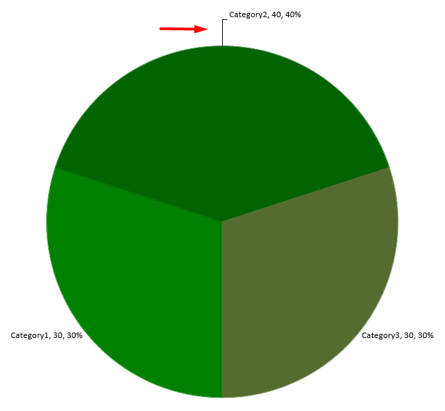

## **Εισαγωγή**

Οι ετικέτες δεδομένων εμφανίζουν πληροφορίες σχετικά με τις σειρές του διαγράμματος και μεμονωμένα σημεία δεδομένων, βοηθώντας τους αναγνώστες να εντοπίζουν τιμές και να κατανοούν το διάγραμμα. Αυτό το άρθρο εξηγεί πώς να μορφοποιήσετε τιμές, να εμφανίσετε ποσοστά, να διαβάσετε το κείμενο της ετικέτας, να ελέγξετε ετικέτες πέρα από το μέγιστο του άξονα, να ρυθμίσετε την απόσταση των ετικετών του άξονα κατηγορίας και να τοποθετήσετε τις ετικέτες του πίτας.

## **Καταμέτρηση Ορατών Ετικετών Δεδομένων**

Χρησιμοποιήστε [getCountOfVisibleDataLabels](https://reference.aspose.com/slides/java/com.aspose.slides/idatalabelcollection/#getCountOfVisibleDataLabels--) για να ελέγξετε πόσες ετικέτες δεδομένων είναι ενεργοποιημένες για προβολή πριν από τη δημοσίευση μιας παρουσίασης. Σε αντίθεση με το [getCount](https://reference.aspose.com/slides/java/com.aspose.slides/idatalabelcollection/#getCount--), το οποίο επιστρέφει το σύνολο των ετικετών στη συλλογή, λαμβάνει υπόψη τις προεπιλογές της σειράς και τις ατομικές ρυθμίσεις ετικετών.

Αυτό το παράδειγμα δημιουργεί ένα ραβδόγραμμα με μία σειρά και τρία σημεία δεδομένων. Προσεγγίζει τη συλλογή ετικετών της σειράς μέσω του [getLabels](https://reference.aspose.com/slides/java/com.aspose.slides/ichartseries/#getLabels--) και εκτυπώνει τον ορατό αριθμό καθώς οι ρυθμίσεις αλλάζουν: **0, 3, 2, 3**. Ο συνολικός αριθμός παραμένει **3**.

```java
import com.aspose.slides.*;

Presentation presentation = new Presentation();
try {
    ISlide slide = presentation.getSlides().get_Item(0);

    IChart chart = slide.getShapes().addChart(ChartType.ClusteredColumn, 50, 50, 500, 300);

    chart.getChartData().getSeries().clear();
    chart.getChartData().getCategories().clear();

    IChartDataWorkbook workbook = chart.getChartData().getChartDataWorkbook();
    IChartDataCell seriesCell = workbook.getCell(0, 0, 1, "Values");
    IChartSeries series = chart.getChartData().getSeries().add(seriesCell, chart.getType());

    for (int i = 0; i < 3; i++) {
        IChartDataCell categoryCell = workbook.getCell(0, i + 1, 0, "Category " + (i + 1));
        chart.getChartData().getCategories().add(categoryCell);
        IChartDataCell valueCell = workbook.getCell(0, i + 1, 1, (i + 1) * 10);
        series.getDataPoints().addDataPointForBarSeries(valueCell);
    }

    IDataLabelCollection labels = series.getLabels();
    System.out.println("Total: " + labels.getCount() + "; visible: " + labels.getCountOfVisibleDataLabels()); // Συνολικά: 3; ορατά: 0

    labels.getDefaultDataLabelFormat().setShowValue(true);
    System.out.println("Visible: " + labels.getCountOfVisibleDataLabels()); // Ορατά: 3

    labels.get_Item(1).getDataLabelFormat().setShowValue(false);
    System.out.println("Visible: " + labels.getCountOfVisibleDataLabels()); // Ορατά: 2

    labels.get_Item(1).getDataLabelFormat().setShowLegendKey(true);
    System.out.println("Visible: " + labels.getCountOfVisibleDataLabels()); // Ορατά: 3
} finally {
    presentation.dispose();
}
```

Η [getDefaultDataLabelFormat](https://reference.aspose.com/slides/java/com.aspose.slides/idatalabelcollection/#getDefaultDataLabelFormat--) παρέχει τις προεπιλεγμένες ρυθμίσεις. Η μετάδοση του `true` στο [setShowValue](https://reference.aspose.com/slides/java/com.aspose.slides/idatalabelformat/#setShowValue-boolean-) εκεί εμφανίζει τιμές για όλες τις τρεις ετικέτες. Η μετάδοση του `false` μέσω του [getDataLabelFormat](https://reference.aspose.com/slides/java/com.aspose.slides/idatalabel/#getDataLabelFormat--) μιας ετικέτας υπερισχύει αυτής της ρύθμισης για την επιλεγμένη ετικέτα. Η μετάδοση του `true` στο [setShowLegendKey](https://reference.aspose.com/slides/java/com.aspose.slides/idatalabelformat/#setShowLegendKey-boolean-) κάνει αυτήν την ετικέτα να μετράει ξανά ως ορατή, ακόμη και αν η τιμή της παραμένει κρυφή.

Ο ορατός αριθμός αντικατοπτρίζει τις ρυθμίσεις ορατότητας. Δεν μετρά εάν οι ετικέτες αλληλοεπικαλύπτονται, περικοπούν ή είναι αναγνώσιμες στο αποδιδόμενο διάγραμμα.

## **Ορισμός Ακρίβειας Δεδομένων στις Ετικέτες Δεδομένων Διαγράμματος**

Χρησιμοποιήστε το [setNumberFormatOfValues](https://reference.aspose.com/slides/java/com.aspose.slides/ichartseries/#setNumberFormatOfValues-java.lang.String-) για να μορφοποιήσετε τις τιμές της σειράς. Αυτό το παράδειγμα δημιουργεί ένα γράφημα γραμμής με προεπιλεγμένα δεδομένα, εμφανίζει τον πίνακα δεδομένων του και ενεργοποιεί τις ετικέτες τιμών για την πρώτη σειρά. Η μορφή `#,##0.00` εμφανίζει διαχωριστικό χιλιάδων και δύο δεκαδικά ψηφία χωρίς να αλλάζει τις υποκείμενες τιμές.

```java
import com.aspose.slides.*;

Presentation presentation = new Presentation();
try {
    ISlide slide = presentation.getSlides().get_Item(0);

    IChart chart = slide.getShapes().addChart(ChartType.Line, 50, 50, 450, 300);
    chart.setDataTable(true);

    IChartSeries series = chart.getChartData().getSeries().get_Item(0);
    series.setNumberFormatOfValues("#,##0.00");
    series.getLabels().getDefaultDataLabelFormat().setShowValue(true);

    presentation.save("PrecisionOfDatalabels_out.pptx", SaveFormat.Pptx);
} finally {
    presentation.dispose();
}
```

Για να μορφοποιήσετε τα αριθμητικά κελιά στο ενσωματωμένο βιβλίο εργασίας ενός διαγράμματος, δείτε το [Set Custom Number Formats for Workbook Cells](/slides/el/java/chart-workbook/#set-custom-number-formats-for-workbook-cells). Το παράδειγμα αυτό δείχνει επίσης ετικέτες τιμών που ακολουθούν τις μορφές των κελιά τους ενώ διατηρούν τις αποθηκευμένες αριθμητικές τιμές.

## **Εμφάνιση Ποσοστών ως Ετικέτες**

Για ένα στοίβαγμα στήλης, υπολογίστε κάθε τιμή ως ποσοστό του συνολικού καταλόγου της κατηγορίας της και αντιστοιχίστε το κείμενο στο πλαίσιο κειμένου που επιστρέφεται από το [getTextFrameForOverriding](https://reference.aspose.com/slides/java/com.aspose.slides/ioverridabletext/#getTextFrameForOverriding--). Αυτό το παράδειγμα χρησιμοποιεί τα προεπιλεγμένα δεδομένα διαγράμματος και εμφανίζει ποσοστά με δύο δεκαδικά ψηφία σε γραμματοσειρά 8 σημείων. Κατηγορίες με σύνολο μηδέν παραλείπονται για αποφυγή διαίρεσης με το μηδέν. Επανυπολογίστε το προσαρμοσμένο κείμενο ετικέτας εάν τα δεδομένα του διαγράμματος αλλάξουν.

```java
import com.aspose.slides.*;
import java.util.Locale;

Presentation presentation = new Presentation();
try {
    ISlide slide = presentation.getSlides().get_Item(0);

    IChart chart = slide.getShapes().addChart(ChartType.StackedColumn, 20, 20, 400, 400);

    double[] categoryTotals = new double[chart.getChartData().getCategories().size()];
    for (int k = 0; k < chart.getChartData().getCategories().size(); k++) {
        for (int i = 0; i < chart.getChartData().getSeries().size(); i++) {
            IChartSeries series = chart.getChartData().getSeries().get_Item(i);
            Number pointValue = (Number) series.getDataPoints().get_Item(k).getValue().getData();
            categoryTotals[k] += pointValue.doubleValue();
        }
    }

    for (int x = 0; x < chart.getChartData().getSeries().size(); x++) {
        IChartSeries series = chart.getChartData().getSeries().get_Item(x);
        series.getLabels().getDefaultDataLabelFormat().setShowLegendKey(false);

        for (int j = 0; j < series.getDataPoints().size(); j++) {
            IDataLabel label = series.getDataPoints().get_Item(j).getLabel();
            if (categoryTotals[j] == 0) {
                continue;
            }

            Number pointValue = (Number) series.getDataPoints().get_Item(j).getValue().getData();
            double dataPointPercent = (pointValue.doubleValue() / categoryTotals[j]) * 100;

            IPortion portion = new Portion();
            portion.setText(String.format(Locale.US, "%.2f %%", dataPointPercent));
            portion.getPortionFormat().setFontHeight(8f);

            label.getTextFrameForOverriding().setText("");
            IParagraph paragraph = label.getTextFrameForOverriding().getParagraphs().get_Item(0);
            paragraph.getPortions().add(portion);

            label.getDataLabelFormat().setShowValue(true);
            label.getDataLabelFormat().setShowSeriesName(false);
            label.getDataLabelFormat().setShowPercentage(false);
            label.getDataLabelFormat().setShowLegendKey(false);
            label.getDataLabelFormat().setShowCategoryName(false);
            label.getDataLabelFormat().setShowBubbleSize(false);
        }
    }

    presentation.save("DisplayPercentageAsLabels_out.pptx", SaveFormat.Pptx);
} finally {
    presentation.dispose();
}
```

## **Ορισμός Συμβόλου Ποσοστού με Ετικέτες Δεδομένων Διαγράμματος**

Όταν οι τιμές αποθηκεύονται ως κλάσματα, χρησιμοποιήστε το [setNumberFormat](https://reference.aspose.com/slides/java/com.aspose.slides/idatalabelformat/#setNumberFormat-java.lang.String-) για να εμφανίσετε ποσοστά. Μεταβιβάστε το `false` στο [setNumberFormatLinkedToSource](https://reference.aspose.com/slides/java/com.aspose.slides/idatalabelformat/#setNumberFormatLinkedToSource-boolean-) για να εφαρμόσετε τη μορφή της ετικέτας ανεξάρτητα από τα κελιά προέλευσης.

Αυτό το παράδειγμα δημιουργεί ένα διάγραμμα στήλης 100% στοίβαξης με κόκκινη και μπλέ σειρά σε τέσσερις κατηγορίες. Κάθε ζεύγος τιμών προστίθεται σε 1. Η μορφή ετικέτας `0.0%` εμφανίζει το 0.30 ως 30.0%, ενώ ο κατακόρυφος άξονας χρησιμοποιεί δύο δεκαδικά ψηφία. Και οι δύο σειρές χρησιμοποιούν λευκό κείμενο ετικέτας 10 σημείων.

```java
import com.aspose.slides.*;
import java.awt.Color;

Presentation presentation = new Presentation();
try {
    ISlide slide = presentation.getSlides().get_Item(0);

    IChart chart = slide.getShapes().addChart(ChartType.PercentsStackedColumn, 20, 20, 500, 400);

    chart.getAxes().getVerticalAxis().setNumberFormatLinkedToSource(false);
    chart.getAxes().getVerticalAxis().setNumberFormat("0.00%");

    chart.getChartData().getSeries().clear();
    chart.getChartData().getCategories().clear();

    IChartDataWorkbook workbook = chart.getChartData().getChartDataWorkbook();
    int worksheetIndex = 0;
    for (int i = 0; i < 4; i++) {
        IChartDataCell categoryCell = workbook.getCell(worksheetIndex, i + 1, 0, "Category " + (i + 1));
        chart.getChartData().getCategories().add(categoryCell);
    }

    String[] seriesNames = { "Reds", "Blues" };
    Color[] seriesColors = { Color.RED, Color.BLUE };
    double[][] values = { { 0.30, 0.50, 0.80, 0.65 }, { 0.70, 0.50, 0.20, 0.35 } };

    for (int i = 0; i < seriesNames.length; i++) {
        IChartDataCell seriesCell = workbook.getCell(worksheetIndex, 0, i + 1, seriesNames[i]);
        IChartSeries series = chart.getChartData().getSeries().add(seriesCell, chart.getType());
        for (int j = 0; j < 4; j++) {
            IChartDataCell valueCell = workbook.getCell(worksheetIndex, j + 1, i + 1, values[i][j]);
            series.getDataPoints().addDataPointForBarSeries(valueCell);
        }

        series.getFormat().getFill().setFillType(FillType.Solid);
        series.getFormat().getFill().getSolidFillColor().setColor(seriesColors[i]);

        IDataLabelFormat labelFormat = series.getLabels().getDefaultDataLabelFormat();
        labelFormat.setShowValue(true);
        labelFormat.setNumberFormatLinkedToSource(false);
        labelFormat.setNumberFormat("0.0%");
        labelFormat.getTextFormat().getPortionFormat().setFontHeight(10);
        labelFormat.getTextFormat().getPortionFormat().getFillFormat().setFillType(FillType.Solid);
        labelFormat.getTextFormat().getPortionFormat().getFillFormat().getSolidFillColor().setColor(Color.WHITE);
    }

    presentation.save("SetDataLabelsPercentageSign_out.pptx", SaveFormat.Pptx);
} finally {
    presentation.dispose();
}
```

## **Ανάγνωση Πραγματικού Κειμένου Ετικετών Δεδομένων**

Χρησιμοποιήστε το [getActualLabelText](https://reference.aspose.com/slides/java/com.aspose.slides/idatalabel/#getActualLabelText--) για να ανακτήσετε το κείμενο που παράγεται από τις ρυθμίσεις μιας ετικέτας δεδομένων. Αυτό είναι χρήσιμο όταν εξάγετε ετικέτες για αναφορές, αναζητάτε περιεχόμενο παρουσίασης ή επαληθεύετε τα παραγόμενα διαγράμματα. Στο παρακάτω παράδειγμα, η προεπιλεγμένη [μορφή ετικέτας δεδομένων](https://reference.aspose.com/slides/java/com.aspose.slides/idatalabelformat/) συνδυάζει το όνομα κάθε κατηγορίας, το όνομα της σειράς και την τιμή. Ένα σημείο μορφοποιεί την τιμή του ως ποσοστό, ενώ ένα άλλο χρησιμοποιεί προσαρμοσμένο κείμενο από το [getTextFrameForOverriding](https://reference.aspose.com/slides/java/com.aspose.slides/ioverridabletext/#getTextFrameForOverriding--).

```java
import com.aspose.slides.*;

Presentation presentation = new Presentation();
try {
    ISlide slide = presentation.getSlides().get_Item(0);

    IChart chart = slide.getShapes().addChart(ChartType.ClusteredColumn, 20, 20, 500, 300);

    chart.getChartData().getSeries().clear();
    chart.getChartData().getCategories().clear();

    IChartDataWorkbook workbook = chart.getChartData().getChartDataWorkbook();
    IChartDataCell firstCategoryCell = workbook.getCell(0, 1, 0, "Q1");
    chart.getChartData().getCategories().add(firstCategoryCell);
    IChartDataCell secondCategoryCell = workbook.getCell(0, 2, 0, "Q2");
    chart.getChartData().getCategories().add(secondCategoryCell);

    IChartDataCell northSeriesCell = workbook.getCell(0, 0, 1, "North");
    IChartSeries north = chart.getChartData().getSeries().add(northSeriesCell, chart.getType());
    IChartDataCell northFirstValueCell = workbook.getCell(0, 1, 1, 0.25);
    north.getDataPoints().addDataPointForBarSeries(northFirstValueCell);
    IChartDataCell northSecondValueCell = workbook.getCell(0, 2, 1, 0.75);
    north.getDataPoints().addDataPointForBarSeries(northSecondValueCell);

    IChartDataCell southSeriesCell = workbook.getCell(0, 0, 2, "South");
    IChartSeries south = chart.getChartData().getSeries().add(southSeriesCell, chart.getType());
    IChartDataCell southFirstValueCell = workbook.getCell(0, 1, 2, 0.40);
    south.getDataPoints().addDataPointForBarSeries(southFirstValueCell);
    IChartDataCell southSecondValueCell = workbook.getCell(0, 2, 2, 0.60);
    south.getDataPoints().addDataPointForBarSeries(southSecondValueCell);

    for (IChartSeries series : chart.getChartData().getSeries()) {
        IDataLabelFormat format = series.getLabels().getDefaultDataLabelFormat();
        format.setShowCategoryName(true);
        format.setShowSeriesName(true);
        format.setShowValue(true);
    }

    north.getLabels().get_Item(1).getDataLabelFormat().setNumberFormatLinkedToSource(false);
    north.getLabels().get_Item(1).getDataLabelFormat().setNumberFormat("0%");
    south.getLabels().get_Item(0).getTextFrameForOverriding().setText("Reviewed");

    for (IChartSeries series : chart.getChartData().getSeries()) {
        for (IChartDataPoint point : series.getDataPoints()) {
            IDataLabel label = point.getLabel();
            if (!label.isVisible()) {
                continue;
            }

            System.out.println("Value: " + point.getValue().getData() + "; label: " + label.getActualLabelText());
        }
    }
} finally {
    presentation.dispose();
}
```

Ο αριθμός που αποθηκεύεται σε ένα σημείο δεδομένων παραμένει `0.75`, ακόμη και αν η ετικέτα του εμφανίζει `75%` μαζί με τα ονόματα κατηγορίας και σειράς. Το προσαρμοσμένο κείμενο αντικαθιστά το παραγόμενο κείμενο ετικέτας. Το [getActualLabelText](https://reference.aspose.com/slides/java/com.aspose.slides/idatalabel/#getActualLabelText--) επιστρέφει το τελικό κείμενο ετικέτας και στις δύο περιπτώσεις. Ελέγξτε το [isVisible](https://reference.aspose.com/slides/java/com.aspose.slides/idatalabel/#isVisible--) ξεχωριστά, όπως φαίνεται παραπάνω, όταν θέλετε να εξάγετε μόνο τις ορατές ετικέτες.

## **Έλεγχος Ετικετών Δεδομένων Πέρα από το Μέγιστο του Άξονα**

Όταν περιορίζετε το εύρος ενός άξονα χειροκίνητα, κάποια σημεία δεδομένων μπορεί να υπερβούν το μέγιστό του. Χρησιμοποιήστε το [setShowDataLabelsOverMaximum](https://reference.aspose.com/slides/java/com.aspose.slides/ichart/#setShowDataLabelsOverMaximum-boolean-) για να ελέγξετε αν οι ετικέτες δεδομένων τους εμφανίζονται. Αυτή η ρύθμιση αλλάζει την ορατότητα των ετικετών· δεν αλλάζει το εύρος του άξονα ή τις υποκείμενες τιμές των δεδομένων.

Το παρακάτω παράδειγμα δημιουργεί ένα 2Δ διαγωνιζόμενο ραβδόγραμμα με τιμές 60 και 120. Μεταβιβάζει το `false` στο [setAutomaticMaxValue](https://reference.aspose.com/slides/java/com.aspose.slides/iaxis/#setAutomaticMaxValue-boolean-) και ορίζει το μέγιστο σε 100 με το [setMaxValue](https://reference.aspose.com/slides/java/com.aspose.slides/iaxis/#setMaxValue-double-) στον κατακόρυφο άξονα. Η πρώτη διαφάνεια επιτρέπει ετικέτες πέρα από το μέγιστο· ένα αντίγραφο αυτής της διαφάνειας τις απενεργοποιεί. Και οι δύο διαφάνειες αποθηκεύονται στο `DataLabelsOverMaximum.pptx`.

Ενεργοποιήστε τις ετικέτες τιμών με το [setShowValue](https://reference.aspose.com/slides/java/com.aspose.slides/idatalabelformat/#setShowValue-boolean-). Η ρύθμιση σε επίπεδο διαγράμματος δεν ενεργοποιεί την προβολή τιμών από μόνη της ούτε παρακάμπτει την απενεργοποίηση προβολής τιμών μιας μεμονωμένης ετικέτας. Αυτό το παράδειγμα ενεργοποιεί τις τιμές για ολόκληρη τη σειρά και χρησιμοποιεί το [setPosition](https://reference.aspose.com/slides/java/com.aspose.slides/idatalabelformat/#setPosition-int-) για να τοποθετήσει τις ετικέτες στο εξωτερικό άκρο κάθε στήλης.

```java
import com.aspose.slides.*;

Presentation presentation = new Presentation();
try {
    ISlide slide = presentation.getSlides().get_Item(0);

    IChart chart = slide.getShapes().addChart(ChartType.ClusteredColumn, 50, 50, 600, 400);
    chart.setLegend(false);

    chart.getChartData().getSeries().clear();
    chart.getChartData().getCategories().clear();

    IChartDataWorkbook workbook = chart.getChartData().getChartDataWorkbook();

    IChartDataCell firstCategory = workbook.getCell(0, 1, 0, "Within range");
    IChartDataCell secondCategory = workbook.getCell(0, 2, 0, "Above maximum");

    chart.getChartData().getCategories().add(firstCategory);
    chart.getChartData().getCategories().add(secondCategory);

    IChartDataCell seriesName = workbook.getCell(0, 0, 1, "Values");
    IChartSeries series = chart.getChartData().getSeries().add(seriesName, chart.getType());

    IChartDataCell firstValue = workbook.getCell(0, 1, 1, 60);
    IChartDataCell secondValue = workbook.getCell(0, 2, 1, 120);

    series.getDataPoints().addDataPointForBarSeries(firstValue);
    series.getDataPoints().addDataPointForBarSeries(secondValue);

    series.getLabels().getDefaultDataLabelFormat().setShowValue(true);
    series.getLabels().getDefaultDataLabelFormat().setPosition(LegendDataLabelPosition.OutsideEnd);

    chart.getAxes().getVerticalAxis().setAutomaticMaxValue(false);
    chart.getAxes().getVerticalAxis().setMaxValue(100);
    chart.setShowDataLabelsOverMaximum(true);

    ISlide secondSlide = presentation.getSlides().addClone(slide);
    IChart secondChart = (IChart) secondSlide.getShapes().get_Item(0);
    secondChart.setShowDataLabelsOverMaximum(false);

    presentation.save("DataLabelsOverMaximum.pptx", SaveFormat.Pptx);
} finally {
    presentation.dispose();
}
```

Οι παρακάτω εικόνες δείχνουν τις αποθηκευμένες διαφάνειες όπως τις αποδίδει το Microsoft PowerPoint. Με `true`, η ετικέτα **120** είναι ορατή στο ανώτερο όριο· με `false`, είναι κρυφή. Η ετικέτα **60** παραμένει ορατή, το μέγιστο του άξονα παραμένει στα **100**, και το δεύτερο σημείο δεδομένων παραμένει **120** και στις δύο περιπτώσεις.

| setShowDataLabelsOverMaximum(true) | setShowDataLabelsOverMaximum(false) |
| --- | --- |
|  |  |

{}
Αυτό το παράδειγμα χρησιμοποιεί ένα 2Δ ραβδόγραμμα με άξονα τιμών. Διαγράμματα χωρίς άξονα τιμών, όπως τα διαγράμματα πίτας και δακτυλίου, δεν έχουν μέγιστο άξονα που να περιορίζεται με αυτόν τον τρόπο.
{}

## **Ορισμός Απόστασης Ετικέτας από Άξονα**

Χρησιμοποιήστε το [setLabelOffset](https://reference.aspose.com/slides/java/com.aspose.slides/iaxis/#setLabelOffset-int-) για να ελέγξετε την απόσταση μεταξύ των ετικετών του άξονα κατηγορίας και του άξονα. Η τιμή είναι ποσοστό του μέγιστου μεγέθους γραμματοσειράς των ετικετών του άξονα. Αυτό το παράδειγμα δημιουργεί ένα διαγωνιζόμενο ραβδόγραμμα και θέτει την απόσταση ετικέτας του οριζόντιου άξονα σε 500. Αυτή η ρύθμιση επηρεάζει τις ετικέτες του άξονα κατηγορίας αντί για τις ετικέτες που συνδέονται με μεμονωμένα σημεία δεδομένων.

```java
import com.aspose.slides.*;

Presentation presentation = new Presentation();
try {
    ISlide slide = presentation.getSlides().get_Item(0);

    IChart chart = slide.getShapes().addChart(ChartType.ClusteredColumn, 20, 20, 500, 300);
    chart.getAxes().getHorizontalAxis().setLabelOffset(500);

    presentation.save("SetCategoryAxisLabelDistance_out.pptx", SaveFormat.Pptx);
} finally {
    presentation.dispose();
}
```

## **Προσαρμογή Θέσης Ετικέτας**

Σε διάγραμμα πίτας, προσαρμόστε τις θέσεις των ετικετών δεδομένων για να βελτιώσετε την απόσταση και να δημιουργήσετε χώρο για τις γραμμές οδηγούς.

Αυτό το παράδειγμα εμφανίζει την τιμή του πρώτου σημείου δεδομένων, τοποθετεί την ετικέτα του έξω από το τμήμα και προσαρμόζει τις οριζόντιες και κατακόρυφες μετατοπίσεις του χρησιμοποιώντας τα [setX](https://reference.aspose.com/slides/java/com.aspose.slides/ilayoutable/#setX-float-) και [setY](https://reference.aspose.com/slides/java/com.aspose.slides/ilayoutable/#setY-float-). Αυτές οι μετατοπίσεις είναι σχετικές με το πλάτος και το ύψος του διαγράμματος, αντίστοιχα.

```java
import com.aspose.slides.*;

Presentation presentation = new Presentation();
try {
    ISlide slide = presentation.getSlides().get_Item(0);
    
    IChart chart = slide.getShapes().addChart(ChartType.Pie, 50, 50, 200, 200);
    IChartSeriesCollection series = chart.getChartData().getSeries();

    IDataLabel label = series.get_Item(0).getLabels().get_Item(0);
    label.getDataLabelFormat().setShowValue(true);
    label.getDataLabelFormat().setPosition(LegendDataLabelPosition.OutsideEnd);
    label.setX(0.71f);
    label.setY(0.04f);

    presentation.save("presentation.pptx", SaveFormat.Pptx);
} finally {
    presentation.dispose();
}
```



## **Μορφοποίηση Γραμμών Οδηγού**

Όταν οι ετικέτες πίτας βρίσκονται έξω από τα τμήματά τους, οι γραμμές οδηγούς βοηθούν τους αναγνώστες να αντιστοιχίσουν κάθε τιμή στο σωστό τμήμα. Ένα αντίθετο χρώμα και μια ελαφρώς πιο παχιά γραμμή μπορούν να κάνουν αυτές τις συνδέσεις πιο ευανάγνωστες, ενώ η διαφάνεια και το διακεκομμένο στυλ διατηρούν τις γραμμές λιγότερο εμφανείς.

Χρησιμοποιήστε το [getLeaderLinesFormat](https://reference.aspose.com/slides/java/com.aspose.slides/idatalabelcollection/#getLeaderLinesFormat--) για να μορφοποιήσετε τις γραμμές οδηγούς στο επίπεδο της συλλογής ετικετών δεδομένων της σειράς. Οι ρυθμίσεις στο `series.getLabels().getLeaderLinesFormat().getLine()` ισχύουν για τη συλλογή, όχι για μεμονωμένη ετικέτα.

Αυτό το παράδειγμα δημιουργεί ένα διάγραμμα πίτας με προεπιλεγμένα δεδομένα, εμφανίζει τιμές έξω από τα τμήματα και ενεργοποιεί το [setShowLeaderLines](https://reference.aspose.com/slides/java/com.aspose.slides/idatalabelformat/#setShowLeaderLines-boolean-). Μετακινεί δύο ετικέτες πιο μακριά από τα τμήματά τους χρησιμοποιώντας μετατοπίσεις [setX](https://reference.aspose.com/slides/java/com.aspose.slides/ilayoutable/#setX-float-) και [setY](https://reference.aspose.com/slides/java/com.aspose.slides/ilayoutable/#setY-float-), εκφρασμένες ως κλάσματα του πλάτους και του ύψους του διαγράμματος. Δεν απαιτείται παρουσίαση εισόδου.

Η [getFillFormat](https://reference.aspose.com/slides/java/com.aspose.slides/ilineformat/#getFillFormat--) της γραμμής ορίζει ένα στερεό μπλε χρώμα με τιμή alpha 191 από 255, παρέχοντας περίπου 25% διαφάνεια. Το [setWidth](https://reference.aspose.com/slides/java/com.aspose.slides/ilineformat/#setWidth-double-) ορίζει το πάχος σε 2 σημεία, και το [setDashStyle](https://reference.aspose.com/slides/java/com.aspose.slides/ilineformat/#setDashStyle-byte-) κάνει τη γραμμή διακεκομμένη.

```java
import com.aspose.slides.*;
import java.awt.Color;

Presentation presentation = new Presentation();
try {
    ISlide slide = presentation.getSlides().get_Item(0);

    IChart chart = slide.getShapes().addChart(ChartType.Pie, 80, 50, 560, 400);
    chart.setLegend(false);

    IChartSeries series = chart.getChartData().getSeries().get_Item(0);

    IDataLabelFormat labelFormat = series.getLabels().getDefaultDataLabelFormat();
    labelFormat.setShowValue(true);
    labelFormat.setPosition(LegendDataLabelPosition.OutsideEnd);
    labelFormat.setShowLeaderLines(true);

    // Μετακινήστε δύο ετικέτες πιο μακριά από τα τμήματα τους.
    series.getLabels().get_Item(0).setX(0.10f);
    series.getLabels().get_Item(0).setY(-0.05f);
    series.getLabels().get_Item(1).setX(-0.10f);
    series.getLabels().get_Item(1).setY(0.05f);

    ILineFormat line = series.getLabels().getLeaderLinesFormat().getLine();
    line.getFillFormat().setFillType(FillType.Solid);
    line.getFillFormat().getSolidFillColor().setColor(new Color(30, 90, 160, 191));
    line.setWidth(2);
    line.setDashStyle(LineDashStyle.Dash);

    presentation.save("FormattedLeaderLines.pptx", SaveFormat.Pptx);
} finally {
    presentation.dispose();
}
```

Η ενεργοποίηση των γραμμών οδηγού δεν εγγυάται ότι θα εμφανιστεί γραμμή για κάθε ετικέτα. Η ορατότητα εξαρτάται από τη θέση της ετικέτας και τη συμπεριφορά διάταξης του διαγράμματος. Σε αυτό το παράδειγμα, οι δύο μετατοπισμένες ετικέτες έχουν ορατές γραμμές οδηγούς· οι ετικέτες που παραμένουν κοντά στα τμήματά τους δεν τις χρειάζονται.

Η παρακάτω εικόνα δείχνει το αποθηκευμένο `FormattedLeaderLines.pptx` όπως αποδίδεται με το Aspose.Slides:


## **Προσθήκη Πολλαπλών Γραμμών Ετικετών Δεδομένων Πάνω από Ραβδόγραμμα**

Αυτό το παράδειγμα δημιουργεί ένα ραβδόγραμμα με δύο γραμμές ετικετών δεδομένων πάνω από την περιοχή σχεδίασης. Η Σειρά A εμφανίζει τις ορατές στήλες, ενώ οι Σειρές B και C παρέχουν τις πρόσθετες ετικέτες. Οι στήλες τους κρύβονται αφαιρώντας το γέμισμα και το περίγραμμα. Η μέθοδος [ChartSeriesGroup.setOverlap](https://reference.aspose.com/slides/java/com.aspose.slides/chartseriesgroup/) ευθυγραμμίζει όλες τις τρεις σειρές στα ίδια κέντρα κατηγοριών.

Οι ρυθμίσεις του [ChartPlotArea](https://reference.aspose.com/slides/java/com.aspose.slides/chartplotarea/) διατηρούν χώρο για τις γραμμές ετικετών. Μετά τον υπολογισμό των προεπιλεγμένων θέσεων από το [Chart.validateChartLayout](https://reference.aspose.com/slides/java/com.aspose.slides/chart/) τα [DataLabel.setX και DataLabel.setY](https://reference.aspose.com/slides/java/com.aspose.slides/datalabel/) διατηρούν την οριζόντια στοίχιση και εφαρμόζουν κάθετες μετατοπίσεις για να τοποθετήσουν τις ετικέτες σε δύο γραμμές. Οι αριθμοί παραμένουν ετικέτες δεδομένων συνδεδεμένες με τις τιμές των σειρών· μόνο οι επικεφαλίδες των γραμμών είναι ξεχωριστά σχήματα κειμένου.

```java
Presentation presentation = new Presentation();
try {
    ISlide slide = presentation.getSlides().get_Item(0);

    IChart chart = slide.getShapes().addChart(ChartType.ClusteredColumn, 40, 40, 640, 200);
    chart.setTitle(false);
    chart.setLegend(false);
    chart.getTextFormat().getPortionFormat().setFontHeight(12);

    chart.getChartData().getSeries().clear();
    chart.getChartData().getCategories().clear();

    IChartDataWorkbook workbook = chart.getChartData().getChartDataWorkbook();
    workbook.clear(0);

    String[] categories = {"North", "South", "East", "West"};
    String[] seriesNames = {"Series A", "Series B", "Series C"};
    double[][] seriesValues = {
            {35, 42, 28, 47},
            {22, 31, 19, 26},
            {12, 16, 14, 18}
    };

    for (int categoryIndex = 0; categoryIndex < categories.length; categoryIndex++) {
        chart.getChartData().getCategories().add(
                workbook.getCell(0, categoryIndex + 1, 0, categories[categoryIndex]));
    }

    for (int seriesIndex = 0; seriesIndex < seriesNames.length; seriesIndex++) {
        IChartSeries series = chart.getChartData().getSeries().add(
                workbook.getCell(0, 0, seriesIndex + 1, seriesNames[seriesIndex]),
                ChartType.ClusteredColumn);

        for (int categoryIndex = 0; categoryIndex < categories.length; categoryIndex++) {
            series.getDataPoints().addDataPointForBarSeries(workbook.getCell(
                    0, categoryIndex + 1, seriesIndex + 1,
                    seriesValues[seriesIndex][categoryIndex]));
        }

        if (seriesIndex > 0) {
            // Απόκρυψη των στηλών του B και C, αλλά διατήρηση των ετικετών δεδομένων τους.
            series.getFormat().getFill().setFillType(FillType.NoFill);
            series.getFormat().getLine().getFillFormat().setFillType(FillType.NoFill);
            series.getLabels().getDefaultDataLabelFormat().setShowValue(true);
            series.getLabels().getDefaultDataLabelFormat()
                    .getTextFormat().getPortionFormat().setFontHeight(12);
            IFillFormat labelFill = series.getLabels().getDefaultDataLabelFormat()
                    .getTextFormat().getPortionFormat().getFillFormat();
            labelFill.setFillType(FillType.Solid);
            labelFill.getSolidFillColor().setColor(java.awt.Color.BLACK);
            series.getLabels().getDefaultDataLabelFormat().setPosition(
                    LegendDataLabelPosition.InsideBase);
        }
    }

    // Στοίχιση και των τριών σειρών στα ίδια κέντρα κατηγοριών.
    chart.getChartData().getSeries().get_Item(0)
            .getParentSeriesGroup().setOverlap((byte) 100);

    // Χρήση λιγότερων γραμμών πλέγματος για αυτό το συμπαγές παράδειγμα.
    chart.getAxes().getVerticalAxis().setAutomaticMajorUnit(false);
    chart.getAxes().getVerticalAxis().setMajorUnit(10);

    // Δέσμευση χώρου πάνω από το γράφημα για δύο σειρές ετικετών δεδομένων.
    chart.getPlotArea().setLayoutTargetType(LayoutTargetType.Inner);
    chart.getPlotArea().setX(0.15f);
    chart.getPlotArea().setY(0.32f);
    chart.getPlotArea().setWidth(0.80f);
    chart.getPlotArea().setHeight(0.48f);
    chart.validateChartLayout();

    for (int seriesIndex = 1; seriesIndex < seriesNames.length; seriesIndex++) {
        IChartSeries series = chart.getChartData().getSeries().get_Item(seriesIndex);
        float rowTop = seriesIndex == 1 ? 0.15f : 0.03f;

        for (int categoryIndex = 0; categoryIndex < categories.length; categoryIndex++) {
            IDataLabel dataLabel = series.getDataPoints().get_Item(categoryIndex).getLabel();
            // Διατήρηση της προεπιλεγμένης οριζόντιας θέσης. Το Y είναι μια μετατόπιση από
            // τη προεπιλεγμένη θέση ετικέτας, εκφρασμένη ως κλάσμα του ύψους του διαγράμματος.
            dataLabel.setX(0);
            dataLabel.setY(rowTop - dataLabel.getActualY() / chart.getHeight());
        }

        // Μόνο η επικεφαλίδα της σειράς είναι ξεχωριστό σχήμα κειμένου.
        IAutoShape rowHeading = slide.getShapes().addAutoShape(
                ShapeType.Rectangle, chart.getX(),
                chart.getY() + rowTop * chart.getHeight(), 85, 18);
        rowHeading.getFillFormat().setFillType(FillType.NoFill);
        rowHeading.getLineFormat().getFillFormat().setFillType(FillType.NoFill);
        rowHeading.addTextFrame(seriesNames[seriesIndex]);
        rowHeading.getTextFrame().getTextFrameFormat().setMarginTop(0);
        rowHeading.getTextFrame().getTextFrameFormat().setMarginBottom(0);
        IPortionFormat headingFormat = rowHeading.getTextFrame().getParagraphs()
                .get_Item(0).getPortions().get_Item(0).getPortionFormat();
        headingFormat.setFontHeight(12);
        headingFormat.getFillFormat().setFillType(FillType.Solid);
        headingFormat.getFillFormat().getSolidFillColor().setColor(java.awt.Color.BLACK);
    }

    presentation.save("multiple-rows-of-labels.pptx", SaveFormat.Pptx);
} finally {
    presentation.dispose();
}
```


## **Συχνές Ερωτήσεις**

**Πώς μπορώ να αποτρέψω την επικάλυψη των ετικετών δεδομένων σε πυκνά διαγράμματα;**

Συνδυάστε αυτόματη τοποθέτηση ετικετών, γραμμές οδηγούς και μειωμένο μέγεθος γραμματοσειράς· αν χρειάζεται, κρύψτε ορισμένα πεδία (π.χ., την κατηγορία) ή εμφανίστε ετικέτες μόνο για ακραίες τιμές ή κύρια σημεία.

**Πώς μπορώ να απενεργοποιήσω τις ετικέτες μόνο για μηδενικές, αρνητικές ή κενές τιμές;**

Φιλτράρετε τα σημεία δεδομένων πριν ενεργοποιήσετε τις ετικέτες και απενεργοποιήστε την προβολή για τιμές 0, αρνητικές τιμές ή ελλιπείς τιμές σύμφωνα με έναν καθορισμένο κανόνα.

**Πώς μπορώ να εξασφαλίσω ένα συνεπές στυλ ετικετών κατά την εξαγωγή σε PDF/εικόνες;**

Ορίστε ρητά την οικογένεια γραμματοσειράς και το μέγεθος και επαληθεύστε ότι η γραμματοσειρά είναι διαθέσιμη στο περιβάλλον απόδοσης για να αποφύγετε την εναλλακτική επιλογή.