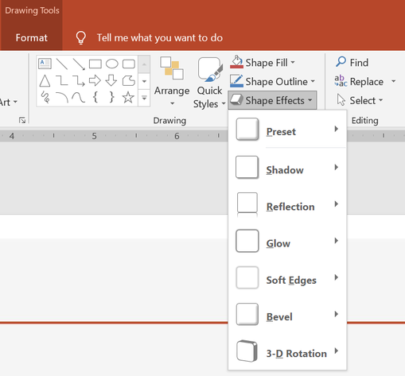

## **Εισαγωγή**

Ενώ τα εφέ στο PowerPoint μπορούν να χρησιμοποιηθούν για να κάνουν ένα σχήμα να ξεχωρίζει, διαφέρουν από τις [γέμιση](/slides/el/nodejs-java/shape-formatting/#gradient-fill) ή τα περιγράμματα. Χρησιμοποιώντας τα εφέ του PowerPoint, μπορείτε να δημιουργήσετε πειστικές αντανακλάσεις σε ένα σχήμα, να διασπείρετε τη λάμψη του σχήματος κ.λπ.



Το PowerPoint παρέχει έξι εφέ που μπορούν να εφαρμοστούν σε σχήματα. Μπορείτε να εφαρμόσετε ένα ή περισσότερα εφέ σε ένα σχήμα.

Ορισμένοι συνδυασμοί εφέ φαίνονται καλύτεροι από άλλους. Για αυτόν τον λόγο, το PowerPoint παρέχει επιλογές κάτω από **Preset**. Οι επιλογές Preset είναι συνδυασμοί δύο ή περισσότερων εφέ που είναι γνωστό ότι φαίνονται καλά. Με αυτόν τον τρόπο, επιλέγοντας ένα preset, δεν θα χρειαστεί να χάνετε χρόνο δοκιμάζοντας ή συνδυάζοντας διαφορετικά εφέ για να βρείτε έναν καλό συνδυασμό.

Το Aspose.Slides παρέχει ιδιότητες και μεθόδους στην κλάση [EffectFormat](https://reference.aspose.com/slides/nodejs-java/aspose.slides/effectformat/) που σας επιτρέπουν να εφαρμόζετε τα ίδια εφέ σε σχήματα σε παρουσιάσεις PowerPoint.

## **Εφαρμογή Σκιάς**

Το Aspose.Slides για Node.js μέσω Java υποστηρίζει εξωτερικές και εσωτερικές σκιές για σχήματα. Μπορείτε να προσαρμόσετε το χρώμα, την κατεύθυνση, την απόσταση και την ακτίνα θολώματος ώστε να ταιριάζει με το σχέδιο της παρουσίασής σας.

### **Εφαρμογή Εξωτερικής Σκιάς**

Χρησιμοποιήστε εξωτερική σκιά για να κάνετε μια κάρτα ή πίνακα να ξεχωρίζει από το φόντο της διαφάνειας. Η σκιά εκτείνεται πέρα από τις άκρες του σχήματος, δημιουργώντας την εντύπωση ότι το σχήμα είναι ανυψωμένο πάνω από τη διαφάνεια. Προσαρμόστε το χρώμα, την κατεύθυνση, την απόσταση και την ακτίνα θολώματος ώστε να ταιριάζει με το φωτισμό και το στυλ του προτύπου σας.

Αυτός ο κώδικας JavaScript δείχνει πώς να εφαρμόσετε το [εξωτερική σκιά](https://reference.aspose.com/slides/nodejs-java/aspose.slides/effectformat/#getOuterShadowEffect) σε ένα ορθογώνιο:

```javascript
const aspose = { slides: require("aspose.slides.via.java") };
const java = require("java");

const presentation = new aspose.slides.Presentation();
try {
    const slide = presentation.getSlides().get_Item(0);

    const shape = slide.getShapes().addAutoShape(aspose.slides.ShapeType.RoundCornerRectangle, 20, 20, 200, 100);
    shape.getEffectFormat().enableOuterShadowEffect();
    const color = java.newInstanceSync("java.awt.Color", 169, 169, 169);
    shape.getEffectFormat().getOuterShadowEffect().getShadowColor().setColor(color);
    shape.getEffectFormat().getOuterShadowEffect().setDistance(10);
    shape.getEffectFormat().getOuterShadowEffect().setDirection(45);

    presentation.save("shadow_effect.pptx", aspose.slides.SaveFormat.Pptx);
} finally {
    presentation.dispose();
}
```


### **Εφαρμογή Εσωτερικής Σκιάς**

Κατά την αναδημιουργία του οπτικού στυλ ενός προτύπου, χρησιμοποιήστε εσωτερική σκιά για να δώσετε σε μια κάρτα ή πίνακα μια εσομένη εμφάνιση. Η εξωτερική σκιά εκτείνεται έξω από το σχήμα και το κάνει να φαίνεται ανυψωμένο, ενώ η εσωτερική σκιά σκιάζει το εσωτερικό των άκρων του.

Καλέστε [enableInnerShadowEffect](https://reference.aspose.com/slides/nodejs-java/aspose.slides/effectformat/#enableInnerShadowEffect), έπειτα διαμορφώστε τη σκιά που επιστρέφεται από το [getInnerShadowEffect](https://reference.aspose.com/slides/nodejs-java/aspose.slides/effectformat/#getInnerShadowEffect). Μεγαλύτερες τιμές ακτίνας θολώματος παράγουν πιο μαλακές ακμές.

Αυτό το παράδειγμα JavaScript δημιουργεί μια ανοιχτό-μπλε κάρτα με εσωτερική σκιά σκούρου γκρι και την αποθηκεύει ως αρχείο PPTX. Η κατεύθυνση της σκιάς είναι 225 μοίρες, η απόσταση 7 σημεία και η ακτίνα θολώματος 6 σημεία:

```javascript
const aspose = { slides: require("aspose.slides.via.java") };
const java = require("java");

const presentation = new aspose.slides.Presentation();
try {
    const slide = presentation.getSlides().get_Item(0);

    const shape = slide.getShapes().addAutoShape(aspose.slides.ShapeType.Rectangle, 20, 20, 200, 100);
    shape.getFillFormat().setFillType(java.newByte(aspose.slides.FillType.Solid));
    const fillColor = java.newInstanceSync("java.awt.Color", 173, 216, 230);
    shape.getFillFormat().getSolidFillColor().setColor(fillColor);
    shape.getLineFormat().getFillFormat().setFillType(java.newByte(aspose.slides.FillType.NoFill));

    shape.getEffectFormat().enableInnerShadowEffect();
    const shadow = shape.getEffectFormat().getInnerShadowEffect();
    const color = java.newInstanceSync("java.awt.Color", 105, 105, 105);
    shadow.getShadowColor().setColor(color);
    shadow.setDirection(225);
    shadow.setDistance(7);
    shadow.setBlurRadius(6);

    presentation.save("inner_shadow_effect.pptx", aspose.slides.SaveFormat.Pptx);
} finally {
    presentation.dispose();
}
```


Για να αφαιρέσετε την εσωτερική σκιά, καλέστε [disableInnerShadowEffect](https://reference.aspose.com/slides/nodejs-java/aspose.slides/effectformat/#disableInnerShadowEffect) στη μορφή εφέ του σχήματος.

## **Εφαρμογή Εφέ Αντανάκλασης**

Για να εφαρμόσετε ένα εφέ αντανάκλασης στο Aspose.Slides για Node.js μέσω Java, μπορείτε να προσθέσετε μια καθρέφτη‑σαν αντανάκλαση σε σχήματα, ρυθμίζοντας παραμέτρους όπως απόσταση, διαφάνεια και μέγεθος. Αυτό το εφέ βελτιώνει την αισθητική των παρουσιάσεων σας δίνοντας στα σχήματα μια πιο γυαλιστερή και εκλεπτυσμένη εμφάνιση. Είναι εύκολο να υλοποιηθεί με απλό κώδικα, επιτρέποντας γρήγορη εφαρμογή σε πολλαπλά στοιχεία για ομοιόμορφο σχεδιασμό.

Αυτός ο κώδικας JavaScript δείχνει πώς να εφαρμόσετε το [εφέ αντανάκλασης](https://reference.aspose.com/slides/nodejs-java/aspose.slides/effectformat/#getReflectionEffect) σε ένα σχήμα:

```javascript
const aspose = { slides: require("aspose.slides.via.java") };
const java = require("java");

const presentation = new aspose.slides.Presentation();
try {
    const slide = presentation.getSlides().get_Item(0);

    const shape = slide.getShapes().addAutoShape(aspose.slides.ShapeType.RoundCornerRectangle, 20, 20, 200, 100);
    shape.getEffectFormat().enableReflectionEffect();
    shape.getEffectFormat().getReflectionEffect().setRectangleAlign(java.newByte(aspose.slides.RectangleAlignment.Bottom));
    shape.getEffectFormat().getReflectionEffect().setDirection(90);
    shape.getEffectFormat().getReflectionEffect().setDistance(40);
    shape.getEffectFormat().getReflectionEffect().setBlurRadius(2);

    presentation.save("reflection_effect.pptx", aspose.slides.SaveFormat.Pptx);
} finally {
    presentation.dispose();
}
```


## **Εφαρμογή Εφέ Λάμψης**

Για να εφαρμόσετε ένα εφέ λάμψης σε σχήμα στο Aspose.Slides για Node.js μέσω Java, μπορείτε να προσθέσετε μια απαλό, φωτεινό αύρα γύρω από τα σχήματα, ρυθμίζοντας ιδιότητες όπως χρώμα και μέγεθος. Αυτό το εφέ βοηθά τα σχήματα να ξεχωρίσουν και προσθέτει ένα ελκυστικό, εντυπωσιακό οπτικό στοιχείο στην παρουσίασή σας. Είναι εύκολο να υλοποιηθεί με ελάχιστο κώδικα, βελτιώνοντας τη συνολική εμφάνιση των διαφανειών σας.

Αυτός ο κώδικας JavaScript δείχνει πώς να εφαρμόσετε το [εφέ λάμψης](https://reference.aspose.com/slides/nodejs-java/aspose.slides/effectformat/#getGlowEffect) σε ένα σχήμα:

```javascript
const aspose = { slides: require("aspose.slides.via.java") };
const java = require("java");

const presentation = new aspose.slides.Presentation();
try {
    const slide = presentation.getSlides().get_Item(0);

    const shape = slide.getShapes().addAutoShape(aspose.slides.ShapeType.RoundCornerRectangle, 20, 20, 200, 100);
    shape.getEffectFormat().enableGlowEffect();
    const color = java.getStaticFieldValue("java.awt.Color", "MAGENTA");
    shape.getEffectFormat().getGlowEffect().getColor().setColor(color);
    shape.getEffectFormat().getGlowEffect().setRadius(15);

    presentation.save("glow_effect.pptx", aspose.slides.SaveFormat.Pptx);
} finally {
    presentation.dispose();
}
```


## **Εφαρμογή Εφέ Μαλακών Άκρων**

Για να εφαρμόσετε ένα εφέ μαλακών άκρων στο Aspose.Slides για Node.js μέσω Java, μπορείτε να δημιουργήσετε μια ομαλή, θολή μετάβαση γύρω από τις άκρες ενός σχήματος. Αυτό το εφέ προσθέτει μια πιο διακριτική και εκλεπτυσμένη εμφάνιση, ιδανική για σχέδια που χρειάζονται μια ήπια, πιο απαλής όψης. Μπορείτε εύκολα να ρυθμίσετε παραμέτρους όπως η ακτίνα για να επιτύχετε το επιθυμητό αποτέλεσμα σε διάφορα σχήματα της παρουσίασής σας.

Αυτός ο κώδικας JavaScript δείχνει πώς να εφαρμόσετε το [εφέ μαλακών άκρων](https://reference.aspose.com/slides/nodejs-java/aspose.slides/effectformat/#getSoftEdgeEffect) σε ένα σχήμα:

```javascript
const aspose = { slides: require("aspose.slides.via.java") };

const presentation = new aspose.slides.Presentation();
try {
    const slide = presentation.getSlides().get_Item(0);

    const shape = slide.getShapes().addAutoShape(aspose.slides.ShapeType.RoundCornerRectangle, 20, 20, 200, 150);
    shape.getEffectFormat().enableSoftEdgeEffect();
    shape.getEffectFormat().getSoftEdgeEffect().setRadius(8);

    presentation.save("soft_edges_effect.pptx", aspose.slides.SaveFormat.Pptx);
} finally {
    presentation.dispose();
}
```


## **Εφαρμογή Εφέ Θολώματος**

Χρησιμοποιήστε θόλωση σχήματος για να μαλακώσετε τη γέμιση και το περίγραμμα ενός σχήματος, διατηρώντας το σχήμα επεξεργάσιμο. Καλέστε [setBlurEffect](https://reference.aspose.com/slides/nodejs-java/aspose.slides/effectformat/#setBlurEffect) στη μορφή εφέ του σχήματος. Η ακτίνα μετράται σε σημεία (1/72 ίντσα): χρησιμοποιήστε μη αρνητική τιμή, με μεγαλύτερες τιμές να παράγουν ισχυρότερη θόλωση. Μια ακτίνα μηδέν αφήνει την εμφάνιση αμετάβλητη.

Η ρύθμιση [getGrow](https://reference.aspose.com/slides/nodejs-java/aspose.slides/blur/#getGrow) ελέγχει τα ορατά όρια του εφέ. Με `false`, η θόλωση περιορίζεται στα αρχικά χρωματισμένα όρια, συμπεριλαμβανομένου του περιγράμματος. Με `true`, η θόλωση μπορεί να εκτείνεται πέρα από αυτά τα όρια. Καμία από τις ρυθμίσεις δεν αλλάζει τη θέση ή τις διαστάσεις του σχήματος.

Η σύγκριση παρακάτω χρησιμοποιεί την ίδια γέμιση, περίγραμμα και διαστάσεις σχήματος καθ' όλη τη διάρκεια. Η πρώτη σειρά χρησιμοποιεί `grow = false`; η δεύτερη σειρά χρησιμοποιεί `grow = true`.


Αυτό το παράδειγμα JavaScript δημιουργεί ένα πορτοκαλί ορθογώνιο με σκούρο μπλε περίγραμμα, εφαρμόζει θόλωση 5 σημείων και έπειτα το ενημερώνει σε θόλωση 15 σημείων καλώντας ξανά το [setBlurEffect](https://reference.aspose.com/slides/nodejs-java/aspose.slides/effectformat/#setBlurEffect). Αποθηκεύει και τις δύο καταστάσεις με θόλωση, μετά καλεί [disableBlurEffect](https://reference.aspose.com/slides/nodejs-java/aspose.slides/effectformat/#disableBlurEffect) και αποθηκεύει το σχήμα χωρίς θόλωση.

```javascript
const aspose = { slides: require("aspose.slides.via.java") };
const java = require("java");

const presentation = new aspose.slides.Presentation();
try {
    const slide = presentation.getSlides().get_Item(0);

    const shape = slide.getShapes().addAutoShape(aspose.slides.ShapeType.Rectangle, 100, 80, 160, 100);
    shape.getFillFormat().setFillType(java.newByte(aspose.slides.FillType.Solid));
    const fillColor = java.newInstanceSync("java.awt.Color", 255, 165, 0);
    shape.getFillFormat().getSolidFillColor().setColor(fillColor);
    shape.getLineFormat().getFillFormat().setFillType(java.newByte(aspose.slides.FillType.Solid));
    const lineColor = java.newInstanceSync("java.awt.Color", 0, 0, 139);
    shape.getLineFormat().getFillFormat().getSolidFillColor().setColor(lineColor);
    shape.getLineFormat().setWidth(8);

    shape.getEffectFormat().setBlurEffect(5, false);
    presentation.save("shape_blur_5.pptx", aspose.slides.SaveFormat.Pptx);

    shape.getEffectFormat().setBlurEffect(15, true);
    presentation.save("shape_blur_15.pptx", aspose.slides.SaveFormat.Pptx);

    shape.getEffectFormat().disableBlurEffect();
    presentation.save("shape_blur_removed.pptx", aspose.slides.SaveFormat.Pptx);
} finally {
    presentation.dispose();
}
```

Η θόλωση σχήματος επηρεάζει τη γέμιση και το περίγραμμα μαζί. Το εφέ μαλακών άκρων εξαλείφει τις άκρες του σχήματος, ενώ η θόλωση σκιάς μαλακώνει μόνο τη σκιά. Τα εφέ μετασχηματισμού εικόνας λειτουργούν πάνω στο περιεχόμενο της εικόνας· αυτό το παράδειγμα εφαρμόζει θόλωση άμεσα στη μορφή εφέ του σχήματος χωρίς να μετατρέπει το σχήμα σε εικόνα.

## **ΣΥΧΝΑ ΕΡΩΤΗΣΕΙΣ**

**Μπορώ να εφαρμόσω πολλαπλά εφέ στο ίδιο σχήμα;**

Ναι, μπορείτε να συνδυάσετε διαφορετικά εφέ, όπως σκιά, αντανάκλαση και λάμψη, σε ένα μόνο σχήμα για να δημιουργήσετε μια πιο δυναμική εμφάνιση.

**Σε ποια σχήματα μπορώ να εφαρμόσω εφέ;**

Μπορείτε να εφαρμόσετε εφέ σε διάφορα σχήματα, συμπεριλαμβανομένων αυτόματων σχημάτων, διαγραμμάτων, πινάκων, εικόνων, αντικειμένων SmartArt, αντικειμένων OLE και άλλων.

**Μπορώ να εφαρμόσω εφέ σε ομαδοποιημένα σχήματα;**

Ναι, μπορείτε να εφαρμόσετε εφέ σε ομαδοποιημένα σχήματα. Το εφέ θα εφαρμοστεί σε ολόκληρη την ομάδα.