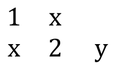

## **Επισκόπηση**

Το PowerPoint αποθηκεύει εξισώσεις ως Office Math Markup Language (OMML). Με το Aspose.Slides for PHP via Java, μπορείτε να δημιουργήσετε το ίδιο είδος μαθηματικού περιεχομένου προγραμματιστικά: κλάσματες, ριζικές, συναρτήσεις, όρια, τελεστές N-ary, πίνακες, ακολουθίες και μορφοποιημένα μαθηματικά μπλοκ.

Στο PowerPoint, οι χρήστες συνήθως προσθέτουν εξισώσεις από **Insert > Equation**:


Το αποτέλεσμα είναι επεξεργάσιμο μαθηματικό κείμενο στη διαφάνεια:


Το Aspose.Slides δημιουργεί αυτό το μαθηματικό κείμενο μέσω τριών κύριων αντικειμένων:

- Ένα μαθηματικό σχήμα, που δημιουργείται με [addMathShape](https://reference.aspose.com/slides/php-java/aspose.slides/shapecollection/#addMathShape), είναι το σχήμα που περιέχει την εξίσωση.
- [MathPortion](https://reference.aspose.com/slides/php-java/aspose.slides/mathportion/) αποθηκεύει το μαθηματικό περιεχόμενο μέσα στο πλαίσιο κειμένου του σχήματος.
- [MathParagraph](https://reference.aspose.com/slides/php-java/aspose.slides/mathparagraph/) περιέχει ένα ή περισσότερα αντικείμενα [MathBlock](https://reference.aspose.com/slides/php-java/aspose.slides/mathblock/).

Οι περισσότερα παραδείγματα παρακάτω χρησιμοποιούν [MathematicalText](https://reference.aspose.com/slides/php-java/aspose.slides/mathematicaltext/) και τις φλογομεγαλές μεθόδους από [MathElementBase](https://reference.aspose.com/slides/php-java/aspose.slides/mathelementbase/) για σύντομο και αναγνώσιμο κώδικα.

Για σενάρια εξαγωγής MathML, δείτε [Export Math Equations from Presentations in PHP via Java](/slides/el/php-java/exporting-math-equations/).

## **Δημιουργία Εξίσωσης**

Αυτό το παράδειγμα χρησιμοποιεί [addMathShape](https://reference.aspose.com/slides/php-java/aspose.slides/shapecollection/#addMathShape) για τη δημιουργία μαθηματικού σχήματος και προσθέτει το Πυθαγόρειο θεώρημα:


```php
$presentation = new Presentation();
try {
    $slide = $presentation->getSlides()->get_Item(0);

    $mathShape = $slide->getShapes()->addMathShape(20, 20, 700, 120);
    $mathParagraph = $mathShape->getTextFrame()->getParagraphs()
        - >get_Item(0)->getPortions()->get_Item(0)->getMathParagraph();

    $equation = (new MathematicalText("c"))
        - >setSuperscript("2")
        - >join("=")
        - >join((new MathematicalText("a"))->setSuperscript("2"))
        - >join("+")
        - >join((new MathematicalText("b"))->setSuperscript("2"));

    $mathParagraph->add($equation);

    $presentation->save("pythagorean-theorem.pptx", SaveFormat::Pptx);
} finally {
    if (!java_is_null($presentation)) {
        $presentation->dispose();
    }
}
```

{}

[addMathShape](https://reference.aspose.com/slides/php-java/aspose.slides/shapecollection/#addMathShape) δημιουργεί ένα σχήμα που ήδη περιέχει ένα μαθηματικό παράγραφο. Πρόσβαση στο πρώτο [MathPortion](https://reference.aspose.com/slides/php-java/aspose.slides/mathportion/), κλήση του [getMathParagraph](https://reference.aspose.com/slides/php-java/aspose.slides/mathportion/#getMathParagraph) και προσθήκη μαθηματικών μπλοκ ή στοιχείων σε αυτό.

{}

### **Συνένωση Μαθηματικών Μπλοκ**

Όταν τμήματα μιας εξίσωσης κατασκευάζονται ανεξάρτητα ως αντικείμενα [MathBlock](https://reference.aspose.com/slides/php-java/aspose.slides/mathblock/), χρησιμοποιήστε [joinBlock](https://reference.aspose.com/slides/php-java/aspose.slides/mathblock/#joinBlock) για να τα συνδυάσετε. Το παράδειγμα δημιουργεί `c² =` στο αριστερό μπλοκ και `a² + b²` στο δεξιό μπλοκ. Η μέθοδος [setSuperscript](https://reference.aspose.com/slides/php-java/aspose.slides/mathelementbase/#setSuperscript) δημιουργεί επεξεργάσιμα μαθηματικά εκθέτες για όλες τις τρεις δυνάμεις.

```php
use aspose\slides\MathBlock;
use aspose\slides\MathematicalText;
use aspose\slides\Presentation;
use aspose\slides\SaveFormat;

$presentation = new Presentation();
try {
    $slide = $presentation->getSlides()->get_Item(0);

    $shape = $slide->getShapes()->addMathShape(20, 20, 600, 100);
    $mathPortion = $shape->getTextFrame()->getParagraphs()->get_Item(0)->getPortions()->get_Item(0);
    $mathParagraph = $mathPortion->getMathParagraph();

    $leftBlock = new MathBlock();
    $leftBlock->add((new MathematicalText("c"))->setSuperscript("2"));
    $leftBlock->add(new MathematicalText("="));

    $rightBlock = new MathBlock();
    $rightBlock->add((new MathematicalText("a"))->setSuperscript("2"));
    $rightBlock->add(new MathematicalText("+"));
    $rightBlock->add((new MathematicalText("b"))->setSuperscript("2"));

    $combinedBlock = $leftBlock->joinBlock($rightBlock);
    $mathParagraph->add($combinedBlock);

    $presentation->save("equation.pptx", SaveFormat::Pptx);
} finally {
    $presentation->dispose();
}
```

[joinBlock](https://reference.aspose.com/slides/php-java/aspose.slides/mathblock/#joinBlock) επιστρέφει το ίδιο το `$leftBlock`, που τώρα περιέχει και τα δύο τμήματα με σειρά, και αφήνει το `$rightBlock` κενό. Προσθέστε το συνδυασμένο μπλοκ στο [MathParagraph](https://reference.aspose.com/slides/php-java/aspose.slides/mathparagraph/) μόνο μία φορά. Μετά το άνοιγμα ξανά του `equation.pptx`, η παράγραφος περιέχει ένα μπλοκ που αντιπροσωπεύει `c² = a² + b²`, με όλους τους τρεις εκθέτες διατηρημένους ως μαθηματικά εκθέτες.

Η κλήση του [add](https://reference.aspose.com/slides/php-java/aspose.slides/mathblock/#add) ως `$leftBlock->add($rightBlock)` προσπαθεί να ενσωματώσει ένα μπλοκ μέσα σε άλλο και προκαλεί `InvalidOperationException`.

## **Προσθήκη Κλασμάτων**

Χρησιμοποιήστε [divide](https://reference.aspose.com/slides/php-java/aspose.slides/mathelementbase/#divide) για να δημιουργήσετε ένα κλάσμα. Μπορείτε να επιλέξετε στυλ κλάσματος με [MathFractionTypes](https://reference.aspose.com/slides/php-java/aspose.slides/mathfractiontypes/).


```php
$presentation = new Presentation();
try {
    $slide = $presentation->getSlides()->get_Item(0);

    $mathShape = $slide->getShapes()->addMathShape(20, 20, 700, 100);
    $mathParagraph = $mathShape->getTextFrame()->getParagraphs()
        - >get_Item(0)->getPortions()->get_Item(0)->getMathParagraph();

    $fraction = (new MathematicalText("1"))
        - >divide("x", MathFractionTypes::Skewed);

    $mathParagraph->add(new MathBlock($fraction));

    $presentation->save("fraction.pptx", SaveFormat::Pptx);
} finally {
    if (!java_is_null($presentation)) {
        $presentation->dispose();
    }
}
```

Για στοιβαγμένο κλάσμα, χρησιμοποιήστε [MathFractionTypes::Bar](https://reference.aspose.com/slides/php-java/aspose.slides/mathfractiontypes/#Bar):

```php
$stackedFraction = (new MathematicalText("x + 1"))->divide("y - 1", MathFractionTypes::Bar);
```

## **Προσθήκη Ριζών**

Χρησιμοποιήστε [radical](https://reference.aspose.com/slides/php-java/aspose.slides/mathelementbase/#radical) για να δημιουργήσετε τετραγωνική ρίζα, κυβική ρίζα ή άλλη ρίζα. Το τρέχον στοιχείο γίνεται η βάση, και το όρισμα γίνεται ο εκθέτης.


```php
$presentation = new Presentation();
try {
    $slide = $presentation->getSlides()->get_Item(0);

    $mathShape = $slide->getShapes()->addMathShape(20, 20, 700, 100);
    $mathParagraph = $mathShape->getTextFrame()->getParagraphs()
        - >get_Item(0)->getPortions()->get_Item(0)->getMathParagraph();

    $radical = (new MathematicalText("x"))
        - >radical("n");

    $mathParagraph->add(new MathBlock($radical));

    $presentation->save("radical.pptx", SaveFormat::Pptx);
} finally {
    if (!java_is_null($presentation)) {
        $presentation->dispose();
    }
}
```

### **Εμφάνιση ή Απόκρυψη του Εκθέτη μιας Τετραγωνικής Ρίζας**

Μια τετραγωνική ρίζα μπορεί να εμφανίζει τον αριθμό 2 ρητά ή να χρησιμοποιεί τη συμβατική σημειογραφία √x. Η μέθοδος [setHideDegree](https://reference.aspose.com/slides/php-java/aspose.slides/mathradical/#setHideDegree) της [MathRadical](https://reference.aspose.com/slides/php-java/aspose.slides/mathradical/) ελέγχει ποια μορφή εμφανίζεται. Και οι δύο μορφές διατηρούν τον εκθέτη 2 και το ριζικό x στην επεξεργάσιμη εξίσωση.


Το παράδειγμα αποθηκεύει την ίδια τετραγωνική ρίζα δύο φορές. Στο `visible-degree.pptx`, το 2 είναι ορατό. Στο `hidden-degree.pptx`, είναι κρυφό.

```php
use aspose\slides\MathBlock;
use aspose\slides\MathematicalText;
use aspose\slides\Presentation;
use aspose\slides\SaveFormat;

$presentation = new Presentation();
try {
    $slide = $presentation->getSlides()->get_Item(0);
    
    $radical = (new MathematicalText("x"))->radical("2");

    $shape = $slide->getShapes()->addMathShape(20, 20, 200, 100);
    $portion = $shape->getTextFrame()->getParagraphs()->get_Item(0)->getPortions()->get_Item(0);
    $portion->getMathParagraph()->add(new MathBlock($radical));

    $radical->setHideDegree(false);
    $presentation->save("visible-degree.pptx", SaveFormat::Pptx);

    $radical->setHideDegree(true);
    $presentation->save("hidden-degree.pptx", SaveFormat::Pptx);
} finally {
    $presentation->dispose();
}
```

## **Προσθήκη Συναρτήσεων και Ορίων**

Χρησιμοποιήστε [asArgumentOfFunction](https://reference.aspose.com/slides/php-java/aspose.slides/mathelementbase/#asArgumentOfFunction) ή [function](https://reference.aspose.com/slides/php-java/aspose.slides/mathelementbase/#function) για συναρτήσεις όπως `sin(x)`, `log(x)` ή προσαρμοσμένα ονόματα συναρτήσεων. Για όρια, τοποθετήστε `lim` σε ένα [MathLimit](https://reference.aspose.com/slides/php-java/aspose.slides/mathlimit/) ή χρησιμοποιήστε [setLowerLimit](https://reference.aspose.com/slides/php-java/aspose.slides/mathelementbase/#setLowerLimit).


```php
$presentation = new Presentation();
try {
    $slide = $presentation->getSlides()->get_Item(0);

    $mathShape = $slide->getShapes()->addMathShape(20, 20, 700, 100);
    $mathParagraph = $mathShape->getTextFrame()->getParagraphs()
        - >get_Item(0)->getPortions()->get_Item(0)->getMathParagraph();

    $limit = (new MathematicalText("lim"))
        - >setLowerLimit("x\u{2192}\u{221E}")
        - >function("x");

    $mathParagraph->add(new MathBlock($limit));

    $presentation->save("functions-and-limits.pptx", SaveFormat::Pptx);
} finally {
    if (!java_is_null($presentation)) {
        $presentation->dispose();
    }
}
```

Για προσαρμοσμένο όνομα συνάρτησης, κάντε το όνομα της συνάρτησης το τρέχον στοιχείο και καλέστε το [function](https://reference.aspose.com/slides/php-java/aspose.slides/mathelementbase/#function) με το όρισμά του:

```php
$customFunction = (new MathematicalText("f"))->function("x + 1");
```

## **Προσθήκη Τελεστών N-ary και Ολοκληρωμάτων**

Χρησιμοποιήστε [nary](https://reference.aspose.com/slides/php-java/aspose.slides/mathelementbase/#nary) για αθροίσεις, ενώσεις, τομές και άλλους μεγάλους τελεστές. Χρησιμοποιήστε [integral](https://reference.aspose.com/slides/php-java/aspose.slides/mathelementbase/#integral) για ολοκληρώματα. Και οι δύο μέθοδοι επιτρέπουν τον ορισμό κάτω και άνω ορίων.


```php
$presentation = new Presentation();
try {
    $slide = $presentation->getSlides()->get_Item(0);

    $mathShape = $slide->getShapes()->addMathShape(20, 20, 700, 120);
    $mathParagraph = $mathShape->getTextFrame()->getParagraphs()
        - >get_Item(0)->getPortions()->get_Item(0)->getMathParagraph();

    $summationBase = (new MathematicalText("x"))
        - >setSuperscript("k")
        - >join((new MathematicalText("a"))->setSuperscript("n-k"));

    $summation = $summationBase->nary(MathNaryOperatorTypes::Summation, "k=0", "n");

    $mathParagraph->add(new MathBlock($summation));

    $presentation->save("nary-operators.pptx", SaveFormat::Pptx);
} finally {
    if (!java_is_null($presentation)) {
        $presentation->dispose();
    }
}
```

Οι τελεστές N-ary προορίζονται για μεγάλους τελεστές με προαιρετικά όρια. Οι απλοί τελεστές όπως `+`, `-` και `=` προστίθενται συνήθως ως [MathematicalText](https://reference.aspose.com/slides/php-java/aspose.slides/mathematicaltext/) και ενσωματώνονται στην έκφραση.

Για ένα ολοκλήρωμα, χρησιμοποιήστε [integral](https://reference.aspose.com/slides/php-java/aspose.slides/mathelementbase/#integral):

```php
$integralBase = (new MathematicalText("x"))->join((new MathematicalText("dx"))->toBox());
$integral = $integralBase->integral(MathIntegralTypes::Simple, "0", "1");
```

## **Προσθήκη Πινακών**

Χρησιμοποιήστε [MathMatrix](https://reference.aspose.com/slides/php-java/aspose.slides/mathmatrix/) για σειρές και στήλες. Οι πίνακες δεν περιλαμβάνουν αγκύλες από προεπιλογή, οπότε περικλειδώστε τον πίνακα όταν χρειάζεστε παρενθέσεις, αγκύλες ή άγκιστρα.


```php
$presentation = new Presentation();
try {
    $slide = $presentation->getSlides()->get_Item(0);

    $mathShape = $slide->getShapes()->addMathShape(20, 20, 700, 120);
    $mathParagraph = $mathShape->getTextFrame()->getParagraphs()
        - >get_Item(0)->getPortions()->get_Item(0)->getMathParagraph();

    $matrix = new MathMatrix(2, 3);
    $matrix->set_Item(0, 0, new MathematicalText("1"));
    $matrix->set_Item(0, 1, new MathematicalText("x"));
    $matrix->set_Item(1, 0, new MathematicalText("x"));
    $matrix->set_Item(1, 1, new MathematicalText("2"));
    $matrix->set_Item(1, 2, new MathematicalText("y"));

    $mathParagraph->add(new MathBlock($matrix));

    $presentation->save("matrix.pptx", SaveFormat::Pptx);
} finally {
    if (!java_is_null($presentation)) {
        $presentation->dispose();
    }
}
```

### **Επεξεργασία Υπάρχοντος Πίνακα**

Ας υποθέσουμε ότι ένα μάθημα γραμμικής άλγεβρας ξεκινά με τον πίνακα συντελεστών στο `matrix.pptx`, αποθηκευμένο από το προηγούμενο παράδειγμα. Για την επόμενη άσκηση, διατηρήστε την πρώτη εξίσωση, αντικαταστήστε τη δεύτερη με δύο νέες εξισώσεις και αναθεωρήστε το σύνολο των μεταβλητών. Ανοίξτε τον υπάρχοντα πίνακα μέσω [MathMatrix](https://reference.aspose.com/slides/php-java/aspose.slides/mathmatrix/) για να διατηρήσετε τους συντελεστές που παραμένουν σε ισχύ.



Οι δείκτες γραμμής και στήλης αρχίζουν από το μηδέν και αναφέρονται στον πίνακα όπως είναι κατά κάθε κλήση. Η εισαγωγή σειράς πριν τον δείκτη 1 μετακινεί την αρχική δεύτερη σειρά στον δείκτη 2. Η εισαγωγή μετά τον δείκτη 2 προσθέτει μια σειρά. Η διαγραφή της σειράς 2 αφαιρεί την αρχική δεύτερη εξίσωση και μετακινεί την προστεθείσα σειρά μία θέση προς τα πάνω. Οι στήλες μετακινούνται με τον ίδιο τρόπο.

```php
use aspose\slides\MathematicalText;
use aspose\slides\MathHorizontalAlignment;
use aspose\slides\Presentation;
use aspose\slides\SaveFormat;

$presentation = new Presentation("matrix.pptx");
try {
    $shape = $presentation->getSlides()->get_Item(0)->getShapes()->get_Item(0);
    $portion = $shape->getTextFrame()->getParagraphs()->get_Item(0)->getPortions()->get_Item(0);
    $block = $portion->getMathParagraph()->get_Item(0);
    $matrix = $block->get_Item(0);

    $matrix->insertRowBefore(1);
    $matrix->insertRowAfter(2);
    $matrix->deleteRow(2);

    $matrix->insertColumnBefore(1);
    $matrix->insertColumnAfter(3);
    $matrix->deleteColumn(3);

    // Τα νέα κελιά είναι αρχικά null. Ορίστε πρώτα τους μη μηδενικούς συντελεστές.
    $matrix->set_Item(1, 0, new MathematicalText("12"));
    $matrix->set_Item(1, 1, new MathematicalText("1"));
    $matrix->set_Item(2, 2, new MathematicalText("10"));
    $matrix->set_Item(2, 3, new MathematicalText("1"));
    $rowCount = java_values($matrix->getRowCount());
    $columnCount = java_values($matrix->getColumnCount());
    for ($row = 0; $row < $rowCount; $row++) {
        for ($column = 0; $column < $columnCount; $column++) {
            $coefficient = $matrix->get_Item($row, $column);
            if (java_is_null($coefficient)) {
                $matrix->set_Item($row, $column, new MathematicalText("0"));
            }
        }
    }

    $matrix->setColumnAlignment(0, MathHorizontalAlignment::Left);
    $matrix->setColumnsAlignment(1, 3, MathHorizontalAlignment::Right);

    $presentation->save("updated-matrix.pptx", SaveFormat::Pptx);
} finally {
    $presentation->dispose();
}
```

[setColumnAlignment](https://reference.aspose.com/slides/php-java/aspose.slides/mathmatrix/#setColumnAlignment) ευθυγραμμίζει την πρώτη στήλη αριστερά. [setColumnsAlignment](https://reference.aspose.com/slides/php-java/aspose.slides/mathmatrix/#setColumnsAlignment) ευθυγραμμίζει τρεις διαδοχικές στήλες δεξιά, ξεκινώντας από τον δείκτη 1. Στο `updated-matrix.pptx`, ο πίνακας έχει τρεις εξισώσεις και τέσσερις μεταβλητές. Οι αρχικοί συντελεστές πρώτης σειράς `1` και `x` εμφανίζονται πλέον στην πρώτη και τρίτη στήλη.


## **Προσθήκη Ακολουθιών Εξισώσεων**

Χρησιμοποιήστε [toMathArray](https://reference.aspose.com/slides/php-java/aspose.slides/mathelementbase/#toMathArray) όταν χρειάζεστε ευθυγραμμισμένες εξισώσεις ή κατακόρυφο σωρό εκφράσεων.


```php
$presentation = new Presentation();
try {
    $slide = $presentation->getSlides()->get_Item(0);

    $mathShape = $slide->getShapes()->addMathShape(20, 20, 700, 140);
    $mathParagraph = $mathShape->getTextFrame()->getParagraphs()
        - >get_Item(0)->getPortions()->get_Item(0)->getMathParagraph();

    $equationArray = (new MathematicalText("x"))
        - >join("y")
        - >toMathArray();

    $mathParagraph->add(new MathBlock($equationArray));

    $presentation->save("equation-array.pptx", SaveFormat::Pptx);
} finally {
    if (!java_is_null($presentation)) {
        $presentation->dispose();
    }
}
```

### **Ευθυγράμμιση Ακολουθίας με Περιβάλλοντα Στοιχεία**

[setBaseJustification](https://reference.aspose.com/slides/php-java/aspose.slides/matharray/#setBaseJustification) ελέγχει την κατακόρυφη ευθυγράμμιση μιας ακολουθίας σε σχέση με τα μαθηματικά στοιχεία δίπλα της. Το παρακάτω παράδειγμα συγκρίνει την ευθυγράμμιση με την πρώτη σειρά, το κέντρο της ακολουθίας και την τελευταία σειρά.

Το ακόλουθο παράδειγμα δημιουργεί τρεις πανομοιότυπες ακολουθίες, η καθεμία με τρεις σειρές και τα γειτονικά στοιχεία `A=` και `=B`. Όλο το μαθηματικό κείμενο χρησιμοποιεί Cambria Math σε μέγεθος 24 σημείων. Μόνο η ευθυγράμμιση της ακολουθίας αλλάζει.

```php
use aspose\slides\FillType;
use aspose\slides\FontData;
use aspose\slides\MathArray;
use aspose\slides\MathBlock;
use aspose\slides\MathJustification;
use aspose\slides\MathVerticalAlignment;
use aspose\slides\MathematicalText;
use aspose\slides\Presentation;
use aspose\slides\SaveFormat;
use aspose\slides\ShapeType;
use aspose\slides\SlideSizeScaleType;
use aspose\slides\TextAnchorType;

$createText = static function (string $value) {
    $text = new MathematicalText($value);
    $text->getFormat()->setFontHeight(24);
    $text->getFormat()->setLatinFont(new FontData("Cambria Math"));
    return $text;
};

$alignments = ["Top" => MathVerticalAlignment::Top, "Center" => MathVerticalAlignment::Center, "Bottom" => MathVerticalAlignment::Bottom];
$presentation = new Presentation();
try {
    $presentation->getSlideSize()->setSize(780, 200, SlideSizeScaleType::DoNotScale);
    $slide = $presentation->getSlides()->get_Item(0);
    $x = 20;
    foreach ($alignments as $name => $alignment) {
        $label = $slide->getShapes()->addAutoShape(ShapeType::Rectangle, $x, 10, 240, 30);
        $label->getFillFormat()->setFillType(FillType::NoFill);
        $label->getLineFormat()->getFillFormat()->setFillType(FillType::NoFill);
        $label->getTextFrame()->setText($name);
        $labelFormat = $label->getTextFrame()->getParagraphs()->get_Item(0)->getPortions()->get_Item(0)->getPortionFormat();
        $labelFormat->setFontHeight(16);
        $labelFormat->getFillFormat()->setFillType(FillType::Solid);
        $labelFormat->getFillFormat()->getSolidFillColor()->setColor(java("java.awt.Color")->BLACK);

        $mathShape = $slide->getShapes()->addMathShape($x, 60, 240, 130);
        $mathShape->getTextFrame()->getTextFrameFormat()->setAnchoringType(TextAnchorType::Top);
        $paragraph = $mathShape->getTextFrame()->getParagraphs()->get_Item(0);
        $mathParagraph = $paragraph->getPortions()->get_Item(0)->getMathParagraph();
        $mathParagraph->setJustification(MathJustification::LeftJustified);

        $firstRow = $createText("x+y=3");
        $equationArray = new MathArray($firstRow);
        foreach (["x-y=1", "x=2"] as $value) {
            $row = $createText($value);
            $equationArray->getArguments()->add($row);
        }
        $equationArray->setBaseJustification($alignment);
        $leftText = $createText("A=");
        $rightText = $createText("=B");
        $equation = (new MathBlock($leftText))->join($equationArray)->join($rightText);
        $mathParagraph->add($equation);
        $x += 260;
    }
    $presentation->save("equation-array-alignment.pptx", SaveFormat::Pptx);
} finally {
    $presentation->dispose();
}
```

Η παρακάτω σύγκριση δείχνει την αποθηκευμένη παρουσίαση στο PowerPoint. Παρατηρήστε τη θέση των `A=` και `=B` δίπλα σε κάθε ακολουθία.


### **Διαμόρφωση Απόστασης Σειρών**

[setRowSpacingRule](https://reference.aspose.com/slides/php-java/aspose.slides/matharray/#setRowSpacingRule) επιλέγει τον κανόνα απόστασης για τις σειρές μέσα στην ακολουθία. [setRowSpacing](https://reference.aspose.com/slides/php-java/aspose.slides/matharray/#setRowSpacing) παρέχει αριθμητική τιμή για έναν ρητό κανόνα απόστασης και αγνοείται από τις προεπιλεγμένες ρυθμίσεις.

Για ακριβή απόσταση, η τιμή μετράται σε σημεία. Για αναλογική απόσταση, μετράται σε μισές γραμμές: η τιμή `3` στο παράδειγμα καθορίζει 1,5 γραμμές. Ορίζετε και τις δύο ιδιότητες όταν δηλώνετε ρητή τιμή· η αλλαγή μόνο της αριθμητικής τιμής δεν επιλέγει κανόνα απόστασης.

Το παράδειγμα παρακάτω αποθηκεύει πέντε παρουσιάσεις με τις ίδιες εξισώσεις, ευθυγράμμιση και ρυθμίσεις γραμματοσειράς. Οι πρώτες τρεις χρησιμοποιούν προεπιλογές· οι τελευταίες δύο δείχνουν ρητές τιμές.

```php
use aspose\slides\FontData;
use aspose\slides\MathArray;
use aspose\slides\MathBlock;
use aspose\slides\MathJustification;
use aspose\slides\MathRowSpacingRule;
use aspose\slides\MathVerticalAlignment;
use aspose\slides\MathematicalText;
use aspose\slides\Presentation;
use aspose\slides\SaveFormat;

$createText = static function (string $value) {
    $text = new MathematicalText($value);
    $text->getFormat()->setFontHeight(24);
    $text->getFormat()->setLatinFont(new FontData("Cambria Math"));
    return $text;
};

$settings = [
    "SingleLineGap" => [MathRowSpacingRule::SingleLineGap, 0],
    "OneAndAHalfLineGap" => [MathRowSpacingRule::OneAndAHalfLineGap, 0],
    "TwoLineGap" => [MathRowSpacingRule::TwoLineGap, 0],
    "Exactly" => [MathRowSpacingRule::Exactly, 20],
    "Multiple" => [MathRowSpacingRule::Multiple, 3],
];

foreach ($settings as $name => [$rule, $spacing]) {
    $presentation = new Presentation();
    try {
        $mathShape = $presentation->getSlides()->get_Item(0)->getShapes()->addMathShape(20, 20, 600, 300);
        $paragraph = $mathShape->getTextFrame()->getParagraphs()->get_Item(0);
        $paragraph->getParagraphFormat()->setSpaceBefore(0);
        $paragraph->getParagraphFormat()->setSpaceAfter(0);
        $mathParagraph = $paragraph->getPortions()->get_Item(0)->getMathParagraph();
        $mathParagraph->setJustification(MathJustification::LeftJustified);

        $firstRow = $createText("x+y=3");
        $equationArray = new MathArray($firstRow);
        foreach (["x-y=1", "x=2"] as $value) {
            $row = $createText($value);
            $equationArray->getArguments()->add($row);
        }
        $equationArray->setBaseJustification(MathVerticalAlignment::Center);
        $equationArray->setRowSpacingRule($rule);
        $equationArray->setRowSpacing($spacing);
        $leftText = $createText("A=");
        $rightText = $createText("=B");
        $equation = (new MathBlock($leftText))->join($equationArray)->join($rightText);
        $mathParagraph->add($equation);
        $presentation->save("equation-array-$name.pptx", SaveFormat::Pptx);
    } finally {
        $presentation->dispose();
    }
}
```

Η απόσταση των σειρών της ακολουθίας είναι ξεχωριστή από την απόσταση των παραγράφων. Τα [setSpaceBefore](https://reference.aspose.com/slides/php-java/aspose.slides/paragraphformat/#setSpaceBefore) και [setSpaceAfter](https://reference.aspose.com/slides/php-java/aspose.slides/paragraphformat/#setSpaceAfter) προσθέτουν χώρο γύρω από την περιέχουσα παράγραφο, όχι μεταξύ των σειρών της ακολουθίας. Ομοίως, η μέθοδος [MathParagraph::setJustification](https://reference.aspose.com/slides/php-java/aspose.slides/mathparagraph/#setJustification) τοποθετεί ολόκληρη τη μαθηματική παράγραφο οριζόντια· δεν αντικαθιστά τη ρύθμιση κατακόρυφης ευθυγράμμισης της ακολουθίας.

## **Προσθήκη Τριγωνομετρικών Συναρτήσεων**

Χρησιμοποιήστε [asArgumentOfFunction](https://reference.aspose.com/slides/php-java/aspose.slides/mathelementbase/#asArgumentOfFunction) όταν το όρισμα είναι το τρέχον στοιχείο και το όνομα της συνάρτησης είναι γνωστό.


```php
$presentation = new Presentation();
try {
    $slide = $presentation->getSlides()->get_Item(0);

    $mathShape = $slide->getShapes()->addMathShape(20, 20, 700, 100);
    $mathParagraph = $mathShape->getTextFrame()->getParagraphs()
        - >get_Item(0)->getPortions()->get_Item(0)->getMathParagraph();

    $cosine = (new MathematicalText("2x"))
        - >asArgumentOfFunction(MathFunctionsOfOneArgument::Cos);

    $mathParagraph->add(new MathBlock($cosine));

    $presentation->save("trigonometric-function.pptx", SaveFormat::Pptx);
} finally {
    if (!java_is_null($presentation)) {
        $presentation->dispose();
    }
}
```

## **Προσθήκη Δεδομένων Υποκαι Επάνω Εκθετών**

Χρησιμοποιήστε τις βοηθητικές μεθόδους για υποδείκτες και υπερδείκτες σε δείκτες και δυνάμεις. Όταν οι δείκτες πρέπει να εμφανίζονται στην αριστερή πλευρά της βάσης, χρησιμοποιήστε [setSubSuperscriptOnTheLeft](https://reference.aspose.com/slides/php-java/aspose.slides/mathelementbase/#setSubSuperscriptOnTheLeft).


```php
$presentation = new Presentation();
try {
    $slide = $presentation->getSlides()->get_Item(0);

    $mathShape = $slide->getShapes()->addMathShape(20, 20, 700, 100);
    $mathParagraph = $mathShape->getTextFrame()->getParagraphs()
        - >get_Item(0)->getPortions()->get_Item(0)->getMathParagraph();

    $scripts = (new MathematicalText("Y"))
        - >setSubSuperscriptOnTheLeft("1", "n");

    $mathParagraph->add(new MathBlock($scripts));

    $presentation->save("subscript-superscript.pptx", SaveFormat::Pptx);
} finally {
    if (!java_is_null($presentation)) {
        $presentation->dispose();
    }
}
```

### **Δεξιός Ευθυγραμμισμένος Υποκαι Επάνω Εκθέτης**

Όταν και οι δύο δείκτες ανήκουν στην ίδια βάση, χρησιμοποιήστε [MathRightSubSuperscriptElement](https://reference.aspose.com/slides/php-java/aspose.slides/mathrightsubsuperscriptelement/). Η μέθοδός του [setAlignScripts](https://reference.aspose.com/slides/php-java/aspose.slides/mathrightsubsuperscriptelement/#setAlignScripts) ελέγχει τις οριζόντιες θέσεις τους: `false` (προεπιλογή) τους αφήνει να ακολουθήσουν το περίγραμμα της βάσης, ενώ `true` τα ευθυγραμμίζει οριζόντια μεταξύ τους.

Αυτό το παράδειγμα τοποθετεί δύο αντίγραφα της ίδιας επεξεργάσιμης έκφρασης πλάι-πλάι. Και τα δύο χρησιμοποιούν μαθηματικό πλάγιση f (U+1D453), κάτω δείκτη 1, άνω δείκτη 2 και Cambria Math σε 72 σημεία. Η κλίνουσα βάση κάνει τη διαφορά ορατή στο PowerPoint. Εγκαταστήστε το Cambria Math πριν τρέξετε το παράδειγμα.

```php
use aspose\slides\FontData;
use aspose\slides\MathBlock;
use aspose\slides\MathematicalText;
use aspose\slides\MathRightSubSuperscriptElement;
use aspose\slides\PortionFormat;
use aspose\slides\Presentation;
use aspose\slides\SaveFormat;
use aspose\slides\SlideSizeScaleType;

$presentation = new Presentation();
try {
    $presentation->getSlideSize()->setSize(900, 250, SlideSizeScaleType::DoNotScale);
    $slide = $presentation->getSlides()->get_Item(0);

    $format = new PortionFormat();
    $format->setFontHeight(72);
    $font = new FontData("Cambria Math");
    $format->setLatinFont($font);

    for ($i = 0; $i < 2; $i++) {
        $left = 40 + $i * 440;
        $shape = $slide->getShapes()->addMathShape($left, 75, 380, 150);

        $baseText = new MathematicalText("\u{1D453}", $format);
        $subscript = new MathematicalText("1", $format);
        $superscript = new MathematicalText("2", $format);
        $scripts = new MathRightSubSuperscriptElement($baseText, $subscript, $superscript);
        $scripts->setAlignScripts($i === 1);

        $portion = $shape->getTextFrame()->getParagraphs()->get_Item(0)->getPortions()->get_Item(0);
        $portion->getPortionFormat()->setFontHeight($format->getFontHeight());
        $portion->getPortionFormat()->setLatinFont($format->getLatinFont());
        $mathBlock = new MathBlock($scripts);
        $portion->getMathParagraph()->add($mathBlock);
    }

    $presentation->save("aligned-scripts.pptx", SaveFormat::Pptx);
} finally {
    $presentation->dispose();
}
```


Στα αριστερά, ο κάτω δείκτης αρχίζει πιο αριστερά από τον άνω, ακολουθώντας το περίγραμμα της βάσης. Στα δεξιά, οι δύο δείκτες ευθυγραμμίζονται οριζόντια μεταξύ τους.

## **Προσθήκη Οριοθέτηρων**

Χρησιμοποιήστε [enclose](https://reference.aspose.com/slides/php-java/aspose.slides/mathelementbase/#enclose) για να τοποθετήσετε μια έκφραση μέσα σε οριοθέτες. Μπορείτε επίσης να ορίσετε χαρακτήρα διαχωριστικού για εκφράσεις οριοθέτη που περιέχουν πολλά στοιχεία.


```php
$presentation = new Presentation();
try {
    $slide = $presentation->getSlides()->get_Item(0);

    $mathShape = $slide->getShapes()->addMathShape(20, 20, 700, 100);
    $mathParagraph = $mathShape->getTextFrame()->getParagraphs()
        - >get_Item(0)->getPortions()->get_Item(0)->getMathParagraph();

    $delimiter = (new MathematicalText("x"))
        - >join("y")
        - >join("z")
        - >enclose(new Java("java.lang.Character", "<"), new Java("java.lang.Character", ">"));
    $delimiter->setSeparatorCharacter(new Java("java.lang.Character", "|"));

    $mathParagraph->add(new MathBlock($delimiter));

    $presentation->save("delimiters.pptx", SaveFormat::Pptx);
} finally {
    if (!java_is_null($presentation)) {
        $presentation->dispose();
    }
}
```

### **Μέγεθος και Ευθυγράμμιση Οριοθέτη**

Προωθήστε `true` στο [setGrowToMatchOperandHeight](https://reference.aspose.com/slides/php-java/aspose.slides/mathdelimiter/#setGrowToMatchOperandHeight) για να επιτρέψετε στις παρενθέσεις να μεγαλώσουν γύρω από ένα ψηλό όπλο, ή `false` για να παραμείνουν στο κανονικό τους μέγεθος. Χρησιμοποιήστε το [setDelimiterShape](https://reference.aspose.com/slides/php-java/aspose.slides/mathdelimiter/#setDelimiterShape) με μία από τις δύο τιμές του [MathDelimiterShape](https://reference.aspose.com/slides/php-java/aspose.slides/mathdelimitershape/). Η επιλογή `Centered` κεντράρει τις παρενθέσεις στον μαθηματικό άξονα, που περνά από το μέσο του ίσου (=). Η επιλογή `Match` τις ευθυγραμμίζει με το περιεχόμενο που περιβάλλεται. Και οι δύο ρυθμίσεις επηρεάζουν μόνο τους οριοθέτες· η έκφραση μέσα παραμένει η ίδια.

Το παράδειγμα τοποθετεί ένα κλάσμα σε εκθέτη του `x` ώστε η έκφραση να εκτείνεται πιο πάνω από τη βάση της γραμμής. Όλες οι τέσσερις εξισώσεις χρησιμοποιούν τις ίδιες παρενθέσεις και τις ίδιες ρυθμίσεις γραμματοσειράς.

```php
use aspose\slides\MathDelimiterShape;
use aspose\slides\MathematicalText;
use aspose\slides\Presentation;
use aspose\slides\SaveFormat;

$presentation = new Presentation();
try {
    $slide = $presentation->getSlides()->get_Item(0);
    $opening = new Java("java.lang.Character", "(");
    $closing = new Java("java.lang.Character", ")");
    for ($row = 0; $row < 2; $row++) {
        for ($column = 0; $column < 2; $column++) {
            $fraction = (new MathematicalText("a + b"))->divide("c + d");
            $power = (new MathematicalText("x"))->setSuperscript($fraction);
            $delimiter = $power->enclose($opening, $closing);
            $delimiter->setGrowToMatchOperandHeight($row === 0);
            $delimiter->setDelimiterShape($column === 0 ? MathDelimiterShape::Centered : MathDelimiterShape::Match);

            $mathShape = $slide->getShapes()->addMathShape(20 + 330 * $column, 20 + 120 * $row, 300, 100);
            $portion = $mathShape->getTextFrame()->getParagraphs()->get_Item(0)->getPortions()->get_Item(0);
            $portion->getPortionFormat()->setFontHeight(32);
            $equation = (new MathematicalText("y = "))->join($delimiter);
            $portion->getMathParagraph()->add($equation);
        }
    }
    $presentation->save("delimiter-sizing.pptx", SaveFormat::Pptx);
} finally {
    $presentation->dispose();
}
```

Στο PowerPoint, συγκρίνετε τις σειρές για να δείτε το αποτέλεσμα της επέκτασης. Στην κορυφαία σειρά, οι παρενθέσεις μεγαλώνουν για να περιβάλουν τον εκθέτη και φαίνονται παρόμοιες για και τις δύο μορφές. Στη κάτω σειρά, η επέκταση είναι απενεργοποιημένη. Οι μικρότερες παρενθέσεις στα αριστερά (`Centered`) ευθυγραμμίζονται με το ίσον, ενώ αυτές στα δεξιά (`Match`) κάθονται πιο ψηλά γύρω από την έκφραση.


## **Προσθήκη Πλαίσιας Περιγράμματος**

Καλέστε το [toBorderBox](https://reference.aspose.com/slides/php-java/aspose.slides/mathelementbase/#toBorderBox) σε ένα κλάσμα για να περιβάλλετε όλη την έκφραση. Η επιστρεφόμενη [MathBorderBox](https://reference.aspose.com/slides/php-java/aspose.slides/mathborderbox/) εμφανίζει όλες τις τέσσερις πλευρές από προεπιλογή. Χρησιμοποιήστε τις μεθόδους [setHideTop](https://reference.aspose.com/slides/php-java/aspose.slides/mathborderbox/#setHideTop), [setHideBottom](https://reference.aspose.com/slides/php-java/aspose.slides/mathborderbox/#setHideBottom), [setHideLeft](https://reference.aspose.com/slides/php-java/aspose.slides/mathborderbox/#setHideLeft) και [setHideRight](https://reference.aspose.com/slides/php-java/aspose.slides/mathborderbox/#setHideRight) για να αφαιρέσετε μεμονωμένες πλευρές.

Το παράδειγμα τοποθετεί έξι αντίγραφους του ίδιου κλάσματος σε μία διαφάνεια. Για να δείξετε ακύρωση, κρύψτε όλες τις τέσσερις πλευρές και προωθήστε `true` στο [setStrikethroughBottomLeftToTopRight](https://reference.aspose.com/slides/php-java/aspose.slides/mathborderbox/#setStrikethroughBottomLeftToTopRight) για διαγώνιο ανερχόμενο (↗) ή στο [setStrikethroughTopLeftToBottomRight](https://reference.aspose.com/slides/php-java/aspose.slides/mathborderbox/#setStrikethroughTopLeftToBottomRight) για διαγώνιο κατιούσες (↘). Μπορείτε επίσης να χρησιμοποιήσετε το [setStrikethroughHorizontal](https://reference.aspose.com/slides/php-java/aspose.slides/mathborderbox/#setStrikethroughHorizontal) ή το [setStrikethroughVertical](https://reference.aspose.com/slides/php-java/aspose.slides/mathborderbox/#setStrikethroughVertical) με οποιονδήποτε συνδυασμό ορατών πλευρών.

```php
use aspose\slides\MathBlock;
use aspose\slides\MathematicalText;
use aspose\slides\Presentation;
use aspose\slides\SaveFormat;
use aspose\slides\SlideSizeScaleType;

$presentation = new Presentation();
try {
    $presentation->getSlideSize()->setSize(540, 220, SlideSizeScaleType::DoNotScale);
    $slide = $presentation->getSlides()->get_Item(0);

    $addFraction = function ($x, $y, $hideBorder) use ($slide) {
        $fraction = (new MathematicalText("x+1"))->divide("y+2");
        $box = $fraction->toBorderBox();
        $box->setHideTop($hideBorder);
        $box->setHideBottom($hideBorder);
        $box->setHideLeft($hideBorder);
        $box->setHideRight($hideBorder);

        $shape = $slide->getShapes()->addMathShape($x, $y, 160, 90);
        $portion = $shape->getTextFrame()->getParagraphs()->get_Item(0)->getPortions()->get_Item(0);
        $portion->getPortionFormat()->setFontHeight(28);
        $mathBlock = new MathBlock($box);
        $portion->getMathParagraph()->add($mathBlock);
        return $box;
    };

    $addFraction(10, 10, false);

    $partial = $addFraction(190, 10, false);
    $partial->setHideTop(true);
    $partial->setHideRight(true);

    $addFraction(370, 10, true)->setStrikethroughBottomLeftToTopRight(true);
    $addFraction(10, 120, true)->setStrikethroughTopLeftToBottomRight(true);
    $addFraction(190, 120, true)->setStrikethroughHorizontal(true);
    $addFraction(370, 120, false)->setStrikethroughVertical(true);

    $presentation->save("border-box.pptx", SaveFormat::Pptx);
} finally {
    $presentation->dispose();
}
```


Σε αυτό το κλάσμα, η οριζόντια διαγραφή επικαλύπτει τη γραμμή του κλάσματος. Η κάθετη διαγραφή διασχίζει τόσο τον αριθμητή όσο και τον παρονομαστή ενώ το περιβάλλον πλαίσιο παραμένει ορατό. Αυτές οι γραμμές διακοσμούν ολόκληρη την έκφραση. Η τυπική διαγραφή κειμένου εφαρμόζεται σε χαρακτήρες ενός τμήματος κειμένου. Αφού ανοίξετε ξανά την παρουσίαση στο PowerPoint, μπορείτε ακόμα να επεξεργαστείτε ανεξάρτητα τον αριθμητή και τον παρονομαστή.

## **Έλεγχος Ορατότητας και Διάταξης με Στοιχεία Phantom**

Τυλίξτε μια έκφραση σε [MathPhantom](https://reference.aspose.com/slides/php-java/aspose.slides/mathphantom/) για να ελέγξετε την ορατότητά της και το χώρο που προσφέρει στην εξίσωση ανεξάρτητα. Οι μέθοδοι του [MathPhantom](https://reference.aspose.com/slides/php-java/aspose.slides/mathphantom/) ελέγχουν τα εξής:

| Method | Effect |
| --- | --- |
| [setShow](https://reference.aspose.com/slides/php-java/aspose.slides/mathphantom/#setShow) | Περάστε `false` για απόκρυψη της έκφρασης. Οι διαστάσεις της συμβάλλουν ακόμη στη διάταξη, εκτός αν οι αντίστοιχες μέθοδοι παρακάτω λάβουν `true`. |
| [setZeroWidth](https://reference.aspose.com/slides/php-java/aspose.slides/mathphantom/#setZeroWidth) | Θεωρεί το οριζόντιο πλάτος της έκφρασης ως μηδέν, επιτρέποντας στα γειτονικά στοιχεία να πλησιάσουν περισσότερο. |
| [setZeroAsc](https://reference.aspose.com/slides/php-java/aspose.slides/mathphantom/#setZeroAsc) | Θεωρεί την άνοδο της έκφρασης (το ύψος πάνω από τη γραμμή βάσης) ως μηδέν. Αυτό μπορεί να μειώσει το χώρο που διατηρείται πάνω από τα γειτονικά στοιχεία. |
| [setZeroDesc](https://reference.aspose.com/slides/php-java/aspose.slides/mathphantom/#setZeroDesc) | Θεωρεί την κάθοδο της έκφρασης (το βάθος κάτω από τη γραμμή βάσης) ως μηδέν. Αυτό μπορεί να φέρει τη γραμμή κλάσματος ή άλλο περιεχόμενο πιο κοντά στους γειτονικούς αντικειμενικούς. |

Η γραμμή βάσης είναι η αναφορά στην οποία κάθονται τα κανονικά μαθηματικά γράμματα. Η απόκρυψη περιεχομένου δεν αφαιρεί τις διαστάσεις του, και η αντιμετώπιση μιας διάστασης ως μηδέν δεν διαγράφει την έκφραση. Η υποκείμενη έκφραση παραμένει προσβάσιμη μέσω του [getBase](https://reference.aspose.com/slides/php-java/aspose.slides/mathphantom/#getBase). Περάστε `true` στο [setShow](https://reference.aspose.com/slides/php-java/aspose.slides/mathphantom/#setShow) για να την εμφανίσετε ξανά· οι ρυθμίσεις διάστασης παραμένουν αμετάβλητες.

Το παρακάτω παράδειγμα δημιουργεί πέντε παραλλαγές πλευρικά: ένα ορατό κλάσμα, ένα κρυφό κλάσμα που κρατάει χώρο, και τρία κρυφά κλάσματα με μία διάσταση αντιμετωπισμένη ως μηδέν. Κάθε παραλλαγή χρησιμοποιεί την ίδια περιβάλλουσα έκφραση και Cambria Math σε 24 σημεία. Όλα τα σχήματα εξίσωσης έχουν την ίδια θέση από πάνω, επισημασμένη από τον γκρι οδηγό. Η τοποθέτηση του phantom στον αριθμητή ενός εξωτερικού κλάσματος διευκολύνει την παρατήρηση των κατακόρυφων αλλαγών διάταξης.

```php
use aspose\slides\FillType;
use aspose\slides\FontData;
use aspose\slides\MathBlock;
use aspose\slides\MathFraction;
use aspose\slides\MathPhantom;
use aspose\slides\MathematicalText;
use aspose\slides\Presentation;
use aspose\slides\SaveFormat;
use aspose\slides\ShapeType;
use aspose\slides\SlideSizeScaleType;
use aspose\slides\TextAnchorType;

$createText = static function (string $value) {
    $text = new MathematicalText($value);
    $text->getFormat()->setFontHeight(24);
    $text->getFormat()->setLatinFont(new FontData("Cambria Math"));
    return $text;
};

$presentation = new Presentation();
try {
    $presentation->getSlideSize()->setSize(1000, 180, SlideSizeScaleType::DoNotScale);
    $slide = $presentation->getSlides()->get_Item(0);

    $labels = ["Visible", "Hidden: reserves space", "Hidden: ZeroWidth", "Hidden: ZeroAsc", "Hidden: ZeroDesc"];

    $guide = $slide->getShapes()->addAutoShape(ShapeType::Line, 10, 60, 980, 0);
    $guide->getLineFormat()->getFillFormat()->setFillType(FillType::Solid);
    $guide->getLineFormat()->getFillFormat()->getSolidFillColor()->setColor(java("java.awt.Color")->LIGHT_GRAY);

    foreach ($labels as $i => $labelText) {
        $left = 10 + $i * 200;

        $label = $slide->getShapes()->addAutoShape(ShapeType::Rectangle, $left, 10, 190, 30);
        $label->getFillFormat()->setFillType(FillType::NoFill);
        $label->getLineFormat()->getFillFormat()->setFillType(FillType::NoFill);
        $label->getTextFrame()->setText($labelText);

        $labelFormat = $label->getTextFrame()->getParagraphs()->get_Item(0)->getPortions()->get_Item(0)->getPortionFormat();
        $labelFormat->setFontHeight(14);
        $labelFormat->getFillFormat()->setFillType(FillType::Solid);
        $labelFormat->getFillFormat()->getSolidFillColor()->setColor(java("java.awt.Color")->BLACK);

        $fractionNumerator = $createText("a+b");
        $fractionDenominator = $createText("c+d");
        $fraction = new MathFraction($fractionNumerator, $fractionDenominator);
        $phantom = new MathPhantom($fraction);
        $phantom->setShow($i === 0);
        $phantom->setZeroWidth($i === 2);
        $phantom->setZeroAsc($i === 3);
        $phantom->setZeroDesc($i === 4);

        $leftText = $createText("x+");
        $rightText = $createText("+y");
        $numerator = (new MathBlock($leftText))->join($phantom)->join($rightText);
        $denominator = $createText("z");
        $equation = new MathFraction($numerator, $denominator);

        $shape = $slide->getShapes()->addMathShape($left, 60, 190, 100);
        $shape->getTextFrame()->getTextFrameFormat()->setAnchoringType(TextAnchorType::Top);

        $mathPortion = $shape->getTextFrame()->getParagraphs()->get_Item(0)->getPortions()->get_Item(0);
        $mathParagraph = $mathPortion->getMathParagraph();
        $mathBlock = new MathBlock($equation);
        $mathParagraph->add($mathBlock);
    }

    $presentation->save("math-phantom.pptx", SaveFormat::Pptx);
} finally {
    $presentation->dispose();
}
```


## **Ομαδοποίηση Όρων**

Χρησιμοποιήστε [group](https://reference.aspose.com/slides/php-java/aspose.slides/mathelementbase/#group) για να τοποθετήσετε έναν χαρακτήρα ομαδοποίησης πάνω ή κάτω από μια έκφραση. Προσθέστε ένα όριο για να ετικετοθετήσετε τους ομαδοποιημένους όρους.


```php
$presentation = new Presentation();
try {
    $slide = $presentation->getSlides()->get_Item(0);

    $mathShape = $slide->getShapes()->addMathShape(20, 20, 700, 120);
    $mathParagraph = $mathShape->getTextFrame()->getParagraphs()
        - >get_Item(0)->getPortions()->get_Item(0)->getMathParagraph();

    $grouped = (new MathematicalText("x + y"))
        - >group(new Java("java.lang.Character", "\u{23DF}"), MathTopBotPositions::Bottom, MathTopBotPositions::Top)
        - >setLowerLimit("any text");

    $mathParagraph->add(new MathBlock($grouped));

    $presentation->save("grouped-terms.pptx", SaveFormat::Pptx);
} finally {
    if (!java_is_null($presentation)) {
        $presentation->dispose();
    }
}
```

## **Μορφοποίηση Μαθηματικών Στοιχείων**

Χρησιμοποιήστε βοηθητικά εργαλεία μορφοποίησης μόνο όπου διευκρινίζουν τον τύπο. Για παράδειγμα, το [overbar](https://reference.aspose.com/slides/php-java/aspose.slides/mathelementbase/#overbar) τοποθετεί μια μπάρα πάνω από ένα μαθηματικό στοιχείο.


```php
$presentation = new Presentation();
try {
    $slide = $presentation->getSlides()->get_Item(0);

    $mathShape = $slide->getShapes()->addMathShape(20, 20, 700, 100);
    $mathParagraph = $mathShape->getTextFrame()->getParagraphs()
        - >get_Item(0)->getPortions()->get_Item(0)->getMathParagraph();

    $overbar = (new MathematicalText("ABC"))->overbar();

    $mathParagraph->add(new MathBlock($overbar));

    $presentation->save("overbar.pptx", SaveFormat::Pptx);
} finally {
    if (!java_is_null($presentation)) {
        $presentation->dispose();
    }
}
```

### **Μορφοποίηση Κειμένου σε Υπάρχουσα Εξίσωση**

Για να μορφοποιήσετε κείμενο σε ολόκληρη μια υπάρχουσα εξίσωση, διασχίστε το δέντρο στοιχείων κάθε μαθηματικού μπλοκ. Η [MathElementBase::getChildren](https://reference.aspose.com/slides/php-java/aspose.slides/mathelementbase/#getChildren) επιστρέφει μόνο τα άμεσα παιδιά, έτσι καλείται αναδρομικά για να φτάσει στο κείμενο μέσα σε κλάσματα, δείκτες, ριζικές και άλλες ένθετες δομές. Ελέγξτε τόσο το τρέχον στοιχείο όσο και τα παιδιά του ώστε να συμπεριληφθεί το αρχικό στοιχείο όταν είναι [MathematicalText](https://reference.aspose.com/slides/php-java/aspose.slides/mathematicaltext/).

Αυτό το παράδειγμα υποθέτει ότι το `input.pptx` περιέχει μια εξίσωση όπως `z = xᵢ / ∛y`, με ένα κλάσμα που περιέχει υποδείκτη στο αριθμητή και ριζική στο παρονομαστή. Η επεξεργασία μόνο των στοιχείων κορυφής του μπλοκ θα χάσει το κείμενο μέσα στο κλάσμα. Το παράδειγμα εντοπίζει μαθηματικές περιοχές σε πλαισίων κειμένου διαφανειών, προσπελαύνει τα μπλοκ μέσω του [MathPortion::getMathParagraph](https://reference.aspose.com/slides/php-java/aspose.slides/mathportion/#getMathParagraph) και χρησιμοποιεί το [setFontHeight](https://reference.aspose.com/slides/php-java/aspose.slides/baseportionformat/#setFontHeight) για να ορίσει το μέγεθος γραμματοσειράς στα 28 σημεία σε κάθε στοιχείο κειμένου μέσω της μεθόδου [getFormat](https://reference.aspose.com/slides/php-java/aspose.slides/mathematicaltext/#getFormat).

```php
use aspose\slides\Presentation;
use aspose\slides\SaveFormat;

function formatMathText($element, $mathematicalTextClass) {
    if (java_instanceof($element, $mathematicalTextClass)) {
        $element->getFormat()->setFontHeight(28);
    }

    foreach ($element->getChildren() as $child) {
        formatMathText($child, $mathematicalTextClass);
    }
}

$mathematicalTextClass = new JavaClass("com.aspose.slides.MathematicalText");
$autoShapeClass = new JavaClass("com.aspose.slides.IAutoShape");
$mathPortionClass = new JavaClass("com.aspose.slides.IMathPortion");

$presentation = new Presentation("input.pptx");
try {
    for ($slideIndex = 0; $slideIndex < java_values($presentation->getSlides()->size()); $slideIndex++) {
        $slide = $presentation->getSlides()->get_Item($slideIndex);
        for ($shapeIndex = 0; $shapeIndex < java_values($slide->getShapes()->size()); $shapeIndex++) {
            $shape = $slide->getShapes()->get_Item($shapeIndex);
            if (!java_instanceof($shape, $autoShapeClass)) {
                continue;
            }

            $textFrame = $shape->getTextFrame();
            if (java_is_null($textFrame)) {
                continue;
            }

            for ($paragraphIndex = 0; $paragraphIndex < java_values($textFrame->getParagraphs()->getCount()); $paragraphIndex++) {
                $paragraph = $textFrame->getParagraphs()->get_Item($paragraphIndex);
                for ($portionIndex = 0; $portionIndex < java_values($paragraph->getPortions()->getCount()); $portionIndex++) {
                    $portion = $paragraph->getPortions()->get_Item($portionIndex);
                    if (java_instanceof($portion, $mathPortionClass)) {
                        for ($blockIndex = 0; $blockIndex < java_values($portion->getMathParagraph()->getCount()); $blockIndex++) {
                            $block = $portion->getMathParagraph()->get_Item($blockIndex);
                            formatMathText($block, $mathematicalTextClass);
                        }
                    }
                }
            }
        }
    }

    $presentation->save("formatted-equations.pptx", SaveFormat::Pptx);
} finally {
    $presentation->dispose();
}
```

Η αποθηκευμένη παρουσίαση περιέχει την ενημερωμένη μορφοποίηση κειμένου σε κάθε επίπεδο κάθε επεξεργασμένης εξίσωσης, διατηρώντας το περιεχόμενο κειμένου και τη μαθηματική δομή.

## **Γρήγορη Αναφορά**

| Task | Main API |
| --- | --- |
| Create math text | [MathematicalText](https://reference.aspose.com/slides/php-java/aspose.slides/mathematicaltext/) |
| Combine elements | [join](https://reference.aspose.com/slides/php-java/aspose.slides/mathelementbase/) |
| Create fractions | [divide](https://reference.aspose.com/slides/php-java/aspose.slides/mathelementbase/) |
| Add superscript or subscript | [setSuperscript](https://reference.aspose.com/slides/php-java/aspose.slides/mathelementbase/), [setSubscript](https://reference.aspose.com/slides/php-java/aspose.slides/mathelementbase/) |
| Add functions | [function](https://reference.aspose.com/slides/php-java/aspose.slides/mathelementbase/), [asArgumentOfFunction](https://reference.aspose.com/slides/php-java/aspose.slides/mathelementbase/) |
| Add radicals | [radical](https://reference.aspose.com/slides/php-java/aspose.slides/mathelementbase/) |
| Add limits | [setLowerLimit](https://reference.aspose.com/slides/php-java/aspose.slides/mathelementbase/), [setUpperLimit](https://reference.aspose.com/slides/php-java/aspose.slides/mathelementbase/) |
| Add left-side scripts | [setSubSuperscriptOnTheLeft](https://reference.aspose.com/slides/php-java/aspose.slides/mathelementbase/) |
| Add summations and integrals | [nary](https://reference.aspose.com/slides/php-java/aspose.slides/mathelementbase/), [integral](https://reference.aspose.com/slides/php-java/aspose.slides/mathelementbase/) |
| Add matrices | [MathMatrix](https://reference.aspose.com/slides/php-java/aspose.slides/mathmatrix/) |
| Add equation arrays | [toMathArray](https://reference.aspose.com/slides/php-java/aspose.slides/mathelementbase/) |
| Add delimiters | [enclose](https://reference.aspose.com/slides/php-java/aspose.slides/mathelementbase/) |
| Add bars and borders | [overbar](https://reference.aspose.com/slides/php-java/aspose.slides/mathelementbase/), [toBorderBox](https://reference.aspose.com/slides/php-java/aspose.slides/mathelementbase/) |
| Group terms | [group](https://reference.aspose.com/slides/php-java/aspose.slides/mathelementbase/) |

## **Συχνές Ερωτήσεις**

**Μπορώ να επεξεργαστώ μια υπάρχουσα εξίσωση PowerPoint;**

Ναι. Ανοίξτε την παρουσίαση, βρείτε το σχήμα που περιέχει ένα [MathPortion](https://reference.aspose.com/slides/php-java/aspose.slides/mathportion/), καλέστε το [getMathParagraph](https://reference.aspose.com/slides/php-java/aspose.slides/mathportion/#getMathParagraph) και ενημερώστε τα μαθηματικά μπλοκ σε αυτήν την παράγραφο.

**Αποθηκεύονται οι εξισώσεις ως επεξεργάσιμο μαθηματικό PowerPoint;**

Ναι. Όταν αποθηκεύετε σε PPTX, το Aspose.Slides γράφει την εξίσωση ως επεξεργάσιμο περιεχόμενο Office Math.

**Μπορώ να εξάγω εξισώσεις σε LaTeX;**

Ναι. Λάβετε το [MathParagraph](https://reference.aspose.com/slides/php-java/aspose.slides/mathparagraph/) της [MathPortion](https://reference.aspose.com/slides/php-java/aspose.slides/mathportion/), και καλέστε το [MathParagraph::toLatex](https://reference.aspose.com/slides/php-java/aspose.slides/mathparagraph/#toLatex) για απευθείας εξαγωγή. Για πλήρες παράδειγμα, δείτε [Export Math Equations from Presentations in PHP via Java](/slides/el/php-java/exporting-math-equations/#export-math-equations-to-latex).