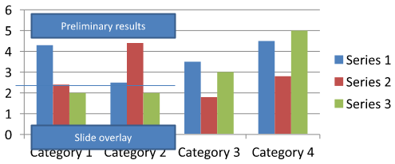

## **Επισκόπηση**

Αυτό το άρθρο εξηγεί πώς να μορφοποιήσετε διαγράμματα σε παρουσιάσεις PowerPoint χρησιμοποιώντας το Aspose.Slides. Δείχνει πώς να προσαρμόσετε βασικά στοιχεία διαγράμματος όπως άξονες, γραμμές πλέγματος, τίτλους, υπομνήματα, την περιοχή σχεδίασης και τις γεμίσματα τοίχου για να βελτιώσετε την εμφάνιση και την αναγνωσιμότητα των δεδομένων του διαγράμματος.

Επίσης, δείχνει πώς να ορίσετε ιδιότητες γραμματοσειράς για το κείμενο του διαγράμματος, να εφαρμόσετε προκαθορισμένες αριθμητικές μορφές στα δεδομένα του διαγράμματος και να ενεργοποιήσετε στρογγυλεμένες γωνίες για την περιοχή του διαγράμματος. Μαζί, αυτά τα παραδείγματα δείχνουν πώς να ελέγξετε τόσο το οπτικό στυλ όσο και την παρουσίαση των δεδομένων των διαγραμμάτων σε μια παρουσίαση.

Για ξεχωριστές γεμίσματα και περίγραμμα στα ανερχόμενα και καθοδικά διαστήματα, δείτε το [παράδειγμα διαγράμματος μετοχών](/slides/el/python-java/create-chart/#create-stock-charts).

## **Διαμόρφωση Στοιχείων Διαγράμματος**

Χρησιμοποιήστε το [Chart](https://reference.aspose.com/slides/python-java/aspose.slides/chart/) για να διαμορφώσετε τίτλους διαγράμματος, άξονες, γραμμές πλέγματος, υπομνήματα και την περιοχή σχεδίασης. Αυτό το παράδειγμα δημιουργεί ένα διάγραμμα γραμμής με δείκτες και προεπιλεγμένα δεδομένα, έπειτα εφαρμόζει ξεχωριστά στυλ κειμένου και γραμμής στους άξονες τιμών και κατηγοριών. Τα μεγέθη γραμματοσειράς και τα πλάτη των γραμμών ορίζονται σε points· οι ετικέτες κατηγοριών περιστρέφονται κατά 45 μοίρες.

Ο άξονας τιμών χρησιμοποιεί το [setNumberFormat](https://reference.aspose.com/slides/python-java/aspose.slides/axis/#setNumberFormat) ανεξάρτητα από τα κελιά προέλευσης. Η κλίμακά του εκτείνεται από -2 έως 15, με κύρια διαστήματα των 2 και δευτερεύοντα διαστήματα των 0.5. Το παράδειγμα επίσης συνδυάζει μορφοποίηση ποσοστών με το [setDisplayUnit](https://reference.aspose.com/slides/python-java/aspose.slides/axis/#setDisplayUnit) ορισμένο σε χιλιάδες, έτσι προσαρμόστε αυτές τις ρυθμίσεις στο νόημα και το μέγεθος των δεδομένων σας. Το υπόμνημα παραμένει έξω από την περιοχή σχεδίασης επειδή το [setOverlay](https://reference.aspose.com/slides/python-java/aspose.slides/legend/#setOverlay) καλείται με `False`. Τα γεμίσματα του πίσω τοίχου και του πεδίου ρυθμίζονται μέσω των [getBackWall](https://reference.aspose.com/slides/python-java/aspose.slides/chart/#getBackWall) και [getFloor](https://reference.aspose.com/slides/python-java/aspose.slides/chart/#getFloor), αλλά αυτές οι επιφάνειες είναι ορατές μόνο σε 3D διαγράμματα.

```python
import jpype
import asposeslides

if not jpype.isJVMStarted():
    jpype.startJVM()

from asposeslides.api import ChartType, DisplayUnitType, FillType, FontData, LineDashStyle, NullableBool, Presentation, PresetColor, SaveFormat, TickLabelPositionType

Color = jpype.JClass("java.awt.Color")

presentation = Presentation()
try:
    slide = presentation.getSlides().get_Item(0)

    chart = slide.getShapes().addChart(ChartType.LineWithMarkers, 50, 50, 500, 400)

    chart.setTitle(True)
    chart.getChartTitle().addTextFrameForOverriding("")
    chart_title = chart.getChartTitle().getTextFrameForOverriding().getParagraphs().get_Item(0).getPortions().get_Item(0)
    chart_title.setText("Sample Chart")
    chart_title.getPortionFormat().getFillFormat().setFillType(FillType.Solid)
    chart_title.getPortionFormat().getFillFormat().getSolidFillColor().setColor(Color.GRAY)
    chart_title.getPortionFormat().setFontHeight(20)
    chart_title.getPortionFormat().setFontBold(NullableBool.True_)
    chart_title.getPortionFormat().setFontItalic(NullableBool.True_)

    chart.getAxes().getVerticalAxis().getMajorGridLinesFormat().getLine().getFillFormat().setFillType(FillType.Solid)
    chart.getAxes().getVerticalAxis().getMajorGridLinesFormat().getLine().getFillFormat().getSolidFillColor().setColor(Color.BLUE)
    chart.getAxes().getVerticalAxis().getMajorGridLinesFormat().getLine().setWidth(5)
    chart.getAxes().getVerticalAxis().getMajorGridLinesFormat().getLine().setDashStyle(LineDashStyle.DashDot)

    chart.getAxes().getVerticalAxis().getMinorGridLinesFormat().getLine().getFillFormat().setFillType(FillType.Solid)
    chart.getAxes().getVerticalAxis().getMinorGridLinesFormat().getLine().getFillFormat().getSolidFillColor().setColor(Color.RED)
    chart.getAxes().getVerticalAxis().getMinorGridLinesFormat().getLine().setWidth(3)

    chart.getAxes().getVerticalAxis().setNumberFormatLinkedToSource(False)
    chart.getAxes().getVerticalAxis().setDisplayUnit(DisplayUnitType.Thousands)
    chart.getAxes().getVerticalAxis().setNumberFormat("0.0%")

    chart.getAxes().getVerticalAxis().setAutomaticMajorUnit(False)
    chart.getAxes().getVerticalAxis().setAutomaticMaxValue(False)
    chart.getAxes().getVerticalAxis().setAutomaticMinorUnit(False)
    chart.getAxes().getVerticalAxis().setAutomaticMinValue(False)

    chart.getAxes().getVerticalAxis().setMaxValue(15)
    chart.getAxes().getVerticalAxis().setMinValue(-2)
    chart.getAxes().getVerticalAxis().setMinorUnit(0.5)
    chart.getAxes().getVerticalAxis().setMajorUnit(2.0)

    value_axis_text = chart.getAxes().getVerticalAxis().getTextFormat().getPortionFormat()
    value_axis_text.setFontBold(NullableBool.True_)
    value_axis_text.setFontHeight(16)
    value_axis_text.setFontItalic(NullableBool.True_)
    value_axis_text.getFillFormat().setFillType(FillType.Solid)
    value_axis_text.getFillFormat().getSolidFillColor().setPresetColor(PresetColor.DarkGreen)
    value_axis_font = FontData("Times New Roman")
    value_axis_text.setLatinFont(value_axis_font)

    chart.getAxes().getVerticalAxis().setTitle(True)
    chart.getAxes().getVerticalAxis().getTitle().addTextFrameForOverriding("")
    value_axis_title = chart.getAxes().getVerticalAxis().getTitle().getTextFrameForOverriding().getParagraphs().get_Item(0).getPortions().get_Item(0)
    value_axis_title.setText("Primary Axis")
    value_axis_title.getPortionFormat().getFillFormat().setFillType(FillType.Solid)
    value_axis_title.getPortionFormat().getFillFormat().getSolidFillColor().setColor(Color.GRAY)
    value_axis_title.getPortionFormat().setFontHeight(20)
    value_axis_title.getPortionFormat().setFontBold(NullableBool.True_)
    value_axis_title.getPortionFormat().setFontItalic(NullableBool.True_)

    chart.getAxes().getHorizontalAxis().getMajorGridLinesFormat().getLine().getFillFormat().setFillType(FillType.Solid)
    category_grid_color = Color(0, 128, 0)
    chart.getAxes().getHorizontalAxis().getMajorGridLinesFormat().getLine().getFillFormat().getSolidFillColor().setColor(category_grid_color)
    chart.getAxes().getHorizontalAxis().getMajorGridLinesFormat().getLine().setWidth(5)

    chart.getAxes().getHorizontalAxis().getMinorGridLinesFormat().getLine().getFillFormat().setFillType(FillType.Solid)
    chart.getAxes().getHorizontalAxis().getMinorGridLinesFormat().getLine().getFillFormat().getSolidFillColor().setColor(Color.YELLOW)
    chart.getAxes().getHorizontalAxis().getMinorGridLinesFormat().getLine().setWidth(3)

    category_axis_text = chart.getAxes().getHorizontalAxis().getTextFormat().getPortionFormat()
    category_axis_text.setFontBold(NullableBool.True_)
    category_axis_text.setFontHeight(16)
    category_axis_text.setFontItalic(NullableBool.True_)
    category_axis_text.getFillFormat().setFillType(FillType.Solid)
    category_axis_text.getFillFormat().getSolidFillColor().setColor(Color.BLUE)
    category_axis_font = FontData("Arial")
    category_axis_text.setLatinFont(category_axis_font)

    chart.getAxes().getHorizontalAxis().setTitle(True)
    chart.getAxes().getHorizontalAxis().getTitle().addTextFrameForOverriding("")

    category_axis_title = chart.getAxes().getHorizontalAxis().getTitle().getTextFrameForOverriding().getParagraphs().get_Item(0).getPortions().get_Item(0)
    category_axis_title.setText("Sample Category")
    category_axis_title.getPortionFormat().getFillFormat().setFillType(FillType.Solid)
    category_axis_title.getPortionFormat().getFillFormat().getSolidFillColor().setColor(Color.GRAY)
    category_axis_title.getPortionFormat().setFontHeight(20)
    category_axis_title.getPortionFormat().setFontBold(NullableBool.True_)
    category_axis_title.getPortionFormat().setFontItalic(NullableBool.True_)

    chart.getAxes().getHorizontalAxis().setTickLabelPosition(TickLabelPositionType.Low)
    chart.getAxes().getHorizontalAxis().setTickLabelRotationAngle(45)

    legend_text = chart.getLegend().getTextFormat().getPortionFormat()
    legend_text.setFontBold(NullableBool.True_)
    legend_text.setFontHeight(16)
    legend_text.setFontItalic(NullableBool.True_)
    legend_text.getFillFormat().setFillType(FillType.Solid)
    legend_text.getFillFormat().getSolidFillColor().setPresetColor(PresetColor.DarkRed)

    chart.getLegend().setOverlay(False)

    chart.getBackWall().setThickness(1)
    chart.getBackWall().getFormat().getFill().setFillType(FillType.Solid)
    back_wall_color = Color(255, 165, 0)
    chart.getBackWall().getFormat().getFill().getSolidFillColor().setColor(back_wall_color)

    chart.getFloor().getFormat().getFill().setFillType(FillType.Solid)
    chart.getFloor().getFormat().getFill().getSolidFillColor().setColor(Color.RED)

    chart.getPlotArea().getFormat().getFill().setFillType(FillType.Solid)
    chart.getPlotArea().getFormat().getFill().getSolidFillColor().setPresetColor(PresetColor.LightCyan)

    presentation.save("FormattedChart_out.pptx", SaveFormat.Pptx)
finally:
    presentation.dispose()
```

## **Ορισμός Ιδιοτήτων Γραμματοσειράς για Διάγραμμα**

Ορίστε το προεπιλεγμένο μέγεθος γραμματοσειράς για το κείμενο του διαγράμματος μέσω του [Chart.getTextFormat](https://reference.aspose.com/slides/python-java/aspose.slides/chart/#getTextFormat). Το παράδειγμα δημιουργεί ένα συγκεντρωτικό στήλης διάγραμμα με γραμματοσειρά 20 σημείων και ενεργοποιεί ετικέτες τιμών για την πρώτη σειρά μέσω του [setShowValue](https://reference.aspose.com/slides/python-java/aspose.slides/datalabelformat/#setShowValue). Στοιχεία κειμένου με δικές τους ρητές ρυθμίσεις γραμματοσειράς μπορούν να παρακάμψουν το προεπιλεγμένο του διαγράμματος.

```python
import jpype
import asposeslides

if not jpype.isJVMStarted():
    jpype.startJVM()

from asposeslides.api import ChartType, Presentation, SaveFormat

presentation = Presentation()
try:
    slide = presentation.getSlides().get_Item(0)

    chart = slide.getShapes().addChart(ChartType.ClusteredColumn, 100, 100, 500, 400)
    chart.getTextFormat().getPortionFormat().setFontHeight(20)
    chart.getChartData().getSeries().get_Item(0).getLabels().getDefaultDataLabelFormat().setShowValue(True)

    presentation.save("FontPropertiesForChart.pptx", SaveFormat.Pptx)
finally:
    presentation.dispose()
```

## **Επαναχρησιμοποίηση Μορφοποίησης Πλαισίου Κειμένου για Υπόμνημα Διαγράμματος**

Για να ταιριάξετε ένα υπόμνημα με την επικεφαλίδα μιας διαφάνειας, ορίστε τη γραμματοσειρά της επικεφαλίδας μέσω του [getDefaultPortionFormat](https://reference.aspose.com/slides/python-java/aspose.slides/paragraphformat/#getDefaultPortionFormat) στο πρώτο παράγραφο. Καλέστε το [copyFrom](https://reference.aspose.com/slides/python-java/aspose.slides/charttextformat/#copyFrom) στη μορφή που επιστρέφεται από το [getTextFormat](https://reference.aspose.com/slides/python-java/aspose.slides/legend/#getTextFormat) του υπομνήματος. Αυτό αντιγράφει τις ρυθμίσεις του πλαισίου κειμένου, τη μορφοποίηση του πρώτου παραγράφου και τις προεπιλεγμένες ιδιότητες γραμματοσειράς εκείνου του παραγράφου. Η μορφοποίηση που εφαρμόζεται απευθείας σε μεμονωμένα τμήματα ή σε μεταγενέστερα παραγράφους παραμένει τοπική στην πηγή.

Το παράδειγμα χρησιμοποιεί μια έντονη, 26‑σημείων επικεφαλίδα Calibri σε σκούρο μπλε ως πρότυπο. Μετά το στυλ του υπομνήματος, καλεί το [copyTo](https://reference.aspose.com/slides/python-java/aspose.slides/charttextformat/#copyTo) για να εφαρμόσει την ίδια μορφοποίηση σε ξεχωριστή λεζάντα.

```python
import jpype
import asposeslides

if not jpype.isJVMStarted():
    jpype.startJVM()

from asposeslides.api import ChartType, FillType, FontData, LegendPositionType, NullableBool, Presentation, SaveFormat, ShapeType, StyleType

Color = jpype.JClass("java.awt.Color")

presentation = Presentation()
try:
    shapes = presentation.getSlides().get_Item(0).getShapes()
    
    heading = shapes.addAutoShape(ShapeType.Rectangle, 40, 20, 640, 40, False)
    source_text_frame = heading.addTextFrame("Quarterly sales")
    paragraph = source_text_frame.getParagraphs().get_Item(0)
    font = paragraph.getParagraphFormat().getDefaultPortionFormat()
    font.setLatinFont(FontData("Calibri"))
    font.setFontHeight(26)
    font.setFontBold(NullableBool.True_)
    font.getFillFormat().setFillType(FillType.Solid)
    font.getFillFormat().getSolidFillColor().setColor(Color(32, 64, 96))

    chart = shapes.addChart(ChartType.ClusteredColumn, 40, 75, 640, 360)
    chart.setStyle(StyleType.Style3)
    workbook = chart.getChartData().getChartDataWorkbook()
    for column, series_name in enumerate(("Retail", "Online", "Wholesale"), start=1):
        workbook.getCell(0, 0, column).setValue(series_name)
    for quarter in range(1, 5):
        workbook.getCell(0, quarter, 0).setValue(f"Q{quarter}")

    chart.setLegend(True)
    legend = chart.getLegend()
    legend.setPosition(LegendPositionType.Bottom)
    legend_format = legend.getTextFormat()
    legend_format.copyFrom(source_text_frame)

    caption = shapes.addAutoShape(ShapeType.Rectangle, 40, 460, 640, 40, False)
    caption_text_frame = caption.addTextFrame("Sales in millions of dollars")
    legend_format.copyTo(caption_text_frame)

    presentation.save("legend-formatting.pptx", SaveFormat.Pptx)
finally:
    presentation.dispose()
```

Στην αποθηκευμένη παρουσίαση, το υπόμνημα και η λεζάντα ταιριάζουν με την επικεφαλίδα σε μέγεθος, πάχος και χρώμα. Το υπόμνημα εξακολουθεί να εμφανίζει τα ονόματα των σειρών, και η λεζάντα διατηρεί το δικό της κείμενο. Εάν ένα τμήμα στη λεζάντα έχει ήδη ρητό μέγεθος γραμματοσειράς, αυτό το μέγεθος έχει προτεραιότητα έναντι του αντιγραμμένου προεπιλεγμένου παραγράφου.

| Πριν από την αντιγραφή | Μετά την αντιγραφή |
| --- | --- |
|  |  |

## **Ορισμός Αριθμητικής Μορφής**

Χρησιμοποιήστε το [ChartDataCell.setPresetNumberFormat](https://reference.aspose.com/slides/python-java/aspose.slides/chartdatacell/#setPresetNumberFormat) για να εφαρμόσετε ενσωματωμένη αριθμητική μορφή στα κελιά του βιβλίου εργασίας του διαγράμματος. Αυτό το παράδειγμα δημιουργεί ένα συγκεντρωτικό στήλης διάγραμμα με προεπιλεγμένα δεδομένα από κελιά και εφαρμόζει δείκτη μορφής 10 (`0.00%`) σε κάθε κελί τιμής σειράς. Αυτό αλλάζει τον τρόπο εμφάνισης των τιμών στο βιβλίο εργασίας χωρίς να αλλάζει τους υποκείμενους αριθμούς· για παράδειγμα, το 0.25 εμφανίζεται ως 25,00%. Οι μορφές των αξόνων και των ετικετών δεδομένων μπορούν να ρυθμιστούν ξεχωριστά.

```python
import jpype
import asposeslides

if not jpype.isJVMStarted():
    jpype.startJVM()

from asposeslides.api import ChartType, Presentation, SaveFormat

presentation = Presentation()
try:
    slide = presentation.getSlides().get_Item(0)

    chart = slide.getShapes().addChart(ChartType.ClusteredColumn, 50, 50, 500, 400)
    chart_series_collection = chart.getChartData().getSeries()

    for chart_series in chart_series_collection:
        for data_point in chart_series.getDataPoints():
            data_point.getValue().getAsCell().setPresetNumberFormat(jpype.JByte(10))  # 0,00%

    presentation.save("PresetNumberFormat_out.pptx", SaveFormat.Pptx)
finally:
    presentation.dispose()
```

Ο παρακάτω πίνακας παραθέτει τους ενσωματωμένους δείκτες αριθμητικής μορφής με αντιπροσωπευτικές μορφές Excel για τη γλώσσα English (United States). Οι ακριβείς συμβολοσειρές μορφής και η εμφάνισή τους μπορεί να διαφέρουν ανά εφαρμογή και γλώσσα, ιδιαίτερα για νόμισμα και ημερομηνίες. Ορισμένες μορφές Excel διαφέρουν επίσης από τα προεπιλεγμένα στο πρότυπο OOXML, όπως περιγράφεται στις [σημειώσεις υλοποίησης αριθμητικών μορφών της Microsoft](https://learn.microsoft.com/en-us/openspecs/office_standards/ms-oi29500/17d11129-219b-4e2c-88db-45844d21e528).

| Δείκτης | Μορφή |
| --- | --- |
| 0 | `General` |
| 1 | `0` |
| 2 | `0.00` |
| 3 | `#,##0` |
| 4 | `#,##0.00` |
| 5 | `"$"#,##0_);("$"#,##0)` |
| 6 | `"$"#,##0_);[Red]("$"#,##0)` |
| 7 | `"$"#,##0.00_);("$"#,##0.00)` |
| 8 | `"$"#,##0.00_);[Red]("$"#,##0.00)` |
| 9 | `0%` |
| 10 | `0.00%` |
| 11 | `0.00E+00` |
| 12 | `# ?/?` |
| 13 | `# ??/??` |
| 14 | `m/d/yyyy` |
| 15 | `d-mmm-yy` |
| 16 | `d-mmm` |
| 17 | `mmm-yy` |
| 18 | `h:mm AM/PM` |
| 19 | `h:mm:ss AM/PM` |
| 20 | `h:mm` |
| 21 | `h:mm:ss` |
| 22 | `m/d/yyyy h:mm` |
| 37 | `#,##0_);(#,##0)` |
| 38 | `#,##0_);[Red](#,##0)` |
| 39 | `#,##0.00_);(#,##0.00)` |
| 40 | `#,##0.00_);[Red](#,##0.00)` |
| 41 | `_(* #,##0_);_(* (#,##0);_(* "-"_);_(@_)` |
| 42 | `_("$"* #,##0_);_("$"* (#,##0);_("$"* "-"_);_(@_)` |
| 43 | `_(* #,##0.00_);_(* (#,##0.00);_(* "-"??_);_(@_)` |
| 44 | `_("$"* #,##0.00_);_("$"* (#,##0.00);_("$"* "-"??_);_(@_)` |
| 45 | `mm:ss` |
| 46 | `[h]:mm:ss` |
| 47 | `mm:ss.0` |
| 48 | `##0.0E+0` |
| 49 | `@` |

## **Ορισμός Στρογγυλεμένων Άκρων Περιοχής Διαγράμματος**

Καλέστε το [Chart.setRoundedCorners](https://reference.aspose.com/slides/python-java/aspose.slides/chart/#setRoundedCorners) με `True` για να στρογγυλοποιήσετε τις γωνίες της περιοχής του διαγράμματος. Το παράδειγμα δημιουργεί ένα συγκεντρωτικό στήλης διάγραμμα και χρησιμοποιεί το [getLineFormat](https://reference.aspose.com/slides/python-java/aspose.slides/shape/#getLineFormat) για να δώσει στο περίγραμμά του ένα ενιαίο γκρι χρώμα και στυλ μονής γραμμής πριν αποθηκεύσει την παρουσίαση.

```python
import jpype
import asposeslides

if not jpype.isJVMStarted():
    jpype.startJVM()

from asposeslides.api import ChartType, FillType, LineStyle, Presentation, SaveFormat

Color = jpype.JClass("java.awt.Color")

presentation = Presentation()
try:
    slide = presentation.getSlides().get_Item(0)

    chart = slide.getShapes().addChart(ChartType.ClusteredColumn, 20, 100, 600, 400)
    chart.getLineFormat().getFillFormat().setFillType(FillType.Solid)
    chart.getLineFormat().getFillFormat().getSolidFillColor().setColor(Color.GRAY)
    chart.getLineFormat().setStyle(LineStyle.Single)
    chart.setRoundedCorners(True)

    presentation.save("out.pptx", SaveFormat.Pptx)
finally:
    presentation.dispose()
```

## **Επεξεργασία Υφιστάμενων Σχολίων Διαγράμματος**

Ένα διάγραμμα μπορεί να περιέχει προσαρμοσμένα σχήματα, όπως μια σχολίαση κειμένου που εξηγεί την κατάσταση μιας αναφοράς. Πρόσβαση σε αυτά τα σχήματα μέσω του [Chart.getUserShapes](https://reference.aspose.com/slides/python-java/aspose.slides/chart/#getUserShapes). Η συλλογή που επιστρέφεται από το [getShapes](https://reference.aspose.com/slides/python-java/aspose.slides/groupshape/#getShapes) περιέχει τα σχήματα που ανήκουν στο διάγραμμα.

Ένα απλό πλαίσιο κειμένου τοποθετημένο πάνω σε ένα διάγραμμα ανήκει στη διαφάνεια, ακόμη και αν φαίνεται να είναι μέρος του διαγράμματος. Η επανάληψη μέσω του [Slide.getShapes](https://reference.aspose.com/slides/python-java/aspose.slides/baseslide/#getShapes) βρίσκει το διάγραμμα και τα κανονικά σχήματα της διαφάνειας, αλλά δεν απαριθμεί τα μεμονωμένα σχήματα μέσα στο διάγραμμα. Οι τίτλοι διαγράμματος και οι ετικέτες δεδομένων είναι ξεχωριστά στοιχεία του διαγράμματος, όχι προσαρμοσμένες σχολιαστικές σημειώσεις σε αυτήν τη συλλογή.

Κατεβάστε το [chart-annotations.pptx](chart-annotations.pptx) και τοποθετήστε το στον κατάλογο εργασίας της εφαρμογής. Η πρώτη του διαφάνεια περιέχει ένα διάγραμμα με μια μη ομαδοποιημένη σημείωση που διαβάζει «Προκαταρκτικά αποτελέσματα», μια γραμμή που ανήκει στο διάγραμμα, και ένα απλό πλαίσιο κειμένου στη διαφάνεια που διαβάζει «Επικάλυψη διαφάνειας». Το παράδειγμα βρίσκει το πρώτο διάγραμμα σε αυτή τη διαφάνεια και αλλάζει τη σημείωση σε «Τελικά αποτελέσματα» όταν η αναφορά είναι έτοιμη για δημοσίευση. Ελέγχει για κενή συλλογή και επεξεργάζεται μόνο ένα [AutoShape](https://reference.aspose.com/slides/python-java/aspose.slides/autoshape/) με πλαίσιο κειμένου διαφορετικό από `None` που επιστρέφεται από το [getTextFrame](https://reference.aspose.com/slides/python-java/aspose.slides/autoshape/#getTextFrame) και το αναμενόμενο κείμενο.

```python
import jpype
import asposeslides

if not jpype.isJVMStarted():
    jpype.startJVM()

from asposeslides.api import AutoShape, Chart, Presentation, SaveFormat

presentation = Presentation("chart-annotations.pptx")
try:
    slide = presentation.getSlides().get_Item(0)

    chart = None
    for shape in slide.getShapes():
        if isinstance(shape, Chart):
            chart = shape
            break

    if chart is None or chart.getUserShapes().getShapes().size() == 0:
        print("No chart or chart-owned shapes found.")
    else:
        updated = False
        for shape in chart.getUserShapes().getShapes():
            if isinstance(shape, AutoShape):
                text_frame = shape.getTextFrame()
                if text_frame is not None and text_frame.getText() == "Preliminary results":
                    text_frame.setText("Final results")
                    updated = True
                    break

        if updated:
            presentation.save("chart-annotations-updated.pptx", SaveFormat.Pptx)
        else:
            print("No matching text annotation found.")
finally:
    presentation.dispose()
```

Η γραμμή και το πλαίσιο κειμένου της διαφάνειας παραμένουν αμετάβλητα. Οι παρακάτω εικόνες δείχνουν την είσοδο και το αποθηκευμένο, ξανά ανοικτό αποτέλεσμα:

| Πριν την επεξεργασία | Μετά την επεξεργασία |
| --- | --- |
|  |  |

{}
Το παράδειγμα ελέγχει μόνο τα σχήματα του διαγράμματος στο ανώτερο επίπεδο. Εάν μια σημείωση βρίσκεται μέσα σε ένα [GroupShape](https://reference.aspose.com/slides/python-java/aspose.slides/groupshape/), ελέγξτε επίσης τη συλλογή [getShapes](https://reference.aspose.com/slides/python-java/aspose.slides/groupshape/#getShapes) του συγκεκριμένου γκρουπ. Επαναλάβετε αυτό αναδρομικά για τα ένθετα γκρουπ, εφαρμόζοντας τους ίδιους ελέγχους κειμένου στα παιδικά σχήματά τους. Ένα γκρουπ από μόνο του είναι ένας δοχείο· μην το θεωρείτε ως πλαίσιο κειμένου.
{}

## **FAQ**

**Μπορώ να ορίσω ημιδιαφανή γεμίσματα για στήλες/περιοχές ενώ διατηρώ το περίγραμμα αδιαφανές;**

Ναι. Η διαφάνεια του γεμίσματος και το περίγραμμα ρυθμίζονται ξεχωριστά. Αυτό είναι χρήσιμο για τη βελτίωση της αναγνωσιμότητας του πλέγματος και των δεδομένων σε πυκνές απεικονίσεις.

**Πώς μπορώ να αντιμετωπίσω τις ετικέτες δεδομένων όταν επικαλύπτονται;**

Μειώστε το μέγεθος της γραμματοσειράς, απενεργοποιήστε μη απαραίτητα στοιχεία ετικετών (π.χ., κατηγορίες), προσαρμόστε τη θέση της ετικέτας, εμφανίστε ετικέτες μόνο για επιλεγμένα σημεία αν χρειάζεται, ή αλλάξτε τη μορφή σε «τιμή + υπόμνημα».

**Μπορώ να εφαρμόσω διαβάσεις ή μοτίβα γεμίσματος στις σειρές;**

Ναι. Οι σειρές υποστηρίζουν γεμίσματα στερεά, διαβαθμισμένα και μοτίβα. Στην πράξη, χρησιμοποιήστε διαβάσεις με φειδώ και αποφύγετε συνδυασμούς που μειώνουν την αντίθεση με το πλέγμα και το κείμενο.