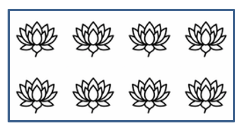

## **Εισαγωγή**

Διαμορφώστε σχήματα στο PowerPoint προσαρμόζοντας τις γραμμές περιγράμματος, τις γεμίσεις και τα εφέ. Το Aspose.Slides for Python via Java σας επιτρέπει να ελέγχετε αυτές τις ρυθμίσεις προγραμματιστικά, συμπεριλαμβανομένης της διαφάνειας, της περιστροφής και της 3D μορφοποίησης.


Το Aspose.Slides for Python via Java παρέχει κλάσεις και μεθόδους που σας επιτρέπουν να μορφοποιείτε σχήματα χρησιμοποιώντας τις ίδιες επιλογές που διατίθενται στο PowerPoint.

## **Μορφοποίηση Γραμμών**

Χρησιμοποιήστε [Shape.getLineFormat](https://reference.aspose.com/slides/python-java/aspose.slides/shape/#getLineFormat) για να ελέγξετε το περίγραμμα ενός σχήματος. Αυτό το παράδειγμα δημιουργεί ένα ακατέργαστο ορθογώνιο με μπλε, διακεκομμένο περίγραμμα. Το [LineFormat.setStyle](https://reference.aspose.com/slides/python-java/aspose.slides/lineformat/#setStyle) επιλέγει σύνθετη γραμμή παχύ‑λεπτή, ενώ το [LineFormat.setWidth](https://reference.aspose.com/slides/python-java/aspose.slides/lineformat/#setWidth) θέτει το πλάτος της σε 7 σημεία και το [LineFormat.setDashStyle](https://reference.aspose.com/slides/python-java/aspose.slides/lineformat/#setDashStyle) επιλέγει το μοτίβο διακεκομμένης γραμμής.

```python
import jpype
import asposeslides

if not jpype.isJVMStarted():
    jpype.startJVM()

from asposeslides.api import FillType, LineDashStyle, LineStyle, Presentation, SaveFormat, ShapeType
from java.awt import Color

presentation = Presentation()
try:
    slide = presentation.getSlides().get_Item(0)

    shape = slide.getShapes().addAutoShape(ShapeType.Rectangle, 50, 50, 150, 75)
    shape.getFillFormat().setFillType(FillType.NoFill)
    shape.getLineFormat().setStyle(LineStyle.ThickThin)
    shape.getLineFormat().setWidth(7)
    shape.getLineFormat().setDashStyle(LineDashStyle.Dash)
    shape.getLineFormat().getFillFormat().setFillType(FillType.Solid)
    shape.getLineFormat().getFillFormat().getSolidFillColor().setColor(Color.BLUE)

    presentation.save("formatted_lines.pptx", SaveFormat.Pptx)
finally:
    presentation.dispose()
```

Το αποτέλεσμα:


### **Ορισμός Προσαρμοσμένων Μοτίβων Διακεκομμένων Γραμμών**

Χρησιμοποιήστε [LineFormat.setCustomDashPattern](https://reference.aspose.com/slides/python-java/aspose.slides/lineformat/#setCustomDashPattern) όταν τα προεπιλεγμένα στυλ γραμμής δεν παρέχουν τα μήκη και τα κενά που χρειάζεστε, για παράδειγμα για εξατομικευμένα περιγράμματα ή τεχνικά διαγράμματα. Η ανάθεση ενός μοτίβου μετατρέπει αυτόματα το στυλ διακεκομμένης γραμμής σε [LineDashStyle.Custom](https://reference.aspose.com/slides/python-java/aspose.slides/linedashstyle/).

Οι καταχωρήσεις του πίνακα εναλλάσσονται μεταξύ μηκών διακεκομμένων και κενών, αρχίζοντας με διακεκομμένο. Κάθε τιμή είναι πολλαπλάσιο του πλάτους της γραμμής: `[4, 2]` σε πλάτος 3 σημείων παράγει διακεκομμένο 12 σημείων και κενό 6 σημείων. Χρησιμοποιήστε ζεύγη πεπερασμένων, μη αρνητικών τιμών για να ορίσετε πλήρη τμήματα διακεκομμένων‑και‑κενών. Το παράδειγμα χρησιμοποιεί θετικές τιμές ώστε κάθε διακεκομμένο και κενό να είναι ορατά.

Αυτό το παράδειγμα δημιουργεί πέντε μπλε γραμμές με το ίδιο μήκος και επίπεδα άκρα. Οι πρώτες τρεις συγκρίνουν μοτίβα σε πλάτος 3 σημείων. Η τέταρτη επαναλαμβάνει το πρώτο μοτίβο σε διπλάσιο πλάτος, διπλασιάζοντας τόσο τα διακεκομμένα όσο και τα κενά. Η πέμπτη αλλάζει από προσαρμοσμένο μοτίβο σε στερεή γραμμή.

```python
import jpype
import asposeslides

if not jpype.isJVMStarted():
    jpype.startJVM()

from asposeslides.api import FillType, LineArrowheadStyle, LineCapStyle, LineDashStyle, Presentation, SaveFormat, ShapeType, SlideSizeScaleType
from java.awt import Color

presentation = Presentation()
try:
    presentation.getSlideSize().setSize(600, 300, SlideSizeScaleType.DoNotScale)
    slide = presentation.getSlides().get_Item(0)

    patterns = [
        [4, 2],
        [1, 2],
        [6, 2, 1, 2],
        [4, 2],
        [4, 2]
    ]

    for i, pattern in enumerate(patterns):
        line = slide.getShapes().addAutoShape(ShapeType.Line, 50, 50 + i * 50, 500, 0)
        line.getLineFormat().setWidth(6 if i == 3 else 3)
        line.getLineFormat().getFillFormat().setFillType(FillType.Solid)
        color = Color(0, 0, 139)
        line.getLineFormat().getFillFormat().getSolidFillColor().setColor(color)
        line.getLineFormat().setCapStyle(LineCapStyle.Flat)
        line.getLineFormat().setBeginArrowheadStyle(LineArrowheadStyle.None_)
        line.getLineFormat().setEndArrowheadStyle(LineArrowheadStyle.None_)
        line.getLineFormat().setCustomDashPattern(jpype.JArray(jpype.JFloat)(pattern))

    # Επιστρέψτε την τελευταία γραμμή σε στερεό στυλ.
    slide.getShapes().get_Item(4).getLineFormat().setDashStyle(LineDashStyle.Solid)

    presentation.save("custom_dash_patterns.pptx", SaveFormat.Pptx)
finally:
    presentation.dispose()
```

Για να επιστρέψετε σε προεπιλεγμένο διακεκομμένο στυλ, περάστε το [LineDashStyle.Dash](https://reference.aspose.com/slides/python-java/aspose.slides/linedashstyle/) στο [LineFormat.setDashStyle](https://reference.aspose.com/slides/python-java/aspose.slides/lineformat/#setDashStyle). Το επιλεγμένο στυλ ελέγχει την εμφάνιση της γραμμής.

Το αποτέλεσμα στο PowerPoint, από πάνω προς τα κάτω: **{4, 2}, 3 pt**· **{1, 2}, 3 pt**· **{6, 2, 1, 2}, 3 pt**· **{4, 2}, 6 pt**· και **Solid, 3 pt**.


### **Ορισμός Άκρων Γραμμής**

Χρησιμοποιήστε [LineFormat.setCapStyle](https://reference.aspose.com/slides/python-java/aspose.slides/lineformat/#setCapStyle) για να ορίσετε τα άκρα μιας ανοικτής γραμμής. Η κλάση [LineCapStyle](https://reference.aspose.com/slides/python-java/aspose.slides/linecapstyle/) παρέχει τρία σαφή στυλ άκρων:

- `Flat`: Η γραμμή σταματά στο άκρο.
- `Round`: Ένα ημικυκλικό άκρο επεκτείνεται πέρα από το άκρο κατά το ήμισυ του πλάτους της γραμμής.
- `Square`: Ένα τετράγωνο άκρο επεκτείνεται πέρα από το άκρο κατά το ήμισυ του πλάτους της γραμμής.

Η κλάση περιλαμβάνει επίσης το `NotDefined`, που σημαίνει ότι δεν έχει οριστεί ρητά κάποιο στυλ άκρου.

Τα άκρα διαφέρουν από τα βέλη, που προσθέτουν σύμβολα στα άκρα της γραμμής, και από τις συνδέσεις, που ελέγχουν τις γωνίες μεταξύ τμημάτων γραμμής. Αυτό το παράδειγμα απενεργοποιεί τα βέλη μέσω των [LineFormat.setBeginArrowheadStyle](https://reference.aspose.com/slides/python-java/aspose.slides/lineformat/#setBeginArrowheadStyle) και [LineFormat.setEndArrowheadStyle](https://reference.aspose.com/slides/python-java/aspose.slides/lineformat/#setEndArrowheadStyle) ώστε να συγκριθούν μόνο τα σχήματα των άκρων.

Το παρακάτω παράδειγμα δημιουργεί τρεις οριζόντιες γραμμές, 20 σημείων πλάτος, που είναι κατά τρία άλλα πράγματα ίδιες. Από πάνω προς τα κάτω, χρησιμοποιούν επίπεδα, στρογγυλά και τετράγωνα άκρα. Τα άκρα τους έχουν τις ίδιες οριζόντιες συντεταγμένες· τα στρογγυλά και τετράγωνα άκρα επεκτείνονται 10 σημεία πέρα από κάθε άκρο.

```python
import jpype
import asposeslides

if not jpype.isJVMStarted():
    jpype.startJVM()

from asposeslides.api import FillType, LineArrowheadStyle, LineCapStyle, LineDashStyle, Presentation, SaveFormat, ShapeType, SlideSizeScaleType
from java.awt import Color

presentation = Presentation()
try:
    presentation.getSlideSize().setSize(500, 240, SlideSizeScaleType.DoNotScale)
    slide = presentation.getSlides().get_Item(0)

    cap_styles = [LineCapStyle.Flat, LineCapStyle.Round, LineCapStyle.Square]

    for i, cap_style in enumerate(cap_styles):
        line = slide.getShapes().addAutoShape(ShapeType.Line, 100, 50 + i * 70, 300, 0)
        line.getLineFormat().setWidth(20)
        line.getLineFormat().getFillFormat().setFillType(FillType.Solid)
        color = Color(0, 0, 139)
        line.getLineFormat().getFillFormat().getSolidFillColor().setColor(color)
        line.getLineFormat().setDashStyle(LineDashStyle.Solid)
        line.getLineFormat().setCapStyle(cap_style)
        line.getLineFormat().setBeginArrowheadStyle(LineArrowheadStyle.None_)
        line.getLineFormat().setEndArrowheadStyle(LineArrowheadStyle.None_)

    presentation.save("line_caps.pptx", SaveFormat.Pptx)
finally:
    presentation.dispose()
```

Το αποτέλεσμα στο PowerPoint, από πάνω προς τα κάτω: **Flat**, **Round**, και **Square**.


## **Εφαρμογή Σχεδίου Εφέ σε Γραμμές Σχήματος**

Ένα εφέ σχεδίου κάνει μια γραμμή σχήματος να φαίνεται χειροποίητη. Χρησιμοποιήστε [Shape.getLineFormat](https://reference.aspose.com/slides/python-java/aspose.slides/shape/#getLineFormat) για να προσπελάσετε τις ρυθμίσεις της γραμμής, [LineFormat.getSketchFormat](https://reference.aspose.com/slides/python-java/aspose.slides/lineformat/#getSketchFormat) για να προσπελάσετε τις ρυθμίσεις του σχεδίου, και [SketchFormat.setSketchType](https://reference.aspose.com/slides/python-java/aspose.slides/sketchformat/#setSketchType) για να επιλέξετε μια τιμή από την κλάση [LineSketchType](https://reference.aspose.com/slides/python-java/aspose.slides/linesketchtype/).

Ο παρακάτω κώδικας Python δείχνει πώς να εφαρμόσετε το εφέ [LineSketchType.Curved](https://reference.aspose.com/slides/python-java/aspose.slides/linesketchtype/) , να διαβάσετε την ρητά ορισμένη τιμή, και να αφαιρέσετε το εφέ με το [LineSketchType.None_](https://reference.aspose.com/slides/python-java/aspose.slides/linesketchtype/):

```python
import jpype
import asposeslides

if not jpype.isJVMStarted():
    jpype.startJVM()

from asposeslides.api import LineSketchType, Presentation, ShapeType

presentation = Presentation()
try:
    slide = presentation.getSlides().get_Item(0)

    shape = slide.getShapes().addAutoShape(ShapeType.Rectangle, 50, 50, 200, 100)

    sketch_format = shape.getLineFormat().getSketchFormat()
    sketch_format.setSketchType(LineSketchType.Curved)
    explicit_sketch_type = sketch_format.getSketchType()
    print("Explicit sketch type:", explicit_sketch_type)
    sketch_format.setSketchType(LineSketchType.None_)
finally:
    presentation.dispose()
```

Η τιμή που επιστρέφει το [SketchFormat.getSketchType](https://reference.aspose.com/slides/python-java/aspose.slides/sketchformat/#getSketchType) αντιπροσωπεύει τη ρύθμιση που έχει οριστεί άμεσα στο σχήμα. Εάν η μορφοποίηση της γραμμής μπορεί να κληρονομηθεί από ένα θέμα, μια κύρια διαφάνεια ή μια διαφάνεια διάταξης, χρησιμοποιήστε το [LineFormat.getEffective](https://reference.aspose.com/slides/python-java/aspose.slides/lineformat/#getEffective) και διαβάστε τον τύπο σχεδίου από την αποτελεσματική μορφοποίηση γραμμής που επιστρέφεται, όπως φαίνεται παρακάτω. Η αποτελεσματική τιμή αντικατοπτρίζει τη μορφοποίηση που εφαρμόζεται πραγματικά μόλις λυθεί η κληρονομικότητα. Το παράδειγμα απαιτεί μια υπάρχουσα παρουσίαση με τουλάχιστον ένα σχήμα στην πρώτη διαφάνεια και εκτυπώνει και τις δύο τιμές:

```python
import jpype
import asposeslides

if not jpype.isJVMStarted():
    jpype.startJVM()

from asposeslides.api import Presentation

presentation = Presentation("presentation.pptx")
try:
    shape = presentation.getSlides().get_Item(0).getShapes().get_Item(0)

    line_format = shape.getLineFormat()
    explicit_sketch_type = line_format.getSketchFormat().getSketchType()
    effective_line_format = line_format.getEffective()
    effective_sketch_type = effective_line_format.getSketchFormat().getSketchType()

    print("Explicit sketch type:", explicit_sketch_type)
    print("Effective sketch type:", effective_sketch_type)
finally:
    presentation.dispose()
```

## **Μορφοποίηση Στυλ Συνδέσεων**

Εδώ είναι οι τρεις επιλογές τύπου σύνδεσης:

* Round
* Miter
* Bevel

Το στυλ σύνδεσης ελέγχει πώς δύο τμήματα περιγράμματος συναντώνται σε γωνία. Χρησιμοποιήστε **Round** για στρογγυλεμένες γωνίες, **Miter** για αιχμηρές γωνίες ή **Bevel** για επίπεδες γωνίες.


Αυτό το παράδειγμα δημιουργεί τρία μαύρα ορθογώνια με μπλε περιγράμματα πλάτους 15 σημείων. Χρησιμοποιεί το [LineFormat.setJoinStyle](https://reference.aspose.com/slides/python-java/aspose.slides/lineformat/#setJoinStyle) για να ορίσει τις τιμές miter, bevel και round της κλάσης [LineJoinStyle](https://reference.aspose.com/slides/python-java/aspose.slides/linejoinstyle/), αντίστοιχα, ώστε να συγκρίνει πώς σχεδιάζονται οι γωνίες.

```python
import jpype
import asposeslides

if not jpype.isJVMStarted():
    jpype.startJVM()

from asposeslides.api import FillType, LineJoinStyle, Presentation, SaveFormat, ShapeType
from java.awt import Color

presentation = Presentation()
try:
    slide = presentation.getSlides().get_Item(0)

    miter_shape = slide.getShapes().addAutoShape(ShapeType.Rectangle, 20, 20, 150, 75)
    bevel_shape = slide.getShapes().addAutoShape(ShapeType.Rectangle, 210, 20, 150, 75)
    round_shape = slide.getShapes().addAutoShape(ShapeType.Rectangle, 20, 135, 150, 75)

    miter_shape.getFillFormat().setFillType(FillType.Solid)
    miter_shape.getFillFormat().getSolidFillColor().setColor(Color.BLACK)
    bevel_shape.getFillFormat().setFillType(FillType.Solid)
    bevel_shape.getFillFormat().getSolidFillColor().setColor(Color.BLACK)
    round_shape.getFillFormat().setFillType(FillType.Solid)
    round_shape.getFillFormat().getSolidFillColor().setColor(Color.BLACK)

    miter_shape.getLineFormat().setWidth(15)
    bevel_shape.getLineFormat().setWidth(15)
    round_shape.getLineFormat().setWidth(15)

    miter_shape.getLineFormat().getFillFormat().setFillType(FillType.Solid)
    miter_shape.getLineFormat().getFillFormat().getSolidFillColor().setColor(Color.BLUE)
    bevel_shape.getLineFormat().getFillFormat().setFillType(FillType.Solid)
    bevel_shape.getLineFormat().getFillFormat().getSolidFillColor().setColor(Color.BLUE)
    round_shape.getLineFormat().getFillFormat().setFillType(FillType.Solid)
    round_shape.getLineFormat().getFillFormat().getSolidFillColor().setColor(Color.BLUE)

    miter_shape.getLineFormat().setJoinStyle(LineJoinStyle.Miter)
    bevel_shape.getLineFormat().setJoinStyle(LineJoinStyle.Bevel)
    round_shape.getLineFormat().setJoinStyle(LineJoinStyle.Round)

    miter_shape.getTextFrame().setText("Miter Join Style")
    bevel_shape.getTextFrame().setText("Bevel Join Style")
    round_shape.getTextFrame().setText("Round Join Style")

    presentation.save("join_styles.pptx", SaveFormat.Pptx)
finally:
    presentation.dispose()
```

### **Περιορισμός Συνδέσεων Miter σε Αιχμηρές Γωνίες**

Χρησιμοποιήστε το [LineFormat.setMiterLimit](https://reference.aspose.com/slides/python-java/aspose.slides/lineformat/#setMiterLimit) μαζί με το [LineFormat.setJoinStyle](https://reference.aspose.com/slides/python-java/aspose.slides/lineformat/#setJoinStyle) ορισμένο σε [LineJoinStyle.Miter](https://reference.aspose.com/slides/python-java/aspose.slides/linejoinstyle/) για να περιορίσετε το πόσο μακριά μπορεί να εκτείνεται μια αιχμηρή γωνία.

Το όριο είναι ένας λόγος της απόστασης μεταξύ των εσωτερικών και εξωτερικών γωνιών της σύνδεσης προς το πλάτος της γραμμής. Για παράδειγμα, μια τιμή `8` επιτρέπει μήκος μιτερ μέχρι και οκτώ φορές το πλάτος της γραμμής· δεν είναι μέτρηση σε σημεία. Εάν η γωνία ξεπερνούσε το όριο, το PowerPoint χρησιμοποιεί επίπεδη σύνδεση σε εκείνη τη γωνία. Μεγαλύτερο όριο επιτρέπει πιο αιχμηρά σημεία. Η ρύθμιση επηρεάζει μόνο συνδέσεις miter και η αλλαγή της δεν έχει ορατό αποτέλεσμα όταν η γωνία παραμένει εντός και των δύο ορίων.

Αυτό το παράδειγμα δημιουργεί δύο ίσα, ακατέργαστα τρίγωνα με περιγράμματα πλάτους 20 σημείων. Το αριστερό τρίγωνο χρησιμοποιεί όριο `2`, το δεξιό `8`. Κάθε τρίγωνο είναι 80 σημείων πλατύ και 160 σημείων ψηλό, δίνοντας στην επάνω γωνία λόγο μιτερ‑πλάτους περίπου `4.12`. Συνεπώς, το PowerPoint δημιουργεί επίπεδη κορυφή στο αριστερό τρίγωνο και διατηρεί την αιχμηρή κορυφή στο δεξιό.

```python
import jpype
import asposeslides

if not jpype.isJVMStarted():
    jpype.startJVM()

from asposeslides.api import FillType, LineJoinStyle, Presentation, SaveFormat, ShapeType, SlideSizeScaleType
from java.awt import Color

presentation = Presentation()
try:
    presentation.getSlideSize().setSize(500, 320, SlideSizeScaleType.DoNotScale)
    slide = presentation.getSlides().get_Item(0)

    miter_limits = [2.0, 8.0]

    for i, miter_limit in enumerate(miter_limits):
        triangle = slide.getShapes().addAutoShape(ShapeType.Triangle, 90 + i * 240, 110, 80, 160)
        triangle.getFillFormat().setFillType(FillType.NoFill)
        triangle.getLineFormat().setWidth(20)
        triangle.getLineFormat().getFillFormat().setFillType(FillType.Solid)
        color = Color(0, 0, 139)
        triangle.getLineFormat().getFillFormat().getSolidFillColor().setColor(color)
        triangle.getLineFormat().setJoinStyle(LineJoinStyle.Miter)
        triangle.getLineFormat().setMiterLimit(miter_limit)

    presentation.save("miter_limits.pptx", SaveFormat.Pptx)
finally:
    presentation.dispose()
```

Το αποτέλεσμα στο PowerPoint: **Miter limit 2** στα αριστερά και **miter limit 8** στα δεξιά.


## **Γέμιση Διαβάθμισης**

Μια γέμιση διαβάθμισης αναμειγνύει χρώματα σε ένα σχήμα. Αυτό το παράδειγμα γεμίζει μια έλλειψη με γραμμική διαβάθμιση 45 μοιρών από κόκκινο σε μοβ χρησιμοποιώντας το [FillFormat.getGradientFormat](https://reference.aspose.com/slides/python-java/aspose.slides/fillformat/#getGradientFormat). Η μέθοδος [GradientStopCollection.addPresetColor](https://reference.aspose.com/slides/python-java/aspose.slides/gradientstopcollection/#addPresetColor) τοποθετεί τα χρώματα στα 0 και 1, την αρχή και το τέλος της διαβάθμισης. Η αφαίρεση των υφιστάμενων στάσεων εξασφαλίζει ότι χρησιμοποιούνται μόνο αυτά τα δύο χρώματα.

```python
import jpype
import asposeslides

if not jpype.isJVMStarted():
    jpype.startJVM()

from asposeslides.api import FillType, GradientShape, Presentation, PresetColor, SaveFormat, ShapeType
from java.awt import Color

presentation = Presentation()
try:
    slide = presentation.getSlides().get_Item(0)

    shape = slide.getShapes().addAutoShape(ShapeType.Ellipse, 50, 50, 150, 75)
    shape.getFillFormat().setFillType(FillType.Gradient)
    shape.getFillFormat().getGradientFormat().setGradientShape(GradientShape.Linear)
    shape.getFillFormat().getGradientFormat().setLinearGradientAngle(45)
    shape.getFillFormat().getGradientFormat().getGradientStops().clear()
    shape.getFillFormat().getGradientFormat().getGradientStops().addPresetColor(1.0, PresetColor.Purple)
    shape.getFillFormat().getGradientFormat().getGradientStops().addPresetColor(0.0, PresetColor.Red)

    presentation.save("gradient_fill.pptx", SaveFormat.Pptx)
finally:
    presentation.dispose()
```

Το αποτέλεσμα:


Εάν μια διαβάθμιση εμφανίζεται διαφορετικά σε μια εξαγόμενη εικόνα απ' ό,τι στο PowerPoint, δείτε το [Choose a Gradient Rendering Style](/slides/el/python-java/convert-powerpoint-to-png/#choose-a-gradient-rendering-style). Μπορείτε να επιλέξετε στυλ απόδοσης χωρίς να αλλάξετε τη διαβάθμιση που αποθηκεύεται στην παρουσίαση.

### **Ορισμός Γωνίας Γραμμικής Διαβάθμισης**

Χρησιμοποιήστε το [GradientFormat.setLinearGradientAngle](https://reference.aspose.com/slides/python-java/aspose.slides/gradientformat/#setLinearGradientAngle) για να ελέγξετε τον προσανατολισμό μιας γέμισης [GradientShape.Linear](https://reference.aspose.com/slides/python-java/aspose.slides/gradientshape/). Η γωνία μετράται σε μοίρες και αυξάνεται δεξιόστροφα: `0` από αριστερά προς δεξιά, `90` από πάνω προς κάτω, `180` από δεξιά προς αριστερά, και `270` από κάτω προς πάνω. Υποστηρίζονται κλασματικές γωνίες. Οι γωνίες εκτός του εύρους `[0, 360)` κανονικοποιούνται σε μια πλήρη στροφή· για παράδειγμα, `-45` γίνεται `315` και `360` γίνεται `0`.

Αυτό το παράδειγμα δημιουργεί έξι ορθογώνια με τα ίδια κόκκινα, πράσινα και μπλε στάδια στις θέσεις `0`, `0.5` και `1`. Η κλιμάκωση είναι απενεργοποιημένη ώστε η γωνία να μπορεί να συγκρίνεται ανεξάρτητα από τις αναλογίες των ορθογωνίων. Οι γωνίες, από αριστερά προς δεξιά, είναι `0`, `45` και `90` στην πρώτη γραμμή, και `135`, `180` και `270` στη δεύτερη γραμμή.

```python
import jpype
import asposeslides

if not jpype.isJVMStarted():
    jpype.startJVM()

from asposeslides.api import FillType, GradientShape, NullableBool, Presentation, SaveFormat, ShapeType, SlideSizeScaleType
from java.awt import Color

presentation = Presentation()
try:
    presentation.getSlideSize().setSize(720, 400, SlideSizeScaleType.DoNotScale)
    slide = presentation.getSlides().get_Item(0)

    angles = [0, 45, 90, 135, 180, 270]

    for i, angle in enumerate(angles):
        x = 30 + (i % 3) * 230
        y = 30 + (i // 3) * 190

        shape = slide.getShapes().addAutoShape(ShapeType.Rectangle, x, y, 200, 150)
        shape.getLineFormat().getFillFormat().setFillType(FillType.NoFill)
        shape.getFillFormat().setFillType(FillType.Gradient)

        gradient = shape.getFillFormat().getGradientFormat()
        gradient.setGradientShape(GradientShape.Linear)
        gradient.getGradientStops().clear()
        gradient.getGradientStops().add(0, Color.RED)
        gradient.getGradientStops().add(0.5, Color.GREEN)
        gradient.getGradientStops().add(1, Color.BLUE)
        gradient.setLinearGradientScaled(NullableBool.False_)
        gradient.setLinearGradientAngle(angle)

    presentation.save("linear_gradient_angles.pptx", SaveFormat.Pptx)
finally:
    presentation.dispose()
```

Το αποτέλεσμα στο PowerPoint:


### **Κλιμάκωση Γραμμικής Διαβάθμισης με το Σχήμα**

Το [GradientFormat.setLinearGradientScaled](https://reference.aspose.com/slides/python-java/aspose.slides/gradientformat/#setLinearGradientScaled) δέχεται τιμή τύπου [NullableBool](https://reference.aspose.com/slides/python-java/aspose.slides/nullablebool/). Ορίστε το ρητά σε `False_` για να διατηρείται η γεωμετρική γωνία της διαβάθμισης όταν αλλάζουν οι διαστάσεις του σχήματος, ή σε `True_` για να κλιμακώνεται η διαβάθμιση με το πλάτος και το ύψος του σχήματος. Με την κλιμάκωση ενεργοποιημένη, η ορατή γωνία μπορεί να διαφέρει από την καθορισμένη γωνία σε σχήμα που δεν είναι τετράγωνο.

Το παρακάτω παράδειγμα χρησιμοποιεί γωνία `45` μοιρών και τα ίδια στάδια χρώματος με τη σύγκριση γωνίας. Η αριστερή στήλη χρησιμοποιεί `False_`; η δεξιά στήλη χρησιμοποιεί `True_`. Κάθε στήλη περιέχει ένα πλατύ ορθογώνιο πάνω από ένα ψηλό ορθογώνιο. Και οι δύο ξεκινούν με τις ίδιες πλατιές διαστάσεις· η αλλαγή του πλάτους και του ύψους του δεύτερου ορθογωνίου δείχνει πώς η γέμιση ανταποκρίνεται στην αλλαγή μεγέθους χωρίς να αλλάζει τις ρυθμίσεις της διαβάθμισης.

```python
import jpype
import asposeslides

if not jpype.isJVMStarted():
    jpype.startJVM()

from asposeslides.api import FillType, GradientShape, NullableBool, Presentation, SaveFormat, ShapeType, SlideSizeScaleType
from java.awt import Color

presentation = Presentation()
try:
    presentation.getSlideSize().setSize(720, 460, SlideSizeScaleType.DoNotScale)
    slide = presentation.getSlides().get_Item(0)

    scaling_options = [NullableBool.False_, NullableBool.True_]

    for column, scaled in enumerate(scaling_options):
        for row in range(2):
            x = 30 + column * 360
            y = 30 if row == 0 else 150

            shape = slide.getShapes().addAutoShape(ShapeType.Rectangle, x, y, 300, 90)
            shape.getLineFormat().getFillFormat().setFillType(FillType.NoFill)
            shape.getFillFormat().setFillType(FillType.Gradient)

            gradient = shape.getFillFormat().getGradientFormat()
            gradient.setGradientShape(GradientShape.Linear)
            gradient.getGradientStops().clear()
            gradient.getGradientStops().add(0, Color.RED)
            gradient.getGradientStops().add(0.5, Color.GREEN)
            gradient.getGradientStops().add(1, Color.BLUE)
            gradient.setLinearGradientAngle(45)
            gradient.setLinearGradientScaled(scaled)

            if row == 1:
                shape.setWidth(90)
                shape.setHeight(280)

    presentation.save("linear_gradient_scaling.pptx", SaveFormat.Pptx)
finally:
    presentation.dispose()
```

Το αποτέλεσμα στο PowerPoint, με την κλιμάκωση απενεργοποιημένη στα αριστερά και ενεργοποιημένη στα δεξιά:


Με την κλιμάκωση απενεργοποιημένη, οι διαγώνιες λωρίδες χρώματος διατηρούν την ίδια κατεύθυνση και στα δύο ορθογώνια. Με την κλιμάκωση ενεργοποιημένη, οι λωρίδες τεντώνονται με τις αναλογίες του σχήματος. Αυτό βοηθά στην αναδημιουργία μιας διαβάθμισης προτύπου όταν προσαρμόζετε ένα σχήμα σε διαφορετικό μέγεθος. Σε τετράγωνο σχήμα, η ενεργοποίηση της κλιμάκωσης δεν αλλάζει την εμφάνιση της διαβάθμισης `45` μοιρών.

Τanto η γωνία όσο και η κλιμάκωση ισχύουν για γραμμικές διαβαθμίσεις. Δεν ελέγχουν τις γεμίσεις [GradientShape.Radial ή GradientShape.Rectangle](https://reference.aspose.com/slides/python-java/aspose.slides/gradientshape/).

### **Συνδυασμός Γωνίας με Κατεύθυνση Διαβάθμισης**

Η [GradientFormat.setGradientDirection](https://reference.aspose.com/slides/python-java/aspose.slides/gradientformat/#setGradientDirection) επιλέγει στυλ διαβάθμισης από την κλάση [GradientDirection](https://reference.aspose.com/slides/python-java/aspose.slides/gradientdirection/); δεν είναι υποκατάστατο αριθμητικής γωνίας. Για γραμμική διαβάθμιση, τα στυλ γωνιών μπορούν να αλλάξουν την περιοχή που διανέμονται τα χρώματα χωρίς να αλλάζουν τη γωνία που έχει οριστεί μέσω του [setLinearGradientAngle](https://reference.aspose.com/slides/python-java/aspose.slides/gradientformat/#setLinearGradientAngle). Διατηρήστε την κατεύθυνση αμετάβλητη όταν συγκρίνετε γωνίες ή κλιμάκωση.

Το παρακάτω παράδειγμα εφαρμόζει τις ίδιες ρυθμίσεις με αντίστροφη σειρά. Τα δύο ορθογώνια έχουν την ίδια εμφάνιση: η ανάθεση της κατεύθυνσης πριν ή μετά τη γωνία δεν αλλάζει το αποτέλεσμα.

```python
import jpype
import asposeslides

if not jpype.isJVMStarted():
    jpype.startJVM()

from asposeslides.api import FillType, GradientDirection, GradientShape, NullableBool, Presentation, SaveFormat, ShapeType
from java.awt import Color

presentation = Presentation()
try:
    slide = presentation.getSlides().get_Item(0)

    for i in range(2):
        shape = slide.getShapes().addAutoShape(ShapeType.Rectangle, 30, 30 + i * 140, 320, 100)
        shape.getLineFormat().getFillFormat().setFillType(FillType.NoFill)
        shape.getFillFormat().setFillType(FillType.Gradient)

        gradient = shape.getFillFormat().getGradientFormat()
        gradient.setGradientShape(GradientShape.Linear)
        gradient.getGradientStops().clear()
        gradient.getGradientStops().add(0, Color.RED)
        gradient.getGradientStops().add(0.5, Color.GREEN)
        gradient.getGradientStops().add(1, Color.BLUE)
        gradient.setLinearGradientScaled(NullableBool.True_)

        if i == 0:
            gradient.setGradientDirection(GradientDirection.FromCorner1)
            gradient.setLinearGradientAngle(30)
        else:
            gradient.setLinearGradientAngle(30)
            gradient.setGradientDirection(GradientDirection.FromCorner1)

    presentation.save("linear_gradient_direction.pptx", SaveFormat.Pptx)
finally:
    presentation.dispose()
```

## **Γέμιση Μοτίβου**

Μια γέμιση μοτίβου εφαρμόζει σχέδιο δύο χρωμάτων, όπως σημεία, λωρίδες ή σκαλοπαίδες. Αυτό το παράδειγμα χρησιμοποιεί το [PatternFormat.setPatternStyle](https://reference.aspose.com/slides/python-java/aspose.slides/patternformat/#setPatternStyle) για να επιλέξει μοτίβο πλέγματος. Το [PatternFormat.getBackColor](https://reference.aspose.com/slides/python-java/aspose.slides/patternformat/#getBackColor) παρέχει το ανοιχτό γκρι φόντο, και το [PatternFormat.getForeColor](https://reference.aspose.com/slides/python-java/aspose.slides/patternformat/#getForeColor) παρέχει το κίτρινο χρώμα του μοτίβου.

```python
import jpype
import asposeslides

if not jpype.isJVMStarted():
    jpype.startJVM()

from asposeslides.api import FillType, PatternStyle, Presentation, SaveFormat, ShapeType
from java.awt import Color

presentation = Presentation()
try:
    slide = presentation.getSlides().get_Item(0)

    shape = slide.getShapes().addAutoShape(ShapeType.Rectangle, 50, 50, 150, 75)
    shape.getFillFormat().setFillType(FillType.Pattern)
    shape.getFillFormat().getPatternFormat().setPatternStyle(PatternStyle.Trellis)
    shape.getFillFormat().getPatternFormat().getBackColor().setColor(Color.LIGHT_GRAY)
    shape.getFillFormat().getPatternFormat().getForeColor().setColor(Color.YELLOW)

    presentation.save("pattern_fill.pptx", SaveFormat.Pptx)
finally:
    presentation.dispose()
```

Το αποτέλεσμα:


## **Γέμιση Εικόνας**

Μια γέμιση εικόνας χρησιμοποιεί μια εικόνα μέσα σε ένα σχήμα. Αυτό το παράδειγμα απαιτεί τοπική εικόνα και χρησιμοποιεί το [Images.fromFile](https://reference.aspose.com/slides/python-java/aspose.slides/images/#fromFile) για να τη φορτώσει στη συλλογή εικόνων της παρουσίασης. Ορίζοντας το [PictureFillFormat.setPictureFillMode](https://reference.aspose.com/slides/python-java/aspose.slides/picturefillformat/#setPictureFillMode) σε λειτουργία παράθεσης (tiled) η εικόνα επαναλαμβάνεται μέσα στο ορθογώνιο. Η παρακάτω εικόνα χρησιμοποιείται ως πηγή:


```python
import jpype
import asposeslides

if not jpype.isJVMStarted():
    jpype.startJVM()

from asposeslides.api import FillType, Images, PictureFillMode, Presentation, SaveFormat, ShapeType

presentation = Presentation()
try:
    slide = presentation.getSlides().get_Item(0)

    shape = slide.getShapes().addAutoShape(ShapeType.Rectangle, 50, 50, 255, 130)
    shape.getFillFormat().setFillType(FillType.Picture)
    shape.getFillFormat().getPictureFillFormat().setPictureFillMode(PictureFillMode.Tile)

    image = Images.fromFile("lotus.png")
    try:
        picture = presentation.getImages().addImage(image)
    finally:
        image.dispose()
    shape.getFillFormat().getPictureFillFormat().getPicture().setImage(picture)

    presentation.save("picture_fill.pptx", SaveFormat.Pptx)
finally:
    presentation.dispose()
```

Το αποτέλεσμα:



### **Σκαναρισμός Εικόνας ως Υφή**

Εάν θέλετε να ορίσετε μια εικόνα σε σκαναρισμένη λειτουργία ως υφή και να προσαρμόσετε τη συμπεριφορά σκαναρίσματος, μπορείτε να χρησιμοποιήσετε τις παρακάτω μεθόδους της κλάσης [PictureFillFormat](https://reference.aspose.com/slides/python-java/aspose.slides/picturefillformat/):

- [setPictureFillMode](https://reference.aspose.com/slides/python-java/aspose.slides/picturefillformat/#setPictureFillMode): Ορίζει τη λειτουργία γέμισης εικόνας — είτε `Tile` είτε `Stretch`.
- [setTileAlignment](https://reference.aspose.com/slides/python-java/aspose.slides/picturefillformat/#setTileAlignment): Καθορίζει την ευθυγράμμιση των πλακιδίων μέσα στο σχήμα.
- [setTileFlip](https://reference.aspose.com/slides/python-java/aspose.slides/picturefillformat/#setTileFlip): Ελέγχει εάν το πλακίδιο αναστρέφεται οριζόντια, κάθετα ή και τα δύο.
- [setTileOffsetX](https://reference.aspose.com/slides/python-java/aspose.slides/picturefillformat/#setTileOffsetX): Ορίζει την οριζόντια μετατόπιση του πλακιδίου (σε σημεία) από το σημείο προέλευσης του σχήματος.
- [setTileOffsetY](https://reference.aspose.com/slides/python-java/aspose.slides/picturefillformat/#setTileOffsetY): Ορίζει την κάθετη μετατόπιση του πλακιδίου (σε σημεία) από το σημείο προέλευσης του σχήματος.
- [setTileScaleX](https://reference.aspose.com/slides/python-java/aspose.slides/picturefillformat/#setTileScaleX): Ορίζει την οριζόντια κλίμακα του πλακιδίου ως ποσοστό.
- [setTileScaleY](https://reference.aspose.com/slides/python-java/aspose.slides/picturefillformat/#setTileScaleY): Ορίζει την κάθετη κλίμακα του πλακιδίου ως ποσοστό.

Αυτό το παράδειγμα απαιτεί τοπική εικόνα και ρυθμίζει το [PictureFillFormat](https://reference.aspose.com/slides/python-java/aspose.slides/picturefillformat/) ώστε να την επαναλάβει στο 50 % του αρχικού μεγέθους. Οι μετατοπίσεις −32 σημείων μετακινούν τα πλακίδια οριζόντια και κάθετα· η ευθυγράμμιση κάτω‑δεξιά και η αναστροφή και στις δύο κατευθύνσεις καθορίζουν πώς διατάσσεται η επαναλαμβανόμενη υφή.

```python
import jpype
import asposeslides

if not jpype.isJVMStarted():
    jpype.startJVM()

from asposeslides.api import FillType, Images, PictureFillMode, Presentation, RectangleAlignment, SaveFormat, ShapeType, TileFlip

presentation = Presentation()
try:
    first_slide = presentation.getSlides().get_Item(0)

    shape = first_slide.getShapes().addAutoShape(ShapeType.Rectangle, 50, 50, 190, 95)
    shape.getFillFormat().setFillType(FillType.Picture)

    source_image = Images.fromFile("lotus.png")
    try:
        presentation_image = presentation.getImages().addImage(source_image)
    finally:
        source_image.dispose()

    picture_fill_format = shape.getFillFormat().getPictureFillFormat()
    picture_fill_format.getPicture().setImage(presentation_image)
    picture_fill_format.setPictureFillMode(PictureFillMode.Tile)
    picture_fill_format.setTileOffsetX(-32)
    picture_fill_format.setTileOffsetY(-32)
    picture_fill_format.setTileScaleX(50)
    picture_fill_format.setTileScaleY(50)
    picture_fill_format.setTileAlignment(RectangleAlignment.BottomRight)
    picture_fill_format.setTileFlip(TileFlip.FlipBoth)

    presentation.save("tile.pptx", SaveFormat.Pptx)
finally:
    presentation.dispose()
```

Το αποτέλεσμα:


## **Γέμιση Σταθερού Χρώματος**

Μια στερεή γέμιση δίνει σε ένα σχήμα ένα ενιαίο, ομοιόμορφο χρώμα. Αυτό το παράδειγμα χρησιμοποιεί το [FillFormat.setFillType](https://reference.aspose.com/slides/python-java/aspose.slides/fillformat/#setFillType) για να ορίσει τη λειτουργία στερεής γέμισης και ορίζει το κίτρινο χρώμα μέσω του [FillFormat.getSolidFillColor](https://reference.aspose.com/slides/python-java/aspose.slides/fillformat/#getSolidFillColor), στη συνέχεια αποθηκεύει το ορθογώνιο στην παρουσίαση.

```python
import jpype
import asposeslides

if not jpype.isJVMStarted():
    jpype.startJVM()

from asposeslides.api import FillType, Presentation, SaveFormat, ShapeType
from java.awt import Color

presentation = Presentation()
try:
    slide = presentation.getSlides().get_Item(0)

    shape = slide.getShapes().addAutoShape(ShapeType.Rectangle, 50, 50, 150, 75)
    shape.getFillFormat().setFillType(FillType.Solid)
    shape.getFillFormat().getSolidFillColor().setColor(Color.YELLOW)

    presentation.save("solid_color_fill.pptx", SaveFormat.Pptx)
finally:
    presentation.dispose()
```

Το αποτέλεσμα:


### **Αντιγραφή Χρωμάτων Διατηρώντας Αναφορές Θέματος**

Χρησιμοποιήστε το [ColorFormat.copyFrom](https://reference.aspose.com/slides/python-java/aspose.slides/colorformat/#copyFrom) για να αντιγράψετε έναν ορισμό χρώματος, συμπεριλαμβανομένου του τύπου χρώματος, της αναφοράς στο θέμα και των μετασχηματισμών. Αυτό είναι χρήσιμο όταν μεταφέρετε ένα χρώμα γέμισης μεταξύ σχημάτων που πρέπει να συνεχίσουν να ακολουθούν το θέμα της παρουσίασης. Η μέθοδος αντιγράφει μόνο το χρώμα: δεν αντιγράφει το τύπο γέμισης, το περίγραμμα ή άλλη μορφοποίηση. Ορίστε ρητά τον τύπο γέμισης του προορισμού με το [FillFormat.setFillType](https://reference.aspose.com/slides/python-java/aspose.slides/fillformat/#setFillType).

Αυτό το παράδειγμα δημιουργεί τρία ορθογώνια, από αριστερά προς δεξιά: το πηγή, ένα αντίγραφο που σέβεται το θέμα, και ένα σταθερό αντίγραφο RGB. Η πηγή χρησιμοποιεί το [ColorFormat.setSchemeColor](https://reference.aspose.com/slides/python-java/aspose.slides/colorformat/#setSchemeColor) για να αναφερθεί στο πρώτο χρώμα έμφασης και προσθέτει απόχρωση μέσω του [ColorOperationCollection.add](https://reference.aspose.com/slides/python-java/aspose.slides/coloroperationcollection/#add). Το αντίγραφο RGB χρησιμοποιεί το αποτελεσματικό χρώμα γέμισης της πηγής, οπότε και τα τρία αρχικά φαίνονται ίδια. Η κλήση του [ColorFormat.setColor](https://reference.aspose.com/slides/python-java/aspose.slides/colorformat/#setColor) ορίζει σταθερή τιμή RGB και αφαιρεί τυχόν υπάρχουσες μετατροπές χρώματος.

```python
import jpype
import asposeslides

if not jpype.isJVMStarted():
    jpype.startJVM()

from asposeslides.api import ColorTransformOperation, FillType, ImageFormat, Presentation, SaveFormat, SchemeColor, ShapeType, SlideSizeScaleType
from java.awt import Color

presentation = Presentation()
try:
    presentation.getSlideSize().setSize(660, 220, SlideSizeScaleType.DoNotScale)
    slide = presentation.getSlides().get_Item(0)

    accent_color = Color(65, 105, 225)
    presentation.getMasterTheme().getColorScheme().getAccent1().setColor(accent_color)

    source = slide.getShapes().addAutoShape(ShapeType.Rectangle, 30, 40, 180, 140)
    theme_copy = slide.getShapes().addAutoShape(ShapeType.Rectangle, 240, 40, 180, 140)
    rgb_copy = slide.getShapes().addAutoShape(ShapeType.Rectangle, 450, 40, 180, 140)

    for shape in (source, theme_copy, rgb_copy):
        shape.getFillFormat().setFillType(FillType.Solid)
        shape.getLineFormat().getFillFormat().setFillType(FillType.NoFill)

    source_color = source.getFillFormat().getSolidFillColor()
    source_color.setSchemeColor(SchemeColor.Accent1)
    source_color.getColorTransform().add(ColorTransformOperation.Tint, 0.75)

    theme_copy.getFillFormat().getSolidFillColor().copyFrom(source_color)
    rgb_copy.getFillFormat().getSolidFillColor().setColor(source.getFillFormat().getEffective().getSolidFillColor())

    before = slide.getImage(1.0, 1.0)
    try:
        before.save("color-copy-before.png", ImageFormat.Png)
    finally:
        before.dispose()

    # Οι αναφορές θέματος ακολουθούν το νέο χρώμα έμφασης· η σταθερή τιμή RGB δεν το ακολουθεί.
    accent_color = Color(255, 69, 0)
    presentation.getMasterTheme().getColorScheme().getAccent1().setColor(accent_color)

    after = slide.getImage(1.0, 1.0)
    try:
        after.save("color-copy-after.png", ImageFormat.Png)
    finally:
        after.dispose()
    presentation.save("copied_colors.pptx", SaveFormat.Pptx)
finally:
    presentation.dispose()
```

Πριν από τη αλλαγή θέματος, όλες οι γέμισεις ταιριάζουν:


Μετά την αλλαγή θέματος, η πηγή και το αντίγραφο που σέβεται το θέμα ακολουθούν το νέο χρώμα έμφασης και διατηρούν την απόχρωσή τους. Το σταθερό αντίγραφο RGB παραμένει μπλε:


Ο αντιγραμμένος ορισμός είναι ανεξάρτητος από την πηγή. Η μεταγενέστερη αλλαγή της αναφοράς θέματος της πηγής, η ανάθεση άλλου χρώματος ή η προσθήκη/αφαίρεση μετατροπών δεν επηρεάζει τον προορισμό. Μια αλλαγή θέματος εξακολουθεί να επηρεάζει και τα δύο σχήματα επειδή κάθε ένα αναφέρεται ανεξάρτητα στο ίδιο χρώμα θέματος.

Η αποθήκευση και επαναφόρτωση του PPTX διατηρεί τον τύπο του αντιγραμμένου χρώματος που επιστρέφεται από το [ColorFormat.getColorType](https://reference.aspose.com/slides/python-java/aspose.slides/colorformat/#getColorType), την αναφορά θέματος και τη συλλογή μετασχηματισμών που επιστρέφεται από το [ColorFormat.getColorTransform](https://reference.aspose.com/slides/python-java/aspose.slides/colorformat/#getColorTransform); δεν μετατρέπει τον ορισμό σε RGB.

Όταν αντιγράφετε μεταξύ διαφορετικών συμφραζομένων θέματος, όπως παρουσιάσεις με διαφορετικές παλέτες έμφασης, η αντιγραμμένη αναφορά λύνει το πρόβλημα απέναντι στο θέμα του προορισμού. Η ίδια αναφορά και οι ίδιες μετατροπές μπορούν επομένως να αποδώσουν διαφορετικό ορατό χρώμα. Δείτε το [Presentation Theme](/slides/el/python-java/presentation-theme/) για περισσότερα σχετικά με τη διαμόρφωση χρωμάτων θέματος.

## **Χρήση του Φόντου της Διαφάνειας ως Γέμιση Σχήματος**

Χρησιμοποιήστε το [AutoShape.setUseBackgroundFill](https://reference.aspose.com/slides/python-java/aspose.slides/autoshape/#setUseBackgroundFill) όταν ένα σχήμα πρέπει να ταιριάζει με το φόντο της διαφάνειας, π.χ. σε πρότυπο παρουσίασης. Ορίστε τον τύπο γέμισης με το [FillFormat.setFillType](https://reference.aspose.com/slides/python-java/aspose.slides/fillformat/#setFillType) στο [FillType.NotDefined](https://reference.aspose.com/slides/python-java/aspose.slides/filltype/) πρώτα, ώστε να αφαιρεθεί οποιαδήποτε ρητή γέμιση. Με αυτόν τον συνδυασμό, το σχήμα χρησιμοποιεί το φόντο της διαφάνειας αντί για τη δική του γέμιση. Η ενεργοποίηση της σημαίας από μόνη της δεν αφαιρεί μια υπάρχουσα ρητή γέμιση.

Αυτό διαφέρει από το [FillType.NoFill](https://reference.aspose.com/slides/python-java/aspose.slides/filltype/): η γέμιση φόντου καλύπτει αντικείμενα πίσω από το σχήμα με την αντίστοιχη περιοχή του φόντου της διαφάνειας, ενώ η επιλογή «χωρίς γέμιση» αφήνει αυτά τα αντικείμενα ορατά. Μια διαβάθμιση παραμένει ευθυγραμμισμένη με τη διαφάνεια αντί να ξεκινά ξανά μέσα σε κάθε σχήμα.

Το ακόλουθο παράδειγμα δημιουργεί ένα κύριο φόντο που κληρονομείται από τη διαφάνεια και τοποθετεί μια ματζέντα λωρίδα πίσω από τρία ορθογώνια. Το αριστερό ορθογώνιο χρησιμοποιεί το φόντο, το μεσαίο δεν έχει γέμιση, και το δεξιό εναλλάσσει από γέμιση φόντου σε ρητή πορτοκαλί γέμιση.

```python
import jpype
import asposeslides

if not jpype.isJVMStarted():
    jpype.startJVM()

from asposeslides.api import BackgroundType, FillType, GradientShape, Presentation, SaveFormat, ShapeType, SlideSizeScaleType
from java.awt import Color

presentation = Presentation()
try:
    presentation.getSlideSize().setSize(720, 400, SlideSizeScaleType.DoNotScale)
    slide = presentation.getSlides().get_Item(0)

    # Κληρονομεί τη διαβάθμιση από το κύριο.
    slide.getBackground().setType(BackgroundType.NotDefined)
    slide.getLayoutSlide().getBackground().setType(BackgroundType.NotDefined)
    background = slide.getLayoutSlide().getMasterSlide().getBackground()
    background.setType(BackgroundType.OwnBackground)
    background.getFillFormat().setFillType(FillType.Gradient)
    gradient = background.getFillFormat().getGradientFormat()
    gradient.setGradientShape(GradientShape.Linear)
    gradient.setLinearGradientAngle(0)
    gradient.getGradientStops().clear()
    color = Color(0, 0, 139)
    gradient.getGradientStops().add(0, color)
    color = Color(135, 206, 250)
    gradient.getGradientStops().add(1, color)

    # Προσθέστε αυτό το αντικείμενο πρώτα ώστε να εμφανίζεται πίσω από τα ορθογώνια.
    band = slide.getShapes().addAutoShape(ShapeType.Rectangle, 25, 150, 670, 100)
    band.getFillFormat().setFillType(FillType.Solid)
    band.getFillFormat().getSolidFillColor().setColor(Color.MAGENTA)
    band.getLineFormat().getFillFormat().setFillType(FillType.NoFill)

    background_shape = slide.getShapes().addAutoShape(ShapeType.Rectangle, 50, 100, 160, 200)
    background_shape.getFillFormat().setFillType(FillType.NotDefined)
    background_shape.setUseBackgroundFill(True)

    no_fill_shape = slide.getShapes().addAutoShape(ShapeType.Rectangle, 280, 100, 160, 200)
    no_fill_shape.getFillFormat().setFillType(FillType.NoFill)

    explicit_shape = slide.getShapes().addAutoShape(ShapeType.Rectangle, 510, 100, 160, 200)
    explicit_shape.getFillFormat().setFillType(FillType.NotDefined)
    explicit_shape.setUseBackgroundFill(True)

    # Απενεργοποίηση της γεμίσης φόντου πριν την εφαρμογή ρητής γεμίσης.
    explicit_shape.setUseBackgroundFill(False)
    explicit_shape.getFillFormat().setFillType(FillType.Solid)
    color = Color(255, 165, 0)
    explicit_shape.getFillFormat().getSolidFillColor().setColor(color)

    presentation.save("background_fill.pptx", SaveFormat.Pptx)
finally:
    presentation.dispose()
```

Το αποτέλεσμα, από αριστερά προς δεξιά: **γέμιση φόντου**, **χωρίς γέμιση**, και **ρητή γέμιση**. Η λωρίδα ματζέντα κρύβεται από τα αριστερά και δεξιά ορθογώνια, αλλά παραμένει ορατή μέσω του μεσαίου ορθογωνίου.


Το ίδιο συμπεριφέρεται για φόντο ορισμένο απευθείας στη διαφάνεια ή κληρονομούμενο από μια διάταξη. Το σχήμα χρησιμοποιεί το διαφαινόμενο φόντο που έχει επιλυθεί· το παράδειγμα αφήνει τόσο τη διαφάνεια όσο και τη διάταξη χωρίς ορισμένο φόντο, ώστε το κύριο να το παρέχει.

## **Ορισμός Διαφάνειας**

Για μια στερεή γέμιση, το συστατικό alfa του χρώματος ελέγχει τη διαφάνεια: 0 είναι πλήρως διαφανές και 255 πλήρως αδιαφανές. Αυτό το παράδειγμα χρησιμοποιεί τιμή άλφα 128 για ένα κίτρινο ορθογώνιο, κάνοντάς το περίπου 50 % διαφανές ώστε το ορθογώνιο από κάτω να παραμένει ορατό. Το χρώμα ορίζεται μέσω του [FillFormat.getSolidFillColor](https://reference.aspose.com/slides/python-java/aspose.slides/fillformat/#getSolidFillColor).

```python
import jpype
import asposeslides

if not jpype.isJVMStarted():
    jpype.startJVM()

from asposeslides.api import FillType, Presentation, SaveFormat, ShapeType
from java.awt import Color

presentation = Presentation()
try:
    slide = presentation.getSlides().get_Item(0)

    solid_shape = slide.getShapes().addAutoShape(ShapeType.Rectangle, 50, 50, 150, 75)

    transparent_shape = slide.getShapes().addAutoShape(ShapeType.Rectangle, 80, 80, 150, 75)
    transparent_shape.getFillFormat().setFillType(FillType.Solid)
    color = Color(255, 255, 0, 128)
    transparent_shape.getFillFormat().getSolidFillColor().setColor(color)

    presentation.save("shape_transparency.pptx", SaveFormat.Pptx)
finally:
    presentation.dispose()
```

Το αποτέλεσμα:


## **Περιστροφή Σχημάτων**

Χρησιμοποιήστε το [Shape.setRotation](https://reference.aspose.com/slides/python-java/aspose.slides/shape/#setRotation) για να περιστρέψετε ένα σχήμα στο επίπεδο της διαφάνειας. Η γωνία μετράται σε μοίρες· αυτό το παράδειγμα περιστρέφει ένα ορθογώνιο 5 μοίρες δεξιόστροφου και αποθηκεύει την παρουσίαση.

```python
import jpype
import asposeslides

if not jpype.isJVMStarted():
    jpype.startJVM()

from asposeslides.api import Presentation, SaveFormat, ShapeType

presentation = Presentation()
try:
    slide = presentation.getSlides().get_Item(0)

    shape = slide.getShapes().addAutoShape(ShapeType.Rectangle, 50, 50, 150, 75)
    shape.setRotation(5)

    presentation.save("shape_rotation.pptx", SaveFormat.Pptx)
finally:
    presentation.dispose()
```

Το αποτέλεσμα:


## **Προσθήκη 3Δ Εφέ Κοίλωσης**

Χρησιμοποιήστε το [Shape.getThreeDFormat](https://reference.aspose.com/slides/python-java/aspose.slides/shape/#getThreeDFormat) για να δώσετε βάθος και κοίλες άκρες σε ένα σχήμα. Αυτό το παράδειγμα δημιουργεί μια πράσινη έλλειψη με πορτοκαλί περίγραμμα, χρησιμοποιεί το [ThreeDFormat.setDepth](https://reference.aspose.com/slides/python-java/aspose.slides/threedformat/#setDepth) για να ορίσει το βάθος σε 4 σημεία, και εφαρμόζει κορυφαία κυκλική κοίλη άκρη με πλάτος και ύψος 6 σημείων μέσω του [ThreeDFormat.getBevelTop](https://reference.aspose.com/slides/python-java/aspose.slides/threedformat/#getBevelTop). Μια μπροστινή ορθογώνια ορθογραφική κάμερα και τριών‑σημείων φωτισμός κάνουν την κοίλη άκρη ορατή.

```python
import jpype
import asposeslides

if not jpype.isJVMStarted():
    jpype.startJVM()

from asposeslides.api import BevelPresetType, CameraPresetType, FillType, LightRigPresetType, LightingDirection, Presentation, SaveFormat, ShapeType
from java.awt import Color

presentation = Presentation()
try:
    slide = presentation.getSlides().get_Item(0)

    shape = slide.getShapes().addAutoShape(ShapeType.Ellipse, 50, 50, 100, 100)
    shape.getFillFormat().setFillType(FillType.Solid)
    color = Color(0, 128, 0)
    shape.getFillFormat().getSolidFillColor().setColor(color)
    shape.getLineFormat().getFillFormat().setFillType(FillType.Solid)
    color = Color(255, 165, 0)
    shape.getLineFormat().getFillFormat().getSolidFillColor().setColor(color)
    shape.getLineFormat().setWidth(2.0)
    shape.getThreeDFormat().setDepth(4)
    shape.getThreeDFormat().getBevelTop().setBevelType(BevelPresetType.Circle)
    shape.getThreeDFormat().getBevelTop().setHeight(6)
    shape.getThreeDFormat().getBevelTop().setWidth(6)
    shape.getThreeDFormat().getCamera().setCameraType(CameraPresetType.OrthographicFront)
    shape.getThreeDFormat().getLightRig().setLightType(LightRigPresetType.ThreePt)
    shape.getThreeDFormat().getLightRig().setDirection(LightingDirection.Top)

    presentation.save("3D_bevel_effect.pptx", SaveFormat.Pptx)
finally:
    presentation.dispose()
```

Το αποτέλεσμα:


## **Προσθήκη 3Δ Εφέ Περιστροφής**

Η τρισδιάστατη προβολή ενός σχήματος ελέγχεται από τις ρυθμίσεις της κάμερας. Αυτό το παράδειγμα χρησιμοποιεί το [Camera.setRotation](https://reference.aspose.com/slides/python-java/aspose.slides/camera/#setRotation) με γωνίες latitude, longitude και revolution 40, 35 και 20 μοιρών, αντίστοιχα. Επιλέγει ισομετρική κάμερα μέσω του [Camera.setCameraType](https://reference.aspose.com/slides/python-java/aspose.slides/camera/#setCameraType) και ισορροπημένο φωτισμό μέσω του [LightRig.setLightType](https://reference.aspose.com/slides/python-java/aspose.slides/lightrig/#setLightType), στη συνέχεια αποθηκεύει το μορφοποιημένο ορθογώνιο.

```python
import jpype
import asposeslides

if not jpype.isJVMStarted():
    jpype.startJVM()

from asposeslides.api import CameraPresetType, LightRigPresetType, Presentation, SaveFormat, ShapeType

presentation = Presentation()
try:
    slide = presentation.getSlides().get_Item(0)

    auto_shape = slide.getShapes().addAutoShape(ShapeType.Rectangle, 50, 50, 150, 75)
    auto_shape.getTextFrame().setText("Hello, Aspose!")
    auto_shape.getThreeDFormat().getCamera().setCameraType(CameraPresetType.IsometricLeftUp)
    auto_shape.getThreeDFormat().getCamera().setRotation(40, 35, 20)
    auto_shape.getThreeDFormat().getLightRig().setLightType(LightRigPresetType.Balanced)

    presentation.save("3D_rotation_effect.pptx", SaveFormat.Pptx)
finally:
    presentation.dispose()
```

Το αποτέλεσμα:


## **Έλεγχος Απόδοση Ένα‑Μαύρο‑Άσπρο για Σχήματα**

Η μέθοδος [Shape.setBlackWhiteMode](https://reference.aspose.com/slides/python-java/aspose.slides/shape/#setBlackWhiteMode) καθορίζει πώς ένα ατομικό σχήμα αποδίδεται όταν μια παρουσίαση προβάλλεται ή επεξεργάζεται σε λειτουργία ασπρόμαυρου. Δεν ενεργοποιεί την προβολή ασπρόμαυρου από μόνη της και δεν αλλάζει τη γέμιση, τη γραμμή ή άλλη μορφοποίηση του σχήματος στην κανονική έγχρωμη λειτουργία.

Χρησιμοποιήστε μια τιμή από την κλάση [BlackWhiteMode](https://reference.aspose.com/slides/python-java/aspose.slides/blackwhitemode/) για να επιλέξετε τη συμπεριφορά. Για παράδειγμα, `Automatic` αφήνει την εφαρμογή απόδοσης να επιλέξει τη μετατροπή, τα `Gray` και `LightGray` χρησιμοποιούν γκρι χρωματισμό, το `BlackWhite` χρησιμοποιεί μόνο μαύρο και άσπρο, τα `Black` και `White` εξαναγκάζουν ένα χρώμα, το `Color` διατηρεί το κανονικό χρώμα, και το `Hidden` παραλείπει το σχήμα σε ασπρόμαυρη λειτουργία. Το `NotDefined` σημαίνει ότι δεν έχει οριστεί λειτουργία σε επίπεδο σχήματος.

Αυτό το παράδειγμα δημιουργεί ένα πορτοκαλί ορθογώνιο και χρησιμοποιεί το [Shape.setBlackWhiteMode](https://reference.aspose.com/slides/python-java/aspose.slides/shape/#setBlackWhiteMode) για να ορίσει τη λειτουργία σε γκρι. Το αποθηκευμένο σχήμα διατηρεί το πορτοκαλί γέμισμα για κανονική έγχρωμη προβολή και ζητά γκρι χρωματισμό από τις εφαρμογές που σέβονται τις ρυθμίσεις ασπρόμαυρης προβολής:

```python
import jpype
import asposeslides

if not jpype.isJVMStarted():
    jpype.startJVM()

from asposeslides.api import BlackWhiteMode, FillType, Presentation, SaveFormat, ShapeType
from java.awt import Color

presentation = Presentation()
try:
    slide = presentation.getSlides().get_Item(0)

    shape = slide.getShapes().addAutoShape(ShapeType.Rectangle, 50, 50, 200, 100)
    shape.getFillFormat().setFillType(FillType.Solid)
    color = Color(255, 165, 0)
    shape.getFillFormat().getSolidFillColor().setColor(color)
    shape.setBlackWhiteMode(BlackWhiteMode.Gray)

    presentation.save("shape_black_white_mode.pptx", SaveFormat.Pptx)
finally:
    presentation.dispose()
```

Στην κανονική έγχρωμη λειτουργία, το ορθογώνιο διατηρεί το πορτοκαλί γέμισμα. Σε ροή εργασίας ασπρόμαυρης προβολής, χρησιμοποιεί γκρι χρωματισμό επειδή η λειτουργία του είναι ορισμένη σε `Gray`. Αυτό σας επιτρέπει να διατηρήσετε μια διαφάνεια πλήρους χρώματος ενώ ορίζετε διαφορετική εμφάνιση για εκτύπωση, προεπισκόπηση ή άλλες ροές που σέβονται τις ρυθμίσεις ασπρόμαυρης προβολής.

## **Επαναφορά Μορφοποίησης**

Χρησιμοποιήστε το [Slide.reset](https://reference.aspose.com/slides/python-java/aspose.slides/slide/#reset) για να επαναφέρετε τη θέση, το μέγεθος και τη μορφοποίηση των δεσμευτών διαφάνειας από τους αντίστοιχους δεσμευτές διάταξης. Αυτό το παράδειγμα απαιτεί μια υπάρχουσα παρουσίαση με δεσμευτές συνδεδεμένους σε διάταξη και επαναφέρει κάθε διαφάνεια πριν την αποθήκευση. Τα σχήματα χωρίς αντίστοιχο δεσμευτή διάταξης δεν επαναφέρονται.

```python
import jpime
import asposeslides

if not jpype.isJVMStarted():
    jpype.startJVM()

from asposeslides.api import Presentation, SaveFormat

presentation = Presentation("sample.pptx")
try:
    for slide in presentation.getSlides():
        slide.reset()

    presentation.save("reset_formatting.pptx", SaveFormat.Pptx)
finally:
    presentation.dispose()
```

## **ΣΥΧΝΕΣ ΕΡΩΤΗΣΕΣ**

**Επηρεάζει η μορφοποίηση των σχημάτων το τελικό μέγεθος του αρχείου παρουσίασης;**

Τα χρώματα, τα στυλ γραμμής και οι ρυθμίσεις εφέ προσθέτουν συνήθως λίγο δεδομένα σε σύγκριση με τις ενσωματωμένες εικόνες και τα μέσα. Οι γέμισμα εικόνας μπορούν να αυξήσουν το μέγεθος του αρχείου επειδή οι εικόνες αποθηκεύονται στην παρουσίαση.

**Πώς μπορώ να εντοπίσω σχήματα σε μια διαφάνεια που έχουν ταυτόσημη μορφοποίηση ώστε να τα ομαδοποιήσω;**

Συγκρίνετε τις βασικές ιδιότητες μορφοποίησης κάθε σχήματος—γέμιση, γραμμή και ρυθμίσεις εφέ. Εάν όλες οι αντίστοιχες τιμές ταιριάζουν, θεωρήστε το στυλ τους ως ταυτόσημο και λογικά ομαδοποιήστε αυτά τα σχήματα, κάτι που απλοποιεί τη μετέπειτα διαχείριση στυλ.

**Μπορώ να αποθηκεύσω ένα σύνολο προσαρμοσμένων στυλ σχήματος σε ξεχωριστό αρχείο για χρήση σε άλλες παρουσιάσεις;**

Ναι. Αποθηκεύστε δείγματα σχημάτων με τα επιθυμητά στυλ σε ένα πρότυπο παρουσίασης ή αρχείο .POTX. Όταν δημιουργείτε νέα παρουσίαση, ανοίξτε το πρότυπο, κλώνο τα στυλιζαρισμένα σχήματα που χρειάζεστε και εφαρμόστε ξανά τη μορφοποίηση όπου απαιτείται.