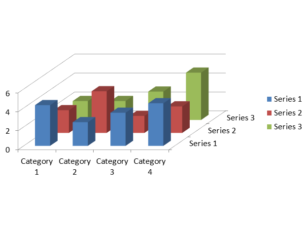
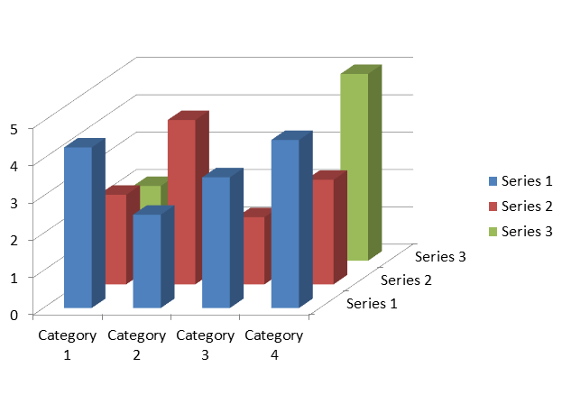
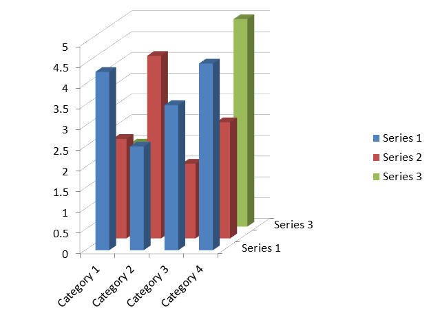
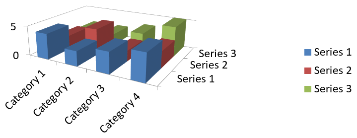
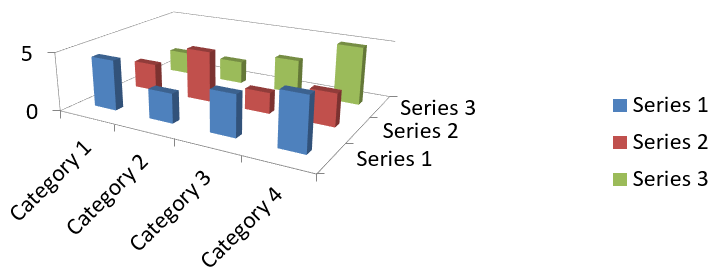

## **Overview**

Aspose.Slides for Android via Java lets you customize the view of a 3D chart through the [IChart.getRotation3D](https://reference.aspose.com/slides/androidjava/com.aspose.slides/ichart/#getRotation3D--) method. This article demonstrates how to adjust rotation, height proportions, depth, right-angle axes, and spacing between series, then save the presentation in PPTX format.

## **Set the Rotation and Depth of a 3D Chart**

The example below creates a [Presentation](https://reference.aspose.com/slides/androidjava/com.aspose.slides/presentation/) and uses [IShapeCollection.addChart](https://reference.aspose.com/slides/androidjava/com.aspose.slides/ishapecollection/#addChart-int-float-float-float-float-) to add a stacked 3D column chart to its first slide. It replaces the default series and categories with two series containing three values each. Worksheet index `0` identifies the chart's first data worksheet; row `0` holds series names, and column `0` holds category labels.

The [setRotationX](https://reference.aspose.com/slides/androidjava/com.aspose.slides/irotation3d/#setRotationX-byte-) and [setRotationY](https://reference.aspose.com/slides/androidjava/com.aspose.slides/irotation3d/#setRotationY-int-) methods set the chart's rotation to 40 and 270 degrees, respectively. [setDepthPercents](https://reference.aspose.com/slides/androidjava/com.aspose.slides/irotation3d/#setDepthPercents-int-) sets its depth to 150% of its width, while [setRightAngleAxes](https://reference.aspose.com/slides/androidjava/com.aspose.slides/irotation3d/#setRightAngleAxes-boolean-) enables right-angle axes instead of perspective. The resulting presentation contains the populated chart with these 3D view settings.

```java
import com.aspose.slides.*;

Presentation presentation = new Presentation();
try {
    ISlide slide = presentation.getSlides().get_Item(0);

    IChart chart = slide.getShapes().addChart(ChartType.StackedColumn3D, 0, 0, 500, 500);

    chart.getChartData().getSeries().clear();
    chart.getChartData().getCategories().clear();

    IChartDataWorkbook workbook = chart.getChartData().getChartDataWorkbook();
    int worksheetIndex = 0;

    double[][] values = { { 20, 50, 30 }, { 30, 10, 60 } };

    for (int categoryIndex = 0; categoryIndex < 3; categoryIndex++) {
        IChartDataCell categoryCell = workbook.getCell(worksheetIndex, categoryIndex + 1, 0, "Category " + (categoryIndex + 1));
        chart.getChartData().getCategories().add(categoryCell);
    }

    for (int seriesIndex = 0; seriesIndex < 2; seriesIndex++) {
        IChartDataCell seriesCell = workbook.getCell(worksheetIndex, 0, seriesIndex + 1, "Series " + (seriesIndex + 1));
        IChartSeries series = chart.getChartData().getSeries().add(seriesCell, chart.getType());

        for (int categoryIndex = 0; categoryIndex < 3; categoryIndex++) {
            IChartDataCell valueCell = workbook.getCell(worksheetIndex, categoryIndex + 1, seriesIndex + 1, values[seriesIndex][categoryIndex]);
            series.getDataPoints().addDataPointForBarSeries(valueCell);
        }
    }

    chart.getRotation3D().setRightAngleAxes(true);
    chart.getRotation3D().setRotationX((byte) 40);
    chart.getRotation3D().setRotationY(270);
    chart.getRotation3D().setDepthPercents(150);

    presentation.save("Rotation3D_out.pptx", SaveFormat.Pptx);
} finally {
    presentation.dispose();
}
```

## **Adjust the Height Proportions of a 3D Chart**

Use [IRotation3D.setHeightPercents](https://reference.aspose.com/slides/androidjava/com.aspose.slides/irotation3d/#setHeightPercents-int-) to set the height of a 3D chart as a percentage of its width. This changes the proportions of the 3D scene without resizing the chart object on the slide.

The following example creates a [Column3D](https://reference.aspose.com/slides/androidjava/com.aspose.slides/charttype/) chart with the default data: three series and four categories. It saves three presentations with height proportions of 50%, 100%, and 200%. The chart's position, width, and height remain fixed. The data, rotation, depth, series spacing, and formatting are identical in all three files; only the height percentage changes.

```java
import com.aspose.slides.*;

Presentation presentation = new Presentation();
try {
    ISlide slide = presentation.getSlides().get_Item(0);

    IChart chart = slide.getShapes().addChart(ChartType.Column3D, 40, 30, 620, 460);
    chart.getRotation3D().setRotationX((byte) 20);
    chart.getRotation3D().setRotationY(30);
    chart.getRotation3D().setRightAngleAxes(true);
    chart.getRotation3D().setDepthPercents(100);
    chart.getChartData().getSeries().get_Item(0).getParentSeriesGroup().setGapDepth(150);

    for (int heightPercent : new int[] { 50, 100, 200 }) {
        chart.getRotation3D().setHeightPercents(heightPercent);
        presentation.save("chart_height_" + heightPercent + ".pptx", SaveFormat.Pptx);
    }
} finally {
    presentation.dispose();
}
```

The following images illustrate the same height settings in the equivalent .NET example and were exported using Microsoft PowerPoint. A smaller percentage produces a flatter scene, while a larger percentage produces a taller scene within the same chart object. PowerPoint may also adjust axis tick intervals and label placement to fit the scene.

| Height: 50% | Height: 100% | Height: 200% |
| --- | --- | --- |
|  |  |  |

These methods control different aspects of the chart:

| Method | Effect |
| --- | --- |
| [IRotation3D.setHeightPercents](https://reference.aspose.com/slides/androidjava/com.aspose.slides/irotation3d/#setHeightPercents-int-) | Height of the 3D scene as a percentage of its width. |
| [IChart.setHeight](https://reference.aspose.com/slides/androidjava/com.aspose.slides/ishape/#setHeight-float-) | Height of the chart object on the slide, in points. |
| [IRotation3D.setDepthPercents](https://reference.aspose.com/slides/androidjava/com.aspose.slides/irotation3d/#setDepthPercents-int-) | Depth of the 3D scene as a percentage of its width. |
| [IChartSeriesGroup.setGapDepth](https://reference.aspose.com/slides/androidjava/com.aspose.slides/ichartseriesgroup/#setGapDepth-int-) | Spacing between series along the depth axis, as a percentage of the marker width. |

The height setting affects 3D column and bar charts, including cylinder, cone, and pyramid variants, as well as 3D line, area, pie, and surface charts. The comparison above uses the verified `Column3D` type. The setting does not change the appearance of a 2D `ClusteredColumn` chart or a `BubbleWith3D` chart; these names are members of the [ChartType](https://reference.aspose.com/slides/androidjava/com.aspose.slides/charttype/) class. For other chart appearance settings, see [Chart Formatting](/slides/androidjava/chart-formatting/).

## **Adjust the Gap Between Series**

Use [IChartSeriesGroup.setGapDepth](https://reference.aspose.com/slides/androidjava/com.aspose.slides/ichartseriesgroup/#setGapDepth-int-) to control the distance between data series along the depth axis of a 3D chart, expressed as a percentage of the marker width. Use values from **0 to 500**, inclusive: `0` removes the gap, while larger values increase the spacing. With a fixed chart depth, increasing the gap makes the markers thinner along the depth axis.

Access the group through [IChartSeries.getParentSeriesGroup](https://reference.aspose.com/slides/androidjava/com.aspose.slides/ichartseries/#getParentSeriesGroup--). The setting applies to every series in that group, not just the series used to access it. [IChartSeries.getGapDepth](https://reference.aspose.com/slides/androidjava/com.aspose.slides/ichartseries/#getGapDepth--) returns the depth gap and reflects the parent group's setting.

This setting affects 3D column and bar charts, including their cylinder, cone, and pyramid variants, as well as 3D line and area charts. The appearance depends on whether the series are arranged in depth, clustered, or stacked. For a clear comparison of gaps between separate series, use `ChartType.Column3D` from the [ChartType](https://reference.aspose.com/slides/androidjava/com.aspose.slides/charttype/) class.

These methods control different aspects of the chart:

| Method | Effect |
| --- | --- |
| [IChartSeriesGroup.setGapDepth](https://reference.aspose.com/slides/androidjava/com.aspose.slides/ichartseriesgroup/#setGapDepth-int-) | Spacing between series along the depth axis, as a percentage of the marker width. |
| [IChartSeriesGroup.setGapWidth](https://reference.aspose.com/slides/androidjava/com.aspose.slides/ichartseriesgroup/#setGapWidth-int-) | Spacing between adjacent bar or column clusters, as a percentage of the bar or column width. |
| [setDepthPercents](https://reference.aspose.com/slides/androidjava/com.aspose.slides/irotation3d/#setDepthPercents-int-) | Overall chart depth, as a percentage of the chart width. |

The following self-contained example uses the default chart data, which contains three series and four categories. It saves two presentations with identical data, rotation, gap width, and chart depth; only the gap depth changes.

```java
import com.aspose.slides.*;

Presentation presentation = new Presentation();
try {
    ISlide slide = presentation.getSlides().get_Item(0);
    
    IChart chart = slide.getShapes().addChart(ChartType.Column3D, 40, 30, 620, 230);

    chart.getRotation3D().setRotationX((byte) 20);
    chart.getRotation3D().setRotationY(30);
    chart.getRotation3D().setDepthPercents(100);

    IChartSeries series = chart.getChartData().getSeries().get_Item(0);
    IChartSeriesGroup group = series.getParentSeriesGroup();
    group.setGapWidth(150);

    for (int gapDepth : new int[] { 0, 500 }) {
        group.setGapDepth(gapDepth);

        String fileName = "series_gap_depth_" + gapDepth + ".pptx";
        presentation.save(fileName, SaveFormat.Pptx);
    }
} finally {
    presentation.dispose();
}
```

The following images illustrate the same gap depth settings in the equivalent .NET example and were exported using Microsoft PowerPoint.

| Gap depth: 0% | Gap depth: 500% |
| --- | --- |
|  |  |

## **FAQ**

**Which chart types support 3D mode in Aspose.Slides?**

Aspose.Slides supports 3D variants of column charts, including Column 3D, Clustered Column 3D, Stacked Column 3D, and 100% Stacked Column 3D, along with related 3D types exposed through the [ChartType](https://reference.aspose.com/slides/androidjava/com.aspose.slides/charttype/) class. For an exact, up-to-date list, check the [ChartType](https://reference.aspose.com/slides/androidjava/com.aspose.slides/charttype/) members in the API reference of your installed version.

**Can I get a raster image of a 3D chart for a report or the web?**

Yes. You can export a chart to an image with [Shape.getImage](https://reference.aspose.com/slides/androidjava/com.aspose.slides/shape/#getImage--) or [render the entire slide](/slides/androidjava/convert-powerpoint-to-png/) to formats like PNG or JPEG. This is useful when you need a raster preview or want to embed the chart into documents, dashboards, or web pages without requiring PowerPoint.

**How performant is building and rendering large 3D charts?**

Performance depends on data volume and visual complexity. For best results, keep 3D effects minimal, avoid heavy textures on walls and plot areas, limit the number of data points per series when possible, and render to an appropriately sized output (resolution and dimensions) to match the target display or print needs.
