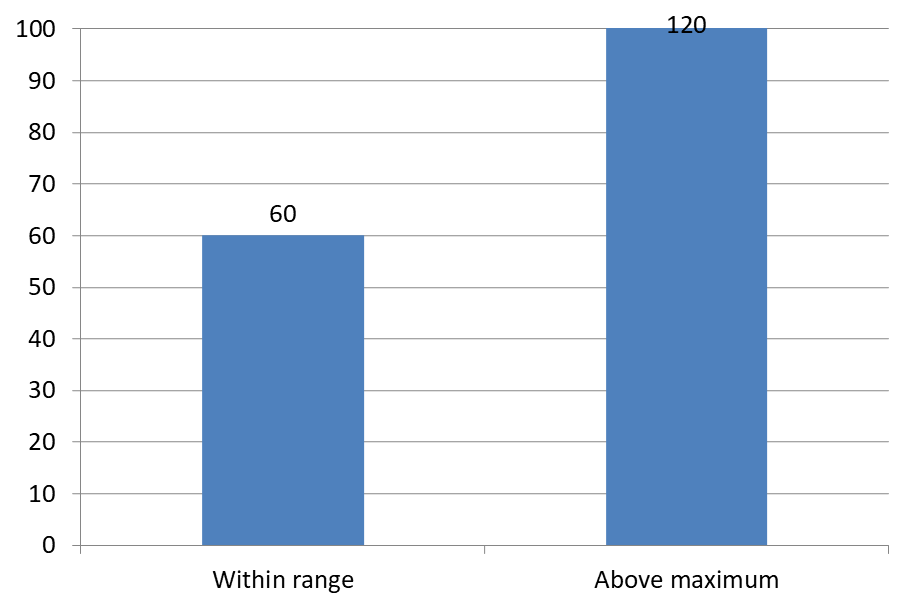

## **Introduction**

Data labels display information about chart series and individual data points, helping readers identify values and understand the chart. This article explains how to format values, display percentages, read label text, control labels beyond the axis maximum, adjust category axis label spacing, and position pie chart labels.

## **Set Data Precision in Chart Data Labels**

Use [set_NumberFormatOfValues](https://reference.aspose.com/slides/cpp/aspose.slides.charts/ichartseries/set_numberformatofvalues/) to format series values. This example creates a line chart with default data, displays its data table, and enables value labels for the first series. The format `#,##0.00` displays a thousands separator and two decimal places without changing the underlying values.

```cpp
#include <DOM/Presentation.h>
#include <DOM/ISlide.h>
#include <DOM/IShapeCollection.h>
#include <DOM/IChart.h>
#include <DOM/Chart/ChartType.h>
#include <DOM/Chart/IChartData.h>
#include <DOM/Chart/IChartSeriesCollection.h>
#include <DOM/Chart/IChartSeries.h>
#include <DOM/Chart/IDataLabelCollection.h>
#include <DOM/Chart/IDataLabelFormat.h>
#include <Export/SaveFormat.h>
#include <system/smart_ptr.h>
#include <system/string.h>

using namespace Aspose::Slides;
using namespace Aspose::Slides::Charts;
using namespace Aspose::Slides::Export;
using namespace System;

auto presentation = MakeObject<Presentation>();
auto slide = presentation->get_Slide(0);

auto chart = slide->get_Shapes()->AddChart(ChartType::Line, 50, 50, 450, 300);
chart->set_HasDataTable(true);

auto series = chart->get_ChartData()->get_Series()->idx_get(0);
series->set_NumberFormatOfValues(u"#,##0.00");
series->get_Labels()->get_DefaultDataLabelFormat()->set_ShowValue(true);

presentation->Save(u"PrecisionOfDatalabels_out.pptx", SaveFormat::Pptx);
```

To format the numeric cells in a chart's embedded workbook, see [Set Custom Number Formats for Workbook Cells](/slides/cpp/chart-workbook/#set-custom-number-formats-for-workbook-cells). That example also shows value labels following their source cell formats while preserving the stored numeric values.

## **Display Percentage as Labels**

For a stacked column chart, calculate each value as a percentage of its category total and assign the text to the text frame returned by [get_TextFrameForOverriding](https://reference.aspose.com/slides/cpp/aspose.slides.charts/ioverridabletext/get_textframeforoverriding/). This example uses the default chart data and displays percentages with two decimal places in an 8-point font. Categories with a total of zero are skipped to avoid division by zero. Recalculate the custom label text if the chart data changes.

```cpp
#include <DOM/Presentation.h>
#include <DOM/ISlide.h>
#include <DOM/IShapeCollection.h>
#include <DOM/IChart.h>
#include <DOM/Chart/ChartType.h>
#include <DOM/Chart/IChartData.h>
#include <DOM/Chart/IChartCategoryCollection.h>
#include <DOM/Chart/IChartSeriesCollection.h>
#include <DOM/Chart/IChartSeries.h>
#include <DOM/Chart/IChartDataPointCollection.h>
#include <DOM/Chart/IChartDataPoint.h>
#include <DOM/Chart/IDoubleChartValue.h>
#include <DOM/Chart/IDataLabel.h>
#include <DOM/Chart/IDataLabelCollection.h>
#include <DOM/Chart/IDataLabelFormat.h>
#include <DOM/Portion.h>
#include <DOM/IPortionFormat.h>
#include <DOM/ITextFrame.h>
#include <DOM/IParagraph.h>
#include <DOM/IParagraphCollection.h>
#include <DOM/IPortionCollection.h>
#include <system/convert.h>
#include <vector>
#include <Export/SaveFormat.h>
#include <system/smart_ptr.h>
#include <system/string.h>

using namespace Aspose::Slides;
using namespace Aspose::Slides::Charts;
using namespace Aspose::Slides::Export;
using namespace System;

auto presentation = MakeObject<Presentation>();
auto slide = presentation->get_Slide(0);

auto chart = slide->get_Shapes()->AddChart(ChartType::StackedColumn, 20, 20, 400, 400);

auto categoryTotals = std::vector<double>(chart->get_ChartData()->get_Categories()->get_Count(), 0.0);
for (auto k = 0; k < chart->get_ChartData()->get_Categories()->get_Count(); k++)
{
    for (auto i = 0; i < chart->get_ChartData()->get_Series()->get_Count(); i++)
    {
        auto series = chart->get_ChartData()->get_Series()->idx_get(i);
        auto pointValue = Convert::ToDouble(series->get_DataPoint(k)->get_Value()->get_Data());
        categoryTotals[k] += pointValue;
    }
}

for (auto x = 0; x < chart->get_ChartData()->get_Series()->get_Count(); x++)
{
    auto series = chart->get_ChartData()->get_Series()->idx_get(x);
    series->get_Labels()->get_DefaultDataLabelFormat()->set_ShowLegendKey(false);

    for (auto j = 0; j < series->get_DataPoints()->get_Count(); j++)
    {
        auto label = series->get_DataPoint(j)->get_Label();
        if (categoryTotals[j] == 0)
        {
            continue;
        }

        auto pointValue = Convert::ToDouble(series->get_DataPoint(j)->get_Value()->get_Data());
        auto dataPointPercent = (pointValue / categoryTotals[j]) * 100;

        auto portion = MakeObject<Portion>();
        portion->set_Text(String::Format(u"{0:F2} %", dataPointPercent));
        portion->get_PortionFormat()->set_FontHeight(8.0f);

        label->get_TextFrameForOverriding()->set_Text(u"");

        auto paragraph = label->get_TextFrameForOverriding()->get_Paragraphs()->idx_get(0);
        paragraph->get_Portions()->Add(portion);

        label->get_DataLabelFormat()->set_ShowValue(true);
        label->get_DataLabelFormat()->set_ShowSeriesName(false);
        label->get_DataLabelFormat()->set_ShowPercentage(false);
        label->get_DataLabelFormat()->set_ShowLegendKey(false);
        label->get_DataLabelFormat()->set_ShowCategoryName(false);
        label->get_DataLabelFormat()->set_ShowBubbleSize(false);
    }
}

presentation->Save(u"DisplayPercentageAsLabels_out.pptx", SaveFormat::Pptx);
```

## **Set Percentage Sign with Chart Data Labels**

When values are stored as fractions, use [set_NumberFormat](https://reference.aspose.com/slides/cpp/aspose.slides.charts/idatalabelformat/set_numberformat/) to display percentages. Pass `false` to [set_IsNumberFormatLinkedToSource](https://reference.aspose.com/slides/cpp/aspose.slides.charts/idatalabelformat/set_isnumberformatlinkedtosource/) to apply the label format independently of the source cells.

This example creates a 100% stacked column chart with red and blue series across four categories. Each pair of values adds up to 1. The label format `0.0%` displays 0.30 as 30.0%, while the vertical axis uses two decimal places. Both series use white, 10-point label text.

```cpp
#include <DOM/Presentation.h>
#include <DOM/ISlide.h>
#include <DOM/IShapeCollection.h>
#include <DOM/IChart.h>
#include <DOM/Chart/ChartType.h>
#include <DOM/Chart/IAxesManager.h>
#include <DOM/Chart/IAxis.h>
#include <DOM/Chart/IChartData.h>
#include <DOM/Chart/IChartCategoryCollection.h>
#include <DOM/Chart/IChartDataWorkbook.h>
#include <DOM/Chart/IChartDataCell.h>
#include <DOM/Chart/IChartSeriesCollection.h>
#include <DOM/Chart/IChartSeries.h>
#include <DOM/Chart/IChartDataPointCollection.h>
#include <DOM/Chart/IFormat.h>
#include <DOM/Chart/IDataLabelCollection.h>
#include <DOM/Chart/IDataLabelFormat.h>
#include <DOM/Chart/IChartTextFormat.h>
#include <DOM/Chart/IChartPortionFormat.h>
#include <DOM/FillType.h>
#include <DOM/IFillFormat.h>
#include <DOM/IColorFormat.h>
#include <drawing/color.h>
#include <system/object_ext.h>
#include <Export/SaveFormat.h>
#include <system/smart_ptr.h>
#include <system/string.h>

using namespace Aspose::Slides;
using namespace Aspose::Slides::Charts;
using namespace Aspose::Slides::Export;
using namespace System;
using namespace System::Drawing;

auto presentation = MakeObject<Presentation>();
auto slide = presentation->get_Slide(0);

auto chart = slide->get_Shapes()->AddChart(ChartType::PercentsStackedColumn, 20, 20, 500, 400);

chart->get_Axes()->get_VerticalAxis()->set_IsNumberFormatLinkedToSource(false);
chart->get_Axes()->get_VerticalAxis()->set_NumberFormat(u"0.00%");

chart->get_ChartData()->get_Series()->Clear();
chart->get_ChartData()->get_Categories()->Clear();

auto workbook = chart->get_ChartData()->get_ChartDataWorkbook();
auto worksheetIndex = 0;
for (auto i = 0; i < 4; i++)
{
    auto categoryCell = workbook->GetCell(worksheetIndex, i + 1, 0, ObjectExt::Box(String::Format(u"Category {0}", i + 1)));
    chart->get_ChartData()->get_Categories()->Add(categoryCell);
}

String seriesNames[] = { u"Reds", u"Blues" };
Color seriesColors[] = { Color::get_Red(), Color::get_Blue() };
double values[2][4] = { { 0.30, 0.50, 0.80, 0.65 }, { 0.70, 0.50, 0.20, 0.35 } };

for (auto i = 0; i < 2; i++)
{
    auto seriesCell = workbook->GetCell(worksheetIndex, 0, i + 1, ObjectExt::Box(seriesNames[i]));
    auto series = chart->get_ChartData()->get_Series()->Add(seriesCell, chart->get_Type());
    for (auto j = 0; j < 4; j++)
    {
        auto valueCell = workbook->GetCell(worksheetIndex, j + 1, i + 1, ObjectExt::Box(values[i][j]));
        series->get_DataPoints()->AddDataPointForBarSeries(valueCell);
    }

    series->get_Format()->get_Fill()->set_FillType(FillType::Solid);
    series->get_Format()->get_Fill()->get_SolidFillColor()->set_Color(seriesColors[i]);

    auto labelFormat = series->get_Labels()->get_DefaultDataLabelFormat();
    labelFormat->set_ShowValue(true);
    labelFormat->set_IsNumberFormatLinkedToSource(false);
    labelFormat->set_NumberFormat(u"0.0%");
    labelFormat->get_TextFormat()->get_PortionFormat()->set_FontHeight(10);
    labelFormat->get_TextFormat()->get_PortionFormat()->get_FillFormat()->set_FillType(FillType::Solid);
    labelFormat->get_TextFormat()->get_PortionFormat()->get_FillFormat()->get_SolidFillColor()->set_Color(Color::get_White());
}

presentation->Save(u"SetDataLabelsPercentageSign_out.pptx", SaveFormat::Pptx);
```

## **Read the Actual Text of Data Labels**

Use [GetActualLabelText](https://reference.aspose.com/slides/cpp/aspose.slides.charts/idatalabel/getactuallabeltext/) to retrieve the text produced by a data label's settings. This is useful when extracting labels for reports, searching presentation content, or validating generated charts. In the example below, the default [data label format](https://reference.aspose.com/slides/cpp/aspose.slides.charts/idatalabelformat/) combines each category name, series name, and value. One point formats its value as a percentage, and another uses custom text from [get_TextFrameForOverriding](https://reference.aspose.com/slides/cpp/aspose.slides.charts/ioverridabletext/get_textframeforoverriding/).

```cpp
#include <DOM/Presentation.h>
#include <DOM/ISlide.h>
#include <DOM/IShapeCollection.h>
#include <DOM/IChart.h>
#include <DOM/Chart/ChartType.h>
#include <DOM/Chart/IChartData.h>
#include <DOM/Chart/IChartCategoryCollection.h>
#include <DOM/Chart/IChartDataWorkbook.h>
#include <DOM/Chart/IChartDataCell.h>
#include <DOM/Chart/IChartSeriesCollection.h>
#include <DOM/Chart/IChartSeries.h>
#include <DOM/Chart/IChartDataPointCollection.h>
#include <DOM/Chart/IChartDataPoint.h>
#include <DOM/Chart/IDoubleChartValue.h>
#include <DOM/Chart/IDataLabel.h>
#include <DOM/Chart/IDataLabelCollection.h>
#include <DOM/Chart/IDataLabelFormat.h>
#include <DOM/ITextFrame.h>
#include <system/console.h>
#include <system/object_ext.h>
#include <system/smart_ptr.h>
#include <system/string.h>

using namespace Aspose::Slides;
using namespace Aspose::Slides::Charts;
using namespace System;

auto presentation = MakeObject<Presentation>();
auto slide = presentation->get_Slide(0);

auto chart = slide->get_Shapes()->AddChart(ChartType::ClusteredColumn, 20, 20, 500, 300);

chart->get_ChartData()->get_Series()->Clear();
chart->get_ChartData()->get_Categories()->Clear();

auto workbook = chart->get_ChartData()->get_ChartDataWorkbook();
auto firstCategoryCell = workbook->GetCell(0, 1, 0, ObjectExt::Box<String>(u"Q1"));
chart->get_ChartData()->get_Categories()->Add(firstCategoryCell);
auto secondCategoryCell = workbook->GetCell(0, 2, 0, ObjectExt::Box<String>(u"Q2"));
chart->get_ChartData()->get_Categories()->Add(secondCategoryCell);

auto northSeriesCell = workbook->GetCell(0, 0, 1, ObjectExt::Box<String>(u"North"));
auto north = chart->get_ChartData()->get_Series()->Add(northSeriesCell, chart->get_Type());
auto northFirstValueCell = workbook->GetCell(0, 1, 1, ObjectExt::Box(0.25));
north->get_DataPoints()->AddDataPointForBarSeries(northFirstValueCell);
auto northSecondValueCell = workbook->GetCell(0, 2, 1, ObjectExt::Box(0.75));
north->get_DataPoints()->AddDataPointForBarSeries(northSecondValueCell);

auto southSeriesCell = workbook->GetCell(0, 0, 2, ObjectExt::Box<String>(u"South"));
auto south = chart->get_ChartData()->get_Series()->Add(southSeriesCell, chart->get_Type());
auto southFirstValueCell = workbook->GetCell(0, 1, 2, ObjectExt::Box(0.40));
south->get_DataPoints()->AddDataPointForBarSeries(southFirstValueCell);
auto southSecondValueCell = workbook->GetCell(0, 2, 2, ObjectExt::Box(0.60));
south->get_DataPoints()->AddDataPointForBarSeries(southSecondValueCell);

for (auto i = 0; i < chart->get_ChartData()->get_Series()->get_Count(); i++)
{
    auto series = chart->get_ChartData()->get_Series()->idx_get(i);
    auto format = series->get_Labels()->get_DefaultDataLabelFormat();
    format->set_ShowCategoryName(true);
    format->set_ShowSeriesName(true);
    format->set_ShowValue(true);
}

north->get_Label(1)->get_DataLabelFormat()->set_IsNumberFormatLinkedToSource(false);
north->get_Label(1)->get_DataLabelFormat()->set_NumberFormat(u"0%");
south->get_Label(0)->get_TextFrameForOverriding()->set_Text(u"Reviewed");

for (auto i = 0; i < chart->get_ChartData()->get_Series()->get_Count(); i++)
{
    auto series = chart->get_ChartData()->get_Series()->idx_get(i);
    for (auto j = 0; j < series->get_DataPoints()->get_Count(); j++)
    {
        auto point = series->get_DataPoint(j);
        auto label = point->get_Label();
        if (!label->get_IsVisible())
        {
            continue;
        }

        Console::WriteLine(String::Format(u"Value: {0}; label: {1}", point->get_Value()->get_Data(), label->GetActualLabelText()));
    }
}
```

The number stored in a data point remains `0.75`, even when its label shows `75%` along with the category and series names. Custom text replaces the generated label text. [GetActualLabelText](https://reference.aspose.com/slides/cpp/aspose.slides.charts/idatalabel/getactuallabeltext/) returns the resulting label string in either case. Check [get_IsVisible](https://reference.aspose.com/slides/cpp/aspose.slides.charts/idatalabel/get_isvisible/) separately, as shown above, when you want to extract only visible labels.

## **Control Data Labels Beyond the Axis Maximum**

When you limit an axis range manually, some data points may exceed its maximum. Use [set_ShowDataLabelsOverMaximum](https://reference.aspose.com/slides/cpp/aspose.slides.charts/ichart/set_showdatalabelsovermaximum/) to control whether their data labels are shown. This setting changes label visibility; it does not change the axis range or the underlying data values.

The example below creates a 2D clustered column chart with values of 60 and 120. It sets [set_IsAutomaticMaxValue](https://reference.aspose.com/slides/cpp/aspose.slides.charts/iaxis/set_isautomaticmaxvalue/) to `false` and [set_MaxValue](https://reference.aspose.com/slides/cpp/aspose.slides.charts/iaxis/set_maxvalue/) to 100 on the vertical axis. The first slide allows labels beyond the maximum; a copy of that slide disables them. Both slides are saved in `DataLabelsOverMaximum.pptx`.

Enable value labels with [set_ShowValue](https://reference.aspose.com/slides/cpp/aspose.slides.charts/idatalabelformat/set_showvalue/). The chart-level setting does not enable value display by itself or override an individual label's disabled value display. This example enables values for the entire series and uses [set_Position](https://reference.aspose.com/slides/cpp/aspose.slides.charts/idatalabelformat/set_position/) to place labels at the outside end of each column.

```cpp
#include <DOM/Presentation.h>
#include <DOM/ISlide.h>
#include <DOM/ISlideCollection.h>
#include <DOM/IShapeCollection.h>
#include <DOM/IChart.h>
#include <DOM/Chart/ChartType.h>
#include <DOM/Chart/IAxesManager.h>
#include <DOM/Chart/IAxis.h>
#include <DOM/Chart/IChartData.h>
#include <DOM/Chart/IChartCategoryCollection.h>
#include <DOM/Chart/IChartDataWorkbook.h>
#include <DOM/Chart/IChartDataCell.h>
#include <DOM/Chart/IChartSeriesCollection.h>
#include <DOM/Chart/IChartSeries.h>
#include <DOM/Chart/IChartDataPointCollection.h>
#include <DOM/Chart/IDataLabelCollection.h>
#include <DOM/Chart/IDataLabelFormat.h>
#include <DOM/Chart/LegendDataLabelPosition.h>
#include <Export/SaveFormat.h>
#include <system/object_ext.h>
#include <system/smart_ptr.h>
#include <system/string.h>

using namespace Aspose::Slides;
using namespace Aspose::Slides::Charts;
using namespace Aspose::Slides::Export;
using namespace System;

auto presentation = MakeObject<Presentation>();
auto slide = presentation->get_Slide(0);

auto chart = slide->get_Shapes()->AddChart(ChartType::ClusteredColumn, 50, 50, 600, 400);
chart->set_HasLegend(false);

chart->get_ChartData()->get_Series()->Clear();
chart->get_ChartData()->get_Categories()->Clear();

auto workbook = chart->get_ChartData()->get_ChartDataWorkbook();

auto firstCategory = workbook->GetCell(0, 1, 0, ObjectExt::Box<String>(u"Within range"));
auto secondCategory = workbook->GetCell(0, 2, 0, ObjectExt::Box<String>(u"Above maximum"));

chart->get_ChartData()->get_Categories()->Add(firstCategory);
chart->get_ChartData()->get_Categories()->Add(secondCategory);

auto seriesName = workbook->GetCell(0, 0, 1, ObjectExt::Box<String>(u"Values"));
auto series = chart->get_ChartData()->get_Series()->Add(seriesName, chart->get_Type());

auto firstValue = workbook->GetCell(0, 1, 1, ObjectExt::Box(60));
auto secondValue = workbook->GetCell(0, 2, 1, ObjectExt::Box(120));

series->get_DataPoints()->AddDataPointForBarSeries(firstValue);
series->get_DataPoints()->AddDataPointForBarSeries(secondValue);

series->get_Labels()->get_DefaultDataLabelFormat()->set_ShowValue(true);
series->get_Labels()->get_DefaultDataLabelFormat()->set_Position(LegendDataLabelPosition::OutsideEnd);

chart->get_Axes()->get_VerticalAxis()->set_IsAutomaticMaxValue(false);
chart->get_Axes()->get_VerticalAxis()->set_MaxValue(100);
chart->set_ShowDataLabelsOverMaximum(true);

auto secondSlide = presentation->get_Slides()->AddClone(slide);
auto secondChart = ExplicitCast<IChart>(secondSlide->get_Shape(0));
secondChart->set_ShowDataLabelsOverMaximum(false);

presentation->Save(u"DataLabelsOverMaximum.pptx", SaveFormat::Pptx);
```

The following images show the saved slides rendered by Microsoft PowerPoint. With `true`, the label **120** is visible at the upper boundary; with `false`, it is hidden. The label **60** remains visible, the axis maximum stays at **100**, and the second data point remains **120** in both cases.

| ShowDataLabelsOverMaximum = true | ShowDataLabelsOverMaximum = false |
| --- | --- |
|  |  |

{}

This example uses a 2D column chart with a value axis. Charts without a value axis, such as pie and doughnut charts, do not have an axis maximum to limit in this way.

{}

## **Set Label Distance from an Axis**

Use [set_LabelOffset](https://reference.aspose.com/slides/cpp/aspose.slides.charts/iaxis/set_labeloffset/) to control the distance between category axis labels and the axis. The value is a percentage of the maximum font size of the axis labels. This example creates a clustered column chart and sets the horizontal axis label offset to 500. This setting affects category axis labels rather than labels attached to individual data points.

```cpp
#include <DOM/Presentation.h>
#include <DOM/ISlide.h>
#include <DOM/IShapeCollection.h>
#include <DOM/IChart.h>
#include <DOM/Chart/ChartType.h>
#include <DOM/Chart/IAxesManager.h>
#include <DOM/Chart/IAxis.h>
#include <Export/SaveFormat.h>
#include <system/smart_ptr.h>
#include <system/string.h>

using namespace Aspose::Slides;
using namespace Aspose::Slides::Charts;
using namespace Aspose::Slides::Export;
using namespace System;

auto presentation = MakeObject<Presentation>();
auto slide = presentation->get_Slide(0);

auto chart = slide->get_Shapes()->AddChart(ChartType::ClusteredColumn, 20, 20, 500, 300);
chart->get_Axes()->get_HorizontalAxis()->set_LabelOffset(500);

presentation->Save(u"SetCategoryAxisLabelDistance_out.pptx", SaveFormat::Pptx);
```

## **Adjust Label Location**

On a pie chart, adjust data label positions to improve spacing and make room for leader lines.

This example displays the value of the first data point, places its label outside the slice, and uses [set_X](https://reference.aspose.com/slides/cpp/aspose.slides.charts/ilayoutable/set_x/) and [set_Y](https://reference.aspose.com/slides/cpp/aspose.slides.charts/ilayoutable/set_y/) to adjust its offsets. These offsets are relative to the chart width and height, respectively.

```cpp
#include <DOM/Presentation.h>
#include <DOM/ISlide.h>
#include <DOM/IShapeCollection.h>
#include <DOM/IChart.h>
#include <DOM/Chart/ChartType.h>
#include <DOM/Chart/IChartData.h>
#include <DOM/Chart/IChartSeriesCollection.h>
#include <DOM/Chart/IChartSeries.h>
#include <DOM/Chart/IDataLabel.h>
#include <DOM/Chart/IDataLabelFormat.h>
#include <DOM/Chart/LegendDataLabelPosition.h>
#include <Export/SaveFormat.h>
#include <system/smart_ptr.h>
#include <system/string.h>

using namespace Aspose::Slides;
using namespace Aspose::Slides::Charts;
using namespace Aspose::Slides::Export;
using namespace System;

auto presentation = MakeObject<Presentation>();
auto slide = presentation->get_Slide(0);

auto chart = slide->get_Shapes()->AddChart(ChartType::Pie, 50, 50, 200, 200);
auto series = chart->get_ChartData()->get_Series();

auto label = series->idx_get(0)->get_Label(0);
label->get_DataLabelFormat()->set_ShowValue(true);
label->get_DataLabelFormat()->set_Position(LegendDataLabelPosition::OutsideEnd);
label->set_X(0.71f);
label->set_Y(0.04f);

presentation->Save(u"presentation.pptx", SaveFormat::Pptx);
```


## **Format Leader Lines**

When pie chart labels sit outside their slices, leader lines help readers match each value to the correct slice. A contrasting color and a slightly thicker line can make these connections easier to follow, while transparency and a dashed style keep the lines visually unobtrusive.

Use [get_LeaderLinesFormat](https://reference.aspose.com/slides/cpp/aspose.slides.charts/idatalabelcollection/get_leaderlinesformat/) to format leader lines at the series' data label collection level. The settings in `series->get_Labels()->get_LeaderLinesFormat()->get_Line()` apply to the collection, rather than to an individual label.

This example creates a pie chart with default data, displays values outside the slices, and enables leader lines with [set_ShowLeaderLines](https://reference.aspose.com/slides/cpp/aspose.slides.charts/idatalabelformat/set_showleaderlines/). It moves two labels farther from their slices using [set_X](https://reference.aspose.com/slides/cpp/aspose.slides.charts/ilayoutable/set_x/) and [set_Y](https://reference.aspose.com/slides/cpp/aspose.slides.charts/ilayoutable/set_y/) offsets, expressed as fractions of the chart width and height. No input presentation is required.

The fill format returned by [get_FillFormat](https://reference.aspose.com/slides/cpp/aspose.slides/ilineformat/get_fillformat/) is used to set a solid blue color with an alpha value of 191 out of 255, giving approximately 25% transparency. [set_Width](https://reference.aspose.com/slides/cpp/aspose.slides/ilineformat/set_width/) sets the thickness to 2 points, and [set_DashStyle](https://reference.aspose.com/slides/cpp/aspose.slides/ilineformat/set_dashstyle/) makes the line dashed.

```cpp
#include <DOM/Presentation.h>
#include <DOM/ISlide.h>
#include <DOM/IShapeCollection.h>
#include <DOM/IChart.h>
#include <DOM/Chart/ChartType.h>
#include <DOM/Chart/IChartData.h>
#include <DOM/Chart/IChartSeriesCollection.h>
#include <DOM/Chart/IChartSeries.h>
#include <DOM/Chart/IDataLabel.h>
#include <DOM/Chart/IDataLabelCollection.h>
#include <DOM/Chart/IDataLabelFormat.h>
#include <DOM/Chart/IChartLinesFormat.h>
#include <DOM/Chart/LegendDataLabelPosition.h>
#include <DOM/ILineFormat.h>
#include <DOM/ILineFillFormat.h>
#include <DOM/IColorFormat.h>
#include <DOM/FillType.h>
#include <DOM/LineDashStyle.h>
#include <Export/SaveFormat.h>
#include <drawing/color.h>
#include <system/smart_ptr.h>
#include <system/string.h>

using namespace Aspose::Slides;
using namespace Aspose::Slides::Charts;
using namespace Aspose::Slides::Export;
using namespace System;
using namespace System::Drawing;

auto presentation = MakeObject<Presentation>();
auto slide = presentation->get_Slide(0);

auto chart = slide->get_Shapes()->AddChart(ChartType::Pie, 80, 50, 560, 400);
chart->set_HasLegend(false);

auto series = chart->get_ChartData()->get_Series()->idx_get(0);

auto labelFormat = series->get_Labels()->get_DefaultDataLabelFormat();
labelFormat->set_ShowValue(true);
labelFormat->set_Position(LegendDataLabelPosition::OutsideEnd);
labelFormat->set_ShowLeaderLines(true);

// Move two labels farther away from their slices.
series->get_Label(0)->set_X(0.10f);
series->get_Label(0)->set_Y(-0.05f);
series->get_Label(1)->set_X(-0.10f);
series->get_Label(1)->set_Y(0.05f);

auto line = series->get_Labels()->get_LeaderLinesFormat()->get_Line();
line->get_FillFormat()->set_FillType(FillType::Solid);
line->get_FillFormat()->get_SolidFillColor()->set_Color(Color::FromArgb(191, 30, 90, 160));
line->set_Width(2);
line->set_DashStyle(LineDashStyle::Dash);

presentation->Save(u"FormattedLeaderLines.pptx", SaveFormat::Pptx);
```

Enabling leader lines does not guarantee that a line will appear for every label. Visibility depends on label placement and the chart's layout behavior. In this example, the two displaced labels have visible leader lines; the labels that remain close to their slices do not need them.

The following image shows the saved `FormattedLeaderLines.pptx` rendered with Aspose.Slides:


## **Add Multiple Rows of Data Labels Above a Column Chart**

This example creates a column chart with two rows of data labels above the plot area. Series A displays the visible columns, while Series B and Series C provide the additional labels. Their columns are hidden by removing the fill and outline. The [set_Overlap](https://reference.aspose.com/slides/cpp/aspose.slides.charts/ichartseriesgroup/set_overlap/) method aligns all three series with the same category centers.

The [get_PlotArea](https://reference.aspose.com/slides/cpp/aspose.slides.charts/ichart/get_plotarea/) settings reserve space for the label rows. After [ValidateChartLayout](https://reference.aspose.com/slides/cpp/aspose.slides.charts/ichart/validatechartlayout/) calculates the default positions, [set_X](https://reference.aspose.com/slides/cpp/aspose.slides.charts/ilayoutable/set_x/) and [set_Y](https://reference.aspose.com/slides/cpp/aspose.slides.charts/ilayoutable/set_y/) preserve the horizontal alignment and apply vertical offsets to arrange the labels in two rows. The numbers remain data labels linked to the series values; only the row headings are separate text shapes.

```cpp
#include <DOM/Presentation.h>
#include <DOM/ISlide.h>
#include <DOM/IShapeCollection.h>
#include <DOM/IChart.h>
#include <DOM/Chart/ChartType.h>
#include <DOM/Chart/IChartData.h>
#include <DOM/Chart/IChartCategoryCollection.h>
#include <DOM/Chart/IChartDataWorkbook.h>
#include <DOM/Chart/IChartDataCell.h>
#include <DOM/Chart/IChartSeriesCollection.h>
#include <DOM/Chart/IChartSeries.h>
#include <DOM/Chart/IChartDataPointCollection.h>
#include <DOM/Chart/IChartDataPoint.h>
#include <DOM/Chart/IChartSeriesGroup.h>
#include <DOM/Chart/IFormat.h>
#include <DOM/Chart/IDataLabelCollection.h>
#include <DOM/Chart/IDataLabelFormat.h>
#include <DOM/Chart/IDataLabel.h>
#include <DOM/Chart/IChartTextFormat.h>
#include <DOM/Chart/IChartPortionFormat.h>
#include <DOM/Chart/LegendDataLabelPosition.h>
#include <DOM/Chart/IAxesManager.h>
#include <DOM/Chart/IAxis.h>
#include <DOM/Chart/IChartPlotArea.h>
#include <DOM/Chart/LayoutTargetType.h>
#include <DOM/FillType.h>
#include <DOM/IFillFormat.h>
#include <DOM/ILineFormat.h>
#include <DOM/IColorFormat.h>
#include <DOM/ShapeType.h>
#include <DOM/IAutoShape.h>
#include <DOM/ITextFrame.h>
#include <DOM/ITextFrameFormat.h>
#include <DOM/IParagraphCollection.h>
#include <DOM/IParagraph.h>
#include <DOM/IPortionCollection.h>
#include <DOM/IPortion.h>
#include <DOM/IPortionFormat.h>
#include <Export/SaveFormat.h>
#include <drawing/color.h>
#include <system/object_ext.h>
#include <system/smart_ptr.h>
#include <system/string.h>

using namespace Aspose::Slides;
using namespace Aspose::Slides::Charts;
using namespace Aspose::Slides::Export;
using namespace System;
using namespace System::Drawing;

auto presentation = MakeObject<Presentation>();
auto slide = presentation->get_Slide(0);

auto chart = slide->get_Shapes()->AddChart(ChartType::ClusteredColumn, 40, 40, 640, 200);
chart->set_HasTitle(false);
chart->set_HasLegend(false);
chart->get_TextFormat()->get_PortionFormat()->set_FontHeight(12);

chart->get_ChartData()->get_Series()->Clear();
chart->get_ChartData()->get_Categories()->Clear();

auto workbook = chart->get_ChartData()->get_ChartDataWorkbook();
workbook->Clear(0);

String categories[] = { u"North", u"South", u"East", u"West" };
String seriesNames[] = { u"Series A", u"Series B", u"Series C" };
double seriesValues[3][4] = {
    { 35, 42, 28, 47 },
    { 22, 31, 19, 26 },
    { 12, 16, 14, 18 }
};

for (auto categoryIndex = 0; categoryIndex < 4; categoryIndex++)
{
    auto categoryCell = workbook->GetCell(0, categoryIndex + 1, 0, ObjectExt::Box(categories[categoryIndex]));
    chart->get_ChartData()->get_Categories()->Add(categoryCell);
}

for (auto seriesIndex = 0; seriesIndex < 3; seriesIndex++)
{
    auto seriesCell = workbook->GetCell(0, 0, seriesIndex + 1, ObjectExt::Box(seriesNames[seriesIndex]));
    auto series = chart->get_ChartData()->get_Series()->Add(seriesCell, ChartType::ClusteredColumn);

    for (auto categoryIndex = 0; categoryIndex < 4; categoryIndex++)
    {
        auto valueCell = workbook->GetCell(0, categoryIndex + 1, seriesIndex + 1, ObjectExt::Box(seriesValues[seriesIndex][categoryIndex]));
        series->get_DataPoints()->AddDataPointForBarSeries(valueCell);
    }

    if (seriesIndex > 0)
    {
        // Hide the columns of B and C, but keep their data labels.
        series->get_Format()->get_Fill()->set_FillType(FillType::NoFill);
        series->get_Format()->get_Line()->get_FillFormat()->set_FillType(FillType::NoFill);
        auto labelFormat = series->get_Labels()->get_DefaultDataLabelFormat();
        labelFormat->set_ShowValue(true);
        labelFormat->get_TextFormat()->get_PortionFormat()->set_FontHeight(12);
        auto labelFill = labelFormat->get_TextFormat()->get_PortionFormat()->get_FillFormat();
        labelFill->set_FillType(FillType::Solid);
        labelFill->get_SolidFillColor()->set_Color(Color::get_Black());
        labelFormat->set_Position(LegendDataLabelPosition::InsideBase);
    }
}

// Align all three series with the same category centers.
chart->get_ChartData()->get_Series()->idx_get(0)->get_ParentSeriesGroup()->set_Overlap(100);

// Use fewer gridlines for this compact example.
chart->get_Axes()->get_VerticalAxis()->set_IsAutomaticMajorUnit(false);
chart->get_Axes()->get_VerticalAxis()->set_MajorUnit(10);

// Reserve space above the plot for two rows of data labels.
chart->get_PlotArea()->set_LayoutTargetType(LayoutTargetType::Inner);
chart->get_PlotArea()->set_X(0.15f);
chart->get_PlotArea()->set_Y(0.32f);
chart->get_PlotArea()->set_Width(0.80f);
chart->get_PlotArea()->set_Height(0.48f);
chart->ValidateChartLayout();

for (auto seriesIndex = 1; seriesIndex < 3; seriesIndex++)
{
    auto series = chart->get_ChartData()->get_Series()->idx_get(seriesIndex);
    auto rowTop = seriesIndex == 1 ? 0.15f : 0.03f;

    for (auto categoryIndex = 0; categoryIndex < 4; categoryIndex++)
    {
        auto dataLabel = series->get_DataPoint(categoryIndex)->get_Label();
        // Keep the default horizontal position. Y is an offset from
        // the default label position, expressed as a chart-height fraction.
        dataLabel->set_X(0);
        dataLabel->set_Y(rowTop - dataLabel->get_ActualY() / chart->get_Height());
    }

    // Only the row heading is a separate text shape.
    auto rowHeading = slide->get_Shapes()->AddAutoShape(ShapeType::Rectangle, chart->get_X(), chart->get_Y() + rowTop * chart->get_Height(), 85, 18);
    rowHeading->get_FillFormat()->set_FillType(FillType::NoFill);
    rowHeading->get_LineFormat()->get_FillFormat()->set_FillType(FillType::NoFill);
    rowHeading->AddTextFrame(seriesNames[seriesIndex]);
    rowHeading->get_TextFrame()->get_TextFrameFormat()->set_MarginTop(0);
    rowHeading->get_TextFrame()->get_TextFrameFormat()->set_MarginBottom(0);
    auto headingFormat = rowHeading->get_TextFrame()->get_Paragraphs()->idx_get(0)->get_Portions()->idx_get(0)->get_PortionFormat();
    headingFormat->set_FontHeight(12);
    headingFormat->get_FillFormat()->set_FillType(FillType::Solid);
    headingFormat->get_FillFormat()->get_SolidFillColor()->set_Color(Color::get_Black());
}

presentation->Save(u"multiple-rows-of-labels.pptx", SaveFormat::Pptx);
```


## **FAQ**

**How can I prevent data labels from overlapping on dense charts?**

Combine automatic label placement, leader lines, and reduced font size; if necessary, hide some fields (for example, the category) or show labels only for extreme values or key points.

**How can I disable labels only for zero, negative, or empty values?**

Filter data points before enabling labels and turn off display for values of 0, negative values, or missing values according to a defined rule.

**How can I ensure a consistent label style when exporting to PDF/images?**

Explicitly set the font family and size and verify that the font is available in the rendering environment to avoid fallback.
