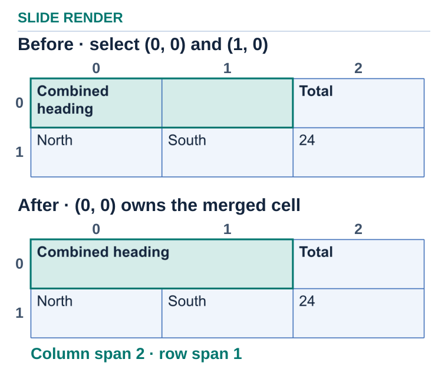

## **Overview**

Combine cells to create a heading across several columns or a label spanning multiple rows. The table model records the merged area and its origin cell, so your application can navigate the table without treating every covered cell as separate content.

## **Usage example**

This C# example creates a three-column, two-row table and merges the first two cells of its top row. Cell coordinates are zero-based `(column, row)`. The merged heading stays editable in `merge-table-cells.pptx`; the PNG shows its span.

```csharp
using System;
using System.Drawing;
using Aspose.Slides;
using Aspose.Slides.Export;

using var presentation = new Presentation();
var table = presentation.Slides[0].Shapes.AddTable(40, 40, new double[] { 160, 160, 160 }, new double[] { 60, 60 });
table[0, 0].TextFrame.Text = "Combined heading";
table[2, 0].TextFrame.Text = "Total";
table[0, 1].TextFrame.Text = "North";
table[1, 1].TextFrame.Text = "South";
table[2, 1].TextFrame.Text = "24";
table.MergeCells(table[0, 0], table[1, 0], false);
presentation.Save("merge-table-cells.pptx", SaveFormat.Pptx);
using var image = presentation.Slides[0].GetImage(1f, 1f);
image.Save("merge-table-cells.png", Aspose.Slides.ImageFormat.Png);
```


<!-- visual-explanation:merge-table-cells:start -->
[](visual-merge-table-cells-4cf44b5a5865.svg)

*The top-left cell owns the merged heading. The other rows and columns keep their original indices.*
<!-- visual-explanation:merge-table-cells:end -->

## **FAQ**

### **Can I undo a merge through the API?**

Yes. Cell-splitting operations let you divide a merged area again when the table layout changes.

### **Must merged cells form a rectangle?**

Yes. Pass the top-left and bottom-right cells of the rectangular range. Check existing merged regions before applying another merge.

### **How can I identify the cell that owns a merged region?**

Read the merged cell’s first row and first column indices. Use that origin cell to access the region’s text and formatting; its spans describe the covered grid.

## **Guides**

- [Manage Table Cells in Presentations in .NET](/slides/net/manage-cells/)

Related feature: [Create tables on slides](/slides/features/create-tables/).
