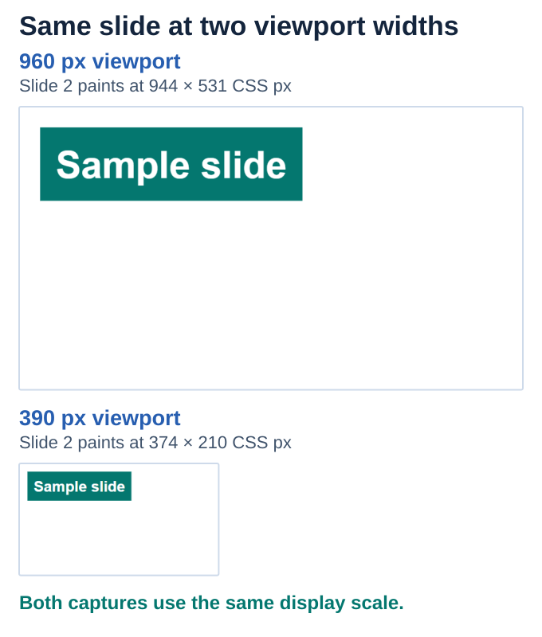

## **Overview**

Use responsive SVG layout settings when exporting classic HTML so the slide graphic can fit its containing area. This helps integrate slide output into a page whose width changes. Your hosting page controls the surrounding layout and browser viewport settings.

## **Usage example (C#)**

Install [Aspose.Slides for .NET](/slides/net/installation/) before running this standalone example. Export a generated slide using the responsive HTML controller. Its slide viewport scales with the browser width while preserving the slide's proportions.

```csharp
using System;
using Aspose.Slides;
using Aspose.Slides.Export;

using var presentation = new Presentation();
var shape = presentation.Slides[0].Shapes.AddAutoShape(ShapeType.Rectangle, 40, 40, 500, 140);
shape.AddTextFrame("Sample slide");
var controller = new ResponsiveHtmlController();
var options = new HtmlOptions { HtmlFormatter = HtmlFormatter.CreateCustomFormatter(controller) };
presentation.Save("responsive.html", SaveFormat.Html, options);
presentation.Save("source.pptx", SaveFormat.Pptx);
```


<!-- visual-explanation:responsive-html:start -->
[](visual-responsive-html-4167cc43de8c.svg)

*Two measured Edge viewports show the same exported slide. Its canvas scales with the available width and retains its 16:9 proportions.*
<!-- visual-explanation:responsive-html:end -->

## **FAQ**

### **Does this also make the HTML5 player responsive?**

The responsive SVG options belong to the classic HTML path. HTML5 player sizing is a separate behavior.

### **How does responsive HTML scale to a narrow viewport?**

The exported slide scales to fit the available width while retaining its slide coordinate system and proportions.

### **Does responsive output reflow slide objects like ordinary HTML text?**

No. It scales the slide view; it does not turn the slide into independently reflowing paragraphs and objects.

## **Guides**

- [Convert PowerPoint Presentations to HTML in .NET](/slides/net/convert-powerpoint-to-html/)

Related feature: [Export presentations to HTML](/slides/features/html-export/).
