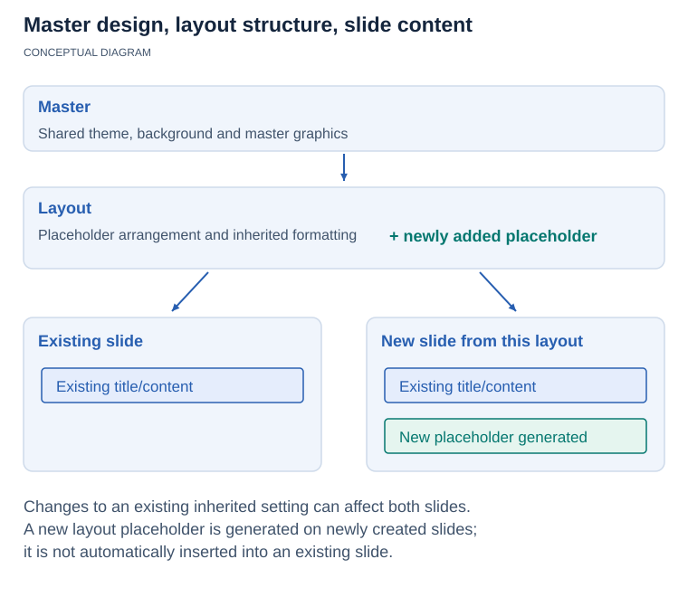

## **Overview**

Read, copy and edit slide masters to control design elements shared by multiple slides. Master backgrounds and master shapes can appear on slides that use the master, helping you apply a design change consistently without editing every slide object.


<!-- visual-explanation:master-layout-slides:start -->
[](visual-master-layout-slides-68f75c126f65.svg)

*Master backgrounds and graphics can be shared by slides through their layouts. The example adds one Shared brand label to a master and enables master graphics on two dependent slides. The graphic is inherited rather than duplicated as two slide-local shapes.*
<!-- visual-explanation:master-layout-slides:end -->

## **Usage example (C# / .NET)**

Install [Aspose.Slides for .NET](/slides/net/installation/) before running this standalone example.

This C# example adds a recurring label to the blank layout’s master and creates two slides using that layout. Master graphics are enabled on both slides, so the label is inherited without adding two independent text shapes.

```csharp
using Aspose.Slides;
using Aspose.Slides.Export;

using var presentation = new Presentation();
var layout = presentation.Masters[0].LayoutSlides.GetByType(SlideLayoutType.Blank);
var master = layout.MasterSlide;
var label = master.Shapes.AddAutoShape(ShapeType.Rectangle, 40, 30, 260, 50);
label.Name = "Shared brand";
label.TextFrame.Text = "Shared brand";
presentation.Slides[0].LayoutSlide = layout;
presentation.Slides[0].Shapes.Clear();
presentation.Slides[0].ShowMasterShapes = true;
var second = presentation.Slides.AddEmptySlide(layout);
second.ShowMasterShapes = true;
presentation.Save("slide-masters.pptx", SaveFormat.Pptx);
```

## **FAQ**

### **Can one presentation contain several masters?**

Yes. A presentation can retain multiple masters, including designs brought in when slides are copied from other decks.

### **How can I find the master used by a slide?**

Follow the slide’s layout to its master. Do not assume the first master is used by every slide in a presentation containing several designs.

### **How do I hide master graphics for one slide?**

Disable master graphics for that slide while keeping them enabled on its shared layout. This hides inherited master shapes for that slide without deleting the source shapes.

## **Guides**

- [Manage Presentation Slide Masters in .NET](/slides/net/slide-master/)

Related feature: [Change themes and color schemes](/slides/features/presentation-themes/).
