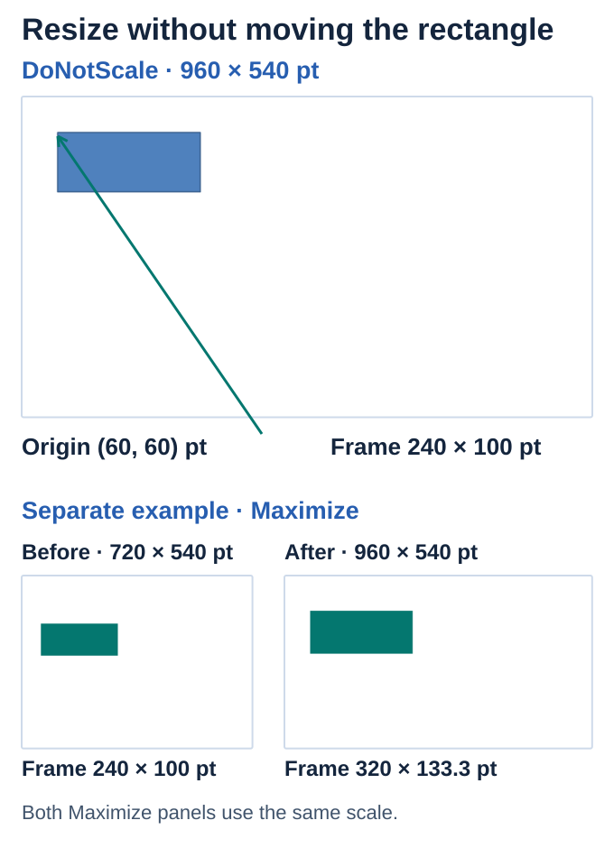

## **Overview**

Choose a standard slide size or set custom dimensions for a presentation. You can also change orientation and select how existing content should be scaled or fitted. Set these choices before assembling a deck when possible, so its layout starts with the right canvas.

## **Usage example (C# / .NET)**

Install [Aspose.Slides for .NET](/slides/net/installation/) before running this standalone example.

This C# example sets a 960 by 540 point canvas and explicitly leaves shape coordinates unchanged. The rectangle stays at 60,60 with a size of 240 by 100 points; the new canvas has a 16:9 aspect ratio.

```csharp
using Aspose.Slides;
using Aspose.Slides.Export;

using var presentation = new Presentation();
presentation.Slides[0].Shapes.AddAutoShape(ShapeType.Rectangle, 60, 60, 240, 100);
presentation.SlideSize.SetSize(960, 540, SlideSizeScaleType.DoNotScale);
presentation.Save("slide-size.pptx", SaveFormat.Pptx);
```


<!-- visual-explanation:slide-size:start -->
[](visual-slide-size-7f7865d71c9a.svg)

*DoNotScale keeps the 240 × 100-point rectangle at (60, 60) on the 960 × 540-point slide. In a separate resize from 720 × 540 to 960 × 540 points, Maximize scales the rectangle to about 320 × 133 points.*
<!-- visual-explanation:slide-size:end -->

## **FAQ**

### **Can I change the size of an existing deck?**

Yes. Choose a fitting or scaling behavior appropriate to its content, rather than only changing the canvas dimensions.

### **Can I change slide size without scaling the shapes?**

Yes. Choose the policy that leaves existing shape coordinates and dimensions unchanged. Review the resulting layout because a larger or smaller canvas can leave unused space or place objects outside the visible area.

### **Which units are used for slide width and height?**

Slide dimensions use points: 72 points equal one inch. Use the same units when calculating shape placement for the new canvas.

## **Guides**

- [Change the Presentation Slide Size in .NET](/slides/net/slide-size/)

Related feature: [Merge presentations](/slides/features/merge-presentations/).
