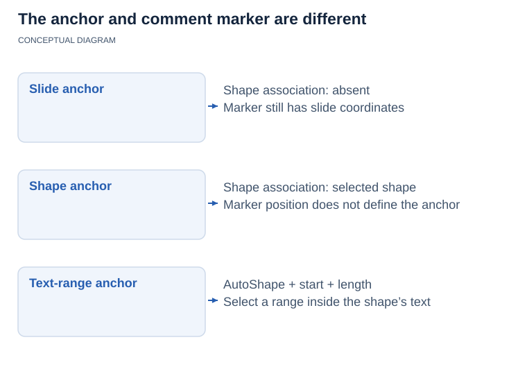

## **Overview**

This article explains how to manage presentation comments with Aspose.Slides for Java. It introduces the main comment-related types and demonstrates how to add comments to slides, access existing comments, work with replies and modern comments, and remove comments from a presentation.

The examples cover common review and collaboration scenarios in PowerPoint, such as assigning comments to authors, reading comment text and metadata, building reply chains, and removing selected comments or all comments.

In PowerPoint, comments appear as annotations on slides. Selecting a comment displays its text and related discussion.

To request that comments be shown or hidden when a presentation opens without changing the comments themselves, see [Show or Hide Comments When Opening a Presentation](/slides/java/presentation-view-properties/).

## **Why Add Comments to Presentations?**

You can use comments to provide feedback and collaborate with colleagues when reviewing presentations.

Aspose.Slides for Java provides the following APIs for working with comments:

* The [Presentation](https://reference.aspose.com/slides/java/com.aspose.slides/presentation/) class, which provides access to the presentation's comment authors.
* The [ICommentCollection](https://reference.aspose.com/slides/java/com.aspose.slides/icommentcollection/) interface, which represents the comments associated with an individual author.
* The [IComment](https://reference.aspose.com/slides/java/com.aspose.slides/icomment/) interface, which provides information about a comment, including its author, creation time, position, and text.
* The [CommentAuthor](https://reference.aspose.com/slides/java/com.aspose.slides/commentauthor/) class, which provides information about an author, including their name, initials, and associated comments.

## **Add Slide Comments**

The example creates two slides and registers a comment author with [addAuthor](https://reference.aspose.com/slides/java/com.aspose.slides/icommentauthorcollection/#addAuthor-java.lang.String-java.lang.String-). It uses [addComment](https://reference.aspose.com/slides/java/com.aspose.slides/icommentcollection/#addComment-java.lang.String-com.aspose.slides.ISlide-java.awt.geom.Point2D.Float-java.util.Date-) to place one comment on each slide, then retrieves the first slide's comments for that author with [getSlideComments](https://reference.aspose.com/slides/java/com.aspose.slides/islide/#getSlideComments-com.aspose.slides.ICommentAuthor-). The console displays the first comment's text twice, demonstrating access through both the slide and the author, and the saved presentation contains both comments.

```java
import com.aspose.slides.IComment;
import com.aspose.slides.ICommentAuthor;
import com.aspose.slides.ISlide;
import com.aspose.slides.Presentation;
import com.aspose.slides.SaveFormat;
import java.awt.geom.Point2D;
import java.util.Date;

Presentation presentation = new Presentation();
try {
    ISlide firstSlide = presentation.getSlides().get_Item(0);
    ISlide secondSlide = presentation.getSlides().addEmptySlide(presentation.getLayoutSlides().get_Item(0));

    ICommentAuthor author = presentation.getCommentAuthors().addAuthor("Jawad", "MF");
    Point2D.Float position = new Point2D.Float(0.2f, 0.2f);
    Date createdTime = new Date();

    author.getComments().addComment("Hello Jawad, this is a slide comment", firstSlide, position, createdTime);
    author.getComments().addComment("Hello Jawad, this is the second slide comment", secondSlide, position, createdTime);

    IComment[] comments = firstSlide.getSlideComments(author);
    if (comments.length > 0) {
        IComment firstComment = comments[0];
        System.out.println(firstComment.getText());

        String commentText = firstComment.getAuthor().getComments().get_Item(0).getText();
        System.out.println(commentText);
    }

    presentation.save("Comments_out.pptx", SaveFormat.Pptx);
} finally {
    presentation.dispose();
}
```

## **Find or Create a Comment Author**

When an automated review processes the same presentation repeatedly, search the collection returned by [getCommentAuthors](https://reference.aspose.com/slides/java/com.aspose.slides/presentation/#getCommentAuthors--) before adding an author. [findByNameAndInitials](https://reference.aspose.com/slides/java/com.aspose.slides/icommentauthorcollection/#findByNameAndInitials-java.lang.String-java.lang.String-) matches both the name and initials and returns an array of matching authors, or an empty array if no matches exist. In contrast, [findByName](https://reference.aspose.com/slides/java/com.aspose.slides/icommentauthorcollection/#findByName-java.lang.String-) searches by name alone, regardless of initials. Calling [addAuthor](https://reference.aspose.com/slides/java/com.aspose.slides/icommentauthorcollection/#addAuthor-java.lang.String-java.lang.String-) with a name and initials already present in the collection throws an exception.

The example requires a presentation file with at least one slide. On each of two passes, it reuses the first matching author, or creates one only when the result is empty. If there are multiple matches, it selects the first array element without merging or removing the other authors. It then calls [addComment](https://reference.aspose.com/slides/java/com.aspose.slides/icommentcollection/#addComment-java.lang.String-com.aspose.slides.ISlide-java.awt.geom.Point2D.Float-java.util.Date-) for the selected author and saves the presentation. The second pass opens the first pass's output and repeats the operation.

```java
import com.aspose.slides.ICommentAuthor;
import com.aspose.slides.Presentation;
import com.aspose.slides.SaveFormat;
import java.awt.geom.Point2D;
import java.util.Date;

final String authorName = "Reviewer";
final String authorInitials = "RV";

String inputFile = "input.pptx";
Point2D.Float position = new Point2D.Float(20, 20);

for (int pass = 1; pass <= 2; pass++) {
    Presentation presentation = new Presentation(inputFile);
    try {
        ICommentAuthor[] matches = presentation.getCommentAuthors().findByNameAndInitials(authorName, authorInitials);

        ICommentAuthor author = matches.length > 0 ? matches[0] : presentation.getCommentAuthors().addAuthor(authorName, authorInitials);
        author.getComments().addComment("Please review this slide.", presentation.getSlides().get_Item(0), position, new Date());

        String outputFile = "review_pass_" + pass + ".pptx";
        presentation.save(outputFile, SaveFormat.Pptx);
        inputFile = outputFile;
    } finally {
        presentation.dispose();
    }
}
```

The second pass adds another comment without adding another author or removing existing comments. The final file, `review_pass_2.pptx`, contains both new comments alongside any original comments. Reusing an author does not deduplicate comments: to avoid repeatedly adding the same comment, implement separate duplicate detection before adding it.

## **Access Slide Comments**

The example opens an existing presentation and reads the collection returned by [getCommentAuthors](https://reference.aspose.com/slides/java/com.aspose.slides/presentation/#getCommentAuthors--). For each author, it iterates through the collection returned by [getComments](https://reference.aspose.com/slides/java/com.aspose.slides/icommentauthor/#getComments--) and prints the slide number, comment text, author name, and creation time. The input presentation must contain comments to produce console output.

```java
import com.aspose.slides.IComment;
import com.aspose.slides.ICommentAuthor;
import com.aspose.slides.Presentation;

Presentation presentation = new Presentation("Comments1.pptx");
try {
    for (ICommentAuthor author : presentation.getCommentAuthors()) {
        for (IComment comment : author.getComments()) {
            System.out.println("Slide: " + comment.getSlide().getSlideNumber());
            System.out.println("Comment: " + comment.getText());
            System.out.println("Author: " + comment.getAuthor().getName());
            System.out.println("Posted at: " + comment.getCreatedTime());
            System.out.println();
        }
    }
} finally {
    presentation.dispose();
}
```

## **Reply to Comments**

A parent comment is the original comment at the top of a reply hierarchy. The [IComment.getParentComment](https://reference.aspose.com/slides/java/com.aspose.slides/icomment/#getParentComment--) and [IComment.setParentComment](https://reference.aspose.com/slides/java/com.aspose.slides/icomment/#setParentComment-com.aspose.slides.IComment-) methods let you get or set the parent of a comment.

The example creates comments from two authors and uses [setParentComment](https://reference.aspose.com/slides/java/com.aspose.slides/icomment/#setParentComment-com.aspose.slides.IComment-) to build replies, including a reply to another reply. Passing `null` to [getSlideComments](https://reference.aspose.com/slides/java/com.aspose.slides/islide/#getSlideComments-com.aspose.slides.ICommentAuthor-) retrieves comments from all authors; the console indents each entry according to its depth in the reply hierarchy. The example saves the complete discussion, calls [remove](https://reference.aspose.com/slides/java/com.aspose.slides/icomment/#remove--) on the first root comment, and saves a second presentation with that comment and its replies removed.

```java
import com.aspose.slides.IComment;
import com.aspose.slides.ICommentAuthor;
import com.aspose.slides.ISlide;
import com.aspose.slides.Presentation;
import com.aspose.slides.SaveFormat;
import java.awt.geom.Point2D;
import java.util.Date;

Presentation presentation = new Presentation();
try {
    ISlide slide = presentation.getSlides().get_Item(0);

    Point2D.Float position = new Point2D.Float(10, 10);
    Date createdTime = new Date();

    ICommentAuthor originalAuthor = presentation.getCommentAuthors().addAuthor("Author_1", "A.A.");
    IComment rootComment = originalAuthor.getComments().addComment("comment 1", slide, position, createdTime);

    ICommentAuthor reviewer = presentation.getCommentAuthors().addAuthor("Author_2", "B.B.");
    IComment firstReply = reviewer.getComments().addComment("reply 1 for comment 1", slide, position, createdTime);
    firstReply.setParentComment(rootComment);

    IComment secondReply = reviewer.getComments().addComment("reply 2 for comment 1", slide, position, createdTime);
    secondReply.setParentComment(rootComment);

    IComment subReply = originalAuthor.getComments().addComment("subreply 3 for reply 2", slide, position, createdTime);
    subReply.setParentComment(secondReply);

    reviewer.getComments().addComment("comment 2", slide, position, createdTime);
    IComment separateComment = reviewer.getComments().addComment("comment 3", slide, position, createdTime);

    IComment separateReply = originalAuthor.getComments().addComment("reply 4 for comment 3", slide, position, createdTime);
    separateReply.setParentComment(separateComment);

    IComment[] comments = slide.getSlideComments(null);
    for (int i = 0; i < comments.length; i++) {
        IComment comment = comments[i];
        while (comment.getParentComment() != null) {
            System.out.print("\t");
            comment = comment.getParentComment();
        }

        System.out.println(comments[i].getAuthor().getName() + ": " + comments[i].getText());
    }

    presentation.save("parent_comment.pptx", SaveFormat.Pptx);

    rootComment.remove();
    presentation.save("remove_comment.pptx", SaveFormat.Pptx);
} finally {
    presentation.dispose();
}
```

{}

* When the [IComment.remove](https://reference.aspose.com/slides/java/com.aspose.slides/icomment/#remove--) method is used to delete a comment, all replies to that comment are also deleted.
* If [IComment.setParentComment](https://reference.aspose.com/slides/java/com.aspose.slides/icomment/#setParentComment-com.aspose.slides.IComment-) creates a circular reference, a [PptxEditException](https://reference.aspose.com/slides/java/com.aspose.slides/pptxeditexception/) is thrown.

{}

## **Add Modern Comments**

Modern comments can be associated with the slide itself, with a specific shape, or with a text range inside an AutoShape. The [ICommentCollection.addModernComment](https://reference.aspose.com/slides/java/com.aspose.slides/icommentcollection/#addModernComment-java.lang.String-com.aspose.slides.ISlide-com.aspose.slides.IShape-java.awt.geom.Point2D.Float-java.util.Date-) method accepts an [IShape](https://reference.aspose.com/slides/java/com.aspose.slides/ishape/) argument in addition to the slide and comment-marker coordinates.

When `null` is passed for the shape argument, the comment is a slide-level comment. Its marker is positioned by the supplied coordinates, but it is not associated with a particular shape, so [IModernComment.getShape](https://reference.aspose.com/slides/java/com.aspose.slides/imoderncomment/#getShape--) returns `null`. When an [IShape](https://reference.aspose.com/slides/java/com.aspose.slides/ishape/) is supplied, the comment is anchored to that shape. The coordinates still define the position of the comment marker on the slide, while the shape association can be retrieved through [IModernComment.getShape](https://reference.aspose.com/slides/java/com.aspose.slides/imoderncomment/#getShape--).


<!-- visual-explanation:presentation-comments:start -->
[](visual-presentation-comments-3cbd80a755df.svg)

*A modern comment can have a slide, shape or AutoShape text-range anchor. Marker coordinates place its visual marker; they do not select the anchor. A text range adds a starting character index and length to the shape association.*
<!-- visual-explanation:presentation-comments:end -->

### **Anchor a Modern Comment to a Shape**

The example calls [addModernComment](https://reference.aspose.com/slides/java/com.aspose.slides/icommentcollection/#addModernComment-java.lang.String-com.aspose.slides.ISlide-com.aspose.slides.IShape-java.awt.geom.Point2D.Float-java.util.Date-) twice: once with a `null` shape for a slide-level comment and once with a rectangle as the anchor. Reading [getShape](https://reference.aspose.com/slides/java/com.aspose.slides/imoderncomment/#getShape--) prints `true` for the slide-level comment's null check and `Revenue title` for the anchored comment. Both comments are saved with the presentation.

```java
import com.aspose.slides.IAutoShape;
import com.aspose.slides.ICommentAuthor;
import com.aspose.slides.IModernComment;
import com.aspose.slides.ISlide;
import com.aspose.slides.Presentation;
import com.aspose.slides.SaveFormat;
import com.aspose.slides.ShapeType;
import java.awt.geom.Point2D;
import java.util.Date;

Presentation presentation = new Presentation();
try {
    ISlide slide = presentation.getSlides().get_Item(0);

    ICommentAuthor author = presentation.getCommentAuthors().addAuthor("Reviewer", "RV");

    IAutoShape shape = slide.getShapes().addAutoShape(ShapeType.Rectangle, 50, 50, 300, 80);
    shape.setName("Revenue title");
    shape.getTextFrame().setText("Quarterly revenue");

    Date createdTime = new Date();
    Point2D.Float slideCommentPosition = new Point2D.Float(20, 20);
    Point2D.Float shapeCommentPosition = new Point2D.Float(60, 60);
    IModernComment slideComment = author.getComments().addModernComment("Review the overall slide layout.", slide, null, slideCommentPosition, createdTime);
    IModernComment shapeComment = author.getComments().addModernComment("Check this title.", slide, shape, shapeCommentPosition, createdTime);

    System.out.println(slideComment.getShape() == null);
    System.out.println(shapeComment.getShape().getName());

    presentation.save("modern_comments.pptx", SaveFormat.Pptx);
} finally {
    presentation.dispose();
}
```

### **Anchor Comments to Different Shape Types**

Any slide object that implements [IShape](https://reference.aspose.com/slides/java/com.aspose.slides/ishape/) can be used as a shape anchor. Common examples include [IAutoShape](https://reference.aspose.com/slides/java/com.aspose.slides/iautoshape/), [IPictureFrame](https://reference.aspose.com/slides/java/com.aspose.slides/ipictureframe/), [IGroupShape](https://reference.aspose.com/slides/java/com.aspose.slides/igroupshape/), [IConnector](https://reference.aspose.com/slides/java/com.aspose.slides/iconnector/), and [IGraphicalObject](https://reference.aspose.com/slides/java/com.aspose.slides/igraphicalobject/) instances such as charts.

The example uses [addModernComment](https://reference.aspose.com/slides/java/com.aspose.slides/icommentcollection/#addModernComment-java.lang.String-com.aspose.slides.ISlide-com.aspose.slides.IShape-java.awt.geom.Point2D.Float-java.util.Date-) to associate a comment with each of five shape types: an AutoShape, a picture frame, a group, a connector, and a chart. The picture uses embedded image data, so no external image is required. Each comment has its own marker position, and the saved presentation retains all five shape associations.

```java
import com.aspose.slides.ChartType;
import com.aspose.slides.IAutoShape;
import com.aspose.slides.IChart;
import com.aspose.slides.ICommentAuthor;
import com.aspose.slides.IConnector;
import com.aspose.slides.IGroupShape;
import com.aspose.slides.IPPImage;
import com.aspose.slides.IPictureFrame;
import com.aspose.slides.ISlide;
import com.aspose.slides.Presentation;
import com.aspose.slides.SaveFormat;
import com.aspose.slides.ShapeType;
import java.awt.geom.Point2D;
import java.util.Base64;
import java.util.Date;

Presentation presentation = new Presentation();
try {
    ISlide slide = presentation.getSlides().get_Item(0);

    ICommentAuthor author = presentation.getCommentAuthors().addAuthor("Reviewer", "RV");
    Date createdTime = new Date();

    IAutoShape autoShape = slide.getShapes().addAutoShape(ShapeType.Rectangle, 20, 20, 180, 60);
    autoShape.getTextFrame().setText("AutoShape");

    Point2D.Float autoShapeCommentPosition = new Point2D.Float(30, 30);
    author.getComments().addModernComment("Comment on an AutoShape.", slide, autoShape, autoShapeCommentPosition, createdTime);

    String imageBase64 = "iVBORw0KGgoAAAANSUhEUgAAAAIAAAACCAIAAAD91JpzAAAAFklEQVR4nGP8//8/AwMDEwMDAwMDAwAkBgMB/DXemwAAAABJRU5ErkJggg==";
    byte[] imageData = Base64.getDecoder().decode(imageBase64);
    IPPImage image = presentation.getImages().addImage(imageData);
    IPictureFrame pictureFrame = slide.getShapes().addPictureFrame(ShapeType.Rectangle, 220, 20, 120, 80, image);
    Point2D.Float pictureCommentPosition = new Point2D.Float(230, 30);
    author.getComments().addModernComment("Comment on a picture.", slide, pictureFrame, pictureCommentPosition, createdTime);

    IGroupShape groupShape = slide.getShapes().addGroupShape();
    groupShape.getShapes().addAutoShape(ShapeType.Rectangle, 0, 0, 80, 40);
    groupShape.getShapes().addAutoShape(ShapeType.Ellipse, 100, 0, 80, 40);
    Point2D.Float groupCommentPosition = new Point2D.Float(40, 150);
    author.getComments().addModernComment("Comment on a group.", slide, groupShape, groupCommentPosition, createdTime);

    IConnector connector = slide.getShapes().addConnector(ShapeType.StraightConnector1, 220, 150, 140, 40);
    Point2D.Float connectorCommentPosition = new Point2D.Float(240, 150);
    author.getComments().addModernComment("Comment on a connector.", slide, connector, connectorCommentPosition, createdTime);

    IChart chart = slide.getShapes().addChart(ChartType.ClusteredColumn, 400, 20, 250, 180);
    Point2D.Float chartCommentPosition = new Point2D.Float(420, 40);
    author.getComments().addModernComment("Comment on a graphical object.", slide, chart, chartCommentPosition, createdTime);

    presentation.save("modern_comment_shape_types.pptx", SaveFormat.Pptx);
} finally {
    presentation.dispose();
}
```

### **Anchor a Comment to Text and Set Its Status**

For a modern comment associated with an [IAutoShape](https://reference.aspose.com/slides/java/com.aspose.slides/iautoshape/), [IModernComment.getTextSelectionStart](https://reference.aspose.com/slides/java/com.aspose.slides/imoderncomment/#getTextSelectionStart--) and [IModernComment.setTextSelectionStart](https://reference.aspose.com/slides/java/com.aspose.slides/imoderncomment/#setTextSelectionStart-int-) access the starting position of the selected text in the shape's text frame. [IModernComment.getTextSelectionLength](https://reference.aspose.com/slides/java/com.aspose.slides/imoderncomment/#getTextSelectionLength--) and [IModernComment.setTextSelectionLength](https://reference.aspose.com/slides/java/com.aspose.slides/imoderncomment/#setTextSelectionLength-int-) access the length of the selection. Together, these values associate the comment with a specific text range inside the AutoShape.

The [IModernComment.getStatus](https://reference.aspose.com/slides/java/com.aspose.slides/imoderncomment/#getStatus--) and [IModernComment.setStatus](https://reference.aspose.com/slides/java/com.aspose.slides/imoderncomment/#setStatus-byte-) methods access a value from the [ModernCommentStatus](https://reference.aspose.com/slides/java/com.aspose.slides/moderncommentstatus/) constants:

- `NotDefined` — no specific modern-comment status is defined.
- `Active` — the comment is active.
- `Resolved` — the comment has been resolved.
- `Closed` — the comment is closed.

The example anchors a modern comment to the words "quarterly revenue" in a rectangle's text. It calculates the zero-based selection start from the text and passes it to [setTextSelectionStart](https://reference.aspose.com/slides/java/com.aspose.slides/imoderncomment/#setTextSelectionStart-int-) and uses [setTextSelectionLength](https://reference.aspose.com/slides/java/com.aspose.slides/imoderncomment/#setTextSelectionLength-int-) to set the number of selected characters. After calling [setStatus](https://reference.aspose.com/slides/java/com.aspose.slides/imoderncomment/#setStatus-byte-) with `Resolved`, it saves and reopens the presentation. The four console checks should each print `true`, confirming that the shape anchor, text range, and status were preserved.

```java
import com.aspose.slides.IAutoShape;
import com.aspose.slides.IComment;
import com.aspose.slides.ICommentAuthor;
import com.aspose.slides.IModernComment;
import com.aspose.slides.ISlide;
import com.aspose.slides.ModernCommentStatus;
import com.aspose.slides.Presentation;
import com.aspose.slides.SaveFormat;
import com.aspose.slides.ShapeType;
import java.awt.geom.Point2D;
import java.util.Date;

String outputFile = "modern_comment_text_anchor.pptx";
String shapeText = "Review the quarterly revenue forecast.";
String selectedText = "quarterly revenue";
int expectedSelectionStart = shapeText.indexOf(selectedText);

Presentation presentation = new Presentation();
try {
    ISlide slide = presentation.getSlides().get_Item(0);

    IAutoShape shape = slide.getShapes().addAutoShape(ShapeType.Rectangle, 50, 50, 400, 100);
    shape.setName("Forecast text");
    shape.getTextFrame().setText(shapeText);

    ICommentAuthor author = presentation.getCommentAuthors().addAuthor("Reviewer", "RV");
    Point2D.Float commentPosition = new Point2D.Float(60, 60);
    IModernComment comment = author.getComments().addModernComment("Verify this forecast wording.", slide, shape, commentPosition, new Date());
    comment.setTextSelectionStart(expectedSelectionStart);
    comment.setTextSelectionLength(selectedText.length());
    comment.setStatus(ModernCommentStatus.Resolved);

    presentation.save(outputFile, SaveFormat.Pptx);
} finally {
    presentation.dispose();
}

Presentation reopenedPresentation = new Presentation(outputFile);
try {
    ISlide reopenedSlide = reopenedPresentation.getSlides().get_Item(0);
    IComment[] reopenedComments = reopenedSlide.getSlideComments(null);

    for (IComment reopenedComment : reopenedComments) {
        if (!(reopenedComment instanceof IModernComment)) {
            continue;
        }

        IModernComment modernComment = (IModernComment) reopenedComment;
        boolean shapeMatches = modernComment.getShape() != null && "Forecast text".equals(modernComment.getShape().getName());
        boolean selectionStartMatches = modernComment.getTextSelectionStart() == expectedSelectionStart;
        boolean selectionLengthMatches = modernComment.getTextSelectionLength() == selectedText.length();
        boolean statusMatches = modernComment.getStatus() == ModernCommentStatus.Resolved;

        System.out.println("Shape anchor preserved: " + shapeMatches);
        System.out.println("Text selection start preserved: " + selectionStartMatches);
        System.out.println("Text selection length preserved: " + selectionLengthMatches);
        System.out.println("Resolved status preserved: " + statusMatches);
    }
} finally {
    reopenedPresentation.dispose();
}
```

### **Inspect Existing Modern Comments**

The example requires an existing presentation containing modern comments and prints their text, status, and anchor details. To inspect it, check which comments implement [IModernComment](https://reference.aspose.com/slides/java/com.aspose.slides/imoderncomment/), then examine [IModernComment.getShape](https://reference.aspose.com/slides/java/com.aspose.slides/imoderncomment/#getShape--), [IModernComment.getTextSelectionStart](https://reference.aspose.com/slides/java/com.aspose.slides/imoderncomment/#getTextSelectionStart--), [IModernComment.getTextSelectionLength](https://reference.aspose.com/slides/java/com.aspose.slides/imoderncomment/#getTextSelectionLength--), and [IModernComment.getStatus](https://reference.aspose.com/slides/java/com.aspose.slides/imoderncomment/#getStatus--). A `null` shape indicates a slide-level comment. For an [IAutoShape](https://reference.aspose.com/slides/java/com.aspose.slides/iautoshape/) anchor, the text-selection methods identify the associated range in the shape's text frame.

```java
import com.aspose.slides.IAutoShape;
import com.aspose.slides.IComment;
import com.aspose.slides.IModernComment;
import com.aspose.slides.IShape;
import com.aspose.slides.ISlide;
import com.aspose.slides.Presentation;

Presentation presentation = new Presentation("comments.pptx");
try {
    for (ISlide slide : presentation.getSlides()) {
        IComment[] comments = slide.getSlideComments(null);
        for (IComment comment : comments) {
            if (!(comment instanceof IModernComment)) {
                continue;
            }

            IModernComment modernComment = (IModernComment) comment;
            System.out.println("Slide: " + slide.getSlideNumber());
            System.out.println("Text: " + modernComment.getText());
            System.out.println("Status: " + modernComment.getStatus());

            IShape shape = modernComment.getShape();
            if (shape == null) {
                System.out.println("Anchor: slide level");
            } else {
                System.out.println("Anchor shape: " + shape.getName());
                System.out.println("Anchor type: " + shape.getClass().getSimpleName());

                if (shape instanceof IAutoShape) {
                    System.out.println("Text selection start: " + modernComment.getTextSelectionStart());
                    System.out.println("Text selection length: " + modernComment.getTextSelectionLength());
                }
            }

            System.out.println();
        }
    }
} finally {
    presentation.dispose();
}
```

## **Remove Comments**

Aspose.Slides for Java lets you remove all comments and their authors from a presentation or delete selected comments while keeping the rest. The following examples demonstrate both approaches and save the updated presentation.

### **Remove All Comments and Comment Authors**

The example opens an existing presentation and calls [ICommentCollection.clear](https://reference.aspose.com/slides/java/com.aspose.slides/icommentcollection/#clear--) for each author, then calls [ICommentAuthorCollection.clear](https://reference.aspose.com/slides/java/com.aspose.slides/icommentauthorcollection/#clear--) to remove the authors themselves. The saved presentation contains neither comments nor comment authors. Use a presentation containing comments to observe the removal.

```java
import com.aspose.slides.ICommentAuthor;
import com.aspose.slides.Presentation;
import com.aspose.slides.SaveFormat;

Presentation presentation = new Presentation("example.pptx");
try {
    for (ICommentAuthor author : presentation.getCommentAuthors()) {
        author.getComments().clear();
    }

    presentation.getCommentAuthors().clear();

    presentation.save("example_out.pptx", SaveFormat.Pptx);
} finally {
    presentation.dispose();
}
```

### **Remove Specific Comments**

The example creates two comments on one slide and uses [getSlideComments](https://reference.aspose.com/slides/java/com.aspose.slides/islide/#getSlideComments-com.aspose.slides.ICommentAuthor-) to find comments by each author. It collects comments whose text equals "comment 1" before calling [ICommentCollection.remove](https://reference.aspose.com/slides/java/com.aspose.slides/icommentcollection/#remove-com.aspose.slides.IComment-), avoiding changes to the collection during selection. The saved presentation retains only "comment 2".

```java
import com.aspose.slides.IComment;
import com.aspose.slides.ICommentAuthor;
import com.aspose.slides.ISlide;
import com.aspose.slides.Presentation;
import com.aspose.slides.SaveFormat;
import java.awt.geom.Point2D;
import java.util.ArrayList;
import java.util.Date;
import java.util.List;

Presentation presentation = new Presentation();
try {
    ISlide slide = presentation.getSlides().get_Item(0);

    ICommentAuthor author = presentation.getCommentAuthors().addAuthor("Author", "A");
    Date createdTime = new Date();

    Point2D.Float firstCommentPosition = new Point2D.Float(0.2f, 0.2f);
    Point2D.Float secondCommentPosition = new Point2D.Float(0.3f, 0.2f);
    author.getComments().addComment("comment 1", slide, firstCommentPosition, createdTime);
    author.getComments().addComment("comment 2", slide, secondCommentPosition, createdTime);

    for (ICommentAuthor commentAuthor : presentation.getCommentAuthors()) {
        List<IComment> commentsToRemove = new ArrayList<IComment>();
        IComment[] comments = slide.getSlideComments(commentAuthor);

        for (IComment comment : comments) {
            if ("comment 1".equals(comment.getText())) {
                commentsToRemove.add(comment);
            }
        }

        for (IComment comment : commentsToRemove) {
            commentAuthor.getComments().remove(comment);
        }
    }

    presentation.save("pres.pptx", SaveFormat.Pptx);
} finally {
    presentation.dispose();
}
```

## **FAQ**

**Does Aspose.Slides support a resolved status for modern comments?**

Yes. [IModernComment.getStatus](https://reference.aspose.com/slides/java/com.aspose.slides/imoderncomment/#getStatus--) and [IModernComment.setStatus](https://reference.aspose.com/slides/java/com.aspose.slides/imoderncomment/#setStatus-byte-) access a [ModernCommentStatus](https://reference.aspose.com/slides/java/com.aspose.slides/moderncommentstatus/) value, including `Resolved`. The status is stored in the presentation and can be read again after the file is reopened.

**Are threaded discussions (reply chains) supported, and is there a nesting limit?**

Yes. Each comment can reference its [parent comment](https://reference.aspose.com/slides/java/com.aspose.slides/icomment/#getParentComment--), enabling reply chains. The API does not define a specific nesting-depth limit.

**In what coordinate system is a comment marker's position defined on a slide?**

The marker position is defined by floating-point coordinates in the slide coordinate system, allowing you to place it precisely on the slide.
