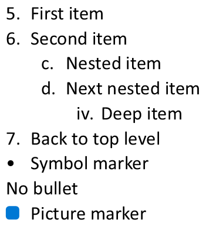

## **Overview**

Aspose.Slides for Java lets you create and format bulleted and numbered lists in PowerPoint and OpenDocument presentations. A list item is a paragraph whose bullet settings are controlled through its paragraph format.

Use the [IParagraph.getParagraphFormat](https://reference.aspose.com/slides/java/com.aspose.slides/iparagraph/#getParagraphFormat--) method to access paragraph-level list settings. The main entry point is [IParagraphFormat.getBullet](https://reference.aspose.com/slides/java/com.aspose.slides/iparagraphformat/#getBullet--), which returns an [IBulletFormat](https://reference.aspose.com/slides/java/com.aspose.slides/ibulletformat/) object. With this object, you can set the bullet type, symbol, picture, color, size, numbering style, and starting number.

This article shows how to:

- create a bulleted list with a custom symbol
- create a picture bullet
- create a multilevel list by setting paragraph depth
- create a numbered list
- inspect and change list formatting in an existing presentation
- read actual list markers and numbers alongside paragraph text

## **Create a Bulleted List**

To create a bulleted list, add [IParagraph](https://reference.aspose.com/slides/java/com.aspose.slides/iparagraph/) objects to an [ITextFrame](https://reference.aspose.com/slides/java/com.aspose.slides/itextframe/) and set [IBulletFormat.setType](https://reference.aspose.com/slides/java/com.aspose.slides/ibulletformat/#setType-byte-) to [BulletType.Symbol](https://reference.aspose.com/slides/java/com.aspose.slides/bullettype/#Symbol). You can then set [IBulletFormat.setChar](https://reference.aspose.com/slides/java/com.aspose.slides/ibulletformat/#setChar-char-), [IBulletFormat.getColor](https://reference.aspose.com/slides/java/com.aspose.slides/ibulletformat/#getColor--), and [IBulletFormat.setHeight](https://reference.aspose.com/slides/java/com.aspose.slides/ibulletformat/#setHeight-float-) to control the bullet appearance.

The following Java code demonstrates how to create a bulleted list in a slide:

```java
import com.aspose.slides.*;
import java.awt.Color;

Presentation presentation = new Presentation();
try {
    ISlide slide = presentation.getSlides().get_Item(0);

    IAutoShape autoShape = slide.getShapes().addAutoShape(ShapeType.Rectangle, 20, 20, 200, 50);

    ITextFrame textFrame = autoShape.getTextFrame();
    textFrame.getParagraphs().clear();

    Color bulletColor = new Color(205, 92, 92);

    Paragraph paragraph1 = new Paragraph();
    paragraph1.getParagraphFormat().getBullet().setType(BulletType.Symbol);
    paragraph1.getParagraphFormat().getBullet().setChar('*');
    paragraph1.getParagraphFormat().setIndent(15);
    paragraph1.getParagraphFormat().getBullet().setBulletHardColor(NullableBool.True);
    paragraph1.getParagraphFormat().getBullet().getColor().setColor(bulletColor);
    paragraph1.getParagraphFormat().getBullet().setHeight(100);
    paragraph1.setText("The first paragraph");
    textFrame.getParagraphs().add(paragraph1);

    Paragraph paragraph2 = new Paragraph();
    paragraph2.getParagraphFormat().getBullet().setType(BulletType.Symbol);
    paragraph2.getParagraphFormat().getBullet().setChar('*');
    paragraph2.getParagraphFormat().setIndent(15);
    paragraph2.getParagraphFormat().getBullet().setBulletHardColor(NullableBool.True);
    paragraph2.getParagraphFormat().getBullet().getColor().setColor(bulletColor);
    paragraph2.getParagraphFormat().getBullet().setHeight(100);
    paragraph2.setText("The second paragraph");
    textFrame.getParagraphs().add(paragraph2);

    presentation.save("symbol_bullets.pptx", SaveFormat.Pptx);
} finally {
    presentation.dispose();
}
```

The result:


## **Create a Numbered List**

Use numbered lists when the order of items matters. Set [IBulletFormat.setType](https://reference.aspose.com/slides/java/com.aspose.slides/ibulletformat/#setType-byte-) to [BulletType.Numbered](https://reference.aspose.com/slides/java/com.aspose.slides/bullettype/#Numbered). You can also choose a numbering format with [IBulletFormat.setNumberedBulletStyle](https://reference.aspose.com/slides/java/com.aspose.slides/ibulletformat/#setNumberedBulletStyle-byte-) or set [IBulletFormat.setNumberedBulletStartWith](https://reference.aspose.com/slides/java/com.aspose.slides/ibulletformat/#setNumberedBulletStartWith-short-) when the list should start from a value other than 1.

The following Java code shows how to create a numbered list in a slide:

```java
import com.aspose.slides.*;

Presentation presentation = new Presentation();
try {
    ISlide slide = presentation.getSlides().get_Item(0);

    IAutoShape autoShape = slide.getShapes().addAutoShape(ShapeType.Rectangle, 20, 20, 90, 80);

    ITextFrame textFrame = autoShape.getTextFrame();
    textFrame.getParagraphs().clear();

    Paragraph paragraph1 = new Paragraph();
    paragraph1.getParagraphFormat().getBullet().setType(BulletType.Numbered);
    paragraph1.setText("Apple");
    textFrame.getParagraphs().add(paragraph1);

    Paragraph paragraph2 = new Paragraph();
    paragraph2.getParagraphFormat().getBullet().setType(BulletType.Numbered);
    paragraph2.setText("Orange");
    textFrame.getParagraphs().add(paragraph2);

    Paragraph paragraph3 = new Paragraph();
    paragraph3.getParagraphFormat().getBullet().setType(BulletType.Numbered);
    paragraph3.setText("Banana");
    textFrame.getParagraphs().add(paragraph3);

    presentation.save("numbered_bullets.pptx", SaveFormat.Pptx);
} finally {
    presentation.dispose();
}
```

The result:


## **Create a Picture Bullet**

Aspose.Slides allows you to replace a regular bullet symbol with an image. Picture bullets work best with simple images that remain readable at a small size, such as icons or small transparent PNG files.

{}

Ideally, if you plan to replace the regular bullet symbol with an image, it's best to choose a simple graphic with a transparent background. Such images work well as custom bullet symbols.

Keep in mind that the image will be scaled down to a very small size. For that reason, we strongly recommend selecting an image that remains clear and visually effective when used as a bullet in a list.

{}

To create a picture bullet, add an image to [Presentation.getImages](https://reference.aspose.com/slides/java/com.aspose.slides/presentation/#getImages--) and assign the returned image object to [IBulletFormat.getPicture](https://reference.aspose.com/slides/java/com.aspose.slides/ibulletformat/#getPicture--). Set [IBulletFormat.setType](https://reference.aspose.com/slides/java/com.aspose.slides/ibulletformat/#setType-byte-) to [BulletType.Picture](https://reference.aspose.com/slides/java/com.aspose.slides/bullettype/#Picture) before assigning the image.

Let's say we have an "image.png":


The following Java code shows how to create picture bullets in a slide:

```java
import com.aspose.slides.*;

Presentation presentation = new Presentation();
try {
    ISlide slide = presentation.getSlides().get_Item(0);

    IAutoShape autoShape = slide.getShapes().addAutoShape(ShapeType.Rectangle, 20, 20, 200, 50);

    ITextFrame textFrame = autoShape.getTextFrame();
    textFrame.getParagraphs().clear();

    IPPImage bulletImage = presentation.getImages().addImage(Images.fromFile("image.png"));

    Paragraph paragraph1 = new Paragraph();
    paragraph1.getParagraphFormat().getBullet().setType(BulletType.Picture);
    paragraph1.getParagraphFormat().getBullet().getPicture().setImage(bulletImage);
    paragraph1.getParagraphFormat().setIndent(15);
    paragraph1.getParagraphFormat().getBullet().setHeight(100);
    paragraph1.setText("The first paragraph");
    textFrame.getParagraphs().add(paragraph1);

    Paragraph paragraph2 = new Paragraph();
    paragraph2.getParagraphFormat().getBullet().setType(BulletType.Picture);
    paragraph2.getParagraphFormat().getBullet().getPicture().setImage(bulletImage);
    paragraph2.getParagraphFormat().setIndent(15);
    paragraph2.getParagraphFormat().getBullet().setHeight(100);
    paragraph2.setText("The second paragraph");
    textFrame.getParagraphs().add(paragraph2);

    presentation.save("picture_bullets.pptx", SaveFormat.Pptx);
} finally {
    presentation.dispose();
}
```

The result:


## **Create a Multilevel List**

Use [IParagraphFormat.setDepth](https://reference.aspose.com/slides/java/com.aspose.slides/iparagraphformat/#setDepth-short-) to place list items on different levels. Level 0 is the top level, level 1 is nested below it, and so on.

The following Java code shows how to create a multilevel bulleted list:

```java
import com.aspose.slides.*;

Presentation presentation = new Presentation();
try {
    ISlide slide = presentation.getSlides().get_Item(0);

    IAutoShape autoShape = slide.getShapes().addAutoShape(ShapeType.Rectangle, 20, 20, 260, 110);

    ITextFrame textFrame = autoShape.getTextFrame();
    textFrame.getParagraphs().clear();

    Paragraph paragraph1 = new Paragraph();
    paragraph1.getParagraphFormat().setDepth((short) 0);
    paragraph1.setText("My text - Depth 0");
    textFrame.getParagraphs().add(paragraph1);

    Paragraph paragraph2 = new Paragraph();
    paragraph2.getParagraphFormat().setDepth((short) 1);
    paragraph2.setText("My text - Depth 1");
    textFrame.getParagraphs().add(paragraph2);

    Paragraph paragraph3 = new Paragraph();
    paragraph3.getParagraphFormat().setDepth((short) 2);
    paragraph3.setText("My text - Depth 2");
    textFrame.getParagraphs().add(paragraph3);

    Paragraph paragraph4 = new Paragraph();
    paragraph4.getParagraphFormat().setDepth((short) 3);
    paragraph4.setText("My text - Depth 3");
    textFrame.getParagraphs().add(paragraph4);

    presentation.save("multilevel_bullets.pptx", SaveFormat.Pptx);
} finally {
    presentation.dispose();
}
```

The result:


## **Change an Existing List**

To change list formatting in an existing presentation, access the target paragraph and update its [IParagraphFormat.getBullet](https://reference.aspose.com/slides/java/com.aspose.slides/iparagraphformat/#getBullet--) settings. The same properties used to create lists can be used to inspect or modify lists loaded from a PPT, PPTX, or ODP file.

The following Java code changes the first paragraph in a text frame to use a numbered list style:

```java
import com.aspose.slides.*;

Presentation presentation = new Presentation("input.pptx");
try {
    ISlide slide = presentation.getSlides().get_Item(0);

    IAutoShape autoShape = (IAutoShape) slide.getShapes().get_Item(0);

    IParagraph paragraph = autoShape.getTextFrame().getParagraphs().get_Item(0);
    paragraph.getParagraphFormat().getBullet().setType(BulletType.Numbered);
    paragraph.getParagraphFormat().getBullet().setNumberedBulletStyle(NumberedBulletStyle.BulletRomanUCPeriod);
    paragraph.getParagraphFormat().getBullet().setNumberedBulletStartWith((short) 1);
    paragraph.getParagraphFormat().setMarginLeft(30);
    paragraph.getParagraphFormat().setIndent(-20);

    presentation.save("updated_list.pptx", SaveFormat.Pptx);
} finally {
    presentation.dispose();
}
```

## **Read Actual Bullet Values**

When extracting presentation content, keep list markers alongside paragraph text. Call [IParagraphFormat.getEffective](https://reference.aspose.com/slides/java/com.aspose.slides/iparagraphformat/#getEffective--) and access [IParagraphFormatEffectiveData.getBullet](https://reference.aspose.com/slides/java/com.aspose.slides/iparagraphformateffectivedata/#getBullet--) to obtain the effective bullet format. Check its [getType](https://reference.aspose.com/slides/java/com.aspose.slides/ibulletformateffectivedata/#getType--) before reading [getActualBulletValue](https://reference.aspose.com/slides/java/com.aspose.slides/ibulletformateffectivedata/#getActualBulletValue--).

For numbered lists, distinguish these three values:

- [getNumberedBulletStyle](https://reference.aspose.com/slides/java/com.aspose.slides/ibulletformateffectivedata/#getNumberedBulletStyle--) determines the format, such as Arabic numbers followed by a period or lowercase letters followed by a period.
- [getNumberedBulletStartWith](https://reference.aspose.com/slides/java/com.aspose.slides/ibulletformateffectivedata/#getNumberedBulletStartWith--) specifies the starting number for a group of numbered paragraphs.
- [getActualBulletValue](https://reference.aspose.com/slides/java/com.aspose.slides/ibulletformateffectivedata/#getActualBulletValue--) returns the formatted marker for a particular paragraph. For example, the second item in a list starting at 5 returns `6.`.

Preserve [getDepth](https://reference.aspose.com/slides/java/com.aspose.slides/iparagraphformat/#getDepth--) with each paragraph to retain its nesting level. The actual marker does not encode the full hierarchy: a nested item can return `c.` rather than a combined label such as `6.c.`.

The following self-contained example creates lists, saves them to a presentation, and reloads the presentation to report each paragraph's text, depth, bullet type, and actual value. The small blue picture marker is created from inline SVG.

```java
import com.aspose.slides.*;
import java.awt.Color;

Presentation presentation = new Presentation();
try {
    presentation.getSlideSize().setSize(720, 440, SlideSizeScaleType.DoNotScale);
    ISlide slide = presentation.getSlides().get_Item(0);

    IAutoShape shape = slide.getShapes().addAutoShape(ShapeType.Rectangle, 30, 20, 660, 400);
    shape.getFillFormat().setFillType(FillType.NoFill);
    shape.getLineFormat().getFillFormat().setFillType(FillType.NoFill);

    ITextFrame textFrame = shape.getTextFrame();
    textFrame.getParagraphs().clear();

    // Create a picture marker without an external image file.
    SvgImage svg = new SvgImage("<svg xmlns='http://www.w3.org/2000/svg' width='16' height='16'><rect width='16' height='16' rx='4' fill='#0078D4'/></svg>");
    IPPImage bulletImage = presentation.getImages().addImage(svg);

    class ListBuilder {
        void addParagraph(String text, short depth, byte type, short start, byte style) {
            Paragraph paragraph = new Paragraph();
            paragraph.setText(text);

            IParagraphFormat format = paragraph.getParagraphFormat();
            format.setDepth(depth);
            format.setMarginLeft(30 + depth * 40);
            format.setIndent(-28);
            format.setSpaceAfter(8);
            format.getDefaultPortionFormat().setFontHeight(22);
            format.getDefaultPortionFormat().getFillFormat().setFillType(FillType.Solid);
            format.getDefaultPortionFormat().getFillFormat().getSolidFillColor().setColor(Color.BLACK);
            format.getBullet().setType(type);
            format.getBullet().setBulletHardColor(NullableBool.True);
            format.getBullet().getColor().setColor(Color.BLACK);
            if (type == BulletType.Numbered) {
                format.getBullet().setNumberedBulletStyle(style);
                format.getBullet().setNumberedBulletStartWith(start);
            } else if (type == BulletType.Symbol) {
                format.getBullet().setChar('\u2022');
            } else if (type == BulletType.Picture) {
                format.getBullet().getPicture().setImage(bulletImage);
            }

            textFrame.getParagraphs().add(paragraph);
        }
    }

    ListBuilder list = new ListBuilder();
    list.addParagraph("First item", (short) 0, BulletType.Numbered, (short) 5, NumberedBulletStyle.BulletArabicPeriod);
    list.addParagraph("Second item", (short) 0, BulletType.Numbered, (short) 5, NumberedBulletStyle.BulletArabicPeriod);
    list.addParagraph("Nested item", (short) 1, BulletType.Numbered, (short) 3, NumberedBulletStyle.BulletAlphaLCPeriod);
    list.addParagraph("Next nested item", (short) 1, BulletType.Numbered, (short) 3, NumberedBulletStyle.BulletAlphaLCPeriod);
    list.addParagraph("Deep item", (short) 2, BulletType.Numbered, (short) 4, NumberedBulletStyle.BulletRomanLCPeriod);
    list.addParagraph("Back to top level", (short) 0, BulletType.Numbered, (short) 5, NumberedBulletStyle.BulletArabicPeriod);
    list.addParagraph("Symbol marker", (short) 0, BulletType.Symbol, (short) 1, NumberedBulletStyle.BulletArabicPeriod);
    list.addParagraph("No bullet", (short) 0, BulletType.None, (short) 1, NumberedBulletStyle.BulletArabicPeriod);
    list.addParagraph("Picture marker", (short) 0, BulletType.Picture, (short) 1, NumberedBulletStyle.BulletArabicPeriod);
    presentation.save("actual_bullet_values.pptx", SaveFormat.Pptx);
} finally {
    presentation.dispose();
}

Presentation loadedPresentation = new Presentation("actual_bullet_values.pptx");
try {
    IAutoShape loadedShape = (IAutoShape) loadedPresentation.getSlides().get_Item(0).getShapes().get_Item(0);
    System.out.println("Text | Depth | Type | Actual value");
    for (IParagraph paragraph : loadedShape.getTextFrame().getParagraphs()) {
        IBulletFormatEffectiveData bullet = paragraph.getParagraphFormat().getEffective().getBullet();
        String marker;
        switch (bullet.getType()) {
            case BulletType.Numbered:
            case BulletType.Symbol:
                marker = bullet.getActualBulletValue();
                break;
            case BulletType.None:
                marker = bullet.getActualBulletValue() + " (no bullet)";
                break;
            case BulletType.Picture:
                marker = bullet.getActualBulletValue() + " (image required)";
                break;
            default:
                marker = "unsupported bullet type";
                break;
        }
        String typeName = BulletType.getName(BulletType.class, bullet.getType());
        System.out.println(paragraph.getText() + " | " + paragraph.getParagraphFormat().getDepth() + " | " + typeName + " | " + marker);
    }
} finally {
    loadedPresentation.dispose();
}
```

The source lists are shown below.



The report matches the markers displayed in PowerPoint:

```text
Text | Depth | Type | Actual value
First item | 0 | Numbered | 5.
Second item | 0 | Numbered | 6.
Nested item | 1 | Numbered | c.
Next nested item | 1 | Numbered | d.
Deep item | 2 | Numbered | iv.
Back to top level | 0 | Numbered | 7.
Symbol marker | 0 | Symbol | •
No bullet | 0 | None | null (no bullet)
Picture marker | 0 | Picture | null (image required)
```

For [BulletType.None and BulletType.Picture](https://reference.aspose.com/slides/java/com.aspose.slides/bullettype/), [getActualBulletValue](https://reference.aspose.com/slides/java/com.aspose.slides/ibulletformateffectivedata/#getActualBulletValue--) returns `null`, not an empty string. Handle these types separately: the former has no marker, while the latter requires extracting the bullet image separately. A picture bullet cannot be reproduced solely by extracting a text marker.

## **FAQ**

**Can bulleted and numbered lists be exported to PDF or images?**

Yes. Aspose.Slides preserves list formatting when the target format supports the corresponding text layout and bullet features.

**Can I edit lists in existing presentations?**

Yes. Load the presentation, access the target paragraph, inspect or update its [IParagraphFormat.getBullet](https://reference.aspose.com/slides/java/com.aspose.slides/iparagraphformat/#getBullet--) settings, and save the presentation.

**Can lists contain non-Latin text?**

Yes. List item text can contain Unicode characters, so you can create lists in multilingual presentations. Make sure the fonts used in the presentation support the characters you need.
