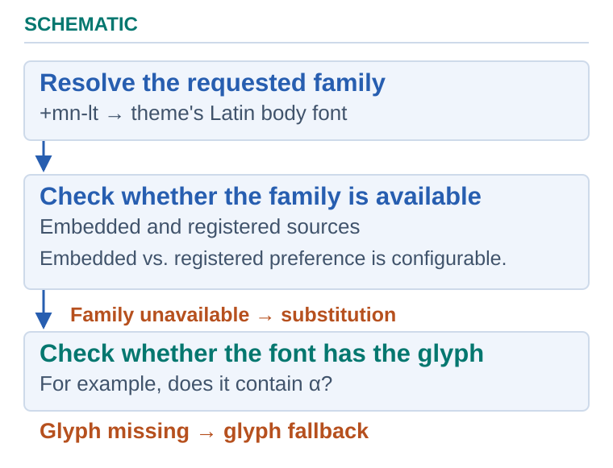

## **Overview**

When a presentation is loaded, rendered, or converted to another format, Aspose.Slides considers its embedded fonts and the fonts available to the application. If a required font is unavailable, Aspose.Slides selects a replacement font that is as close as possible to the one PowerPoint would use.

Available fonts can include system fonts, fonts loaded by the application and fonts embedded in the presentation. For a matching embedded and registered font, the .NET 26.11 preference described below controls which takes priority. Font substitution rules defined through [FontSubstRule](https://reference.aspose.com/slides/net/aspose.slides/fontsubstrule/) are a separate mechanism.

You can also add fonts at application runtime, use embedded fonts from a presentation, or load external fonts for output documents such as PDF files.

## **Font Selection**

Text can reference a theme font, such as `+mn-lt`, rather than an explicit family name. See [Resolve Theme Font References](/slides/net/presentation-theme/#resolve-theme-font-references) to obtain the family specified by the applicable theme. Resolving that reference is separate from checking font availability and applying rendering-time substitution or glyph fallback; it does not identify the font file ultimately used to render the text.

When rendering slides or converting a presentation, check that the requested fonts are embedded or available from registered sources. Missing fonts can require replacement or substitution; see [**Font Replacement**](/slides/net/font-replacement/) and [**Font Substitution**](/slides/net/font-substitution/).

When investigating font selection:

1. Resolve the requested family and style, including any theme reference.
2. Check embedded fonts and registered sources, including system fonts and fonts loaded by the application. Use the preference below when matching embedded and registered versions compete.
3. Review [font substitution rules](https://reference.aspose.com/slides/net/aspose.slides/fontsubstrule/) and glyph fallback if the requested font or characters are unavailable.

Aspose.Slides allows you to add fonts to application runtime and then use those fonts. See [**Custom fonts**](/slides/net/custom-font/).

When additional fonts are placed within a presentation, they are called [**Embedded fonts**](/slides/net/embedded-font/).

Aspose.Slides allows you to add fonts that are applied to *only* output documents. For example, if a presentation you are looking to convert to PDF contains fonts missing from your system and embedded fonts, you can add or load the needed fonts as **external fonts**. 

{} 
We do not distribute any fonts, either paid or free. Our API allows you to load external fonts and embed them in documents, but you do so with fonts at your discretion and responsibility.
{}


<!-- visual-explanation:font-selection-sequence:start -->
[](visual-font-selection-sequence-c58594a31127.svg)

*The embedded-font preference applies when both embedded and registered sources match. Missing families and missing glyphs have separate remedies.*
<!-- visual-explanation:font-selection-sequence:end -->

## **Prefer Registered Fonts over Embedded Fonts**

Starting with .NET 26.11, [IFontsManager.PreferRegisteredFontsOverEmbedded](https://reference.aspose.com/slides/net/aspose.slides/ifontsmanager/preferregisteredfontsoverembedded/) lets a matching registered font take priority over an embedded font during export. The default is `false`. Matching uses the font name and style; a different family name is not a replacement match. Registered fonts can come from the system or [explicitly loaded font sources](/slides/net/custom-font/).

The following example uses the **Aspose.Slides.NET6.CrossPlatform 26.11** package on .NET 8. Follow the [installation guide](/slides/net/installation/) for your environment. Provide `embedded-fonts.pptx` with an embedded font and `preferred.ttf` with the same family name and style. The two font files should differ visibly if you want to compare the output.

```csharp
using System.IO;
using Aspose.Slides;
using Aspose.Slides.Export;

var fontBytes = File.ReadAllBytes("preferred.ttf");
FontsLoader.LoadExternalFont(fontBytes);
using var presentation = new Presentation("embedded-fonts.pptx");

presentation.FontsManager.PreferRegisteredFontsOverEmbedded = false;
presentation.Save("embedded-preference.pdf", SaveFormat.Pdf);

presentation.FontsManager.PreferRegisteredFontsOverEmbedded = true;
presentation.Save("registered-preference.pdf", SaveFormat.Pdf);

presentation.FontsManager.PreferRegisteredFontsOverEmbedded = false;
presentation.Save("restored-preference.pdf", SaveFormat.Pdf);
```

This setting changes font precedence during the export; it does not rename the text's font, remove embedded font data or re-embed the registered file. It is a runtime setting: set it again after reopening a presentation. If no matching registered font is available, enabling the preference does not supply one; verify the resulting font and layout in your target environment.

PNG and PDF output with explicitly loaded regular fonts were checked for the configuration above. Check your own font files, styles, SDK build and output formats before depending on identical results. Font metrics can change line breaks and positioning. Use [font replacement](/slides/net/font-replacement/) or [substitution](/slides/net/font-substitution/) when you need a different family, and [embedded-font operations](/slides/net/embedded-font/) when you need to change the fonts stored in the presentation.

## **FAQ**

**How can I determine which fonts are actually used in a presentation before conversion?**

Aspose.Slides lets you inspect the fonts used via the [font manager](https://reference.aspose.com/slides/net/aspose.slides/presentation/fontsmanager/), so you can decide whether to [embed](/slides/net/embedded-font/), [replace](/slides/net/font-replacement/), or add [external sources](/slides/net/custom-font/). This helps you prevent unwanted substitutions during rendering and export.

**Can I add extra font directories without installing them on the operating system?**

Yes. You can register [external font sources](/slides/net/custom-font/) such as folders or in-memory streams for rendering and export. This removes dependency on host system fonts and keeps layout predictable.

**How do I prevent a silent fallback to an unsuitable font when a glyph is missing?**

Define explicit [font replacement](/slides/net/font-replacement/) and font [fallback rules](/slides/net/fallback-font/) in advance. By analyzing used fonts and setting a controlled priority for substitutes, you ensure consistent typography and avoid unexpected results.
