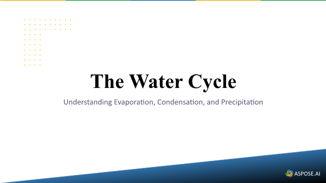

Generate an editable water-cycle presentation through the default Aspose AI client. The program saves and reopens the deck, checks that the requested topic has useful text, and renders a preview. It makes a genuine network call; generated wording and slide count vary.

A representative first slide from one execution follows. Generated wording and design may vary.



## Prerequisites and input

Use a current supported .NET10 SDK/runtime and the supplied flexible SDK settings; no exact patch is required.

The example uses only synthetic prompts and creates its input presentation where needed. Generation and translation contact the selected model service.
## Complete C# example

```csharp
using System;
using System.Collections.Concurrent;
using System.Drawing;
using System.IO;
using System.Linq;
using System.Net.Http;
using System.Text;
using System.Text.Json;
using System.Threading;
using System.Threading.Tasks;
using Aspose.Slides;
using Aspose.Slides.AI;
using Aspose.Slides.Export;

internal static class Program
{
    private static ExampleContext Context = null!;
    private static Task<int> Main(string[] args) => ExampleBootstrap.RunAsync(args, async context =>
    {
        Context=context;
        string actionId="ai/generate/block-001";
        context.BeginAction(actionId);

        context.Prerequisite(context.IsLicensed,"Real AI generation/translation requires an authorized license covering this release. Use --mode licensed with --license PATH or ASPOSE_LICENSE_PATH; evaluation performs no model call.");
        context.Prerequisite(context.Arguments.Contains("--allow-network"),"This recipe contacts a real model service. Add --allow-network only for a service you are authorized to use; no model or credentials are included.");

        int code=await RunExample(context.Arguments);
        context.Require(code==0,"The real AI operation failed. See error.json for the error type and observed HTTP statuses; credentials are never written.");
        VerifyResult(actionId);
    });

    private static void VerifyResult(string actionId)
    {
        using var actual=JsonDocument.Parse(File.ReadAllText("result.json"));
        using var expected=JsonDocument.Parse("{\"generated\":true,\"reopened_text_matches\":true,\"model_response_observed\":true}");
        var checks=new System.Collections.Generic.Dictionary<string,bool>();
        foreach(var field in expected.RootElement.EnumerateObject())
        {
            var value=actual.RootElement;foreach(string part in field.Name.Split('.'))value=value.GetProperty(part);
            string wanted=field.Value.ToString();
            if(actionId.EndsWith("/configured-only",StringComparison.Ordinal)&&field.Name=="providers_checked")wanted="1";
            Context.Require(value.ToString()==wanted,"The genuine operation failed its result check: "+field.Name);
            checks[(Context.IsLicensed?"licensed-":"evaluation-")+field.Name.Replace('.','-')]=true;
        }
        if(!Context.IsLicensed){checks["evaluation-semantic-effect"]=true;checks["evaluation-valid-output"]=true;}
        Context.Pass(actionId,checks);
    }

    private const string Prompt = "Create a short English presentation about the water cycle. Cover evaporation, condensation and precipitation. Use ordinary text slides with a title and a short paragraph. No charts, tables or images. For every section in the JSON, use the integer 0 for its type field instead of a type name. Return raw JSON without Markdown code fences or commentary.";
    private static readonly ConcurrentBag<RequestResult> Requests = new();

    private static async Task<int> RunExample(string[] args)
    {
        try
        {
            using var http = Http("default");
            using var client = new AsposeAIWebClient(http);
            var agent = new SlidesAIAgent(client);
            using IPresentation deck = await agent.GeneratePresentationAsync(Prompt, PresentationContentAmountType.Brief);
            int slides = VerifyGenerated(deck, "generated.pptx");
            Require(Requests.Any(r => r.Provider == "default" && r.StatusCode == 200), "No real model response observed.");
            Report(new { generated = true, reopened_text_matches = true, model_response_observed = true, slides, requests = Requests.ToArray() });
            return 0;
        }
        catch (Exception error)
        {
            int exit = error is OperationCanceledException ? 4 : error is HttpRequestException ? 3 : 2;
            File.WriteAllText("error.json", JsonSerializer.Serialize(new { error_type = error.GetType().Name, requests = Requests.ToArray(), exit_code = exit }));
            Console.Error.WriteLine("AI example failed: " + error.GetType().Name + ". Check configuration and provider access.");
            return exit;
        }
    }

    private static string Required(string name)
    {
        string? value = Environment.GetEnvironmentVariable(name);
        if (string.IsNullOrWhiteSpace(value)) throw new InvalidOperationException("Set " + name + " before running this example.");
        return value;
    }

    private static HttpClient Http(string provider)
    {
        double timeout = 180;
        if (double.TryParse(Environment.GetEnvironmentVariable("SLIDES_AI_TIMEOUT_SECONDS"), System.Globalization.NumberStyles.Float, System.Globalization.CultureInfo.InvariantCulture, out double configured)) timeout = configured;
        if (timeout <= 0) throw new InvalidOperationException("Timeout must be positive.");
        return new HttpClient(new TraceHandler(provider)) { Timeout = TimeSpan.FromSeconds(timeout) };
    }

    private static void Require(bool condition, string message)
    {
        if (!condition) throw new InvalidOperationException(message);
    }

    private static string AllText(IPresentation deck)
    {
        var text = new StringBuilder();
        void Read(IShapeCollection shapes)
        {
            foreach (IShape shape in shapes)
            {
                if (shape is IAutoShape auto && auto.TextFrame != null) text.AppendLine(auto.TextFrame.Text);
                if (shape is IGroupShape group) Read(group.Shapes);
                if (shape is ITable table)
                    for (int row = 0; row < table.Rows.Count; row++)
                        for (int column = 0; column < table.Columns.Count; column++) text.AppendLine(table[column, row].TextFrame.Text);
            }
        }
        foreach (ISlide slide in deck.Slides) Read(slide.Shapes);
        return text.ToString();
    }

    private static int VerifyGenerated(IPresentation deck, string path)
    {
        string live = AllText(deck);
        Require(deck.Slides.Count >= 2 && live.Length > 150 && live.Contains("water", StringComparison.OrdinalIgnoreCase), "Generated content did not describe the requested topic.");
        deck.Save(path, SaveFormat.Pptx);
        using var reopened = new Presentation(path);
        Require(reopened.Slides.Count == deck.Slides.Count && AllText(reopened) == live, "Generated editable text changed after reopening.");
        using var image = reopened.Slides[0].GetImage(new Size(640, 360));
        image.Save(Path.ChangeExtension(path, ".png"), Aspose.Slides.ImageFormat.Png);
        return reopened.Slides.Count;
    }

    private static void Report(object result)
    {
        string json = JsonSerializer.Serialize(result, new JsonSerializerOptions { WriteIndented = true });
        File.WriteAllText("result.json", json);
        Console.WriteLine(json);
    }

    private sealed record RequestResult(string Provider, int StatusCode);
    private sealed class TraceHandler : DelegatingHandler
    {
        private readonly string provider;
        public TraceHandler(string provider) : base(new HttpClientHandler()) { this.provider = provider; }
        protected override async Task<HttpResponseMessage> SendAsync(HttpRequestMessage request, CancellationToken token)
        {
            HttpResponseMessage response = await base.SendAsync(request, token);
            Requests.Add(new RequestResult(provider, (int)response.StatusCode));
            return response;
        }
    }
}
```

## Run and inspect the result

```text
dotnet run --project Example.csproj --configuration Release
```

The program writes "generated.pptx", "generated.png" and a result.json summary in the current directory. Open the PPTX files to edit their text and review the PNG previews at normal size. The source and the generated output are kept separate. Wording varies between model responses; successful execution checks structure and saved text, not a byte-identical deck.

## Limitations

A configured AI service processes the prompt. The default Aspose client avoids hard-coding a model name in this example. Review the generated text and layout before using it. This workflow does not generate images.

Continue with the [detailed guide](/slides/net/ai/generator/).


## Download, prerequisites and run

[Download the complete project](example.zip) and open `Example.sln`. The stable
net8.0/C#12 project accepts compatible installed release SDKs and explicitly runs
on the current .NET10 runtime. No exact SDK patch or locked restore is required.
Bundled Noto Sans fonts include their redistribution notice. See
[setup and supported environments](/slides/net/examples/getting-started/).

The bootstrap prints the separate output workspace. Explicit `--mode evaluation`
ignores all license settings; `--mode licensed` accepts your authorized license
through `--license PATH` or ASPOSE_LICENSE_PATH. No license or credential is included.

Default evaluation performs no model request and reports the missing prerequisite
with exit2. To execute the real generation/translation, opt in explicitly:

```text
dotnet run --project Example.csproj -- --mode licensed --allow-network
```

Configured providers also need their endpoint, real model identifier and API key.
A prerequisite diagnostic never counts as a generated or translated presentation.
