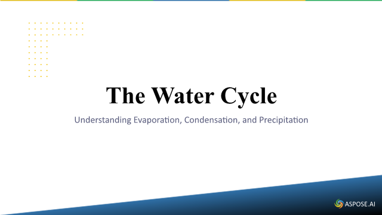

Generate an editable water-cycle presentation through the default Aspose AI client. The program saves and reopens the deck, checks that the requested topic has useful text, and renders a preview. It makes a genuine network call; generated wording and slide count vary.

A representative first slide from one execution follows. Generated wording and design may vary.



## Prerequisites and input

Use a current supported .NET10 SDK/runtime and the supplied flexible SDK settings; no exact patch is required.

The example uses only synthetic prompts and creates its input presentation where needed. Generation and translation contact the selected model service.
## Complete C# example

The code below shows the main operation. The runnable download includes [ExampleSupport.cs](ExampleSupport.cs) with the entry point and supporting code.

```csharp
using System;
using System.Collections.Concurrent;
using System.Drawing;
using System.IO;
using System.Linq;
using System.Net.Http;
using System.Text;
using System.Text.Json;
using System.Threading;
using System.Threading.Tasks;
using Aspose.Slides;
using Aspose.Slides.AI;
using Aspose.Slides.Export;

internal static partial class Program
{
    private const string Prompt = "Create a short English presentation about the water cycle. Cover evaporation, condensation and precipitation. Use ordinary text slides with a title and a short paragraph. No charts, tables or images. For every section in the JSON, use the integer 0 for its type field instead of a type name. Return raw JSON without Markdown code fences or commentary.";

    private static async Task<int> RunExample()
    {
        try
        {
            using var http = Http("default");
            using var client = new AsposeAIWebClient(http);
            var agent = new SlidesAIAgent(client);
            using IPresentation deck = await agent.GeneratePresentationAsync(Prompt, PresentationContentAmountType.Brief);
            int slides = VerifyGenerated(deck, "generated.pptx");
            Require(Requests.Any(r => r.Provider == "default" && r.StatusCode == 200), "No real model response observed.");
            Report(new { generated = true, reopened_text_matches = true, model_response_observed = true, slides, requests = Requests.ToArray() });
            return 0;
        }
        catch (Exception error)
        {
            int exit = error is OperationCanceledException ? 4 : error is HttpRequestException ? 3 : 2;
            File.WriteAllText("error.json", JsonSerializer.Serialize(new { error_type = error.GetType().Name, requests = Requests.ToArray(), exit_code = exit }));
            Console.Error.WriteLine("AI example failed: " + error.GetType().Name + ". Check configuration and provider access.");
            return exit;
        }
    }
}
```

## Run and inspect the result

```text
dotnet run --project Example.csproj --configuration Release
```

The program writes "generated.pptx", "generated.png" and a result.json summary in the current directory. Open the PPTX files to edit their text and review the PNG previews at normal size. The source and the generated output are kept separate. Wording varies between model responses; successful execution checks structure and saved text, not a byte-identical deck.

## Limitations

A configured AI service processes the prompt. The default Aspose client avoids hard-coding a model name in this example. Review the generated text and layout before using it. This workflow does not generate images.

Continue with the [detailed guide](/slides/net/ai/generator/).


## Download, prerequisites and run

[Download the complete project](example.zip) and open `Example.sln`. The stable
net8.0/C#12 project accepts compatible installed release SDKs and explicitly runs
on the current .NET10 runtime. No exact SDK patch or locked restore is required.
Bundled Noto Sans fonts include their redistribution notice. See
[setup and supported environments](/slides/net/examples/getting-started/).

The bootstrap prints the separate output workspace. Explicit `--mode evaluation`
ignores all license settings; `--mode licensed` accepts your authorized license
through `--license PATH` or ASPOSE_LICENSE_PATH. No license or credential is included.

Default evaluation performs no model request and reports the missing prerequisite
with exit2. To execute the real generation/translation, opt in explicitly:

```text
dotnet run --project Example.csproj -- --mode licensed --allow-network
```

Configured providers also need their endpoint, real model identifier and API key.
A prerequisite diagnostic never counts as a generated or translated presentation.
