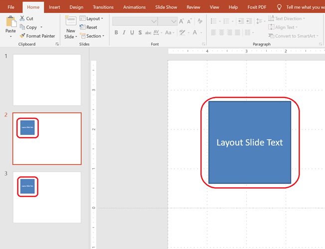

This article demonstrates how to work with **Layout Slides** in Aspose.Slides for .NET. A layout slide defines the design and formatting inherited by normal slides. You can add, access, clone, and remove layout slides, as well as clean up unused ones to reduce presentation size.

## Download and run

[Download the complete project](example.zip), extract it, and open `Example.sln` or run:

```console
dotnet restore Example.sln
dotnet run --project Example.csproj -- --mode evaluation
```

The download includes every case below, its fixture helpers and inputs. `Program.cs` runs all cases; use `--action block-001` to run one independently. Outputs and an action report are written to the printed output directory. No previous example or working-directory setup is required. Evaluation adds a watermark and can truncate read-back text; the short fixtures still have explicit structural checks. For full text and no watermark, use `--mode licensed --license PATH` with your own valid license. See the [setup guide](/slides/net/examples/getting-started/) for supported SDKs and native prerequisites.

Each printed `CaseNN.cs` file is compiled verbatim with the included `Program.cs` and bootstrap. Checks run before saving and after reopening the result.

## **Add a Layout Slide**

You can create a custom layout slide to define reusable formatting. For example, you might add a text box that appears on all slides using this layout.

```csharp
using System;
using System.IO;
using System.Linq;
using Aspose.Slides;
using Aspose.Slides.Export;

internal static partial class Program
{
    static void Case01()
    {
        using var presentation = new Presentation();
        
        var masterSlide = presentation.Masters[0];

        // Create a layout slide with a blank layout type and a custom name.
        var layoutSlide = presentation.LayoutSlides.Add(masterSlide, SlideLayoutType.Blank, "Main layout");

        // Add a text box to the layout slide.
        var layoutTextBox = layoutSlide.Shapes.AddAutoShape(ShapeType.Rectangle, x: 75, y: 75, width: 150, height: 150);
        layoutTextBox.TextFrame.Text = "Base";

        // Add two slides using this layout; both will inherit the text from the layout.
        presentation.Slides.AddEmptySlide(layoutSlide);
        presentation.Slides.AddEmptySlide(layoutSlide);

        // Validate the in-memory operation and its persisted result independently.
        RoundTrip(presentation, "block-001", p =>
        {
            Context.Require(p.LayoutSlides.Any(l => l.Name == "Main layout") && p.Slides.Count == 3 && p.Slides[1].LayoutSlide.Name == "Main layout" && p.Slides[2].LayoutSlide.Name == "Main layout", "AddLayoutSlide: semantic check 1 failed.");
        });
        Context.Pass("elements/layout-slide/block-001", "AddLayoutSlide", "save-reopen-structure");
    }
}
```

> 💡 **Note 1:** Layout slides act as templates for individual slides. You can define common elements once and reuse them across many slides.

> 💡 **Note 2:** When you add shapes or text to a layout slide, all slides based on that layout will display this shared content automatically.
> The screenshot below shows two slides, each inheriting a text box from the same layout slide.



## **Access a Layout Slide**

Layout slides can be accessed by index or by layout type (e.g., `Blank`, `Title`, `SectionHeader`, etc.).

```csharp
using System;
using System.IO;
using System.Linq;
using Aspose.Slides;
using Aspose.Slides.Export;

internal static partial class Program
{
    static void Case02()
    {
        using var presentation = new Presentation();
        
        // Access a layout slide by index.
        var firstLayoutSlide = presentation.LayoutSlides[0];
        
        // Access a layout slide by type.
        var blankLayoutSlide = presentation.LayoutSlides.GetByType(SlideLayoutType.Blank);

        // Validate the in-memory operation and its persisted result independently.
        RoundTrip(presentation, "block-002", p =>
        {
            Context.Require(p.LayoutSlides.Count > 0 && p.LayoutSlides.GetByType(SlideLayoutType.Blank) != null, "AccessLayoutSlide: semantic check 1 failed.");
        });
        Context.Pass("elements/layout-slide/block-002", "AccessLayoutSlide", "save-reopen-structure");
    }
}
```

## **Remove a Layout Slide**

You can remove a specific layout slide if it's no longer needed.

```csharp
using System;
using System.IO;
using System.Linq;
using Aspose.Slides;
using Aspose.Slides.Export;

internal static partial class Program
{
    static void Case03()
    {
        using var presentation = new Presentation();
        
        // Get a layout slide by type and remove it.
        var blankLayoutSlide = presentation.LayoutSlides.Add(presentation.Masters[0], SlideLayoutType.Blank, "Unused");
        presentation.LayoutSlides.Remove(blankLayoutSlide);

        // Validate the in-memory operation and its persisted result independently.
        RoundTrip(presentation, "block-003", p =>
        {
            Context.Require(!p.LayoutSlides.Any(l => l.Name == "Unused"), "RemoveLayoutSlide: semantic check 1 failed.");
        });
        Context.Pass("elements/layout-slide/block-003", "RemoveLayoutSlide", "save-reopen-structure");
    }
}
```

## **Remove Unused Layout Slides**

To reduce the presentation size, you may want to remove layout slides that are not used by any normal slides.

```csharp
using System;
using System.IO;
using System.Linq;
using Aspose.Slides;
using Aspose.Slides.Export;

internal static partial class Program
{
    static void Case04()
    {
        using var presentation = new Presentation();
        
        // Automatically removes all layout slides not referenced by any slide.
        presentation.LayoutSlides.RemoveUnused();

        // Validate the in-memory operation and its persisted result independently.
        RoundTrip(presentation, "block-004", p =>
        {
            Context.Require(p.LayoutSlides.Count == p.Slides.Select(s => s.LayoutSlide).Distinct().Count(), "RemoveUnusedLayoutSlides: semantic check 1 failed.");
        });
        Context.Pass("elements/layout-slide/block-004", "RemoveUnusedLayoutSlides", "save-reopen-structure");
    }
}
```

## **Clone a Layout Slide**

You can duplicate a layout slide using the `AddClone` method.

```csharp
using System;
using System.IO;
using System.Linq;
using Aspose.Slides;
using Aspose.Slides.Export;

internal static partial class Program
{
    static void Case05()
    {
        using var presentation = new Presentation();
        
        // Get an existing layout slide by type.
        var blankLayoutSlide = presentation.LayoutSlides.GetByType(SlideLayoutType.Blank);
        
        // Clone the layout slide to the end of the layout slide collection.
        var clonedLayoutSlide = presentation.LayoutSlides.AddClone(blankLayoutSlide);
        clonedLayoutSlide.Name = "Clone";

        // Validate the in-memory operation and its persisted result independently.
        RoundTrip(presentation, "block-005", p =>
        {
            Context.Require(p.LayoutSlides.Any(l => l.Name == "Clone"), "CloneLayoutSlides: semantic check 1 failed.");
        });
        Context.Pass("elements/layout-slide/block-005", "CloneLayoutSlides", "save-reopen-structure");
    }
}
```

> ✅ **Summary:** Layout slides are powerful tools for managing consistent formatting across slides. Aspose.Slides allows full control over creating, managing, and optimizing layout slides.
