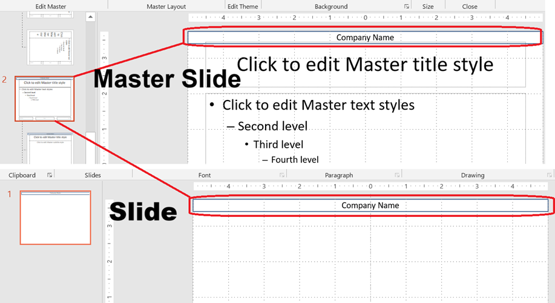

Master slides form the top level of the slide inheritance hierarchy in PowerPoint. A **master slide** defines common design elements such as backgrounds, logos, and text formatting. **Layout slides** inherit from master slides, and **normal slides** inherit from layout slides.

This article demonstrates how to create, modify, and manage master slides using Aspose.Slides for .NET.

## Download and run

[Download the complete project](example.zip), extract it, and open `Example.sln` or run:

```console
dotnet restore Example.sln
dotnet run --project Example.csproj -- --mode evaluation
```

The download includes every case below, its fixture helpers and inputs. `Program.cs` runs all cases; use `--action block-001` to run one independently. Outputs and an action report are written to the printed output directory. No previous example or working-directory setup is required. Evaluation adds a watermark and can truncate read-back text; the short fixtures still have explicit structural checks. For full text and no watermark, use `--mode licensed --license PATH` with your own valid license. See the [setup guide](/slides/net/examples/getting-started/) for supported SDKs and native prerequisites.

Each printed `CaseNN.cs` file is compiled verbatim with the included `Program.cs` and bootstrap. Checks run before saving and after reopening the result.

## **Add a Master Slide**

This example shows how to create a new master slide by cloning the default one. It then adds a company name banner to all slides through layout inheritance.

```csharp
using System;
using System.IO;
using System.Linq;
using Aspose.Slides;
using Aspose.Slides.Export;
using System.Drawing;

internal static partial class Program
{
    static void Case01()
    {
        using var presentation = new Presentation();

        // Clone the default master slide.
        var defaultMasterSlide = presentation.Masters[0];
        var newMasterSlide = presentation.Masters.AddClone(defaultMasterSlide);

        // Add a banner with company name to the top of the master slide.
        var textBox = newMasterSlide.Shapes.AddAutoShape(ShapeType.Rectangle, x: 0, y: 0, width: 720, height: 25);
        textBox.TextFrame.Text = "Acme";
        textBox.TextFrame.Paragraphs[0].ParagraphFormat.DefaultPortionFormat.FillFormat.FillType = FillType.Solid;
        textBox.TextFrame.Paragraphs[0].ParagraphFormat.DefaultPortionFormat.FillFormat.SolidFillColor.Color = Color.Black;
        textBox.FillFormat.FillType = FillType.NoFill;

        // Assign the new master slide to a layout slide.
        var layoutSlide = presentation.LayoutSlides[0];
        layoutSlide.MasterSlide = newMasterSlide;

        // Assign the layout slide to the first slide in the presentation.
        presentation.Slides[0].LayoutSlide = layoutSlide;

        // Validate the in-memory operation and its persisted result independently.
        RoundTrip(presentation, "block-001", p =>
        {
            Context.Require(p.Slides[0].LayoutSlide.MasterSlide.Shapes.OfType<IAutoShape>().Any(s => s.TextFrame.Text == "Acme"), "AddMasterSlide: semantic check 1 failed.");
        });
        Context.Pass("elements/master-slide/block-001", "AddMasterSlide", "save-reopen-structure");
    }
}
```

> 💡 **Note 1:** Master slides provide a way to apply consistent branding or shared design elements across all slides. Any changes made to the master will automatically reflect on dependent layout and normal slides.

> 💡 **Note 2:** Any shapes or formatting added to a master slide are inherited by layout slides and, in turn, all normal slides using those layouts.
> The image below illustrates how a text box added on a master slide is automatically rendered on the final slide.



## **Access a Master Slide**

You can access master slides using the `Presentation.Masters` collection. Here’s how to retrieve and work with them:

```csharp
using System;
using System.IO;
using System.Linq;
using Aspose.Slides;
using Aspose.Slides.Export;

internal static partial class Program
{
    static void Case02()
    {
        using var presentation = new Presentation();

        // Access the first master slide.
        var firstMasterSlide = presentation.Masters[0];

        // Change the background type.
        firstMasterSlide.Background.Type = BackgroundType.OwnBackground;

        // Validate the in-memory operation and its persisted result independently.
        RoundTrip(presentation, "block-002", p =>
        {
            Context.Require(p.Masters[0].Background.Type == BackgroundType.OwnBackground, "AccessMasterSlide: semantic check 1 failed.");
        });
        Context.Pass("elements/master-slide/block-002", "AccessMasterSlide", "save-reopen-structure");
    }
}
```

## **Remove a Master Slide**

Master slides can be removed either by index or by reference.

```csharp
using System;
using System.IO;
using System.Linq;
using Aspose.Slides;
using Aspose.Slides.Export;

internal static partial class Program
{
    static void Case03()
    {
        using var presentation = new Presentation(Seed("master"));

        // Remove the first explicitly unused master by index.
        presentation.Masters.RemoveAt(1);

        // Remove a master slide by reference.
        var firstMasterSlide = presentation.Masters[1];
        presentation.Masters.Remove(firstMasterSlide);

        // Validate the in-memory operation and its persisted result independently.
        RoundTrip(presentation, "block-003", p =>
        {
            Context.Require(p.Masters.Count == 1 && p.Slides[0].LayoutSlide.MasterSlide == p.Masters[0], "RemoveMasterSlide: semantic check 1 failed.");
        });
        Context.Pass("elements/master-slide/block-003", "RemoveMasterSlide", "save-reopen-structure");
    }
}
```

## **Remove Unused Master Slides**

Some presentations contain master slides that are not in use. Removing these slides can help reduce file size.

```csharp
using System;
using System.IO;
using System.Linq;
using Aspose.Slides;
using Aspose.Slides.Export;

internal static partial class Program
{
    static void Case04()
    {
        using var presentation = new Presentation();

        presentation.Masters.AddClone(presentation.Masters[0]).Name = "Unused";

        // Remove all unused master slides (even those marked as Preserve).
        presentation.Masters.RemoveUnused(ignorePreserveField: true);

        // Validate the in-memory operation and its persisted result independently.
        RoundTrip(presentation, "block-004", p =>
        {
            Context.Require(p.Masters.Count == 1 && p.Slides[0].LayoutSlide.MasterSlide == p.Masters[0], "RemoveUnusedMasterSlide: semantic check 1 failed.");
        });
        Context.Pass("elements/master-slide/block-004", "RemoveUnusedMasterSlide", "save-reopen-structure");
    }
}
```
