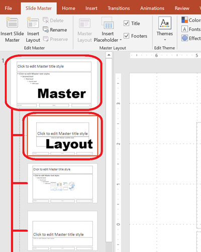

This article provides a series of examples that demonstrate how to work with slides using **Aspose.Slides for .NET**. You’ll learn how to add, access, clone, reorder, and remove slides using the `Presentation` class.

Each example below includes a brief explanation followed by a code snippet in C#.

Copy a C# block into `Program.cs` in a .NET project with `Aspose.Slides.NET6.CrossPlatform` installed. Each block is a complete program. Run one block at a time. The ZIP contains the IDE-ready project and its verification checks. The copied code runs in evaluation mode. For licensed output, apply your license before creating a presentation, as described in the [licensing guide](/slides/net/licensing/).

## **Download and run**

[Download the complete project](example.zip), extract it, and open `Example.sln` or run:

```console
dotnet restore Example.sln
dotnet run --project Example.csproj -- --mode evaluation
```

The download includes every case below, its fixture helpers and inputs. `Program.cs` runs all cases; use `--action block-001` to run one independently. Outputs and an action report are written to the printed output directory. No previous example or working-directory setup is required. Evaluation adds a watermark and can truncate read-back text; the short fixtures still have explicit structural checks. For full text and no watermark, use `--mode licensed --license PATH` with your own valid license. See the [setup guide](/slides/net/examples/getting-started/) for supported SDKs and native prerequisites.

## **Add a Slide**

To add a new slide, you must first select a layout. In this example, we use the `Blank` layout and add an empty slide to the presentation.

```csharp
using Aspose.Slides.Export;
using Aspose.Slides;

using var presentation = new Presentation();

// Each slide is based on a layout, which itself is based on a master slide.
// Use the Blank layout to create a new slide.
var blankLayout = presentation.LayoutSlides.GetByType(SlideLayoutType.Blank);

// Add a new empty slide using the selected layout.
presentation.Slides.AddEmptySlide(layout: blankLayout);

presentation.Save("slide-01.pptx", SaveFormat.Pptx);
```

> 💡 **Note:** Each slide layout is derived from a master slide, which defines the overall design and placeholder structure. The image below illustrates how master slides and their associated layouts are organized in PowerPoint.



## **Access Slides by Index**

You can access slides using their index, or find a slide’s index based on a reference. This is useful for iterating through or modifying specific slides.

```csharp
using System;
using Aspose.Slides.Export;
using Aspose.Slides;

// By default, a presentation is created with one empty slide.
using var presentation = new Presentation();

// Add another empty slide.
var blankLayout = presentation.LayoutSlides.GetByType(SlideLayoutType.Blank);
presentation.Slides.AddEmptySlide(layout: blankLayout);

var secondSlide = presentation.Slides[1];
var secondSlideIndex = presentation.Slides.IndexOf(secondSlide);
Console.WriteLine($"Zero-based index: {secondSlideIndex}");
Console.WriteLine($"Slide number: {secondSlide.SlideNumber}");

presentation.Save("slide-02.pptx", SaveFormat.Pptx);
```

## **Clone a Slide**

This example demonstrates how to clone an existing slide. The cloned slide is automatically added to the end of the slide collection.

```csharp
using System;
using Aspose.Slides.Export;
using Aspose.Slides;

// By default, the presentation contains one empty slide.
using var presentation = new Presentation();
var firstSlide = presentation.Slides[0];

// Clone the first slide; it will be added at the end of the presentation.
var clonedSlide = presentation.Slides.AddClone(sourceSlide: firstSlide);

// The cloned slide index is 1 (second slide in the presentation).
var clonedSlideIndex = presentation.Slides.IndexOf(clonedSlide);
Console.WriteLine($"Clone index: {clonedSlideIndex}");

presentation.Save("slide-03.pptx", SaveFormat.Pptx);
```

## **Reorder Slides**

You can change the order of slides by moving one to a new index. In this case, we move a cloned slide to the first position.

```csharp
using Aspose.Slides.Export;
using Aspose.Slides;

using var presentation = new Presentation();
var firstSlide = presentation.Slides[0];

var clonedSlide = presentation.Slides.AddClone(firstSlide);

clonedSlide.Name = "Clone";

// Move the cloned slide to the first position (others shift down).
presentation.Slides.Reorder(index: 0, clonedSlide);

presentation.Save("slide-04.pptx", SaveFormat.Pptx);
```

## **Remove a Slide**

To remove a slide, simply reference it and call `Remove`. This example adds a second slide and then removes the original, leaving only the new one.

```csharp
using Aspose.Slides.Export;
using Aspose.Slides;

using var presentation = new Presentation();

// Add a new empty slide in addition to the default first slide.
var blankLayout = presentation.LayoutSlides.GetByType(SlideLayoutType.Blank);
var survivingSlide = presentation.Slides.AddEmptySlide(layout: blankLayout);
survivingSlide.Name = "Survivor";

// Remove the first slide; only the newly added slide will remain.
var firstSlide = presentation.Slides[0];
presentation.Slides.Remove(firstSlide);

presentation.Save("slide-05.pptx", SaveFormat.Pptx);
```
