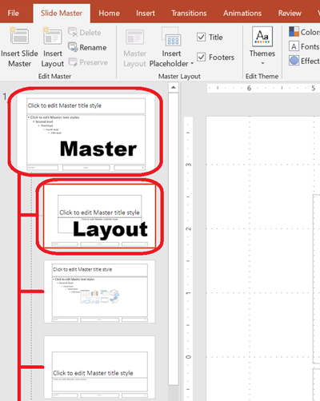

This article provides a series of examples that demonstrate how to work with slides using **Aspose.Slides for .NET**. You’ll learn how to add, access, clone, reorder, and remove slides using the `Presentation` class.

Each example below includes a brief explanation followed by a code snippet in C#.

## Download and run

[Download the complete project](example.zip), extract it, and open `Example.sln` or run:

```console
dotnet restore Example.sln
dotnet run --project Example.csproj -- --mode evaluation
```

The download includes every case below, its fixture helpers and inputs. `Program.cs` runs all cases; use `--action block-001` to run one independently. Outputs and an action report are written to the printed output directory. No previous example or working-directory setup is required. Evaluation adds a watermark and can truncate read-back text; the short fixtures still have explicit structural checks. For full text and no watermark, use `--mode licensed --license PATH` with your own valid license. See the [setup guide](/slides/net/examples/getting-started/) for supported SDKs and native prerequisites.

Each printed `CaseNN.cs` file is compiled verbatim with the included `Program.cs` and bootstrap. Checks run before saving and after reopening the result.

## **Add a Slide**

To add a new slide, you must first select a layout. In this example, we use the `Blank` layout and add an empty slide to the presentation.

```csharp
using System;
using System.IO;
using System.Linq;
using Aspose.Slides;
using Aspose.Slides.Export;

internal static partial class Program
{
    static void Case01()
    {
        using var presentation = new Presentation();

        // Each slide is based on a layout, which itself is based on a master slide.
        // Use the Blank layout to create a new slide.
        var blankLayout = presentation.LayoutSlides.GetByType(SlideLayoutType.Blank);

        // Add a new empty slide using the selected layout.
        presentation.Slides.AddEmptySlide(layout: blankLayout);

        // Validate the in-memory operation and its persisted result independently.
        RoundTrip(presentation, "block-001", p =>
        {
            Context.Require(p.Slides.Count == 2, "AddSlide: semantic check 1 failed.");
        });
        Context.Pass("elements/slide/block-001", "AddSlide", "save-reopen-structure");
    }
}
```

> 💡 **Note:** Each slide layout is derived from a master slide, which defines the overall design and placeholder structure. The image below illustrates how master slides and their associated layouts are organized in PowerPoint.



## **Access Slides by Index**

You can access slides using their index, or find a slide’s index based on a reference. This is useful for iterating through or modifying specific slides.

```csharp
using System;
using System.IO;
using System.Linq;
using Aspose.Slides;
using Aspose.Slides.Export;

internal static partial class Program
{
    static void Case02()
    {
        // By default, a presentation is created with one empty slide.
        using var presentation = new Presentation();

        // Add another empty slide.
        var blankLayout = presentation.LayoutSlides.GetByType(SlideLayoutType.Blank);
        presentation.Slides.AddEmptySlide(layout: blankLayout);

        // Access slides by index.
        var firstSlide = presentation.Slides[0];
        var secondSlide = presentation.Slides[1];

        // Get slide index from a reference, then access it by index.
        var secondSlideIndex = presentation.Slides.IndexOf(secondSlide);
        var secondSlideByIndex = presentation.Slides[secondSlideIndex];

        // Validate the in-memory operation and its persisted result independently.
        RoundTrip(presentation, "block-002", p =>
        {
            Context.Require(p.Slides.Count == 2, "AccessSlide: semantic check 1 failed.");
        });
        Context.Pass("elements/slide/block-002", "AccessSlide", "save-reopen-structure");
    }
}
```

## **Clone a Slide**

This example demonstrates how to clone an existing slide. The cloned slide is automatically added to the end of the slide collection.

```csharp
using System;
using System.IO;
using System.Linq;
using Aspose.Slides;
using Aspose.Slides.Export;

internal static partial class Program
{
    static void Case03()
    {
        // By default, the presentation contains one empty slide.
        using var presentation = new Presentation();
        var firstSlide = presentation.Slides[0];

        // Clone the first slide; it will be added at the end of the presentation.
        var clonedSlide = presentation.Slides.AddClone(sourceSlide: firstSlide);

        // The cloned slide index is 1 (second slide in the presentation).
        var clonedSlideIndex = presentation.Slides.IndexOf(clonedSlide);

        // Validate the in-memory operation and its persisted result independently.
        RoundTrip(presentation, "block-003", p =>
        {
            Context.Require(p.Slides.Count == 2, "CloneSlide: semantic check 1 failed.");
        });
        Context.Pass("elements/slide/block-003", "CloneSlide", "save-reopen-structure");
    }
}
```

## **Reorder Slides**

You can change the order of slides by moving one to a new index. In this case, we move a cloned slide to the first position.

```csharp
using System;
using System.IO;
using System.Linq;
using Aspose.Slides;
using Aspose.Slides.Export;

internal static partial class Program
{
    static void Case04()
    {
        using var presentation = new Presentation();
        var firstSlide = presentation.Slides[0];

        // Add a clone of the first slide (created by default).
        var clonedSlide = presentation.Slides.AddClone(firstSlide);

        clonedSlide.Name = "Clone";

        // Move the cloned slide to the first position (others shift down).
        presentation.Slides.Reorder(index: 0, clonedSlide);

        // Validate the in-memory operation and its persisted result independently.
        RoundTrip(presentation, "block-004", p =>
        {
            Context.Require(p.Slides.Count == 2 && p.Slides[0].Name == "Clone", "ReorderSlide: semantic check 1 failed.");
        });
        Context.Pass("elements/slide/block-004", "ReorderSlide", "save-reopen-structure");
    }
}
```

## **Remove a Slide**

To remove a slide, simply reference it and call `Remove`. This example adds a second slide and then removes the original, leaving only the new one.

```csharp
using System;
using System.IO;
using System.Linq;
using Aspose.Slides;
using Aspose.Slides.Export;

internal static partial class Program
{
    static void Case05()
    {
        using var presentation = new Presentation();

        // Add a new empty slide in addition to the default first slide.
        var blankLayout = presentation.LayoutSlides.GetByType(SlideLayoutType.Blank);
        var secondSlide = presentation.Slides.AddEmptySlide(layout: blankLayout);

        // Remove the first slide; only the newly added slide will remain.
        var firstSlide = presentation.Slides[0];
        presentation.Slides.Remove(firstSlide);

        // Validate the in-memory operation and its persisted result independently.
        RoundTrip(presentation, "block-005", p =>
        {
            Context.Require(p.Slides.Count == 1, "RemoveSlide: semantic check 1 failed.");
        });
        Context.Pass("elements/slide/block-005", "RemoveSlide", "save-reopen-structure");
    }
}
```
