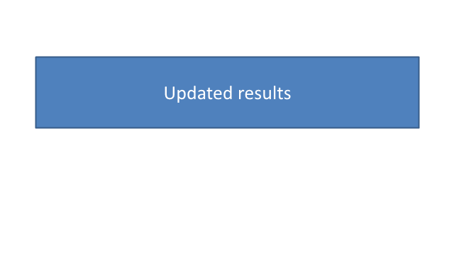

Create a presentation, edit a saved copy, and verify that the original file is unchanged.

## Download and run

Download [the complete project](example.zip) and open **Example.sln** in a compatible IDE. Automatic NuGet restore should run when it opens. The project accepts supported installed release SDKs instead of requiring one exact patch. [Setup and supported environments](/slides/net/examples/getting-started/) explains native libraries, fonts and the SDK/runtime distinction.

```text
dotnet run --project Example.csproj -- --mode evaluation
```

Evaluation mode needs no license and retains the SDK watermark/text limits. For full licensed checks, set ASPOSE_LICENSE_PATH to your authorized license and use --mode licensed. Fonts and synthetic fixtures needed by this recipe are included or acquired as documented. The supplied bootstrap prepares a separate output workspace and prints its absolute path. The complete download includes that bootstrap, solution and editor profiles; the C# block below is Program.cs from the same archive.


## Input and prerequisites

The code creates its own synthetic input. Use a compatible stable SDK with the included Aspose.Slides.NET6.CrossPlatform 26.10.0 project; .NET 10 LTS is recommended. Evaluation mode performs the recipe without a license and retains the SDK watermark and text limits. Licensed mode additionally checks unrestricted content using your authorized license.

[Download the complete project](example.zip), including the solution, source, configuration and bundled fonts. No license is distributed.

## Example

The first using block saves the original. The second opens that file, changes its editable text, and saves to a different name. Reopening both files checks the result rather than treating Save as verification.

```csharp
using System.Threading.Tasks;
using System;
using System.Collections.Generic;
using System.Drawing;
using System.IO;
using System.Linq;
using System.Security.Cryptography;
using System.Text.Json;
using Aspose.Slides;
using Aspose.Slides.Export;

internal static class Program
{
    private static ExampleContext Context = null!;
    private static Task<int> Main(string[] args) => ExampleBootstrap.RunAsync(args, async context =>
    {
        Context = context;
        context.BeginAction("presentations/create-open-save/block-001");
        RunExample();
        await Task.CompletedTask;
        context.Pass("presentations/create-open-save/block-001", "recipe semantic assertions", "source inputs preserved", "documented output generated");
    });

    private static void RunExample()
    {
        using (var created = new Presentation())
        {
            created.SlideSize.SetSize(640, 360, SlideSizeScaleType.DoNotScale);
            Label(created.Slides[0], "Quarterly results");
            created.Save("original.pptx", SaveFormat.Pptx);
        }
        string originalHash = Hash("original.pptx");
        using (var editable = new Presentation("original.pptx"))
        {
            editable.Slides[0].Shapes.OfType<IAutoShape>().Single(s => s.Name.StartsWith("content-", StringComparison.Ordinal)).TextFrame.Text = "Updated results";
            editable.Save("edited.pptx", SaveFormat.Pptx);
        }
        using (var result = new Presentation("edited.pptx"))
        {
            Require(result.Slides.Count == 1, "Unexpected slide count.");
            Require(Text(result.Slides[0]) == Context.ExpectedText("Updated results"), "Edited text did not survive saving.");
            using var image = result.Slides[0].GetImage(new Size(640, 360));
            image.Save("preview.png", Aspose.Slides.ImageFormat.Png);
        }
        Require(Hash("original.pptx") == originalHash, "The input was overwritten.");
        using (var original = new Presentation("original.pptx"))
            Require(Text(original.Slides[0]) == Context.ExpectedText("Quarterly results"), "Original content changed.");
        Report(new { slide_count = 1, edited_text = Context.ExpectedText("Updated results"), original_unchanged = true });
    }


    private static void Require(bool condition, string message)
    {
        if (!condition) throw new InvalidOperationException(message);
    }

    private static IAutoShape Label(ISlide slide, string text)
    {
        var shape = slide.Shapes.AddAutoShape(ShapeType.Rectangle, 50, 80, 540, 100);
        shape.Name = "content-" + text;
        shape.TextFrame.Text = text;
        shape.TextFrame.Paragraphs[0].Portions[0].PortionFormat.FontHeight = 28;
        return shape;
    }

    private static string Text(ISlide slide) => string.Join("|", slide.Shapes.OfType<IAutoShape>().Where(s => s.Name.StartsWith("content-", StringComparison.Ordinal)).Select(s => s.TextFrame.Text));
    private static string Hash(string file) => Convert.ToHexString(SHA256.HashData(File.ReadAllBytes(file)));
    private static void Report(object checks)
    {
        string json = JsonSerializer.Serialize(new { checks }, new JsonSerializerOptions { WriteIndented = true });
        File.WriteAllText("result.json", json);
        Console.WriteLine(json);
    }
}
```

## Run and check the result

Extract the project into an empty working directory, restore its locked packages, then run it:

```text
dotnet restore Example.csproj --locked-mode
dotnet run --project Example.csproj --configuration Release --no-restore
```

The example writes "original.pptx", "edited.pptx", "preview.png" and "result.json". It reopens the generated presentation files and checks the expected data. A failed check raises an exception; successful checks are recorded in "result.json".


## Output previews




## Practical limits

Dispose each Presentation after its last use. Saving to a new file does not update the source file. For a single slide operation, see the Elements examples.

See the [detailed guide](/slides/net/create-presentation/) and [individual slide examples](/slides/net/examples/elements/slide/).
