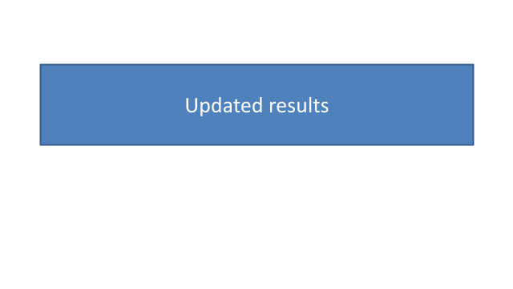

Create a presentation, edit a saved copy, and verify that the original file is unchanged.

## **Input and prerequisites**

The copied program generates its own input. See the [setup guide](/slides/net/examples/getting-started/) for supported SDKs and native dependencies. Evaluation output includes the SDK watermark and text limits.

## **Example**

The first using block saves the original. The second opens that file, changes its editable text, and saves to a different name. The final block reopens the edited copy and prints its text. The download also checks that the original file is unchanged.

Copy a C# block into `Program.cs` in a .NET project with `Aspose.Slides.NET6.CrossPlatform` installed. Each block is a complete program. Run one block at a time. The ZIP contains the IDE-ready project and its verification checks.
The copied program writes its files in the current working directory.

```csharp
using System;
using System.Linq;
using Aspose.Slides;
using Aspose.Slides.Export;

internal static class Program
{
    private static void Main()
    {
        string? licensePath = Environment.GetEnvironmentVariable("ASPOSE_LICENSE_PATH");
        if (!string.IsNullOrWhiteSpace(licensePath))
            new License().SetLicense(licensePath);

        const string originalPath = "original.pptx";
        const string editedPath = "edited.pptx";
        const string titleName = "ReportTitle";
        using (var created = new Presentation())
        {
            var title = created.Slides[0].Shapes.AddAutoShape(ShapeType.Rectangle, 50, 80, 540, 100);
            title.Name = titleName;
            title.TextFrame.Text = "Input";
            created.Save(originalPath, SaveFormat.Pptx);
        }

        using (var editable = new Presentation(originalPath))
        {
            var title = editable.Slides[0].Shapes.OfType<IAutoShape>().Single(shape => shape.Name == titleName);
            title.TextFrame.Text = "Edit";
            editable.Save(editedPath, SaveFormat.Pptx);
        }

        using (var result = new Presentation(editedPath))
        {
            var title = result.Slides[0].Shapes.OfType<IAutoShape>().Single(shape => shape.Name == titleName);
            Console.WriteLine($"{editedPath}: {title.TextFrame.Text}");
        }
    }
}
```

<span id="run-and-check-the-result"></span>

## **Download and run**

[Download the complete project](example.zip), extract it, and open `Example.sln` or run the following commands.

```text
dotnet restore Example.sln
dotnet run --project Example.csproj --configuration Release --no-restore -- --mode evaluation
```

The downloaded project writes "original.pptx", "edited.pptx", "preview.png" and "result.json". It reopens the generated presentation files and checks the expected data. A failed check raises an exception; successful checks are recorded in "result.json".

Use `--mode licensed` with your authorized `ASPOSE_LICENSE_PATH` for unrestricted checks. The project prints its output directory.


## **Output previews**




## **Practical limits**

Dispose each Presentation after its last use. Saving to a new file does not update the source file. For a single slide operation, see the Elements examples.

See the [detailed guide](/slides/net/create-presentation/) and [individual slide examples](/slides/net/examples/elements/slide/).
